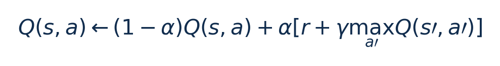

[论文页面](https://doi.org/10.3390/jlpea12020029) · [本笔记所用 PDF](https://mdpi-res.com/d_attachment/jlpea/jlpea-12-00029/article_deploy/jlpea-12-00029.pdf) · [标识符](https://doi.org/10.3390/jlpea12020029)

整理日期：2026-11-05。**读者原创中文解读；原图归论文作者／出版方。未运行作者实验，不是独立复现。**

## 先把四个角色放对位置

被控负载是要完成的程序和输入，比如压缩一块日志；CPU是执行程序的硬件；控制器根据观测选运行档位；驱动／寄存器把档位落实。程序代码可以完全一样，CPU时钟变慢时每条指令对应的墙钟时间通常变长，访存或I/O等待则未必按同样比例变化。

软件控制并不意味着没有真实硬件。软件中的学习策略可控制真实CPU；也可先控制一个执行时间与能量模型。后者能验证闭环逻辑，但模型输出的J不能当真实电测。E902的RTL能在仿真中改变时钟并反馈计数；电压导致的物理功耗还需相应模型、功耗分析或板级实验。

## 这篇到底解决哪一件事

用小Q表控制CPU性能状态，并用七种奖励展示省功率与服务质量的取舍

为什么相同CPU利用率未必对应相同的工作需求？本篇的可检验主张是：用小Q表控制CPU性能状态，并用七种奖励展示省功率与服务质量的取舍。验证链是可观测状态→控制规则或学习模型→执行器→任务正确性/服务质量与能耗对照。

**把方法想成一条流水线：** 路径误差、功率、重规划标志、通信校验错误、地图更新等离散状态；不只CPU利用率 → C/GSL实现表格Q-learning，状态离散化，0.9概率选最大Q/0.1探索；10ms线程更新；七种reward对照，HAL映射至CPU性能状态 → HAL定义的离散CPU性能状态（每状态5个动作Q条目）；具体频率映射需实现确认，线程迁核未作为本实验动作 → 执行与反馈。

| 先回答的问题 | 本文答案 |
| --- | --- |
| 具体控制算法 | C/GSL实现表格Q-learning，状态离散化，0.9概率选最大Q/0.1探索；10ms线程更新；七种reward对照，HAL映射至CPU性能状态 |
| 被控负载类型 | 导航/路径规划CPU软件，计算量、访存与重规划需求变化；本文CPU控制不是电机控制算法 |
| 具体被控程序 | Anytime Dynamic A*（ADA*）路径规划、地图与轨迹规划线程；低层PID/里程计由另一Arduino承担，不是用户课题要实现的内容 |
| 使用平台与测量 | ODROID-XU4 Exynos5422，4×A15/4×A7、2GB，Ubuntu18.04/Linux4.14.5-92；cluster级DVFS；ArduinoROMEO/ATmega328P独立处理低层动作 |
| 输入/状态 | 路径误差、功率、重规划标志、通信校验错误、地图更新等离散状态；不只CPU利用率 |
| 输出/动作 | HAL定义的离散CPU性能状态（每状态5个动作Q条目）；具体频率映射需实现确认，线程迁核未作为本实验动作 |
| 周期与运行位置 | 用户态QoSM独立线程，10ms hrtimer周期；各reward先600s训练，每次试验从同训练矩阵起步，试验中仍可更新 |

## 十个先修关键词

| 级别 | 术语／关键词 | 直觉、严格含义与易混点 |
| --- | --- | --- |
| A | DVFS / DFS | DVFS同时涉及动态电压与频率；只有时钟变化称DFS。电压能否改变取决于实际供电域。 |
| A | Workload | 真正执行应用计算的程序与输入；本文里的控制器是另一个角色。 |
| A | Controller | 根据观测选择动作的软件／硬件，可运行在同一CPU或独立控制核。 |
| A | OPP | Operating Performance Point，经过允许范围验证的电压—频率组合。 |
| A | Power / Energy | 功率W表示此刻消耗快慢；能量J是对时间积分。低功率不必然低能量。 |
| B | Deadline | 作业必须完成的时刻；平均时延、P95与最大时延各有不同用途。 |
| A | 被控程序 | Anytime Dynamic A*（ADA*）路径规划、地图与轨迹规划线程；低层PID/里程计由另一Arduino承担，不是用户课题要实现的内容 |
| A | 控制策略 | C/GSL实现表格Q-learning，状态离散化，0.9概率选最大Q/0.1探索；10ms线程更新；七种reward对照，HAL映射至CPU性能状态 |
| B | 控制周期 | 用户态QoSM独立线程，10ms hrtimer周期；各reward先600s训练，每次试验从同训练矩阵起步，试验中仍可更新 |
| B | 证据边界 | 实测、硬件仿真、功耗模型是不同证据，见平台与结果表。 |

## 用一个小算例建立直觉

α=0.1、Q=1、r=0.5、γ=0.9、maxQ′=1时，新Q=1.04。教学例。

α学习率、γ折扣均无量纲；状态/动作必须离散；不是神经网络反向传播。

**要防止的误读：** 在线探索会导致服务质量下降，需要冻结策略/安全回退；不存在训练结束即严格保证。

## 论文真正验证了什么

| 指标 | 原文报告 | 条件／分母／边界 | 证据位置 |
| --- | --- | --- | --- |
| power-only策略 | 平均功率降低42.6% vs Ondemand | 2.98W；相对situation-aware降低10.2%，但误差更大 | Fig8/§5.4，p15 |
| power＋error策略 | 功率−38.7%、误差−4.6% vs Ondemand | 同一reward可同时转述这两项；不是42.6%与6.1%同时获得 | §5.4，p15 |
| error-only策略 | 误差改善6.1% vs Ondemand | 属于另一策略；不能合并最高功率收益 | §5.4，p15 |
| Q表存储 | 64KB | 1600×5×8B，尚不含程序/栈/其他状态 | §5.2/Table2，p10–11 |

这些结果来自作者实验。算法reward、模型误差、控制器时延、被控应用速度与应用节能是不同指标，要看具体行的单位和证据。

## 它与你的毕设怎么接起来

只借鉴CPU资源管理：用块进度/余量/历史成本作小Q表状态，动作是合法频档；任务正确性不应被当作可交易reward，出错必须失败。无需任何电机知识。

最先可以尝试：**P0：极小Q表**。理由是测E902资源可行性；最低资源是例如3×3状态与合法频档；通过标准是报告Q表/代码RAM与推理周期。

## 五分钟自测

1. 这篇输出的是下一频率、功率估计，还是通信／控制时序？
2. 是真实负载硬件实验，还是模型／RTL／HIL？哪些部分是真的？
3. 最重要百分比的分母和比较对象是什么？
4. 如果换成单核E902，哪一个输入或硬件旋钮会消失？
5. 算上采样、推理、切频和空闲时间后，节能是否还成立？

答案线索在本页角色表和结果表；进一步读“图文技术精读”的关键原图、公式与三项课题实验，再到“图表索引”回查原PDF。不是先记住论文所有缩写。
