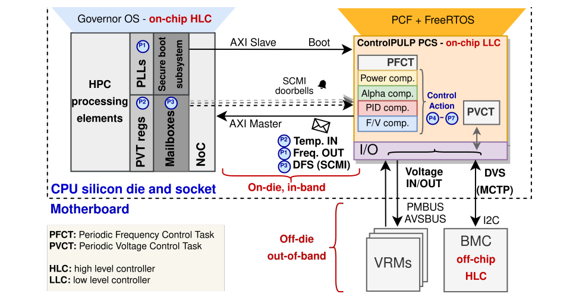
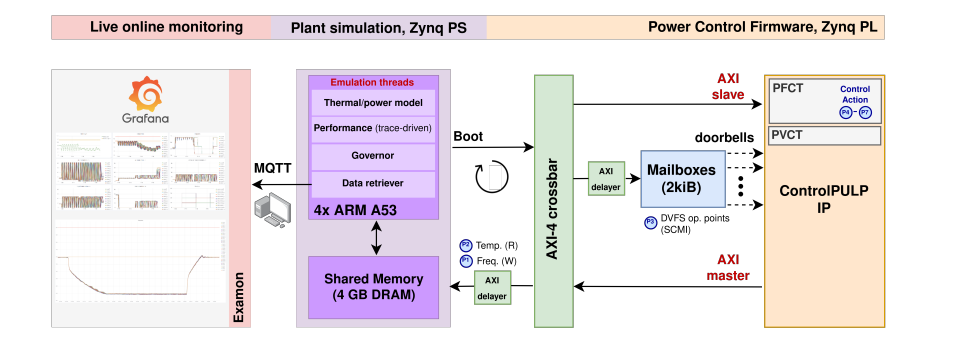
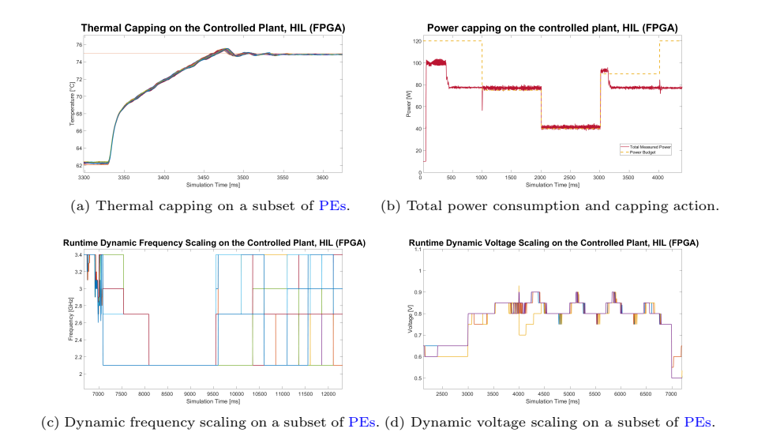
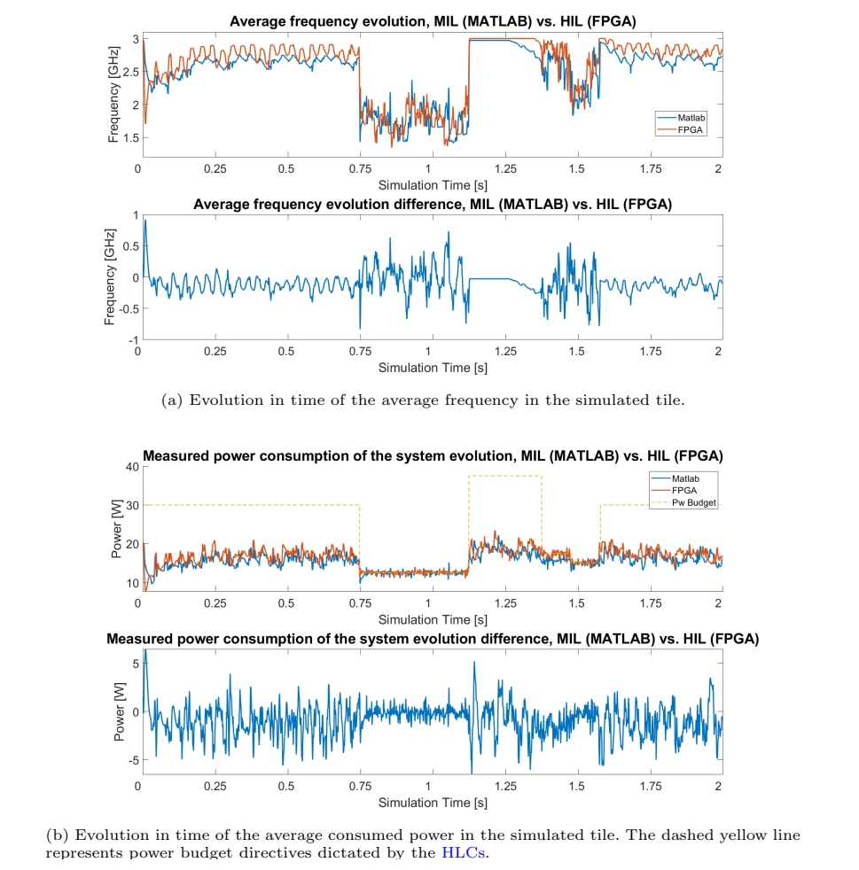
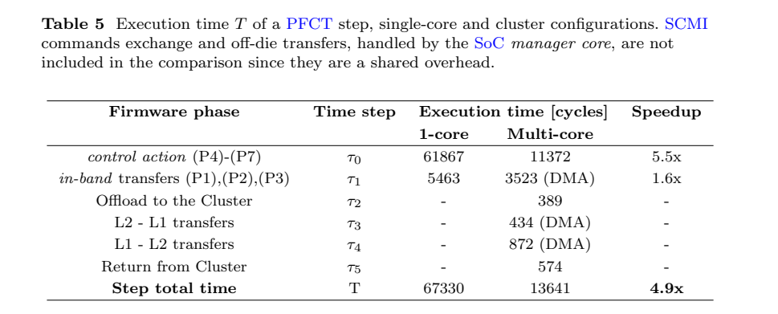

[论文页面](https://arxiv.org/abs/2306.09501) · [本笔记所用 PDF](https://arxiv.org/pdf/2306.09501v2) · [DOI](https://doi.org/10.1007/s10766-024-00761-4)

整理日期：2026-11-05。**读者原创中文解读；原图归论文作者／出版方。未运行作者实验，不是独立复现。**

**覆盖范围：** 本版本正文中识别到的16项图、表或算法；保留原编号。关键项已裁图并在技术精读相应段落出现，未内嵌的项可点PDF页链接查看，不上传整篇PDF。

**统计总边界：** 硬件综合、RTL周期分析、FPGA固件运行和模拟功耗是四类证据，不是同一“真实芯片实测”。HIL/MIL相近证明实现对模型的一致性，不能排除模型本身失准。合成压力轨迹覆盖角落情况，但不能替代实际压缩数据分布或全部多核应用。3%以模拟TDP归一化，不等于每时刻频率误差3%。

## Fig1：系统级控制路径

[原文 Fig1，PDF p9](https://arxiv.org/pdf/2306.09501v2#page=9)

[打开大图](images/original-fig1.png)

1. **本项回答的问题：** 系统级控制路径，用于支撑这条方法或实验链中的具体环节。
2. **组成、坐标和对照：** 区分OS/BMC、LLC、PLL和电压域。 结构／流程类没有统一数值坐标；箭头表示数据或控制关系，不表示统计因果。 颜色按原图图例辨认，不能把同色跨图视为同一组。
3. **阅读顺序与统计单位：** 先看设定、单位和图例，再看趋势与作者正文。重复次数及采样独立性参见本篇技术精读统计节；没有为该图定位到的误差线定义／独立重复数，不另行猜测。
4. **直接观察：** 上层要求经过底层约束再执行。
5. **作者解释的范围：** 原文以该图／表作为上述观察的结构说明或实验支撑，需连同对应页正文读取；本索引不额外替作者推导因果机制。
6. **独立判断（AI分析）：** 图中的执行器不代表FPGA已真实改HPC供电。
7. **证据链位置：** 方法／系统实现说明。它支持本文具体条件下的实现或结果，不单独完成跨平台验证。
8. **结论与强度：** 可复述“上层要求经过底层约束再执行。”；对图内描述的核查可信度高，对未做独立实验的泛化判断为中或无法判断。不能得出的结论是“图中的执行器不代表FPGA已真实改HPC供电。”所排除的外推。

## Fig2：固件软件栈

[原文 Fig2，PDF p9](https://arxiv.org/pdf/2306.09501v2#page=9)

1. **本项回答的问题：** 固件软件栈，用于支撑这条方法或实验链中的具体环节。
2. **组成、坐标和对照：** PCF在FreeRTOS和HAL之上。 结构／流程类没有统一数值坐标；箭头表示数据或控制关系，不表示统计因果。 颜色按原图图例辨认，不能把同色跨图视为同一组。
3. **阅读顺序与统计单位：** 先看设定、单位和图例，再看趋势与作者正文。重复次数及采样独立性参见本篇技术精读统计节；没有为该图定位到的误差线定义／独立重复数，不另行猜测。
4. **直接观察：** 策略和驱动可以分层替换。
5. **作者解释的范围：** 原文以该图／表作为上述观察的结构说明或实验支撑，需连同对应页正文读取；本索引不额外替作者推导因果机制。
6. **独立判断（AI分析）：** 不是所有层在GPU上运行。
7. **证据链位置：** 方法／系统实现说明。它支持本文具体条件下的实现或结果，不单独完成跨平台验证。
8. **结论与强度：** 可复述“策略和驱动可以分层替换。”；对图内描述的核查可信度高，对未做独立实验的泛化判断为中或无法判断。不能得出的结论是“不是所有层在GPU上运行。”所排除的外推。

## Fig3：控制器硬件

[原文 Fig3，PDF p11](https://arxiv.org/pdf/2306.09501v2#page=11)

1. **本项回答的问题：** 控制器硬件，用于支撑这条方法或实验链中的具体环节。
2. **组成、坐标和对照：** 管理域、集群、L1/L2和DMA分别定位。 按原图／表标示的单位与归一化基准阅读；不将不同子图或不同分母的柱高直接相除。 颜色按原图图例辨认，不能把同色跨图视为同一组。
3. **阅读顺序与统计单位：** 先看设定、单位和图例，再看趋势与作者正文。重复次数及采样独立性参见本篇技术精读统计节；没有为该图定位到的误差线定义／独立重复数，不另行猜测。
4. **直接观察：** 并行加速控制计算。
5. **作者解释的范围：** 原文以该图／表作为上述观察的结构说明或实验支撑，需连同对应页正文读取；本索引不额外替作者推导因果机制。
6. **独立判断（AI分析）：** 它不是被控72核CPU本体。
7. **证据链位置：** 性能验证／定量或示例证据，需结合实验条件。它支持本文具体条件下的实现或结果，不单独完成跨平台验证。
8. **结论与强度：** 可复述“并行加速控制计算。”；对图内描述的核查可信度高，对未做独立实验的泛化判断为中或无法判断。不能得出的结论是“它不是被控72核CPU本体。”所排除的外推。

## Fig4：FPGA硬件在环

[原文 Fig4，PDF p15](https://arxiv.org/pdf/2306.09501v2#page=15)

[打开大图](images/original-fig4.png)

1. **本项回答的问题：** FPGA硬件在环，用于支撑这条方法或实验链中的具体环节。
2. **组成、坐标和对照：** PL是真控制器，PS为plant模型。 按原图／表标示的单位与归一化基准阅读；不将不同子图或不同分母的柱高直接相除。 颜色按原图图例辨认，不能把同色跨图视为同一组。
3. **阅读顺序与统计单位：** 先看设定、单位和图例，再看趋势与作者正文。重复次数及采样独立性参见本篇技术精读统计节；没有为该图定位到的误差线定义／独立重复数，不另行猜测。
4. **直接观察：** 能验证真实固件闭环。
5. **作者解释的范围：** 原文以该图／表作为上述观察的结构说明或实验支撑，需连同对应页正文读取；本索引不额外替作者推导因果机制。
6. **独立判断（AI分析）：** 对象功耗并未变成真实硅片测量。
7. **证据链位置：** 性能验证／定量或示例证据，需结合实验条件。它支持本文具体条件下的实现或结果，不单独完成跨平台验证。
8. **结论与强度：** 可复述“能验证真实固件闭环。”；对图内描述的核查可信度高，对未做独立实验的泛化判断为中或无法判断。不能得出的结论是“对象功耗并未变成真实硅片测量。”所排除的外推。

## Fig5：RTL测试台

[原文 Fig5，PDF p19](https://arxiv.org/pdf/2306.09501v2#page=19)

1. **本项回答的问题：** RTL测试台，用于支撑这条方法或实验链中的具体环节。
2. **组成、坐标和对照：** 注入网络延迟和设备行为。 结构／流程类没有统一数值坐标；箭头表示数据或控制关系，不表示统计因果。 颜色按原图图例辨认，不能把同色跨图视为同一组。
3. **阅读顺序与统计单位：** 先看设定、单位和图例，再看趋势与作者正文。重复次数及采样独立性参见本篇技术精读统计节；没有为该图定位到的误差线定义／独立重复数，不另行猜测。
4. **直接观察：** 可测控制路径周期。
5. **作者解释的范围：** 原文以该图／表作为上述观察的结构说明或实验支撑，需连同对应页正文读取；本索引不额外替作者推导因果机制。
6. **独立判断（AI分析）：** 测试台设备响应仍是建模。
7. **证据链位置：** 方法／系统实现说明。它支持本文具体条件下的实现或结果，不单独完成跨平台验证。
8. **结论与强度：** 可复述“可测控制路径周期。”；对图内描述的核查可信度高，对未做独立实验的泛化判断为中或无法判断。不能得出的结论是“测试台设备响应仍是建模。”所排除的外推。

## Fig6：计算、DMA与中断评估

[原文 Fig6，PDF p22](https://arxiv.org/pdf/2306.09501v2#page=22)

1. **本项回答的问题：** 计算、DMA与中断评估，用于支撑这条方法或实验链中的具体环节。
2. **组成、坐标和对照：** (a)(b)计算和加速，(c)传输，(d)消息延迟。 按原图／表标示的单位与归一化基准阅读；不将不同子图或不同分母的柱高直接相除。 颜色按原图图例辨认，不能把同色跨图视为同一组。
3. **阅读顺序与统计单位：** 先看设定、单位和图例，再看趋势与作者正文。重复次数及采样独立性参见本篇技术精读统计节；没有为该图定位到的误差线定义／独立重复数，不另行猜测。
4. **直接观察：** 多处路径共同影响周期预算。
5. **作者解释的范围：** 原文以该图／表作为上述观察的结构说明或实验支撑，需连同对应页正文读取；本索引不额外替作者推导因果机制。
6. **独立判断（AI分析）：** 不能把局部最高加速当整步加速。
7. **证据链位置：** 性能验证／定量或示例证据，需结合实验条件。它支持本文具体条件下的实现或结果，不单独完成跨平台验证。
8. **结论与强度：** 可复述“多处路径共同影响周期预算。”；对图内描述的核查可信度高，对未做独立实验的泛化判断为中或无法判断。不能得出的结论是“不能把局部最高加速当整步加速。”所排除的外推。

## Fig7：控制周期空余

[原文 Fig7，PDF p24](https://arxiv.org/pdf/2306.09501v2#page=24)

1. **本项回答的问题：** 控制周期空余，用于支撑这条方法或实验链中的具体环节。
2. **组成、坐标和对照：** 比较单核和集群占500µs的比例。 按原图／表标示的单位与归一化基准阅读；不将不同子图或不同分母的柱高直接相除。 颜色按原图图例辨认，不能把同色跨图视为同一组。
3. **阅读顺序与统计单位：** 先看设定、单位和图例，再看趋势与作者正文。重复次数及采样独立性参见本篇技术精读统计节；没有为该图定位到的误差线定义／独立重复数，不另行猜测。
4. **直接观察：** 加速留出更复杂算法空间。
5. **作者解释的范围：** 原文以该图／表作为上述观察的结构说明或实验支撑，需连同对应页正文读取；本索引不额外替作者推导因果机制。
6. **独立判断（AI分析）：** 有空余不证明复杂算法必然更好。
7. **证据链位置：** 性能验证／定量或示例证据，需结合实验条件。它支持本文具体条件下的实现或结果，不单独完成跨平台验证。
8. **结论与强度：** 可复述“加速留出更复杂算法空间。”；对图内描述的核查可信度高，对未做独立实验的泛化判断为中或无法判断。不能得出的结论是“有空余不证明复杂算法必然更好。”所排除的外推。

## Fig8：温度功率及DVFS轨迹

[原文 Fig8，PDF p26](https://arxiv.org/pdf/2306.09501v2#page=26)

[打开大图](images/original-fig8.png)

1. **本项回答的问题：** 温度功率及DVFS轨迹，用于支撑这条方法或实验链中的具体环节。
2. **组成、坐标和对照：** 四子图依次看温度、功率、频率、电压。 按原图／表标示的单位与归一化基准阅读；不将不同子图或不同分母的柱高直接相除。 颜色按原图图例辨认，不能把同色跨图视为同一组。
3. **阅读顺序与统计单位：** 先看设定、单位和图例，再看趋势与作者正文。重复次数及采样独立性参见本篇技术精读统计节；没有为该图定位到的误差线定义／独立重复数，不另行猜测。
4. **直接观察：** 闭环响应预算与设点。
5. **作者解释的范围：** 原文以该图／表作为上述观察的结构说明或实验支撑，需连同对应页正文读取；本索引不额外替作者推导因果机制。
6. **独立判断（AI分析）：** 轨迹是模拟plant输出。
7. **证据链位置：** 性能验证／定量或示例证据，需结合实验条件。它支持本文具体条件下的实现或结果，不单独完成跨平台验证。
8. **结论与强度：** 可复述“闭环响应预算与设点。”；对图内描述的核查可信度高，对未做独立实验的泛化判断为中或无法判断。不能得出的结论是“轨迹是模拟plant输出。”所排除的外推。

## Fig9：HIL与MIL对照

[原文 Fig9，PDF p27](https://arxiv.org/pdf/2306.09501v2#page=27)

[打开大图](images/original-fig9.png)

1. **本项回答的问题：** HIL与MIL对照，用于支撑这条方法或实验链中的具体环节。
2. **组成、坐标和对照：** 先读固定电压和9核条件，再比较时间曲线。 按原图／表标示的单位与归一化基准阅读；不将不同子图或不同分母的柱高直接相除。 颜色按原图图例辨认，不能把同色跨图视为同一组。
3. **阅读顺序与统计单位：** 先看设定、单位和图例，再看趋势与作者正文。重复次数及采样独立性参见本篇技术精读统计节；没有为该图定位到的误差线定义／独立重复数，不另行猜测。
4. **直接观察：** 实现与模型趋势相近。
5. **作者解释的范围：** 原文以该图／表作为上述观察的结构说明或实验支撑，需连同对应页正文读取；本索引不额外替作者推导因果机制。
6. **独立判断（AI分析）：** 不证明模型绝对准确或真实节能。
7. **证据链位置：** 性能验证／定量或示例证据，需结合实验条件。它支持本文具体条件下的实现或结果，不单独完成跨平台验证。
8. **结论与强度：** 可复述“实现与模型趋势相近。”；对图内描述的核查可信度高，对未做独立实验的泛化判断为中或无法判断。不能得出的结论是“不证明模型绝对准确或真实节能。”所排除的外推。

## Fig10：IBM策略温控粒度

[原文 Fig10，PDF p28](https://arxiv.org/pdf/2306.09501v2#page=28)

1. **本项回答的问题：** IBM策略温控粒度，用于支撑这条方法或实验链中的具体环节。
2. **组成、坐标和对照：** 横轴被控核，纵轴退休指令差异。 按原图／表标示的单位与归一化基准阅读；不将不同子图或不同分母的柱高直接相除。 颜色按原图图例辨认，不能把同色跨图视为同一组。
3. **阅读顺序与统计单位：** 先看设定、单位和图例，再看趋势与作者正文。重复次数及采样独立性参见本篇技术精读统计节；没有为该图定位到的误差线定义／独立重复数，不另行猜测。
4. **直接观察：** 不同核心的性能有增有减。
5. **作者解释的范围：** 原文以该图／表作为上述观察的结构说明或实验支撑，需连同对应页正文读取；本索引不额外替作者推导因果机制。
6. **独立判断（AI分析）：** 单个核心增加不能称全系统普遍提升。
7. **证据链位置：** 性能验证／定量或示例证据，需结合实验条件。它支持本文具体条件下的实现或结果，不单独完成跨平台验证。
8. **结论与强度：** 可复述“不同核心的性能有增有减。”；对图内描述的核查可信度高，对未做独立实验的泛化判断为中或无法判断。不能得出的结论是“单个核心增加不能称全系统普遍提升。”所排除的外推。

## Fig11：PCF与改进IBM策略

[原文 Fig11，PDF p28](https://arxiv.org/pdf/2306.09501v2#page=28)

1. **本项回答的问题：** PCF与改进IBM策略，用于支撑这条方法或实验链中的具体环节。
2. **组成、坐标和对照：** 同核同轨迹下比较退休指令变化。 按原图／表标示的单位与归一化基准阅读；不将不同子图或不同分母的柱高直接相除。 颜色按原图图例辨认，不能把同色跨图视为同一组。
3. **阅读顺序与统计单位：** 先看设定、单位和图例，再看趋势与作者正文。重复次数及采样独立性参见本篇技术精读统计节；没有为该图定位到的误差线定义／独立重复数，不另行猜测。
4. **直接观察：** 工作负载导向的分配改变公平性。
5. **作者解释的范围：** 原文以该图／表作为上述观察的结构说明或实验支撑，需连同对应页正文读取；本索引不额外替作者推导因果机制。
6. **独立判断（AI分析）：** 应用正确性与整体QoS仍需另外定义。
7. **证据链位置：** 性能验证／定量或示例证据，需结合实验条件。它支持本文具体条件下的实现或结果，不单独完成跨平台验证。
8. **结论与强度：** 可复述“工作负载导向的分配改变公平性。”；对图内描述的核查可信度高，对未做独立实验的泛化判断为中或无法判断。不能得出的结论是“应用正确性与整体QoS仍需另外定义。”所排除的外推。

## Table1：电源控制平台比较

[原文 Table1，PDF p6](https://arxiv.org/pdf/2306.09501v2#page=6)

1. **本项回答的问题：** 电源控制平台比较，用于支撑这条方法或实验链中的具体环节。
2. **组成、坐标和对照：** 看可编程性、并行与接口。 按原图／表标示的单位与归一化基准阅读；不将不同子图或不同分母的柱高直接相除。 颜色按原图图例辨认，不能把同色跨图视为同一组。
3. **阅读顺序与统计单位：** 先看设定、单位和图例，再看趋势与作者正文。重复次数及采样独立性参见本篇技术精读统计节；没有为该图定位到的误差线定义／独立重复数，不另行猜测。
4. **直接观察：** 平台能力比单个PID更广。
5. **作者解释的范围：** 原文以该图／表作为上述观察的结构说明或实验支撑，需连同对应页正文读取；本索引不额外替作者推导因果机制。
6. **独立判断（AI分析）：** 不同工艺不能直接比绝对面积。
7. **证据链位置：** 性能验证／定量或示例证据，需结合实验条件。它支持本文具体条件下的实现或结果，不单独完成跨平台验证。
8. **结论与强度：** 可复述“平台能力比单个PID更广。”；对图内描述的核查可信度高，对未做独立实验的泛化判断为中或无法判断。不能得出的结论是“不同工艺不能直接比绝对面积。”所排除的外推。

## Table2：FPGA资源

[原文 Table2，PDF p15](https://arxiv.org/pdf/2306.09501v2#page=15)

1. **本项回答的问题：** FPGA资源，用于支撑这条方法或实验链中的具体环节。
2. **组成、坐标和对照：** 看LUT/FF/BRAM等利用。 按原图／表标示的单位与归一化基准阅读；不将不同子图或不同分母的柱高直接相除。 颜色按原图图例辨认，不能把同色跨图视为同一组。
3. **阅读顺序与统计单位：** 先看设定、单位和图例，再看趋势与作者正文。重复次数及采样独立性参见本篇技术精读统计节；没有为该图定位到的误差线定义／独立重复数，不另行猜测。
4. **直接观察：** 提供可实现性证据。
5. **作者解释的范围：** 原文以该图／表作为上述观察的结构说明或实验支撑，需连同对应页正文读取；本索引不额外替作者推导因果机制。
6. **独立判断（AI分析）：** FPGA资源不是ASIC门数。
7. **证据链位置：** 性能验证／定量或示例证据，需结合实验条件。它支持本文具体条件下的实现或结果，不单独完成跨平台验证。
8. **结论与强度：** 可复述“提供可实现性证据。”；对图内描述的核查可信度高，对未做独立实验的泛化判断为中或无法判断。不能得出的结论是“FPGA资源不是ASIC门数。”所排除的外推。

## Table3：综合面积

[原文 Table3，PDF p19](https://arxiv.org/pdf/2306.09501v2#page=19)

1. **本项回答的问题：** 综合面积，用于支撑这条方法或实验链中的具体环节。
2. **组成、坐标和对照：** 看管理核、集群和存储贡献。 按原图／表标示的单位与归一化基准阅读；不将不同子图或不同分母的柱高直接相除。 颜色按原图图例辨认，不能把同色跨图视为同一组。
3. **阅读顺序与统计单位：** 先看设定、单位和图例，再看趋势与作者正文。重复次数及采样独立性参见本篇技术精读统计节；没有为该图定位到的误差线定义／独立重复数，不另行猜测。
4. **直接观察：** 面积主要由硬件组成决定。
5. **作者解释的范围：** 原文以该图／表作为上述观察的结构说明或实验支撑，需连同对应页正文读取；本索引不额外替作者推导因果机制。
6. **独立判断（AI分析）：** 综合值不是最终流片测量。
7. **证据链位置：** 性能验证／定量或示例证据，需结合实验条件。它支持本文具体条件下的实现或结果，不单独完成跨平台验证。
8. **结论与强度：** 可复述“面积主要由硬件组成决定。”；对图内描述的核查可信度高，对未做独立实验的泛化判断为中或无法判断。不能得出的结论是“综合值不是最终流片测量。”所排除的外推。

## Table4：中断延迟

[原文 Table4，PDF p21](https://arxiv.org/pdf/2306.09501v2#page=21)

1. **本项回答的问题：** 中断延迟，用于支撑这条方法或实验链中的具体环节。
2. **组成、坐标和对照：** 从外部边沿到ISR第一条指令逐阶段累加。 按原图／表标示的单位与归一化基准阅读；不将不同子图或不同分母的柱高直接相除。 颜色按原图图例辨认，不能把同色跨图视为同一组。
3. **阅读顺序与统计单位：** 先看设定、单位和图例，再看趋势与作者正文。重复次数及采样独立性参见本篇技术精读统计节；没有为该图定位到的误差线定义／独立重复数，不另行猜测。
4. **直接观察：** 30周期量级来自具体实现。
5. **作者解释的范围：** 原文以该图／表作为上述观察的结构说明或实验支撑，需连同对应页正文读取；本索引不额外替作者推导因果机制。
6. **独立判断（AI分析）：** 不等于命令到频率生效的总时延。
7. **证据链位置：** 性能验证／定量或示例证据，需结合实验条件。它支持本文具体条件下的实现或结果，不单独完成跨平台验证。
8. **结论与强度：** 可复述“30周期量级来自具体实现。”；对图内描述的核查可信度高，对未做独立实验的泛化判断为中或无法判断。不能得出的结论是“不等于命令到频率生效的总时延。”所排除的外推。

## Table5：整步周期分解

[原文 Table5，PDF p24](https://arxiv.org/pdf/2306.09501v2#page=24)

[打开大图](images/original-table5.png)

1. **本项回答的问题：** 整步周期分解，用于支撑这条方法或实验链中的具体环节。
2. **组成、坐标和对照：** 包含offload与L1/L2搬移再算总和。 按原图／表标示的单位与归一化基准阅读；不将不同子图或不同分母的柱高直接相除。 颜色按原图图例辨认，不能把同色跨图视为同一组。
3. **阅读顺序与统计单位：** 先看设定、单位和图例，再看趋势与作者正文。重复次数及采样独立性参见本篇技术精读统计节；没有为该图定位到的误差线定义／独立重复数，不另行猜测。
4. **直接观察：** 67330与13641构成4.9×。
5. **作者解释的范围：** 原文以该图／表作为上述观察的结构说明或实验支撑，需连同对应页正文读取；本索引不额外替作者推导因果机制。
6. **独立判断（AI分析）：** 共同SCMI与片外开销在表外。
7. **证据链位置：** 性能验证／定量或示例证据，需结合实验条件。它支持本文具体条件下的实现或结果，不单独完成跨平台验证。
8. **结论与强度：** 可复述“67330与13641构成4.9×。”；对图内描述的核查可信度高，对未做独立实验的泛化判断为中或无法判断。不能得出的结论是“共同SCMI与片外开销在表外。”所排除的外推。
