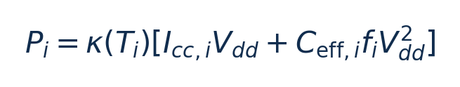
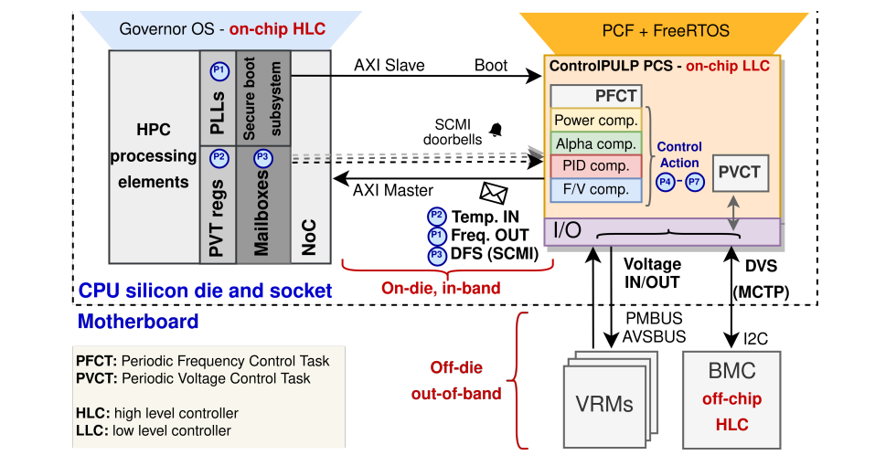
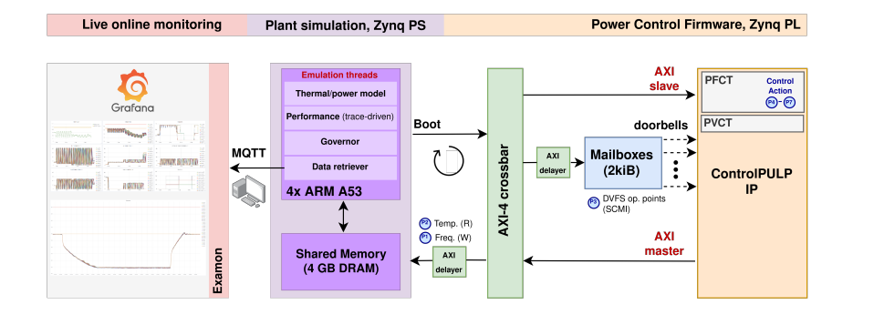
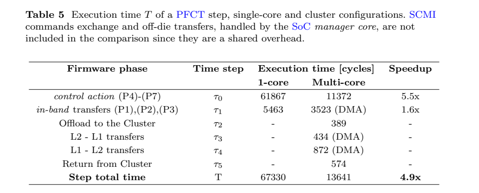
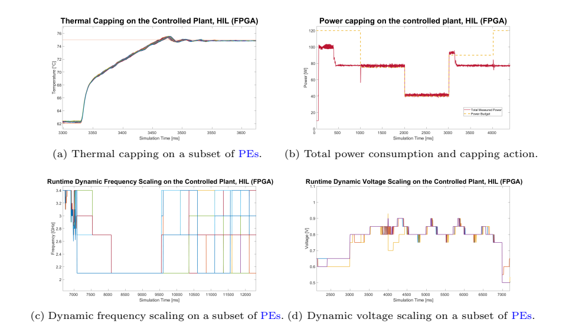
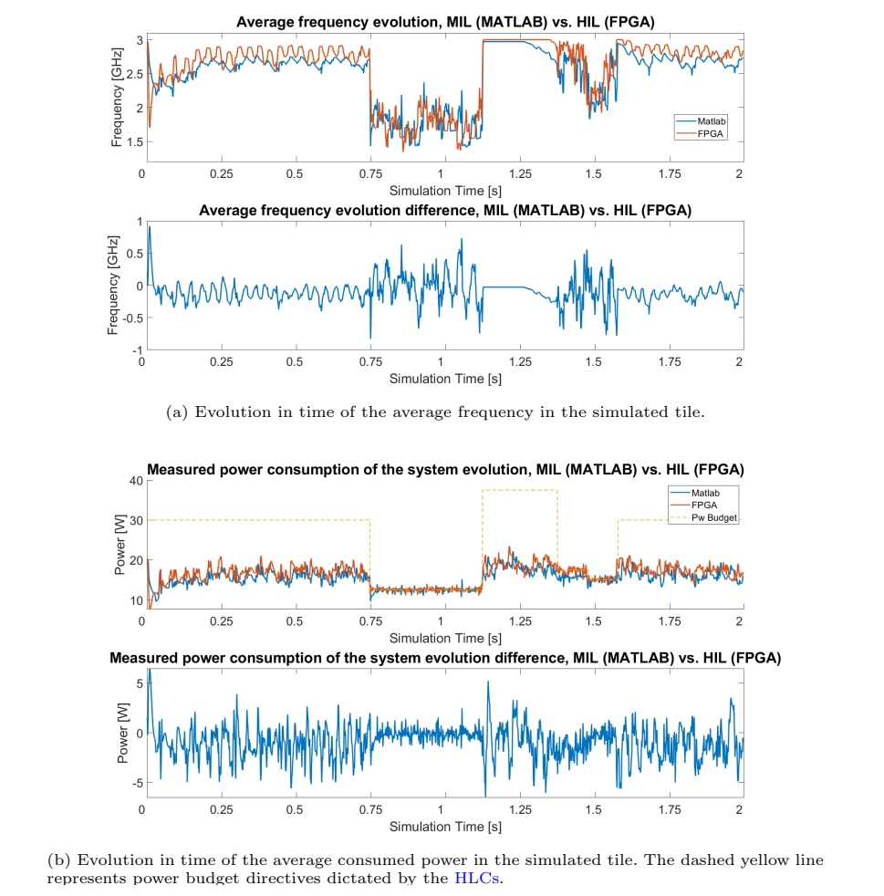

[论文页面](https://arxiv.org/abs/2306.09501) · [本笔记所用 PDF](https://arxiv.org/pdf/2306.09501v2) · [DOI](https://doi.org/10.1007/s10766-024-00761-4)

整理日期：2026-11-05。**读者原创中文解读；原图归论文作者／出版方。未运行作者实验，不是独立复现。**

**一句话：** 用一颗管理RISC-V核加可并行的工作核集群，运行电源控制固件，并用FPGA连接模拟的多核功耗／热系统。

阅读地图：先看问题与输入输出，再顺着架构图、公式和结果图阅读；最后检查统计边界与E902迁移。完整编号索引另见“图表索引”。下文“读者分析”是推断或建议，不是原文结果。

## 阶段0：材料与版本审计

| 材料 | 当前可用程度 | 影响 |
| --- | --- | --- |
| 摘要、正文、方法、原图注 | 已获取本地完整PDF、文本与逐页渲染 | 可核查结构、实验及关键数字；可见页面优先于异常文本层 |
| 分析版本 | 本次分析arXiv:2306.09501v2（2023-06-19），33页；关联2024期刊DOI。元数据核查确认另有v3（2024-02-21），尚未逐页比较v2/v3，本文图号、页码和数字均指v2，不能称最新版本复核。 | 引用页码以“PDF第几页”标识 |
| 代码／原始数据 | [ControlPULP硬件](https://github.com/pulp-platform/control-pulp)；[PCF固件](https://github.com/pulp-platform/control_pulp_pcf)。论文明确开源，当前未执行其构建和完整验证。 | 公开链接不等于已构建或已拿到原始轨迹 |
| 附件、独立原始重复与勘误 | 当前未完成全渠道附件／勘误穷尽检索 | 不能断言没有附件、没有勘误或没有其他版本 |
| 本次工作范围 | 材料阅读、图表裁取、证据整理、教学公式 | 所有新实验均是建议，尚未执行 |

## 阶段1：身份卡与整体概述

| 项目 | 内容 |
| --- | --- |
| 英文题名 | ControlPULP: A RISC-V On-Chip Parallel Power Controller for Many-Core HPC Processors with FPGA-Based Hardware-In-The-Loop Power and Thermal Emulation |
| 中文导读题名 | RISC-V怎样作为电源控制器：硬件在环并不等于真实负载芯片测能 |
| 作者 | Alessandro Ottaviano, Robert Balas, Giovanni Bambini, Antonio del Vecchio, Maicol Ciani, Davide Rossi, Luca Benini, Andrea Bartolini |
| 发表／版本 | International Journal of Parallel Programming 52,93–123 (2024)；本次分析arXiv:2306.09501v2（2023-06-19），33页；关联2024期刊DOI。元数据核查确认另有v3（2024-02-21），尚未逐页比较v2/v3，本文图号、页码和数字均指v2，不能称最新版本复核。 |
| 类型与领域 | 原始方法／工程系统研究；DVFS、CPU能效、运行时控制 |
| 单位、通讯、资助与利益关系 | ETH Zürich IIS与博洛尼亚大学DEI合作，前三作者标共同贡献，通讯作者Alessandro Ottaviano。致谢列EUPILOT、EUPEX、EPI等项目，作者声明无需披露的利益冲突（v2 p29）。 |
| 核心对象与接口 | 案例为72核HPC处理器模型，不是用户的E902，也非72核真实硅片测能。 |
| 代码与数据 | [ControlPULP硬件](https://github.com/pulp-platform/control-pulp)；[PCF固件](https://github.com/pulp-platform/control_pulp_pcf)。论文明确开源，当前未执行其构建和完整验证。 |
| 与本课题关系 | 这篇最适合回答“仿真怎么闭环控制”：控制算法与被控模型交换观测和动作，按仿真时钟推进，仍然可以闭环；HIL再把控制算法放到真实硬件。你的E902可以作为被控CPU，也可以作为控制核，这两种角色不能混用。先做单核C控制器＋模型，再接寄存器和真实时钟域，最后才是板级变压验证。 |

**约200字中文概述（改写）：** 本文提出面向多核CPU的开源电源控制平台ControlPULP：管理核处理通信、异常与调度，集群和DMA加速周期控制计算。FreeRTOS执行功率分配和温度限制等固件。作者通过RTL评估控制路径，并把真实FPGA控制器与软件模拟的功耗热对象接成闭环，与模型在环结果对照。它展示控制器实现和验证流程，而非实测72核CPU的应用节能率；4.9倍是控制固件加速，约3%偏差也是指定仿真对照指标。

**三句话定位：** 问题是大规模被控CPU的观测、约束与动作数增加时，单管理核是否还能在控制期限内完成计算？如何在真实被控芯片尚未完成时验证完整控制链？ 方法主线为OS/BMC提出性能点与功率预算 → SCMI邮箱到管理核 → 读取PVT和工作负载 → 集群计算功率分配／温控 → 电压任务与频率任务协调 → 写执行器接口 → 模拟对象产生新温度与功率 → 再采样。 主要证据见下方结果表，结论须与测量和版本范围一起使用。

## 阶段2：问题、假设与创新位置

大规模被控CPU的观测、约束与动作数增加时，单管理核是否还能在控制期限内完成计算？如何在真实被控芯片尚未完成时验证完整控制链？

**创新判断（读者分析）：** 可编程并行控制平台、低延迟中断与DMA的共同设计，以及可运行完整固件的HIL框架。算法主体包含功率分配与PID温控，并不是以新神经网络为主的论文。你的智能算法可作为上层建议器，底层安全限制仍有独立价值。 不依据作者自称“首次”断定整个领域绝无前例。

## 阶段3：必要术语与数学

| 级别 | 术语／关键词 | 直觉、严格含义与易混点 |
| --- | --- | --- |
| A | DVFS / DFS | DVFS同时涉及动态电压与频率；只有时钟变化称DFS。电压能否改变取决于实际供电域。 |
| A | Workload | 真正执行应用计算的程序与输入；本文里的控制器是另一个角色。 |
| A | Controller | 根据观测选择动作的软件／硬件，可运行在同一CPU或独立控制核。 |
| A | OPP | Operating Performance Point，经过允许范围验证的电压—频率组合。 |
| A | Power / Energy | 功率W表示此刻消耗快慢；能量J是对时间积分。低功率不必然低能量。 |
| B | Deadline | 作业必须完成的时刻；平均时延、P95与最大时延各有不同用途。 |
| A | Plant | 被控对象，可是真实CPU，也可以是功耗热模型。 |
| B | MIL / HIL | 模型在环／硬件在环，区别在控制器和对象哪些部分真实执行。 |
| B | PFCT / PVCT | 频率与电压控制任务，周期不同且需协调。 |
| C | 可编程控制核 | 运行固件的CPU，与承担应用计算的被控CPU角色不同。 |

### 公式1：控制周期内的时限预算（由Table5整理）

**符号与前提：** N_cycles为控制器执行周期数；f_ctrl是控制器时钟Hz，非被控CPU频率；S为剩余控制预算，秒。中断、额外通信若未包括，必须另加。

**代入与检查：** 500MHz下，67330周期约134.66µs；13641周期约27.28µs；在500µs周期内分别剩约73%和95%的时间。4.9倍是控制计算加速，不是被控程序加速4.9倍。

**来源：** §5.4，Table5，PDF p23–24；SCMI等共同开销未计入Table5。
### 公式2：被控功耗模型（原文Eq1符号整理）

**符号与前提：** P_i为W；V_dd为V；f_i为Hz；I_cc为漏电相关电流A；C_eff为有效开关电容F；κ是温度相关因子。参数由模型标定而来。

**代入与检查：** 把f降低而保持V不变，只直接减小动态项，漏电和其他模块能量仍存在；该式求得的是模型功率，并非示波器测到的真实72核功率。

**来源：** §4.2，PDF p16。

## 阶段4–6：架构、关键图与方法拆解

**输入—处理—输出：** OS/BMC提出性能点与功率预算 → SCMI邮箱到管理核 → 读取PVT和工作负载 → 集群计算功率分配／温控 → 电压任务与频率任务协调 → 写执行器接口 → 模拟对象产生新温度与功率 → 再采样。

| 系统角色 | 具体设置 |
| --- | --- |
| 输入 | 每处理单元的目标频率、温度、功率／活动信息，整系统预算及共享电压域约束。 |
| 输出 | 每核频率与各电压域电压／功率限制。 |
| 控制器 | CV32E40P管理核，8核可编程集群与DMA；FreeRTOS固件。 |
| 被控对象 | 案例为72核HPC处理器模型，不是用户的E902，也非72核真实硅片测能。 |

§3（PDF p8–14）：PFCT主频率控制任务周期500µs，PVCT电压控制任务125µs。主任务分配上一步频率、读取传感器和命令、估计功率、功率封顶、PID温控，再算新频率电压。电压在较早步骤下发，频率后一步应用；共享电压域不允许任意每核独立调压。

管理核处理协议和FreeRTOS任务；8个worker并行计算不同被控核的控制量，DMA搬移传感器与结果。CLIC支持较快中断，但中断快不等于整个闭环同样快。

§4（p14–18）：ZCU102的PL中实现控制器，PS上C/pthread程序模拟功耗、温度、工作负载与OS/BMC。1µs模型更新和由轨迹生成的合成工作负载用于覆盖动态情况，温度模型参数来自Monte Cimone相关测量。HIL加入真实固件、通信和调度延迟，但功耗依然由模型计算。

§5比较RTL周期数、GF22FDX综合面积、HIL与Simulink MIL以及IBM控制策略。不同实验有不同配置：72核为主要控制规模，HIL/MIL对照为9核tile、固定0.75V、2秒，以控制MIL运行成本。

### Fig1：系统级控制路径

[打开大图](images/original-fig1.png) · [原文 Fig1，PDF p9](https://arxiv.org/pdf/2306.09501v2#page=9)

**怎样看：** 区分OS/BMC、LLC、PLL和电压域。

**直接观察／原文报告：** 上层要求经过底层约束再执行。

**读者判断：** 图中的执行器不代表FPGA已真实改HPC供电。

### Fig4：FPGA硬件在环

[打开大图](images/original-fig4.png) · [原文 Fig4，PDF p15](https://arxiv.org/pdf/2306.09501v2#page=15)

**怎样看：** PL是真控制器，PS为plant模型。

**直接观察／原文报告：** 能验证真实固件闭环。

**读者判断：** 对象功耗并未变成真实硅片测量。

| 阅读问题 | 先看材料 | 如何接到下一步 |
| --- | --- | --- |
| 为什么要改现有方案 | 问题背景与动机图 | 确定目标、约束和原有不足 |
| 系统观察什么、控制什么 | 输入输出表＋关键架构图 | 确认数据、模型和执行器真实角色 |
| 方法如何得到动作或估计 | 方法段、公式、算法／模型表 | 明确离线训练与在线流程 |
| 收益是否真实且公平 | 结果图表、统计与测量边界 | 核查基线／目标／分母／开销 |
| 能否用于自己的CPU | 局限、复现计划、三项实验 | 把论文假设变成待验证的工程条件 |

## 阶段7–8：实验、统计及证据链

本节数字均是**原文明确报告或原文数值的标注算例**；没有按图柱高度臆造额外精确值。

| 指标 | 原文报告 | 条件／分母／边界 | 证据位置 |
| --- | --- | --- | --- |
| 主控制步 | 67330→13641周期，4.9× | 72核控制量；不含部分共同协议开销 | Table5，p24 |
| 控制周期 | PFCT500µs，PVCT125µs | 多速率固件任务，不是每周期完整神经网络训练 | §3.1，p9–10 |
| HIL/MIL对照 | 平均偏差在TDP的3%以内 | 9核tile、固定0.75V、2s；模拟TDP120W | §5.5.1，Fig9，p25–27 |
| 面积量级 | 相对现代HPC die约0.1% | GF22FDX综合对照；非E902板级面积／能耗 | 摘要、§5.1，p19 |

### Table5：整步周期分解

[打开大图](images/original-table5.png) · [原文 Table5，PDF p24](https://arxiv.org/pdf/2306.09501v2#page=24)

**怎样看：** 包含offload与L1/L2搬移再算总和。

**直接观察／原文报告：** 67330与13641构成4.9×。

**读者判断：** 共同SCMI与片外开销在表外。

### Fig8：温度功率及DVFS轨迹

[打开大图](images/original-fig8.png) · [原文 Fig8，PDF p26](https://arxiv.org/pdf/2306.09501v2#page=26)

**怎样看：** 四子图依次看温度、功率、频率、电压。

**直接观察／原文报告：** 闭环响应预算与设点。

**读者判断：** 轨迹是模拟plant输出。

### Fig9：HIL与MIL对照

[打开大图](images/original-fig9.png) · [原文 Fig9，PDF p27](https://arxiv.org/pdf/2306.09501v2#page=27)

**怎样看：** 先读固定电压和9核条件，再比较时间曲线。

**直接观察／原文报告：** 实现与模型趋势相近。

**读者判断：** 不证明模型绝对准确或真实节能。

**统计与公平性审查（读者分析）：** 硬件综合、RTL周期分析、FPGA固件运行和模拟功耗是四类证据，不是同一“真实芯片实测”。HIL/MIL相近证明实现对模型的一致性，不能排除模型本身失准。合成压力轨迹覆盖角落情况，但不能替代实际压缩数据分布或全部多核应用。3%以模拟TDP归一化，不等于每时刻频率误差3%。

工程实验中，设备、程序、输入文件、重复运行、时间窗口是不同统计层级，不能互相替代。本任务不涉及生物样本，细胞／动物／试剂等检查不适用。未注明的P值或置信区间不补造；“差了几个百分点”不自动等于统计显著。

| 主张层级 | 直接证据 | 对照与统计 | 可得结论／替代解释 | 可信度 |
| --- | --- | --- | --- | --- |
| 原文明确报告 | 主控制步：67330→13641周期，4.9× | Table5，p24 | 72核控制量；不含部分共同协议开销；仅在该实验范围内成立 | 图表／文本可核对：高；独立复现：尚无 |
| 作者解释 | 所提架构／模型解释了性能或估计改善 | 关键原图与方法见上文；统计边界见下节 | 效果可能同时来自动作空间、平台特性与采样设置，因果归因需消融 | 中 |
| AI分析／迁移假设 | 用于E902的压缩候选负载 | 本篇未直接验证该芯片与任务组合 | 需三项后续实验；不能复制论文收益数字 | 待验证，当前无法判断 |

## 阶段9–10：贡献与局限分开判断

可编程并行控制平台、低延迟中断与DMA的共同设计，以及可运行完整固件的HIL框架。算法主体包含功率分配与PID温控，并不是以新神经网络为主的论文。你的智能算法可作为上层建议器，底层安全限制仍有独立价值。

| 来源 | 严重程度 | 局限及其影响 |
| --- | --- | --- |
| 版本边界 | 重要 | 本次全文为v2，已确认存在v3但未完成差异审查。 |
| 作者方法边界 | 关键 | HPC对象为模型，HIL/MIL共享模型基础；仅验证所构造情形。 |
| 读者分析 | 重要 | 单核E902负载不需要照搬8核控制集群；控制器自身面积、能量和复杂性可能超过节能。 |

## 阶段11：最小复现路线与缺口

从开源硬件与固件版本锁定工具链、FreeRTOS和参数；先重现RTL控制路径周期，再跑相同合成plant进行HIL/MIL对照。若缺ZCU102，可以先完成软件／RTL在环并如实标注验证层级。真实供电控制另需板卡执行器，不在PC仿真中自动产生。当前仅阅读与材料整理，未综合或上板。

**代码／数据现状：** [ControlPULP硬件](https://github.com/pulp-platform/control-pulp)；[PCF固件](https://github.com/pulp-platform/control_pulp_pcf)。论文明确开源，当前未执行其构建和完整验证。

**质量控制顺序：** 先验证程序输出和时间基准，再验证采样／模型，最后比较策略。保存输入文件哈希、平台配置、OPP、随机种子、温度与每次运行原始记录。失败时先回固定安全频点定位错误，再继续优化。复现可行性判断为“可开始部分方法复建，完整数值复现条件未齐”；这与“已完成复现”不同。

## 阶段12：用于你的CPU／E902课题

这篇最适合回答“仿真怎么闭环控制”：控制算法与被控模型交换观测和动作，按仿真时钟推进，仍然可以闭环；HIL再把控制算法放到真实硬件。你的E902可以作为被控CPU，也可以作为控制核，这两种角色不能混用。先做单核C控制器＋模型，再接寄存器和真实时钟域，最后才是板级变压验证。

| 建议实验／优先级 | 价值 | 最低资源 | 主要风险 | 成功判据（设计目标，非已得结果） |
| --- | --- | --- | --- | --- |
| P0：软件闭环与RTL闭环对齐 | 验证算法与实现一致 | 相同压缩轨迹／模型、周期与OPP | 仿真时间与墙钟混用 | 相同输入动作顺序一致，解释所有时间偏差 |
| P1：寄存器控制接口 | 让软件建议落到RTL执行路径 | 目标OPP、apply/busy/ack、超时和状态寄存器 | 切换过程数据丢失 | 随机命令下不丢事务；计入生效延迟并正确解压 |
| P2：控制器资源预算 | 证明软控硬实现值得做 | 周期测量、综合面积、能量模型或板测 | 控制器比负载还耗能 | 净收益覆盖控制成本；小核方案优先于并行集群 |

上述优先级是读者建议：P0先做，P1建立在基线可运行后，P2只在资源允许且前序实验证明有必要时开展。压缩应用仍是候选，尚未替你最终定题或证明已在E902运行。论文公开可读不自动授权任意复制数据；代码、图片和数据须分别核对许可。

## 阶段13：读完后应掌握与继续核查

**五个知识点：** 用一颗管理RISC-V核加可并行的工作核集群，运行电源控制固件，并用FPGA连接模拟的多核功耗／热系统。 你还应能解释输入输出表中的角色、两条公式的单位、首个结果指标的分母，以及局限表里的关键条件。

**五个未决问题：** 独立新输入是否成立？最差时延是否可接受？测量参考是否足够？控制与切换是否抵消收益？E902实际具有哪些接口和可观测量？这些是研究问题，不是对作者遗漏的无证据指控。

**立即做：** 按公式算例手算一次，选一张结果图复述“硬件—负载—基线—指标—边界”。**后续核查：** 补齐代码版本、训练数据和仪表设置。**可复用：** 上文明确标注的模型与接口思路。**谨慎采用：** 所有跨平台百分比。**暂不采用：** 尚未证实存在的电压控制和完整硬实时承诺。
