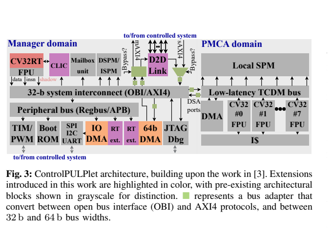
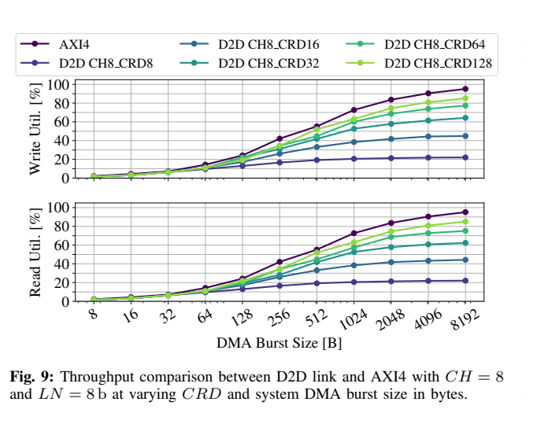
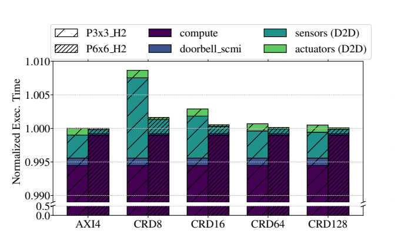
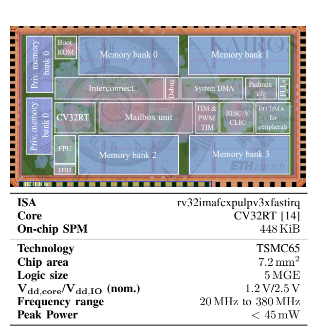
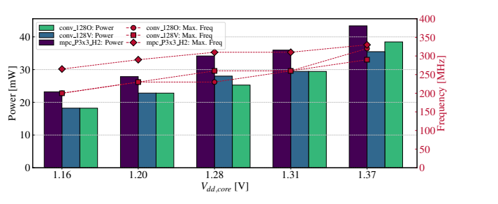
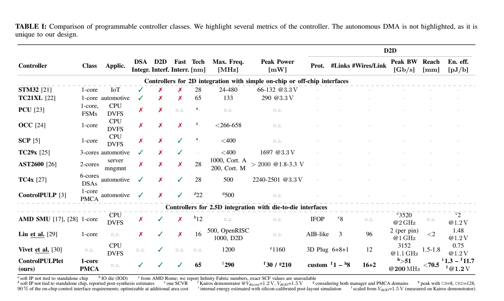

[论文页面](https://arxiv.org/abs/2410.15985) · [本笔记所用 PDF](https://arxiv.org/pdf/2410.15985v2) · [DOI](https://doi.org/10.1109/TVLSI.2025.3596452)

整理日期：2026-11-05。**读者原创中文解读；原图归论文作者／出版方。未运行作者实验，不是独立复现。**

**覆盖范围：** 本版本正文中识别到的19项图、表或算法；保留原编号。关键项已裁图并在技术精读相应段落出现，未内嵌的项可点PDF页链接查看，不上传整篇PDF。

**统计总边界：** 本文混合RTL周期精确测试、综合面积、实际硅片、板测和硅校准仿真，所有数字要注明层级。MPC5次迭代与horizon2只是实验设置，不证明大模型控制器都可实时。板上长走线和封装限制与真正2.5D不同，跨论文能效比较需匹配电压、距离、带宽、工艺与是否含PHY。

## Fig1：感知—计算—执行链

[原文 Fig1，PDF p1](https://arxiv.org/pdf/2410.15985v2#page=1)

1. **本项回答的问题：** 感知—计算—执行链，用于支撑这条方法或实验链中的具体环节。
2. **组成、坐标和对照：** 先找传感器、控制器、执行器。 按原图／表标示的单位与归一化基准阅读；不将不同子图或不同分母的柱高直接相除。 颜色按原图图例辨认，不能把同色跨图视为同一组。
3. **阅读顺序与统计单位：** 先看设定、单位和图例，再看趋势与作者正文。重复次数及采样独立性参见本篇技术精读统计节；没有为该图定位到的误差线定义／独立重复数，不另行猜测。
4. **直接观察：** 通信属于控制回路。
5. **作者解释的范围：** 原文以该图／表作为上述观察的结构说明或实验支撑，需连同对应页正文读取；本索引不额外替作者推导因果机制。
6. **独立判断（AI分析）：** 不专属于电机应用。
7. **证据链位置：** 性能验证／定量或示例证据，需结合实验条件。它支持本文具体条件下的实现或结果，不单独完成跨平台验证。
8. **结论与强度：** 可复述“通信属于控制回路。”；对图内描述的核查可信度高，对未做独立实验的泛化判断为中或无法判断。不能得出的结论是“不专属于电机应用。”所排除的外推。

## Fig2：封装与控制拓扑

[原文 Fig2，PDF p2](https://arxiv.org/pdf/2410.15985v2#page=2)

1. **本项回答的问题：** 封装与控制拓扑，用于支撑这条方法或实验链中的具体环节。
2. **组成、坐标和对照：** 比较片内、离散与chiplet控制。 结构／流程类没有统一数值坐标；箭头表示数据或控制关系，不表示统计因果。 颜色按原图图例辨认，不能把同色跨图视为同一组。
3. **阅读顺序与统计单位：** 先看设定、单位和图例，再看趋势与作者正文。重复次数及采样独立性参见本篇技术精读统计节；没有为该图定位到的误差线定义／独立重复数，不另行猜测。
4. **直接观察：** 封装改变接口需求。
5. **作者解释的范围：** 原文以该图／表作为上述观察的结构说明或实验支撑，需连同对应页正文读取；本索引不额外替作者推导因果机制。
6. **独立判断（AI分析）：** 图示拓扑不代表全部被流片。
7. **证据链位置：** 方法／系统实现说明。它支持本文具体条件下的实现或结果，不单独完成跨平台验证。
8. **结论与强度：** 可复述“封装改变接口需求。”；对图内描述的核查可信度高，对未做独立实验的泛化判断为中或无法判断。不能得出的结论是“图示拓扑不代表全部被流片。”所排除的外推。

## Fig3：架构与新增模块

[原文 Fig3，PDF p3](https://arxiv.org/pdf/2410.15985v2#page=3)

[打开大图](images/original-fig3.png)

1. **本项回答的问题：** 架构与新增模块，用于支撑这条方法或实验链中的具体环节。
2. **组成、坐标和对照：** 彩色新增、灰色继承；分管理域和PMCA。 结构／流程类没有统一数值坐标；箭头表示数据或控制关系，不表示统计因果。 颜色按原图图例辨认，不能把同色跨图视为同一组。
3. **阅读顺序与统计单位：** 先看设定、单位和图例，再看趋势与作者正文。重复次数及采样独立性参见本篇技术精读统计节；没有为该图定位到的误差线定义／独立重复数，不另行猜测。
4. **直接观察：** 快速中断与DMA/D2D协同。
5. **作者解释的范围：** 原文以该图／表作为上述观察的结构说明或实验支撑，需连同对应页正文读取；本索引不额外替作者推导因果机制。
6. **独立判断（AI分析）：** Kairos并未集成图中所有域。
7. **证据链位置：** 方法／系统实现说明。它支持本文具体条件下的实现或结果，不单独完成跨平台验证。
8. **结论与强度：** 可复述“快速中断与DMA/D2D协同。”；对图内描述的核查可信度高，对未做独立实验的泛化判断为中或无法判断。不能得出的结论是“Kairos并未集成图中所有域。”所排除的外推。

## Fig4：D2D分层

[原文 Fig4，PDF p4](https://arxiv.org/pdf/2410.15985v2#page=4)

1. **本项回答的问题：** D2D分层，用于支撑这条方法或实验链中的具体环节。
2. **组成、坐标和对照：** 网络／数据链路／PHY分层看。 结构／流程类没有统一数值坐标；箭头表示数据或控制关系，不表示统计因果。 颜色按原图图例辨认，不能把同色跨图视为同一组。
3. **阅读顺序与统计单位：** 先看设定、单位和图例，再看趋势与作者正文。重复次数及采样独立性参见本篇技术精读统计节；没有为该图定位到的误差线定义／独立重复数，不另行猜测。
4. **直接观察：** AXI语义转换成链路传输。
5. **作者解释的范围：** 原文以该图／表作为上述观察的结构说明或实验支撑，需连同对应页正文读取；本索引不额外替作者推导因果机制。
6. **独立判断（AI分析）：** 不是透明零开销。
7. **证据链位置：** 方法／系统实现说明。它支持本文具体条件下的实现或结果，不单独完成跨平台验证。
8. **结论与强度：** 可复述“AXI语义转换成链路传输。”；对图内描述的核查可信度高，对未做独立实验的泛化判断为中或无法判断。不能得出的结论是“不是透明零开销。”所排除的外推。

## Fig5：网络层通路

[原文 Fig5，PDF p4](https://arxiv.org/pdf/2410.15985v2#page=4)

1. **本项回答的问题：** 网络层通路，用于支撑这条方法或实验链中的具体环节。
2. **组成、坐标和对照：** 区分五类AXI通道与包转换。 结构／流程类没有统一数值坐标；箭头表示数据或控制关系，不表示统计因果。 颜色按原图图例辨认，不能把同色跨图视为同一组。
3. **阅读顺序与统计单位：** 先看设定、单位和图例，再看趋势与作者正文。重复次数及采样独立性参见本篇技术精读统计节；没有为该图定位到的误差线定义／独立重复数，不另行猜测。
4. **直接观察：** 控制逻辑也占面积。
5. **作者解释的范围：** 原文以该图／表作为上述观察的结构说明或实验支撑，需连同对应页正文读取；本索引不额外替作者推导因果机制。
6. **独立判断（AI分析）：** 不能只数PHY门数当整个接口。
7. **证据链位置：** 方法／系统实现说明。它支持本文具体条件下的实现或结果，不单独完成跨平台验证。
8. **结论与强度：** 可复述“控制逻辑也占面积。”；对图内描述的核查可信度高，对未做独立实验的泛化判断为中或无法判断。不能得出的结论是“不能只数PHY门数当整个接口。”所排除的外推。

## Fig6：物理层与时钟域

[原文 Fig6，PDF p5](https://arxiv.org/pdf/2410.15985v2#page=5)

1. **本项回答的问题：** 物理层与时钟域，用于支撑这条方法或实验链中的具体环节。
2. **组成、坐标和对照：** 看发送、接收与跨时钟连接。 结构／流程类没有统一数值坐标；箭头表示数据或控制关系，不表示统计因果。 颜色按原图图例辨认，不能把同色跨图视为同一组。
3. **阅读顺序与统计单位：** 先看设定、单位和图例，再看趋势与作者正文。重复次数及采样独立性参见本篇技术精读统计节；没有为该图定位到的误差线定义／独立重复数，不另行猜测。
4. **直接观察：** 时序与同步是可靠通信前提。
5. **作者解释的范围：** 原文以该图／表作为上述观察的结构说明或实验支撑，需连同对应页正文读取；本索引不额外替作者推导因果机制。
6. **独立判断（AI分析）：** 不证明任意PCB长度都可靠。
7. **证据链位置：** 方法／系统实现说明。它支持本文具体条件下的实现或结果，不单独完成跨平台验证。
8. **结论与强度：** 可复述“时序与同步是可靠通信前提。”；对图内描述的核查可信度高，对未做独立实验的泛化判断为中或无法判断。不能得出的结论是“不证明任意PCB长度都可靠。”所排除的外推。

## Fig7：32B突发传输时序

[原文 Fig7，PDF p5](https://arxiv.org/pdf/2410.15985v2#page=5)

1. **本项回答的问题：** 32B突发传输时序，用于支撑这条方法或实验链中的具体环节。
2. **组成、坐标和对照：** 从AXI请求到数据／信用返回逐拍读。 按原图／表标示的单位与归一化基准阅读；不将不同子图或不同分母的柱高直接相除。 颜色按原图图例辨认，不能把同色跨图视为同一组。
3. **阅读顺序与统计单位：** 先看设定、单位和图例，再看趋势与作者正文。重复次数及采样独立性参见本篇技术精读统计节；没有为该图定位到的误差线定义／独立重复数，不另行猜测。
4. **直接观察：** 协议往返带来空拍。
5. **作者解释的范围：** 原文以该图／表作为上述观察的结构说明或实验支撑，需连同对应页正文读取；本索引不额外替作者推导因果机制。
6. **独立判断（AI分析）：** 峰值带宽不等于小包效率。
7. **证据链位置：** 性能验证／定量或示例证据，需结合实验条件。它支持本文具体条件下的实现或结果，不单独完成跨平台验证。
8. **结论与强度：** 可复述“协议往返带来空拍。”；对图内描述的核查可信度高，对未做独立实验的泛化判断为中或无法判断。不能得出的结论是“峰值带宽不等于小包效率。”所排除的外推。

## Fig8：RTL测试台

[原文 Fig8，PDF p7](https://arxiv.org/pdf/2410.15985v2#page=7)

1. **本项回答的问题：** RTL测试台，用于支撑这条方法或实验链中的具体环节。
2. **组成、坐标和对照：** 两D2D端和内存模型组成闭环事务。 结构／流程类没有统一数值坐标；箭头表示数据或控制关系，不表示统计因果。 颜色按原图图例辨认，不能把同色跨图视为同一组。
3. **阅读顺序与统计单位：** 先看设定、单位和图例，再看趋势与作者正文。重复次数及采样独立性参见本篇技术精读统计节；没有为该图定位到的误差线定义／独立重复数，不另行猜测。
4. **直接观察：** 测试为周期精确。
5. **作者解释的范围：** 原文以该图／表作为上述观察的结构说明或实验支撑，需连同对应页正文读取；本索引不额外替作者推导因果机制。
6. **独立判断（AI分析）：** 不是实际2.5D封装。
7. **证据链位置：** 方法／系统实现说明。它支持本文具体条件下的实现或结果，不单独完成跨平台验证。
8. **结论与强度：** 可复述“测试为周期精确。”；对图内描述的核查可信度高，对未做独立实验的泛化判断为中或无法判断。不能得出的结论是“不是实际2.5D封装。”所排除的外推。

## Fig9：FIFO与burst影响吞吐

[原文 Fig9，PDF p7](https://arxiv.org/pdf/2410.15985v2#page=7)

[打开大图](images/original-fig9.png)

1. **本项回答的问题：** FIFO与burst影响吞吐，用于支撑这条方法或实验链中的具体环节。
2. **组成、坐标和对照：** 横轴字节数，纵轴读写利用率，多曲线为CRD。 按原图／表标示的单位与归一化基准阅读；不将不同子图或不同分母的柱高直接相除。 颜色按原图图例辨认，不能把同色跨图视为同一组。
3. **阅读顺序与统计单位：** 先看设定、单位和图例，再看趋势与作者正文。重复次数及采样独立性参见本篇技术精读统计节；没有为该图定位到的误差线定义／独立重复数，不另行猜测。
4. **直接观察：** 大FIFO和突发提高利用率。
5. **作者解释的范围：** 原文以该图／表作为上述观察的结构说明或实验支撑，需连同对应页正文读取；本索引不额外替作者推导因果机制。
6. **独立判断（AI分析）：** 85%结果依赖指定参数。
7. **证据链位置：** 性能验证／定量或示例证据，需结合实验条件。它支持本文具体条件下的实现或结果，不单独完成跨平台验证。
8. **结论与强度：** 可复述“大FIFO和突发提高利用率。”；对图内描述的核查可信度高，对未做独立实验的泛化判断为中或无法判断。不能得出的结论是“85%结果依赖指定参数。”所排除的外推。

## Fig10：通信对DVFS控制时长影响

[原文 Fig10，PDF p8](https://arxiv.org/pdf/2410.15985v2#page=8)

[打开大图](images/original-fig10.png)

1. **本项回答的问题：** 通信对DVFS控制时长影响，用于支撑这条方法或实验链中的具体环节。
2. **组成、坐标和对照：** 看归一化总时长与细分开销。 按原图／表标示的单位与归一化基准阅读；不将不同子图或不同分母的柱高直接相除。 颜色按原图图例辨认，不能把同色跨图视为同一组。
3. **阅读顺序与统计单位：** 先看设定、单位和图例，再看趋势与作者正文。重复次数及采样独立性参见本篇技术精读统计节；没有为该图定位到的误差线定义／独立重复数，不另行猜测。
4. **直接观察：** 计算主导时D2D相对影响小。
5. **作者解释的范围：** 原文以该图／表作为上述观察的结构说明或实验支撑，需连同对应页正文读取；本索引不额外替作者推导因果机制。
6. **独立判断（AI分析）：** 不能把总开销小理解成传输本身无延迟。
7. **证据链位置：** 性能验证／定量或示例证据，需结合实验条件。它支持本文具体条件下的实现或结果，不单独完成跨平台验证。
8. **结论与强度：** 可复述“计算主导时D2D相对影响小。”；对图内描述的核查可信度高，对未做独立实验的泛化判断为中或无法判断。不能得出的结论是“不能把总开销小理解成传输本身无延迟。”所排除的外推。

## Fig11：Kairos芯片照片和规格

[原文 Fig11，PDF p9](https://arxiv.org/pdf/2410.15985v2#page=9)

[打开大图](images/original-fig11.png)

1. **本项回答的问题：** Kairos芯片照片和规格，用于支撑这条方法或实验链中的具体环节。
2. **组成、坐标和对照：** 先读参数，再辨存储／管理核区域。 按原图／表标示的单位与归一化基准阅读；不将不同子图或不同分母的柱高直接相除。 颜色按原图图例辨认，不能把同色跨图视为同一组。
3. **阅读顺序与统计单位：** 先看设定、单位和图例，再看趋势与作者正文。重复次数及采样独立性参见本篇技术精读统计节；没有为该图定位到的误差线定义／独立重复数，不另行猜测。
4. **直接观察：** 证明管理域实际流片。
5. **作者解释的范围：** 原文以该图／表作为上述观察的结构说明或实验支撑，需连同对应页正文读取；本索引不额外替作者推导因果机制。
6. **独立判断（AI分析）：** PMCA未集成，不能宣称全8核控制芯片实测。
7. **证据链位置：** 性能验证／定量或示例证据，需结合实验条件。它支持本文具体条件下的实现或结果，不单独完成跨平台验证。
8. **结论与强度：** 可复述“证明管理域实际流片。”；对图内描述的核查可信度高，对未做独立实验的泛化判断为中或无法判断。不能得出的结论是“PMCA未集成，不能宣称全8核控制芯片实测。”所排除的外推。

## Fig12：双芯片PCB

[原文 Fig12，PDF p9](https://arxiv.org/pdf/2410.15985v2#page=9)

1. **本项回答的问题：** 双芯片PCB，用于支撑这条方法或实验链中的具体环节。
2. **组成、坐标和对照：** 看两芯片和走线。 按原图／表标示的单位与归一化基准阅读；不将不同子图或不同分母的柱高直接相除。 颜色按原图图例辨认，不能把同色跨图视为同一组。
3. **阅读顺序与统计单位：** 先看设定、单位和图例，再看趋势与作者正文。重复次数及采样独立性参见本篇技术精读统计节；没有为该图定位到的误差线定义／独立重复数，不另行猜测。
4. **直接观察：** 板上链路真实存在。
5. **作者解释的范围：** 原文以该图／表作为上述观察的结构说明或实验支撑，需连同对应页正文读取；本索引不额外替作者推导因果机制。
6. **独立判断（AI分析）：** 长PCB不是先进2.5D interposer。
7. **证据链位置：** 性能验证／定量或示例证据，需结合实验条件。它支持本文具体条件下的实现或结果，不单独完成跨平台验证。
8. **结论与强度：** 可复述“板上链路真实存在。”；对图内描述的核查可信度高，对未做独立实验的泛化判断为中或无法判断。不能得出的结论是“长PCB不是先进2.5D interposer。”所排除的外推。

## Fig13：链路参数与面积

[原文 Fig13，PDF p10](https://arxiv.org/pdf/2410.15985v2#page=10)

1. **本项回答的问题：** 链路参数与面积，用于支撑这条方法或实验链中的具体环节。
2. **组成、坐标和对照：** 看CH/CRD组合，区分左门数与右百分比。 按原图／表标示的单位与归一化基准阅读；不将不同子图或不同分母的柱高直接相除。 颜色按原图图例辨认，不能把同色跨图视为同一组。
3. **阅读顺序与统计单位：** 先看设定、单位和图例，再看趋势与作者正文。重复次数及采样独立性参见本篇技术精读统计节；没有为该图定位到的误差线定义／独立重复数，不另行猜测。
4. **直接观察：** 高吞吐配置有额外面积。
5. **作者解释的范围：** 原文以该图／表作为上述观察的结构说明或实验支撑，需连同对应页正文读取；本索引不额外替作者推导因果机制。
6. **独立判断（AI分析）：** 百分比取决于整个系统配置。
7. **证据链位置：** 性能验证／定量或示例证据，需结合实验条件。它支持本文具体条件下的实现或结果，不单独完成跨平台验证。
8. **结论与强度：** 可复述“高吞吐配置有额外面积。”；对图内描述的核查可信度高，对未做独立实验的泛化判断为中或无法判断。不能得出的结论是“百分比取决于整个系统配置。”所排除的外推。

## Fig14：Kairos面积分解

[原文 Fig14，PDF p10](https://arxiv.org/pdf/2410.15985v2#page=10)

1. **本项回答的问题：** Kairos面积分解，用于支撑这条方法或实验链中的具体环节。
2. **组成、坐标和对照：** 比较存储、核、链路等块。 按原图／表标示的单位与归一化基准阅读；不将不同子图或不同分母的柱高直接相除。 颜色按原图图例辨认，不能把同色跨图视为同一组。
3. **阅读顺序与统计单位：** 先看设定、单位和图例，再看趋势与作者正文。重复次数及采样独立性参见本篇技术精读统计节；没有为该图定位到的误差线定义／独立重复数，不另行猜测。
4. **直接观察：** 存储占比显著。
5. **作者解释的范围：** 原文以该图／表作为上述观察的结构说明或实验支撑，需连同对应页正文读取；本索引不额外替作者推导因果机制。
6. **独立判断（AI分析）：** ASIC门数不等于FPGA LUT。
7. **证据链位置：** 性能验证／定量或示例证据，需结合实验条件。它支持本文具体条件下的实现或结果，不单独完成跨平台验证。
8. **结论与强度：** 可复述“存储占比显著。”；对图内描述的核查可信度高，对未做独立实验的泛化判断为中或无法判断。不能得出的结论是“ASIC门数不等于FPGA LUT。”所排除的外推。

## Fig15：链路内部面积分解

[原文 Fig15，PDF p10](https://arxiv.org/pdf/2410.15985v2#page=10)

1. **本项回答的问题：** 链路内部面积分解，用于支撑这条方法或实验链中的具体环节。
2. **组成、坐标和对照：** 区分完整架构配置和Kairos窄配置。 按原图／表标示的单位与归一化基准阅读；不将不同子图或不同分母的柱高直接相除。 颜色按原图图例辨认，不能把同色跨图视为同一组。
3. **阅读顺序与统计单位：** 先看设定、单位和图例，再看趋势与作者正文。重复次数及采样独立性参见本篇技术精读统计节；没有为该图定位到的误差线定义／独立重复数，不另行猜测。
4. **直接观察：** FIFO与PHY的占比随参数变化。
5. **作者解释的范围：** 原文以该图／表作为上述观察的结构说明或实验支撑，需连同对应页正文读取；本索引不额外替作者推导因果机制。
6. **独立判断（AI分析）：** 7.6kGE只是每通道PHY，不是整个D2D。
7. **证据链位置：** 性能验证／定量或示例证据，需结合实验条件。它支持本文具体条件下的实现或结果，不单独完成跨平台验证。
8. **结论与强度：** 可复述“FIFO与PHY的占比随参数变化。”；对图内描述的核查可信度高，对未做独立实验的泛化判断为中或无法判断。不能得出的结论是“7.6kGE只是每通道PHY，不是整个D2D。”所排除的外推。

## Fig16：芯片电压频率与功耗

[原文 Fig16，PDF p10](https://arxiv.org/pdf/2410.15985v2#page=10)

[打开大图](images/original-fig16.png)

1. **本项回答的问题：** 芯片电压频率与功耗，用于支撑这条方法或实验链中的具体环节。
2. **组成、坐标和对照：** 左轴mW、右轴MHz，分别看不同负载。 按原图／表标示的单位与归一化基准阅读；不将不同子图或不同分母的柱高直接相除。 颜色按原图图例辨认，不能把同色跨图视为同一组。
3. **阅读顺序与统计单位：** 先看设定、单位和图例，再看趋势与作者正文。重复次数及采样独立性参见本篇技术精读统计节；没有为该图定位到的误差线定义／独立重复数，不另行猜测。
4. **直接观察：** 1.2V可到约290MHz。
5. **作者解释的范围：** 原文以该图／表作为上述观察的结构说明或实验支撑，需连同对应页正文读取；本索引不额外替作者推导因果机制。
6. **独立判断（AI分析）：** 不能混用500MHz RTL控制案例。
7. **证据链位置：** 性能验证／定量或示例证据，需结合实验条件。它支持本文具体条件下的实现或结果，不单独完成跨平台验证。
8. **结论与强度：** 可复述“1.2V可到约290MHz。”；对图内描述的核查可信度高，对未做独立实验的泛化判断为中或无法判断。不能得出的结论是“不能混用500MHz RTL控制案例。”所排除的外推。

## Fig17：板级能量每bit

[原文 Fig17，PDF p11](https://arxiv.org/pdf/2410.15985v2#page=11)

1. **本项回答的问题：** 板级能量每bit，用于支撑这条方法或实验链中的具体环节。
2. **组成、坐标和对照：** 横轴burst，曲线对应I/O电压。 按原图／表标示的单位与归一化基准阅读；不将不同子图或不同分母的柱高直接相除。 颜色按原图图例辨认，不能把同色跨图视为同一组。
3. **阅读顺序与统计单位：** 先看设定、单位和图例，再看趋势与作者正文。重复次数及采样独立性参见本篇技术精读统计节；没有为该图定位到的误差线定义／独立重复数，不另行猜测。
4. **直接观察：** 长PCB与I/O电压增加能耗。
5. **作者解释的范围：** 原文以该图／表作为上述观察的结构说明或实验支撑，需连同对应页正文读取；本索引不额外替作者推导因果机制。
6. **独立判断（AI分析）：** 不能拿内部1.3pJ/bit代替板测。
7. **证据链位置：** 性能验证／定量或示例证据，需结合实验条件。它支持本文具体条件下的实现或结果，不单独完成跨平台验证。
8. **结论与强度：** 可复述“长PCB与I/O电压增加能耗。”；对图内描述的核查可信度高，对未做独立实验的泛化判断为中或无法判断。不能得出的结论是“不能拿内部1.3pJ/bit代替板测。”所排除的外推。

## TableI：控制器比较

[原文 TableI，PDF p12](https://arxiv.org/pdf/2410.15985v2#page=12)

[打开大图](images/original-tablei.png)

1. **本项回答的问题：** 控制器比较，用于支撑这条方法或实验链中的具体环节。
2. **组成、坐标和对照：** 按工艺、是否流片、集群和D2D能力读脚注。 按原图／表标示的单位与归一化基准阅读；不将不同子图或不同分母的柱高直接相除。 颜色按原图图例辨认，不能把同色跨图视为同一组。
3. **阅读顺序与统计单位：** 先看设定、单位和图例，再看趋势与作者正文。重复次数及采样独立性参见本篇技术精读统计节；没有为该图定位到的误差线定义／独立重复数，不另行猜测。
4. **直接观察：** 不同证据类型被集中列出。
5. **作者解释的范围：** 原文以该图／表作为上述观察的结构说明或实验支撑，需连同对应页正文读取；本索引不额外替作者推导因果机制。
6. **独立判断（AI分析）：** 忽略脚注会把仿真指标当硅片实测。
7. **证据链位置：** 性能验证／定量或示例证据，需结合实验条件。它支持本文具体条件下的实现或结果，不单独完成跨平台验证。
8. **结论与强度：** 可复述“不同证据类型被集中列出。”；对图内描述的核查可信度高，对未做独立实验的泛化判断为中或无法判断。不能得出的结论是“忽略脚注会把仿真指标当硅片实测。”所排除的外推。

## TableII：D2D接口比较

[原文 TableII，PDF p12](https://arxiv.org/pdf/2410.15985v2#page=12)

1. **本项回答的问题：** D2D接口比较，用于支撑这条方法或实验链中的具体环节。
2. **组成、坐标和对照：** 核对距离、频率、线数、能量边界。 按原图／表标示的单位与归一化基准阅读；不将不同子图或不同分母的柱高直接相除。 颜色按原图图例辨认，不能把同色跨图视为同一组。
3. **阅读顺序与统计单位：** 先看设定、单位和图例，再看趋势与作者正文。重复次数及采样独立性参见本篇技术精读统计节；没有为该图定位到的误差线定义／独立重复数，不另行猜测。
4. **直接观察：** 不同接口面向不同应用。
5. **作者解释的范围：** 原文以该图／表作为上述观察的结构说明或实验支撑，需连同对应页正文读取；本索引不额外替作者推导因果机制。
6. **独立判断（AI分析）：** 跨工艺排行榜不说明E902必须用最高带宽。
7. **证据链位置：** 性能验证／定量或示例证据，需结合实验条件。它支持本文具体条件下的实现或结果，不单独完成跨平台验证。
8. **结论与强度：** 可复述“不同接口面向不同应用。”；对图内描述的核查可信度高，对未做独立实验的泛化判断为中或无法判断。不能得出的结论是“跨工艺排行榜不说明E902必须用最高带宽。”所排除的外推。
