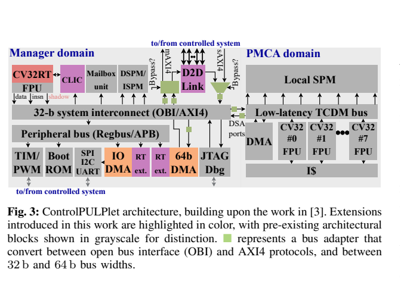
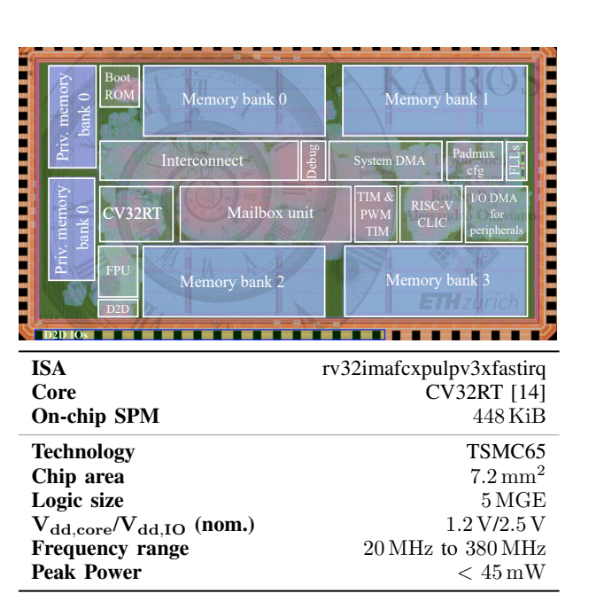
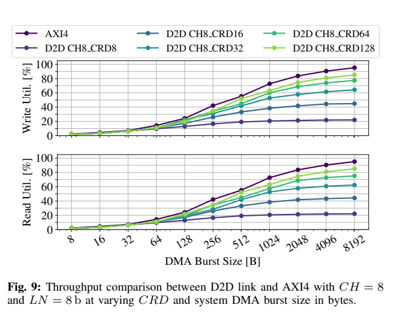
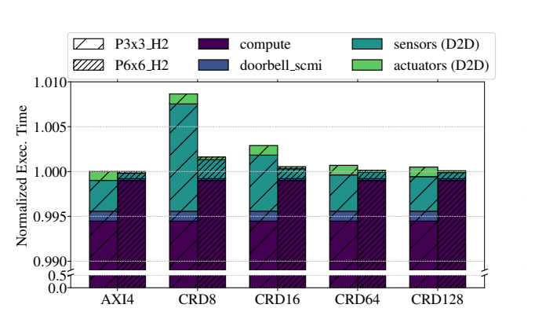
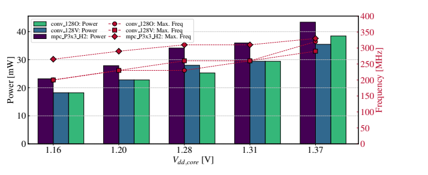
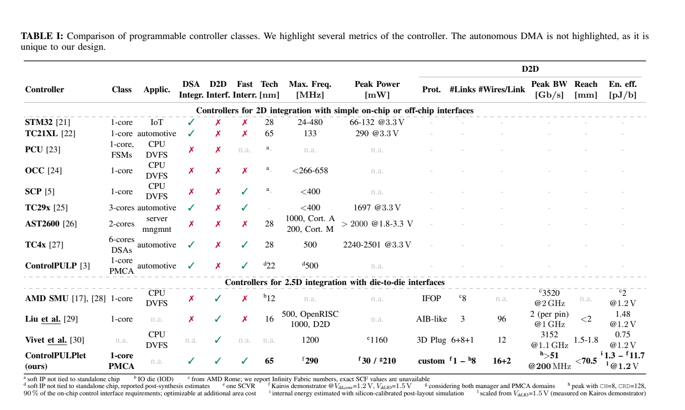

# ControlPULPlet：图文技术精读

[论文页面](https://arxiv.org/abs/2410.15985) · [本笔记所用 PDF](https://arxiv.org/pdf/2410.15985v2) · [DOI](https://doi.org/10.1109/TVLSI.2025.3596452)

整理日期：2026-11-05。**读者原创中文解读；原图归论文作者／出版方。未运行作者实验，不是独立复现。**

**一句话：** 用快速中断、自动周期DMA和可配置D2D接口，减小RISC-V控制器的通信负担，并流片验证管理域。

阅读地图：先看问题与输入输出，再顺着架构图、公式和结果图阅读；最后检查统计边界与E902迁移。完整编号索引另见“图表索引”。下文“读者分析”是推断或建议，不是原文结果。

## 阶段0：材料与版本审计

| 材料 | 当前可用程度 | 影响 |
| --- | --- | --- |
| 摘要、正文、方法、原图注 | 已获取本地完整PDF、文本与逐页渲染 | 可核查结构、实验及关键数字；可见页面优先于异常文本层 |
| 分析版本 | arXiv:2410.15985v2，2025-08-13，14页；有2024年v1，不把预印本首发年当期刊年。 | 引用页码以“PDF第几页”标识 |
| 代码／原始数据 | [ControlPULPlet开源项目](https://github.com/pulp-platform/control-pulp)。原文脚注将架构指向该项目；需要进一步核对相应分支／commit与Kairos配置，当前未运行。 | 公开链接不等于已构建或已拿到原始轨迹 |
| 附件、独立原始重复与勘误 | 当前未完成全渠道附件／勘误穷尽检索 | 不能断言没有附件、没有勘误或没有其他版本 |
| 本次工作范围 | 材料阅读、图表裁取、证据整理、教学公式 | 所有新实验均是建议，尚未执行 |

## 阶段1：身份卡与整体概述

| 项目 | 内容 |
| --- | --- |
| 英文题名 | ControlPULPlet: A Flexible Real-time Multi-core RISC-V Controller for 2.5D Systems-in-package |
| 中文导读题名 | 控制器不仅要算得快，还要及时读传感器和写执行器 |
| 作者 | Alessandro Ottaviano, Robert Balas, Tim Fischer, Thomas Benz, Andrea Bartolini, Luca Benini |
| 发表／版本 | IEEE TVLSI 33(11),3057–3070 (2025)；arXiv:2410.15985v2，2025-08-13，14页；有2024年v1，不把预印本首发年当期刊年。 |
| 类型与领域 | 原始方法／工程系统研究；DVFS、CPU能效、运行时控制 |
| 单位、通讯、资助与利益关系 | 作者来自ETH Zürich和博洛尼亚大学。本文沿ControlPULP架构发展到实时特性和chiplet通信；当前没有逐项核实资助编号与利益冲突声明，保留未知。 |
| 核心对象与接口 | Kairos TSMC65nm、管理域、448KiB SPM；无PMCA/DSA端口，QFN64双芯片PCB，非完整2.5D封装样片。 |
| 代码与数据 | [ControlPULPlet开源项目](https://github.com/pulp-platform/control-pulp)。原文脚注将架构指向该项目；需要进一步核对相应分支／commit与Kairos配置，当前未运行。 |
| 与本课题关系 | 值得你借鉴的是自动采样、快中断、计算与通信预算，不是做chiplet。单核SoC先用简单定时器和寄存器控制，积累完整时延分解。如果智能模型推理很慢，优化通信只能解决小部分；若采样／写PLL占主导，再考虑DMA或轻量硬件状态机。 |

**约200字中文概述（改写）：** ControlPULPlet面向芯粒系统的实时控制，在RISC-V管理核和可编程加速架构中加入快速中断、自动周期DMA及AXI4兼容D2D链路。作者用RTL测试DVFS控制案例与链路吞吐，使用Kairos芯片和双芯片板测量管理域功耗及通信能效。贡献在控制计算、通信和执行时限的共同设计。需要区分500MHz仿真控制案例与290MHz硅片结果，也需区分完整架构包含的集群和Kairos未集成的集群。

**三句话定位：** 问题是芯粒让传感器和执行器跨die，协议转换、DMA重编程及中断会占用控制预算。能否用较小硬件代价保持接近片内通信的控制性能，并用硅片验证关键实现？ 方法主线为邮箱接收设点 → 快速中断/解码 → RT-DMA周期读PVT → 管理核执行MPC → D2D写PLL与片外电压接口 → 确认传输 → 下个控制周期。架构可接8核PMCA，但案例和流片配置有裁剪。 主要证据见下方结果表，结论须与测量和版本范围一起使用。

## 阶段2：问题、假设与创新位置

芯粒让传感器和执行器跨die，协议转换、DMA重编程及中断会占用控制预算。能否用较小硬件代价保持接近片内通信的控制性能，并用硅片验证关键实现？

**创新判断（读者分析）：** CV32RT快速上下文处理、自动周期采样DMA、可参数化数字D2D与系统级时限分析。它强调硬件基础设施，不是新学习策略；DVFS案例采用MPC，是模型预测优化而非必然需要神经网络。 不依据作者自称“首次”断定整个领域绝无前例。

## 阶段3：必要术语与数学

| 级别 | 术语／关键词 | 直觉、严格含义与易混点 |
| --- | --- | --- |
| A | DVFS / DFS | DVFS同时涉及动态电压与频率；只有时钟变化称DFS。电压能否改变取决于实际供电域。 |
| A | Workload | 真正执行应用计算的程序与输入；本文里的控制器是另一个角色。 |
| A | Controller | 根据观测选择动作的软件／硬件，可运行在同一CPU或独立控制核。 |
| A | OPP | Operating Performance Point，经过允许范围验证的电压—频率组合。 |
| A | Power / Energy | 功率W表示此刻消耗快慢；能量J是对时间积分。低功率不必然低能量。 |
| B | Deadline | 作业必须完成的时刻；平均时延、P95与最大时延各有不同用途。 |
| A | MPC | 模型预测控制：用模型预测短期行为，再在约束下求动作。 |
| B | DMA | 不由CPU逐项搬数据的传输硬件，配置和总线争用仍有成本。 |
| B | D2D | die-to-die芯片间通信，带宽能力不等于应用性能收益。 |
| C | 信用流控 | 接收方可用缓冲决定发送许可，FIFO深度影响吞吐与面积。 |

### 公式1：控制时限余量（原文§III-B）

**符号与前提：** T_comp含MPC计算；T_comm含消息、采样与动作传输；T_long=3ms。所有单位s，短周期任务抢占等应在完整预算中体现。

**代入与检查：** 教学例：计算2.2ms、通信0.1ms，3ms周期剩0.7ms；若模型变复杂令计算2.95ms，就会超时。通信占比小不意味着可以忽略计算增大后的预算。

**来源：** §III-B，PDF p8。
### 公式2：峰值链路与实际吞吐（原文整理）

**符号与前提：** Θ单位bit/s；α为利用率；f是时钟Hz；θ为单向每周期有效位数，2表示双向。理论带宽、RTL利用率与板测物理链路应分开。

**代入与检查：** f=200MHz、θ=128bit时理论双向51.2Gbit/s；α=0.85时约43.5Gbit/s。不能把理论峰值与实测可持续值混写。

**来源：** §III-A，Fig9，PDF p7。

## 阶段4–6：架构、关键图与方法拆解

**输入—处理—输出：** 邮箱接收设点 → 快速中断/解码 → RT-DMA周期读PVT → 管理核执行MPC → D2D写PLL与片外电压接口 → 确认传输 → 下个控制周期。架构可接8核PMCA，但案例和流片配置有裁剪。

| 系统角色 | 具体设置 |
| --- | --- |
| 输入 | 被控CPU温度／PVT、频率目标、功率／热约束；D2D端口参数与DMA周期。 |
| 输出 | MPC计算的DVFS点，以及AXI4／D2D读写事务。 |
| RTL控制案例 | 9／36个PE，MPC预测horizon2，5次迭代；500MHz控制器；250µs与3ms双周期。 |
| 硅片边界 | Kairos TSMC65nm、管理域、448KiB SPM；无PMCA/DSA端口，QFN64双芯片PCB，非完整2.5D封装样片。 |

§II（PDF p3–6）：CV32RT加速中断上下文保存／恢复，DMA mid-end保存周期配置减少反复软件编程。链路将AXI4事务转换成流式包，提供信用流控、FIFO及源同步DDR物理层；参数CH、LN、CRD改变吞吐和面积。

§III-A/B（p7–8）：RTL testbench连接另一D2D实例与内存模型。高吞吐配置CH=8、LN=8、CRD=128可达到约85%总线饱和度，片内AXI约95%。DVFS案例读取500个8B PVT寄存器；短任务250µs、长任务3ms，在500MHz下由管理核算MPC，PMCA没有用于本次MPC加速。99%以上时间用于计算，因此通信附加成本对总时长很小，这并不代表通信本身只慢0.05%。

§III-C/D（p8–11）：Kairos采用65nm，核心1.2V最高约290MHz、功耗包络小于30mW；板上两芯片通过平均70.5mm走线连通，受QFN64限制只用CH=1、CRD=8。51.2Gbit/s来自更宽配置的理论／RTL能力，不能声称这块窄链路PCB实测51Gbit/s。内部链路1.3pJ/bit是硅校准后仿真，板级I/O能耗则另外实测。

### Fig3：架构与新增模块

[打开大图](images/original-fig3.png) · [原文 Fig3，PDF p3](https://arxiv.org/pdf/2410.15985v2#page=3)

**怎样看：** 彩色新增、灰色继承；分管理域和PMCA。

**直接观察／原文报告：** 快速中断与DMA/D2D协同。

**读者判断：** Kairos并未集成图中所有域。

### Fig11：Kairos芯片照片和规格

[打开大图](images/original-fig11.png) · [原文 Fig11，PDF p9](https://arxiv.org/pdf/2410.15985v2#page=9)

**怎样看：** 先读参数，再辨存储／管理核区域。

**直接观察／原文报告：** 证明管理域实际流片。

**读者判断：** PMCA未集成，不能宣称全8核控制芯片实测。

| 阅读问题 | 先看材料 | 如何接到下一步 |
| --- | --- | --- |
| 为什么要改现有方案 | 问题背景与动机图 | 确定目标、约束和原有不足 |
| 系统观察什么、控制什么 | 输入输出表＋关键架构图 | 确认数据、模型和执行器真实角色 |
| 方法如何得到动作或估计 | 方法段、公式、算法／模型表 | 明确离线训练与在线流程 |
| 收益是否真实且公平 | 结果图表、统计与测量边界 | 核查基线／目标／分母／开销 |
| 能否用于自己的CPU | 局限、复现计划、三项实验 | 把论文假设变成待验证的工程条件 |

## 阶段7–8：实验、统计及证据链

本节数字均是**原文明确报告或原文数值的标注算例**；没有按图柱高度臆造额外精确值。

| 指标 | 原文报告 | 条件／分母／边界 | 证据位置 |
| --- | --- | --- | --- |
| RTL链路利用率 | 约85%，片内AXI约95% | CH8/LN8/CRD128、大burst | Fig9，p7 |
| DVFS总时长附加开销 | CRD128低于0.05%；CRD8低于0.9% | MPC计算占99%以上；500MHz RTL案例 | Fig10，p8 |
| 快速中断 | 46→13周期；尾链约8周期 | 局部ISR进入路径，非完整闭环 | §III-B，p8 |
| Kairos硅片 | 1.2V约290MHz、30mW包络 | 管理域；不含完整PMCA架构 | Fig16，p10 |
| 内部D2D能量 | 约1.3pJ/bit | 硅校准后仿真，非长PCB的总I/O实测 | §III-D，p11 |

### Fig9：FIFO与burst影响吞吐

[打开大图](images/original-fig9.png) · [原文 Fig9，PDF p7](https://arxiv.org/pdf/2410.15985v2#page=7)

**怎样看：** 横轴字节数，纵轴读写利用率，多曲线为CRD。

**直接观察／原文报告：** 大FIFO和突发提高利用率。

**读者判断：** 85%结果依赖指定参数。

### Fig10：通信对DVFS控制时长影响

[打开大图](images/original-fig10.png) · [原文 Fig10，PDF p8](https://arxiv.org/pdf/2410.15985v2#page=8)

**怎样看：** 看归一化总时长与细分开销。

**直接观察／原文报告：** 计算主导时D2D相对影响小。

**读者判断：** 不能把总开销小理解成传输本身无延迟。

### Fig16：芯片电压频率与功耗

[打开大图](images/original-fig16.png) · [原文 Fig16，PDF p10](https://arxiv.org/pdf/2410.15985v2#page=10)

**怎样看：** 左轴mW、右轴MHz，分别看不同负载。

**直接观察／原文报告：** 1.2V可到约290MHz。

**读者判断：** 不能混用500MHz RTL控制案例。

### TableI：控制器比较

[打开大图](images/original-tablei.png) · [原文 TableI，PDF p12](https://arxiv.org/pdf/2410.15985v2#page=12)

**怎样看：** 按工艺、是否流片、集群和D2D能力读脚注。

**直接观察／原文报告：** 不同证据类型被集中列出。

**读者判断：** 忽略脚注会把仿真指标当硅片实测。

**统计与公平性审查（读者分析）：** 本文混合RTL周期精确测试、综合面积、实际硅片、板测和硅校准仿真，所有数字要注明层级。MPC5次迭代与horizon2只是实验设置，不证明大模型控制器都可实时。板上长走线和封装限制与真正2.5D不同，跨论文能效比较需匹配电压、距离、带宽、工艺与是否含PHY。

工程实验中，设备、程序、输入文件、重复运行、时间窗口是不同统计层级，不能互相替代。本任务不涉及生物样本，细胞／动物／试剂等检查不适用。未注明的P值或置信区间不补造；“差了几个百分点”不自动等于统计显著。

| 主张层级 | 直接证据 | 对照与统计 | 可得结论／替代解释 | 可信度 |
| --- | --- | --- | --- | --- |
| 原文明确报告 | RTL链路利用率：约85%，片内AXI约95% | Fig9，p7 | CH8/LN8/CRD128、大burst；仅在该实验范围内成立 | 图表／文本可核对：高；独立复现：尚无 |
| 作者解释 | 所提架构／模型解释了性能或估计改善 | 关键原图与方法见上文；统计边界见下节 | 效果可能同时来自动作空间、平台特性与采样设置，因果归因需消融 | 中 |
| AI分析／迁移假设 | 用于E902的压缩候选负载 | 本篇未直接验证该芯片与任务组合 | 需三项后续实验；不能复制论文收益数字 | 待验证，当前无法判断 |

## 阶段9–10：贡献与局限分开判断

CV32RT快速上下文处理、自动周期采样DMA、可参数化数字D2D与系统级时限分析。它强调硬件基础设施，不是新学习策略；DVFS案例采用MPC，是模型预测优化而非必然需要神经网络。

| 来源 | 严重程度 | 局限及其影响 |
| --- | --- | --- |
| 作者说明 | 关键 | Kairos受QFN64限制使用窄链路，不等同先进2.5D封装；PMCA在硅片配置被省略。 |
| 实验边界 | 重要 | 500MHz控制案例为RTL设置，不能称290MHz样片实测同一性能。 |
| 读者分析 | 重要 | 大带宽D2D对单核E902毕设可能过度设计；应该先证明寄存器／UART/SPI等路径不足。 |

## 阶段11：最小复现路线与缺口

从ControlPULPlet仓库锁定参数先跑RTL：区分CH/LN/CRD和不同内存延迟；复建Fig9吞吐及Fig10控制预算。硅片、先进封装与板级能量需专用设备，普通电脑无法复现流片实测。对你的项目可只复现预算分析与DMA状态机思想，不声称复现51Gbit/s。

**代码／数据现状：** [ControlPULPlet开源项目](https://github.com/pulp-platform/control-pulp)。原文脚注将架构指向该项目；需要进一步核对相应分支／commit与Kairos配置，当前未运行。

**质量控制顺序：** 先验证程序输出和时间基准，再验证采样／模型，最后比较策略。保存输入文件哈希、平台配置、OPP、随机种子、温度与每次运行原始记录。失败时先回固定安全频点定位错误，再继续优化。复现可行性判断为“可开始部分方法复建，完整数值复现条件未齐”；这与“已完成复现”不同。

## 阶段12：用于你的CPU／E902课题

值得你借鉴的是自动采样、快中断、计算与通信预算，不是做chiplet。单核SoC先用简单定时器和寄存器控制，积累完整时延分解。如果智能模型推理很慢，优化通信只能解决小部分；若采样／写PLL占主导，再考虑DMA或轻量硬件状态机。

| 建议实验／优先级 | 价值 | 最低资源 | 主要风险 | 成功判据（设计目标，非已得结果） |
| --- | --- | --- | --- | --- |
| P0：控制路径成本分解 | 决定该优化哪里 | 周期计数、采样／推理／切换日志 | 只测局部函数 | 建立完整预算，说明最大占比项 |
| P1：周期采样自动化 | 减少控制核重复配置 | 定时器＋DMA或小RTL状态机 | 总线争用／数据陈旧 | 同数据质量下控制占用下降，尾时延不增加 |
| P2：模型复杂度与周期预算 | 选择可行智能算法 | 小Q表、决策树、小MLP三组 | 精度增加而期限失败 | 同时报告参数RAM、推理周期、净能量、最大违约 |

上述优先级是读者建议：P0先做，P1建立在基线可运行后，P2只在资源允许且前序实验证明有必要时开展。压缩应用仍是候选，尚未替你最终定题或证明已在E902运行。论文公开可读不自动授权任意复制数据；代码、图片和数据须分别核对许可。

## 阶段13：读完后应掌握与继续核查

**五个知识点：** 用快速中断、自动周期DMA和可配置D2D接口，减小RISC-V控制器的通信负担，并流片验证管理域。 你还应能解释输入输出表中的角色、两条公式的单位、首个结果指标的分母，以及局限表里的关键条件。

**五个未决问题：** 独立新输入是否成立？最差时延是否可接受？测量参考是否足够？控制与切换是否抵消收益？E902实际具有哪些接口和可观测量？这些是研究问题，不是对作者遗漏的无证据指控。

**立即做：** 按公式算例手算一次，选一张结果图复述“硬件—负载—基线—指标—边界”。**后续核查：** 补齐代码版本、训练数据和仪表设置。**可复用：** 上文明确标注的模型与接口思路。**谨慎采用：** 所有跨平台百分比。**暂不采用：** 尚未证实存在的电压控制和完整硬实时承诺。
