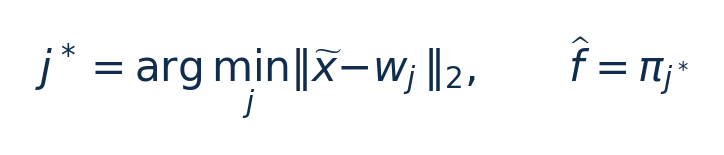

[论文页面](https://pmc.ncbi.nlm.nih.gov/articles/PMC6163884/) · [本笔记所用 PDF](https://mdpi-res.com/d_attachment/sensors/sensors-18-03068/article_deploy/sensors-18-03068.pdf) · [DOI](https://doi.org/10.3390/s18093068)

整理日期：2026-11-05。**读者原创中文解读；原图归论文作者／出版方。未运行作者实验，不是独立复现。**

## 先把四个角色放对位置

被控负载是要完成的程序和输入，比如压缩一块日志；CPU是执行程序的硬件；控制器根据观测选运行档位；驱动／寄存器把档位落实。程序代码可以完全一样，CPU时钟变慢时每条指令对应的墙钟时间通常变长，访存或I/O等待则未必按同样比例变化。

软件控制并不意味着没有真实硬件。软件中的学习策略可控制真实CPU；也可先控制一个执行时间与能量模型。后者能验证闭环逻辑，但模型输出的J不能当真实电测。E902的RTL能在仿真中改变时钟并反馈计数；电压导致的物理功耗还需相应模型、功耗分析或板级实验。

## 这篇到底解决哪一件事

把程序运行特征和用户能接受的性能损失交给CPN，预测应使用的CPU频率。

固定阈值无法同时适应不同访存行为和不同可接受性能损失。问题是能否用比复杂分析模型更轻的学习器，输出满足用户要求的频率，并在真实平台获得净能量收益。

**把方法想成一条流水线：** 离线多频点运行训练程序 → 收集指令、cache miss和性能特征 → 训练原型及输出权重 → 在线特征+性能要求进入CPN → 预测频率 → Linux CPUFreq/PMIC执行 → 再观测。多核共享域把各核建议合成共同频率。

| 先回答的问题 | 本文答案 |
| --- | --- |
| 输入 | Fig4明确为执行指令数、数据cache miss、指令cache miss及性能要求；频率为预测输出／训练标签，不应把它误列为该图第五个输入。 |
| 输出 | 单核建议频率；多核共享域取各核预测中的最大频率。 |
| 平台 | Creator PXA270/Linux2.6.25，外接MAXIM1586B与DAQ；另有Jetson Tegra K1四核A15。 |
| 被控负载 | MiBench与ParMiBench，含gzip_b、gzip、gunzip；不是模拟电机。 |

## 十个先修关键词

| 级别 | 术语／关键词 | 直觉、严格含义与易混点 |
| --- | --- | --- |
| A | DVFS / DFS | DVFS同时涉及动态电压与频率；只有时钟变化称DFS。电压能否改变取决于实际供电域。 |
| A | Workload | 真正执行应用计算的程序与输入；本文里的控制器是另一个角色。 |
| A | Controller | 根据观测选择动作的软件／硬件，可运行在同一CPU或独立控制核。 |
| A | OPP | Operating Performance Point，经过允许范围验证的电压—频率组合。 |
| A | Power / Energy | 功率W表示此刻消耗快慢；能量J是对时间积分。低功率不必然低能量。 |
| B | Deadline | 作业必须完成的时刻；平均时延、P95与最大时延各有不同用途。 |
| A | CPN | Counter Propagation Network，最近原型匹配加输出映射。 |
| A | 性能分数 | 本论文特定的相对时间损失定义，不等于硬截止期保证。 |
| B | MAR | cache miss与执行指令数的比值，用于描述访存压力；与板上DRAM带宽不同。 |
| C | 共享频域 | 多个核心使用同一时钟／电压设置，各核建议不能独立执行。 |

## 用一个小算例建立直觉

教学例：特征(0.2,0.8)，两个原型(0.1,0.9)、(0.9,0.1)，距离约0.141与0.990，选择第一个节点的频率。若把未归一化的百万指令数与0–1比例直接混用，距离会失真。

x̃为归一化特征，无量纲；w_j是第j个原型；π_j是关联频率输出，Hz或归一化值；j*是节点编号。各维必须按同一训练尺度归一化。

**要防止的误读：** Table5存在可见10V异常，必须以硬件资料重建OPP，不据此配置电压。

## 论文真正验证了什么

| 指标 | 原文报告 | 条件／分母／边界 | 证据位置 |
| --- | --- | --- | --- |
| 单核CPN_70能量 | 4.88%–42.63%降低 | 相对Performance基准、不同MiBench；不是平均42% | §6.1，Fig13，p15/17 |
| 单核CPN_90能量 | 0.54%–20.93%降低 | 更严格性能要求，勿混入多核结论 | §6.1，p15 |
| 多核CPN_90能量 | 2.3%–8.8%降低 | 论文结论对10%性能损失设置的归纳 | §7，p23 |
| 多核CPN_70能量 | 3.9%–22%降低 | 论文结论对30%性能损失设置的归纳 | §7，p23 |

这些结果来自作者实验。算法reward、模型误差、控制器时延、被控应用速度与应用节能是不同指标，要看具体行的单位和证据。

## 它与你的毕设怎么接起来

这篇与日志压缩候选最接近。可先用块大小、已处理字节数、历史每字节周期、近期忙闲比例替代昂贵cache事件，离线穷举频点找到满足期限且能量最低的标签，再训练小决策树／原型表。是否一定用CPN应由参数量、准确率和端到端净收益决定。

最先可以尝试：**P0：压缩块OPP扫描**。理由是生成真实训练标签；最低资源是LZ4或heatshrink、不同熵文件、计时与测能；通过标准是每个OPP均正确解压；画完整周期能量—时延曲线。

## 五分钟自测

1. 这篇输出的是下一频率、功率估计，还是通信／控制时序？
2. 是真实负载硬件实验，还是模型／RTL／HIL？哪些部分是真的？
3. 最重要百分比的分母和比较对象是什么？
4. 如果换成单核E902，哪一个输入或硬件旋钮会消失？
5. 算上采样、推理、切频和空闲时间后，节能是否还成立？

答案线索在本页角色表和结果表；进一步读“图文技术精读”的关键原图、公式与三项课题实验，再到“图表索引”回查原PDF。不是先记住论文所有缩写。
