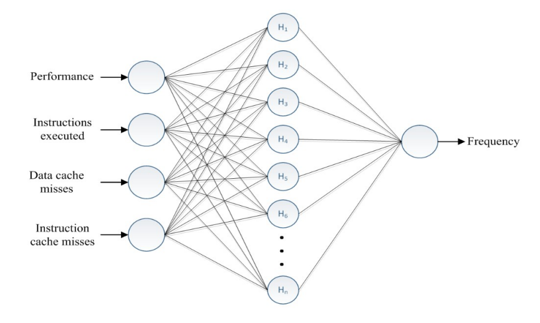
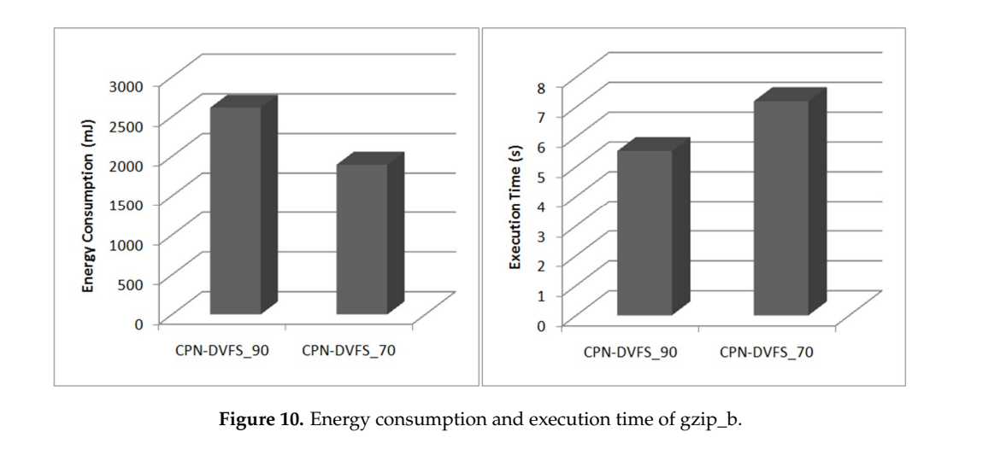
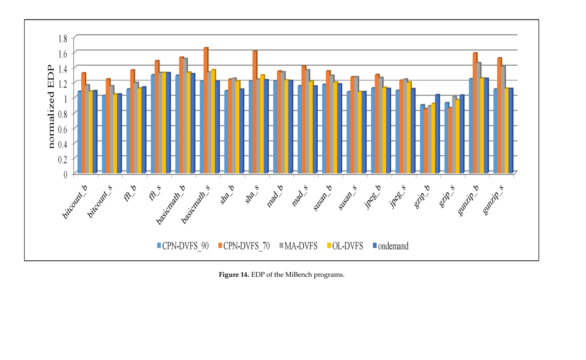
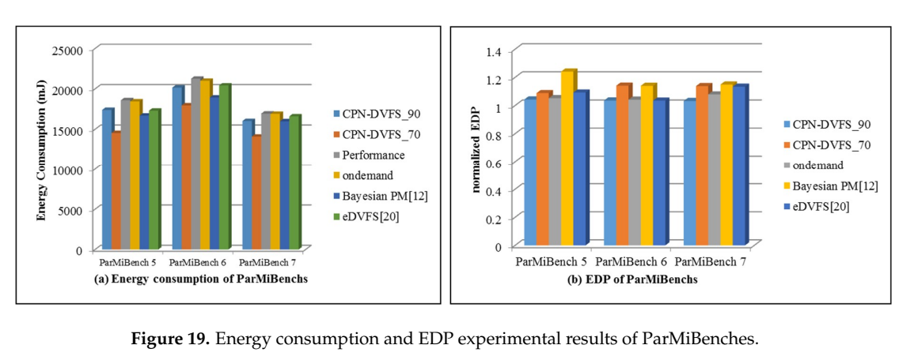

[论文页面](https://pmc.ncbi.nlm.nih.gov/articles/PMC6163884/) · [本笔记所用 PDF](https://mdpi-res.com/d_attachment/sensors/sensors-18-03068/article_deploy/sensors-18-03068.pdf) · [DOI](https://doi.org/10.3390/s18093068)

整理日期：2026-11-05。**读者原创中文解读；原图归论文作者／出版方。未运行作者实验，不是独立复现。**

**覆盖范围：** 本版本正文中识别到的25项图、表或算法；保留原编号。关键项已裁图并在技术精读相应段落出现，未内嵌的项可点PDF页链接查看，不上传整篇PDF。

**统计总边界：** 单核和多核平台、独立程序类型与同程序运行样本是不同层级。当前正文未定位到统一的随机种子、每项重复次数和置信区间，柱状图差异不能自动称为统计显著。原文性能要求70/90允许不同延迟，不能只比较节能率就称同等服务质量下全面胜出。应同时读Fig12–14和Fig18–19。

## Fig1：三种DVFS控制粒度

[原文 Fig1，PDF p4](https://mdpi-res.com/d_attachment/sensors/sensors-18-03068/article_deploy/sensors-18-03068.pdf#page=4)

1. **本项回答的问题：** 三种DVFS控制粒度，用于支撑这条方法或实验链中的具体环节。
2. **组成、坐标和对照：** 区分每芯片、每核、每cluster的PMIC连接。 按原图／表标示的单位与归一化基准阅读；不将不同子图或不同分母的柱高直接相除。 颜色按原图图例辨认，不能把同色跨图视为同一组。
3. **阅读顺序与统计单位：** 先看设定、单位和图例，再看趋势与作者正文。重复次数及采样独立性参见本篇技术精读统计节；没有为该图定位到的误差线定义／独立重复数，不另行猜测。
4. **直接观察：** 物理域决定能否独立选档。
5. **作者解释的范围：** 原文以该图／表作为上述观察的结构说明或实验支撑，需连同对应页正文读取；本索引不额外替作者推导因果机制。
6. **独立判断（AI分析）：** 多核不代表每核独立DVFS。
7. **证据链位置：** 性能验证／定量或示例证据，需结合实验条件。它支持本文具体条件下的实现或结果，不单独完成跨平台验证。
8. **结论与强度：** 可复述“物理域决定能否独立选档。”；对图内描述的核查可信度高，对未做独立实验的泛化判断为中或无法判断。不能得出的结论是“多核不代表每核独立DVFS。”所排除的外推。

## Fig2：CPN层次结构

[原文 Fig2，PDF p5](https://mdpi-res.com/d_attachment/sensors/sensors-18-03068/article_deploy/sensors-18-03068.pdf#page=5)

1. **本项回答的问题：** CPN层次结构，用于支撑这条方法或实验链中的具体环节。
2. **组成、坐标和对照：** 看输入→竞争层→输出层。 结构／流程类没有统一数值坐标；箭头表示数据或控制关系，不表示统计因果。 颜色按原图图例辨认，不能把同色跨图视为同一组。
3. **阅读顺序与统计单位：** 先看设定、单位和图例，再看趋势与作者正文。重复次数及采样独立性参见本篇技术精读统计节；没有为该图定位到的误差线定义／独立重复数，不另行猜测。
4. **直接观察：** 先找赢家再输出频率。
5. **作者解释的范围：** 原文以该图／表作为上述观察的结构说明或实验支撑，需连同对应页正文读取；本索引不额外替作者推导因果机制。
6. **独立判断（AI分析）：** 不是端到端深Q网络。
7. **证据链位置：** 方法／系统实现说明。它支持本文具体条件下的实现或结果，不单独完成跨平台验证。
8. **结论与强度：** 可复述“先找赢家再输出频率。”；对图内描述的核查可信度高，对未做独立实验的泛化判断为中或无法判断。不能得出的结论是“不是端到端深Q网络。”所排除的外推。

## Fig3：自适应查表

[原文 Fig3，PDF p7](https://mdpi-res.com/d_attachment/sensors/sensors-18-03068/article_deploy/sensors-18-03068.pdf#page=7)

1. **本项回答的问题：** 自适应查表，用于支撑这条方法或实验链中的具体环节。
2. **组成、坐标和对照：** 把原型看成特征空间中的代表点。 按原图／表标示的单位与归一化基准阅读；不将不同子图或不同分母的柱高直接相除。 颜色按原图图例辨认，不能把同色跨图视为同一组。
3. **阅读顺序与统计单位：** 先看设定、单位和图例，再看趋势与作者正文。重复次数及采样独立性参见本篇技术精读统计节；没有为该图定位到的误差线定义／独立重复数，不另行猜测。
4. **直接观察：** 相近输入共享一个输出。
5. **作者解释的范围：** 原文以该图／表作为上述观察的结构说明或实验支撑，需连同对应页正文读取；本索引不额外替作者推导因果机制。
6. **独立判断（AI分析）：** 距离近不等于满足时限。
7. **证据链位置：** 性能验证／定量或示例证据，需结合实验条件。它支持本文具体条件下的实现或结果，不单独完成跨平台验证。
8. **结论与强度：** 可复述“相近输入共享一个输出。”；对图内描述的核查可信度高，对未做独立实验的泛化判断为中或无法判断。不能得出的结论是“距离近不等于满足时限。”所排除的外推。

## Fig4：学习选频架构

[原文 Fig4，PDF p8](https://mdpi-res.com/d_attachment/sensors/sensors-18-03068/article_deploy/sensors-18-03068.pdf#page=8)

[打开大图](images/original-fig4.png)

1. **本项回答的问题：** 学习选频架构，用于支撑这条方法或实验链中的具体环节。
2. **组成、坐标和对照：** 先看四类输入，再看预测频率输出。 结构／流程类没有统一数值坐标；箭头表示数据或控制关系，不表示统计因果。 颜色按原图图例辨认，不能把同色跨图视为同一组。
3. **阅读顺序与统计单位：** 先看设定、单位和图例，再看趋势与作者正文。重复次数及采样独立性参见本篇技术精读统计节；没有为该图定位到的误差线定义／独立重复数，不另行猜测。
4. **直接观察：** 用户性能要求参与决策。
5. **作者解释的范围：** 原文以该图／表作为上述观察的结构说明或实验支撑，需连同对应页正文读取；本索引不额外替作者推导因果机制。
6. **独立判断（AI分析）：** 图中假定可观测特征不保证E902具备。
7. **证据链位置：** 方法／系统实现说明。它支持本文具体条件下的实现或结果，不单独完成跨平台验证。
8. **结论与强度：** 可复述“用户性能要求参与决策。”；对图内描述的核查可信度高，对未做独立实验的泛化判断为中或无法判断。不能得出的结论是“图中假定可观测特征不保证E902具备。”所排除的外推。

## Fig5：四核控制框图

[原文 Fig5，PDF p10](https://mdpi-res.com/d_attachment/sensors/sensors-18-03068/article_deploy/sensors-18-03068.pdf#page=10)

1. **本项回答的问题：** 四核控制框图，用于支撑这条方法或实验链中的具体环节。
2. **组成、坐标和对照：** 比较各核预测与统一频率。 结构／流程类没有统一数值坐标；箭头表示数据或控制关系，不表示统计因果。 颜色按原图图例辨认，不能把同色跨图视为同一组。
3. **阅读顺序与统计单位：** 先看设定、单位和图例，再看趋势与作者正文。重复次数及采样独立性参见本篇技术精读统计节；没有为该图定位到的误差线定义／独立重复数，不另行猜测。
4. **直接观察：** 共享域采用最大预测值。
5. **作者解释的范围：** 原文以该图／表作为上述观察的结构说明或实验支撑，需连同对应页正文读取；本索引不额外替作者推导因果机制。
6. **独立判断（AI分析）：** 单核节能不能按4倍外推。
7. **证据链位置：** 方法／系统实现说明。它支持本文具体条件下的实现或结果，不单独完成跨平台验证。
8. **结论与强度：** 可复述“共享域采用最大预测值。”；对图内描述的核查可信度高，对未做独立实验的泛化判断为中或无法判断。不能得出的结论是“单核节能不能按4倍外推。”所排除的外推。

## Fig6：多核流程

[原文 Fig6，PDF p11](https://mdpi-res.com/d_attachment/sensors/sensors-18-03068/article_deploy/sensors-18-03068.pdf#page=11)

1. **本项回答的问题：** 多核流程，用于支撑这条方法或实验链中的具体环节。
2. **组成、坐标和对照：** 顺着观测、推理、取最大和切频阅读。 结构／流程类没有统一数值坐标；箭头表示数据或控制关系，不表示统计因果。 颜色按原图图例辨认，不能把同色跨图视为同一组。
3. **阅读顺序与统计单位：** 先看设定、单位和图例，再看趋势与作者正文。重复次数及采样独立性参见本篇技术精读统计节；没有为该图定位到的误差线定义／独立重复数，不另行猜测。
4. **直接观察：** 频率合成是明确的策略步骤。
5. **作者解释的范围：** 原文以该图／表作为上述观察的结构说明或实验支撑，需连同对应页正文读取；本索引不额外替作者推导因果机制。
6. **独立判断（AI分析）：** 不是自动的硬件独立调压。
7. **证据链位置：** 方法／系统实现说明。它支持本文具体条件下的实现或结果，不单独完成跨平台验证。
8. **结论与强度：** 可复述“频率合成是明确的策略步骤。”；对图内描述的核查可信度高，对未做独立实验的泛化判断为中或无法判断。不能得出的结论是“不是自动的硬件独立调压。”所排除的外推。

## Fig7：CPUFreq调用关系

[原文 Fig7，PDF p12](https://mdpi-res.com/d_attachment/sensors/sensors-18-03068/article_deploy/sensors-18-03068.pdf#page=12)

1. **本项回答的问题：** CPUFreq调用关系，用于支撑这条方法或实验链中的具体环节。
2. **组成、坐标和对照：** 从governor到驱动看执行层。 按原图／表标示的单位与归一化基准阅读；不将不同子图或不同分母的柱高直接相除。 颜色按原图图例辨认，不能把同色跨图视为同一组。
3. **阅读顺序与统计单位：** 先看设定、单位和图例，再看趋势与作者正文。重复次数及采样独立性参见本篇技术精读统计节；没有为该图定位到的误差线定义／独立重复数，不另行猜测。
4. **直接观察：** 软件策略经内核接口落地。
5. **作者解释的范围：** 原文以该图／表作为上述观察的结构说明或实验支撑，需连同对应页正文读取；本索引不额外替作者推导因果机制。
6. **独立判断（AI分析）：** 裸机E902需替换该执行层。
7. **证据链位置：** 性能验证／定量或示例证据，需结合实验条件。它支持本文具体条件下的实现或结果，不单独完成跨平台验证。
8. **结论与强度：** 可复述“软件策略经内核接口落地。”；对图内描述的核查可信度高，对未做独立实验的泛化判断为中或无法判断。不能得出的结论是“裸机E902需替换该执行层。”所排除的外推。

## Fig8：DAQ测量结构

[原文 Fig8，PDF p12](https://mdpi-res.com/d_attachment/sensors/sensors-18-03068/article_deploy/sensors-18-03068.pdf#page=12)

1. **本项回答的问题：** DAQ测量结构，用于支撑这条方法或实验链中的具体环节。
2. **组成、坐标和对照：** 看电源轨、分流电阻和采集。 结构／流程类没有统一数值坐标；箭头表示数据或控制关系，不表示统计因果。 颜色按原图图例辨认，不能把同色跨图视为同一组。
3. **阅读顺序与统计单位：** 先看设定、单位和图例，再看趋势与作者正文。重复次数及采样独立性参见本篇技术精读统计节；没有为该图定位到的误差线定义／独立重复数，不另行猜测。
4. **直接观察：** 有实际电测证据。
5. **作者解释的范围：** 原文以该图／表作为上述观察的结构说明或实验支撑，需连同对应页正文读取；本索引不额外替作者推导因果机制。
6. **独立判断（AI分析）：** 采样边界／带宽仍影响短任务结果。
7. **证据链位置：** 方法／系统实现说明。它支持本文具体条件下的实现或结果，不单独完成跨平台验证。
8. **结论与强度：** 可复述“有实际电测证据。”；对图内描述的核查可信度高，对未做独立实验的泛化判断为中或无法判断。不能得出的结论是“采样边界／带宽仍影响短任务结果。”所排除的外推。

## Fig9：频率选择分布

[原文 Fig9，PDF p13](https://mdpi-res.com/d_attachment/sensors/sensors-18-03068/article_deploy/sensors-18-03068.pdf#page=13)

1. **本项回答的问题：** 频率选择分布，用于支撑这条方法或实验链中的具体环节。
2. **组成、坐标和对照：** 横轴频点、纵轴选择概率，对比70与90。 按原图／表标示的单位与归一化基准阅读；不将不同子图或不同分母的柱高直接相除。 颜色按原图图例辨认，不能把同色跨图视为同一组。
3. **阅读顺序与统计单位：** 先看设定、单位和图例，再看趋势与作者正文。重复次数及采样独立性参见本篇技术精读统计节；没有为该图定位到的误差线定义／独立重复数，不另行猜测。
4. **直接观察：** 宽松目标更偏向低档。
5. **作者解释的范围：** 原文以该图／表作为上述观察的结构说明或实验支撑，需连同对应页正文读取；本索引不额外替作者推导因果机制。
6. **独立判断（AI分析）：** 选择低档本身不证明净能量降低。
7. **证据链位置：** 性能验证／定量或示例证据，需结合实验条件。它支持本文具体条件下的实现或结果，不单独完成跨平台验证。
8. **结论与强度：** 可复述“宽松目标更偏向低档。”；对图内描述的核查可信度高，对未做独立实验的泛化判断为中或无法判断。不能得出的结论是“选择低档本身不证明净能量降低。”所排除的外推。

## Fig10：gzip能量与时间

[原文 Fig10，PDF p14](https://mdpi-res.com/d_attachment/sensors/sensors-18-03068/article_deploy/sensors-18-03068.pdf#page=14)

[打开大图](images/original-fig10.png)

1. **本项回答的问题：** gzip能量与时间，用于支撑这条方法或实验链中的具体环节。
2. **组成、坐标和对照：** 左右图分别看能量与执行时间。 按原图／表标示的单位与归一化基准阅读；不将不同子图或不同分母的柱高直接相除。 颜色按原图图例辨认，不能把同色跨图视为同一组。
3. **阅读顺序与统计单位：** 先看设定、单位和图例，再看趋势与作者正文。重复次数及采样独立性参见本篇技术精读统计节；没有为该图定位到的误差线定义／独立重复数，不另行猜测。
4. **直接观察：** 70设置更省能但更慢。
5. **作者解释的范围：** 原文以该图／表作为上述观察的结构说明或实验支撑，需连同对应页正文读取；本索引不额外替作者推导因果机制。
6. **独立判断（AI分析）：** 必须同时检查服务质量。
7. **证据链位置：** 性能验证／定量或示例证据，需结合实验条件。它支持本文具体条件下的实现或结果，不单独完成跨平台验证。
8. **结论与强度：** 可复述“70设置更省能但更慢。”；对图内描述的核查可信度高，对未做独立实验的泛化判断为中或无法判断。不能得出的结论是“必须同时检查服务质量。”所排除的外推。

## Fig11：控制器开销

[原文 Fig11，PDF p14](https://mdpi-res.com/d_attachment/sensors/sensors-18-03068/article_deploy/sensors-18-03068.pdf#page=14)

1. **本项回答的问题：** 控制器开销，用于支撑这条方法或实验链中的具体环节。
2. **组成、坐标和对照：** 按程序和时间尺度看额外成本。 按原图／表标示的单位与归一化基准阅读；不将不同子图或不同分母的柱高直接相除。 颜色按原图图例辨认，不能把同色跨图视为同一组。
3. **阅读顺序与统计单位：** 先看设定、单位和图例，再看趋势与作者正文。重复次数及采样独立性参见本篇技术精读统计节；没有为该图定位到的误差线定义／独立重复数，不另行猜测。
4. **直接观察：** 学习器本身消耗资源。
5. **作者解释的范围：** 原文以该图／表作为上述观察的结构说明或实验支撑，需连同对应页正文读取；本索引不额外替作者推导因果机制。
6. **独立判断（AI分析）：** 不能把图示平台开销复制到E902。
7. **证据链位置：** 性能验证／定量或示例证据，需结合实验条件。它支持本文具体条件下的实现或结果，不单独完成跨平台验证。
8. **结论与强度：** 可复述“学习器本身消耗资源。”；对图内描述的核查可信度高，对未做独立实验的泛化判断为中或无法判断。不能得出的结论是“不能把图示平台开销复制到E902。”所排除的外推。

## Fig12：单核执行时间与性能表

[原文 Fig12，PDF p16](https://mdpi-res.com/d_attachment/sensors/sensors-18-03068/article_deploy/sensors-18-03068.pdf#page=16)

1. **本项回答的问题：** 单核执行时间与性能表，用于支撑这条方法或实验链中的具体环节。
2. **组成、坐标和对照：** 横向大图按应用逐项看。 按原图／表标示的单位与归一化基准阅读；不将不同子图或不同分母的柱高直接相除。 颜色按原图图例辨认，不能把同色跨图视为同一组。
3. **阅读顺序与统计单位：** 先看设定、单位和图例，再看趋势与作者正文。重复次数及采样独立性参见本篇技术精读统计节；没有为该图定位到的误差线定义／独立重复数，不另行猜测。
4. **直接观察：** 70/90实际性能并非固定常数。
5. **作者解释的范围：** 原文以该图／表作为上述观察的结构说明或实验支撑，需连同对应页正文读取；本索引不额外替作者推导因果机制。
6. **独立判断（AI分析）：** 均值无法排除个别输入违约。
7. **证据链位置：** 性能验证／定量或示例证据，需结合实验条件。它支持本文具体条件下的实现或结果，不单独完成跨平台验证。
8. **结论与强度：** 可复述“70/90实际性能并非固定常数。”；对图内描述的核查可信度高，对未做独立实验的泛化判断为中或无法判断。不能得出的结论是“均值无法排除个别输入违约。”所排除的外推。

## Fig13：单核能量

[原文 Fig13，PDF p17](https://mdpi-res.com/d_attachment/sensors/sensors-18-03068/article_deploy/sensors-18-03068.pdf#page=17)

1. **本项回答的问题：** 单核能量，用于支撑这条方法或实验链中的具体环节。
2. **组成、坐标和对照：** 同一应用内对照Performance与其他governor。 按原图／表标示的单位与归一化基准阅读；不将不同子图或不同分母的柱高直接相除。 颜色按原图图例辨认，不能把同色跨图视为同一组。
3. **阅读顺序与统计单位：** 先看设定、单位和图例，再看趋势与作者正文。重复次数及采样独立性参见本篇技术精读统计节；没有为该图定位到的误差线定义／独立重复数，不另行猜测。
4. **直接观察：** 节能因负载与目标不同。
5. **作者解释的范围：** 原文以该图／表作为上述观察的结构说明或实验支撑，需连同对应页正文读取；本索引不额外替作者推导因果机制。
6. **独立判断（AI分析）：** 最高值不等于平均值。
7. **证据链位置：** 性能验证／定量或示例证据，需结合实验条件。它支持本文具体条件下的实现或结果，不单独完成跨平台验证。
8. **结论与强度：** 可复述“节能因负载与目标不同。”；对图内描述的核查可信度高，对未做独立实验的泛化判断为中或无法判断。不能得出的结论是“最高值不等于平均值。”所排除的外推。

## Fig14：单核EDP

[原文 Fig14，PDF p18](https://mdpi-res.com/d_attachment/sensors/sensors-18-03068/article_deploy/sensors-18-03068.pdf#page=18)

[打开大图](images/original-fig14.png)

1. **本项回答的问题：** 单核EDP，用于支撑这条方法或实验链中的具体环节。
2. **组成、坐标和对照：** 读归一化定义再比较柱高。 按原图／表标示的单位与归一化基准阅读；不将不同子图或不同分母的柱高直接相除。 颜色按原图图例辨认，不能把同色跨图视为同一组。
3. **阅读顺序与统计单位：** 先看设定、单位和图例，再看趋势与作者正文。重复次数及采样独立性参见本篇技术精读统计节；没有为该图定位到的误差线定义／独立重复数，不另行猜测。
4. **直接观察：** 能量最少不一定EDP最好。
5. **作者解释的范围：** 原文以该图／表作为上述观察的结构说明或实验支撑，需连同对应页正文读取；本索引不额外替作者推导因果机制。
6. **独立判断（AI分析）：** EDP也不能代替绝对截止期。
7. **证据链位置：** 性能验证／定量或示例证据，需结合实验条件。它支持本文具体条件下的实现或结果，不单独完成跨平台验证。
8. **结论与强度：** 可复述“能量最少不一定EDP最好。”；对图内描述的核查可信度高，对未做独立实验的泛化判断为中或无法判断。不能得出的结论是“EDP也不能代替绝对截止期。”所排除的外推。

## Fig15：多核组合1/2运行时间

[原文 Fig15，PDF p20](https://mdpi-res.com/d_attachment/sensors/sensors-18-03068/article_deploy/sensors-18-03068.pdf#page=20)

1. **本项回答的问题：** 多核组合1/2运行时间，用于支撑这条方法或实验链中的具体环节。
2. **组成、坐标和对照：** 逐组合比较策略并看下方性能分数。 按原图／表标示的单位与归一化基准阅读；不将不同子图或不同分母的柱高直接相除。 颜色按原图图例辨认，不能把同色跨图视为同一组。
3. **阅读顺序与统计单位：** 先看设定、单位和图例，再看趋势与作者正文。重复次数及采样独立性参见本篇技术精读统计节；没有为该图定位到的误差线定义／独立重复数，不另行猜测。
4. **直接观察：** 共享域产生共同延迟代价。
5. **作者解释的范围：** 原文以该图／表作为上述观察的结构说明或实验支撑，需连同对应页正文读取；本索引不额外替作者推导因果机制。
6. **独立判断（AI分析）：** 不能仅看一个核心。
7. **证据链位置：** 性能验证／定量或示例证据，需结合实验条件。它支持本文具体条件下的实现或结果，不单独完成跨平台验证。
8. **结论与强度：** 可复述“共享域产生共同延迟代价。”；对图内描述的核查可信度高，对未做独立实验的泛化判断为中或无法判断。不能得出的结论是“不能仅看一个核心。”所排除的外推。

## Fig16：多核组合3/4运行时间

[原文 Fig16，PDF p20](https://mdpi-res.com/d_attachment/sensors/sensors-18-03068/article_deploy/sensors-18-03068.pdf#page=20)

1. **本项回答的问题：** 多核组合3/4运行时间，用于支撑这条方法或实验链中的具体环节。
2. **组成、坐标和对照：** 与Fig15对应，重点同构gzip组合。 按原图／表标示的单位与归一化基准阅读；不将不同子图或不同分母的柱高直接相除。 颜色按原图图例辨认，不能把同色跨图视为同一组。
3. **阅读顺序与统计单位：** 先看设定、单位和图例，再看趋势与作者正文。重复次数及采样独立性参见本篇技术精读统计节；没有为该图定位到的误差线定义／独立重复数，不另行猜测。
4. **直接观察：** 同构任务也有可调性能权衡。
5. **作者解释的范围：** 原文以该图／表作为上述观察的结构说明或实验支撑，需连同对应页正文读取；本索引不额外替作者推导因果机制。
6. **独立判断（AI分析）：** 不证明任意并发压缩都如此。
7. **证据链位置：** 性能验证／定量或示例证据，需结合实验条件。它支持本文具体条件下的实现或结果，不单独完成跨平台验证。
8. **结论与强度：** 可复述“同构任务也有可调性能权衡。”；对图内描述的核查可信度高，对未做独立实验的泛化判断为中或无法判断。不能得出的结论是“不证明任意并发压缩都如此。”所排除的外推。

## Fig17：多核能量

[原文 Fig17，PDF p21](https://mdpi-res.com/d_attachment/sensors/sensors-18-03068/article_deploy/sensors-18-03068.pdf#page=21)

1. **本项回答的问题：** 多核能量，用于支撑这条方法或实验链中的具体环节。
2. **组成、坐标和对照：** 在相同组合内比较。 按原图／表标示的单位与归一化基准阅读；不将不同子图或不同分母的柱高直接相除。 颜色按原图图例辨认，不能把同色跨图视为同一组。
3. **阅读顺序与统计单位：** 先看设定、单位和图例，再看趋势与作者正文。重复次数及采样独立性参见本篇技术精读统计节；没有为该图定位到的误差线定义／独立重复数，不另行猜测。
4. **直接观察：** 更宽松要求常有更多节能。
5. **作者解释的范围：** 原文以该图／表作为上述观察的结构说明或实验支撑，需连同对应页正文读取；本索引不额外替作者推导因果机制。
6. **独立判断（AI分析）：** 宽松与严格服务不可当同条件。
7. **证据链位置：** 性能验证／定量或示例证据，需结合实验条件。它支持本文具体条件下的实现或结果，不单独完成跨平台验证。
8. **结论与强度：** 可复述“更宽松要求常有更多节能。”；对图内描述的核查可信度高，对未做独立实验的泛化判断为中或无法判断。不能得出的结论是“宽松与严格服务不可当同条件。”所排除的外推。

## Fig18：ParMiBench运行时间

[原文 Fig18，PDF p22](https://mdpi-res.com/d_attachment/sensors/sensors-18-03068/article_deploy/sensors-18-03068.pdf#page=22)

1. **本项回答的问题：** ParMiBench运行时间，用于支撑这条方法或实验链中的具体环节。
2. **组成、坐标和对照：** 横轴程序，纵轴秒，底表为性能。 按原图／表标示的单位与归一化基准阅读；不将不同子图或不同分母的柱高直接相除。 颜色按原图图例辨认，不能把同色跨图视为同一组。
3. **阅读顺序与统计单位：** 先看设定、单位和图例，再看趋势与作者正文。重复次数及采样独立性参见本篇技术精读统计节；没有为该图定位到的误差线定义／独立重复数，不另行猜测。
4. **直接观察：** 显示实际时间而不只分数。
5. **作者解释的范围：** 原文以该图／表作为上述观察的结构说明或实验支撑，需连同对应页正文读取；本索引不额外替作者推导因果机制。
6. **独立判断（AI分析）：** 缺少分布时不能判断尾时延。
7. **证据链位置：** 性能验证／定量或示例证据，需结合实验条件。它支持本文具体条件下的实现或结果，不单独完成跨平台验证。
8. **结论与强度：** 可复述“显示实际时间而不只分数。”；对图内描述的核查可信度高，对未做独立实验的泛化判断为中或无法判断。不能得出的结论是“缺少分布时不能判断尾时延。”所排除的外推。

## Fig19：ParMiBench能量与EDP

[原文 Fig19，PDF p22](https://mdpi-res.com/d_attachment/sensors/sensors-18-03068/article_deploy/sensors-18-03068.pdf#page=22)

[打开大图](images/original-fig19.png)

1. **本项回答的问题：** ParMiBench能量与EDP，用于支撑这条方法或实验链中的具体环节。
2. **组成、坐标和对照：** 左图能量，右图EDP并排比较。 按原图／表标示的单位与归一化基准阅读；不将不同子图或不同分母的柱高直接相除。 颜色按原图图例辨认，不能把同色跨图视为同一组。
3. **阅读顺序与统计单位：** 先看设定、单位和图例，再看趋势与作者正文。重复次数及采样独立性参见本篇技术精读统计节；没有为该图定位到的误差线定义／独立重复数，不另行猜测。
4. **直接观察：** 策略排名随指标变化。
5. **作者解释的范围：** 原文以该图／表作为上述观察的结构说明或实验支撑，需连同对应页正文读取；本索引不额外替作者推导因果机制。
6. **独立判断（AI分析）：** 选择指标必须贴合课题期限。
7. **证据链位置：** 性能验证／定量或示例证据，需结合实验条件。它支持本文具体条件下的实现或结果，不单独完成跨平台验证。
8. **结论与强度：** 可复述“策略排名随指标变化。”；对图内描述的核查可信度高，对未做独立实验的泛化判断为中或无法判断。不能得出的结论是“选择指标必须贴合课题期限。”所排除的外推。

## Table1：CPN训练过程

[原文 Table1，PDF p6](https://mdpi-res.com/d_attachment/sensors/sensors-18-03068/article_deploy/sensors-18-03068.pdf#page=6)

1. **本项回答的问题：** CPN训练过程，用于支撑这条方法或实验链中的具体环节。
2. **组成、坐标和对照：** 按距离阈值、节点增加和权重更新读。 按原图／表标示的单位与归一化基准阅读；不将不同子图或不同分母的柱高直接相除。 颜色按原图图例辨认，不能把同色跨图视为同一组。
3. **阅读顺序与统计单位：** 先看设定、单位和图例，再看趋势与作者正文。重复次数及采样独立性参见本篇技术精读统计节；没有为该图定位到的误差线定义／独立重复数，不另行猜测。
4. **直接观察：** 容量由训练流程形成。
5. **作者解释的范围：** 原文以该图／表作为上述观察的结构说明或实验支撑，需连同对应页正文读取；本索引不额外替作者推导因果机制。
6. **独立判断（AI分析）：** 需补齐阈值和停止条件才能复现。
7. **证据链位置：** 性能验证／定量或示例证据，需结合实验条件。它支持本文具体条件下的实现或结果，不单独完成跨平台验证。
8. **结论与强度：** 可复述“容量由训练流程形成。”；对图内描述的核查可信度高，对未做独立实验的泛化判断为中或无法判断。不能得出的结论是“需补齐阈值和停止条件才能复现。”所排除的外推。

## Table2：MiBench指令样本

[原文 Table2，PDF p8](https://mdpi-res.com/d_attachment/sensors/sensors-18-03068/article_deploy/sensors-18-03068.pdf#page=8)

1. **本项回答的问题：** MiBench指令样本，用于支撑这条方法或实验链中的具体环节。
2. **组成、坐标和对照：** 比较程序指令量和训练来源。 按原图／表标示的单位与归一化基准阅读；不将不同子图或不同分母的柱高直接相除。 颜色按原图图例辨认，不能把同色跨图视为同一组。
3. **阅读顺序与统计单位：** 先看设定、单位和图例，再看趋势与作者正文。重复次数及采样独立性参见本篇技术精读统计节；没有为该图定位到的误差线定义／独立重复数，不另行猜测。
4. **直接观察：** 数据量在不同程序间不均衡。
5. **作者解释的范围：** 原文以该图／表作为上述观察的结构说明或实验支撑，需连同对应页正文读取；本索引不额外替作者推导因果机制。
6. **独立判断（AI分析）：** 不能把指令样本数当独立任务数。
7. **证据链位置：** 性能验证／定量或示例证据，需结合实验条件。它支持本文具体条件下的实现或结果，不单独完成跨平台验证。
8. **结论与强度：** 可复述“数据量在不同程序间不均衡。”；对图内描述的核查可信度高，对未做独立实验的泛化判断为中或无法判断。不能得出的结论是“不能把指令样本数当独立任务数。”所排除的外推。

## Table3：性能分数示例

[原文 Table3，PDF p9](https://mdpi-res.com/d_attachment/sensors/sensors-18-03068/article_deploy/sensors-18-03068.pdf#page=9)

1. **本项回答的问题：** 性能分数示例，用于支撑这条方法或实验链中的具体环节。
2. **组成、坐标和对照：** 比较指令、cache miss和分数。 按原图／表标示的单位与归一化基准阅读；不将不同子图或不同分母的柱高直接相除。 颜色按原图图例辨认，不能把同色跨图视为同一组。
3. **阅读顺序与统计单位：** 先看设定、单位和图例，再看趋势与作者正文。重复次数及采样独立性参见本篇技术精读统计节；没有为该图定位到的误差线定义／独立重复数，不另行猜测。
4. **直接观察：** 分数是构造的代理指标。
5. **作者解释的范围：** 原文以该图／表作为上述观察的结构说明或实验支撑，需连同对应页正文读取；本索引不额外替作者推导因果机制。
6. **独立判断（AI分析）：** 不是直接的硬实时证明。
7. **证据链位置：** 性能验证／定量或示例证据，需结合实验条件。它支持本文具体条件下的实现或结果，不单独完成跨平台验证。
8. **结论与强度：** 可复述“分数是构造的代理指标。”；对图内描述的核查可信度高，对未做独立实验的泛化判断为中或无法判断。不能得出的结论是“不是直接的硬实时证明。”所排除的外推。

## Table4：在线选频算法

[原文 Table4，PDF p9](https://mdpi-res.com/d_attachment/sensors/sensors-18-03068/article_deploy/sensors-18-03068.pdf#page=9)

1. **本项回答的问题：** 在线选频算法，用于支撑这条方法或实验链中的具体环节。
2. **组成、坐标和对照：** 看训练完成后的取样与应用顺序。 结构／流程类没有统一数值坐标；箭头表示数据或控制关系，不表示统计因果。 颜色按原图图例辨认，不能把同色跨图视为同一组。
3. **阅读顺序与统计单位：** 先看设定、单位和图例，再看趋势与作者正文。重复次数及采样独立性参见本篇技术精读统计节；没有为该图定位到的误差线定义／独立重复数，不另行猜测。
4. **直接观察：** 推理需要持续观测。
5. **作者解释的范围：** 原文以该图／表作为上述观察的结构说明或实验支撑，需连同对应页正文读取；本索引不额外替作者推导因果机制。
6. **独立判断（AI分析）：** 控制开销不能遗漏。
7. **证据链位置：** 方法／系统实现说明。它支持本文具体条件下的实现或结果，不单独完成跨平台验证。
8. **结论与强度：** 可复述“推理需要持续观测。”；对图内描述的核查可信度高，对未做独立实验的泛化判断为中或无法判断。不能得出的结论是“控制开销不能遗漏。”所排除的外推。

## Table5：PXA270频点电压

[原文 Table5，PDF p13](https://mdpi-res.com/d_attachment/sensors/sensors-18-03068/article_deploy/sensors-18-03068.pdf#page=13)

1. **本项回答的问题：** PXA270频点电压，用于支撑这条方法或实验链中的具体环节。
2. **组成、坐标和对照：** 逐行核对单位与安全范围。 按原图／表标示的单位与归一化基准阅读；不将不同子图或不同分母的柱高直接相除。 颜色按原图图例辨认，不能把同色跨图视为同一组。
3. **阅读顺序与统计单位：** 先看设定、单位和图例，再看趋势与作者正文。重复次数及采样独立性参见本篇技术精读统计节；没有为该图定位到的误差线定义／独立重复数，不另行猜测。
4. **直接观察：** 156MHz行可见10V异常。
5. **作者解释的范围：** 原文以该图／表作为上述观察的结构说明或实验支撑，需连同对应页正文读取；本索引不额外替作者推导因果机制。
6. **独立判断（AI分析）：** 该异常不能当真实可用OPP。
7. **证据链位置：** 性能验证／定量或示例证据，需结合实验条件。它支持本文具体条件下的实现或结果，不单独完成跨平台验证。
8. **结论与强度：** 可复述“156MHz行可见10V异常。”；对图内描述的核查可信度高，对未做独立实验的泛化判断为中或无法判断。不能得出的结论是“该异常不能当真实可用OPP。”所排除的外推。

## Table6：多核任务分配

[原文 Table6，PDF p19](https://mdpi-res.com/d_attachment/sensors/sensors-18-03068/article_deploy/sensors-18-03068.pdf#page=19)

1. **本项回答的问题：** 多核任务分配，用于支撑这条方法或实验链中的具体环节。
2. **组成、坐标和对照：** 看四种MiBench组合，注意gzip/gunzip。 按原图／表标示的单位与归一化基准阅读；不将不同子图或不同分母的柱高直接相除。 颜色按原图图例辨认，不能把同色跨图视为同一组。
3. **阅读顺序与统计单位：** 先看设定、单位和图例，再看趋势与作者正文。重复次数及采样独立性参见本篇技术精读统计节；没有为该图定位到的误差线定义／独立重复数，不另行猜测。
4. **直接观察：** 包含混合与同构压缩场景。
5. **作者解释的范围：** 原文以该图／表作为上述观察的结构说明或实验支撑，需连同对应页正文读取；本索引不额外替作者推导因果机制。
6. **独立判断（AI分析）：** 组合数不是独立板卡数。
7. **证据链位置：** 性能验证／定量或示例证据，需结合实验条件。它支持本文具体条件下的实现或结果，不单独完成跨平台验证。
8. **结论与强度：** 可复述“包含混合与同构压缩场景。”；对图内描述的核查可信度高，对未做独立实验的泛化判断为中或无法判断。不能得出的结论是“组合数不是独立板卡数。”所排除的外推。
