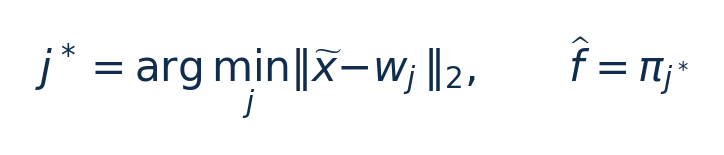
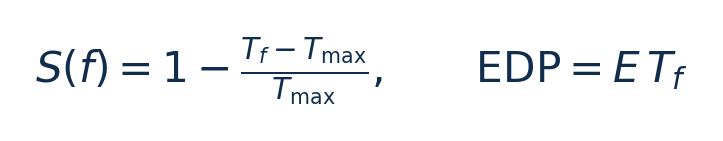
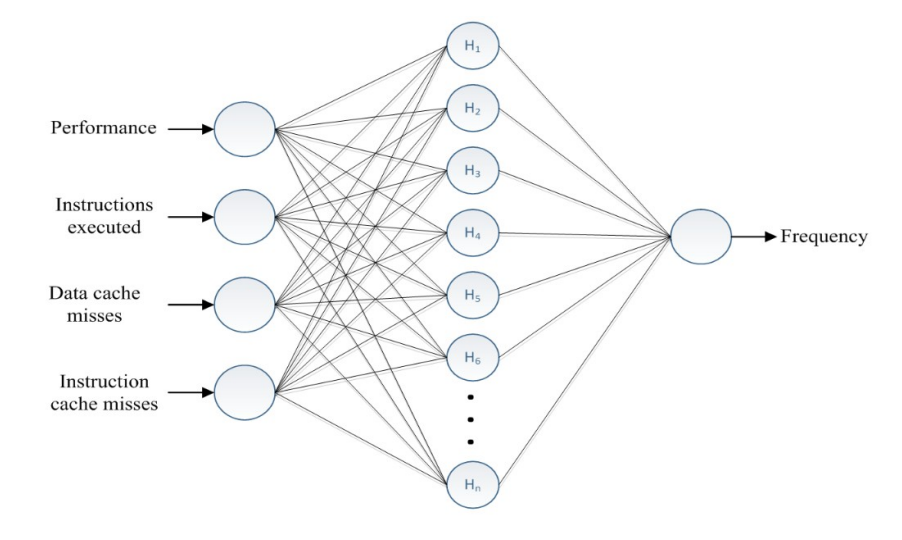
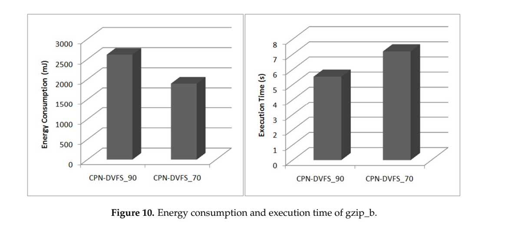
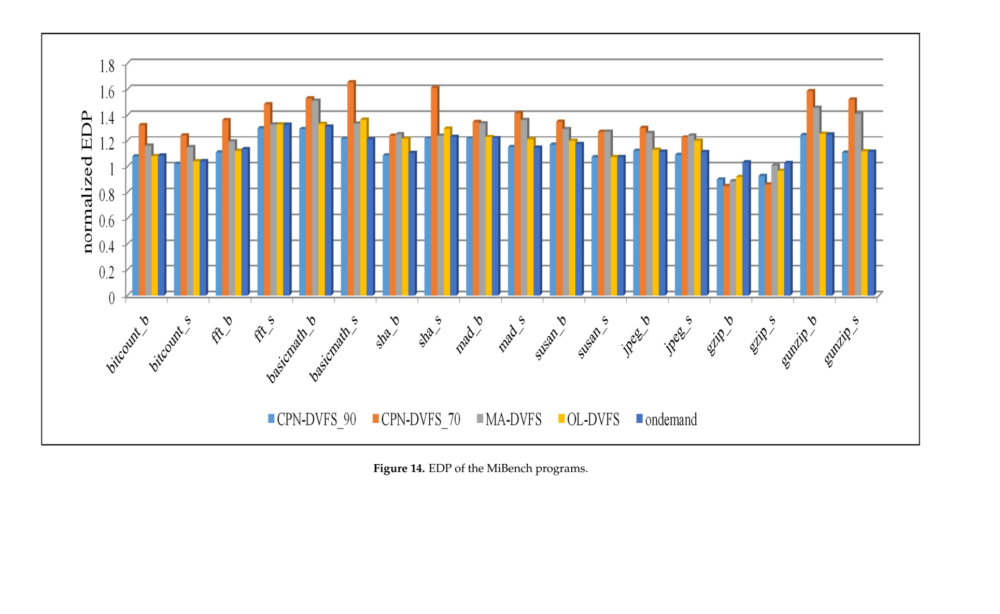
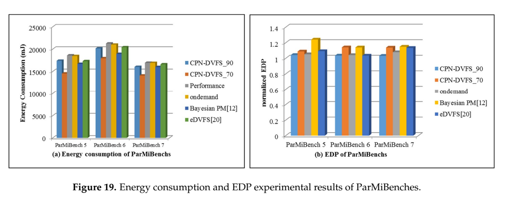

# CPN-DVFS：图文技术精读

[论文页面](https://pmc.ncbi.nlm.nih.gov/articles/PMC6163884/) · [本笔记所用 PDF](https://mdpi-res.com/d_attachment/sensors/sensors-18-03068/article_deploy/sensors-18-03068.pdf) · [DOI](https://doi.org/10.3390/s18093068)

整理日期：2026-11-05。**读者原创中文解读；原图归论文作者／出版方。未运行作者实验，不是独立复现。**

**一句话：** 把程序运行特征和用户能接受的性能损失交给CPN，预测应使用的CPU频率。

阅读地图：先看问题与输入输出，再顺着架构图、公式和结果图阅读；最后检查统计边界与E902迁移。完整编号索引另见“图表索引”。下文“读者分析”是推断或建议，不是原文结果。

## 阶段0：材料与版本审计

| 材料 | 当前可用程度 | 影响 |
| --- | --- | --- |
| 摘要、正文、方法、原图注 | 已获取本地完整PDF、文本与逐页渲染 | 可核查结构、实验及关键数字；可见页面优先于异常文本层 |
| 分析版本 | MDPI正式版，25个PDF页面；部分文本层叠加了排版草稿文字，图表以可见页面为准。 | 引用页码以“PDF第几页”标识 |
| 代码／原始数据 | 正文提供算法表和硬件测量方式；当前材料中尚未定位到完整配套源码／原始DAQ数据。PMC与MDPI提供公开全文。 | 公开链接不等于已构建或已拿到原始轨迹 |
| 附件、独立原始重复与勘误 | 当前未完成全渠道附件／勘误穷尽检索 | 不能断言没有附件、没有勘误或没有其他版本 |
| 本次工作范围 | 材料阅读、图表裁取、证据整理、教学公式 | 所有新实验均是建议，尚未执行 |

## 阶段1：身份卡与整体概述

| 项目 | 内容 |
| --- | --- |
| 英文题名 | Learning-Directed Dynamic Voltage and Frequency Scaling Scheme with Adjustable Performance for Single-Core and Multi-Core Embedded and Mobile Systems |
| 中文导读题名 | 用轻量学习模型给压缩程序选频率 |
| 作者 | Yen-Lin Chen, Ming-Feng Chang, Chao-Wei Yu, Xiu-Zhi Chen, Wen-Yew Liang |
| 发表／版本 | Sensors 18(9),3068 (2018)；MDPI正式版，25个PDF页面；部分文本层叠加了排版草稿文字，图表以可见页面为准。 |
| 类型与领域 | 原始方法／工程系统研究；DVFS、CPU能效、运行时控制 |
| 单位、通讯、资助与利益关系 | 主要单位为台北科技大学，Ming-Feng Chang来自MediaTek；通讯作者Yen-Lin Chen。首页说明是2011会议工作的扩展版。资助MOST-106-2628-E-027-001-MY3等，作者声明无利益冲突（p23）。 |
| 核心对象与接口 | MiBench与ParMiBench，含gzip_b、gzip、gunzip；不是模拟电机。 |
| 代码与数据 | 正文提供算法表和硬件测量方式；当前材料中尚未定位到完整配套源码／原始DAQ数据。PMC与MDPI提供公开全文。 |
| 与本课题关系 | 这篇与日志压缩候选最接近。可先用块大小、已处理字节数、历史每字节周期、近期忙闲比例替代昂贵cache事件，离线穷举频点找到满足期限且能量最低的标签，再训练小决策树／原型表。是否一定用CPN应由参数量、准确率和端到端净收益决定。 |

**约200字中文概述（改写）：** 本文使用计数器特征和可调性能要求驱动轻量CPN模型，学习程序行为到CPU频率的映射，并在单核PXA270与四核Tegra K1上实际运行。论文比较执行时间、能量、EDP和控制开销，其中包含gzip与gunzip负载。更宽松的性能要求通常允许更低频率，但过度延长执行可能增加能量。其研究价值是把学习模型落实到可测的硬件执行路径；其性能分数、共享频域和测试划分必须仔细解释，不能直接当成严格截止时间保证。

**三句话定位：** 问题是固定阈值无法同时适应不同访存行为和不同可接受性能损失。问题是能否用比复杂分析模型更轻的学习器，输出满足用户要求的频率，并在真实平台获得净能量收益。 方法主线为离线多频点运行训练程序 → 收集指令、cache miss和性能特征 → 训练原型及输出权重 → 在线特征+性能要求进入CPN → 预测频率 → Linux CPUFreq/PMIC执行 → 再观测。多核共享域把各核建议合成共同频率。 主要证据见下方结果表，结论须与测量和版本范围一起使用。

## 阶段2：问题、假设与创新位置

固定阈值无法同时适应不同访存行为和不同可接受性能损失。问题是能否用比复杂分析模型更轻的学习器，输出满足用户要求的频率，并在真实平台获得净能量收益。

**创新判断（读者分析）：** 采用竞争层选原型、输出层给频率的CPN，自适应生成节点并近似查表；把可调性能要求、单核／多核选频和DAQ测能整合起来。它不是现代深度强化学习，输出频率标签主要来自训练数据及性能关系。 不依据作者自称“首次”断定整个领域绝无前例。

## 阶段3：必要术语与数学

| 级别 | 术语／关键词 | 直觉、严格含义与易混点 |
| --- | --- | --- |
| A | DVFS / DFS | DVFS同时涉及动态电压与频率；只有时钟变化称DFS。电压能否改变取决于实际供电域。 |
| A | Workload | 真正执行应用计算的程序与输入；本文里的控制器是另一个角色。 |
| A | Controller | 根据观测选择动作的软件／硬件，可运行在同一CPU或独立控制核。 |
| A | OPP | Operating Performance Point，经过允许范围验证的电压—频率组合。 |
| A | Power / Energy | 功率W表示此刻消耗快慢；能量J是对时间积分。低功率不必然低能量。 |
| B | Deadline | 作业必须完成的时刻；平均时延、P95与最大时延各有不同用途。 |
| A | CPN | Counter Propagation Network，最近原型匹配加输出映射。 |
| A | 性能分数 | 本论文特定的相对时间损失定义，不等于硬截止期保证。 |
| B | MAR | cache miss与执行指令数的比值，用于描述访存压力；与板上DRAM带宽不同。 |
| C | 共享频域 | 多个核心使用同一时钟／电压设置，各核建议不能独立执行。 |

### 公式1：最近原型推理（对§3步骤的数学整理）

**符号与前提：** x̃为归一化特征，无量纲；w_j是第j个原型；π_j是关联频率输出，Hz或归一化值；j*是节点编号。各维必须按同一训练尺度归一化。

**代入与检查：** 教学例：特征(0.2,0.8)，两个原型(0.1,0.9)、(0.9,0.1)，距离约0.141与0.990，选择第一个节点的频率。若把未归一化的百万指令数与0–1比例直接混用，距离会失真。

**来源：** §3，Fig2–3，PDF p5–7。
### 公式2：原文性能分数与EDP

**符号与前提：** T_max指最大频率下的执行时间而非最长执行时间，s；T_f为当前频率时间，s；S无量纲；EDP为J·s。S不是T_max/T_f。

**代入与检查：** 最大频率10ms、当前13ms，则S=0.7，而吞吐比例为10/13≈0.769。能量从10mJ降到8mJ但时间从10ms增至13ms，EDP从100变成104mJ·ms，反而变差。

**来源：** Eq6，PDF p8；EDP讨论§6，p15。

## 阶段4–6：架构、关键图与方法拆解

**输入—处理—输出：** 离线多频点运行训练程序 → 收集指令、cache miss和性能特征 → 训练原型及输出权重 → 在线特征+性能要求进入CPN → 预测频率 → Linux CPUFreq/PMIC执行 → 再观测。多核共享域把各核建议合成共同频率。

| 系统角色 | 具体设置 |
| --- | --- |
| 输入 | Fig4明确为执行指令数、数据cache miss、指令cache miss及性能要求；频率为预测输出／训练标签，不应把它误列为该图第五个输入。 |
| 输出 | 单核建议频率；多核共享域取各核预测中的最大频率。 |
| 平台 | Creator PXA270/Linux2.6.25，外接MAXIM1586B与DAQ；另有Jetson Tegra K1四核A15。 |
| 被控负载 | MiBench与ParMiBench，含gzip_b、gzip、gunzip；不是模拟电机。 |

§3（PDF p5–7）：输入归一化，竞争层计算与各原型的欧氏距离，最近节点获胜；距离不满足阈值Δ时增加节点，输出层学习期望标签。推理近似“找最近原型→读频率”，模型大小随Δ和训练数据增长，不能只说恒定开销。

§4（p8–9）：论文用指令与cache miss表征计算／访存差异，并以最高频率下的表现构造性能目标。训练采用七类MiBench程序的80%指令样本；这不证明使用了完全独立的新程序测试，跨输入泛化仍需检验。§5（p10–11）扩展到共享频率多核，满足最繁忙核心需求会降低其他核心独立节能空间。

§6（p12–22）：单核真实变压变频并对CPU/SDRAM用分流电阻及DAQ测量。Table5在156MHz行可见“10 V”，疑似排印错误；没有可靠佐证时不能自行改成1.0V，更不能拿10V当可用工作点。移植应查芯片与主板手册并实测。

### Fig4：学习选频架构

[打开大图](images/original-fig4.png) · [原文 Fig4，PDF p8](https://mdpi-res.com/d_attachment/sensors/sensors-18-03068/article_deploy/sensors-18-03068.pdf#page=8)

**怎样看：** 先看四类输入，再看预测频率输出。

**直接观察／原文报告：** 用户性能要求参与决策。

**读者判断：** 图中假定可观测特征不保证E902具备。

| 阅读问题 | 先看材料 | 如何接到下一步 |
| --- | --- | --- |
| 为什么要改现有方案 | 问题背景与动机图 | 确定目标、约束和原有不足 |
| 系统观察什么、控制什么 | 输入输出表＋关键架构图 | 确认数据、模型和执行器真实角色 |
| 方法如何得到动作或估计 | 方法段、公式、算法／模型表 | 明确离线训练与在线流程 |
| 收益是否真实且公平 | 结果图表、统计与测量边界 | 核查基线／目标／分母／开销 |
| 能否用于自己的CPU | 局限、复现计划、三项实验 | 把论文假设变成待验证的工程条件 |

## 阶段7–8：实验、统计及证据链

本节数字均是**原文明确报告或原文数值的标注算例**；没有按图柱高度臆造额外精确值。

| 指标 | 原文报告 | 条件／分母／边界 | 证据位置 |
| --- | --- | --- | --- |
| 单核CPN_70能量 | 4.88%–42.63%降低 | 相对Performance基准、不同MiBench；不是平均42% | §6.1，Fig13，p15/17 |
| 单核CPN_90能量 | 0.54%–20.93%降低 | 更严格性能要求，勿混入多核结论 | §6.1，p15 |
| 多核CPN_90能量 | 2.3%–8.8%降低 | 论文结论对10%性能损失设置的归纳 | §7，p23 |
| 多核CPN_70能量 | 3.9%–22%降低 | 论文结论对30%性能损失设置的归纳 | §7，p23 |

### Fig10：gzip能量与时间

[打开大图](images/original-fig10.png) · [原文 Fig10，PDF p14](https://mdpi-res.com/d_attachment/sensors/sensors-18-03068/article_deploy/sensors-18-03068.pdf#page=14)

**怎样看：** 左右图分别看能量与执行时间。

**直接观察／原文报告：** 70设置更省能但更慢。

**读者判断：** 必须同时检查服务质量。

### Fig14：单核EDP

[打开大图](images/original-fig14.png) · [原文 Fig14，PDF p18](https://mdpi-res.com/d_attachment/sensors/sensors-18-03068/article_deploy/sensors-18-03068.pdf#page=18)

**怎样看：** 读归一化定义再比较柱高。

**直接观察／原文报告：** 能量最少不一定EDP最好。

**读者判断：** EDP也不能代替绝对截止期。

### Fig19：ParMiBench能量与EDP

[打开大图](images/original-fig19.png) · [原文 Fig19，PDF p22](https://mdpi-res.com/d_attachment/sensors/sensors-18-03068/article_deploy/sensors-18-03068.pdf#page=22)

**怎样看：** 左图能量，右图EDP并排比较。

**直接观察／原文报告：** 策略排名随指标变化。

**读者判断：** 选择指标必须贴合课题期限。

**统计与公平性审查（读者分析）：** 单核和多核平台、独立程序类型与同程序运行样本是不同层级。当前正文未定位到统一的随机种子、每项重复次数和置信区间，柱状图差异不能自动称为统计显著。原文性能要求70/90允许不同延迟，不能只比较节能率就称同等服务质量下全面胜出。应同时读Fig12–14和Fig18–19。

工程实验中，设备、程序、输入文件、重复运行、时间窗口是不同统计层级，不能互相替代。本任务不涉及生物样本，细胞／动物／试剂等检查不适用。未注明的P值或置信区间不补造；“差了几个百分点”不自动等于统计显著。

| 主张层级 | 直接证据 | 对照与统计 | 可得结论／替代解释 | 可信度 |
| --- | --- | --- | --- | --- |
| 原文明确报告 | 单核CPN_70能量：4.88%–42.63%降低 | §6.1，Fig13，p15/17 | 相对Performance基准、不同MiBench；不是平均42%；仅在该实验范围内成立 | 图表／文本可核对：高；独立复现：尚无 |
| 作者解释 | 所提架构／模型解释了性能或估计改善 | 关键原图与方法见上文；统计边界见下节 | 效果可能同时来自动作空间、平台特性与采样设置，因果归因需消融 | 中 |
| AI分析／迁移假设 | 用于E902的压缩候选负载 | 本篇未直接验证该芯片与任务组合 | 需三项后续实验；不能复制论文收益数字 | 待验证，当前无法判断 |

## 阶段9–10：贡献与局限分开判断

采用竞争层选原型、输出层给频率的CPN，自适应生成节点并近似查表；把可调性能要求、单核／多核选频和DAQ测能整合起来。它不是现代深度强化学习，输出频率标签主要来自训练数据及性能关系。

| 来源 | 严重程度 | 局限及其影响 |
| --- | --- | --- |
| 作者讨论 | 重要 | 性能要求低于70%时能量开始反升；未来加入内存频率调节与HPC验证。 |
| 读者分析 | 关键 | 80%指令样本训练不保证输入／程序独立，预测器可能记住同一执行轨迹。 |
| 读者分析 | 重要 | 标签、归一化与Δ影响模型容量；E902可用特征不足时需重设计，不能复制cache指标。 |
| 材料问题 | 次要 | Table5存在可见10V异常，必须以硬件资料重建OPP，不据此配置电压。 |

## 阶段11：最小复现路线与缺口

先重建平台允许的OPP和Performance基线；用独立训练文件完成频率扫描、特征归一化和标签生成；保存Δ、学习率、节点数。测试时冻结模型，并加入与原文相同的性能评分及更直观的实际时延。能量覆盖CPU轨或整板二选一并说明，不混报。作者代码、精确超参数和部分重复设置当前未定位齐，不能宣称可一键复现。

**代码／数据现状：** 正文提供算法表和硬件测量方式；当前材料中尚未定位到完整配套源码／原始DAQ数据。PMC与MDPI提供公开全文。

**质量控制顺序：** 先验证程序输出和时间基准，再验证采样／模型，最后比较策略。保存输入文件哈希、平台配置、OPP、随机种子、温度与每次运行原始记录。失败时先回固定安全频点定位错误，再继续优化。复现可行性判断为“可开始部分方法复建，完整数值复现条件未齐”；这与“已完成复现”不同。

## 阶段12：用于你的CPU／E902课题

这篇与日志压缩候选最接近。可先用块大小、已处理字节数、历史每字节周期、近期忙闲比例替代昂贵cache事件，离线穷举频点找到满足期限且能量最低的标签，再训练小决策树／原型表。是否一定用CPN应由参数量、准确率和端到端净收益决定。

| 建议实验／优先级 | 价值 | 最低资源 | 主要风险 | 成功判据（设计目标，非已得结果） |
| --- | --- | --- | --- | --- |
| P0：压缩块OPP扫描 | 生成真实训练标签 | LZ4或heatshrink、不同熵文件、计时与测能 | 低频不一定最省能 | 每个OPP均正确解压；画完整周期能量—时延曲线 |
| P1：无cache计数器的轻量特征 | 适配E902资源 | 字节计数、周期计数器、块大小、原型表或树 | 可观测性不足 | 按文件划分训练测试；比较误差、违约率和模型字节数 |
| P1：CPN与小Q表公平比较 | 判断智能算法是否必要 | 相同输入／OPP／期限／测量边界 | 不同动作空间造成虚假优势 | 含推理和切换后优于阈值基线；报告最差输入而不只均值 |

上述优先级是读者建议：P0先做，P1建立在基线可运行后，P2只在资源允许且前序实验证明有必要时开展。压缩应用仍是候选，尚未替你最终定题或证明已在E902运行。论文公开可读不自动授权任意复制数据；代码、图片和数据须分别核对许可。

## 阶段13：读完后应掌握与继续核查

**五个知识点：** 把程序运行特征和用户能接受的性能损失交给CPN，预测应使用的CPU频率。 你还应能解释输入输出表中的角色、两条公式的单位、首个结果指标的分母，以及局限表里的关键条件。

**五个未决问题：** 独立新输入是否成立？最差时延是否可接受？测量参考是否足够？控制与切换是否抵消收益？E902实际具有哪些接口和可观测量？这些是研究问题，不是对作者遗漏的无证据指控。

**立即做：** 按公式算例手算一次，选一张结果图复述“硬件—负载—基线—指标—边界”。**后续核查：** 补齐代码版本、训练数据和仪表设置。**可复用：** 上文明确标注的模型与接口思路。**谨慎采用：** 所有跨平台百分比。**暂不采用：** 尚未证实存在的电压控制和完整硬实时承诺。
