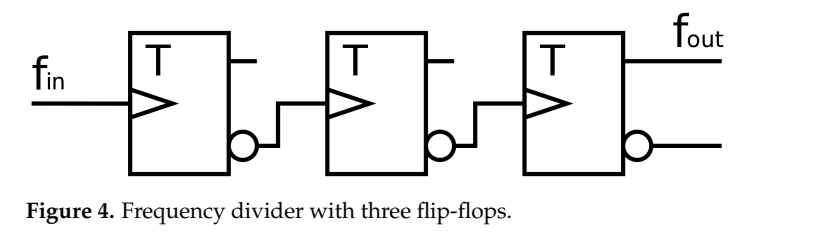
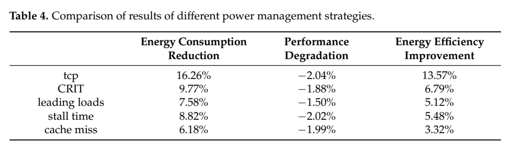
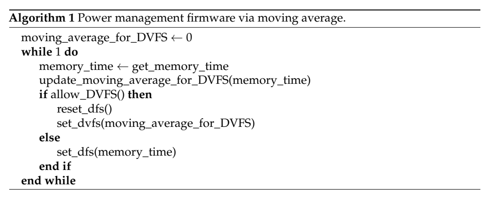

[论文页面](https://doi.org/10.3390/electronics12020407) · [本笔记所用 PDF](https://mdpi-res.com/d_attachment/electronics/electronics-12-00407/article_deploy/electronics-12-00407.pdf) · [标识符](https://doi.org/10.3390/electronics12020407)

整理日期：2026-11-05。**读者原创中文解读；原图归论文作者／出版方。未运行作者实验，不是独立复现。**

**覆盖范围：** 本版本正文中识别到的20项图、表或算法；保留原编号。关键项已裁图并在技术精读相应段落出现，未内嵌的项可点PDF页链接查看，不上传整篇PDF。

**统计总边界：** 实验单位为SPEC trace与模拟配置，不是独立芯片电测重复。对照使用相同阈值但不同估计/时间粒度，收益包括更细采样与快分频贡献；须用消融分开。能量/性能/ED²P指标不可混成同一百分比；摘要与表格矛盾已视觉核对。

## Fig1：mcf阶段示例

[原文 Fig1，PDF p4](https://mdpi-res.com/d_attachment/electronics/electronics-12-00407/article_deploy/electronics-12-00407.pdf#page=4)

1. **本项回答的问题：** mcf阶段示例，用于支撑这条方法或实验链中的具体环节。
2. **组成、坐标和对照：** 先读图题、图例、坐标/表头与单位，再在同一负载和同一基线内比较。100µs平均可能掩盖短片段。 按原图／表标示的单位与归一化基准阅读；不将不同子图或不同分母的柱高直接相除。 颜色按原图图例辨认，不能把同色跨图视为同一组。
3. **阅读顺序与统计单位：** 先看设定、单位和图例，再看趋势与作者正文。重复次数及采样独立性参见本篇技术精读统计节；没有为该图定位到的误差线定义／独立重复数，不另行猜测。
4. **直接观察：** 100µs平均可能掩盖短片段。
5. **作者解释的范围：** 原文以该图／表作为上述观察的结构说明或实验支撑，需连同对应页正文读取；本索引不额外替作者推导因果机制。
6. **独立判断（AI分析）：** 本项只支撑原文所列平台和配置；不证明E902可直接复用这些数值。
7. **证据链位置：** 性能验证／定量或示例证据，需结合实验条件。它支持本文具体条件下的实现或结果，不单独完成跨平台验证。
8. **结论与强度：** 可复述“100µs平均可能掩盖短片段。”；对图内描述的核查可信度高，对未做独立实验的泛化判断为中或无法判断。不能得出的结论是“本项只支撑原文所列平台和配置；不证明E902可直接复用这些数值。”所排除的外推。

## Fig2：lbm阶段示例

[原文 Fig2，PDF p5](https://mdpi-res.com/d_attachment/electronics/electronics-12-00407/article_deploy/electronics-12-00407.pdf#page=5)

1. **本项回答的问题：** lbm阶段示例，用于支撑这条方法或实验链中的具体环节。
2. **组成、坐标和对照：** 先读图题、图例、坐标/表头与单位，再在同一负载和同一基线内比较。突发访存与持续访存需要不同响应。 按原图／表标示的单位与归一化基准阅读；不将不同子图或不同分母的柱高直接相除。 颜色按原图图例辨认，不能把同色跨图视为同一组。
3. **阅读顺序与统计单位：** 先看设定、单位和图例，再看趋势与作者正文。重复次数及采样独立性参见本篇技术精读统计节；没有为该图定位到的误差线定义／独立重复数，不另行猜测。
4. **直接观察：** 突发访存与持续访存需要不同响应。
5. **作者解释的范围：** 原文以该图／表作为上述观察的结构说明或实验支撑，需连同对应页正文读取；本索引不额外替作者推导因果机制。
6. **独立判断（AI分析）：** 本项只支撑原文所列平台和配置；不证明E902可直接复用这些数值。
7. **证据链位置：** 性能验证／定量或示例证据，需结合实验条件。它支持本文具体条件下的实现或结果，不单独完成跨平台验证。
8. **结论与强度：** 可复述“突发访存与持续访存需要不同响应。”；对图内描述的核查可信度高，对未做独立实验的泛化判断为中或无法判断。不能得出的结论是“本项只支撑原文所列平台和配置；不证明E902可直接复用这些数值。”所排除的外推。

## Fig3：退出访存阶段

[原文 Fig3，PDF p5](https://mdpi-res.com/d_attachment/electronics/electronics-12-00407/article_deploy/electronics-12-00407.pdf#page=5)

1. **本项回答的问题：** 退出访存阶段，用于支撑这条方法或实验链中的具体环节。
2. **组成、坐标和对照：** 先读图题、图例、坐标/表头与单位，再在同一负载和同一基线内比较。慢环返回高频太晚会损害性能。 按原图／表标示的单位与归一化基准阅读；不将不同子图或不同分母的柱高直接相除。 颜色按原图图例辨认，不能把同色跨图视为同一组。
3. **阅读顺序与统计单位：** 先看设定、单位和图例，再看趋势与作者正文。重复次数及采样独立性参见本篇技术精读统计节；没有为该图定位到的误差线定义／独立重复数，不另行猜测。
4. **直接观察：** 慢环返回高频太晚会损害性能。
5. **作者解释的范围：** 原文以该图／表作为上述观察的结构说明或实验支撑，需连同对应页正文读取；本索引不额外替作者推导因果机制。
6. **独立判断（AI分析）：** 本项只支撑原文所列平台和配置；不证明E902可直接复用这些数值。
7. **证据链位置：** 性能验证／定量或示例证据，需结合实验条件。它支持本文具体条件下的实现或结果，不单独完成跨平台验证。
8. **结论与强度：** 可复述“慢环返回高频太晚会损害性能。”；对图内描述的核查可信度高，对未做独立实验的泛化判断为中或无法判断。不能得出的结论是“本项只支撑原文所列平台和配置；不证明E902可直接复用这些数值。”所排除的外推。

## Fig4：数字分频器

[原文 Fig4，PDF p6](https://mdpi-res.com/d_attachment/electronics/electronics-12-00407/article_deploy/electronics-12-00407.pdf#page=6)

[打开大图](images/original-fig4.png)

1. **本项回答的问题：** 数字分频器，用于支撑这条方法或实验链中的具体环节。
2. **组成、坐标和对照：** 先读图题、图例、坐标/表头与单位，再在同一负载和同一基线内比较。三级触发器可分频，但不改变电压。 按原图／表标示的单位与归一化基准阅读；不将不同子图或不同分母的柱高直接相除。 颜色按原图图例辨认，不能把同色跨图视为同一组。
3. **阅读顺序与统计单位：** 先看设定、单位和图例，再看趋势与作者正文。重复次数及采样独立性参见本篇技术精读统计节；没有为该图定位到的误差线定义／独立重复数，不另行猜测。
4. **直接观察：** 三级触发器可分频，但不改变电压。
5. **作者解释的范围：** 原文以该图／表作为上述观察的结构说明或实验支撑，需连同对应页正文读取；本索引不额外替作者推导因果机制。
6. **独立判断（AI分析）：** 本项只支撑原文所列平台和配置；不证明E902可直接复用这些数值。
7. **证据链位置：** 性能验证／定量或示例证据，需结合实验条件。它支持本文具体条件下的实现或结果，不单独完成跨平台验证。
8. **结论与强度：** 可复述“三级触发器可分频，但不改变电压。”；对图内描述的核查可信度高，对未做独立实验的泛化判断为中或无法判断。不能得出的结论是“本项只支撑原文所列平台和配置；不证明E902可直接复用这些数值。”所排除的外推。

## Fig5：原CRIT短窗口误差

[原文 Fig5，PDF p10](https://mdpi-res.com/d_attachment/electronics/electronics-12-00407/article_deploy/electronics-12-00407.pdf#page=10)

1. **本项回答的问题：** 原CRIT短窗口误差，用于支撑这条方法或实验链中的具体环节。
2. **组成、坐标和对照：** 先读图题、图例、坐标/表头与单位，再在同一负载和同一基线内比较。短窗口会受未完成miss边界影响。 按原图／表标示的单位与归一化基准阅读；不将不同子图或不同分母的柱高直接相除。 颜色按原图图例辨认，不能把同色跨图视为同一组。
3. **阅读顺序与统计单位：** 先看设定、单位和图例，再看趋势与作者正文。重复次数及采样独立性参见本篇技术精读统计节；没有为该图定位到的误差线定义／独立重复数，不另行猜测。
4. **直接观察：** 短窗口会受未完成miss边界影响。
5. **作者解释的范围：** 原文以该图／表作为上述观察的结构说明或实验支撑，需连同对应页正文读取；本索引不额外替作者推导因果机制。
6. **独立判断（AI分析）：** 本项只支撑原文所列平台和配置；不证明E902可直接复用这些数值。
7. **证据链位置：** 性能验证／定量或示例证据，需结合实验条件。它支持本文具体条件下的实现或结果，不单独完成跨平台验证。
8. **结论与强度：** 可复述“短窗口会受未完成miss边界影响。”；对图内描述的核查可信度高，对未做独立实验的泛化判断为中或无法判断。不能得出的结论是“本项只支撑原文所列平台和配置；不证明E902可直接复用这些数值。”所排除的外推。

## Fig6：改进关键路径误差

[原文 Fig6，PDF p10](https://mdpi-res.com/d_attachment/electronics/electronics-12-00407/article_deploy/electronics-12-00407.pdf#page=10)

1. **本项回答的问题：** 改进关键路径误差，用于支撑这条方法或实验链中的具体环节。
2. **组成、坐标和对照：** 先读图题、图例、坐标/表头与单位，再在同一负载和同一基线内比较。选定间隔下误差改善，仍为模型比较。 结构／流程类没有统一数值坐标；箭头表示数据或控制关系，不表示统计因果。 颜色按原图图例辨认，不能把同色跨图视为同一组。
3. **阅读顺序与统计单位：** 先看设定、单位和图例，再看趋势与作者正文。重复次数及采样独立性参见本篇技术精读统计节；没有为该图定位到的误差线定义／独立重复数，不另行猜测。
4. **直接观察：** 选定间隔下误差改善，仍为模型比较。
5. **作者解释的范围：** 原文以该图／表作为上述观察的结构说明或实验支撑，需连同对应页正文读取；本索引不额外替作者推导因果机制。
6. **独立判断（AI分析）：** 本项只支撑原文所列平台和配置；不证明E902可直接复用这些数值。
7. **证据链位置：** 方法／系统实现说明。它支持本文具体条件下的实现或结果，不单独完成跨平台验证。
8. **结论与强度：** 可复述“选定间隔下误差改善，仍为模型比较。”；对图内描述的核查可信度高，对未做独立实验的泛化判断为中或无法判断。不能得出的结论是“本项只支撑原文所列平台和配置；不证明E902可直接复用这些数值。”所排除的外推。

## Fig7：逐程序能量降低

[原文 Fig7，PDF p12](https://mdpi-res.com/d_attachment/electronics/electronics-12-00407/article_deploy/electronics-12-00407.pdf#page=12)

1. **本项回答的问题：** 逐程序能量降低，用于支撑这条方法或实验链中的具体环节。
2. **组成、坐标和对照：** 先读图题、图例、坐标/表头与单位，再在同一负载和同一基线内比较。并非每个程序都相对每基线最优。 按原图／表标示的单位与归一化基准阅读；不将不同子图或不同分母的柱高直接相除。 颜色按原图图例辨认，不能把同色跨图视为同一组。
3. **阅读顺序与统计单位：** 先看设定、单位和图例，再看趋势与作者正文。重复次数及采样独立性参见本篇技术精读统计节；没有为该图定位到的误差线定义／独立重复数，不另行猜测。
4. **直接观察：** 并非每个程序都相对每基线最优。
5. **作者解释的范围：** 原文以该图／表作为上述观察的结构说明或实验支撑，需连同对应页正文读取；本索引不额外替作者推导因果机制。
6. **独立判断（AI分析）：** 本项只支撑原文所列平台和配置；不证明E902可直接复用这些数值。
7. **证据链位置：** 性能验证／定量或示例证据，需结合实验条件。它支持本文具体条件下的实现或结果，不单独完成跨平台验证。
8. **结论与强度：** 可复述“并非每个程序都相对每基线最优。”；对图内描述的核查可信度高，对未做独立实验的泛化判断为中或无法判断。不能得出的结论是“本项只支撑原文所列平台和配置；不证明E902可直接复用这些数值。”所排除的外推。

## Fig8：逐程序性能损失

[原文 Fig8，PDF p13](https://mdpi-res.com/d_attachment/electronics/electronics-12-00407/article_deploy/electronics-12-00407.pdf#page=13)

1. **本项回答的问题：** 逐程序性能损失，用于支撑这条方法或实验链中的具体环节。
2. **组成、坐标和对照：** 先读图题、图例、坐标/表头与单位，再在同一负载和同一基线内比较。必须与图7配对看代价。 按原图／表标示的单位与归一化基准阅读；不将不同子图或不同分母的柱高直接相除。 颜色按原图图例辨认，不能把同色跨图视为同一组。
3. **阅读顺序与统计单位：** 先看设定、单位和图例，再看趋势与作者正文。重复次数及采样独立性参见本篇技术精读统计节；没有为该图定位到的误差线定义／独立重复数，不另行猜测。
4. **直接观察：** 必须与图7配对看代价。
5. **作者解释的范围：** 原文以该图／表作为上述观察的结构说明或实验支撑，需连同对应页正文读取；本索引不额外替作者推导因果机制。
6. **独立判断（AI分析）：** 本项只支撑原文所列平台和配置；不证明E902可直接复用这些数值。
7. **证据链位置：** 性能验证／定量或示例证据，需结合实验条件。它支持本文具体条件下的实现或结果，不单独完成跨平台验证。
8. **结论与强度：** 可复述“必须与图7配对看代价。”；对图内描述的核查可信度高，对未做独立实验的泛化判断为中或无法判断。不能得出的结论是“本项只支撑原文所列平台和配置；不证明E902可直接复用这些数值。”所排除的外推。

## Fig9：ED²P能效

[原文 Fig9，PDF p14](https://mdpi-res.com/d_attachment/electronics/electronics-12-00407/article_deploy/electronics-12-00407.pdf#page=14)

1. **本项回答的问题：** ED²P能效，用于支撑这条方法或实验链中的具体环节。
2. **组成、坐标和对照：** 先读图题、图例、坐标/表头与单位，再在同一负载和同一基线内比较。能量和时间共同决定。 按原图／表标示的单位与归一化基准阅读；不将不同子图或不同分母的柱高直接相除。 颜色按原图图例辨认，不能把同色跨图视为同一组。
3. **阅读顺序与统计单位：** 先看设定、单位和图例，再看趋势与作者正文。重复次数及采样独立性参见本篇技术精读统计节；没有为该图定位到的误差线定义／独立重复数，不另行猜测。
4. **直接观察：** 能量和时间共同决定。
5. **作者解释的范围：** 原文以该图／表作为上述观察的结构说明或实验支撑，需连同对应页正文读取；本索引不额外替作者推导因果机制。
6. **独立判断（AI分析）：** 本项只支撑原文所列平台和配置；不证明E902可直接复用这些数值。
7. **证据链位置：** 性能验证／定量或示例证据，需结合实验条件。它支持本文具体条件下的实现或结果，不单独完成跨平台验证。
8. **结论与强度：** 可复述“能量和时间共同决定。”；对图内描述的核查可信度高，对未做独立实验的泛化判断为中或无法判断。不能得出的结论是“本项只支撑原文所列平台和配置；不证明E902可直接复用这些数值。”所排除的外推。

## Fig10：动态功率占比

[原文 Fig10，PDF p14](https://mdpi-res.com/d_attachment/electronics/electronics-12-00407/article_deploy/electronics-12-00407.pdf#page=14)

1. **本项回答的问题：** 动态功率占比，用于支撑这条方法或实验链中的具体环节。
2. **组成、坐标和对照：** 先读图题、图例、坐标/表头与单位，再在同一负载和同一基线内比较。占比不是绝对瓦数。 按原图／表标示的单位与归一化基准阅读；不将不同子图或不同分母的柱高直接相除。 颜色按原图图例辨认，不能把同色跨图视为同一组。
3. **阅读顺序与统计单位：** 先看设定、单位和图例，再看趋势与作者正文。重复次数及采样独立性参见本篇技术精读统计节；没有为该图定位到的误差线定义／独立重复数，不另行猜测。
4. **直接观察：** 占比不是绝对瓦数。
5. **作者解释的范围：** 原文以该图／表作为上述观察的结构说明或实验支撑，需连同对应页正文读取；本索引不额外替作者推导因果机制。
6. **独立判断（AI分析）：** 本项只支撑原文所列平台和配置；不证明E902可直接复用这些数值。
7. **证据链位置：** 性能验证／定量或示例证据，需结合实验条件。它支持本文具体条件下的实现或结果，不单独完成跨平台验证。
8. **结论与强度：** 可复述“占比不是绝对瓦数。”；对图内描述的核查可信度高，对未做独立实验的泛化判断为中或无法判断。不能得出的结论是“本项只支撑原文所列平台和配置；不证明E902可直接复用这些数值。”所排除的外推。

## Fig11：采样间隔消融

[原文 Fig11，PDF p15](https://mdpi-res.com/d_attachment/electronics/electronics-12-00407/article_deploy/electronics-12-00407.pdf#page=15)

1. **本项回答的问题：** 采样间隔消融，用于支撑这条方法或实验链中的具体环节。
2. **组成、坐标和对照：** 先读图题、图例、坐标/表头与单位，再在同一负载和同一基线内比较。粒度与硬件/管理成本权衡。 按原图／表标示的单位与归一化基准阅读；不将不同子图或不同分母的柱高直接相除。 颜色按原图图例辨认，不能把同色跨图视为同一组。
3. **阅读顺序与统计单位：** 先看设定、单位和图例，再看趋势与作者正文。重复次数及采样独立性参见本篇技术精读统计节；没有为该图定位到的误差线定义／独立重复数，不另行猜测。
4. **直接观察：** 粒度与硬件/管理成本权衡。
5. **作者解释的范围：** 原文以该图／表作为上述观察的结构说明或实验支撑，需连同对应页正文读取；本索引不额外替作者推导因果机制。
6. **独立判断（AI分析）：** 本项只支撑原文所列平台和配置；不证明E902可直接复用这些数值。
7. **证据链位置：** 性能验证／定量或示例证据，需结合实验条件。它支持本文具体条件下的实现或结果，不单独完成跨平台验证。
8. **结论与强度：** 可复述“粒度与硬件/管理成本权衡。”；对图内描述的核查可信度高，对未做独立实验的泛化判断为中或无法判断。不能得出的结论是“本项只支撑原文所列平台和配置；不证明E902可直接复用这些数值。”所排除的外推。

## Fig12：两种响应机制

[原文 Fig12，PDF p15](https://mdpi-res.com/d_attachment/electronics/electronics-12-00407/article_deploy/electronics-12-00407.pdf#page=15)

1. **本项回答的问题：** 两种响应机制，用于支撑这条方法或实验链中的具体环节。
2. **组成、坐标和对照：** 先读图题、图例、坐标/表头与单位，再在同一负载和同一基线内比较。移动平均与dense sampling各有误差/开销。 按原图／表标示的单位与归一化基准阅读；不将不同子图或不同分母的柱高直接相除。 颜色按原图图例辨认，不能把同色跨图视为同一组。
3. **阅读顺序与统计单位：** 先看设定、单位和图例，再看趋势与作者正文。重复次数及采样独立性参见本篇技术精读统计节；没有为该图定位到的误差线定义／独立重复数，不另行猜测。
4. **直接观察：** 移动平均与dense sampling各有误差/开销。
5. **作者解释的范围：** 原文以该图／表作为上述观察的结构说明或实验支撑，需连同对应页正文读取；本索引不额外替作者推导因果机制。
6. **独立判断（AI分析）：** 本项只支撑原文所列平台和配置；不证明E902可直接复用这些数值。
7. **证据链位置：** 性能验证／定量或示例证据，需结合实验条件。它支持本文具体条件下的实现或结果，不单独完成跨平台验证。
8. **结论与强度：** 可复述“移动平均与dense sampling各有误差/开销。”；对图内描述的核查可信度高，对未做独立实验的泛化判断为中或无法判断。不能得出的结论是“本项只支撑原文所列平台和配置；不证明E902可直接复用这些数值。”所排除的外推。

## Fig13：DVFS切换次数

[原文 Fig13，PDF p16](https://mdpi-res.com/d_attachment/electronics/electronics-12-00407/article_deploy/electronics-12-00407.pdf#page=16)

1. **本项回答的问题：** DVFS切换次数，用于支撑这条方法或实验链中的具体环节。
2. **组成、坐标和对照：** 先读图题、图例、坐标/表头与单位，再在同一负载和同一基线内比较。多切换不自动更节能。 按原图／表标示的单位与归一化基准阅读；不将不同子图或不同分母的柱高直接相除。 颜色按原图图例辨认，不能把同色跨图视为同一组。
3. **阅读顺序与统计单位：** 先看设定、单位和图例，再看趋势与作者正文。重复次数及采样独立性参见本篇技术精读统计节；没有为该图定位到的误差线定义／独立重复数，不另行猜测。
4. **直接观察：** 多切换不自动更节能。
5. **作者解释的范围：** 原文以该图／表作为上述观察的结构说明或实验支撑，需连同对应页正文读取；本索引不额外替作者推导因果机制。
6. **独立判断（AI分析）：** 本项只支撑原文所列平台和配置；不证明E902可直接复用这些数值。
7. **证据链位置：** 性能验证／定量或示例证据，需结合实验条件。它支持本文具体条件下的实现或结果，不单独完成跨平台验证。
8. **结论与强度：** 可复述“多切换不自动更节能。”；对图内描述的核查可信度高，对未做独立实验的泛化判断为中或无法判断。不能得出的结论是“本项只支撑原文所列平台和配置；不证明E902可直接复用这些数值。”所排除的外推。

## Table1：DVFS与分频功率估计

[原文 Table1，PDF p6](https://mdpi-res.com/d_attachment/electronics/electronics-12-00407/article_deploy/electronics-12-00407.pdf#page=6)

1. **本项回答的问题：** DVFS与分频功率估计，用于支撑这条方法或实验链中的具体环节。
2. **组成、坐标和对照：** 先读图题、图例、坐标/表头与单位，再在同一负载和同一基线内比较。静态/动态功率假设来自McPAT。 按原图／表标示的单位与归一化基准阅读；不将不同子图或不同分母的柱高直接相除。 颜色按原图图例辨认，不能把同色跨图视为同一组。
3. **阅读顺序与统计单位：** 先看设定、单位和图例，再看趋势与作者正文。重复次数及采样独立性参见本篇技术精读统计节；没有为该图定位到的误差线定义／独立重复数，不另行猜测。
4. **直接观察：** 静态/动态功率假设来自McPAT。
5. **作者解释的范围：** 原文以该图／表作为上述观察的结构说明或实验支撑，需连同对应页正文读取；本索引不额外替作者推导因果机制。
6. **独立判断（AI分析）：** 本项只支撑原文所列平台和配置；不证明E902可直接复用这些数值。
7. **证据链位置：** 性能验证／定量或示例证据，需结合实验条件。它支持本文具体条件下的实现或结果，不单独完成跨平台验证。
8. **结论与强度：** 可复述“静态/动态功率假设来自McPAT。”；对图内描述的核查可信度高，对未做独立实验的泛化判断为中或无法判断。不能得出的结论是“本项只支撑原文所列平台和配置；不证明E902可直接复用这些数值。”所排除的外推。

## Table2：八档阈值

[原文 Table2，PDF p9](https://mdpi-res.com/d_attachment/electronics/electronics-12-00407/article_deploy/electronics-12-00407.pdf#page=9)

1. **本项回答的问题：** 八档阈值，用于支撑这条方法或实验链中的具体环节。
2. **组成、坐标和对照：** 先读图题、图例、坐标/表头与单位，再在同一负载和同一基线内比较。性能容限用来推导规则。 按原图／表标示的单位与归一化基准阅读；不将不同子图或不同分母的柱高直接相除。 颜色按原图图例辨认，不能把同色跨图视为同一组。
3. **阅读顺序与统计单位：** 先看设定、单位和图例，再看趋势与作者正文。重复次数及采样独立性参见本篇技术精读统计节；没有为该图定位到的误差线定义／独立重复数，不另行猜测。
4. **直接观察：** 性能容限用来推导规则。
5. **作者解释的范围：** 原文以该图／表作为上述观察的结构说明或实验支撑，需连同对应页正文读取；本索引不额外替作者推导因果机制。
6. **独立判断（AI分析）：** 本项只支撑原文所列平台和配置；不证明E902可直接复用这些数值。
7. **证据链位置：** 性能验证／定量或示例证据，需结合实验条件。它支持本文具体条件下的实现或结果，不单独完成跨平台验证。
8. **结论与强度：** 可复述“性能容限用来推导规则。”；对图内描述的核查可信度高，对未做独立实验的泛化判断为中或无法判断。不能得出的结论是“本项只支撑原文所列平台和配置；不证明E902可直接复用这些数值。”所排除的外推。

## Table3：模拟CPU参数

[原文 Table3，PDF p11](https://mdpi-res.com/d_attachment/electronics/electronics-12-00407/article_deploy/electronics-12-00407.pdf#page=11)

1. **本项回答的问题：** 模拟CPU参数，用于支撑这条方法或实验链中的具体环节。
2. **组成、坐标和对照：** 先读图题、图例、坐标/表头与单位，再在同一负载和同一基线内比较。部分表格行有错位，复现要核对配置源。 按原图／表标示的单位与归一化基准阅读；不将不同子图或不同分母的柱高直接相除。 颜色按原图图例辨认，不能把同色跨图视为同一组。
3. **阅读顺序与统计单位：** 先看设定、单位和图例，再看趋势与作者正文。重复次数及采样独立性参见本篇技术精读统计节；没有为该图定位到的误差线定义／独立重复数，不另行猜测。
4. **直接观察：** 部分表格行有错位，复现要核对配置源。
5. **作者解释的范围：** 原文以该图／表作为上述观察的结构说明或实验支撑，需连同对应页正文读取；本索引不额外替作者推导因果机制。
6. **独立判断（AI分析）：** 本项只支撑原文所列平台和配置；不证明E902可直接复用这些数值。
7. **证据链位置：** 性能验证／定量或示例证据，需结合实验条件。它支持本文具体条件下的实现或结果，不单独完成跨平台验证。
8. **结论与强度：** 可复述“部分表格行有错位，复现要核对配置源。”；对图内描述的核查可信度高，对未做独立实验的泛化判断为中或无法判断。不能得出的结论是“本项只支撑原文所列平台和配置；不证明E902可直接复用这些数值。”所排除的外推。

## Table4：核心平均结果

[原文 Table4，PDF p12](https://mdpi-res.com/d_attachment/electronics/electronics-12-00407/article_deploy/electronics-12-00407.pdf#page=12)

[打开大图](images/original-table4.png)

1. **本项回答的问题：** 核心平均结果，用于支撑这条方法或实验链中的具体环节。
2. **组成、坐标和对照：** 先读图题、图例、坐标/表头与单位，再在同一负载和同一基线内比较。视觉可见16.26%，与摘要16.36%冲突。 按原图／表标示的单位与归一化基准阅读；不将不同子图或不同分母的柱高直接相除。 颜色按原图图例辨认，不能把同色跨图视为同一组。
3. **阅读顺序与统计单位：** 先看设定、单位和图例，再看趋势与作者正文。重复次数及采样独立性参见本篇技术精读统计节；没有为该图定位到的误差线定义／独立重复数，不另行猜测。
4. **直接观察：** 视觉可见16.26%，与摘要16.36%冲突。
5. **作者解释的范围：** 原文以该图／表作为上述观察的结构说明或实验支撑，需连同对应页正文读取；本索引不额外替作者推导因果机制。
6. **独立判断（AI分析）：** 本项只支撑原文所列平台和配置；不证明E902可直接复用这些数值。
7. **证据链位置：** 性能验证／定量或示例证据，需结合实验条件。它支持本文具体条件下的实现或结果，不单独完成跨平台验证。
8. **结论与强度：** 可复述“视觉可见16.26%，与摘要16.36%冲突。”；对图内描述的核查可信度高，对未做独立实验的泛化判断为中或无法判断。不能得出的结论是“本项只支撑原文所列平台和配置；不证明E902可直接复用这些数值。”所排除的外推。

## Algorithm1：移动平均快慢环

[原文 Algorithm1，PDF p7](https://mdpi-res.com/d_attachment/electronics/electronics-12-00407/article_deploy/electronics-12-00407.pdf#page=7)

[打开大图](images/original-algorithm1.png)

1. **本项回答的问题：** 移动平均快慢环，用于支撑这条方法或实验链中的具体环节。
2. **组成、坐标和对照：** 先读图题、图例、坐标/表头与单位，再在同一负载和同一基线内比较。稳定时慢DVFS，否则快DFS。 按原图／表标示的单位与归一化基准阅读；不将不同子图或不同分母的柱高直接相除。 颜色按原图图例辨认，不能把同色跨图视为同一组。
3. **阅读顺序与统计单位：** 先看设定、单位和图例，再看趋势与作者正文。重复次数及采样独立性参见本篇技术精读统计节；没有为该图定位到的误差线定义／独立重复数，不另行猜测。
4. **直接观察：** 稳定时慢DVFS，否则快DFS。
5. **作者解释的范围：** 原文以该图／表作为上述观察的结构说明或实验支撑，需连同对应页正文读取；本索引不额外替作者推导因果机制。
6. **独立判断（AI分析）：** 本项只支撑原文所列平台和配置；不证明E902可直接复用这些数值。
7. **证据链位置：** 性能验证／定量或示例证据，需结合实验条件。它支持本文具体条件下的实现或结果，不单独完成跨平台验证。
8. **结论与强度：** 可复述“稳定时慢DVFS，否则快DFS。”；对图内描述的核查可信度高，对未做独立实验的泛化判断为中或无法判断。不能得出的结论是“本项只支撑原文所列平台和配置；不证明E902可直接复用这些数值。”所排除的外推。

## Algorithm2：密集采样控制

[原文 Algorithm2，PDF p8](https://mdpi-res.com/d_attachment/electronics/electronics-12-00407/article_deploy/electronics-12-00407.pdf#page=8)

1. **本项回答的问题：** 密集采样控制，用于支撑这条方法或实验链中的具体环节。
2. **组成、坐标和对照：** 先读图题、图例、坐标/表头与单位，再在同一负载和同一基线内比较。减少历史但误差可能增大。 按原图／表标示的单位与归一化基准阅读；不将不同子图或不同分母的柱高直接相除。 颜色按原图图例辨认，不能把同色跨图视为同一组。
3. **阅读顺序与统计单位：** 先看设定、单位和图例，再看趋势与作者正文。重复次数及采样独立性参见本篇技术精读统计节；没有为该图定位到的误差线定义／独立重复数，不另行猜测。
4. **直接观察：** 减少历史但误差可能增大。
5. **作者解释的范围：** 原文以该图／表作为上述观察的结构说明或实验支撑，需连同对应页正文读取；本索引不额外替作者推导因果机制。
6. **独立判断（AI分析）：** 本项只支撑原文所列平台和配置；不证明E902可直接复用这些数值。
7. **证据链位置：** 性能验证／定量或示例证据，需结合实验条件。它支持本文具体条件下的实现或结果，不单独完成跨平台验证。
8. **结论与强度：** 可复述“减少历史但误差可能增大。”；对图内描述的核查可信度高，对未做独立实验的泛化判断为中或无法判断。不能得出的结论是“本项只支撑原文所列平台和配置；不证明E902可直接复用这些数值。”所排除的外推。

## Algorithm3：关键路径计数

[原文 Algorithm3，PDF p11](https://mdpi-res.com/d_attachment/electronics/electronics-12-00407/article_deploy/electronics-12-00407.pdf#page=11)

1. **本项回答的问题：** 关键路径计数，用于支撑这条方法或实验链中的具体环节。
2. **组成、坐标和对照：** 先读图题、图例、坐标/表头与单位，再在同一负载和同一基线内比较。实现依赖MSHR能力，E902不能默认具备。 结构／流程类没有统一数值坐标；箭头表示数据或控制关系，不表示统计因果。 颜色按原图图例辨认，不能把同色跨图视为同一组。
3. **阅读顺序与统计单位：** 先看设定、单位和图例，再看趋势与作者正文。重复次数及采样独立性参见本篇技术精读统计节；没有为该图定位到的误差线定义／独立重复数，不另行猜测。
4. **直接观察：** 实现依赖MSHR能力，E902不能默认具备。
5. **作者解释的范围：** 原文以该图／表作为上述观察的结构说明或实验支撑，需连同对应页正文读取；本索引不额外替作者推导因果机制。
6. **独立判断（AI分析）：** 本项只支撑原文所列平台和配置；不证明E902可直接复用这些数值。
7. **证据链位置：** 方法／系统实现说明。它支持本文具体条件下的实现或结果，不单独完成跨平台验证。
8. **结论与强度：** 可复述“实现依赖MSHR能力，E902不能默认具备。”；对图内描述的核查可信度高，对未做独立实验的泛化判断为中或无法判断。不能得出的结论是“本项只支撑原文所列平台和配置；不证明E902可直接复用这些数值。”所排除的外推。
