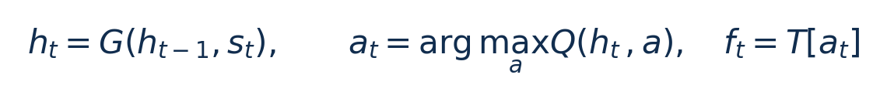

[论文页面](https://doi.org/10.1109/TNSE.2021.3123280) · [本笔记所用 PDF](https://coladog.github.io/assets/papers/TNSE2021.pdf) · [DOI](https://doi.org/10.1109/TNSE.2021.3123280)

整理日期：2026-11-05。**读者原创中文解读；原图归论文作者／出版方。未运行作者实验，不是独立复现。**

## 先把四个角色放对位置

被控负载是要完成的程序和输入，比如压缩一块日志；CPU是执行程序的硬件；控制器根据观测选运行档位；驱动／寄存器把档位落实。程序代码可以完全一样，CPU时钟变慢时每条指令对应的墙钟时间通常变长，访存或I/O等待则未必按同样比例变化。

软件控制并不意味着没有真实硬件。软件中的学习策略可控制真实CPU；也可先控制一个执行时间与能量模型。后者能验证闭环逻辑，但模型输出的J不能当真实电测。E902的RTL能在仿真中改变时钟并反馈计数；电压导致的物理功耗还需相应模型、功耗分析或板级实验。

## 这篇到底解决哪一件事

用GRU记住频率和CPU利用率的历史，再由Q网络选择下一档频率，训练与内核推理分开执行。

同样的瞬时利用率可能来自不同执行阶段，后续需求不同；单点阈值看不到这些历史。假设是历史编码能改善选频，同时把训练移出内核能使部署可行。网络消融与跨输入测试的充分性仍需独立审查。

**把方法想成一条流水线：** 上一采样周期的频率和忙闲时间 → 归一化观测 → GRU更新历史向量 → Q网络给15个动作评分 → CPUFreq执行 → 内核记经验 → 用户态重建序列并训练 → 更新推理参数。

| 先回答的问题 | 本文答案 |
| --- | --- |
| 观测 | s_t=(频率,利用率)，利用率=CPU active time/total time；非图像或LLM token。 |
| 历史／模型 | GRU输入2、内部状态8；Q网络8–16–15，ReLU。此处依据§III-A，不是6维。 |
| 动作 | 15档400–2500MHz，采样100ms，Turbo关闭。 |
| 目标 | 期限内偏好低频、超期惩罚；属于学习目标，不等于硬实时安全过滤。 |

## 十个先修关键词

| 级别 | 术语／关键词 | 直觉、严格含义与易混点 |
| --- | --- | --- |
| A | DVFS / DFS | DVFS同时涉及动态电压与频率；只有时钟变化称DFS。电压能否改变取决于实际供电域。 |
| A | Workload | 真正执行应用计算的程序与输入；本文里的控制器是另一个角色。 |
| A | Controller | 根据观测选择动作的软件／硬件，可运行在同一CPU或独立控制核。 |
| A | OPP | Operating Performance Point，经过允许范围验证的电压—频率组合。 |
| A | Power / Energy | 功率W表示此刻消耗快慢；能量J是对时间积分。低功率不必然低能量。 |
| B | Deadline | 作业必须完成的时刻；平均时延、P95与最大时延各有不同用途。 |
| A | Governor | 根据观测作出频率请求的软件策略。 |
| B | GRU | 带门控的循环网络，用固定长度向量概括历史。 |
| B | Q值 | 某状态采取动作的预期累计回报，非功率测量值。 |
| C | 经验回放 | 保存交互样本后重用训练；循环模型还需处理序列状态。 |

## 用一个小算例建立直觉

教学例：Q值(0.1,0.4,0.3)对应三档时选择第二档，不是把0.4当成频率。GRU状态必须随一次作业连续更新，并在规定边界重置。

s_t为当前二维观测；h_t为8维历史状态；a是离散动作编号，无量纲；T为频率表，Hz。原文推理式的max应按选择动作的含义理解为argmax。

**要防止的误读：** 单平台、少量应用与均值曲线不足以证明跨数据泛化及尾时延安全；奖励并非真实净能量。

## 论文真正验证了什么

| 指标 | 原文报告 | 条件／分母／边界 | 证据位置 |
| --- | --- | --- | --- |
| Benchmark1相对Ondemand | 13%–33%核心能量降低 | 期限4.0–5.0s，10次请求 | §IV-D，Fig9，p9 |
| Benchmark2相对Ondemand | 22%–30%降低 | 期限4.0/4.5s，含转码和蓝牙 | Fig10，p9 |
| Benchmark3相对Ondemand | 7%–28%降低 | 期限4.0/5.0s，FFT与写文件 | Fig11，p9 |
| 单次推理 | 4–10ms | 不是2023后续工作的25µs | 结论，p9 |

这些结果来自作者实验。算法reward、模型误差、控制器时延、被控应用速度与应用节能是不同指标，要看具体行的单位和证据。

## 它与你的毕设怎么接起来

最值得迁移的是“执行历史有用”与“离线训练、在线轻推理”的分工。你的被控负载可以是压缩程序，状态历史换成每块进度、周期与忙闲比例。E902上先比较短历史统计量和小Q表，再决定是否需要GRU；不要把i5上的4–10ms叫轻到可以忽略。

最先可以尝试：**P0：无历史与短历史消融**。理由是判断当前负载是否需要记忆；最低资源是相同压缩块、频点、阈值／小MLP；通过标准是留出文件上净能量或违约率优于无历史。

## 五分钟自测

1. 这篇输出的是下一频率、功率估计，还是通信／控制时序？
2. 是真实负载硬件实验，还是模型／RTL／HIL？哪些部分是真的？
3. 最重要百分比的分母和比较对象是什么？
4. 如果换成单核E902，哪一个输入或硬件旋钮会消失？
5. 算上采样、推理、切频和空闲时间后，节能是否还成立？

答案线索在本页角色表和结果表；进一步读“图文技术精读”的关键原图、公式与三项课题实验，再到“图表索引”回查原PDF。不是先记住论文所有缩写。
