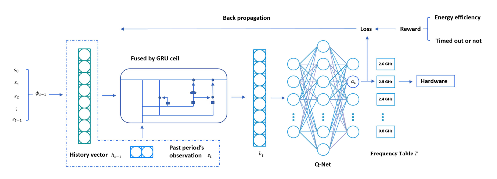
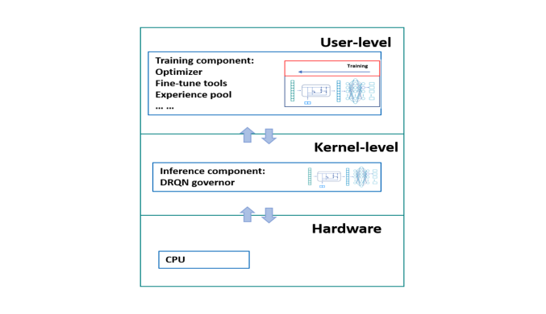
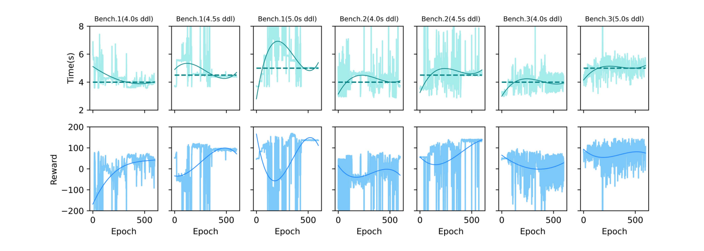
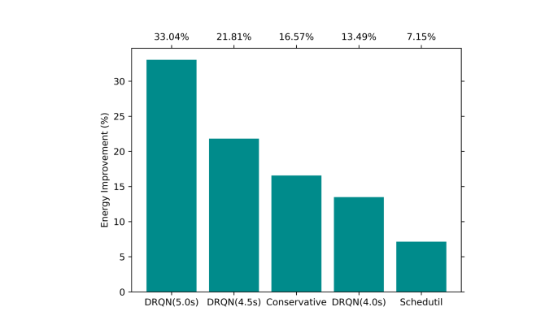
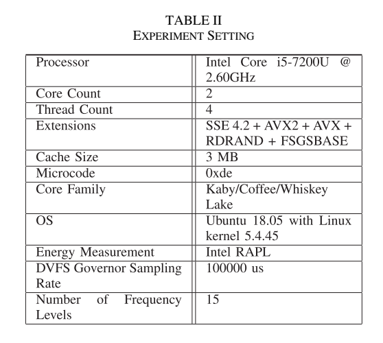

[论文页面](https://doi.org/10.1109/TNSE.2021.3123280) · [本笔记所用 PDF](https://coladog.github.io/assets/papers/TNSE2021.pdf) · [DOI](https://doi.org/10.1109/TNSE.2021.3123280)

整理日期：2026-11-05。**读者原创中文解读；原图归论文作者／出版方。未运行作者实验，不是独立复现。**

**覆盖范围：** 本版本正文中识别到的17项图、表或算法；保留原编号。关键项已裁图并在技术精读相应段落出现，未内嵌的项可点PDF页链接查看，不上传整篇PDF。

**统计总边界：** 每个训练epoch末做3次测试取平均，能量图按10次请求汇总。训练曲线平均执行时间靠近期限不证明所有作业都按时；当前证据不足以给出最坏情况保证。基线有Ondemand、Schedutil、Conservative，采样均为100ms。应进一步核对训练总能量、权重更新成本和输入独立性。

## Fig1：传统governor示意

[原文 Fig1，PDF p3](https://coladog.github.io/assets/papers/TNSE2021.pdf#page=3)

1. **本项回答的问题：** 传统governor示意，用于支撑这条方法或实验链中的具体环节。
2. **组成、坐标和对照：** 比较利用率、频率与任务阶段。 按原图／表标示的单位与归一化基准阅读；不将不同子图或不同分母的柱高直接相除。 颜色按原图图例辨认，不能把同色跨图视为同一组。
3. **阅读顺序与统计单位：** 先看设定、单位和图例，再看趋势与作者正文。重复次数及采样独立性参见本篇技术精读统计节；没有为该图定位到的误差线定义／独立重复数，不另行猜测。
4. **直接观察：** 即时阈值缺乏应用期限信息。
5. **作者解释的范围：** 原文以该图／表作为上述观察的结构说明或实验支撑，需连同对应页正文读取；本索引不额外替作者推导因果机制。
6. **独立判断（AI分析）：** 示意图不是统计实验。
7. **证据链位置：** 性能验证／定量或示例证据，需结合实验条件。它支持本文具体条件下的实现或结果，不单独完成跨平台验证。
8. **结论与强度：** 可复述“即时阈值缺乏应用期限信息。”；对图内描述的核查可信度高，对未做独立实验的泛化判断为中或无法判断。不能得出的结论是“示意图不是统计实验。”所排除的外推。

## Fig2：DRQN网络

[原文 Fig2，PDF p4](https://coladog.github.io/assets/papers/TNSE2021.pdf#page=4)

[打开大图](images/original-fig2.png)

1. **本项回答的问题：** DRQN网络，用于支撑这条方法或实验链中的具体环节。
2. **组成、坐标和对照：** 从二维观测进入GRU再到15个Q输出。 按原图／表标示的单位与归一化基准阅读；不将不同子图或不同分母的柱高直接相除。 颜色按原图图例辨认，不能把同色跨图视为同一组。
3. **阅读顺序与统计单位：** 先看设定、单位和图例，再看趋势与作者正文。重复次数及采样独立性参见本篇技术精读统计节；没有为该图定位到的误差线定义／独立重复数，不另行猜测。
4. **直接观察：** 历史与动作评分分两部分。
5. **作者解释的范围：** 原文以该图／表作为上述观察的结构说明或实验支撑，需连同对应页正文读取；本索引不额外替作者推导因果机制。
6. **独立判断（AI分析）：** 图中输出是选频，不是训练LLM。
7. **证据链位置：** 性能验证／定量或示例证据，需结合实验条件。它支持本文具体条件下的实现或结果，不单独完成跨平台验证。
8. **结论与强度：** 可复述“历史与动作评分分两部分。”；对图内描述的核查可信度高，对未做独立实验的泛化判断为中或无法判断。不能得出的结论是“图中输出是选频，不是训练LLM。”所排除的外推。

## Fig3：训练／推理成本比

[原文 Fig3，PDF p6](https://coladog.github.io/assets/papers/TNSE2021.pdf#page=6)

1. **本项回答的问题：** 训练／推理成本比，用于支撑这条方法或实验链中的具体环节。
2. **组成、坐标和对照：** 横轴序列长度，纵轴耗时比。 按原图／表标示的单位与归一化基准阅读；不将不同子图或不同分母的柱高直接相除。 颜色按原图图例辨认，不能把同色跨图视为同一组。
3. **阅读顺序与统计单位：** 先看设定、单位和图例，再看趋势与作者正文。重复次数及采样独立性参见本篇技术精读统计节；没有为该图定位到的误差线定义／独立重复数，不另行猜测。
4. **直接观察：** 序列越长，训练相对越重。
5. **作者解释的范围：** 原文以该图／表作为上述观察的结构说明或实验支撑，需连同对应页正文读取；本索引不额外替作者推导因果机制。
6. **独立判断（AI分析）：** 比值大不证明推理绝对值足够小。
7. **证据链位置：** 性能验证／定量或示例证据，需结合实验条件。它支持本文具体条件下的实现或结果，不单独完成跨平台验证。
8. **结论与强度：** 可复述“序列越长，训练相对越重。”；对图内描述的核查可信度高，对未做独立实验的泛化判断为中或无法判断。不能得出的结论是“比值大不证明推理绝对值足够小。”所排除的外推。

## Fig4：用户态与内核分工

[原文 Fig4，PDF p6](https://coladog.github.io/assets/papers/TNSE2021.pdf#page=6)

[打开大图](images/original-fig4.png)

1. **本项回答的问题：** 用户态与内核分工，用于支撑这条方法或实验链中的具体环节。
2. **组成、坐标和对照：** 看权重向下、经验向上的箭头。 按原图／表标示的单位与归一化基准阅读；不将不同子图或不同分母的柱高直接相除。 颜色按原图图例辨认，不能把同色跨图视为同一组。
3. **阅读顺序与统计单位：** 先看设定、单位和图例，再看趋势与作者正文。重复次数及采样独立性参见本篇技术精读统计节；没有为该图定位到的误差线定义／独立重复数，不另行猜测。
4. **直接观察：** 训练与推理分离。
5. **作者解释的范围：** 原文以该图／表作为上述观察的结构说明或实验支撑，需连同对应页正文读取；本索引不额外替作者推导因果机制。
6. **独立判断（AI分析）：** 同机训练仍有资源开销。
7. **证据链位置：** 性能验证／定量或示例证据，需结合实验条件。它支持本文具体条件下的实现或结果，不单独完成跨平台验证。
8. **结论与强度：** 可复述“训练与推理分离。”；对图内描述的核查可信度高，对未做独立实验的泛化判断为中或无法判断。不能得出的结论是“同机训练仍有资源开销。”所排除的外推。

## Fig5：交互训练流程

[原文 Fig5，PDF p6](https://coladog.github.io/assets/papers/TNSE2021.pdf#page=6)

1. **本项回答的问题：** 交互训练流程，用于支撑这条方法或实验链中的具体环节。
2. **组成、坐标和对照：** 按episode、参数交换和运行顺序读。 结构／流程类没有统一数值坐标；箭头表示数据或控制关系，不表示统计因果。 颜色按原图图例辨认，不能把同色跨图视为同一组。
3. **阅读顺序与统计单位：** 先看设定、单位和图例，再看趋势与作者正文。重复次数及采样独立性参见本篇技术精读统计节；没有为该图定位到的误差线定义／独立重复数，不另行猜测。
4. **直接观察：** 策略通过真实执行反馈更新。
5. **作者解释的范围：** 原文以该图／表作为上述观察的结构说明或实验支撑，需连同对应页正文读取；本索引不额外替作者推导因果机制。
6. **独立判断（AI分析）：** 流程可执行不等于已有安全保证。
7. **证据链位置：** 方法／系统实现说明。它支持本文具体条件下的实现或结果，不单独完成跨平台验证。
8. **结论与强度：** 可复述“策略通过真实执行反馈更新。”；对图内描述的核查可信度高，对未做独立实验的泛化判断为中或无法判断。不能得出的结论是“流程可执行不等于已有安全保证。”所排除的外推。

## Fig6：训练收敛与执行时间

[原文 Fig6，PDF p8](https://coladog.github.io/assets/papers/TNSE2021.pdf#page=8)

[打开大图](images/original-fig6.png)

1. **本项回答的问题：** 训练收敛与执行时间，用于支撑这条方法或实验链中的具体环节。
2. **组成、坐标和对照：** 先看每组reward，再看时间相对目标线。 按原图／表标示的单位与归一化基准阅读；不将不同子图或不同分母的柱高直接相除。 颜色按原图图例辨认，不能把同色跨图视为同一组。
3. **阅读顺序与统计单位：** 先看设定、单位和图例，再看趋势与作者正文。重复次数及采样独立性参见本篇技术精读统计节；没有为该图定位到的误差线定义／独立重复数，不另行猜测。
4. **直接观察：** 不同期限导向不同策略。
5. **作者解释的范围：** 原文以该图／表作为上述观察的结构说明或实验支撑，需连同对应页正文读取；本索引不额外替作者推导因果机制。
6. **独立判断（AI分析）：** 平均靠近期限不说明每次按时。
7. **证据链位置：** 性能验证／定量或示例证据，需结合实验条件。它支持本文具体条件下的实现或结果，不单独完成跨平台验证。
8. **结论与强度：** 可复述“不同期限导向不同策略。”；对图内描述的核查可信度高，对未做独立实验的泛化判断为中或无法判断。不能得出的结论是“平均靠近期限不说明每次按时。”所排除的外推。

## Fig7：Benchmark1时间功率轨迹

[原文 Fig7，PDF p8](https://coladog.github.io/assets/papers/TNSE2021.pdf#page=8)

1. **本项回答的问题：** Benchmark1时间功率轨迹，用于支撑这条方法或实验链中的具体环节。
2. **组成、坐标和对照：** 横轴时间，比较频率与功耗变化。 按原图／表标示的单位与归一化基准阅读；不将不同子图或不同分母的柱高直接相除。 颜色按原图图例辨认，不能把同色跨图视为同一组。
3. **阅读顺序与统计单位：** 先看设定、单位和图例，再看趋势与作者正文。重复次数及采样独立性参见本篇技术精读统计节；没有为该图定位到的误差线定义／独立重复数，不另行猜测。
4. **直接观察：** DRQN利用较长执行窗口。
5. **作者解释的范围：** 原文以该图／表作为上述观察的结构说明或实验支撑，需连同对应页正文读取；本索引不额外替作者推导因果机制。
6. **独立判断（AI分析）：** 峰值低不等于累计能量同幅下降。
7. **证据链位置：** 性能验证／定量或示例证据，需结合实验条件。它支持本文具体条件下的实现或结果，不单独完成跨平台验证。
8. **结论与强度：** 可复述“DRQN利用较长执行窗口。”；对图内描述的核查可信度高，对未做独立实验的泛化判断为中或无法判断。不能得出的结论是“峰值低不等于累计能量同幅下降。”所排除的外推。

## Fig8：Benchmark2时间功率轨迹

[原文 Fig8，PDF p8](https://coladog.github.io/assets/papers/TNSE2021.pdf#page=8)

1. **本项回答的问题：** Benchmark2时间功率轨迹，用于支撑这条方法或实验链中的具体环节。
2. **组成、坐标和对照：** 对照转码与等待阶段。 按原图／表标示的单位与归一化基准阅读；不将不同子图或不同分母的柱高直接相除。 颜色按原图图例辨认，不能把同色跨图视为同一组。
3. **阅读顺序与统计单位：** 先看设定、单位和图例，再看趋势与作者正文。重复次数及采样独立性参见本篇技术精读统计节；没有为该图定位到的误差线定义／独立重复数，不另行猜测。
4. **直接观察：** 策略随阶段调档。
5. **作者解释的范围：** 原文以该图／表作为上述观察的结构说明或实验支撑，需连同对应页正文读取；本索引不额外替作者推导因果机制。
6. **独立判断（AI分析）：** 没有独立消融时不能把全部收益归因GRU。
7. **证据链位置：** 性能验证／定量或示例证据，需结合实验条件。它支持本文具体条件下的实现或结果，不单独完成跨平台验证。
8. **结论与强度：** 可复述“策略随阶段调档。”；对图内描述的核查可信度高，对未做独立实验的泛化判断为中或无法判断。不能得出的结论是“没有独立消融时不能把全部收益归因GRU。”所排除的外推。

## Fig9：Benchmark1能量

[原文 Fig9，PDF p9](https://coladog.github.io/assets/papers/TNSE2021.pdf#page=9)

[打开大图](images/original-fig9.png)

1. **本项回答的问题：** Benchmark1能量，用于支撑这条方法或实验链中的具体环节。
2. **组成、坐标和对照：** 按deadline比较相对Ondemand柱。 按原图／表标示的单位与归一化基准阅读；不将不同子图或不同分母的柱高直接相除。 颜色按原图图例辨认，不能把同色跨图视为同一组。
3. **阅读顺序与统计单位：** 先看设定、单位和图例，再看趋势与作者正文。重复次数及采样独立性参见本篇技术精读统计节；没有为该图定位到的误差线定义／独立重复数，不另行猜测。
4. **直接观察：** 4–5s范围节能13%–33%。
5. **作者解释的范围：** 原文以该图／表作为上述观察的结构说明或实验支撑，需连同对应页正文读取；本索引不额外替作者推导因果机制。
6. **独立判断（AI分析）：** 不是固定33%。
7. **证据链位置：** 性能验证／定量或示例证据，需结合实验条件。它支持本文具体条件下的实现或结果，不单独完成跨平台验证。
8. **结论与强度：** 可复述“4–5s范围节能13%–33%。”；对图内描述的核查可信度高，对未做独立实验的泛化判断为中或无法判断。不能得出的结论是“不是固定33%。”所排除的外推。

## Fig10：Benchmark2能量

[原文 Fig10，PDF p9](https://coladog.github.io/assets/papers/TNSE2021.pdf#page=9)

1. **本项回答的问题：** Benchmark2能量，用于支撑这条方法或实验链中的具体环节。
2. **组成、坐标和对照：** 同一任务比较4与4.5s。 按原图／表标示的单位与归一化基准阅读；不将不同子图或不同分母的柱高直接相除。 颜色按原图图例辨认，不能把同色跨图视为同一组。
3. **阅读顺序与统计单位：** 先看设定、单位和图例，再看趋势与作者正文。重复次数及采样独立性参见本篇技术精读统计节；没有为该图定位到的误差线定义／独立重复数，不另行猜测。
4. **直接观察：** 更宽松期限有更大节能。
5. **作者解释的范围：** 原文以该图／表作为上述观察的结构说明或实验支撑，需连同对应页正文读取；本索引不额外替作者推导因果机制。
6. **独立判断（AI分析）：** 不能与其他任务直接按柱高比。
7. **证据链位置：** 性能验证／定量或示例证据，需结合实验条件。它支持本文具体条件下的实现或结果，不单独完成跨平台验证。
8. **结论与强度：** 可复述“更宽松期限有更大节能。”；对图内描述的核查可信度高，对未做独立实验的泛化判断为中或无法判断。不能得出的结论是“不能与其他任务直接按柱高比。”所排除的外推。

## Fig11：Benchmark3能量

[原文 Fig11，PDF p9](https://coladog.github.io/assets/papers/TNSE2021.pdf#page=9)

1. **本项回答的问题：** Benchmark3能量，用于支撑这条方法或实验链中的具体环节。
2. **组成、坐标和对照：** 保持Ondemand归一化口径。 按原图／表标示的单位与归一化基准阅读；不将不同子图或不同分母的柱高直接相除。 颜色按原图图例辨认，不能把同色跨图视为同一组。
3. **阅读顺序与统计单位：** 先看设定、单位和图例，再看趋势与作者正文。重复次数及采样独立性参见本篇技术精读统计节；没有为该图定位到的误差线定义／独立重复数，不另行猜测。
4. **直接观察：** 收益可低到7%。
5. **作者解释的范围：** 原文以该图／表作为上述观察的结构说明或实验支撑，需连同对应页正文读取；本索引不额外替作者推导因果机制。
6. **独立判断（AI分析）：** 不能宣称任何任务都超过20%。
7. **证据链位置：** 性能验证／定量或示例证据，需结合实验条件。它支持本文具体条件下的实现或结果，不单独完成跨平台验证。
8. **结论与强度：** 可复述“收益可低到7%。”；对图内描述的核查可信度高，对未做独立实验的泛化判断为中或无法判断。不能得出的结论是“不能宣称任何任务都超过20%。”所排除的外推。

## TableI：符号表

[原文 TableI，PDF p5](https://coladog.github.io/assets/papers/TNSE2021.pdf#page=5)

1. **本项回答的问题：** 符号表，用于支撑这条方法或实验链中的具体环节。
2. **组成、坐标和对照：** 先分s、h、动作和频率表。 按原图／表标示的单位与归一化基准阅读；不将不同子图或不同分母的柱高直接相除。 颜色按原图图例辨认，不能把同色跨图视为同一组。
3. **阅读顺序与统计单位：** 先看设定、单位和图例，再看趋势与作者正文。重复次数及采样独立性参见本篇技术精读统计节；没有为该图定位到的误差线定义／独立重复数，不另行猜测。
4. **直接观察：** 不同符号表示不同控制角色。
5. **作者解释的范围：** 原文以该图／表作为上述观察的结构说明或实验支撑，需连同对应页正文读取；本索引不额外替作者推导因果机制。
6. **独立判断（AI分析）：** 不要把历史向量当物理传感器。
7. **证据链位置：** 性能验证／定量或示例证据，需结合实验条件。它支持本文具体条件下的实现或结果，不单独完成跨平台验证。
8. **结论与强度：** 可复述“不同符号表示不同控制角色。”；对图内描述的核查可信度高，对未做独立实验的泛化判断为中或无法判断。不能得出的结论是“不要把历史向量当物理传感器。”所排除的外推。

## TableII：环境与训练设置

[原文 TableII，PDF p7](https://coladog.github.io/assets/papers/TNSE2021.pdf#page=7)

[打开大图](images/original-tableii.png)

1. **本项回答的问题：** 环境与训练设置，用于支撑这条方法或实验链中的具体环节。
2. **组成、坐标和对照：** 核对CPU、OS、频率表和学习参数。 按原图／表标示的单位与归一化基准阅读；不将不同子图或不同分母的柱高直接相除。 颜色按原图图例辨认，不能把同色跨图视为同一组。
3. **阅读顺序与统计单位：** 先看设定、单位和图例，再看趋势与作者正文。重复次数及采样独立性参见本篇技术精读统计节；没有为该图定位到的误差线定义／独立重复数，不另行猜测。
4. **直接观察：** 决定结果适用平台。
5. **作者解释的范围：** 原文以该图／表作为上述观察的结构说明或实验支撑，需连同对应页正文读取；本索引不额外替作者推导因果机制。
6. **独立判断（AI分析）：** 不能替换成E902而沿用时延。
7. **证据链位置：** 性能验证／定量或示例证据，需结合实验条件。它支持本文具体条件下的实现或结果，不单独完成跨平台验证。
8. **结论与强度：** 可复述“决定结果适用平台。”；对图内描述的核查可信度高，对未做独立实验的泛化判断为中或无法判断。不能得出的结论是“不能替换成E902而沿用时延。”所排除的外推。

## TableIII：传统governor执行时间

[原文 TableIII，PDF p7](https://coladog.github.io/assets/papers/TNSE2021.pdf#page=7)

1. **本项回答的问题：** 传统governor执行时间，用于支撑这条方法或实验链中的具体环节。
2. **组成、坐标和对照：** 按三个benchmark读平均值。 按原图／表标示的单位与归一化基准阅读；不将不同子图或不同分母的柱高直接相除。 颜色按原图图例辨认，不能把同色跨图视为同一组。
3. **阅读顺序与统计单位：** 先看设定、单位和图例，再看趋势与作者正文。重复次数及采样独立性参见本篇技术精读统计节；没有为该图定位到的误差线定义／独立重复数，不另行猜测。
4. **直接观察：** 期限设计有基线参照。
5. **作者解释的范围：** 原文以该图／表作为上述观察的结构说明或实验支撑，需连同对应页正文读取；本索引不额外替作者推导因果机制。
6. **独立判断（AI分析）：** 平均时间不是WCET。
7. **证据链位置：** 性能验证／定量或示例证据，需结合实验条件。它支持本文具体条件下的实现或结果，不单独完成跨平台验证。
8. **结论与强度：** 可复述“期限设计有基线参照。”；对图内描述的核查可信度高，对未做独立实验的泛化判断为中或无法判断。不能得出的结论是“平均时间不是WCET。”所排除的外推。

## Algorithm1：基础训练

[原文 Algorithm1，PDF p5](https://coladog.github.io/assets/papers/TNSE2021.pdf#page=5)

1. **本项回答的问题：** 基础训练，用于支撑这条方法或实验链中的具体环节。
2. **组成、坐标和对照：** 看TD目标与终止样本处理。 按原图／表标示的单位与归一化基准阅读；不将不同子图或不同分母的柱高直接相除。 颜色按原图图例辨认，不能把同色跨图视为同一组。
3. **阅读顺序与统计单位：** 先看设定、单位和图例，再看趋势与作者正文。重复次数及采样独立性参见本篇技术精读统计节；没有为该图定位到的误差线定义／独立重复数，不另行猜测。
4. **直接观察：** 奖励来自交互。
5. **作者解释的范围：** 原文以该图／表作为上述观察的结构说明或实验支撑，需连同对应页正文读取；本索引不额外替作者推导因果机制。
6. **独立判断（AI分析）：** 需要正确处理序列。
7. **证据链位置：** 性能验证／定量或示例证据，需结合实验条件。它支持本文具体条件下的实现或结果，不单独完成跨平台验证。
8. **结论与强度：** 可复述“奖励来自交互。”；对图内描述的核查可信度高，对未做独立实验的泛化判断为中或无法判断。不能得出的结论是“需要正确处理序列。”所排除的外推。

## Algorithm2：内核推理

[原文 Algorithm2，PDF p6](https://coladog.github.io/assets/papers/TNSE2021.pdf#page=6)

1. **本项回答的问题：** 内核推理，用于支撑这条方法或实验链中的具体环节。
2. **组成、坐标和对照：** 按取观测、GRU、Q、设频执行。 按原图／表标示的单位与归一化基准阅读；不将不同子图或不同分母的柱高直接相除。 颜色按原图图例辨认，不能把同色跨图视为同一组。
3. **阅读顺序与统计单位：** 先看设定、单位和图例，再看趋势与作者正文。重复次数及采样独立性参见本篇技术精读统计节；没有为该图定位到的误差线定义／独立重复数，不另行猜测。
4. **直接观察：** 实时路径不做完整训练。
5. **作者解释的范围：** 原文以该图／表作为上述观察的结构说明或实验支撑，需连同对应页正文读取；本索引不额外替作者推导因果机制。
6. **独立判断（AI分析）：** 仍有毫秒成本。
7. **证据链位置：** 性能验证／定量或示例证据，需结合实验条件。它支持本文具体条件下的实现或结果，不单独完成跨平台验证。
8. **结论与强度：** 可复述“实时路径不做完整训练。”；对图内描述的核查可信度高，对未做独立实验的泛化判断为中或无法判断。不能得出的结论是“仍有毫秒成本。”所排除的外推。

## Algorithm3：用户态训练

[原文 Algorithm3，PDF p7](https://coladog.github.io/assets/papers/TNSE2021.pdf#page=7)

1. **本项回答的问题：** 用户态训练，用于支撑这条方法或实验链中的具体环节。
2. **组成、坐标和对照：** 重建序列，再更新参数。 按原图／表标示的单位与归一化基准阅读；不将不同子图或不同分母的柱高直接相除。 颜色按原图图例辨认，不能把同色跨图视为同一组。
3. **阅读顺序与统计单位：** 先看设定、单位和图例，再看趋势与作者正文。重复次数及采样独立性参见本篇技术精读统计节；没有为该图定位到的误差线定义／独立重复数，不另行猜测。
4. **直接观察：** 回放并非独立单样本。
5. **作者解释的范围：** 原文以该图／表作为上述观察的结构说明或实验支撑，需连同对应页正文读取；本索引不额外替作者推导因果机制。
6. **独立判断（AI分析）：** 代码和种子未齐全不算复现。
7. **证据链位置：** 性能验证／定量或示例证据，需结合实验条件。它支持本文具体条件下的实现或结果，不单独完成跨平台验证。
8. **结论与强度：** 可复述“回放并非独立单样本。”；对图内描述的核查可信度高，对未做独立实验的泛化判断为中或无法判断。不能得出的结论是“代码和种子未齐全不算复现。”所排除的外推。
