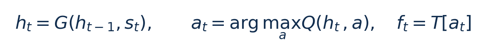
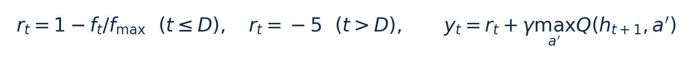
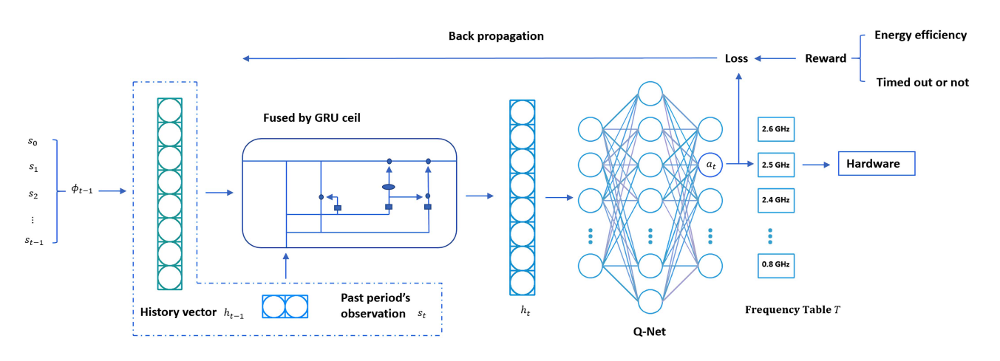
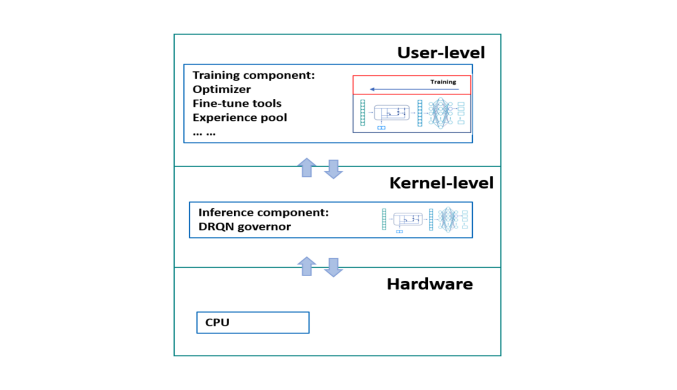
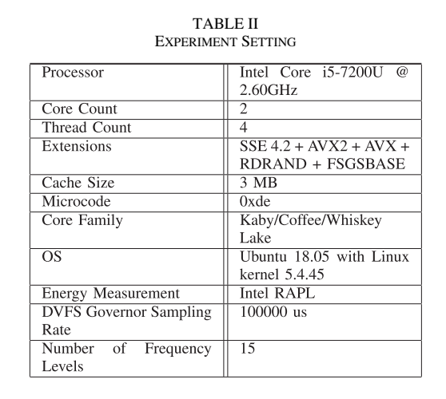
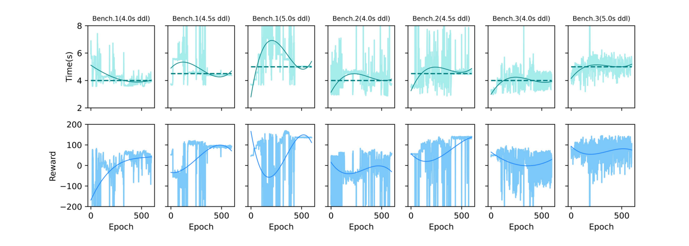
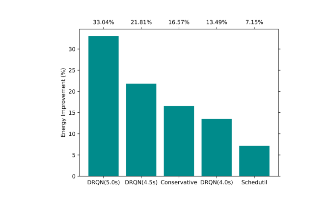

# DRQN Governor：图文技术精读

[论文页面](https://doi.org/10.1109/TNSE.2021.3123280) · [本笔记所用 PDF](https://coladog.github.io/assets/papers/TNSE2021.pdf) · [DOI](https://doi.org/10.1109/TNSE.2021.3123280)

整理日期：2026-11-05。**读者原创中文解读；原图归论文作者／出版方。未运行作者实验，不是独立复现。**

**一句话：** 用GRU记住频率和CPU利用率的历史，再由Q网络选择下一档频率，训练与内核推理分开执行。

阅读地图：先看问题与输入输出，再顺着架构图、公式和结果图阅读；最后检查统计边界与E902迁移。完整编号索引另见“图表索引”。下文“读者分析”是推断或建议，不是原文结果。

## 阶段0：材料与版本审计

| 材料 | 当前可用程度 | 影响 |
| --- | --- | --- |
| 摘要、正文、方法、原图注 | 已获取本地完整PDF、文本与逐页渲染 | 可核查结构、实验及关键数字；可见页面优先于异常文本层 |
| 分析版本 | 作者公开的IEEE正式排版PDF，10页；印刷页3886起。 | 引用页码以“PDF第几页”标识 |
| 代码／原始数据 | 作者网页提供PDF。当前材料中尚未确认对应本篇版本的完整代码；后续2023论文仓库不能未经核对就充当本篇源码。 | 公开链接不等于已构建或已拿到原始轨迹 |
| 附件、独立原始重复与勘误 | 当前未完成全渠道附件／勘误穷尽检索 | 不能断言没有附件、没有勘误或没有其他版本 |
| 本次工作范围 | 材料阅读、图表裁取、证据整理、教学公式 | 所有新实验均是建议，尚未执行 |

## 阶段1：身份卡与整体概述

| 项目 | 内容 |
| --- | --- |
| 英文题名 | Deadline-Aware Deep-Recurrent-Q-Network Governor for Smart Energy Saving |
| 中文导读题名 | 为什么要让CPU选频器记住过去：DRQN及用户态训练 |
| 作者 | Ti Zhou, Man Lin |
| 发表／版本 | IEEE TNSE 9(6),3886–3895 (2022；在线2021)；作者公开的IEEE正式排版PDF，10页；印刷页3886起。 |
| 类型与领域 | 原始方法／工程系统研究；DVFS、CPU能效、运行时控制 |
| 单位、通讯、资助与利益关系 | 作者来自加拿大St. Francis Xavier University计算机系，通讯作者Man Lin。致谢列NSERC资助（PDF p10）。当前版本未定位到单独的利益冲突表格，不能推断没有利益关系。 |
| 核心对象与接口 | 期限内偏好低频、超期惩罚；属于学习目标，不等于硬实时安全过滤。 |
| 代码与数据 | 作者网页提供PDF。当前材料中尚未确认对应本篇版本的完整代码；后续2023论文仓库不能未经核对就充当本篇源码。 |
| 与本课题关系 | 最值得迁移的是“执行历史有用”与“离线训练、在线轻推理”的分工。你的被控负载可以是压缩程序，状态历史换成每块进度、周期与忙闲比例。E902上先比较短历史统计量和小Q表，再决定是否需要GRU；不要把i5上的4–10ms叫轻到可以忽略。 |

**约200字中文概述（改写）：** 传统Linux governor主要根据当前负载阈值调频，难以按特定应用的软截止时间利用执行阶段差异。作者以频率和利用率为观测，用GRU压缩历史、Q网络输出频率动作；内核只执行推理和采样，用户态进行经验回放训练。i5平台上的视觉、转码联网以及FFT与文件写入三类任务显示了依截止期变化的能量收益。方法证明了真实CPU上的学习选频可实现，但4–10ms推理开销、单平台与软时限证据使其不能原样迁移到小型E902。

**三句话定位：** 问题是同样的瞬时利用率可能来自不同执行阶段，后续需求不同；单点阈值看不到这些历史。假设是历史编码能改善选频，同时把训练移出内核能使部署可行。网络消融与跨输入测试的充分性仍需独立审查。 方法主线为上一采样周期的频率和忙闲时间 → 归一化观测 → GRU更新历史向量 → Q网络给15个动作评分 → CPUFreq执行 → 内核记经验 → 用户态重建序列并训练 → 更新推理参数。 主要证据见下方结果表，结论须与测量和版本范围一起使用。

## 阶段2：问题、假设与创新位置

同样的瞬时利用率可能来自不同执行阶段，后续需求不同；单点阈值看不到这些历史。假设是历史编码能改善选频，同时把训练移出内核能使部署可行。网络消融与跨输入测试的充分性仍需独立审查。

**创新判断（读者分析）：** 贡献由历史状态表示、应用期限驱动奖励、用户态训练／内核推理框架共同组成。它是已有JSA2023时序编码论文的前序工作；2023的轻量编码、整数实现和25µs数值不能倒填到本篇。 不依据作者自称“首次”断定整个领域绝无前例。

## 阶段3：必要术语与数学

| 级别 | 术语／关键词 | 直觉、严格含义与易混点 |
| --- | --- | --- |
| A | DVFS / DFS | DVFS同时涉及动态电压与频率；只有时钟变化称DFS。电压能否改变取决于实际供电域。 |
| A | Workload | 真正执行应用计算的程序与输入；本文里的控制器是另一个角色。 |
| A | Controller | 根据观测选择动作的软件／硬件，可运行在同一CPU或独立控制核。 |
| A | OPP | Operating Performance Point，经过允许范围验证的电压—频率组合。 |
| A | Power / Energy | 功率W表示此刻消耗快慢；能量J是对时间积分。低功率不必然低能量。 |
| B | Deadline | 作业必须完成的时刻；平均时延、P95与最大时延各有不同用途。 |
| A | Governor | 根据观测作出频率请求的软件策略。 |
| B | GRU | 带门控的循环网络，用固定长度向量概括历史。 |
| B | Q值 | 某状态采取动作的预期累计回报，非功率测量值。 |
| C | 经验回放 | 保存交互样本后重用训练；循环模型还需处理序列状态。 |

### 公式1：历史编码与动作（原文§III的符号澄清）

**符号与前提：** s_t为当前二维观测；h_t为8维历史状态；a是离散动作编号，无量纲；T为频率表，Hz。原文推理式的max应按选择动作的含义理解为argmax。

**代入与检查：** 教学例：Q值(0.1,0.4,0.3)对应三档时选择第二档，不是把0.4当成频率。GRU状态必须随一次作业连续更新，并在规定边界重置。

**来源：** §III-A/B，Fig2，PDF p4。
### 公式2：即时奖励与TD目标（本篇版本）

**符号与前提：** r和Q是无量纲学习分数；D是应用期限，秒；γ=0.9。终止样本只取y=r。频率比奖励是能量偏好的代理，不是实测J。

**代入与检查：** f=0.5fmax时期限内奖励0.5；超时记-5。低频可能得到较多局部奖励却拖长任务，因此必须观察实际期限与完整能量，不能只用训练reward证明节能。

**来源：** Algorithms1–3与§IV-A，PDF p5–7。

## 阶段4–6：架构、关键图与方法拆解

**输入—处理—输出：** 上一采样周期的频率和忙闲时间 → 归一化观测 → GRU更新历史向量 → Q网络给15个动作评分 → CPUFreq执行 → 内核记经验 → 用户态重建序列并训练 → 更新推理参数。

| 系统角色 | 具体设置 |
| --- | --- |
| 观测 | s_t=(频率,利用率)，利用率=CPU active time/total time；非图像或LLM token。 |
| 历史／模型 | GRU输入2、内部状态8；Q网络8–16–15，ReLU。此处依据§III-A，不是6维。 |
| 动作 | 15档400–2500MHz，采样100ms，Turbo关闭。 |
| 目标 | 期限内偏好低频、超期惩罚；属于学习目标，不等于硬实时安全过滤。 |

§III（PDF p4–7）：部分可观测执行过程由GRU向量h_t表示，Q网络评估各频率的预期回报。训练回放需要恢复历史状态，不能把随机抽取的单个观测直接当作完整序列。Adam学习率1e-3，折扣因子0.9，共600个episode，探索概率从0.5逐步降低。

框架把重训练与轻推理分开：用户态读经验、训练、导出权重；内核在采样周期更新历史、推理和执行CPUFreq。该分离减轻内核负担，但训练仍运行在同一设备上，不能假定零资源消耗。

§IV：Intel i5-7200U、Ubuntu18.04、Linux5.4.45。视觉任务含相机、ResNet50和存储；网络任务含MP3转WAV和蓝牙通知；第三类含FFT与4KB文件写入。它们提供不同计算／等待阶段，而不是让DVFS控制图像内容。RAPL测CPU on-core能量，不是整板电池。

材料内部差异：正文实验段写Ubuntu18.04，TableII可见18.05；本笔记保留差异，不凭猜测补成统一的可复现系统版本。

### Fig2：DRQN网络

[打开大图](images/original-fig2.png) · [原文 Fig2，PDF p4](https://coladog.github.io/assets/papers/TNSE2021.pdf#page=4)

**怎样看：** 从二维观测进入GRU再到15个Q输出。

**直接观察／原文报告：** 历史与动作评分分两部分。

**读者判断：** 图中输出是选频，不是训练LLM。

### Fig4：用户态与内核分工

[打开大图](images/original-fig4.png) · [原文 Fig4，PDF p6](https://coladog.github.io/assets/papers/TNSE2021.pdf#page=6)

**怎样看：** 看权重向下、经验向上的箭头。

**直接观察／原文报告：** 训练与推理分离。

**读者判断：** 同机训练仍有资源开销。

### TableII：环境与训练设置

[打开大图](images/original-tableii.png) · [原文 TableII，PDF p7](https://coladog.github.io/assets/papers/TNSE2021.pdf#page=7)

**怎样看：** 核对CPU、OS、频率表和学习参数。

**直接观察／原文报告：** 决定结果适用平台。

**读者判断：** 不能替换成E902而沿用时延。

| 阅读问题 | 先看材料 | 如何接到下一步 |
| --- | --- | --- |
| 为什么要改现有方案 | 问题背景与动机图 | 确定目标、约束和原有不足 |
| 系统观察什么、控制什么 | 输入输出表＋关键架构图 | 确认数据、模型和执行器真实角色 |
| 方法如何得到动作或估计 | 方法段、公式、算法／模型表 | 明确离线训练与在线流程 |
| 收益是否真实且公平 | 结果图表、统计与测量边界 | 核查基线／目标／分母／开销 |
| 能否用于自己的CPU | 局限、复现计划、三项实验 | 把论文假设变成待验证的工程条件 |

## 阶段7–8：实验、统计及证据链

本节数字均是**原文明确报告或原文数值的标注算例**；没有按图柱高度臆造额外精确值。

| 指标 | 原文报告 | 条件／分母／边界 | 证据位置 |
| --- | --- | --- | --- |
| Benchmark1相对Ondemand | 13%–33%核心能量降低 | 期限4.0–5.0s，10次请求 | §IV-D，Fig9，p9 |
| Benchmark2相对Ondemand | 22%–30%降低 | 期限4.0/4.5s，含转码和蓝牙 | Fig10，p9 |
| Benchmark3相对Ondemand | 7%–28%降低 | 期限4.0/5.0s，FFT与写文件 | Fig11，p9 |
| 单次推理 | 4–10ms | 不是2023后续工作的25µs | 结论，p9 |

### Fig6：训练收敛与执行时间

[打开大图](images/original-fig6.png) · [原文 Fig6，PDF p8](https://coladog.github.io/assets/papers/TNSE2021.pdf#page=8)

**怎样看：** 先看每组reward，再看时间相对目标线。

**直接观察／原文报告：** 不同期限导向不同策略。

**读者判断：** 平均靠近期限不说明每次按时。

### Fig9：Benchmark1能量

[打开大图](images/original-fig9.png) · [原文 Fig9，PDF p9](https://coladog.github.io/assets/papers/TNSE2021.pdf#page=9)

**怎样看：** 按deadline比较相对Ondemand柱。

**直接观察／原文报告：** 4–5s范围节能13%–33%。

**读者判断：** 不是固定33%。

**统计与公平性审查（读者分析）：** 每个训练epoch末做3次测试取平均，能量图按10次请求汇总。训练曲线平均执行时间靠近期限不证明所有作业都按时；当前证据不足以给出最坏情况保证。基线有Ondemand、Schedutil、Conservative，采样均为100ms。应进一步核对训练总能量、权重更新成本和输入独立性。

工程实验中，设备、程序、输入文件、重复运行、时间窗口是不同统计层级，不能互相替代。本任务不涉及生物样本，细胞／动物／试剂等检查不适用。未注明的P值或置信区间不补造；“差了几个百分点”不自动等于统计显著。

| 主张层级 | 直接证据 | 对照与统计 | 可得结论／替代解释 | 可信度 |
| --- | --- | --- | --- | --- |
| 原文明确报告 | Benchmark1相对Ondemand：13%–33%核心能量降低 | §IV-D，Fig9，p9 | 期限4.0–5.0s，10次请求；仅在该实验范围内成立 | 图表／文本可核对：高；独立复现：尚无 |
| 作者解释 | 所提架构／模型解释了性能或估计改善 | 关键原图与方法见上文；统计边界见下节 | 效果可能同时来自动作空间、平台特性与采样设置，因果归因需消融 | 中 |
| AI分析／迁移假设 | 用于E902的压缩候选负载 | 本篇未直接验证该芯片与任务组合 | 需三项后续实验；不能复制论文收益数字 | 待验证，当前无法判断 |

## 阶段9–10：贡献与局限分开判断

贡献由历史状态表示、应用期限驱动奖励、用户态训练／内核推理框架共同组成。它是已有JSA2023时序编码论文的前序工作；2023的轻量编码、整数实现和25µs数值不能倒填到本篇。

| 来源 | 严重程度 | 局限及其影响 |
| --- | --- | --- |
| 作者讨论 | 关键 | 4–10ms推理仍慢于启发式；更低算力设备更难部署，作者提出量化／剪枝方向。 |
| 作者讨论 | 重要 | 解释学习出的策略仍待后续工作。 |
| 读者分析 | 重要 | 单平台、少量应用与均值曲线不足以证明跨数据泛化及尾时延安全；奖励并非真实净能量。 |

## 阶段11：最小复现路线与缺口

建立相同15档、100ms采样与任务期限；复核GRU8维及QNN8–16–15，恢复序列回放和episode重置。先验证不调频时结果正确，再加入训练、冻结测试和RAPL对齐。要精确复现还需完整训练代码、种子和输入数据，当前尚未齐全；本笔记未运行训练。

**代码／数据现状：** 作者网页提供PDF。当前材料中尚未确认对应本篇版本的完整代码；后续2023论文仓库不能未经核对就充当本篇源码。

**质量控制顺序：** 先验证程序输出和时间基准，再验证采样／模型，最后比较策略。保存输入文件哈希、平台配置、OPP、随机种子、温度与每次运行原始记录。失败时先回固定安全频点定位错误，再继续优化。复现可行性判断为“可开始部分方法复建，完整数值复现条件未齐”；这与“已完成复现”不同。

## 阶段12：用于你的CPU／E902课题

最值得迁移的是“执行历史有用”与“离线训练、在线轻推理”的分工。你的被控负载可以是压缩程序，状态历史换成每块进度、周期与忙闲比例。E902上先比较短历史统计量和小Q表，再决定是否需要GRU；不要把i5上的4–10ms叫轻到可以忽略。

| 建议实验／优先级 | 价值 | 最低资源 | 主要风险 | 成功判据（设计目标，非已得结果） |
| --- | --- | --- | --- | --- |
| P0：无历史与短历史消融 | 判断当前负载是否需要记忆 | 相同压缩块、频点、阈值／小MLP | 历史并未增加可辨识信息 | 留出文件上净能量或违约率优于无历史 |
| P1：推理成本预算 | 验证E902是否装得下 | 周期计数、模型参数、栈与RAM统计 | 软件浮点开销过大 | 控制时间小于自定周期预算；同时报告最大值和周期占比 |
| P1：训练与部署分离 | 训练放电脑、板上只推理 | 离线轨迹、冻结权重、小整数推理器 | 训练部署分布不一致 | 独立输入正确执行；比较浮点／整数决策差异及能量 |

上述优先级是读者建议：P0先做，P1建立在基线可运行后，P2只在资源允许且前序实验证明有必要时开展。压缩应用仍是候选，尚未替你最终定题或证明已在E902运行。论文公开可读不自动授权任意复制数据；代码、图片和数据须分别核对许可。

## 阶段13：读完后应掌握与继续核查

**五个知识点：** 用GRU记住频率和CPU利用率的历史，再由Q网络选择下一档频率，训练与内核推理分开执行。 你还应能解释输入输出表中的角色、两条公式的单位、首个结果指标的分母，以及局限表里的关键条件。

**五个未决问题：** 独立新输入是否成立？最差时延是否可接受？测量参考是否足够？控制与切换是否抵消收益？E902实际具有哪些接口和可观测量？这些是研究问题，不是对作者遗漏的无证据指控。

**立即做：** 按公式算例手算一次，选一张结果图复述“硬件—负载—基线—指标—边界”。**后续核查：** 补齐代码版本、训练数据和仪表设置。**可复用：** 上文明确标注的模型与接口思路。**谨慎采用：** 所有跨平台百分比。**暂不采用：** 尚未证实存在的电压控制和完整硬实时承诺。
