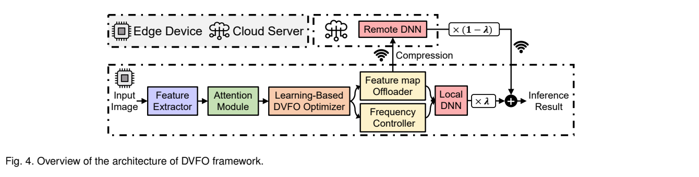
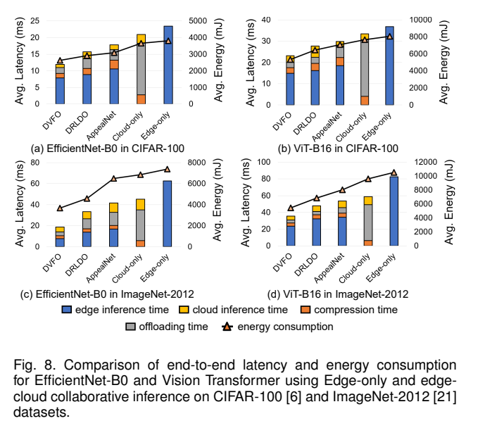
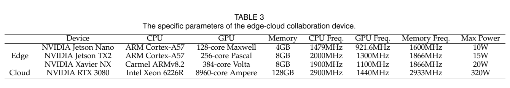

[论文页面](https://arxiv.org/abs/2306.01811v3) · [本笔记所用 PDF](https://arxiv.org/pdf/2306.01811v3) · [标识符](https://doi.org/10.48550/arXiv.2306.01811)

整理日期：2026-11-06。**读者原创中文解读；原图归论文作者／出版方。未运行作者实验，不是独立复现。**

**覆盖范围：** 本版本正文中识别到的21项图、表或算法；保留原编号。关键项已裁图并在技术精读相应段落出现，未内嵌的项可点PDF页链接查看，不上传整篇PDF。

**统计总边界：** 作者说所有结果在测试集平均，但图像数不是独立设备运行重复。带宽固定5Mbps的主结果与带宽敏感性分开。jetson-stats估边缘整体功耗，云GPU/网络设施能量未包含。改量化、特征分配、网络与调频多组件共同作用，比较必须看相同QAT和模型条件。

## Fig1：边缘能量组成

[原文 Fig1，PDF p1](https://arxiv.org/pdf/2306.01811v3#page=1)

1. **本项回答的问题：** 边缘能量组成，用于支撑这条方法或实验链中的具体环节。
2. **组成、坐标和对照：** 先读图题、图例、坐标/表头与单位，再在同一负载和同一基线内比较。CPU/GPU/内存都消耗能量。 结构／流程类没有统一数值坐标；箭头表示数据或控制关系，不表示统计因果。 颜色按原图图例辨认，不能把同色跨图视为同一组。
3. **阅读顺序与统计单位：** 先看设定、单位和图例，再看趋势与作者正文。重复次数及采样独立性参见本篇技术精读统计节；没有为该图定位到的误差线定义／独立重复数，不另行猜测。
4. **直接观察：** CPU/GPU/内存都消耗能量。
5. **作者解释的范围：** 原文以该图／表作为上述观察的结构说明或实验支撑，需连同对应页正文读取；本索引不额外替作者推导因果机制。
6. **独立判断（AI分析）：** 只支持此图所列的模型、设备、输入与测量口径；CPU/GPU/内存都消耗能量。 不能由单图推出E902或其他GPU的同幅收益。
7. **证据链位置：** 方法／系统实现说明。它支持本文具体条件下的实现或结果，不单独完成跨平台验证。
8. **结论与强度：** 可复述“CPU/GPU/内存都消耗能量。”；对图内描述的核查可信度高，对未做独立实验的泛化判断为中或无法判断。不能得出的结论是“只支持此图所列的模型、设备、输入与测量口径；CPU/GPU/内存都消耗能量。 不能由单图推出E902或其他GPU的同幅收益。”所排除的外推。

## Fig2：频率组合影响

[原文 Fig2，PDF p3](https://arxiv.org/pdf/2306.01811v3#page=3)

1. **本项回答的问题：** 频率组合影响，用于支撑这条方法或实验链中的具体环节。
2. **组成、坐标和对照：** 先读图题、图例、坐标/表头与单位，再在同一负载和同一基线内比较。多频域不能只看GPU。 按原图／表标示的单位与归一化基准阅读；不将不同子图或不同分母的柱高直接相除。 颜色按原图图例辨认，不能把同色跨图视为同一组。
3. **阅读顺序与统计单位：** 先看设定、单位和图例，再看趋势与作者正文。重复次数及采样独立性参见本篇技术精读统计节；没有为该图定位到的误差线定义／独立重复数，不另行猜测。
4. **直接观察：** 多频域不能只看GPU。
5. **作者解释的范围：** 原文以该图／表作为上述观察的结构说明或实验支撑，需连同对应页正文读取；本索引不额外替作者推导因果机制。
6. **独立判断（AI分析）：** 只支持此图所列的模型、设备、输入与测量口径；多频域不能只看GPU。 不能由单图推出E902或其他GPU的同幅收益。
7. **证据链位置：** 性能验证／定量或示例证据，需结合实验条件。它支持本文具体条件下的实现或结果，不单独完成跨平台验证。
8. **结论与强度：** 可复述“多频域不能只看GPU。”；对图内描述的核查可信度高，对未做独立实验的泛化判断为中或无法判断。不能得出的结论是“只支持此图所列的模型、设备、输入与测量口径；多频域不能只看GPU。 不能由单图推出E902或其他GPU的同幅收益。”所排除的外推。

## Fig3：DRL角色

[原文 Fig3，PDF p4](https://arxiv.org/pdf/2306.01811v3#page=4)

1. **本项回答的问题：** DRL角色，用于支撑这条方法或实验链中的具体环节。
2. **组成、坐标和对照：** 先读图题、图例、坐标/表头与单位，再在同一负载和同一基线内比较。agent不同于推理DNN。 按原图／表标示的单位与归一化基准阅读；不将不同子图或不同分母的柱高直接相除。 颜色按原图图例辨认，不能把同色跨图视为同一组。
3. **阅读顺序与统计单位：** 先看设定、单位和图例，再看趋势与作者正文。重复次数及采样独立性参见本篇技术精读统计节；没有为该图定位到的误差线定义／独立重复数，不另行猜测。
4. **直接观察：** agent不同于推理DNN。
5. **作者解释的范围：** 原文以该图／表作为上述观察的结构说明或实验支撑，需连同对应页正文读取；本索引不额外替作者推导因果机制。
6. **独立判断（AI分析）：** 只支持此图所列的模型、设备、输入与测量口径；agent不同于推理DNN。 不能由单图推出E902或其他GPU的同幅收益。
7. **证据链位置：** 性能验证／定量或示例证据，需结合实验条件。它支持本文具体条件下的实现或结果，不单独完成跨平台验证。
8. **结论与强度：** 可复述“agent不同于推理DNN。”；对图内描述的核查可信度高，对未做独立实验的泛化判断为中或无法判断。不能得出的结论是“只支持此图所列的模型、设备、输入与测量口径；agent不同于推理DNN。 不能由单图推出E902或其他GPU的同幅收益。”所排除的外推。

## Fig4：系统架构

[原文 Fig4，PDF p5](https://arxiv.org/pdf/2306.01811v3#page=5)

[打开大图](images/original-fig4.png)

1. **本项回答的问题：** 系统架构，用于支撑这条方法或实验链中的具体环节。
2. **组成、坐标和对照：** 先读图题、图例、坐标/表头与单位，再在同一负载和同一基线内比较。区分边缘、云、压缩与融合。 结构／流程类没有统一数值坐标；箭头表示数据或控制关系，不表示统计因果。 颜色按原图图例辨认，不能把同色跨图视为同一组。
3. **阅读顺序与统计单位：** 先看设定、单位和图例，再看趋势与作者正文。重复次数及采样独立性参见本篇技术精读统计节；没有为该图定位到的误差线定义／独立重复数，不另行猜测。
4. **直接观察：** 区分边缘、云、压缩与融合。
5. **作者解释的范围：** 原文以该图／表作为上述观察的结构说明或实验支撑，需连同对应页正文读取；本索引不额外替作者推导因果机制。
6. **独立判断（AI分析）：** 只支持此图所列的模型、设备、输入与测量口径；区分边缘、云、压缩与融合。 不能由单图推出E902或其他GPU的同幅收益。
7. **证据链位置：** 方法／系统实现说明。它支持本文具体条件下的实现或结果，不单独完成跨平台验证。
8. **结论与强度：** 可复述“区分边缘、云、压缩与融合。”；对图内描述的核查可信度高，对未做独立实验的泛化判断为中或无法判断。不能得出的结论是“只支持此图所列的模型、设备、输入与测量口径；区分边缘、云、压缩与融合。 不能由单图推出E902或其他GPU的同幅收益。”所排除的外推。

## Fig5：阻塞与并发策略

[原文 Fig5，PDF p6](https://arxiv.org/pdf/2306.01811v3#page=6)

1. **本项回答的问题：** 阻塞与并发策略，用于支撑这条方法或实验链中的具体环节。
2. **组成、坐标和对照：** 先读图题、图例、坐标/表头与单位，再在同一负载和同一基线内比较。并发动作存在观测滞后。 按原图／表标示的单位与归一化基准阅读；不将不同子图或不同分母的柱高直接相除。 颜色按原图图例辨认，不能把同色跨图视为同一组。
3. **阅读顺序与统计单位：** 先看设定、单位和图例，再看趋势与作者正文。重复次数及采样独立性参见本篇技术精读统计节；没有为该图定位到的误差线定义／独立重复数，不另行猜测。
4. **直接观察：** 并发动作存在观测滞后。
5. **作者解释的范围：** 原文以该图／表作为上述观察的结构说明或实验支撑，需连同对应页正文读取；本索引不额外替作者推导因果机制。
6. **独立判断（AI分析）：** 只支持此图所列的模型、设备、输入与测量口径；并发动作存在观测滞后。 不能由单图推出E902或其他GPU的同幅收益。
7. **证据链位置：** 性能验证／定量或示例证据，需结合实验条件。它支持本文具体条件下的实现或结果，不单独完成跨平台验证。
8. **结论与强度：** 可复述“并发动作存在观测滞后。”；对图内描述的核查可信度高，对未做独立实验的泛化判断为中或无法判断。不能得出的结论是“只支持此图所列的模型、设备、输入与测量口径；并发动作存在观测滞后。 不能由单图推出E902或其他GPU的同幅收益。”所排除的外推。

## Fig6：SCAM结构

[原文 Fig6，PDF p8](https://arxiv.org/pdf/2306.01811v3#page=8)

1. **本项回答的问题：** SCAM结构，用于支撑这条方法或实验链中的具体环节。
2. **组成、坐标和对照：** 先读图题、图例、坐标/表头与单位，再在同一负载和同一基线内比较。通道与空间注意力筛特征。 结构／流程类没有统一数值坐标；箭头表示数据或控制关系，不表示统计因果。 颜色按原图图例辨认，不能把同色跨图视为同一组。
3. **阅读顺序与统计单位：** 先看设定、单位和图例，再看趋势与作者正文。重复次数及采样独立性参见本篇技术精读统计节；没有为该图定位到的误差线定义／独立重复数，不另行猜测。
4. **直接观察：** 通道与空间注意力筛特征。
5. **作者解释的范围：** 原文以该图／表作为上述观察的结构说明或实验支撑，需连同对应页正文读取；本索引不额外替作者推导因果机制。
6. **独立判断（AI分析）：** 只支持此图所列的模型、设备、输入与测量口径；通道与空间注意力筛特征。 不能由单图推出E902或其他GPU的同幅收益。
7. **证据链位置：** 方法／系统实现说明。它支持本文具体条件下的实现或结果，不单独完成跨平台验证。
8. **结论与强度：** 可复述“通道与空间注意力筛特征。”；对图内描述的核查可信度高，对未做独立实验的泛化判断为中或无法判断。不能得出的结论是“只支持此图所列的模型、设备、输入与测量口径；通道与空间注意力筛特征。 不能由单图推出E902或其他GPU的同幅收益。”所排除的外推。

## Fig7：特征贡献

[原文 Fig7，PDF p8](https://arxiv.org/pdf/2306.01811v3#page=8)

1. **本项回答的问题：** 特征贡献，用于支撑这条方法或实验链中的具体环节。
2. **组成、坐标和对照：** 先读图题、图例、坐标/表头与单位，再在同一负载和同一基线内比较。重要性排序不等于严格因果必要性。 按原图／表标示的单位与归一化基准阅读；不将不同子图或不同分母的柱高直接相除。 颜色按原图图例辨认，不能把同色跨图视为同一组。
3. **阅读顺序与统计单位：** 先看设定、单位和图例，再看趋势与作者正文。重复次数及采样独立性参见本篇技术精读统计节；没有为该图定位到的误差线定义／独立重复数，不另行猜测。
4. **直接观察：** 重要性排序不等于严格因果必要性。
5. **作者解释的范围：** 原文以该图／表作为上述观察的结构说明或实验支撑，需连同对应页正文读取；本索引不额外替作者推导因果机制。
6. **独立判断（AI分析）：** 只支持此图所列的模型、设备、输入与测量口径；重要性排序不等于严格因果必要性。 不能由单图推出E902或其他GPU的同幅收益。
7. **证据链位置：** 性能验证／定量或示例证据，需结合实验条件。它支持本文具体条件下的实现或结果，不单独完成跨平台验证。
8. **结论与强度：** 可复述“重要性排序不等于严格因果必要性。”；对图内描述的核查可信度高，对未做独立实验的泛化判断为中或无法判断。不能得出的结论是“只支持此图所列的模型、设备、输入与测量口径；重要性排序不等于严格因果必要性。 不能由单图推出E902或其他GPU的同幅收益。”所排除的外推。

## Fig8：时延和边缘能量

[原文 Fig8，PDF p9](https://arxiv.org/pdf/2306.01811v3#page=9)

[打开大图](images/original-fig8.png)

1. **本项回答的问题：** 时延和边缘能量，用于支撑这条方法或实验链中的具体环节。
2. **组成、坐标和对照：** 先读图题、图例、坐标/表头与单位，再在同一负载和同一基线内比较。彩色堆叠时延与能量折线单位不同。 按原图／表标示的单位与归一化基准阅读；不将不同子图或不同分母的柱高直接相除。 颜色按原图图例辨认，不能把同色跨图视为同一组。
3. **阅读顺序与统计单位：** 先看设定、单位和图例，再看趋势与作者正文。重复次数及采样独立性参见本篇技术精读统计节；没有为该图定位到的误差线定义／独立重复数，不另行猜测。
4. **直接观察：** 彩色堆叠时延与能量折线单位不同。
5. **作者解释的范围：** 原文以该图／表作为上述观察的结构说明或实验支撑，需连同对应页正文读取；本索引不额外替作者推导因果机制。
6. **独立判断（AI分析）：** 只支持此图所列的模型、设备、输入与测量口径；彩色堆叠时延与能量折线单位不同。 不能由单图推出E902或其他GPU的同幅收益。
7. **证据链位置：** 性能验证／定量或示例证据，需结合实验条件。它支持本文具体条件下的实现或结果，不单独完成跨平台验证。
8. **结论与强度：** 可复述“彩色堆叠时延与能量折线单位不同。”；对图内描述的核查可信度高，对未做独立实验的泛化判断为中或无法判断。不能得出的结论是“只支持此图所列的模型、设备、输入与测量口径；彩色堆叠时延与能量折线单位不同。 不能由单图推出E902或其他GPU的同幅收益。”所排除的外推。

## Fig9：分类精度

[原文 Fig9，PDF p10](https://arxiv.org/pdf/2306.01811v3#page=10)

1. **本项回答的问题：** 分类精度，用于支撑这条方法或实验链中的具体环节。
2. **组成、坐标和对照：** 先读图题、图例、坐标/表头与单位，再在同一负载和同一基线内比较。压缩/卸载的质量代价不能隐藏。 按原图／表标示的单位与归一化基准阅读；不将不同子图或不同分母的柱高直接相除。 颜色按原图图例辨认，不能把同色跨图视为同一组。
3. **阅读顺序与统计单位：** 先看设定、单位和图例，再看趋势与作者正文。重复次数及采样独立性参见本篇技术精读统计节；没有为该图定位到的误差线定义／独立重复数，不另行猜测。
4. **直接观察：** 压缩/卸载的质量代价不能隐藏。
5. **作者解释的范围：** 原文以该图／表作为上述观察的结构说明或实验支撑，需连同对应页正文读取；本索引不额外替作者推导因果机制。
6. **独立判断（AI分析）：** 只支持此图所列的模型、设备、输入与测量口径；压缩/卸载的质量代价不能隐藏。 不能由单图推出E902或其他GPU的同幅收益。
7. **证据链位置：** 性能验证／定量或示例证据，需结合实验条件。它支持本文具体条件下的实现或结果，不单独完成跨平台验证。
8. **结论与强度：** 可复述“压缩/卸载的质量代价不能隐藏。”；对图内描述的核查可信度高，对未做独立实验的泛化判断为中或无法判断。不能得出的结论是“只支持此图所列的模型、设备、输入与测量口径；压缩/卸载的质量代价不能隐藏。 不能由单图推出E902或其他GPU的同幅收益。”所排除的外推。

## Fig10：频率动态

[原文 Fig10，PDF p10](https://arxiv.org/pdf/2306.01811v3#page=10)

1. **本项回答的问题：** 频率动态，用于支撑这条方法或实验链中的具体环节。
2. **组成、坐标和对照：** 先读图题、图例、坐标/表头与单位，再在同一负载和同一基线内比较。实际动作不是恒定最高频。 按原图／表标示的单位与归一化基准阅读；不将不同子图或不同分母的柱高直接相除。 颜色按原图图例辨认，不能把同色跨图视为同一组。
3. **阅读顺序与统计单位：** 先看设定、单位和图例，再看趋势与作者正文。重复次数及采样独立性参见本篇技术精读统计节；没有为该图定位到的误差线定义／独立重复数，不另行猜测。
4. **直接观察：** 实际动作不是恒定最高频。
5. **作者解释的范围：** 原文以该图／表作为上述观察的结构说明或实验支撑，需连同对应页正文读取；本索引不额外替作者推导因果机制。
6. **独立判断（AI分析）：** 只支持此图所列的模型、设备、输入与测量口径；实际动作不是恒定最高频。 不能由单图推出E902或其他GPU的同幅收益。
7. **证据链位置：** 性能验证／定量或示例证据，需结合实验条件。它支持本文具体条件下的实现或结果，不单独完成跨平台验证。
8. **结论与强度：** 可复述“实际动作不是恒定最高频。”；对图内描述的核查可信度高，对未做独立实验的泛化判断为中或无法判断。不能得出的结论是“只支持此图所列的模型、设备、输入与测量口径；实际动作不是恒定最高频。 不能由单图推出E902或其他GPU的同幅收益。”所排除的外推。

## Fig11：带宽变化

[原文 Fig11，PDF p10](https://arxiv.org/pdf/2306.01811v3#page=10)

1. **本项回答的问题：** 带宽变化，用于支撑这条方法或实验链中的具体环节。
2. **组成、坐标和对照：** 先读图题、图例、坐标/表头与单位，再在同一负载和同一基线内比较。慢链路与云计算耗时分开。 按原图／表标示的单位与归一化基准阅读；不将不同子图或不同分母的柱高直接相除。 颜色按原图图例辨认，不能把同色跨图视为同一组。
3. **阅读顺序与统计单位：** 先看设定、单位和图例，再看趋势与作者正文。重复次数及采样独立性参见本篇技术精读统计节；没有为该图定位到的误差线定义／独立重复数，不另行猜测。
4. **直接观察：** 慢链路与云计算耗时分开。
5. **作者解释的范围：** 原文以该图／表作为上述观察的结构说明或实验支撑，需连同对应页正文读取；本索引不额外替作者推导因果机制。
6. **独立判断（AI分析）：** 只支持此图所列的模型、设备、输入与测量口径；慢链路与云计算耗时分开。 不能由单图推出E902或其他GPU的同幅收益。
7. **证据链位置：** 性能验证／定量或示例证据，需结合实验条件。它支持本文具体条件下的实现或结果，不单独完成跨平台验证。
8. **结论与强度：** 可复述“慢链路与云计算耗时分开。”；对图内描述的核查可信度高，对未做独立实验的泛化判断为中或无法判断。不能得出的结论是“只支持此图所列的模型、设备、输入与测量口径；慢链路与云计算耗时分开。 不能由单图推出E902或其他GPU的同幅收益。”所排除的外推。

## Fig12：融合权重λ

[原文 Fig12，PDF p11](https://arxiv.org/pdf/2306.01811v3#page=11)

1. **本项回答的问题：** 融合权重λ，用于支撑这条方法或实验链中的具体环节。
2. **组成、坐标和对照：** 先读图题、图例、坐标/表头与单位，再在同一负载和同一基线内比较。质量/时延受融合影响。 按原图／表标示的单位与归一化基准阅读；不将不同子图或不同分母的柱高直接相除。 颜色按原图图例辨认，不能把同色跨图视为同一组。
3. **阅读顺序与统计单位：** 先看设定、单位和图例，再看趋势与作者正文。重复次数及采样独立性参见本篇技术精读统计节；没有为该图定位到的误差线定义／独立重复数，不另行猜测。
4. **直接观察：** 质量/时延受融合影响。
5. **作者解释的范围：** 原文以该图／表作为上述观察的结构说明或实验支撑，需连同对应页正文读取；本索引不额外替作者推导因果机制。
6. **独立判断（AI分析）：** 只支持此图所列的模型、设备、输入与测量口径；质量/时延受融合影响。 不能由单图推出E902或其他GPU的同幅收益。
7. **证据链位置：** 性能验证／定量或示例证据，需结合实验条件。它支持本文具体条件下的实现或结果，不单独完成跨平台验证。
8. **结论与强度：** 可复述“质量/时延受融合影响。”；对图内描述的核查可信度高，对未做独立实验的泛化判断为中或无法判断。不能得出的结论是“只支持此图所列的模型、设备、输入与测量口径；质量/时延受融合影响。 不能由单图推出E902或其他GPU的同幅收益。”所排除的外推。

## Fig13：η权衡

[原文 Fig13，PDF p11](https://arxiv.org/pdf/2306.01811v3#page=11)

1. **本项回答的问题：** η权衡，用于支撑这条方法或实验链中的具体环节。
2. **组成、坐标和对照：** 先读图题、图例、坐标/表头与单位，再在同一负载和同一基线内比较。权重改变优化目标，非统一排行榜。 按原图／表标示的单位与归一化基准阅读；不将不同子图或不同分母的柱高直接相除。 颜色按原图图例辨认，不能把同色跨图视为同一组。
3. **阅读顺序与统计单位：** 先看设定、单位和图例，再看趋势与作者正文。重复次数及采样独立性参见本篇技术精读统计节；没有为该图定位到的误差线定义／独立重复数，不另行猜测。
4. **直接观察：** 权重改变优化目标，非统一排行榜。
5. **作者解释的范围：** 原文以该图／表作为上述观察的结构说明或实验支撑，需连同对应页正文读取；本索引不额外替作者推导因果机制。
6. **独立判断（AI分析）：** 只支持此图所列的模型、设备、输入与测量口径；权重改变优化目标，非统一排行榜。 不能由单图推出E902或其他GPU的同幅收益。
7. **证据链位置：** 性能验证／定量或示例证据，需结合实验条件。它支持本文具体条件下的实现或结果，不单独完成跨平台验证。
8. **结论与强度：** 可复述“权重改变优化目标，非统一排行榜。”；对图内描述的核查可信度高，对未做独立实验的泛化判断为中或无法判断。不能得出的结论是“只支持此图所列的模型、设备、输入与测量口径；权重改变优化目标，非统一排行榜。 不能由单图推出E902或其他GPU的同幅收益。”所排除的外推。

## Fig14：融合实现开销

[原文 Fig14，PDF p12](https://arxiv.org/pdf/2306.01811v3#page=12)

1. **本项回答的问题：** 融合实现开销，用于支撑这条方法或实验链中的具体环节。
2. **组成、坐标和对照：** 先读图题、图例、坐标/表头与单位，再在同一负载和同一基线内比较。加权和与NN融合不等成本。 按原图／表标示的单位与归一化基准阅读；不将不同子图或不同分母的柱高直接相除。 颜色按原图图例辨认，不能把同色跨图视为同一组。
3. **阅读顺序与统计单位：** 先看设定、单位和图例，再看趋势与作者正文。重复次数及采样独立性参见本篇技术精读统计节；没有为该图定位到的误差线定义／独立重复数，不另行猜测。
4. **直接观察：** 加权和与NN融合不等成本。
5. **作者解释的范围：** 原文以该图／表作为上述观察的结构说明或实验支撑，需连同对应页正文读取；本索引不额外替作者推导因果机制。
6. **独立判断（AI分析）：** 只支持此图所列的模型、设备、输入与测量口径；加权和与NN融合不等成本。 不能由单图推出E902或其他GPU的同幅收益。
7. **证据链位置：** 性能验证／定量或示例证据，需结合实验条件。它支持本文具体条件下的实现或结果，不单独完成跨平台验证。
8. **结论与强度：** 可复述“加权和与NN融合不等成本。”；对图内描述的核查可信度高，对未做独立实验的泛化判断为中或无法判断。不能得出的结论是“只支持此图所列的模型、设备、输入与测量口径；加权和与NN融合不等成本。 不能由单图推出E902或其他GPU的同幅收益。”所排除的外推。

## Fig15：并发训练曲线

[原文 Fig15，PDF p12](https://arxiv.org/pdf/2306.01811v3#page=12)

1. **本项回答的问题：** 并发训练曲线，用于支撑这条方法或实验链中的具体环节。
2. **组成、坐标和对照：** 先读图题、图例、坐标/表头与单位，再在同一负载和同一基线内比较。训练收敛不等独立部署收益。 按原图／表标示的单位与归一化基准阅读；不将不同子图或不同分母的柱高直接相除。 颜色按原图图例辨认，不能把同色跨图视为同一组。
3. **阅读顺序与统计单位：** 先看设定、单位和图例，再看趋势与作者正文。重复次数及采样独立性参见本篇技术精读统计节；没有为该图定位到的误差线定义／独立重复数，不另行猜测。
4. **直接观察：** 训练收敛不等独立部署收益。
5. **作者解释的范围：** 原文以该图／表作为上述观察的结构说明或实验支撑，需连同对应页正文读取；本索引不额外替作者推导因果机制。
6. **独立判断（AI分析）：** 只支持此图所列的模型、设备、输入与测量口径；训练收敛不等独立部署收益。 不能由单图推出E902或其他GPU的同幅收益。
7. **证据链位置：** 性能验证／定量或示例证据，需结合实验条件。它支持本文具体条件下的实现或结果，不单独完成跨平台验证。
8. **结论与强度：** 可复述“训练收敛不等独立部署收益。”；对图内描述的核查可信度高，对未做独立实验的泛化判断为中或无法判断。不能得出的结论是“只支持此图所列的模型、设备、输入与测量口径；训练收敛不等独立部署收益。 不能由单图推出E902或其他GPU的同幅收益。”所排除的外推。

## Fig16：策略运行开销

[原文 Fig16，PDF p12](https://arxiv.org/pdf/2306.01811v3#page=12)

1. **本项回答的问题：** 策略运行开销，用于支撑这条方法或实验链中的具体环节。
2. **组成、坐标和对照：** 先读图题、图例、坐标/表头与单位，再在同一负载和同一基线内比较。报告推理/计算各部分。 按原图／表标示的单位与归一化基准阅读；不将不同子图或不同分母的柱高直接相除。 颜色按原图图例辨认，不能把同色跨图视为同一组。
3. **阅读顺序与统计单位：** 先看设定、单位和图例，再看趋势与作者正文。重复次数及采样独立性参见本篇技术精读统计节；没有为该图定位到的误差线定义／独立重复数，不另行猜测。
4. **直接观察：** 报告推理/计算各部分。
5. **作者解释的范围：** 原文以该图／表作为上述观察的结构说明或实验支撑，需连同对应页正文读取；本索引不额外替作者推导因果机制。
6. **独立判断（AI分析）：** 只支持此图所列的模型、设备、输入与测量口径；报告推理/计算各部分。 不能由单图推出E902或其他GPU的同幅收益。
7. **证据链位置：** 性能验证／定量或示例证据，需结合实验条件。它支持本文具体条件下的实现或结果，不单独完成跨平台验证。
8. **结论与强度：** 可复述“报告推理/计算各部分。”；对图内描述的核查可信度高，对未做独立实验的泛化判断为中或无法判断。不能得出的结论是“只支持此图所列的模型、设备、输入与测量口径；报告推理/计算各部分。 不能由单图推出E902或其他GPU的同幅收益。”所排除的外推。

## Table1：相关工作维度

[原文 Table1，PDF p2](https://arxiv.org/pdf/2306.01811v3#page=2)

1. **本项回答的问题：** 相关工作维度，用于支撑这条方法或实验链中的具体环节。
2. **组成、坐标和对照：** 先读图题、图例、坐标/表头与单位，再在同一负载和同一基线内比较。功能覆盖不证明性能最优。 按原图／表标示的单位与归一化基准阅读；不将不同子图或不同分母的柱高直接相除。 颜色按原图图例辨认，不能把同色跨图视为同一组。
3. **阅读顺序与统计单位：** 先看设定、单位和图例，再看趋势与作者正文。重复次数及采样独立性参见本篇技术精读统计节；没有为该图定位到的误差线定义／独立重复数，不另行猜测。
4. **直接观察：** 功能覆盖不证明性能最优。
5. **作者解释的范围：** 原文以该图／表作为上述观察的结构说明或实验支撑，需连同对应页正文读取；本索引不额外替作者推导因果机制。
6. **独立判断（AI分析）：** 只支持此图所列的模型、设备、输入与测量口径；功能覆盖不证明性能最优。 不能由单图推出E902或其他GPU的同幅收益。
7. **证据链位置：** 性能验证／定量或示例证据，需结合实验条件。它支持本文具体条件下的实现或结果，不单独完成跨平台验证。
8. **结论与强度：** 可复述“功能覆盖不证明性能最优。”；对图内描述的核查可信度高，对未做独立实验的泛化判断为中或无法判断。不能得出的结论是“只支持此图所列的模型、设备、输入与测量口径；功能覆盖不证明性能最优。 不能由单图推出E902或其他GPU的同幅收益。”所排除的外推。

## Table2：符号

[原文 Table2，PDF p6](https://arxiv.org/pdf/2306.01811v3#page=6)

1. **本项回答的问题：** 符号，用于支撑这条方法或实验链中的具体环节。
2. **组成、坐标和对照：** 先读图题、图例、坐标/表头与单位，再在同一负载和同一基线内比较。核对ξ语义方向。 按原图／表标示的单位与归一化基准阅读；不将不同子图或不同分母的柱高直接相除。 颜色按原图图例辨认，不能把同色跨图视为同一组。
3. **阅读顺序与统计单位：** 先看设定、单位和图例，再看趋势与作者正文。重复次数及采样独立性参见本篇技术精读统计节；没有为该图定位到的误差线定义／独立重复数，不另行猜测。
4. **直接观察：** 核对ξ语义方向。
5. **作者解释的范围：** 原文以该图／表作为上述观察的结构说明或实验支撑，需连同对应页正文读取；本索引不额外替作者推导因果机制。
6. **独立判断（AI分析）：** 只支持此图所列的模型、设备、输入与测量口径；核对ξ语义方向。 不能由单图推出E902或其他GPU的同幅收益。
7. **证据链位置：** 性能验证／定量或示例证据，需结合实验条件。它支持本文具体条件下的实现或结果，不单独完成跨平台验证。
8. **结论与强度：** 可复述“核对ξ语义方向。”；对图内描述的核查可信度高，对未做独立实验的泛化判断为中或无法判断。不能得出的结论是“只支持此图所列的模型、设备、输入与测量口径；核对ξ语义方向。 不能由单图推出E902或其他GPU的同幅收益。”所排除的外推。

## Table3：边云平台

[原文 Table3，PDF p10](https://arxiv.org/pdf/2306.01811v3#page=10)

[打开大图](images/original-table3.png)

1. **本项回答的问题：** 边云平台，用于支撑这条方法或实验链中的具体环节。
2. **组成、坐标和对照：** 先读图题、图例、坐标/表头与单位，再在同一负载和同一基线内比较。默认NX；非三板相同频档。 按原图／表标示的单位与归一化基准阅读；不将不同子图或不同分母的柱高直接相除。 颜色按原图图例辨认，不能把同色跨图视为同一组。
3. **阅读顺序与统计单位：** 先看设定、单位和图例，再看趋势与作者正文。重复次数及采样独立性参见本篇技术精读统计节；没有为该图定位到的误差线定义／独立重复数，不另行猜测。
4. **直接观察：** 默认NX；非三板相同频档。
5. **作者解释的范围：** 原文以该图／表作为上述观察的结构说明或实验支撑，需连同对应页正文读取；本索引不额外替作者推导因果机制。
6. **独立判断（AI分析）：** 只支持此图所列的模型、设备、输入与测量口径；默认NX；非三板相同频档。 不能由单图推出E902或其他GPU的同幅收益。
7. **证据链位置：** 性能验证／定量或示例证据，需结合实验条件。它支持本文具体条件下的实现或结果，不单独完成跨平台验证。
8. **结论与强度：** 可复述“默认NX；非三板相同频档。”；对图内描述的核查可信度高，对未做独立实验的泛化判断为中或无法判断。不能得出的结论是“只支持此图所列的模型、设备、输入与测量口径；默认NX；非三板相同频档。 不能由单图推出E902或其他GPU的同幅收益。”所排除的外推。

## Table4：融合准确率

[原文 Table4，PDF p12](https://arxiv.org/pdf/2306.01811v3#page=12)

1. **本项回答的问题：** 融合准确率，用于支撑这条方法或实验链中的具体环节。
2. **组成、坐标和对照：** 先读图题、图例、坐标/表头与单位，再在同一负载和同一基线内比较。0.68/0.56为百分点损失。 按原图／表标示的单位与归一化基准阅读；不将不同子图或不同分母的柱高直接相除。 颜色按原图图例辨认，不能把同色跨图视为同一组。
3. **阅读顺序与统计单位：** 先看设定、单位和图例，再看趋势与作者正文。重复次数及采样独立性参见本篇技术精读统计节；没有为该图定位到的误差线定义／独立重复数，不另行猜测。
4. **直接观察：** 0.68/0.56为百分点损失。
5. **作者解释的范围：** 原文以该图／表作为上述观察的结构说明或实验支撑，需连同对应页正文读取；本索引不额外替作者推导因果机制。
6. **独立判断（AI分析）：** 只支持此图所列的模型、设备、输入与测量口径；0.68/0.56为百分点损失。 不能由单图推出E902或其他GPU的同幅收益。
7. **证据链位置：** 性能验证／定量或示例证据，需结合实验条件。它支持本文具体条件下的实现或结果，不单独完成跨平台验证。
8. **结论与强度：** 可复述“0.68/0.56为百分点损失。”；对图内描述的核查可信度高，对未做独立实验的泛化判断为中或无法判断。不能得出的结论是“只支持此图所列的模型、设备、输入与测量口径；0.68/0.56为百分点损失。 不能由单图推出E902或其他GPU的同幅收益。”所排除的外推。

## Algorithm1：DVFO优化过程

[原文 Algorithm1，PDF p7](https://arxiv.org/pdf/2306.01811v3#page=7)

1. **本项回答的问题：** DVFO优化过程，用于支撑这条方法或实验链中的具体环节。
2. **组成、坐标和对照：** 先读图题、图例、坐标/表头与单位，再在同一负载和同一基线内比较。离线训练与在线动作分开。 按原图／表标示的单位与归一化基准阅读；不将不同子图或不同分母的柱高直接相除。 颜色按原图图例辨认，不能把同色跨图视为同一组。
3. **阅读顺序与统计单位：** 先看设定、单位和图例，再看趋势与作者正文。重复次数及采样独立性参见本篇技术精读统计节；没有为该图定位到的误差线定义／独立重复数，不另行猜测。
4. **直接观察：** 离线训练与在线动作分开。
5. **作者解释的范围：** 原文以该图／表作为上述观察的结构说明或实验支撑，需连同对应页正文读取；本索引不额外替作者推导因果机制。
6. **独立判断（AI分析）：** 只支持此图所列的模型、设备、输入与测量口径；离线训练与在线动作分开。 不能由单图推出E902或其他GPU的同幅收益。
7. **证据链位置：** 性能验证／定量或示例证据，需结合实验条件。它支持本文具体条件下的实现或结果，不单独完成跨平台验证。
8. **结论与强度：** 可复述“离线训练与在线动作分开。”；对图内描述的核查可信度高，对未做独立实验的泛化判断为中或无法判断。不能得出的结论是“只支持此图所列的模型、设备、输入与测量口径；离线训练与在线动作分开。 不能由单图推出E902或其他GPU的同幅收益。”所排除的外推。
