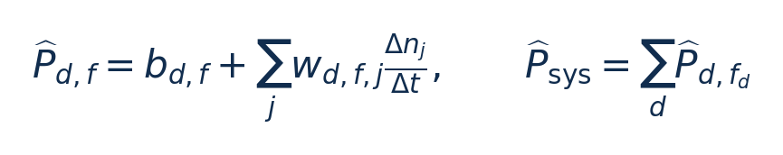

# DVFS功率模型 / SAMOS：从零入门

[论文页面](https://arxiv.org/abs/2305.06782) · [本笔记所用 PDF](https://arxiv.org/pdf/2305.06782) · [DOI](https://doi.org/10.1007/978-3-031-15074-6_22)

整理日期：2026-11-05。**读者原创中文解读；原图归论文作者／出版方。未运行作者实验，不是独立复现。**

## 先把四个角色放对位置

被控负载是要完成的程序和输入，比如压缩一块日志；CPU是执行程序的硬件；控制器根据观测选运行档位；驱动／寄存器把档位落实。程序代码可以完全一样，CPU时钟变慢时每条指令对应的墙钟时间通常变长，访存或I/O等待则未必按同样比例变化。

软件控制并不意味着没有真实硬件。软件中的学习策略可控制真实CPU；也可先控制一个执行时间与能量模型。后者能验证闭环逻辑，但模型输出的J不能当真实电测。E902的RTL能在仿真中改变时钟并反馈计数；电压导致的物理功耗还需相应模型、功耗分析或板级实验。

## 这篇到底解决哪一件事

每个频率分别拟合一个很小的功率模型，自动选择能同时读取的计数器，再组合成跨频点模型表。

单一模型难处理跨频率非线性，手工挑选事件依赖架构经验，而全部读取又有计数器数量／兼容性限制。假设是按频点拆分后，用少量线性项仍能兼顾精度与低开销。

**把方法想成一条流水线：** 多类负载重复运行 → 同步采PMC和功率 → 各频点做相关筛选 → 在PMU限制内选兼容事件 → NNLS拟合 → 留出数据验证 → LUT组合CPU/GPU功率 → 可供控制策略调用。

| 先回答的问题 | 本文答案 |
| --- | --- |
| 模型输入 | 当前子系统频率、采样窗口长度、选定PMC增量／事件率、CPU活跃周期。 |
| 输出 | CPU/GPU及两者之和的估计功率W；积分得能量J，不直接输出下一频率。 |
| CPU特征约束 | 每核3个可编程PMC＋额外cycle counter，模型只用可同时观测的事件。 |
| 平台与标定 | Xavier 8核ARMv8.2＋Volta GPU，INA3221，100ms同步采样。 |

## 十个先修关键词

| 级别 | 术语／关键词 | 直觉、严格含义与易混点 |
| --- | --- | --- |
| A | DVFS / DFS | DVFS同时涉及动态电压与频率；只有时钟变化称DFS。电压能否改变取决于实际供电域。 |
| A | Workload | 真正执行应用计算的程序与输入；本文里的控制器是另一个角色。 |
| A | Controller | 根据观测选择动作的软件／硬件，可运行在同一CPU或独立控制核。 |
| A | OPP | Operating Performance Point，经过允许范围验证的电压—频率组合。 |
| A | Power / Energy | 功率W表示此刻消耗快慢；能量J是对时间积分。低功率不必然低能量。 |
| B | Deadline | 作业必须完成的时刻；平均时延、P95与最大时延各有不同用途。 |
| A | PMC/PMU | 事件计数器及管理这些计数器的硬件单元。 |
| B | NNLS | 限制权重非负的最小二乘拟合。 |
| B | LUT | 按频率／子系统索引的模型表，并非每时刻都重新训练。 |
| C | 相关性 | 统计共同变化程度，不是某事件直接造成几瓦功率的证明。 |

## 用一个小算例建立直觉

教学例：b=0.01W，每秒2×10⁶次事件、权重2nJ/事件，则估计0.014W。若把2ms内的4000次事件直接当每秒事件，结果会错500倍。

Δn为窗口事件次数，Δt为秒，事件率单位s⁻¹；b为W，w单位J/事件，依特征定义变化；CPU活跃度项在原文Eq4中另有表示。这里为阅读统一式，不代替完整实现。

**要防止的误读：** 统计筛选会受负载覆盖、共线性与多重检验影响；E902事件种类和计数资源不同。

## 论文真正验证了什么

| 指标 | 原文报告 | 条件／分母／边界 | 证据位置 |
| --- | --- | --- | --- |
| 全部组合 | 瞬时功率MAPE8.6%；整体能量误差2.5% | 包括高CPU/低GPU等困难组合 | §5.3，p14 |
| 限制GPU>600MHz后 | 功率MAPE7.5%；能量平均1.3%、最大约3.1% | 这是受限范围的结果，不是全部组合上限 | §5.3，p14 |
| 低GPU频率例 | Table4出现5.7%与6.6%能量误差 | 不能与受限范围最大3.1%合并 | Table4，p15 |
| 模型求值 | 约150–500ns | 仅模型binary求值，非完整PMC读取＋策略＋切频 | §5.3，p14 |

这些结果来自作者实验。算法reward、模型误差、控制器时延、被控应用速度与应用节能是不同指标，要看具体行的单位和证据。

## 它与你的毕设怎么接起来

你可以先把CPU单独建模：3个频点×几项低成本特征，离线拟合系数、在线整数乘加。功耗模型只能给估计反馈，真正节能还需加入选频策略与外部测能闭环。若E902没有足够PMC，可先用活跃周期、退休指令或已处理字节，但必须重验误差。

最先可以尝试：**P0：每频点线性功率代理**。理由是获得可部署反馈；最低资源是外部电测／RTL功耗工具、频点和周期计数；通过标准是留出文件同时报告功率MAPE和任务能量误差。

## 五分钟自测

1. 这篇输出的是下一频率、功率估计，还是通信／控制时序？
2. 是真实负载硬件实验，还是模型／RTL／HIL？哪些部分是真的？
3. 最重要百分比的分母和比较对象是什么？
4. 如果换成单核E902，哪一个输入或硬件旋钮会消失？
5. 算上采样、推理、切频和空闲时间后，节能是否还成立？

答案线索在本页角色表和结果表；进一步读“图文技术精读”的关键原图、公式与三项课题实验，再到“图表索引”回查原PDF。不是先记住论文所有缩写。
