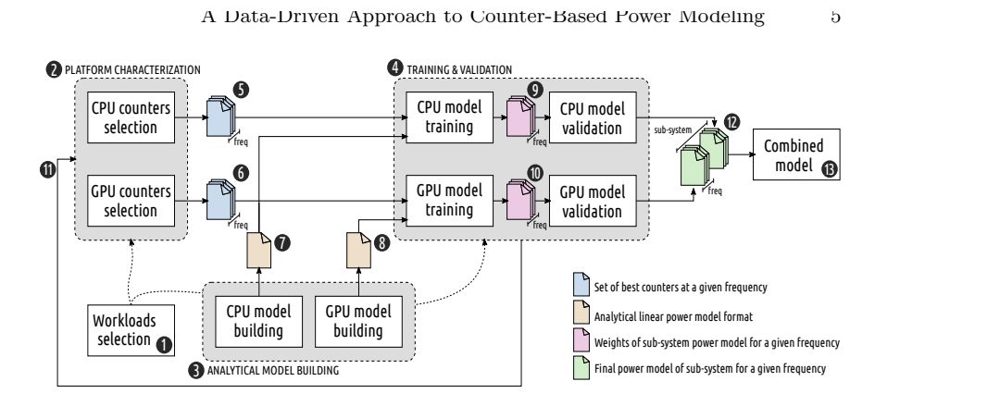
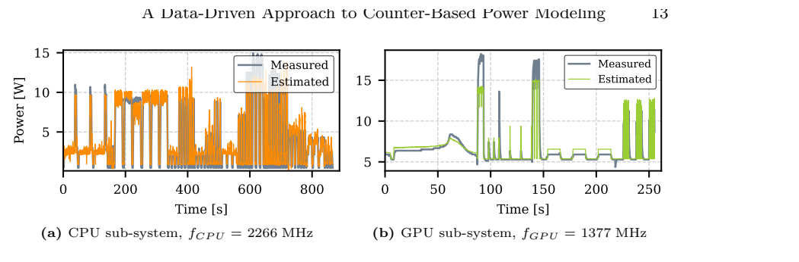
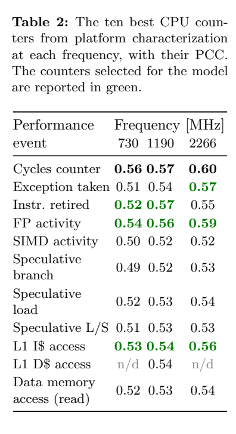
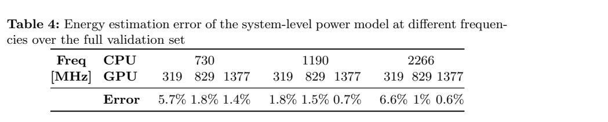

[论文页面](https://arxiv.org/abs/2305.06782) · [本笔记所用 PDF](https://arxiv.org/pdf/2305.06782) · [DOI](https://doi.org/10.1007/978-3-031-15074-6_22)

整理日期：2026-11-05。**读者原创中文解读；原图归论文作者／出版方。未运行作者实验，不是独立复现。**

**覆盖范围：** 本版本正文中识别到的8项图、表或算法；保留原编号。关键项已裁图并在技术精读相应段落出现，未内嵌的项可点PDF页链接查看，不上传整篇PDF。

**统计总边界：** 每负载3次有助平滑系统干扰，但时间轨迹样本不是独立芯片重复。训练／验证沿轨迹切分，仍可能包含相同程序和输入；未见程序留出测试与温度漂移需另做。INA3221约200mW分辨率、响应较慢，既做训练参考又做验证参考，不能以相对它的低误差证明高速瞬态绝对真实。

## Fig1：完整建模流程

[原文 Fig1，PDF p5](https://arxiv.org/pdf/2305.06782#page=5)

[打开大图](images/original-fig1.png)

1. **本项回答的问题：** 完整建模流程，用于支撑这条方法或实验链中的具体环节。
2. **组成、坐标和对照：** 从离线采样到事件选择、训练、验证、模型合成。 结构／流程类没有统一数值坐标；箭头表示数据或控制关系，不表示统计因果。 颜色按原图图例辨认，不能把同色跨图视为同一组。
3. **阅读顺序与统计单位：** 先看设定、单位和图例，再看趋势与作者正文。重复次数及采样独立性参见本篇技术精读统计节；没有为该图定位到的误差线定义／独立重复数，不另行猜测。
4. **直接观察：** 可独立构建子系统模型。
5. **作者解释的范围：** 原文以该图／表作为上述观察的结构说明或实验支撑，需连同对应页正文读取；本索引不额外替作者推导因果机制。
6. **独立判断（AI分析）：** 图右输出功率模型，不是最优调频动作。
7. **证据链位置：** 方法／系统实现说明。它支持本文具体条件下的实现或结果，不单独完成跨平台验证。
8. **结论与强度：** 可复述“可独立构建子系统模型。”；对图内描述的核查可信度高，对未做独立实验的泛化判断为中或无法判断。不能得出的结论是“图右输出功率模型，不是最优调频动作。”所排除的外推。

## Fig2：GPU筛选与计数器数目

[原文 Fig2，PDF p12](https://arxiv.org/pdf/2305.06782#page=12)

1. **本项回答的问题：** GPU筛选与计数器数目，用于支撑这条方法或实验链中的具体环节。
2. **组成、坐标和对照：** 先看相关性，再看随事件数量的误差。 按原图／表标示的单位与归一化基准阅读；不将不同子图或不同分母的柱高直接相除。 颜色按原图图例辨认，不能把同色跨图视为同一组。
3. **阅读顺序与统计单位：** 先看设定、单位和图例，再看趋势与作者正文。重复次数及采样独立性参见本篇技术精读统计节；没有为该图定位到的误差线定义／独立重复数，不另行猜测。
4. **直接观察：** 八个输入是该平台折中。
5. **作者解释的范围：** 原文以该图／表作为上述观察的结构说明或实验支撑，需连同对应页正文读取；本索引不额外替作者推导因果机制。
6. **独立判断（AI分析）：** 不是任意平台固定最优8个。
7. **证据链位置：** 性能验证／定量或示例证据，需结合实验条件。它支持本文具体条件下的实现或结果，不单独完成跨平台验证。
8. **结论与强度：** 可复述“八个输入是该平台折中。”；对图内描述的核查可信度高，对未做独立实验的泛化判断为中或无法判断。不能得出的结论是“不是任意平台固定最优8个。”所排除的外推。

## Fig3：CPU/GPU实测与估计

[原文 Fig3，PDF p13](https://arxiv.org/pdf/2305.06782#page=13)

[打开大图](images/original-fig3.png)

1. **本项回答的问题：** CPU/GPU实测与估计，用于支撑这条方法或实验链中的具体环节。
2. **组成、坐标和对照：** 横轴时间，比较估计与传感器轨迹。 按原图／表标示的单位与归一化基准阅读；不将不同子图或不同分母的柱高直接相除。 颜色按原图图例辨认，不能把同色跨图视为同一组。
3. **阅读顺序与统计单位：** 先看设定、单位和图例，再看趋势与作者正文。重复次数及采样独立性参见本篇技术精读统计节；没有为该图定位到的误差线定义／独立重复数，不另行猜测。
4. **直接观察：** 模型可跟踪活动变化。
5. **作者解释的范围：** 原文以该图／表作为上述观察的结构说明或实验支撑，需连同对应页正文读取；本索引不额外替作者推导因果机制。
6. **独立判断（AI分析）：** 传感器平滑使瞬态比较受限。
7. **证据链位置：** 性能验证／定量或示例证据，需结合实验条件。它支持本文具体条件下的实现或结果，不单独完成跨平台验证。
8. **结论与强度：** 可复述“模型可跟踪活动变化。”；对图内描述的核查可信度高，对未做独立实验的泛化判断为中或无法判断。不能得出的结论是“传感器平滑使瞬态比较受限。”所排除的外推。

## Fig4：合成与分项功率

[原文 Fig4，PDF p14](https://arxiv.org/pdf/2305.06782#page=14)

1. **本项回答的问题：** 合成与分项功率，用于支撑这条方法或实验链中的具体环节。
2. **组成、坐标和对照：** 总和与CPU/GPU分项一起看。 按原图／表标示的单位与归一化基准阅读；不将不同子图或不同分母的柱高直接相除。 颜色按原图图例辨认，不能把同色跨图视为同一组。
3. **阅读顺序与统计单位：** 先看设定、单位和图例，再看趋势与作者正文。重复次数及采样独立性参见本篇技术精读统计节；没有为该图定位到的误差线定义／独立重复数，不另行猜测。
4. **直接观察：** 模型可解释子系统贡献。
5. **作者解释的范围：** 原文以该图／表作为上述观察的结构说明或实验支撑，需连同对应页正文读取；本索引不额外替作者推导因果机制。
6. **独立判断（AI分析）：** 独立假设遇跨域等待会失准。
7. **证据链位置：** 性能验证／定量或示例证据，需结合实验条件。它支持本文具体条件下的实现或结果，不单独完成跨平台验证。
8. **结论与强度：** 可复述“模型可解释子系统贡献。”；对图内描述的核查可信度高，对未做独立实验的泛化判断为中或无法判断。不能得出的结论是“独立假设遇跨域等待会失准。”所排除的外推。

## Table1：与已有功耗模型比较

[原文 Table1，PDF p4](https://arxiv.org/pdf/2305.06782#page=4)

1. **本项回答的问题：** 与已有功耗模型比较，用于支撑这条方法或实验链中的具体环节。
2. **组成、坐标和对照：** 逐列看自动化、DVFS与开销。 按原图／表标示的单位与归一化基准阅读；不将不同子图或不同分母的柱高直接相除。 颜色按原图图例辨认，不能把同色跨图视为同一组。
3. **阅读顺序与统计单位：** 先看设定、单位和图例，再看趋势与作者正文。重复次数及采样独立性参见本篇技术精读统计节；没有为该图定位到的误差线定义／独立重复数，不另行猜测。
4. **直接观察：** 本文整合多种能力。
5. **作者解释的范围：** 原文以该图／表作为上述观察的结构说明或实验支撑，需连同对应页正文读取；本索引不额外替作者推导因果机制。
6. **独立判断（AI分析）：** 不同硬件误差不能当同平台公平排名。
7. **证据链位置：** 性能验证／定量或示例证据，需结合实验条件。它支持本文具体条件下的实现或结果，不单独完成跨平台验证。
8. **结论与强度：** 可复述“本文整合多种能力。”；对图内描述的核查可信度高，对未做独立实验的泛化判断为中或无法判断。不能得出的结论是“不同硬件误差不能当同平台公平排名。”所排除的外推。

## Table2：CPU事件相关系数

[原文 Table2，PDF p11](https://arxiv.org/pdf/2305.06782#page=11)

[打开大图](images/original-table2.png)

1. **本项回答的问题：** CPU事件相关系数，用于支撑这条方法或实验链中的具体环节。
2. **组成、坐标和对照：** 看每频点候选与绿色选中项。 按原图／表标示的单位与归一化基准阅读；不将不同子图或不同分母的柱高直接相除。 颜色按原图图例辨认，不能把同色跨图视为同一组。
3. **阅读顺序与统计单位：** 先看设定、单位和图例，再看趋势与作者正文。重复次数及采样独立性参见本篇技术精读统计节；没有为该图定位到的误差线定义／独立重复数，不另行猜测。
4. **直接观察：** 选用事件随频点可能变化。
5. **作者解释的范围：** 原文以该图／表作为上述观察的结构说明或实验支撑，需连同对应页正文读取；本索引不额外替作者推导因果机制。
6. **独立判断（AI分析）：** 不能无视PMU数量限制。
7. **证据链位置：** 性能验证／定量或示例证据，需结合实验条件。它支持本文具体条件下的实现或结果，不单独完成跨平台验证。
8. **结论与强度：** 可复述“选用事件随频点可能变化。”；对图内描述的核查可信度高，对未做独立实验的泛化判断为中或无法判断。不能得出的结论是“不能无视PMU数量限制。”所排除的外推。

## Table3：GPU兼容事件

[原文 Table3，PDF p11](https://arxiv.org/pdf/2305.06782#page=11)

1. **本项回答的问题：** GPU兼容事件，用于支撑这条方法或实验链中的具体环节。
2. **组成、坐标和对照：** 结合事件编号、频点与选中颜色。 按原图／表标示的单位与归一化基准阅读；不将不同子图或不同分母的柱高直接相除。 颜色按原图图例辨认，不能把同色跨图视为同一组。
3. **阅读顺序与统计单位：** 先看设定、单位和图例，再看趋势与作者正文。重复次数及采样独立性参见本篇技术精读统计节；没有为该图定位到的误差线定义／独立重复数，不另行猜测。
4. **直接观察：** 兼容性约束影响最终组合。
5. **作者解释的范围：** 原文以该图／表作为上述观察的结构说明或实验支撑，需连同对应页正文读取；本索引不额外替作者推导因果机制。
6. **独立判断（AI分析）：** 最高相关的事件不一定能同读。
7. **证据链位置：** 性能验证／定量或示例证据，需结合实验条件。它支持本文具体条件下的实现或结果，不单独完成跨平台验证。
8. **结论与强度：** 可复述“兼容性约束影响最终组合。”；对图内描述的核查可信度高，对未做独立实验的泛化判断为中或无法判断。不能得出的结论是“最高相关的事件不一定能同读。”所排除的外推。

## Table4：不同频率对的能量误差

[原文 Table4，PDF p15](https://arxiv.org/pdf/2305.06782#page=15)

[打开大图](images/original-table4.png)

1. **本项回答的问题：** 不同频率对的能量误差，用于支撑这条方法或实验链中的具体环节。
2. **组成、坐标和对照：** 逐列核对CPU与GPU频点。 按原图／表标示的单位与归一化基准阅读；不将不同子图或不同分母的柱高直接相除。 颜色按原图图例辨认，不能把同色跨图视为同一组。
3. **阅读顺序与统计单位：** 先看设定、单位和图例，再看趋势与作者正文。重复次数及采样独立性参见本篇技术精读统计节；没有为该图定位到的误差线定义／独立重复数，不另行猜测。
4. **直接观察：** 某些低GPU组合误差高达6.6%。
5. **作者解释的范围：** 原文以该图／表作为上述观察的结构说明或实验支撑，需连同对应页正文读取；本索引不额外替作者推导因果机制。
6. **独立判断（AI分析）：** 受限范围最大3.1%不是该表全部最大值。
7. **证据链位置：** 性能验证／定量或示例证据，需结合实验条件。它支持本文具体条件下的实现或结果，不单独完成跨平台验证。
8. **结论与强度：** 可复述“某些低GPU组合误差高达6.6%。”；对图内描述的核查可信度高，对未做独立实验的泛化判断为中或无法判断。不能得出的结论是“受限范围最大3.1%不是该表全部最大值。”所排除的外推。
