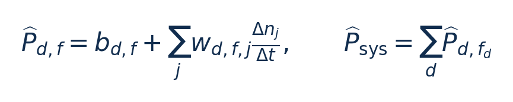
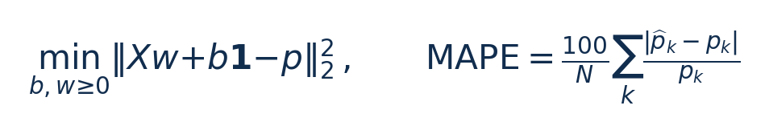
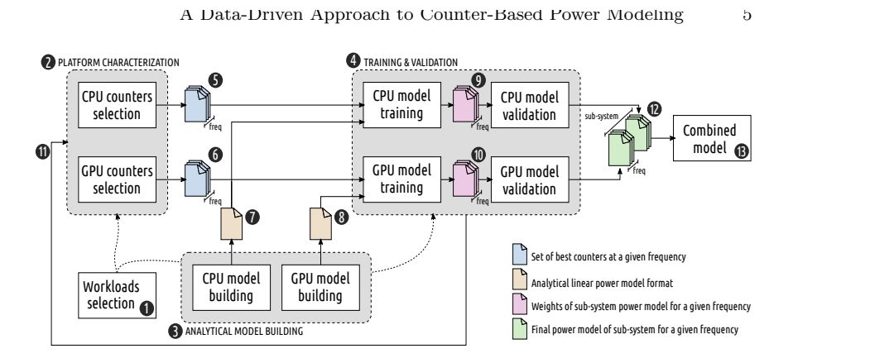
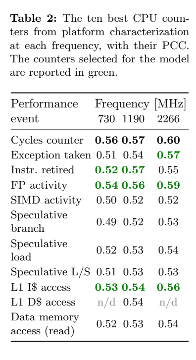
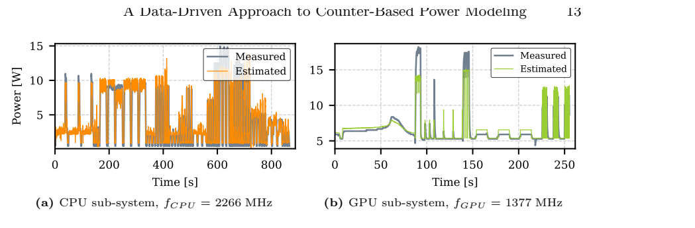
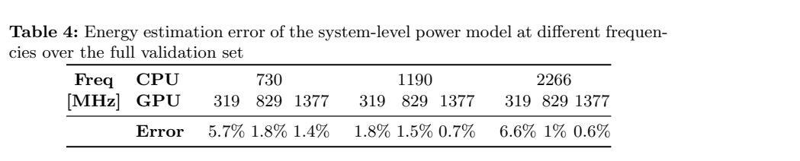

# DVFS功率模型 / SAMOS：图文技术精读

[论文页面](https://arxiv.org/abs/2305.06782) · [本笔记所用 PDF](https://arxiv.org/pdf/2305.06782) · [DOI](https://doi.org/10.1007/978-3-031-15074-6_22)

整理日期：2026-11-05。**读者原创中文解读；原图归论文作者／出版方。未运行作者实验，不是独立复现。**

**一句话：** 每个频率分别拟合一个很小的功率模型，自动选择能同时读取的计数器，再组合成跨频点模型表。

阅读地图：先看问题与输入输出，再顺着架构图、公式和结果图阅读；最后检查统计边界与E902迁移。完整编号索引另见“图表索引”。下文“读者分析”是推断或建议，不是原文结果。

## 阶段0：材料与版本审计

| 材料 | 当前可用程度 | 影响 |
| --- | --- | --- |
| 摘要、正文、方法、原图注 | 已获取本地完整PDF、文本与逐页渲染 | 可核查结构、实验及关键数字；可见页面优先于异常文本层 |
| 分析版本 | arXiv:2305.06782，16页；对应书章DOI 10.1007/978-3-031-15074-6_22。不能把arXiv上传年误记为会议年。 | 引用页码以“PDF第几页”标识 |
| 代码／原始数据 | 当前预印本材料中尚未定位到完整独立发布的2022模型流水线。后续Runmeter提供相关开源工具，应标明版本和新增部分。 | 公开链接不等于已构建或已拿到原始轨迹 |
| 附件、独立原始重复与勘误 | 当前未完成全渠道附件／勘误穷尽检索 | 不能断言没有附件、没有勘误或没有其他版本 |
| 本次工作范围 | 材料阅读、图表裁取、证据整理、教学公式 | 所有新实验均是建议，尚未执行 |

## 阶段1：身份卡与整体概述

| 项目 | 内容 |
| --- | --- |
| 英文题名 | A Data-Driven Approach to Lightweight DVFS-Aware Counter-Based Power Modeling for Heterogeneous Platforms |
| 中文导读题名 | 没有高速功耗仪时，如何用少量计数器估计功率 |
| 作者 | Sergio Mazzola, Thomas Benz, Björn Forsberg, Luca Benini |
| 发表／版本 | SAMOS 2022；公开预印本于2023上传；arXiv:2305.06782，16页；对应书章DOI 10.1007/978-3-031-15074-6_22。不能把arXiv上传年误记为会议年。 |
| 类型与领域 | 原始方法／工程系统研究；DVFS、CPU能效、运行时控制 |
| 单位、通讯、资助与利益关系 | 主要单位ETH Zürich IIS，Luca Benini同时关联博洛尼亚大学。致谢列欧盟Horizon2020 AMPERE和Fractal项目（p15）。当前预印本未定位到单独的通讯作者或利益冲突声明，保持未知。 |
| 核心对象与接口 | Xavier 8核ARMv8.2＋Volta GPU，INA3221，100ms同步采样。 |
| 代码与数据 | 当前预印本材料中尚未定位到完整独立发布的2022模型流水线。后续Runmeter提供相关开源工具，应标明版本和新增部分。 |
| 与本课题关系 | 你可以先把CPU单独建模：3个频点×几项低成本特征，离线拟合系数、在线整数乘加。功耗模型只能给估计反馈，真正节能还需加入选频策略与外部测能闭环。若E902没有足够PMC，可先用活跃周期、退休指令或已处理字节，但必须重验误差。 |

**约200字中文概述（改写）：** 本文研究支持DVFS的异构平台功率估计。作者按子系统和频率分开建模，通过统计相关性与PMU兼容性筛选少量计数器，用非负线性回归拟合各模型，再按当前工作点查表组合。Xavier实验检验CPU、GPU分项和合成模型的瞬时功率及累计能量误差，并测量求值时间。它可为DVFS提供反馈估计，但本身没有证明某个选频策略节省了多少能量；跨域耦合、低功率参考仪表和测试范围限制均需保留。

**三句话定位：** 问题是单一模型难处理跨频率非线性，手工挑选事件依赖架构经验，而全部读取又有计数器数量／兼容性限制。假设是按频点拆分后，用少量线性项仍能兼顾精度与低开销。 方法主线为多类负载重复运行 → 同步采PMC和功率 → 各频点做相关筛选 → 在PMU限制内选兼容事件 → NNLS拟合 → 留出数据验证 → LUT组合CPU/GPU功率 → 可供控制策略调用。 主要证据见下方结果表，结论须与测量和版本范围一起使用。

## 阶段2：问题、假设与创新位置

单一模型难处理跨频率非线性，手工挑选事件依赖架构经验，而全部读取又有计数器数量／兼容性限制。假设是按频点拆分后，用少量线性项仍能兼顾精度与低开销。

**创新判断（读者分析）：** 自动事件选择＋每子系统每频点非负线性模型＋组合查表，避免必须在全部CPU/GPU频率对上重新训练。相较后续Runmeter，本篇主要完成离线模型构造与验证，尚不是2025内核在线框架。 不依据作者自称“首次”断定整个领域绝无前例。

## 阶段3：必要术语与数学

| 级别 | 术语／关键词 | 直觉、严格含义与易混点 |
| --- | --- | --- |
| A | DVFS / DFS | DVFS同时涉及动态电压与频率；只有时钟变化称DFS。电压能否改变取决于实际供电域。 |
| A | Workload | 真正执行应用计算的程序与输入；本文里的控制器是另一个角色。 |
| A | Controller | 根据观测选择动作的软件／硬件，可运行在同一CPU或独立控制核。 |
| A | OPP | Operating Performance Point，经过允许范围验证的电压—频率组合。 |
| A | Power / Energy | 功率W表示此刻消耗快慢；能量J是对时间积分。低功率不必然低能量。 |
| B | Deadline | 作业必须完成的时刻；平均时延、P95与最大时延各有不同用途。 |
| A | PMC/PMU | 事件计数器及管理这些计数器的硬件单元。 |
| B | NNLS | 限制权重非负的最小二乘拟合。 |
| B | LUT | 按频率／子系统索引的模型表，并非每时刻都重新训练。 |
| C | 相关性 | 统计共同变化程度，不是某事件直接造成几瓦功率的证明。 |

### 公式1：固定频点的线性模型与组合（简化记号）

**符号与前提：** Δn为窗口事件次数，Δt为秒，事件率单位s⁻¹；b为W，w单位J/事件，依特征定义变化；CPU活跃度项在原文Eq4中另有表示。这里为阅读统一式，不代替完整实现。

**代入与检查：** 教学例：b=0.01W，每秒2×10⁶次事件、权重2nJ/事件，则估计0.014W。若把2ms内的4000次事件直接当每秒事件，结果会错500倍。

**来源：** §3.1，Eq1/4/5，PDF p5–7；数字为教学。
### 公式2：非负最小二乘及误差

**符号与前提：** X是事件率矩阵，p是测得W；N为样本数。MAPE在p接近零时不稳定；能量误差需先积分再比较，不等于功率MAPE。

**代入与检查：** 估计前半偏高后半偏低，累计能量误差可能很小，瞬时误差仍大。故1.3%能量误差不能写成每个瞬间功率都准到1.3%。

**来源：** §3.3与§5，PDF p8/13–15。

## 阶段4–6：架构、关键图与方法拆解

**输入—处理—输出：** 多类负载重复运行 → 同步采PMC和功率 → 各频点做相关筛选 → 在PMU限制内选兼容事件 → NNLS拟合 → 留出数据验证 → LUT组合CPU/GPU功率 → 可供控制策略调用。

| 系统角色 | 具体设置 |
| --- | --- |
| 模型输入 | 当前子系统频率、采样窗口长度、选定PMC增量／事件率、CPU活跃周期。 |
| 输出 | CPU/GPU及两者之和的估计功率W；积分得能量J，不直接输出下一频率。 |
| CPU特征约束 | 每核3个可编程PMC＋额外cycle counter，模型只用可同时观测的事件。 |
| 平台与标定 | Xavier 8核ARMv8.2＋Volta GPU，INA3221，100ms同步采样。 |

§3（PDF p5–9）：以子系统d和频率f为索引，构建各自特征集合与权重。CPU模型包含power-gating相关活跃度和事件项；GPU用常数项与按时间归一化的事件。线性并不意味着总跨频率曲面是单一直线，非线性由不同频率的模型表承载。

平台表征先多次重放同一负载采不同事件，避免在线时间复用。单事件回归p>0.05者过滤，再按Pearson相关排序，选择可在一个pass同时计数的组合。GPU事件存在互斥，不能简单选相关最高的前N个。最后用非负最小二乘拟合；非负权重有解释便利，但相关性不证明因果，重复检验也未自动控制多重比较。

§4–5：17个Rodinia OpenMP程序＋5个合成负载用于CPU，10个CUDA程序用于GPU；每负载采3次。CPU训练使用初始70%轨迹、后30%验证；GPU为初始60%／后40%，与2025论文随机70/30不同。CPU建模只选择730/1190/2266MHz，不能说覆盖所有29档实测。

### Fig1：完整建模流程

[打开大图](images/original-fig1.png) · [原文 Fig1，PDF p5](https://arxiv.org/pdf/2305.06782#page=5)

**怎样看：** 从离线采样到事件选择、训练、验证、模型合成。

**直接观察／原文报告：** 可独立构建子系统模型。

**读者判断：** 图右输出功率模型，不是最优调频动作。

### Table2：CPU事件相关系数

[打开大图](images/original-table2.png) · [原文 Table2，PDF p11](https://arxiv.org/pdf/2305.06782#page=11)

**怎样看：** 看每频点候选与绿色选中项。

**直接观察／原文报告：** 选用事件随频点可能变化。

**读者判断：** 不能无视PMU数量限制。

| 阅读问题 | 先看材料 | 如何接到下一步 |
| --- | --- | --- |
| 为什么要改现有方案 | 问题背景与动机图 | 确定目标、约束和原有不足 |
| 系统观察什么、控制什么 | 输入输出表＋关键架构图 | 确认数据、模型和执行器真实角色 |
| 方法如何得到动作或估计 | 方法段、公式、算法／模型表 | 明确离线训练与在线流程 |
| 收益是否真实且公平 | 结果图表、统计与测量边界 | 核查基线／目标／分母／开销 |
| 能否用于自己的CPU | 局限、复现计划、三项实验 | 把论文假设变成待验证的工程条件 |

## 阶段7–8：实验、统计及证据链

本节数字均是**原文明确报告或原文数值的标注算例**；没有按图柱高度臆造额外精确值。

| 指标 | 原文报告 | 条件／分母／边界 | 证据位置 |
| --- | --- | --- | --- |
| 全部组合 | 瞬时功率MAPE8.6%；整体能量误差2.5% | 包括高CPU/低GPU等困难组合 | §5.3，p14 |
| 限制GPU>600MHz后 | 功率MAPE7.5%；能量平均1.3%、最大约3.1% | 这是受限范围的结果，不是全部组合上限 | §5.3，p14 |
| 低GPU频率例 | Table4出现5.7%与6.6%能量误差 | 不能与受限范围最大3.1%合并 | Table4，p15 |
| 模型求值 | 约150–500ns | 仅模型binary求值，非完整PMC读取＋策略＋切频 | §5.3，p14 |

### Fig3：CPU/GPU实测与估计

[打开大图](images/original-fig3.png) · [原文 Fig3，PDF p13](https://arxiv.org/pdf/2305.06782#page=13)

**怎样看：** 横轴时间，比较估计与传感器轨迹。

**直接观察／原文报告：** 模型可跟踪活动变化。

**读者判断：** 传感器平滑使瞬态比较受限。

### Table4：不同频率对的能量误差

[打开大图](images/original-table4.png) · [原文 Table4，PDF p15](https://arxiv.org/pdf/2305.06782#page=15)

**怎样看：** 逐列核对CPU与GPU频点。

**直接观察／原文报告：** 某些低GPU组合误差高达6.6%。

**读者判断：** 受限范围最大3.1%不是该表全部最大值。

**统计与公平性审查（读者分析）：** 每负载3次有助平滑系统干扰，但时间轨迹样本不是独立芯片重复。训练／验证沿轨迹切分，仍可能包含相同程序和输入；未见程序留出测试与温度漂移需另做。INA3221约200mW分辨率、响应较慢，既做训练参考又做验证参考，不能以相对它的低误差证明高速瞬态绝对真实。

工程实验中，设备、程序、输入文件、重复运行、时间窗口是不同统计层级，不能互相替代。本任务不涉及生物样本，细胞／动物／试剂等检查不适用。未注明的P值或置信区间不补造；“差了几个百分点”不自动等于统计显著。

| 主张层级 | 直接证据 | 对照与统计 | 可得结论／替代解释 | 可信度 |
| --- | --- | --- | --- | --- |
| 原文明确报告 | 全部组合：瞬时功率MAPE8.6%；整体能量误差2.5% | §5.3，p14 | 包括高CPU/低GPU等困难组合；仅在该实验范围内成立 | 图表／文本可核对：高；独立复现：尚无 |
| 作者解释 | 所提架构／模型解释了性能或估计改善 | 关键原图与方法见上文；统计边界见下节 | 效果可能同时来自动作空间、平台特性与采样设置，因果归因需消融 | 中 |
| AI分析／迁移假设 | 用于E902的压缩候选负载 | 本篇未直接验证该芯片与任务组合 | 需三项后续实验；不能复制论文收益数字 | 待验证，当前无法判断 |

## 阶段9–10：贡献与局限分开判断

自动事件选择＋每子系统每频点非负线性模型＋组合查表，避免必须在全部CPU/GPU频率对上重新训练。相较后续Runmeter，本篇主要完成离线模型构造与验证，尚不是2025内核在线框架。

| 来源 | 严重程度 | 局限及其影响 |
| --- | --- | --- |
| 作者报告 | 关键 | 子系统独立假设在CPU/GPU频率差很大时失效，后续聚焦更高GPU频率范围。 |
| 作者方向 | 重要 | 在线监控和DPM策略、跨平台验证属于后续工作。 |
| 读者分析 | 重要 | 统计筛选会受负载覆盖、共线性与多重检验影响；E902事件种类和计数资源不同。 |

## 阶段11：最小复现路线与缺口

先核实PMU可同时读取的事件，再固定频点同步采样。按原文切分与严格按程序／文件切分分别测试，保留仪表分辨率与采样对齐记录。分别复现CPU、GPU和组合，不能只报最有利频率子集。精确数据和脚本未完整定位；本笔记只完成材料与方法审查。

**代码／数据现状：** 当前预印本材料中尚未定位到完整独立发布的2022模型流水线。后续Runmeter提供相关开源工具，应标明版本和新增部分。

**质量控制顺序：** 先验证程序输出和时间基准，再验证采样／模型，最后比较策略。保存输入文件哈希、平台配置、OPP、随机种子、温度与每次运行原始记录。失败时先回固定安全频点定位错误，再继续优化。复现可行性判断为“可开始部分方法复建，完整数值复现条件未齐”；这与“已完成复现”不同。

## 阶段12：用于你的CPU／E902课题

你可以先把CPU单独建模：3个频点×几项低成本特征，离线拟合系数、在线整数乘加。功耗模型只能给估计反馈，真正节能还需加入选频策略与外部测能闭环。若E902没有足够PMC，可先用活跃周期、退休指令或已处理字节，但必须重验误差。

| 建议实验／优先级 | 价值 | 最低资源 | 主要风险 | 成功判据（设计目标，非已得结果） |
| --- | --- | --- | --- | --- |
| P0：每频点线性功率代理 | 获得可部署反馈 | 外部电测／RTL功耗工具、频点和周期计数 | 标签本身噪声较大 | 留出文件同时报告功率MAPE和任务能量误差 |
| P1：单一模型与分频点模型 | 检验LUT是否必要 | 相同数据和参数预算 | 过多模型过拟合 | 按输入划分下比较误差与存储量 |
| P1：模型误差对选频的影响 | 连接预测与控制收益 | 候选OPP、能量估计和期限约束 | 错误排序比平均误差更致命 | 报告选错档位率、期限违约和相对穷举最优的净能量差 |

上述优先级是读者建议：P0先做，P1建立在基线可运行后，P2只在资源允许且前序实验证明有必要时开展。压缩应用仍是候选，尚未替你最终定题或证明已在E902运行。论文公开可读不自动授权任意复制数据；代码、图片和数据须分别核对许可。

## 阶段13：读完后应掌握与继续核查

**五个知识点：** 每个频率分别拟合一个很小的功率模型，自动选择能同时读取的计数器，再组合成跨频点模型表。 你还应能解释输入输出表中的角色、两条公式的单位、首个结果指标的分母，以及局限表里的关键条件。

**五个未决问题：** 独立新输入是否成立？最差时延是否可接受？测量参考是否足够？控制与切换是否抵消收益？E902实际具有哪些接口和可观测量？这些是研究问题，不是对作者遗漏的无证据指控。

**立即做：** 按公式算例手算一次，选一张结果图复述“硬件—负载—基线—指标—边界”。**后续核查：** 补齐代码版本、训练数据和仪表设置。**可复用：** 上文明确标注的模型与接口思路。**谨慎采用：** 所有跨平台百分比。**暂不采用：** 尚未证实存在的电压控制和完整硬实时承诺。
