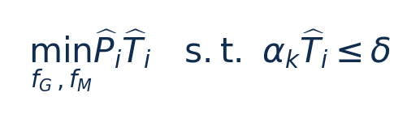

[论文页面](https://arxiv.org/abs/2609.13153v1) · [本笔记所用 PDF](https://arxiv.org/pdf/2609.13153v1) · [标识符](https://doi.org/10.48550/arXiv.2609.13153)

整理日期：2026-11-06。**读者原创中文解读；原图归论文作者／出版方。未运行作者实验，不是独立复现。**

## 先把四个角色放对位置

被控负载是要完成的程序和输入，比如识别一帧图像、生成token或完成一次训练迭代；CPU/GPU是执行程序的硬件；控制器根据观测选运行档位；驱动／寄存器把档位落实。程序代码可以完全一样，CPU时钟变慢时每条指令对应的墙钟时间通常变长，访存或I/O等待则未必按同样比例变化。

软件控制并不意味着没有真实硬件。软件中的学习策略可控制真实CPU；也可先控制一个执行时间与能量模型。后者能验证闭环逻辑，但模型输出的J不能当真实电测。E902的RTL能在仿真中改变时钟并反馈计数；电压导致的物理功耗还需相应模型、功耗分析或板级实验。

## 这篇到底解决哪一件事

从下一token的矩阵计算规模预测硬件元数据，再用轻量功率/延时模型在deadline下搜索GPU与EMC频率

为什么局部利用率不能完整反映整个应用的性能与能耗？本篇的研究问题或可检验主张是：从下一token的矩阵计算规模预测硬件元数据，再用轻量功率/延时模型在deadline下搜索GPU与EMC频率。验证链是可观测状态→控制规则或学习模型→执行器→任务正确性/服务质量与能耗对照。

**把方法想成一条流水线：** 模型层结构、当前context长度与矩阵维度scale、离线预测HPC、deadline δ=1/目标tokens/s、上窗口测量/估计时延比α → XGBoost矩阵规模→未来HPC元数据parser；线性/频率基函数E/T估计；枚举GPU–EMC候选＋单调剪枝；50token窗口偏差反馈α修正 → 每窗口GPU/EMC频率pair；prefill用高GPU/EMC；CPU保持阈值；无可行解则最高频best-effort → 执行与反馈。

| 先回答的问题 | 本文答案 |
| --- | --- |
| 具体控制算法 | XGBoost矩阵规模→未来HPC元数据parser；线性/频率基函数E/T估计；枚举GPU–EMC候选＋单调剪枝；50token窗口偏差反馈α修正 |
| 被控负载类型 | 边缘GPU本地小语言模型自回归decode（含dense/MoE） |
| 具体被控程序 | llama.cpp/llama-cpp-python q4_0；GPT2-small/medium/large/xl、Qwen2.5-0.5B、TinyLLaMA1.1B、OLMoE-1B-7B；主实验生成1024tokens |
| 使用平台与测量 | Jetson AGX Orin与Orin NX；CPU阈值0.6528GHz固定；44/28组GPU–EMC候选；INA3221 200Hz整设备功耗；C++/XGBoost CAPI/pybind11 |
| 输入/状态 | 模型层结构、当前context长度与矩阵维度scale、离线预测HPC、deadline δ=1/目标tokens/s、上窗口测量/估计时延比α |
| 输出/动作 | 每窗口GPU/EMC频率pair；prefill用高GPU/EMC；CPU保持阈值；无可行解则最高频best-effort |
| 周期与运行位置 | 默认50token一决策窗；剪枝后平均决策0.81ms（原枚举1.73ms）；不是每token都实时采一次CUPTI |

## 十个先修关键词

| 级别 | 术语／关键词 | 直觉、严格含义与易混点 |
| --- | --- | --- |
| A | DVFS / DFS | DVFS同时涉及动态电压与频率；只有时钟变化称DFS。电压能否改变取决于实际供电域。 |
| A | Workload | 真正执行应用计算的程序与输入；本文里的控制器是另一个角色。 |
| A | Controller | 根据观测选择动作的软件／硬件，可运行在同一CPU或独立控制核。 |
| A | OPP | Operating Performance Point，经过允许范围验证的电压—频率组合。 |
| A | Power / Energy | 功率W表示此刻消耗快慢；能量J是对时间积分。低功率不必然低能量。 |
| B | Deadline | 作业必须完成的时刻；平均时延、P95与最大时延各有不同用途。 |
| A | 被控程序 | llama.cpp/llama-cpp-python q4_0；GPT2-small/medium/large/xl、Qwen2.5-0.5B、TinyLLaMA1.1B、OLMoE-1B-7B；主实验生成1024tokens |
| A | 控制策略 | XGBoost矩阵规模→未来HPC元数据parser；线性/频率基函数E/T估计；枚举GPU–EMC候选＋单调剪枝；50token窗口偏差反馈α修正 |
| B | 控制周期 | 默认50token一决策窗；剪枝后平均决策0.81ms（原枚举1.73ms）；不是每token都实时采一次CUPTI |
| B | 证据边界 | 实测、硬件仿真、功耗模型是不同证据，见平台与结果表。 |

## 用一个小算例建立直觉

目标20token/s时δ=50ms；预测45ms且α=1.2则54ms，不可行。

P W、T s/token、δ s/token；预测最优只在固定CPU和已搜候选集合内成立。

**要防止的误读：** 离线标定约一天/设备–模型，成本是否可接受取决于部署规模与复用次数。

## 论文真正验证了什么

| 指标 | 原文报告 | 条件／分母／边界 | 证据位置 |
| --- | --- | --- | --- |
| 每token能量 | 相对RULE最高−12.4%，相对改造Gear最高−8.4% | 模型/期限不同；某些高目标下Gear更省能但QoS差，不能脱约束比较 | Fig8/§5.1，p10 |
| QoS定义与改善 | min(实际tokens/s÷目标tokens/s,1)；原文最高相对改善93.12%/69.14% | 不是百分之多少token按时完成，也不是成功率；不可达目标下仍<100% | Fig9/§5.1，p10 |
| 模型误差/决策 | 功率平均误差2.49%–4.60%、延时2.01%–2.81%；决策0.81ms | 预测误差不是节能；CPU固定＋已剖析模型条件 | §5.2/Fig11，p10–11；§3.3 p8 |
| 一次性剖析成本 | 21.37–27.28小时/模型，0.25–0.33kWh，0.34–0.61GB | 并非零成本部署；须由后续推理节省摊销 | Table3/§5.4，p13 |

这些结果来自作者实验。算法reward、模型误差、控制器时延、被控应用速度与应用节能是不同指标，要看具体行的单位和证据。

## 它与你的毕设怎么接起来

最贴近“输入需求预测→合法档约束搜索→实测反馈”的可行毕设链。GPU上可用小SLM；CPU/E902可把矩阵规模换块长/数据复杂度、未来cycles估计，做同结构小回归/小树，动作空间保持小。

最先可以尝试：**P0：预测下一块/下一token工作量**。理由是先验证应用与执行器，建立同边界基线；最低资源是Jetson小SLM或CPU块处理程序；固定输入与真实执行时间；通过标准是输出正确；保存实际频率、温度、时延与积分能量。

## 五分钟自测

1. 这篇输出的是下一频率、功率估计，还是通信／控制时序？
2. 是真实负载硬件实验，还是模型／RTL／HIL？哪些部分是真的？
3. 最重要百分比的分母和比较对象是什么？
4. 如果换成单核E902，哪一个输入或硬件旋钮会消失？
5. 算上采样、推理、切频和空闲时间后，节能是否还成立？

答案线索在本页角色表和结果表；进一步读“图文技术精读”的关键原图、公式与三项课题实验，再到“图表索引”回查原PDF。不是先记住论文所有缩写。
