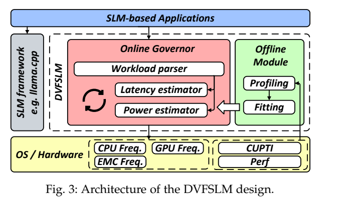
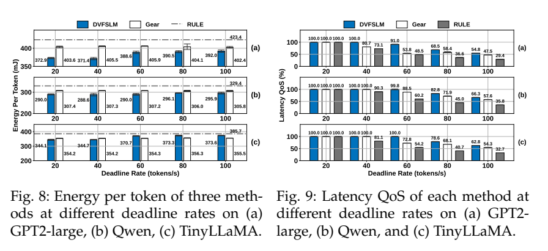
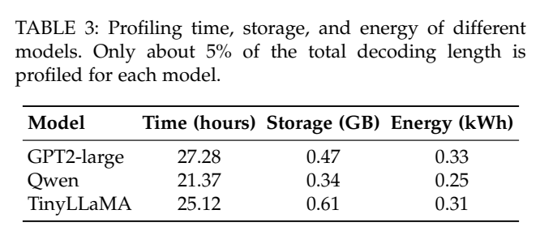
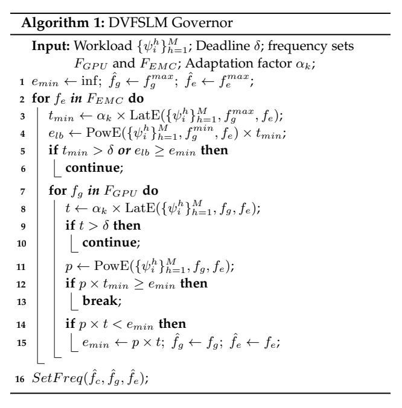

[论文页面](https://arxiv.org/abs/2609.13153v1) · [本笔记所用 PDF](https://arxiv.org/pdf/2609.13153v1) · [标识符](https://doi.org/10.48550/arXiv.2609.13153)

整理日期：2026-11-06。**读者原创中文解读；原图归论文作者／出版方。未运行作者实验，不是独立复现。**

**覆盖范围：** 本版本正文中识别到的29项图、表或算法；保留原编号。关键项已裁图并在技术精读相应段落出现，未内嵌的项可点PDF页链接查看，不上传整篇PDF。

**统计总边界：** 主实验每配置5次，均值与t分布95%CI，n=5不是五模型。INA3221 200Hz测设备平均功率×总时长再除token数。deadline rate20–100含不可达段，必须分别报告；QoS是截断吞吐比例不是deadline miss计数。Gear基线reward改造且训练目标50ms，跨目标泛化是额外公平性因素。

## Fig1：SLM自回归

[原文 Fig1，PDF p3](https://arxiv.org/pdf/2609.13153v1#page=3)

1. **本项回答的问题：** SLM自回归，用于支撑这条方法或实验链中的具体环节。
2. **组成、坐标和对照：** 先读图题、图例、坐标/表头与单位，再在同一负载和同一基线内比较。context增长改变下一token工作量。 按原图／表标示的单位与归一化基准阅读；不将不同子图或不同分母的柱高直接相除。 颜色按原图图例辨认，不能把同色跨图视为同一组。
3. **阅读顺序与统计单位：** 先看设定、单位和图例，再看趋势与作者正文。重复次数及采样独立性参见本篇技术精读统计节；没有为该图定位到的误差线定义／独立重复数，不另行猜测。
4. **直接观察：** context增长改变下一token工作量。
5. **作者解释的范围：** 原文以该图／表作为上述观察的结构说明或实验支撑，需连同对应页正文读取；本索引不额外替作者推导因果机制。
6. **独立判断（AI分析）：** 只支持此图所列的模型、设备、输入与测量口径；context增长改变下一token工作量。 不能由单图推出E902或其他GPU的同幅收益。
7. **证据链位置：** 性能验证／定量或示例证据，需结合实验条件。它支持本文具体条件下的实现或结果，不单独完成跨平台验证。
8. **结论与强度：** 可复述“context增长改变下一token工作量。”；对图内描述的核查可信度高，对未做独立实验的泛化判断为中或无法判断。不能得出的结论是“只支持此图所列的模型、设备、输入与测量口径；context增长改变下一token工作量。 不能由单图推出E902或其他GPU的同幅收益。”所排除的外推。

## Fig2：Gear期限不敏感

[原文 Fig2，PDF p3](https://arxiv.org/pdf/2609.13153v1#page=3)

1. **本项回答的问题：** Gear期限不敏感，用于支撑这条方法或实验链中的具体环节。
2. **组成、坐标和对照：** 先读图题、图例、坐标/表头与单位，再在同一负载和同一基线内比较。吞吐达到要求不等紧贴目标。 按原图／表标示的单位与归一化基准阅读；不将不同子图或不同分母的柱高直接相除。 颜色按原图图例辨认，不能把同色跨图视为同一组。
3. **阅读顺序与统计单位：** 先看设定、单位和图例，再看趋势与作者正文。重复次数及采样独立性参见本篇技术精读统计节；没有为该图定位到的误差线定义／独立重复数，不另行猜测。
4. **直接观察：** 吞吐达到要求不等紧贴目标。
5. **作者解释的范围：** 原文以该图／表作为上述观察的结构说明或实验支撑，需连同对应页正文读取；本索引不额外替作者推导因果机制。
6. **独立判断（AI分析）：** 只支持此图所列的模型、设备、输入与测量口径；吞吐达到要求不等紧贴目标。 不能由单图推出E902或其他GPU的同幅收益。
7. **证据链位置：** 性能验证／定量或示例证据，需结合实验条件。它支持本文具体条件下的实现或结果，不单独完成跨平台验证。
8. **结论与强度：** 可复述“吞吐达到要求不等紧贴目标。”；对图内描述的核查可信度高，对未做独立实验的泛化判断为中或无法判断。不能得出的结论是“只支持此图所列的模型、设备、输入与测量口径；吞吐达到要求不等紧贴目标。 不能由单图推出E902或其他GPU的同幅收益。”所排除的外推。

## Fig3：系统架构

[原文 Fig3，PDF p4](https://arxiv.org/pdf/2609.13153v1#page=4)

[打开大图](images/original-fig3.png)

1. **本项回答的问题：** 系统架构，用于支撑这条方法或实验链中的具体环节。
2. **组成、坐标和对照：** 先读图题、图例、坐标/表头与单位，再在同一负载和同一基线内比较。离线parser/估计器与在线搜索分开。 结构／流程类没有统一数值坐标；箭头表示数据或控制关系，不表示统计因果。 颜色按原图图例辨认，不能把同色跨图视为同一组。
3. **阅读顺序与统计单位：** 先看设定、单位和图例，再看趋势与作者正文。重复次数及采样独立性参见本篇技术精读统计节；没有为该图定位到的误差线定义／独立重复数，不另行猜测。
4. **直接观察：** 离线parser/估计器与在线搜索分开。
5. **作者解释的范围：** 原文以该图／表作为上述观察的结构说明或实验支撑，需连同对应页正文读取；本索引不额外替作者推导因果机制。
6. **独立判断（AI分析）：** 只支持此图所列的模型、设备、输入与测量口径；离线parser/估计器与在线搜索分开。 不能由单图推出E902或其他GPU的同幅收益。
7. **证据链位置：** 方法／系统实现说明。它支持本文具体条件下的实现或结果，不单独完成跨平台验证。
8. **结论与强度：** 可复述“离线parser/估计器与在线搜索分开。”；对图内描述的核查可信度高，对未做独立实验的泛化判断为中或无法判断。不能得出的结论是“只支持此图所列的模型、设备、输入与测量口径；离线parser/估计器与在线搜索分开。 不能由单图推出E902或其他GPU的同幅收益。”所排除的外推。

## Fig4：Transformer矩阵操作

[原文 Fig4，PDF p5](https://arxiv.org/pdf/2609.13153v1#page=5)

1. **本项回答的问题：** Transformer矩阵操作，用于支撑这条方法或实验链中的具体环节。
2. **组成、坐标和对照：** 先读图题、图例、坐标/表头与单位，再在同一负载和同一基线内比较。矩阵维度是未来需求信号。 按原图／表标示的单位与归一化基准阅读；不将不同子图或不同分母的柱高直接相除。 颜色按原图图例辨认，不能把同色跨图视为同一组。
3. **阅读顺序与统计单位：** 先看设定、单位和图例，再看趋势与作者正文。重复次数及采样独立性参见本篇技术精读统计节；没有为该图定位到的误差线定义／独立重复数，不另行猜测。
4. **直接观察：** 矩阵维度是未来需求信号。
5. **作者解释的范围：** 原文以该图／表作为上述观察的结构说明或实验支撑，需连同对应页正文读取；本索引不额外替作者推导因果机制。
6. **独立判断（AI分析）：** 只支持此图所列的模型、设备、输入与测量口径；矩阵维度是未来需求信号。 不能由单图推出E902或其他GPU的同幅收益。
7. **证据链位置：** 性能验证／定量或示例证据，需结合实验条件。它支持本文具体条件下的实现或结果，不单独完成跨平台验证。
8. **结论与强度：** 可复述“矩阵维度是未来需求信号。”；对图内描述的核查可信度高，对未做独立实验的泛化判断为中或无法判断。不能得出的结论是“只支持此图所列的模型、设备、输入与测量口径；矩阵维度是未来需求信号。 不能由单图推出E902或其他GPU的同幅收益。”所排除的外推。

## Fig5：metadata筛选

[原文 Fig5，PDF p6](https://arxiv.org/pdf/2609.13153v1#page=6)

1. **本项回答的问题：** metadata筛选，用于支撑这条方法或实验链中的具体环节。
2. **组成、坐标和对照：** 先读图题、图例、坐标/表头与单位，再在同一负载和同一基线内比较。离线能观测，在线未来尚不存在。 按原图／表标示的单位与归一化基准阅读；不将不同子图或不同分母的柱高直接相除。 颜色按原图图例辨认，不能把同色跨图视为同一组。
3. **阅读顺序与统计单位：** 先看设定、单位和图例，再看趋势与作者正文。重复次数及采样独立性参见本篇技术精读统计节；没有为该图定位到的误差线定义／独立重复数，不另行猜测。
4. **直接观察：** 离线能观测，在线未来尚不存在。
5. **作者解释的范围：** 原文以该图／表作为上述观察的结构说明或实验支撑，需连同对应页正文读取；本索引不额外替作者推导因果机制。
6. **独立判断（AI分析）：** 只支持此图所列的模型、设备、输入与测量口径；离线能观测，在线未来尚不存在。 不能由单图推出E902或其他GPU的同幅收益。
7. **证据链位置：** 性能验证／定量或示例证据，需结合实验条件。它支持本文具体条件下的实现或结果，不单独完成跨平台验证。
8. **结论与强度：** 可复述“离线能观测，在线未来尚不存在。”；对图内描述的核查可信度高，对未做独立实验的泛化判断为中或无法判断。不能得出的结论是“只支持此图所列的模型、设备、输入与测量口径；离线能观测，在线未来尚不存在。 不能由单图推出E902或其他GPU的同幅收益。”所排除的外推。

## Fig6：功率可加性误差

[原文 Fig6，PDF p7](https://arxiv.org/pdf/2609.13153v1#page=7)

1. **本项回答的问题：** 功率可加性误差，用于支撑这条方法或实验链中的具体环节。
2. **组成、坐标和对照：** 先读图题、图例、坐标/表头与单位，再在同一负载和同一基线内比较。CPU/GPU耦合破坏简单相加。 按原图／表标示的单位与归一化基准阅读；不将不同子图或不同分母的柱高直接相除。 颜色按原图图例辨认，不能把同色跨图视为同一组。
3. **阅读顺序与统计单位：** 先看设定、单位和图例，再看趋势与作者正文。重复次数及采样独立性参见本篇技术精读统计节；没有为该图定位到的误差线定义／独立重复数，不另行猜测。
4. **直接观察：** CPU/GPU耦合破坏简单相加。
5. **作者解释的范围：** 原文以该图／表作为上述观察的结构说明或实验支撑，需连同对应页正文读取；本索引不额外替作者推导因果机制。
6. **独立判断（AI分析）：** 只支持此图所列的模型、设备、输入与测量口径；CPU/GPU耦合破坏简单相加。 不能由单图推出E902或其他GPU的同幅收益。
7. **证据链位置：** 性能验证／定量或示例证据，需结合实验条件。它支持本文具体条件下的实现或结果，不单独完成跨平台验证。
8. **结论与强度：** 可复述“CPU/GPU耦合破坏简单相加。”；对图内描述的核查可信度高，对未做独立实验的泛化判断为中或无法判断。不能得出的结论是“只支持此图所列的模型、设备、输入与测量口径；CPU/GPU耦合破坏简单相加。 不能由单图推出E902或其他GPU的同幅收益。”所排除的外推。

## Fig7：CPU阈值剖析

[原文 Fig7，PDF p7](https://arxiv.org/pdf/2609.13153v1#page=7)

1. **本项回答的问题：** CPU阈值剖析，用于支撑这条方法或实验链中的具体环节。
2. **组成、坐标和对照：** 先读图题、图例、坐标/表头与单位，再在同一负载和同一基线内比较。固定阈值来自经验不是通用定律。 按原图／表标示的单位与归一化基准阅读；不将不同子图或不同分母的柱高直接相除。 颜色按原图图例辨认，不能把同色跨图视为同一组。
3. **阅读顺序与统计单位：** 先看设定、单位和图例，再看趋势与作者正文。重复次数及采样独立性参见本篇技术精读统计节；没有为该图定位到的误差线定义／独立重复数，不另行猜测。
4. **直接观察：** 固定阈值来自经验不是通用定律。
5. **作者解释的范围：** 原文以该图／表作为上述观察的结构说明或实验支撑，需连同对应页正文读取；本索引不额外替作者推导因果机制。
6. **独立判断（AI分析）：** 只支持此图所列的模型、设备、输入与测量口径；固定阈值来自经验不是通用定律。 不能由单图推出E902或其他GPU的同幅收益。
7. **证据链位置：** 性能验证／定量或示例证据，需结合实验条件。它支持本文具体条件下的实现或结果，不单独完成跨平台验证。
8. **结论与强度：** 可复述“固定阈值来自经验不是通用定律。”；对图内描述的核查可信度高，对未做独立实验的泛化判断为中或无法判断。不能得出的结论是“只支持此图所列的模型、设备、输入与测量口径；固定阈值来自经验不是通用定律。 不能由单图推出E902或其他GPU的同幅收益。”所排除的外推。

## Fig8：Fig8＋Fig9：能量与QoS成对阅读

[原文 Fig8，PDF p10](https://arxiv.org/pdf/2609.13153v1#page=10)

[打开大图](images/original-fig8.png)

1. **本项回答的问题：** Fig8＋Fig9：能量与QoS成对阅读，用于支撑这条方法或实验链中的具体环节。
2. **组成、坐标和对照：** 左侧三图是Fig8能量，右侧三图是Fig9的QoS；同模型同deadline逐列配对。能量更低若伴随QoS不达标，不能据此判优。 按原图／表标示的单位与归一化基准阅读；不将不同子图或不同分母的柱高直接相除。 颜色按原图图例辨认，不能把同色跨图视为同一组。
3. **阅读顺序与统计单位：** 先看设定、单位和图例，再看趋势与作者正文。重复次数及采样独立性参见本篇技术精读统计节；没有为该图定位到的误差线定义／独立重复数，不另行猜测。
4. **直接观察：** 必须对照Fig9的QoS。
5. **作者解释的范围：** 原文以该图／表作为上述观察的结构说明或实验支撑，需连同对应页正文读取；本索引不额外替作者推导因果机制。
6. **独立判断（AI分析）：** 只支持此图所列的模型、设备、输入与测量口径；必须对照Fig9的QoS。 不能由单图推出E902或其他GPU的同幅收益。
7. **证据链位置：** 性能验证／定量或示例证据，需结合实验条件。它支持本文具体条件下的实现或结果，不单独完成跨平台验证。
8. **结论与强度：** 可复述“必须对照Fig9的QoS。”；对图内描述的核查可信度高，对未做独立实验的泛化判断为中或无法判断。不能得出的结论是“只支持此图所列的模型、设备、输入与测量口径；必须对照Fig9的QoS。 不能由单图推出E902或其他GPU的同幅收益。”所排除的外推。

## Fig9：dense模型QoS

[原文 Fig9，PDF p10](https://arxiv.org/pdf/2609.13153v1#page=10)

1. **本项回答的问题：** dense模型QoS，用于支撑这条方法或实验链中的具体环节。
2. **组成、坐标和对照：** 先读图题、图例、坐标/表头与单位，再在同一负载和同一基线内比较。高目标包含不可达场景。 按原图／表标示的单位与归一化基准阅读；不将不同子图或不同分母的柱高直接相除。 颜色按原图图例辨认，不能把同色跨图视为同一组。
3. **阅读顺序与统计单位：** 先看设定、单位和图例，再看趋势与作者正文。重复次数及采样独立性参见本篇技术精读统计节；没有为该图定位到的误差线定义／独立重复数，不另行猜测。
4. **直接观察：** 高目标包含不可达场景。
5. **作者解释的范围：** 原文以该图／表作为上述观察的结构说明或实验支撑，需连同对应页正文读取；本索引不额外替作者推导因果机制。
6. **独立判断（AI分析）：** 只支持此图所列的模型、设备、输入与测量口径；高目标包含不可达场景。 不能由单图推出E902或其他GPU的同幅收益。
7. **证据链位置：** 性能验证／定量或示例证据，需结合实验条件。它支持本文具体条件下的实现或结果，不单独完成跨平台验证。
8. **结论与强度：** 可复述“高目标包含不可达场景。”；对图内描述的核查可信度高，对未做独立实验的泛化判断为中或无法判断。不能得出的结论是“只支持此图所列的模型、设备、输入与测量口径；高目标包含不可达场景。 不能由单图推出E902或其他GPU的同幅收益。”所排除的外推。

## Fig10：MoE能量/QoS

[原文 Fig10，PDF p10](https://arxiv.org/pdf/2609.13153v1#page=10)

1. **本项回答的问题：** MoE能量/QoS，用于支撑这条方法或实验链中的具体环节。
2. **组成、坐标和对照：** 先读图题、图例、坐标/表头与单位，再在同一负载和同一基线内比较。总参数不等激活算量。 按原图／表标示的单位与归一化基准阅读；不将不同子图或不同分母的柱高直接相除。 颜色按原图图例辨认，不能把同色跨图视为同一组。
3. **阅读顺序与统计单位：** 先看设定、单位和图例，再看趋势与作者正文。重复次数及采样独立性参见本篇技术精读统计节；没有为该图定位到的误差线定义／独立重复数，不另行猜测。
4. **直接观察：** 总参数不等激活算量。
5. **作者解释的范围：** 原文以该图／表作为上述观察的结构说明或实验支撑，需连同对应页正文读取；本索引不额外替作者推导因果机制。
6. **独立判断（AI分析）：** 只支持此图所列的模型、设备、输入与测量口径；总参数不等激活算量。 不能由单图推出E902或其他GPU的同幅收益。
7. **证据链位置：** 性能验证／定量或示例证据，需结合实验条件。它支持本文具体条件下的实现或结果，不单独完成跨平台验证。
8. **结论与强度：** 可复述“总参数不等激活算量。”；对图内描述的核查可信度高，对未做独立实验的泛化判断为中或无法判断。不能得出的结论是“只支持此图所列的模型、设备、输入与测量口径；总参数不等激活算量。 不能由单图推出E902或其他GPU的同幅收益。”所排除的外推。

## Fig11：估计误差

[原文 Fig11，PDF p11](https://arxiv.org/pdf/2609.13153v1#page=11)

1. **本项回答的问题：** 估计误差，用于支撑这条方法或实验链中的具体环节。
2. **组成、坐标和对照：** 先读图题、图例、坐标/表头与单位，再在同一负载和同一基线内比较。功率/延时预测质量。 按原图／表标示的单位与归一化基准阅读；不将不同子图或不同分母的柱高直接相除。 颜色按原图图例辨认，不能把同色跨图视为同一组。
3. **阅读顺序与统计单位：** 先看设定、单位和图例，再看趋势与作者正文。重复次数及采样独立性参见本篇技术精读统计节；没有为该图定位到的误差线定义／独立重复数，不另行猜测。
4. **直接观察：** 功率/延时预测质量。
5. **作者解释的范围：** 原文以该图／表作为上述观察的结构说明或实验支撑，需连同对应页正文读取；本索引不额外替作者推导因果机制。
6. **独立判断（AI分析）：** 只支持此图所列的模型、设备、输入与测量口径；功率/延时预测质量。 不能由单图推出E902或其他GPU的同幅收益。
7. **证据链位置：** 性能验证／定量或示例证据，需结合实验条件。它支持本文具体条件下的实现或结果，不单独完成跨平台验证。
8. **结论与强度：** 可复述“功率/延时预测质量。”；对图内描述的核查可信度高，对未做独立实验的泛化判断为中或无法判断。不能得出的结论是“只支持此图所列的模型、设备、输入与测量口径；功率/延时预测质量。 不能由单图推出E902或其他GPU的同幅收益。”所排除的外推。

## Fig12：估计器和parser消融

[原文 Fig12，PDF p11](https://arxiv.org/pdf/2609.13153v1#page=11)

1. **本项回答的问题：** 估计器和parser消融，用于支撑这条方法或实验链中的具体环节。
2. **组成、坐标和对照：** 先读图题、图例、坐标/表头与单位，再在同一负载和同一基线内比较。模型结构贡献与搜索分开。 按原图／表标示的单位与归一化基准阅读；不将不同子图或不同分母的柱高直接相除。 颜色按原图图例辨认，不能把同色跨图视为同一组。
3. **阅读顺序与统计单位：** 先看设定、单位和图例，再看趋势与作者正文。重复次数及采样独立性参见本篇技术精读统计节；没有为该图定位到的误差线定义／独立重复数，不另行猜测。
4. **直接观察：** 模型结构贡献与搜索分开。
5. **作者解释的范围：** 原文以该图／表作为上述观察的结构说明或实验支撑，需连同对应页正文读取；本索引不额外替作者推导因果机制。
6. **独立判断（AI分析）：** 只支持此图所列的模型、设备、输入与测量口径；模型结构贡献与搜索分开。 不能由单图推出E902或其他GPU的同幅收益。
7. **证据链位置：** 性能验证／定量或示例证据，需结合实验条件。它支持本文具体条件下的实现或结果，不单独完成跨平台验证。
8. **结论与强度：** 可复述“模型结构贡献与搜索分开。”；对图内描述的核查可信度高，对未做独立实验的泛化判断为中或无法判断。不能得出的结论是“只支持此图所列的模型、设备、输入与测量口径；模型结构贡献与搜索分开。 不能由单图推出E902或其他GPU的同幅收益。”所排除的外推。

## Fig13：GPT2规模

[原文 Fig13，PDF p11](https://arxiv.org/pdf/2609.13153v1#page=11)

1. **本项回答的问题：** GPT2规模，用于支撑这条方法或实验链中的具体环节。
2. **组成、坐标和对照：** 先读图题、图例、坐标/表头与单位，再在同一负载和同一基线内比较。固定架构尺寸外推范围。 按原图／表标示的单位与归一化基准阅读；不将不同子图或不同分母的柱高直接相除。 颜色按原图图例辨认，不能把同色跨图视为同一组。
3. **阅读顺序与统计单位：** 先看设定、单位和图例，再看趋势与作者正文。重复次数及采样独立性参见本篇技术精读统计节；没有为该图定位到的误差线定义／独立重复数，不另行猜测。
4. **直接观察：** 固定架构尺寸外推范围。
5. **作者解释的范围：** 原文以该图／表作为上述观察的结构说明或实验支撑，需连同对应页正文读取；本索引不额外替作者推导因果机制。
6. **独立判断（AI分析）：** 只支持此图所列的模型、设备、输入与测量口径；固定架构尺寸外推范围。 不能由单图推出E902或其他GPU的同幅收益。
7. **证据链位置：** 性能验证／定量或示例证据，需结合实验条件。它支持本文具体条件下的实现或结果，不单独完成跨平台验证。
8. **结论与强度：** 可复述“固定架构尺寸外推范围。”；对图内描述的核查可信度高，对未做独立实验的泛化判断为中或无法判断。不能得出的结论是“只支持此图所列的模型、设备、输入与测量口径；固定架构尺寸外推范围。 不能由单图推出E902或其他GPU的同幅收益。”所排除的外推。

## Fig14：低端Orin NX

[原文 Fig14，PDF p11](https://arxiv.org/pdf/2609.13153v1#page=11)

1. **本项回答的问题：** 低端Orin NX，用于支撑这条方法或实验链中的具体环节。
2. **组成、坐标和对照：** 先读图例、单位与模型，再比较同deadline下的能量和QoS。GPT2-large在NX的每token能量与QoS，迁移仍需重新标定。 按原图／表标示的单位与归一化基准阅读；不将不同子图或不同分母的柱高直接相除。 颜色按原图图例辨认，不能把同色跨图视为同一组。
3. **阅读顺序与统计单位：** 先看设定、单位和图例，再看趋势与作者正文。重复次数及采样独立性参见本篇技术精读统计节；没有为该图定位到的误差线定义／独立重复数，不另行猜测。
4. **直接观察：** GPT2-large在NX的每token能量与QoS，迁移仍需重新标定。
5. **作者解释的范围：** 原文以该图／表作为上述观察的结构说明或实验支撑，需连同对应页正文读取；本索引不额外替作者推导因果机制。
6. **独立判断（AI分析）：** 不能把不同设备、context、量化或期限的百分比直接拼在一起。
7. **证据链位置：** 性能验证／定量或示例证据，需结合实验条件。它支持本文具体条件下的实现或结果，不单独完成跨平台验证。
8. **结论与强度：** 可复述“GPT2-large在NX的每token能量与QoS，迁移仍需重新标定。”；对图内描述的核查可信度高，对未做独立实验的泛化判断为中或无法判断。不能得出的结论是“不能把不同设备、context、量化或期限的百分比直接拼在一起。”所排除的外推。

## Fig15：Qwen长上下文

[原文 Fig15，PDF p11](https://arxiv.org/pdf/2609.13153v1#page=11)

1. **本项回答的问题：** Qwen长上下文，用于支撑这条方法或实验链中的具体环节。
2. **组成、坐标和对照：** 先读图例、单位与模型，再比较同deadline下的能量和QoS。context增长时能量与每token延时变化。 按原图／表标示的单位与归一化基准阅读；不将不同子图或不同分母的柱高直接相除。 颜色按原图图例辨认，不能把同色跨图视为同一组。
3. **阅读顺序与统计单位：** 先看设定、单位和图例，再看趋势与作者正文。重复次数及采样独立性参见本篇技术精读统计节；没有为该图定位到的误差线定义／独立重复数，不另行猜测。
4. **直接观察：** context增长时能量与每token延时变化。
5. **作者解释的范围：** 原文以该图／表作为上述观察的结构说明或实验支撑，需连同对应页正文读取；本索引不额外替作者推导因果机制。
6. **独立判断（AI分析）：** 不能把不同设备、context、量化或期限的百分比直接拼在一起。
7. **证据链位置：** 性能验证／定量或示例证据，需结合实验条件。它支持本文具体条件下的实现或结果，不单独完成跨平台验证。
8. **结论与强度：** 可复述“context增长时能量与每token延时变化。”；对图内描述的核查可信度高，对未做独立实验的泛化判断为中或无法判断。不能得出的结论是“不能把不同设备、context、量化或期限的百分比直接拼在一起。”所排除的外推。

## Fig16：并发MobileNet

[原文 Fig16，PDF p11](https://arxiv.org/pdf/2609.13153v1#page=11)

1. **本项回答的问题：** 并发MobileNet，用于支撑这条方法或实验链中的具体环节。
2. **组成、坐标和对照：** 先读图例、单位与模型，再比较同deadline下的能量和QoS。增加5/10/15FPS干扰，考察α反馈适应。 按原图／表标示的单位与归一化基准阅读；不将不同子图或不同分母的柱高直接相除。 颜色按原图图例辨认，不能把同色跨图视为同一组。
3. **阅读顺序与统计单位：** 先看设定、单位和图例，再看趋势与作者正文。重复次数及采样独立性参见本篇技术精读统计节；没有为该图定位到的误差线定义／独立重复数，不另行猜测。
4. **直接观察：** 增加5/10/15FPS干扰，考察α反馈适应。
5. **作者解释的范围：** 原文以该图／表作为上述观察的结构说明或实验支撑，需连同对应页正文读取；本索引不额外替作者推导因果机制。
6. **独立判断（AI分析）：** 不能把不同设备、context、量化或期限的百分比直接拼在一起。
7. **证据链位置：** 性能验证／定量或示例证据，需结合实验条件。它支持本文具体条件下的实现或结果，不单独完成跨平台验证。
8. **结论与强度：** 可复述“增加5/10/15FPS干扰，考察α反馈适应。”；对图内描述的核查可信度高，对未做独立实验的泛化判断为中或无法判断。不能得出的结论是“不能把不同设备、context、量化或期限的百分比直接拼在一起。”所排除的外推。

## Fig17：调频窗口长度

[原文 Fig17，PDF p12](https://arxiv.org/pdf/2609.13153v1#page=12)

1. **本项回答的问题：** 调频窗口长度，用于支撑这条方法或实验链中的具体环节。
2. **组成、坐标和对照：** 先读图例、单位与模型，再比较同deadline下的能量和QoS。每token调节开销高；50token是本文默认折中。 按原图／表标示的单位与归一化基准阅读；不将不同子图或不同分母的柱高直接相除。 颜色按原图图例辨认，不能把同色跨图视为同一组。
3. **阅读顺序与统计单位：** 先看设定、单位和图例，再看趋势与作者正文。重复次数及采样独立性参见本篇技术精读统计节；没有为该图定位到的误差线定义／独立重复数，不另行猜测。
4. **直接观察：** 每token调节开销高；50token是本文默认折中。
5. **作者解释的范围：** 原文以该图／表作为上述观察的结构说明或实验支撑，需连同对应页正文读取；本索引不额外替作者推导因果机制。
6. **独立判断（AI分析）：** 不能把不同设备、context、量化或期限的百分比直接拼在一起。
7. **证据链位置：** 性能验证／定量或示例证据，需结合实验条件。它支持本文具体条件下的实现或结果，不单独完成跨平台验证。
8. **结论与强度：** 可复述“每token调节开销高；50token是本文默认折中。”；对图内描述的核查可信度高，对未做独立实验的泛化判断为中或无法判断。不能得出的结论是“不能把不同设备、context、量化或期限的百分比直接拼在一起。”所排除的外推。

## Fig18：EMC敏感性

[原文 Fig18，PDF p12](https://arxiv.org/pdf/2609.13153v1#page=12)

1. **本项回答的问题：** EMC敏感性，用于支撑这条方法或实验链中的具体环节。
2. **组成、坐标和对照：** 先读图例、单位与模型，再比较同deadline下的能量和QoS。低EMC导致带宽瓶颈，过高也未必节能。 按原图／表标示的单位与归一化基准阅读；不将不同子图或不同分母的柱高直接相除。 颜色按原图图例辨认，不能把同色跨图视为同一组。
3. **阅读顺序与统计单位：** 先看设定、单位和图例，再看趋势与作者正文。重复次数及采样独立性参见本篇技术精读统计节；没有为该图定位到的误差线定义／独立重复数，不另行猜测。
4. **直接观察：** 低EMC导致带宽瓶颈，过高也未必节能。
5. **作者解释的范围：** 原文以该图／表作为上述观察的结构说明或实验支撑，需连同对应页正文读取；本索引不额外替作者推导因果机制。
6. **独立判断（AI分析）：** 不能把不同设备、context、量化或期限的百分比直接拼在一起。
7. **证据链位置：** 性能验证／定量或示例证据，需结合实验条件。它支持本文具体条件下的实现或结果，不单独完成跨平台验证。
8. **结论与强度：** 可复述“低EMC导致带宽瓶颈，过高也未必节能。”；对图内描述的核查可信度高，对未做独立实验的泛化判断为中或无法判断。不能得出的结论是“不能把不同设备、context、量化或期限的百分比直接拼在一起。”所排除的外推。

## Fig19：量化格式

[原文 Fig19，PDF p12](https://arxiv.org/pdf/2609.13153v1#page=12)

1. **本项回答的问题：** 量化格式，用于支撑这条方法或实验链中的具体环节。
2. **组成、坐标和对照：** 先读图例、单位与模型，再比较同deadline下的能量和QoS。q4_0与FP16的能量和QoS；质量代价需另查。 按原图／表标示的单位与归一化基准阅读；不将不同子图或不同分母的柱高直接相除。 颜色按原图图例辨认，不能把同色跨图视为同一组。
3. **阅读顺序与统计单位：** 先看设定、单位和图例，再看趋势与作者正文。重复次数及采样独立性参见本篇技术精读统计节；没有为该图定位到的误差线定义／独立重复数，不另行猜测。
4. **直接观察：** q4_0与FP16的能量和QoS；质量代价需另查。
5. **作者解释的范围：** 原文以该图／表作为上述观察的结构说明或实验支撑，需连同对应页正文读取；本索引不额外替作者推导因果机制。
6. **独立判断（AI分析）：** 不能把不同设备、context、量化或期限的百分比直接拼在一起。
7. **证据链位置：** 性能验证／定量或示例证据，需结合实验条件。它支持本文具体条件下的实现或结果，不单独完成跨平台验证。
8. **结论与强度：** 可复述“q4_0与FP16的能量和QoS；质量代价需另查。”；对图内描述的核查可信度高，对未做独立实验的泛化判断为中或无法判断。不能得出的结论是“不能把不同设备、context、量化或期限的百分比直接拼在一起。”所排除的外推。

## Fig20：端到端两阶段能量

[原文 Fig20，PDF p13](https://arxiv.org/pdf/2609.13153v1#page=13)

1. **本项回答的问题：** 端到端两阶段能量，用于支撑这条方法或实验链中的具体环节。
2. **组成、坐标和对照：** 先读图例、单位与模型，再比较同deadline下的能量和QoS。输入prompt长度变化，分别计prefill和decode。 按原图／表标示的单位与归一化基准阅读；不将不同子图或不同分母的柱高直接相除。 颜色按原图图例辨认，不能把同色跨图视为同一组。
3. **阅读顺序与统计单位：** 先看设定、单位和图例，再看趋势与作者正文。重复次数及采样独立性参见本篇技术精读统计节；没有为该图定位到的误差线定义／独立重复数，不另行猜测。
4. **直接观察：** 输入prompt长度变化，分别计prefill和decode。
5. **作者解释的范围：** 原文以该图／表作为上述观察的结构说明或实验支撑，需连同对应页正文读取；本索引不额外替作者推导因果机制。
6. **独立判断（AI分析）：** 不能把不同设备、context、量化或期限的百分比直接拼在一起。
7. **证据链位置：** 性能验证／定量或示例证据，需结合实验条件。它支持本文具体条件下的实现或结果，不单独完成跨平台验证。
8. **结论与强度：** 可复述“输入prompt长度变化，分别计prefill和decode。”；对图内描述的核查可信度高，对未做独立实验的泛化判断为中或无法判断。不能得出的结论是“不能把不同设备、context、量化或期限的百分比直接拼在一起。”所排除的外推。

## Fig21：端到端两阶段时延

[原文 Fig21，PDF p13](https://arxiv.org/pdf/2609.13153v1#page=13)

1. **本项回答的问题：** 端到端两阶段时延，用于支撑这条方法或实验链中的具体环节。
2. **组成、坐标和对照：** 先读图例、单位与模型，再比较同deadline下的能量和QoS。TTFT与decode每token延时不混。 按原图／表标示的单位与归一化基准阅读；不将不同子图或不同分母的柱高直接相除。 颜色按原图图例辨认，不能把同色跨图视为同一组。
3. **阅读顺序与统计单位：** 先看设定、单位和图例，再看趋势与作者正文。重复次数及采样独立性参见本篇技术精读统计节；没有为该图定位到的误差线定义／独立重复数，不另行猜测。
4. **直接观察：** TTFT与decode每token延时不混。
5. **作者解释的范围：** 原文以该图／表作为上述观察的结构说明或实验支撑，需连同对应页正文读取；本索引不额外替作者推导因果机制。
6. **独立判断（AI分析）：** 不能把不同设备、context、量化或期限的百分比直接拼在一起。
7. **证据链位置：** 性能验证／定量或示例证据，需结合实验条件。它支持本文具体条件下的实现或结果，不单独完成跨平台验证。
8. **结论与强度：** 可复述“TTFT与decode每token延时不混。”；对图内描述的核查可信度高，对未做独立实验的泛化判断为中或无法判断。不能得出的结论是“不能把不同设备、context、量化或期限的百分比直接拼在一起。”所排除的外推。

## Fig22：时间序列

[原文 Fig22，PDF p13](https://arxiv.org/pdf/2609.13153v1#page=13)

1. **本项回答的问题：** 时间序列，用于支撑这条方法或实验链中的具体环节。
2. **组成、坐标和对照：** 先读图题、图例、坐标/表头与单位，再在同一负载和同一基线内比较。观察频率/负载响应。 按原图／表标示的单位与归一化基准阅读；不将不同子图或不同分母的柱高直接相除。 颜色按原图图例辨认，不能把同色跨图视为同一组。
3. **阅读顺序与统计单位：** 先看设定、单位和图例，再看趋势与作者正文。重复次数及采样独立性参见本篇技术精读统计节；没有为该图定位到的误差线定义／独立重复数，不另行猜测。
4. **直接观察：** 观察频率/负载响应。
5. **作者解释的范围：** 原文以该图／表作为上述观察的结构说明或实验支撑，需连同对应页正文读取；本索引不额外替作者推导因果机制。
6. **独立判断（AI分析）：** 只支持此图所列的模型、设备、输入与测量口径；观察频率/负载响应。 不能由单图推出E902或其他GPU的同幅收益。
7. **证据链位置：** 性能验证／定量或示例证据，需结合实验条件。它支持本文具体条件下的实现或结果，不单独完成跨平台验证。
8. **结论与强度：** 可复述“观察频率/负载响应。”；对图内描述的核查可信度高，对未做独立实验的泛化判断为中或无法判断。不能得出的结论是“只支持此图所列的模型、设备、输入与测量口径；观察频率/负载响应。 不能由单图推出E902或其他GPU的同幅收益。”所排除的外推。

## Fig23：温度轨迹

[原文 Fig23，PDF p13](https://arxiv.org/pdf/2609.13153v1#page=13)

1. **本项回答的问题：** 温度轨迹，用于支撑这条方法或实验链中的具体环节。
2. **组成、坐标和对照：** 先读图题、图例、坐标/表头与单位，再在同一负载和同一基线内比较。需检查热节流。 按原图／表标示的单位与归一化基准阅读；不将不同子图或不同分母的柱高直接相除。 颜色按原图图例辨认，不能把同色跨图视为同一组。
3. **阅读顺序与统计单位：** 先看设定、单位和图例，再看趋势与作者正文。重复次数及采样独立性参见本篇技术精读统计节；没有为该图定位到的误差线定义／独立重复数，不另行猜测。
4. **直接观察：** 需检查热节流。
5. **作者解释的范围：** 原文以该图／表作为上述观察的结构说明或实验支撑，需连同对应页正文读取；本索引不额外替作者推导因果机制。
6. **独立判断（AI分析）：** 只支持此图所列的模型、设备、输入与测量口径；需检查热节流。 不能由单图推出E902或其他GPU的同幅收益。
7. **证据链位置：** 性能验证／定量或示例证据，需结合实验条件。它支持本文具体条件下的实现或结果，不单独完成跨平台验证。
8. **结论与强度：** 可复述“需检查热节流。”；对图内描述的核查可信度高，对未做独立实验的泛化判断为中或无法判断。不能得出的结论是“只支持此图所列的模型、设备、输入与测量口径；需检查热节流。 不能由单图推出E902或其他GPU的同幅收益。”所排除的外推。

## Fig24：动态deadline

[原文 Fig24，PDF p13](https://arxiv.org/pdf/2609.13153v1#page=13)

1. **本项回答的问题：** 动态deadline，用于支撑这条方法或实验链中的具体环节。
2. **组成、坐标和对照：** 先读图题、图例、坐标/表头与单位，再在同一负载和同一基线内比较。响应取决于窗口。 按原图／表标示的单位与归一化基准阅读；不将不同子图或不同分母的柱高直接相除。 颜色按原图图例辨认，不能把同色跨图视为同一组。
3. **阅读顺序与统计单位：** 先看设定、单位和图例，再看趋势与作者正文。重复次数及采样独立性参见本篇技术精读统计节；没有为该图定位到的误差线定义／独立重复数，不另行猜测。
4. **直接观察：** 响应取决于窗口。
5. **作者解释的范围：** 原文以该图／表作为上述观察的结构说明或实验支撑，需连同对应页正文读取；本索引不额外替作者推导因果机制。
6. **独立判断（AI分析）：** 只支持此图所列的模型、设备、输入与测量口径；响应取决于窗口。 不能由单图推出E902或其他GPU的同幅收益。
7. **证据链位置：** 性能验证／定量或示例证据，需结合实验条件。它支持本文具体条件下的实现或结果，不单独完成跨平台验证。
8. **结论与强度：** 可复述“响应取决于窗口。”；对图内描述的核查可信度高，对未做独立实验的泛化判断为中或无法判断。不能得出的结论是“只支持此图所列的模型、设备、输入与测量口径；响应取决于窗口。 不能由单图推出E902或其他GPU的同幅收益。”所排除的外推。

## Fig25：控制器功耗

[原文 Fig25，PDF p13](https://arxiv.org/pdf/2609.13153v1#page=13)

1. **本项回答的问题：** 控制器功耗，用于支撑这条方法或实验链中的具体环节。
2. **组成、坐标和对照：** 先读图题、图例、坐标/表头与单位，再在同一负载和同一基线内比较。净收益必须扣除成本。 按原图／表标示的单位与归一化基准阅读；不将不同子图或不同分母的柱高直接相除。 颜色按原图图例辨认，不能把同色跨图视为同一组。
3. **阅读顺序与统计单位：** 先看设定、单位和图例，再看趋势与作者正文。重复次数及采样独立性参见本篇技术精读统计节；没有为该图定位到的误差线定义／独立重复数，不另行猜测。
4. **直接观察：** 净收益必须扣除成本。
5. **作者解释的范围：** 原文以该图／表作为上述观察的结构说明或实验支撑，需连同对应页正文读取；本索引不额外替作者推导因果机制。
6. **独立判断（AI分析）：** 只支持此图所列的模型、设备、输入与测量口径；净收益必须扣除成本。 不能由单图推出E902或其他GPU的同幅收益。
7. **证据链位置：** 性能验证／定量或示例证据，需结合实验条件。它支持本文具体条件下的实现或结果，不单独完成跨平台验证。
8. **结论与强度：** 可复述“净收益必须扣除成本。”；对图内描述的核查可信度高，对未做独立实验的泛化判断为中或无法判断。不能得出的结论是“只支持此图所列的模型、设备、输入与测量口径；净收益必须扣除成本。 不能由单图推出E902或其他GPU的同幅收益。”所排除的外推。

## Table1：估计器误差/时延

[原文 Table1，PDF p6](https://arxiv.org/pdf/2609.13153v1#page=6)

1. **本项回答的问题：** 估计器误差/时延，用于支撑这条方法或实验链中的具体环节。
2. **组成、坐标和对照：** 先读图题、图例、坐标/表头与单位，再在同一负载和同一基线内比较。小模型精度与开销权衡。 按原图／表标示的单位与归一化基准阅读；不将不同子图或不同分母的柱高直接相除。 颜色按原图图例辨认，不能把同色跨图视为同一组。
3. **阅读顺序与统计单位：** 先看设定、单位和图例，再看趋势与作者正文。重复次数及采样独立性参见本篇技术精读统计节；没有为该图定位到的误差线定义／独立重复数，不另行猜测。
4. **直接观察：** 小模型精度与开销权衡。
5. **作者解释的范围：** 原文以该图／表作为上述观察的结构说明或实验支撑，需连同对应页正文读取；本索引不额外替作者推导因果机制。
6. **独立判断（AI分析）：** 只支持此图所列的模型、设备、输入与测量口径；小模型精度与开销权衡。 不能由单图推出E902或其他GPU的同幅收益。
7. **证据链位置：** 性能验证／定量或示例证据，需结合实验条件。它支持本文具体条件下的实现或结果，不单独完成跨平台验证。
8. **结论与强度：** 可复述“小模型精度与开销权衡。”；对图内描述的核查可信度高，对未做独立实验的泛化判断为中或无法判断。不能得出的结论是“只支持此图所列的模型、设备、输入与测量口径；小模型精度与开销权衡。 不能由单图推出E902或其他GPU的同幅收益。”所排除的外推。

## Table2：七模型

[原文 Table2，PDF p9](https://arxiv.org/pdf/2609.13153v1#page=9)

1. **本项回答的问题：** 七模型，用于支撑这条方法或实验链中的具体环节。
2. **组成、坐标和对照：** 先读图题、图例、坐标/表头与单位，再在同一负载和同一基线内比较。CPU阈值一致是本文观察。 按原图／表标示的单位与归一化基准阅读；不将不同子图或不同分母的柱高直接相除。 颜色按原图图例辨认，不能把同色跨图视为同一组。
3. **阅读顺序与统计单位：** 先看设定、单位和图例，再看趋势与作者正文。重复次数及采样独立性参见本篇技术精读统计节；没有为该图定位到的误差线定义／独立重复数，不另行猜测。
4. **直接观察：** CPU阈值一致是本文观察。
5. **作者解释的范围：** 原文以该图／表作为上述观察的结构说明或实验支撑，需连同对应页正文读取；本索引不额外替作者推导因果机制。
6. **独立判断（AI分析）：** 只支持此图所列的模型、设备、输入与测量口径；CPU阈值一致是本文观察。 不能由单图推出E902或其他GPU的同幅收益。
7. **证据链位置：** 性能验证／定量或示例证据，需结合实验条件。它支持本文具体条件下的实现或结果，不单独完成跨平台验证。
8. **结论与强度：** 可复述“CPU阈值一致是本文观察。”；对图内描述的核查可信度高，对未做独立实验的泛化判断为中或无法判断。不能得出的结论是“只支持此图所列的模型、设备、输入与测量口径；CPU阈值一致是本文观察。 不能由单图推出E902或其他GPU的同幅收益。”所排除的外推。

## Table3：离线profiling成本

[原文 Table3，PDF p13](https://arxiv.org/pdf/2609.13153v1#page=13)

[打开大图](images/original-table3.png)

1. **本项回答的问题：** 离线profiling成本，用于支撑这条方法或实验链中的具体环节。
2. **组成、坐标和对照：** 先读图题、图例、坐标/表头与单位，再在同一负载和同一基线内比较。一次成本也需摊销。 按原图／表标示的单位与归一化基准阅读；不将不同子图或不同分母的柱高直接相除。 颜色按原图图例辨认，不能把同色跨图视为同一组。
3. **阅读顺序与统计单位：** 先看设定、单位和图例，再看趋势与作者正文。重复次数及采样独立性参见本篇技术精读统计节；没有为该图定位到的误差线定义／独立重复数，不另行猜测。
4. **直接观察：** 一次成本也需摊销。
5. **作者解释的范围：** 原文以该图／表作为上述观察的结构说明或实验支撑，需连同对应页正文读取；本索引不额外替作者推导因果机制。
6. **独立判断（AI分析）：** 只支持此图所列的模型、设备、输入与测量口径；一次成本也需摊销。 不能由单图推出E902或其他GPU的同幅收益。
7. **证据链位置：** 性能验证／定量或示例证据，需结合实验条件。它支持本文具体条件下的实现或结果，不单独完成跨平台验证。
8. **结论与强度：** 可复述“一次成本也需摊销。”；对图内描述的核查可信度高，对未做独立实验的泛化判断为中或无法判断。不能得出的结论是“只支持此图所列的模型、设备、输入与测量口径；一次成本也需摊销。 不能由单图推出E902或其他GPU的同幅收益。”所排除的外推。

## Algorithm1：剪枝搜索

[原文 Algorithm1，PDF p8](https://arxiv.org/pdf/2609.13153v1#page=8)

[打开大图](images/original-algorithm1.png)

1. **本项回答的问题：** 剪枝搜索，用于支撑这条方法或实验链中的具体环节。
2. **组成、坐标和对照：** 先读图题、图例、坐标/表头与单位，再在同一负载和同一基线内比较。最优仅限已搜固定CPU空间。 按原图／表标示的单位与归一化基准阅读；不将不同子图或不同分母的柱高直接相除。 颜色按原图图例辨认，不能把同色跨图视为同一组。
3. **阅读顺序与统计单位：** 先看设定、单位和图例，再看趋势与作者正文。重复次数及采样独立性参见本篇技术精读统计节；没有为该图定位到的误差线定义／独立重复数，不另行猜测。
4. **直接观察：** 最优仅限已搜固定CPU空间。
5. **作者解释的范围：** 原文以该图／表作为上述观察的结构说明或实验支撑，需连同对应页正文读取；本索引不额外替作者推导因果机制。
6. **独立判断（AI分析）：** 只支持此图所列的模型、设备、输入与测量口径；最优仅限已搜固定CPU空间。 不能由单图推出E902或其他GPU的同幅收益。
7. **证据链位置：** 性能验证／定量或示例证据，需结合实验条件。它支持本文具体条件下的实现或结果，不单独完成跨平台验证。
8. **结论与强度：** 可复述“最优仅限已搜固定CPU空间。”；对图内描述的核查可信度高，对未做独立实验的泛化判断为中或无法判断。不能得出的结论是“只支持此图所列的模型、设备、输入与测量口径；最优仅限已搜固定CPU空间。 不能由单图推出E902或其他GPU的同幅收益。”所排除的外推。
