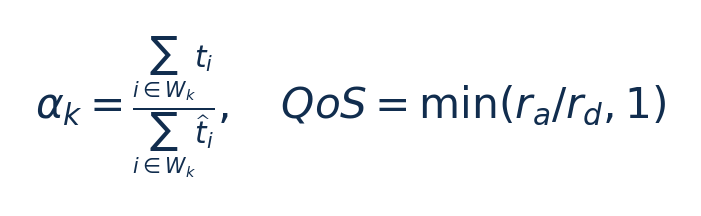
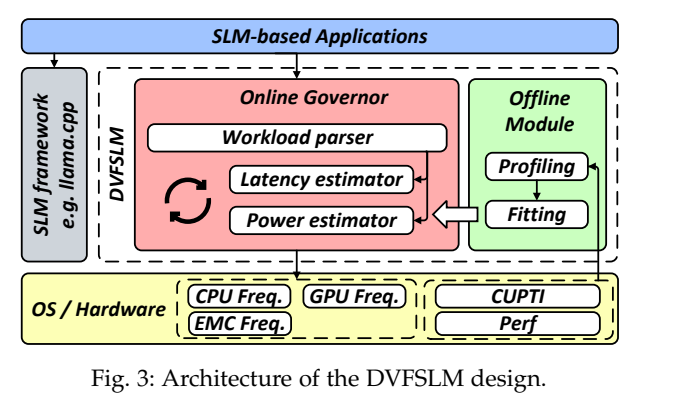
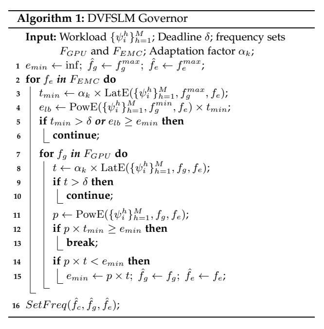
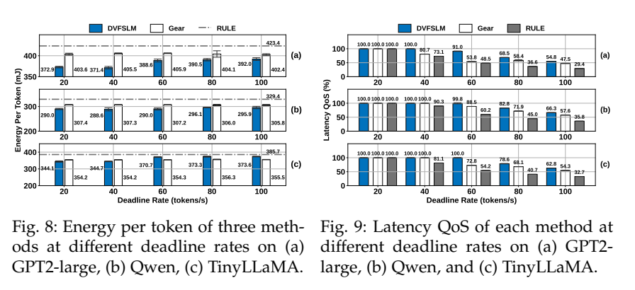
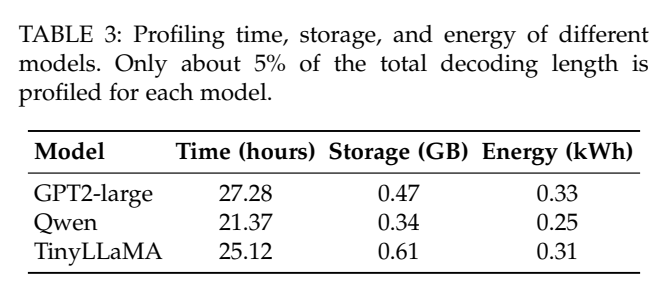

[论文页面](https://arxiv.org/abs/2609.13153v1) · [本笔记所用 PDF](https://arxiv.org/pdf/2609.13153v1) · [标识符](https://doi.org/10.48550/arXiv.2609.13153)

整理日期：2026-11-06。**读者原创中文解读；原图归论文作者／出版方。未运行作者实验，不是独立复现。**

**一句话：** 从下一token的矩阵计算规模预测硬件元数据，再用轻量功率/延时模型在deadline下搜索GPU与EMC频率

阅读地图：先看问题与输入输出，再顺着架构图、公式和结果图阅读；最后检查统计边界与E902迁移。完整编号索引另见“图表索引”。下文“读者分析”是推断或建议，不是原文结果。

## 阶段0：材料与版本审计

| 材料 | 当前可用程度 | 影响 |
| --- | --- | --- |
| 摘要、正文、方法、原图注 | 已获取本地完整PDF、文本与逐页渲染 | 可核查结构、实验及关键数字；可见页面优先于异常文本层 |
| 分析版本 | arXiv2609.13153v1，16页；首页版本标2026-07-08，与编号月份不同，按所用PDF记录，不自行改日期。 | 引用页码以“PDF第几页”标识 |
| 代码／原始数据 | 当前材料中尚未定位齐完整控制器源码、实验脚本和原始重复数据；这不表示这些材料不存在。 | 公开链接不等于已构建或已拿到原始轨迹 |
| 附件、独立原始重复与勘误 | 当前未完成全渠道附件／勘误穷尽检索 | 不能断言没有附件、没有勘误或没有其他版本 |
| 本次工作范围 | 材料阅读、图表裁取、证据整理、教学公式 | 所有新实验均是建议，尚未执行 |

## 阶段1：身份卡与整体概述

| 项目 | 内容 |
| --- | --- |
| 英文题名 | DVFS for Small Language Model Inference on Mobile Edge Devices |
| 中文导读题名 | 从下一token的矩阵计算规模预测硬件元数据，再用轻量功率/延时模型在deadline下搜索GPU与EMC频率 |
| 作者 | Jiesong Chen, Lixiang Han, Jiani Cao, Zhaoxi Yue, Zhenjiang Li |
| 发表／版本 | arXiv预印本2026；arXiv2609.13153v1，16页；首页版本标2026-07-08，与编号月份不同，按所用PDF记录，不自行改日期。 |
| 类型与领域 | 原始方法／工程系统研究；DVFS、GPU/CPU能效、CV/LLM应用运行时控制 |
| 单位、通讯、资助与利益关系 | 作者姓名以本版本首页为准；通讯方式、单位及资助可回查首页与末页声明。当前尚未完成资助/利益关系/勘误的跨版本穷尽审计。 |
| 核心对象与接口 | 默认50token一决策窗；剪枝后平均决策0.81ms（原枚举1.73ms）；不是每token都实时采一次CUPTI |
| 代码与数据 | 当前材料中尚未定位齐完整控制器源码、实验脚本和原始重复数据；这不表示这些材料不存在。 |
| 与本课题关系 | 最贴近“输入需求预测→合法档约束搜索→实测反馈”的可行毕设链。GPU上可用小SLM；CPU/E902可把矩阵规模换块长/数据复杂度、未来cycles估计，做同结构小回归/小树，动作空间保持小。 |

**约200字中文概述（改写）：** 本文研究边缘GPU本地小语言模型自回归decode（含dense/MoE）的运行时能效。具体程序包括llama.cpp/llama-cpp-python q4_0；GPT2-small/medium/large/xl、Qwen2.5-0.5B、TinyLLaMA1.1B、OLMoE-1B-7B；主实验生成1024tokens。作者在Jetson AGX Orin与Orin NX；CPU阈值0.6528GHz固定；44/28组GPU–EMC候选；INA3221 200Hz整设备功耗；C++/XGBoost CAPI/pybind11上采用XGBoost矩阵规模→未来HPC元数据parser；线性/频率基函数E/T估计；枚举GPU–EMC候选＋单调剪枝；50token窗口偏差反馈α修正。输入为模型层结构、当前context长度与矩阵维度scale、离线预测HPC、deadline δ=1/目标tokens/s、上窗口测量/估计时延比α，输出为每窗口GPU/EMC频率pair；prefill用高GPU/EMC；CPU保持阈值；无可行解则最高频best-effort。主要结果应与下方基线、性能约束和测量范围一起阅读，不能只摘最高百分比。把应用可知的未来矩阵工作量接到硬件元数据，再用轻量可解释估计和小空间约束搜索；智能学习在估计器，不在强化学习选频。

**三句话定位：** 问题是为什么局部利用率不能完整反映整个应用的性能与能耗？本篇的研究问题或可检验主张是：从下一token的矩阵计算规模预测硬件元数据，再用轻量功率/延时模型在deadline下搜索GPU与EMC频率。验证链是可观测状态→控制规则或学习模型→执行器→任务正确性/服务质量与能耗对照。 方法主线为模型层结构、当前context长度与矩阵维度scale、离线预测HPC、deadline δ=1/目标tokens/s、上窗口测量/估计时延比α → XGBoost矩阵规模→未来HPC元数据parser；线性/频率基函数E/T估计；枚举GPU–EMC候选＋单调剪枝；50token窗口偏差反馈α修正 → 每窗口GPU/EMC频率pair；prefill用高GPU/EMC；CPU保持阈值；无可行解则最高频best-effort → 执行与反馈。 主要证据见下方结果表，结论须与测量和版本范围一起使用。

## 阶段2：问题、假设与创新位置

为什么局部利用率不能完整反映整个应用的性能与能耗？本篇的研究问题或可检验主张是：从下一token的矩阵计算规模预测硬件元数据，再用轻量功率/延时模型在deadline下搜索GPU与EMC频率。验证链是可观测状态→控制规则或学习模型→执行器→任务正确性/服务质量与能耗对照。

**创新判断（读者分析）：** 把应用可知的未来矩阵工作量接到硬件元数据，再用轻量可解释估计和小空间约束搜索；智能学习在估计器，不在强化学习选频。 不依据作者自称“首次”断定整个领域绝无前例。

## 阶段3：必要术语与数学

| 级别 | 术语／关键词 | 直觉、严格含义与易混点 |
| --- | --- | --- |
| A | DVFS / DFS | DVFS同时涉及动态电压与频率；只有时钟变化称DFS。电压能否改变取决于实际供电域。 |
| A | Workload | 真正执行应用计算的程序与输入；本文里的控制器是另一个角色。 |
| A | Controller | 根据观测选择动作的软件／硬件，可运行在同一CPU或独立控制核。 |
| A | OPP | Operating Performance Point，经过允许范围验证的电压—频率组合。 |
| A | Power / Energy | 功率W表示此刻消耗快慢；能量J是对时间积分。低功率不必然低能量。 |
| B | Deadline | 作业必须完成的时刻；平均时延、P95与最大时延各有不同用途。 |
| A | 被控程序 | llama.cpp/llama-cpp-python q4_0；GPT2-small/medium/large/xl、Qwen2.5-0.5B、TinyLLaMA1.1B、OLMoE-1B-7B；主实验生成1024tokens |
| A | 控制策略 | XGBoost矩阵规模→未来HPC元数据parser；线性/频率基函数E/T估计；枚举GPU–EMC候选＋单调剪枝；50token窗口偏差反馈α修正 |
| B | 控制周期 | 默认50token一决策窗；剪枝后平均决策0.81ms（原枚举1.73ms）；不是每token都实时采一次CUPTI |
| B | 证据边界 | 实测、硬件仿真、功耗模型是不同证据，见平台与结果表。 |

### 公式1：受deadline约束的能量搜索

**符号与前提：** P W、T s/token、δ s/token；预测最优只在固定CPU和已搜候选集合内成立。

**代入与检查：** 目标20token/s时δ=50ms；预测45ms且α=1.2则54ms，不可行。

**来源：** Eq1/Algorithm1，p4/8
### 公式2：窗口自适应校正

**符号与前提：** α无量纲；ra/rd为实际/目标tokens/s；QoS不等按时token比例。

**代入与检查：** 实测总1.2s/预测1s→α1.2；实际40目标80tokens/s→QoS50%，并不说明一半token超时。

**来源：** Eq14/§5，p8/10

## 阶段4–6：架构、关键图与方法拆解

**输入—处理—输出：** 模型层结构、当前context长度与矩阵维度scale、离线预测HPC、deadline δ=1/目标tokens/s、上窗口测量/估计时延比α → XGBoost矩阵规模→未来HPC元数据parser；线性/频率基函数E/T估计；枚举GPU–EMC候选＋单调剪枝；50token窗口偏差反馈α修正 → 每窗口GPU/EMC频率pair；prefill用高GPU/EMC；CPU保持阈值；无可行解则最高频best-effort → 执行与反馈。

| 系统角色 | 具体设置 |
| --- | --- |
| 具体控制算法 | XGBoost矩阵规模→未来HPC元数据parser；线性/频率基函数E/T估计；枚举GPU–EMC候选＋单调剪枝；50token窗口偏差反馈α修正 |
| 被控负载类型 | 边缘GPU本地小语言模型自回归decode（含dense/MoE） |
| 具体被控程序 | llama.cpp/llama-cpp-python q4_0；GPT2-small/medium/large/xl、Qwen2.5-0.5B、TinyLLaMA1.1B、OLMoE-1B-7B；主实验生成1024tokens |
| 使用平台与测量 | Jetson AGX Orin与Orin NX；CPU阈值0.6528GHz固定；44/28组GPU–EMC候选；INA3221 200Hz整设备功耗；C++/XGBoost CAPI/pybind11 |
| 输入/状态 | 模型层结构、当前context长度与矩阵维度scale、离线预测HPC、deadline δ=1/目标tokens/s、上窗口测量/估计时延比α |
| 输出/动作 | 每窗口GPU/EMC频率pair；prefill用高GPU/EMC；CPU保持阈值；无可行解则最高频best-effort |
| 周期与运行位置 | 默认50token一决策窗；剪枝后平均决策0.81ms（原枚举1.73ms）；不是每token都实时采一次CUPTI |

§3，PDF p4–8：HPC反映执行行为但未来token尚未运行，所以不能直接读取其真实counter。离线把矩阵规模/上下文映射到未来metadata，parser用XGBoost；功率/时延用受物理形式约束的轻量回归，而不是直接上大MLP。GPU/CPU耦合导致功率不可简单相加，于是先剖析CPU阈值fhatc，再固定CPU只搜GPU/EMC。

Algorithm1按EMC条带遍历GPU档，用最小延时/能量下界跳过无可行或不可能更优的条带；最低档前缀不满足期限就跳过，能量下界不再改善就break。上一窗口α=Σ真实t/Σ预测t校正下一窗。无可行频点时最高档也只能尽力，不保证满足不可达目标。对GearDVFS增加deadline reward并重新训练，再冻结测不同目标；这属于修改后基线，必须说明。

### Fig3：系统架构

[打开大图](images/original-fig3.png) · [原文 Fig3，PDF p4](https://arxiv.org/pdf/2609.13153v1#page=4)

**怎样看：** 先读图题、图例、坐标/表头与单位，再在同一负载和同一基线内比较。离线parser/估计器与在线搜索分开。

**直接观察／原文报告：** 离线parser/估计器与在线搜索分开。

**读者判断：** 只支持此图所列的模型、设备、输入与测量口径；离线parser/估计器与在线搜索分开。 不能由单图推出E902或其他GPU的同幅收益。

### Algorithm1：剪枝搜索

[打开大图](images/original-algorithm1.png) · [原文 Algorithm1，PDF p8](https://arxiv.org/pdf/2609.13153v1#page=8)

**怎样看：** 先读图题、图例、坐标/表头与单位，再在同一负载和同一基线内比较。最优仅限已搜固定CPU空间。

**直接观察／原文报告：** 最优仅限已搜固定CPU空间。

**读者判断：** 只支持此图所列的模型、设备、输入与测量口径；最优仅限已搜固定CPU空间。 不能由单图推出E902或其他GPU的同幅收益。

| 阅读问题 | 先看材料 | 如何接到下一步 |
| --- | --- | --- |
| 为什么要改现有方案 | 问题背景与动机图 | 确定目标、约束和原有不足 |
| 系统观察什么、控制什么 | 输入输出表＋关键架构图 | 确认数据、模型和执行器真实角色 |
| 方法如何得到动作或估计 | 方法段、公式、算法／模型表 | 明确离线训练与在线流程 |
| 收益是否真实且公平 | 结果图表、统计与测量边界 | 核查基线／目标／分母／开销 |
| 能否用于自己的CPU | 局限、复现计划、三项实验 | 把论文假设变成待验证的工程条件 |

## 阶段7–8：实验、统计及证据链

本节数字均是**原文明确报告或原文数值的标注算例**；没有按图柱高度臆造额外精确值。

| 指标 | 原文报告 | 条件／分母／边界 | 证据位置 |
| --- | --- | --- | --- |
| 每token能量 | 相对RULE最高−12.4%，相对改造Gear最高−8.4% | 模型/期限不同；某些高目标下Gear更省能但QoS差，不能脱约束比较 | Fig8/§5.1，p10 |
| QoS定义与改善 | min(实际tokens/s÷目标tokens/s,1)；原文最高相对改善93.12%/69.14% | 不是百分之多少token按时完成，也不是成功率；不可达目标下仍<100% | Fig9/§5.1，p10 |
| 模型误差/决策 | 功率平均误差2.49%–4.60%、延时2.01%–2.81%；决策0.81ms | 预测误差不是节能；CPU固定＋已剖析模型条件 | §5.2/Fig11，p10–11；§3.3 p8 |
| 一次性剖析成本 | 21.37–27.28小时/模型，0.25–0.33kWh，0.34–0.61GB | 并非零成本部署；须由后续推理节省摊销 | Table3/§5.4，p13 |

### Fig8：Fig8＋Fig9：能量与QoS成对阅读

[打开大图](images/original-fig8.png) · [原文 Fig8，PDF p10](https://arxiv.org/pdf/2609.13153v1#page=10)

**怎样看：** 左侧三图是Fig8能量，右侧三图是Fig9的QoS；同模型同deadline逐列配对。能量更低若伴随QoS不达标，不能据此判优。

**直接观察／原文报告：** 必须对照Fig9的QoS。

**读者判断：** 只支持此图所列的模型、设备、输入与测量口径；必须对照Fig9的QoS。 不能由单图推出E902或其他GPU的同幅收益。

### Table3：离线profiling成本

[打开大图](images/original-table3.png) · [原文 Table3，PDF p13](https://arxiv.org/pdf/2609.13153v1#page=13)

**怎样看：** 先读图题、图例、坐标/表头与单位，再在同一负载和同一基线内比较。一次成本也需摊销。

**直接观察／原文报告：** 一次成本也需摊销。

**读者判断：** 只支持此图所列的模型、设备、输入与测量口径；一次成本也需摊销。 不能由单图推出E902或其他GPU的同幅收益。

**统计与公平性审查（读者分析）：** 主实验每配置5次，均值与t分布95%CI，n=5不是五模型。INA3221 200Hz测设备平均功率×总时长再除token数。deadline rate20–100含不可达段，必须分别报告；QoS是截断吞吐比例不是deadline miss计数。Gear基线reward改造且训练目标50ms，跨目标泛化是额外公平性因素。

工程实验中，设备、程序、输入文件、重复运行、时间窗口是不同统计层级，不能互相替代。本任务不涉及生物样本，细胞／动物／试剂等检查不适用。未注明的P值或置信区间不补造；“差了几个百分点”不自动等于统计显著。

| 主张层级 | 直接证据 | 对照与统计 | 可得结论／替代解释 | 可信度 |
| --- | --- | --- | --- | --- |
| 原文明确报告 | 每token能量：相对RULE最高−12.4%，相对改造Gear最高−8.4% | Fig8/§5.1，p10 | 模型/期限不同；某些高目标下Gear更省能但QoS差，不能脱约束比较；仅在该实验范围内成立 | 图表／文本可核对：高；独立复现：尚无 |
| 作者解释 | 所提架构／模型解释了性能或估计改善 | 关键原图与方法见上文；统计边界见下节 | 效果可能同时来自动作空间、平台特性与采样设置，因果归因需消融 | 中 |
| AI分析／迁移假设 | 用于允许的GPU/CV/LLM候选场景及CPU/E902迁移 | 本篇未直接验证该芯片与任务组合 | 需三项后续实验；不能复制论文收益数字 | 待验证，当前无法判断 |

## 阶段9–10：贡献与局限分开判断

把应用可知的未来矩阵工作量接到硬件元数据，再用轻量可解释估计和小空间约束搜索；智能学习在估计器，不在强化学习选频。

| 来源 | 严重程度 | 局限及其影响 |
| --- | --- | --- |
| 读者分析 | 关键 | 每设备–模型一次标定；50token窗口在突变负载下可能反应慢。 |
| 作者明确讨论＋读者影响分析（§3.2–3.3，p8） | 关键 | 固定CPU阈值是本平台经验，CPU/GPU耦合尚未完整建模。 |
| 读者分析 | 关键 | QoS比值不能替代token尾延时/违约率；E902无法直接运行这些SLM与CUPTI元数据。 |
| 作者报告/读者分析 | 重要 | 离线标定约一天/设备–模型，成本是否可接受取决于部署规模与复用次数。 |

## 阶段11：最小复现路线与缺口

本次未运行作者代码。最小复建顺序：①固定本文平台/模型/输入与质量目标，确认合法可用频档和权限；②逐档运行真实被控程序，验证输出、预热、计时同步与能量测量窗口，至少记录多次独立运行原始数据；③实现本文算法，冻结离线训练/搜索配置，留出新的输入、到达率和温度条件测试；④同动作空间、同质量/SLO比较固定最高档、默认governor、简单规则和本文方案；⑤把离线剖析与在线控制、采样、切频成本单列并计算摊销次数。失败时退回安全固定档，缺失参数列日志，不猜成已知。最贴近“输入需求预测→合法档约束搜索→实测反馈”的可行毕设链。GPU上可用小SLM；CPU/E902可把矩阵规模换块长/数据复杂度、未来cycles估计，做同结构小回归/小树，动作空间保持小。

**代码／数据现状：** 当前材料中尚未定位齐完整控制器源码、实验脚本和原始重复数据；这不表示这些材料不存在。

**质量控制顺序：** 先验证程序输出和时间基准，再验证采样／模型，最后比较策略。保存输入文件哈希、平台配置、OPP、随机种子、温度与每次运行原始记录。失败时先回固定安全频点定位错误，再继续优化。复现可行性判断为“可开始部分方法复建，完整数值复现条件未齐”；这与“已完成复现”不同。

## 阶段12：应用选题与CPU／E902课题联系

最贴近“输入需求预测→合法档约束搜索→实测反馈”的可行毕设链。GPU上可用小SLM；CPU/E902可把矩阵规模换块长/数据复杂度、未来cycles估计，做同结构小回归/小树，动作空间保持小。

| 建议实验／优先级 | 价值 | 最低资源 | 主要风险 | 成功判据（设计目标，非已得结果） |
| --- | --- | --- | --- | --- |
| P0：预测下一块/下一token工作量 | 先验证应用与执行器，建立同边界基线 | Jetson小SLM或CPU块处理程序；固定输入与真实执行时间 | 频率命令不一定获准或真实生效 | 输出正确；保存实际频率、温度、时延与积分能量 |
| P1：轻量预测＋约束搜索与纯RL/阈值对照 | 验证状态/阶段感知是否优于固定档与阈值 | Jetson小SLM或CPU块处理程序；固定输入与真实执行时间 | 新输入与离线标定分布不同 | 同期限/质量/动作空间下报告净收益及尾部时延 |
| P1：控制成本和迁移消融 | 分开采样、模型、切换与算法贡献 | 执行器时间戳；必要时外部电测或明确功耗模型 | 短任务收益被开销吞掉；E902可观测量不同 | 分别关闭各组件；报告失败输入；CPU迁移重新标定 |

上述优先级是读者建议：P0先做，P1建立在基线可运行后，P2只在资源允许且前序实验证明有必要时开展。本批允许CV/LLM/GPU应用；压缩、CV、SLM均未最终定题，也未证明已在E902运行。论文公开可读不自动授权任意复制数据；代码、图片和数据须分别核对许可。

## 阶段13：读完后应掌握与继续核查

**五个知识点：** 从下一token的矩阵计算规模预测硬件元数据，再用轻量功率/延时模型在deadline下搜索GPU与EMC频率 你还应能解释输入输出表中的角色、两条公式的单位、首个结果指标的分母，以及局限表里的关键条件。

**五个未决问题：** 独立新输入是否成立？最差时延是否可接受？测量参考是否足够？控制与切换是否抵消收益？E902实际具有哪些接口和可观测量？这些是研究问题，不是对作者遗漏的无证据指控。

**立即做：** 按公式算例手算一次，选一张结果图复述“硬件—负载—基线—指标—边界”。**后续核查：** 补齐代码版本、训练数据和仪表设置。**可复用：** 上文明确标注的模型与接口思路。**谨慎采用：** 所有跨平台百分比。**暂不采用：** 尚未证实存在的电压控制和完整硬实时承诺。
