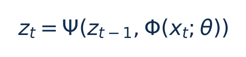
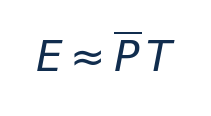
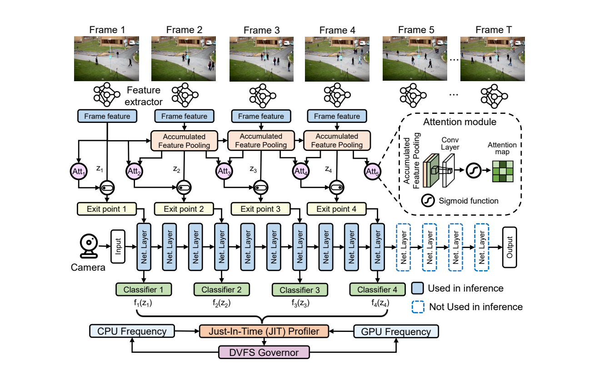
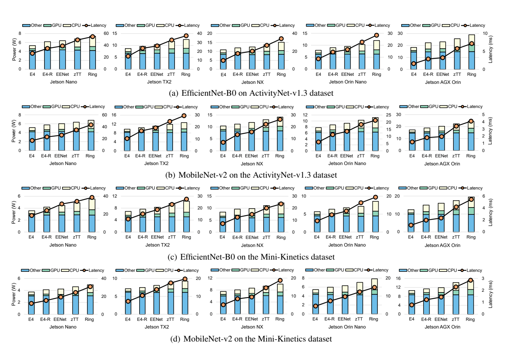
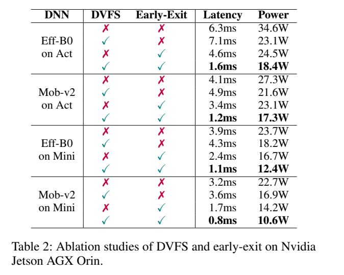

[论文页面](https://ojs.aaai.org/index.php/AAAI/article/view/32104) · [本笔记所用 PDF](https://yangece.github.io/papers/conference/AAAI2025-E4.pdf) · [标识符](https://ojs.aaai.org/index.php/AAAI/article/view/32104)

整理日期：2026-11-06。**读者原创中文解读；原图归论文作者／出版方。未运行作者实验，不是独立复现。**

**一句话：** 先通过时序注意力确定视频动作识别所需的退出位置，再用坐标下降为退出前各层选CPU/GPU频率

阅读地图：先看问题与输入输出，再顺着架构图、公式和结果图阅读；最后检查统计边界与E902迁移。完整编号索引另见“图表索引”。下文“读者分析”是推断或建议，不是原文结果。

## 阶段0：材料与版本审计

| 材料 | 当前可用程度 | 影响 |
| --- | --- | --- |
| 摘要、正文、方法、原图注 | 已获取本地完整PDF、文本与逐页渲染 | 可核查结构、实验及关键数字；可见页面优先于异常文本层 |
| 分析版本 | 作者托管正式会议PDF9页；PDF p1为印刷p1165，非arXiv版页码。 | 引用页码以“PDF第几页”标识 |
| 代码／原始数据 | 当前材料中尚未定位齐完整控制器源码、实验脚本和原始重复数据；这不表示这些材料不存在。 | 公开链接不等于已构建或已拿到原始轨迹 |
| 附件、独立原始重复与勘误 | 当前未完成全渠道附件／勘误穷尽检索 | 不能断言没有附件、没有勘误或没有其他版本 |
| 本次工作范围 | 材料阅读、图表裁取、证据整理、教学公式 | 所有新实验均是建议，尚未执行 |

## 阶段1：身份卡与整体概述

| 项目 | 内容 |
| --- | --- |
| 英文题名 | E4: Energy-Efficient DNN Inference for Edge Video Analytics via Early Exiting and DVFS |
| 中文导读题名 | 先通过时序注意力确定视频动作识别所需的退出位置，再用坐标下降为退出前各层选CPU/GPU频率 |
| 作者 | Ziyang Zhang, Yang Zhao, Ming-Ching Chang, Changyao Lin, Jie Liu |
| 发表／版本 | AAAI 2025，1165–1173；作者托管正式会议PDF9页；PDF p1为印刷p1165，非arXiv版页码。 |
| 类型与领域 | 原始方法／工程系统研究；DVFS、GPU/CPU能效、CV/LLM应用运行时控制 |
| 单位、通讯、资助与利益关系 | 作者姓名以本版本首页为准；通讯方式、单位及资助可回查首页与末页声明。当前尚未完成资助/利益关系/勘误的跨版本穷尽审计。 |
| 核心对象与接口 | 按视频帧/网络层动作；频率执行毫秒级，JIT搜索开销需单计；不是逐周期硬实时保证 |
| 代码与数据 | 当前材料中尚未定位齐完整控制器源码、实验脚本和原始重复数据；这不表示这些材料不存在。 |
| 与本课题关系 | 若选CV应用，建议先CPU小型分类模型固定网络/固定精度做DFS，再加早退作为独立实验变量。E902可尝试小型模型或前处理；Jetson更适合复建完整E4，不能把大平台频率表直接复制到E902。 |

**约200字中文概述（改写）：** 本文研究边缘视频动作识别，多帧/多出口DNN推理的运行时能效。具体程序包括EfficientNet-B0、MobileNet-v2特征骨干＋5出口；ActivityNet-v1.3、Mini-Kinetics；ImageNet预训练。作者在Jetson Nano/TX2/Xavier NX/Orin Nano/AGX Orin五设备；Python3.6、nvpmodel；jetson-stats整设备遥测；早退网络另用4×RTX3080离线训练上采用两层LSTM累计特征＋注意力/MLP早退gate；JIT coordinate descent search逐层找CPU-GPU频率；nvpmodel执行，非RL governor。输入为历史与当前帧累计特征、注意力权重、gate置信/退出条件、可用CPU/GPU频档、剖析每层配置能量，输出为DNN退出位置（改变执行量）＋退出前逐层CPU/GPU频率pair；视频类别。主要结果应与下方基线、性能约束和测量范围一起阅读，不能只摘最高百分比。把时序视频复杂度、退出位置与逐层频率搜索结合；优化空间既有少算几层，也有每层硬件运行档。

**三句话定位：** 问题是为什么局部利用率不能完整反映整个应用的性能与能耗？本篇的研究问题或可检验主张是：先通过时序注意力确定视频动作识别所需的退出位置，再用坐标下降为退出前各层选CPU/GPU频率。验证链是可观测状态→控制规则或学习模型→执行器→任务正确性/服务质量与能耗对照。 方法主线为历史与当前帧累计特征、注意力权重、gate置信/退出条件、可用CPU/GPU频档、剖析每层配置能量 → 两层LSTM累计特征＋注意力/MLP早退gate；JIT coordinate descent search逐层找CPU-GPU频率；nvpmodel执行，非RL governor → DNN退出位置（改变执行量）＋退出前逐层CPU/GPU频率pair；视频类别 → 执行与反馈。 主要证据见下方结果表，结论须与测量和版本范围一起使用。

## 阶段2：问题、假设与创新位置

为什么局部利用率不能完整反映整个应用的性能与能耗？本篇的研究问题或可检验主张是：先通过时序注意力确定视频动作识别所需的退出位置，再用坐标下降为退出前各层选CPU/GPU频率。验证链是可观测状态→控制规则或学习模型→执行器→任务正确性/服务质量与能耗对照。

**创新判断（读者分析）：** 把时序视频复杂度、退出位置与逐层频率搜索结合；优化空间既有少算几层，也有每层硬件运行档。 不依据作者自称“首次”断定整个领域绝无前例。

## 阶段3：必要术语与数学

| 级别 | 术语／关键词 | 直觉、严格含义与易混点 |
| --- | --- | --- |
| A | DVFS / DFS | DVFS同时涉及动态电压与频率；只有时钟变化称DFS。电压能否改变取决于实际供电域。 |
| A | Workload | 真正执行应用计算的程序与输入；本文里的控制器是另一个角色。 |
| A | Controller | 根据观测选择动作的软件／硬件，可运行在同一CPU或独立控制核。 |
| A | OPP | Operating Performance Point，经过允许范围验证的电压—频率组合。 |
| A | Power / Energy | 功率W表示此刻消耗快慢；能量J是对时间积分。低功率不必然低能量。 |
| B | Deadline | 作业必须完成的时刻；平均时延、P95与最大时延各有不同用途。 |
| A | 被控程序 | EfficientNet-B0、MobileNet-v2特征骨干＋5出口；ActivityNet-v1.3、Mini-Kinetics；ImageNet预训练 |
| A | 控制策略 | 两层LSTM累计特征＋注意力/MLP早退gate；JIT coordinate descent search逐层找CPU-GPU频率；nvpmodel执行，非RL governor |
| B | 控制周期 | 按视频帧/网络层动作；频率执行毫秒级，JIT搜索开销需单计；不是逐周期硬实时保证 |
| B | 证据边界 | 实测、硬件仿真、功耗模型是不同证据，见平台与结果表。 |

### 公式1：累积时序特征

**符号与前提：** xt是第t帧，Φ提取特征，Ψ累计历史；z无物理单位，不是CPU利用率。

**代入与检查：** 同一帧可因之前帧信息不同而在不同出口结束；不能只按图像大小选频。

**来源：** Eq1，p3
### 公式2：同任务能量与功率

**符号与前提：** P单位W，T用s，E为J；6.3ms必须写0.0063s。

**代入与检查：** 34.6W×6.3ms=0.21798J=217.98mJ，绝不是217.98µJ。

**来源：** 能量核查公式；Table2，p7

## 阶段4–6：架构、关键图与方法拆解

**输入—处理—输出：** 历史与当前帧累计特征、注意力权重、gate置信/退出条件、可用CPU/GPU频档、剖析每层配置能量 → 两层LSTM累计特征＋注意力/MLP早退gate；JIT coordinate descent search逐层找CPU-GPU频率；nvpmodel执行，非RL governor → DNN退出位置（改变执行量）＋退出前逐层CPU/GPU频率pair；视频类别 → 执行与反馈。

| 系统角色 | 具体设置 |
| --- | --- |
| 具体控制算法 | 两层LSTM累计特征＋注意力/MLP早退gate；JIT coordinate descent search逐层找CPU-GPU频率；nvpmodel执行，非RL governor |
| 被控负载类型 | 边缘视频动作识别，多帧/多出口DNN推理 |
| 具体被控程序 | EfficientNet-B0、MobileNet-v2特征骨干＋5出口；ActivityNet-v1.3、Mini-Kinetics；ImageNet预训练 |
| 使用平台与测量 | Jetson Nano/TX2/Xavier NX/Orin Nano/AGX Orin五设备；Python3.6、nvpmodel；jetson-stats整设备遥测；早退网络另用4×RTX3080离线训练 |
| 输入/状态 | 历史与当前帧累计特征、注意力权重、gate置信/退出条件、可用CPU/GPU频档、剖析每层配置能量 |
| 输出/动作 | DNN退出位置（改变执行量）＋退出前逐层CPU/GPU频率pair；视频类别 |
| 周期与运行位置 | 按视频帧/网络层动作；频率执行毫秒级，JIT搜索开销需单计；不是逐周期硬实时保证 |

PDF p3–5：两层LSTM实现累积特征Ψ，attention与64/32单元MLP gate选最早满足条件的出口；没有gate满足则跑完整模型。训练包括classifier CE、gate BCE与attention CE三项loss。随后Algorithm1按出口前的每层作坐标，固定其他层频率、采样该层CPU/GPU pair并测能量，迭代更新缓存，输出低能耗schedule。论文称CDS能近似高效找配置，不能由普通坐标下降推导非凸全局最优保证。

p5实验是动作识别数据集，不因示意图含车就改写为实时目标检测。频率搜索和智能early-exit不同：学习的是质量相关的gate/attention，频率搜索本身没有DQN训练。p6 Fig3纵轴Power(W)却标题称energy，需以Table2给出的功率与时延推导能量对照，而不把W直接写J。

### Fig2：E4整体结构

[打开大图](images/original-fig2.png) · [原文 Fig2，PDF p3](https://yangece.github.io/papers/conference/AAAI2025-E4.pdf#page=3)

**怎样看：** 先读图题、图例、坐标/表头与单位，再在同一负载和同一基线内比较。先退出策略，再逐层频率。

**直接观察／原文报告：** 先退出策略，再逐层频率。

**读者判断：** 只支持此图所列的模型、设备、输入与测量口径；先退出策略，再逐层频率。 不能由单图推出E902或其他GPU的同幅收益。

### Fig3：五设备结果

[打开大图](images/original-fig3.png) · [原文 Fig3，PDF p6](https://yangece.github.io/papers/conference/AAAI2025-E4.pdf#page=6)

**怎样看：** 先读图题、图例、坐标/表头与单位，再在同一负载和同一基线内比较。柱轴W是功率，折线ms是时延；不可同单位相减。

**直接观察／原文报告：** 柱轴W是功率，折线ms是时延；不可同单位相减。

**读者判断：** 只支持此图所列的模型、设备、输入与测量口径；柱轴W是功率，折线ms是时延；不可同单位相减。 不能由单图推出E902或其他GPU的同幅收益。

| 阅读问题 | 先看材料 | 如何接到下一步 |
| --- | --- | --- |
| 为什么要改现有方案 | 问题背景与动机图 | 确定目标、约束和原有不足 |
| 系统观察什么、控制什么 | 输入输出表＋关键架构图 | 确认数据、模型和执行器真实角色 |
| 方法如何得到动作或估计 | 方法段、公式、算法／模型表 | 明确离线训练与在线流程 |
| 收益是否真实且公平 | 结果图表、统计与测量边界 | 核查基线／目标／分母／开销 |
| 能否用于自己的CPU | 局限、复现计划、三项实验 | 把论文假设变成待验证的工程条件 |

## 阶段7–8：实验、统计及证据链

本节数字均是**原文明确报告或原文数值的标注算例**；没有按图柱高度臆造额外精确值。

| 指标 | 原文报告 | 条件／分母／边界 | 证据位置 |
| --- | --- | --- | --- |
| 主要正文结果 | EfficientNet能量−20%–37%、速度1.3–2.2×；MobileNet−18%–30%、1.4–1.9× | 五Jetson/两数据集，与EENet/zTT/Ring比较；摘要最高2.8×不冒充所有主图结果 | §Performance/Fig3，p5–6 |
| 摘要总体 | 平均节能26%，最高速度2.8× | 联合早退和调频；保留正文分组与精度条件 | 摘要，p1 |
| 能量换算示例 | 约217.98mJ→164.01mJ | Table2 Eff-B0无策略6.3ms/34.6W，单DVFS7.1ms/23.1W；乘积教学换算，约−24.8%，不是新实测 | Table2，p7 |

### Table2：DVFS与early-exit消融

[打开大图](images/original-table2.png) · [原文 Table2，PDF p7](https://yangece.github.io/papers/conference/AAAI2025-E4.pdf#page=7)

**怎样看：** 先读图题、图例、坐标/表头与单位，再在同一负载和同一基线内比较。功率、时延必须配对，分开组件。

**直接观察／原文报告：** 功率、时延必须配对，分开组件。

**读者判断：** 只支持此图所列的模型、设备、输入与测量口径；功率、时延必须配对，分开组件。 不能由单图推出E902或其他GPU的同幅收益。

**统计与公平性审查（读者分析）：** Fig3用W轴展示功率，不能直接按柱差称能量降幅；E=P·T需同一任务。Table2消融同时报告DVFS/early-exit，可检查联合贡献。跨模型精度损失和输入帧数互相影响；图像/帧不是运行独立重复。当前材料未定位到每个配置的独立运行数/CI，不能补造显著性。

工程实验中，设备、程序、输入文件、重复运行、时间窗口是不同统计层级，不能互相替代。本任务不涉及生物样本，细胞／动物／试剂等检查不适用。未注明的P值或置信区间不补造；“差了几个百分点”不自动等于统计显著。

| 主张层级 | 直接证据 | 对照与统计 | 可得结论／替代解释 | 可信度 |
| --- | --- | --- | --- | --- |
| 原文明确报告 | 主要正文结果：EfficientNet能量−20%–37%、速度1.3–2.2×；MobileNet−18%–30%、1.4–1.9× | §Performance/Fig3，p5–6 | 五Jetson/两数据集，与EENet/zTT/Ring比较；摘要最高2.8×不冒充所有主图结果；仅在该实验范围内成立 | 图表／文本可核对：高；独立复现：尚无 |
| 作者解释 | 所提架构／模型解释了性能或估计改善 | 关键原图与方法见上文；统计边界见下节 | 效果可能同时来自动作空间、平台特性与采样设置，因果归因需消融 | 中 |
| AI分析／迁移假设 | 用于允许的GPU/CV/LLM候选场景及CPU/E902迁移 | 本篇未直接验证该芯片与任务组合 | 需三项后续实验；不能复制论文收益数字 | 待验证，当前无法判断 |

## 阶段9–10：贡献与局限分开判断

把时序视频复杂度、退出位置与逐层频率搜索结合；优化空间既有少算几层，也有每层硬件运行档。

| 来源 | 严重程度 | 局限及其影响 |
| --- | --- | --- |
| 读者分析 | 关键 | early-exit改变计算与潜在识别质量，必须同精度/同帧数比较。 |
| 读者分析 | 关键 | 逐层频率切换毫秒开销可能接近层时长；不同板的可用OPP与权限需验证。 |
| 读者分析 | 关键 | 论文功率/能量标注、摘要与分组最高加速不同，不能只摘2.8×作为纯DVFS效果。 |

## 阶段11：最小复现路线与缺口

本次未运行作者代码。最小复建顺序：①固定本文平台/模型/输入与质量目标，确认合法可用频档和权限；②逐档运行真实被控程序，验证输出、预热、计时同步与能量测量窗口，至少记录多次独立运行原始数据；③实现本文算法，冻结离线训练/搜索配置，留出新的输入、到达率和温度条件测试；④同动作空间、同质量/SLO比较固定最高档、默认governor、简单规则和本文方案；⑤把离线剖析与在线控制、采样、切频成本单列并计算摊销次数。失败时退回安全固定档，缺失参数列日志，不猜成已知。若选CV应用，建议先CPU小型分类模型固定网络/固定精度做DFS，再加早退作为独立实验变量。E902可尝试小型模型或前处理；Jetson更适合复建完整E4，不能把大平台频率表直接复制到E902。

**代码／数据现状：** 当前材料中尚未定位齐完整控制器源码、实验脚本和原始重复数据；这不表示这些材料不存在。

**质量控制顺序：** 先验证程序输出和时间基准，再验证采样／模型，最后比较策略。保存输入文件哈希、平台配置、OPP、随机种子、温度与每次运行原始记录。失败时先回固定安全频点定位错误，再继续优化。复现可行性判断为“可开始部分方法复建，完整数值复现条件未齐”；这与“已完成复现”不同。

## 阶段12：应用选题与CPU／E902课题联系

若选CV应用，建议先CPU小型分类模型固定网络/固定精度做DFS，再加早退作为独立实验变量。E902可尝试小型模型或前处理；Jetson更适合复建完整E4，不能把大平台频率表直接复制到E902。

| 建议实验／优先级 | 价值 | 最低资源 | 主要风险 | 成功判据（设计目标，非已得结果） |
| --- | --- | --- | --- | --- |
| P0：固定网络与早退质量基线 | 先验证应用与执行器，建立同边界基线 | Linux CPU/Jetson、轻量图像或短视频模型、带标注输入 | 频率命令不一定获准或真实生效 | 输出正确；保存实际频率、温度、时延与积分能量 |
| P1：固定计算量下调频与联合早退分别比较 | 验证状态/阶段感知是否优于固定档与阈值 | Linux CPU/Jetson、轻量图像或短视频模型、带标注输入 | 新输入与离线标定分布不同 | 同期限/质量/动作空间下报告净收益及尾部时延 |
| P1：控制成本和迁移消融 | 分开采样、模型、切换与算法贡献 | 执行器时间戳；必要时外部电测或明确功耗模型 | 短任务收益被开销吞掉；E902可观测量不同 | 分别关闭各组件；报告失败输入；CPU迁移重新标定 |

上述优先级是读者建议：P0先做，P1建立在基线可运行后，P2只在资源允许且前序实验证明有必要时开展。本批允许CV/LLM/GPU应用；压缩、CV、SLM均未最终定题，也未证明已在E902运行。论文公开可读不自动授权任意复制数据；代码、图片和数据须分别核对许可。

## 阶段13：读完后应掌握与继续核查

**五个知识点：** 先通过时序注意力确定视频动作识别所需的退出位置，再用坐标下降为退出前各层选CPU/GPU频率 你还应能解释输入输出表中的角色、两条公式的单位、首个结果指标的分母，以及局限表里的关键条件。

**五个未决问题：** 独立新输入是否成立？最差时延是否可接受？测量参考是否足够？控制与切换是否抵消收益？E902实际具有哪些接口和可观测量？这些是研究问题，不是对作者遗漏的无证据指控。

**立即做：** 按公式算例手算一次，选一张结果图复述“硬件—负载—基线—指标—边界”。**后续核查：** 补齐代码版本、训练数据和仪表设置。**可复用：** 上文明确标注的模型与接口思路。**谨慎采用：** 所有跨平台百分比。**暂不采用：** 尚未证实存在的电压控制和完整硬实时承诺。
