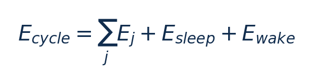

[论文页面](https://doi.org/10.3390/technologies13020082) · [本笔记所用 PDF](https://mdpi-res.com/d_attachment/technologies/technologies-13-00082/article_deploy/technologies-13-00082.pdf) · [标识符](https://doi.org/10.3390/technologies13020082)

整理日期：2026-11-05。**读者原创中文解读；原图归论文作者／出版方。未运行作者实验，不是独立复现。**

## 先把四个角色放对位置

被控负载是要完成的程序和输入，比如压缩一块日志；CPU是执行程序的硬件；控制器根据观测选运行档位；驱动／寄存器把档位落实。程序代码可以完全一样，CPU时钟变慢时每条指令对应的墙钟时间通常变长，访存或I/O等待则未必按同样比例变化。

软件控制并不意味着没有真实硬件。软件中的学习策略可控制真实CPU；也可先控制一个执行时间与能量模型。后者能验证闭环逻辑，但模型输出的J不能当真实电测。E902的RTL能在仿真中改变时钟并反馈计数；电压导致的物理功耗还需相应模型、功耗分析或板级实验。

## 这篇到底解决哪一件事

把采集、计算、通信和睡眠分开选档，满足整个IoT工作周期而不是只最小化CPU瞬时功率

为什么相同CPU利用率未必对应相同的工作需求？本篇的可检验主张是：把采集、计算、通信和睡眠分开选档，满足整个IoT工作周期而不是只最小化CPU瞬时功率。验证链是可观测状态→控制规则或学习模型→执行器→任务正确性/服务质量与能耗对照。

**把方法想成一条流水线：** 当前阶段、20s或30s周期预算、离线各配置的耗时和能量 → 离线阶段能量/时延表＋固定周期预算：固定时长采集/通信走Slow，计算选能满足剩余期限的最低电压可行档，余时睡眠；确定性规则，无训练模型 → RP2040软件设置Vreg与系统频率、进入睡眠；不是电机驱动 → 执行与反馈。

| 先回答的问题 | 本文答案 |
| --- | --- |
| 具体控制算法 | 离线阶段能量/时延表＋固定周期预算：固定时长采集/通信走Slow，计算选能满足剩余期限的最低电压可行档，余时睡眠；确定性规则，无训练模型 |
| 被控负载类型 | 周期性IoT声音采集→数字信号处理→无线发送→睡眠 |
| 具体被控程序 | 4000点FFT、4000点自相关、50-tap FIR；4kHz采集4000样点；经ESP-01发送19字节标志/时间等 |
| 使用平台与测量 | RP2040双Cortex-M0+（264KB SRAM）＋PDM MEMS麦克风＋ESP-01；裸机；Nordic PPK2 100ksps，3.3V板级供电，GPIO四位标记阶段；ATmega328p补充泄漏实验 |
| 输入/状态 | 当前阶段、20s或30s周期预算、离线各配置的耗时和能量 |
| 输出/动作 | RP2040软件设置Vreg与系统频率、进入睡眠；不是电机驱动 |
| 周期与运行位置 | 阶段边界切换；20s/30s任务周期，采音约1.5s（含500ms稳定等待） |

## 十个先修关键词

| 级别 | 术语／关键词 | 直觉、严格含义与易混点 |
| --- | --- | --- |
| A | DVFS / DFS | DVFS同时涉及动态电压与频率；只有时钟变化称DFS。电压能否改变取决于实际供电域。 |
| A | Workload | 真正执行应用计算的程序与输入；本文里的控制器是另一个角色。 |
| A | Controller | 根据观测选择动作的软件／硬件，可运行在同一CPU或独立控制核。 |
| A | OPP | Operating Performance Point，经过允许范围验证的电压—频率组合。 |
| A | Power / Energy | 功率W表示此刻消耗快慢；能量J是对时间积分。低功率不必然低能量。 |
| B | Deadline | 作业必须完成的时刻；平均时延、P95与最大时延各有不同用途。 |
| A | 被控程序 | 4000点FFT、4000点自相关、50-tap FIR；4kHz采集4000样点；经ESP-01发送19字节标志/时间等 |
| A | 控制策略 | 离线阶段能量/时延表＋固定周期预算：固定时长采集/通信走Slow，计算选能满足剩余期限的最低电压可行档，余时睡眠；确定性规则，无训练模型 |
| B | 控制周期 | 阶段边界切换；20s/30s任务周期，采音约1.5s（含500ms稳定等待） |
| B | 证据边界 | 实测、硬件仿真、功耗模型是不同证据，见平台与结果表。 |

## 用一个小算例建立直觉

20s Medium Optimized总量2.947J，不等于只报告计算阶段1.55J。

E_j为每阶段能量J；必须使用相同周期长度；供电转换损耗按测量边界计入。

**要防止的误读：** 未完整穷尽OS/RTOS调度、中断、Flash等待和长期温漂对结果的影响。

## 论文真正验证了什么

| 指标 | 原文报告 | 条件／分母／边界 | 证据位置 |
| --- | --- | --- | --- |
| 20s周期完整能量 | 2.947J/周期 | Medium Optimized；High4.409J，Medium3.594J，High Optimized3.104J | Table10–11，p15 |
| 30s周期完整能量 | 2.884J/周期 | Low Optimized；High4.503J，Medium3.676J，Low3.145J | Table12–13，p16 |
| 作者概括收益 | 最高约33%/36% | 分别20s/30s、相对未优化高档；不是相对每一种基线均省36% | §4.1，p15–16 |

这些结果来自作者实验。算法reward、模型误差、控制器时延、被控应用速度与应用节能是不同指标，要看具体行的单位和证据。

## 它与你的毕设怎么接起来

可以把声音处理换成日志分块压缩：采集/收包与发送阶段使用满足接口要求的低档，压缩阶段按剩余期限选档，再睡眠。若不具备真实电压调节，先实现DFS并标明能量模型。

最先可以尝试：**P0：压缩应用阶段剖面**。理由是知道每个阶段是否CPU受限；最低资源是字节到达/压缩/发送/空闲GPIO或trace；通过标准是同周期、同压缩结果分阶段积分。

## 五分钟自测

1. 这篇输出的是下一频率、功率估计，还是通信／控制时序？
2. 是真实负载硬件实验，还是模型／RTL／HIL？哪些部分是真的？
3. 最重要百分比的分母和比较对象是什么？
4. 如果换成单核E902，哪一个输入或硬件旋钮会消失？
5. 算上采样、推理、切频和空闲时间后，节能是否还成立？

答案线索在本页角色表和结果表；进一步读“图文技术精读”的关键原图、公式与三项课题实验，再到“图表索引”回查原PDF。不是先记住论文所有缩写。
