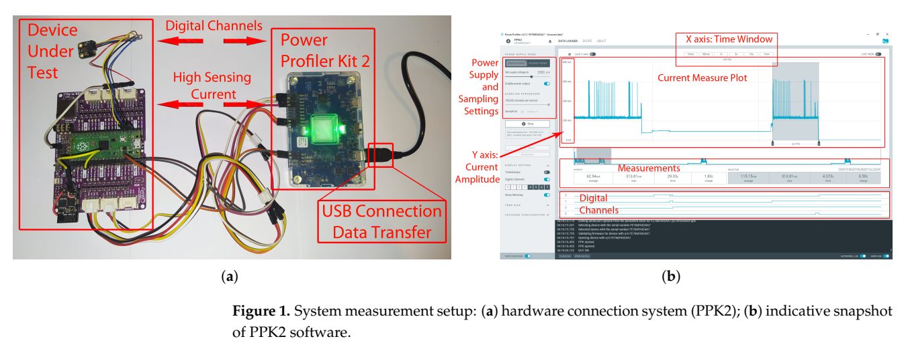
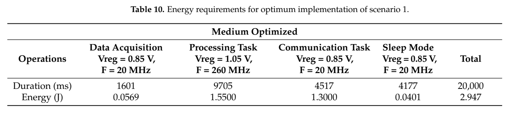
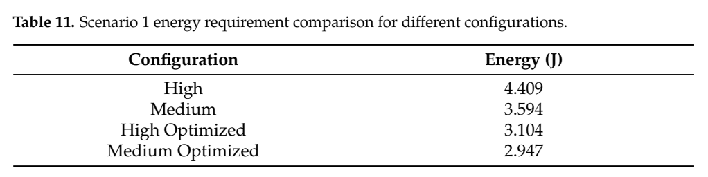

[论文页面](https://doi.org/10.3390/technologies13020082) · [本笔记所用 PDF](https://mdpi-res.com/d_attachment/technologies/technologies-13-00082/article_deploy/technologies-13-00082.pdf) · [标识符](https://doi.org/10.3390/technologies13020082)

整理日期：2026-11-05。**读者原创中文解读；原图归论文作者／出版方。未运行作者实验，不是独立复现。**

**一句话：** 把采集、计算、通信和睡眠分开选档，满足整个IoT工作周期而不是只最小化CPU瞬时功率

阅读地图：先看问题与输入输出，再顺着架构图、公式和结果图阅读；最后检查统计边界与E902迁移。完整编号索引另见“图表索引”。下文“读者分析”是推断或建议，不是原文结果。

## 阶段0：材料与版本审计

| 材料 | 当前可用程度 | 影响 |
| --- | --- | --- |
| 摘要、正文、方法、原图注 | 已获取本地完整PDF、文本与逐页渲染 | 可核查结构、实验及关键数字；可见页面优先于异常文本层 |
| 分析版本 | MDPI正式版18页，Table13标题疑似沿用Scenario1，实际处于Scenario2。 | 引用页码以“PDF第几页”标识 |
| 代码／原始数据 | 当前材料中尚未定位齐完整控制器源码、实验脚本和原始重复数据；这不表示这些材料不存在。 | 公开链接不等于已构建或已拿到原始轨迹 |
| 附件、独立原始重复与勘误 | 当前未完成全渠道附件／勘误穷尽检索 | 不能断言没有附件、没有勘误或没有其他版本 |
| 本次工作范围 | 材料阅读、图表裁取、证据整理、教学公式 | 所有新实验均是建议，尚未执行 |

## 阶段1：身份卡与整体概述

| 项目 | 内容 |
| --- | --- |
| 英文题名 | Reducing Energy Consumption in Embedded Systems Applications |
| 中文导读题名 | 把采集、计算、通信和睡眠分开选档，满足整个IoT工作周期而不是只最小化CPU瞬时功率 |
| 作者 | Ioannis Sofianidis, Vasileios Konstantakos, Spyridon Nikolaidis |
| 发表／版本 | Technologies 13(2),82 (2025)；MDPI正式版18页，Table13标题疑似沿用Scenario1，实际处于Scenario2。 |
| 类型与领域 | 原始方法／工程系统研究；DVFS、CPU能效、运行时控制 |
| 单位、通讯、资助与利益关系 | 作者姓名以本版本首页为准；通讯方式、单位及资助可回查首页与末页声明。当前尚未完成资助/利益关系/勘误的跨版本穷尽审计。 |
| 核心对象与接口 | 阶段边界切换；20s/30s任务周期，采音约1.5s（含500ms稳定等待） |
| 代码与数据 | 当前材料中尚未定位齐完整控制器源码、实验脚本和原始重复数据；这不表示这些材料不存在。 |
| 与本课题关系 | 可以把声音处理换成日志分块压缩：采集/收包与发送阶段使用满足接口要求的低档，压缩阶段按剩余期限选档，再睡眠。若不具备真实电压调节，先实现DFS并标明能量模型。 |

**约200字中文概述（改写）：** 本文研究周期性IoT声音采集→数字信号处理→无线发送→睡眠的运行时能效。具体程序包括4000点FFT、4000点自相关、50-tap FIR；4kHz采集4000样点；经ESP-01发送19字节标志/时间等。作者在RP2040双Cortex-M0+（264KB SRAM）＋PDM MEMS麦克风＋ESP-01；裸机；Nordic PPK2 100ksps，3.3V板级供电，GPIO四位标记阶段；ATmega328p补充泄漏实验上采用离线阶段能量/时延表＋固定周期预算：固定时长采集/通信走Slow，计算选能满足剩余期限的最低电压可行档，余时睡眠；确定性规则，无训练模型。输入为当前阶段、20s或30s周期预算、离线各配置的耗时和能量，输出为RP2040软件设置Vreg与系统频率、进入睡眠；不是电机驱动。主要结果应与下方基线、性能约束和测量范围一起阅读，不能只摘最高百分比。优势在于将真实应用的采样、处理、通信、睡眠和唤醒纳入统一时间/能量预算，并展示不同周期需要不同计算档。它提供测量驱动规则基线，不是新神经网络。

**三句话定位：** 问题是为什么相同CPU利用率未必对应相同的工作需求？本篇的可检验主张是：把采集、计算、通信和睡眠分开选档，满足整个IoT工作周期而不是只最小化CPU瞬时功率。验证链是可观测状态→控制规则或学习模型→执行器→任务正确性/服务质量与能耗对照。 方法主线为当前阶段、20s或30s周期预算、离线各配置的耗时和能量 → 离线阶段能量/时延表＋固定周期预算：固定时长采集/通信走Slow，计算选能满足剩余期限的最低电压可行档，余时睡眠；确定性规则，无训练模型 → RP2040软件设置Vreg与系统频率、进入睡眠；不是电机驱动 → 执行与反馈。 主要证据见下方结果表，结论须与测量和版本范围一起使用。

## 阶段2：问题、假设与创新位置

为什么相同CPU利用率未必对应相同的工作需求？本篇的可检验主张是：把采集、计算、通信和睡眠分开选档，满足整个IoT工作周期而不是只最小化CPU瞬时功率。验证链是可观测状态→控制规则或学习模型→执行器→任务正确性/服务质量与能耗对照。

**创新判断（读者分析）：** 优势在于将真实应用的采样、处理、通信、睡眠和唤醒纳入统一时间/能量预算，并展示不同周期需要不同计算档。它提供测量驱动规则基线，不是新神经网络。 不依据作者自称“首次”断定整个领域绝无前例。

## 阶段3：必要术语与数学

| 级别 | 术语／关键词 | 直觉、严格含义与易混点 |
| --- | --- | --- |
| A | DVFS / DFS | DVFS同时涉及动态电压与频率；只有时钟变化称DFS。电压能否改变取决于实际供电域。 |
| A | Workload | 真正执行应用计算的程序与输入；本文里的控制器是另一个角色。 |
| A | Controller | 根据观测选择动作的软件／硬件，可运行在同一CPU或独立控制核。 |
| A | OPP | Operating Performance Point，经过允许范围验证的电压—频率组合。 |
| A | Power / Energy | 功率W表示此刻消耗快慢；能量J是对时间积分。低功率不必然低能量。 |
| B | Deadline | 作业必须完成的时刻；平均时延、P95与最大时延各有不同用途。 |
| A | 被控程序 | 4000点FFT、4000点自相关、50-tap FIR；4kHz采集4000样点；经ESP-01发送19字节标志/时间等 |
| A | 控制策略 | 离线阶段能量/时延表＋固定周期预算：固定时长采集/通信走Slow，计算选能满足剩余期限的最低电压可行档，余时睡眠；确定性规则，无训练模型 |
| B | 控制周期 | 阶段边界切换；20s/30s任务周期，采音约1.5s（含500ms稳定等待） |
| B | 证据边界 | 实测、硬件仿真、功耗模型是不同证据，见平台与结果表。 |

### 公式1：完整周期能量

**符号与前提：** E_j为每阶段能量J；必须使用相同周期长度；供电转换损耗按测量边界计入。

**代入与检查：** 20s Medium Optimized总量2.947J，不等于只报告计算阶段1.55J。

**来源：** Table10，p15
### 公式2：计算时间预算（教学整理）

**符号与前提：** D为周期s，采集/传输/切换均用s；实际还需中断和安全余量。

**代入与检查：** D=20s，采集1.6s、发送4.5s、切换0.1s时，计算最多13.8s。此为算例，非原文切换测值。

**来源：** §4.1，p15–16

## 阶段4–6：架构、关键图与方法拆解

**输入—处理—输出：** 当前阶段、20s或30s周期预算、离线各配置的耗时和能量 → 离线阶段能量/时延表＋固定周期预算：固定时长采集/通信走Slow，计算选能满足剩余期限的最低电压可行档，余时睡眠；确定性规则，无训练模型 → RP2040软件设置Vreg与系统频率、进入睡眠；不是电机驱动 → 执行与反馈。

| 系统角色 | 具体设置 |
| --- | --- |
| 具体控制算法 | 离线阶段能量/时延表＋固定周期预算：固定时长采集/通信走Slow，计算选能满足剩余期限的最低电压可行档，余时睡眠；确定性规则，无训练模型 |
| 被控负载类型 | 周期性IoT声音采集→数字信号处理→无线发送→睡眠 |
| 具体被控程序 | 4000点FFT、4000点自相关、50-tap FIR；4kHz采集4000样点；经ESP-01发送19字节标志/时间等 |
| 使用平台与测量 | RP2040双Cortex-M0+（264KB SRAM）＋PDM MEMS麦克风＋ESP-01；裸机；Nordic PPK2 100ksps，3.3V板级供电，GPIO四位标记阶段；ATmega328p补充泄漏实验 |
| 输入/状态 | 当前阶段、20s或30s周期预算、离线各配置的耗时和能量 |
| 输出/动作 | RP2040软件设置Vreg与系统频率、进入睡眠；不是电机驱动 |
| 周期与运行位置 | 阶段边界切换；20s/30s任务周期，采音约1.5s（含500ms稳定等待） |

§2–4（p3–16）先逐个Vreg寻找作者实验中的稳定频率，再把功能分成“固定持续时间”和“CPU工作量决定时间”。麦克风实际采样1s，加500ms稳定等待；采集与Wi-Fi发送的墙钟时间不随CPU频率同比缩短，故用Slow。FFT/FIR/自相关随算力变化，20s周期需计算在约14s内完成，选择Medium；30s周期可留约24s，选择Low。以GPIO标记并积分板级电流，完整周期包含睡眠与唤醒。

Table1列140MHz/0.85V、260MHz/1.05V、416MHz/1.30V等作者实验点，§3.1还涉及brown-out阈值和Flash时钟调整。这些不能作为芯片额定安全保证，更不可移植到E902；本课题只借鉴阶段预算与测量方法。Table12分项的1.4900J与Table7 Low计算1.4J表述存在差异，不能无说明跨表拼算。

### Fig1：PPK2与GPIO测量

[打开大图](images/original-fig1.png) · [原文 Fig1，PDF p6](https://mdpi-res.com/d_attachment/technologies/technologies-13-00082/article_deploy/technologies-13-00082.pdf#page=6)

**怎样看：** 先读图题、图例、坐标/表头与单位，再在同一负载和同一基线内比较。可将电流波形与任务状态对齐。

**直接观察／原文报告：** 可将电流波形与任务状态对齐。

**读者判断：** 本项只支撑原文所列平台和配置；不证明E902可直接复用这些数值。

| 阅读问题 | 先看材料 | 如何接到下一步 |
| --- | --- | --- |
| 为什么要改现有方案 | 问题背景与动机图 | 确定目标、约束和原有不足 |
| 系统观察什么、控制什么 | 输入输出表＋关键架构图 | 确认数据、模型和执行器真实角色 |
| 方法如何得到动作或估计 | 方法段、公式、算法／模型表 | 明确离线训练与在线流程 |
| 收益是否真实且公平 | 结果图表、统计与测量边界 | 核查基线／目标／分母／开销 |
| 能否用于自己的CPU | 局限、复现计划、三项实验 | 把论文假设变成待验证的工程条件 |

## 阶段7–8：实验、统计及证据链

本节数字均是**原文明确报告或原文数值的标注算例**；没有按图柱高度臆造额外精确值。

| 指标 | 原文报告 | 条件／分母／边界 | 证据位置 |
| --- | --- | --- | --- |
| 20s周期完整能量 | 2.947J/周期 | Medium Optimized；High4.409J，Medium3.594J，High Optimized3.104J | Table10–11，p15 |
| 30s周期完整能量 | 2.884J/周期 | Low Optimized；High4.503J，Medium3.676J，Low3.145J | Table12–13，p16 |
| 作者概括收益 | 最高约33%/36% | 分别20s/30s、相对未优化高档；不是相对每一种基线均省36% | §4.1，p15–16 |

### Table10：20s周期阶段组合

[打开大图](images/original-table10.png) · [原文 Table10，PDF p15](https://mdpi-res.com/d_attachment/technologies/technologies-13-00082/article_deploy/technologies-13-00082.pdf#page=15)

**怎样看：** 先读图题、图例、坐标/表头与单位，再在同一负载和同一基线内比较。采集通信Slow、计算Medium、余时睡眠。

**直接观察／原文报告：** 采集通信Slow、计算Medium、余时睡眠。

**读者判断：** 本项只支撑原文所列平台和配置；不证明E902可直接复用这些数值。

### Table11：20s同周期基线

[打开大图](images/original-table11.png) · [原文 Table11，PDF p15](https://mdpi-res.com/d_attachment/technologies/technologies-13-00082/article_deploy/technologies-13-00082.pdf#page=15)

**怎样看：** 先读图题、图例、坐标/表头与单位，再在同一负载和同一基线内比较。2.947J需与同20s配置比较。

**直接观察／原文报告：** 2.947J需与同20s配置比较。

**读者判断：** 本项只支撑原文所列平台和配置；不证明E902可直接复用这些数值。

**统计与公平性审查（读者分析）：** PPK2 100ksps是时间采样率，不是独立重复次数。文中给任务分项与周期总能量，但当前未定位齐每个场景独立重复数、随机化顺序及置信区间；阶段采样不能冒充多个独立样本。Table13题名与章节不符，Low计算分项跨表差异也应保留。固定功能/同周期比较优于仅比较计算阶段，但超规格配置的长期可靠性仍未证明。

工程实验中，设备、程序、输入文件、重复运行、时间窗口是不同统计层级，不能互相替代。本任务不涉及生物样本，细胞／动物／试剂等检查不适用。未注明的P值或置信区间不补造；“差了几个百分点”不自动等于统计显著。

| 主张层级 | 直接证据 | 对照与统计 | 可得结论／替代解释 | 可信度 |
| --- | --- | --- | --- | --- |
| 原文明确报告 | 20s周期完整能量：2.947J/周期 | Table10–11，p15 | Medium Optimized；High4.409J，Medium3.594J，High Optimized3.104J；仅在该实验范围内成立 | 图表／文本可核对：高；独立复现：尚无 |
| 作者解释 | 所提架构／模型解释了性能或估计改善 | 关键原图与方法见上文；统计边界见下节 | 效果可能同时来自动作空间、平台特性与采样设置，因果归因需消融 | 中 |
| AI分析／迁移假设 | 用于E902的压缩候选负载 | 本篇未直接验证该芯片与任务组合 | 需三项后续实验；不能复制论文收益数字 | 待验证，当前无法判断 |

## 阶段9–10：贡献与局限分开判断

优势在于将真实应用的采样、处理、通信、睡眠和唤醒纳入统一时间/能量预算，并展示不同周期需要不同计算档。它提供测量驱动规则基线，不是新神经网络。

| 来源 | 严重程度 | 局限及其影响 |
| --- | --- | --- |
| 读者分析 | 关键 | 实验稳定不等于额定OPP安全；不应让E902实验从超频降压开始。 |
| 读者分析 | 关键 | 对阶段可预测、固定工作量应用适用；突发输入/计算复杂度波动需要预测和回退。 |
| 读者分析 | 关键 | 未完整穷尽OS/RTOS调度、中断、Flash等待和长期温漂对结果的影响。 |

## 阶段11：最小复现路线与缺口

先重建原文固定安全档、输入文件和测量边界，再实现上述算法。逐档确认正确输出和执行时间，记录控制、监测、调频与空闲成本；冻结模型后用整文件留出的输入测试。原文未定位齐的参数须列入复现日志，不用猜测值伪装完整复现。可以把声音处理换成日志分块压缩：采集/收包与发送阶段使用满足接口要求的低档，压缩阶段按剩余期限选档，再睡眠。若不具备真实电压调节，先实现DFS并标明能量模型。

**代码／数据现状：** 当前材料中尚未定位齐完整控制器源码、实验脚本和原始重复数据；这不表示这些材料不存在。

**质量控制顺序：** 先验证程序输出和时间基准，再验证采样／模型，最后比较策略。保存输入文件哈希、平台配置、OPP、随机种子、温度与每次运行原始记录。失败时先回固定安全频点定位错误，再继续优化。复现可行性判断为“可开始部分方法复建，完整数值复现条件未齐”；这与“已完成复现”不同。

## 阶段12：用于你的CPU／E902课题

可以把声音处理换成日志分块压缩：采集/收包与发送阶段使用满足接口要求的低档，压缩阶段按剩余期限选档，再睡眠。若不具备真实电压调节，先实现DFS并标明能量模型。

| 建议实验／优先级 | 价值 | 最低资源 | 主要风险 | 成功判据（设计目标，非已得结果） |
| --- | --- | --- | --- | --- |
| P0：压缩应用阶段剖面 | 知道每个阶段是否CPU受限 | 字节到达/压缩/发送/空闲GPIO或trace | 只测压缩可能错过整周期能量 | 同周期、同压缩结果分阶段积分 |
| P1：周期变化实验 | 验证规则能否自适应服务需求 | 多周期/块大小与合法OPP表 | 过松目标只会空闲不增加意义 | 记录每周期能量和截止期违约 |
| P1：智能预测增量 | 比较查表与小树/原型预测 | 输入熵和历史cycles/byte | 模型收益小于开销 | 按整文件留出；净能量优于阶段规则 |

上述优先级是读者建议：P0先做，P1建立在基线可运行后，P2只在资源允许且前序实验证明有必要时开展。压缩应用仍是候选，尚未替你最终定题或证明已在E902运行。论文公开可读不自动授权任意复制数据；代码、图片和数据须分别核对许可。

## 阶段13：读完后应掌握与继续核查

**五个知识点：** 把采集、计算、通信和睡眠分开选档，满足整个IoT工作周期而不是只最小化CPU瞬时功率 你还应能解释输入输出表中的角色、两条公式的单位、首个结果指标的分母，以及局限表里的关键条件。

**五个未决问题：** 独立新输入是否成立？最差时延是否可接受？测量参考是否足够？控制与切换是否抵消收益？E902实际具有哪些接口和可观测量？这些是研究问题，不是对作者遗漏的无证据指控。

**立即做：** 按公式算例手算一次，选一张结果图复述“硬件—负载—基线—指标—边界”。**后续核查：** 补齐代码版本、训练数据和仪表设置。**可复用：** 上文明确标注的模型与接口思路。**谨慎采用：** 所有跨平台百分比。**暂不采用：** 尚未证实存在的电压控制和完整硬实时承诺。
