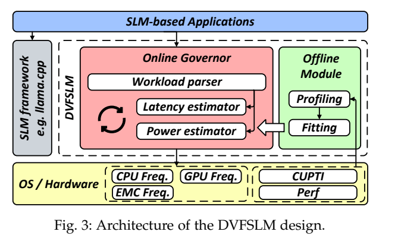
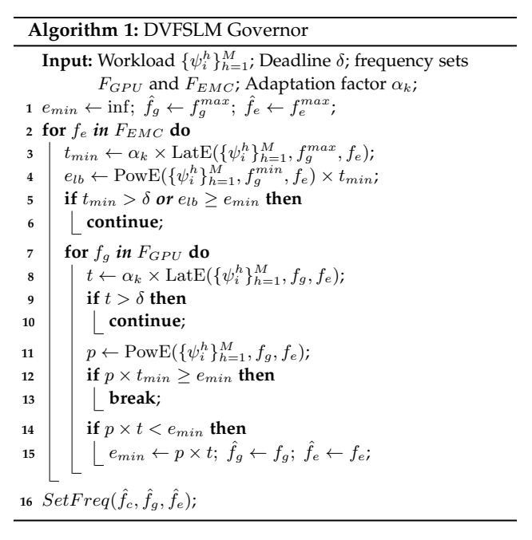
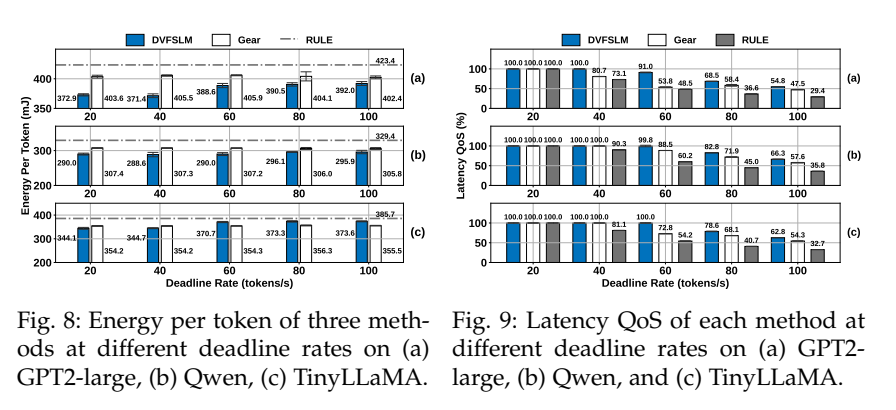
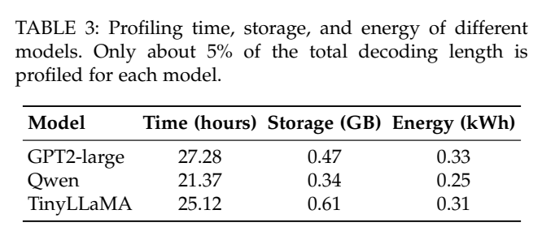

[返回五篇实验手册](guide.md) · [论文原文](https://arxiv.org/abs/2609.13153v1) · [所用版本PDF](https://arxiv.org/pdf/2609.13153v1)

**DVFS for Small Language Model Inference on Mobile Edge Devices**  
Jiesong Chen, Lixiang Han, Jiani Cao, Zhaoxi Yue, Zhenjiang Li。arXiv2609.13153v1，16页；首页版本标2026-07-08，与编号月份不同，按所用PDF记录，不自行改日期。

> 方法详解第二版。本篇重点是把“下一次计算需要多少资源”变成“带期限约束的频率选择”。以下逐层解释特征、训练标签、预测模型、搜索、反馈和实验。模型公式按所用PDF §3核对；手算表与验证代码是明确标注的教学实现。

## 1. 先沿一次决策看完整系统

语言模型即将继续生成token。策略此刻知道模型结构和当前上下文长度，却还不知道下一token真正花多少时间和能量。DVFSLM先从计算规模预测硬件行为，再估计各候选频率下的时间与功率，筛掉不能满足期限的候选，从剩余候选中选择能量最小者。运行一个窗口后，用实际延时修正下一次预测。



[放大原图表](images/dvfslm2026-fig3.png) · [原文 Fig3，PDF 第 4 页](https://arxiv.org/pdf/2609.13153v1#page=4)。图表来自该论文作者。

Fig.3左侧是在线governor，中间是工作量parser与功率/时延估计器，右侧是离线profiling与拟合，底部才是频率控制接口。沿箭头读时应区分两条路径：**离线真实运行产生训练数据，在线预测尚未执行的工作**。在线没有先把下一token在所有档位都运行一遍。

| 阶段 | 已知输入 | 产生输出 | 是否需要真实运行 |
| --- | --- | --- | --- |
| 描述未来工作 | 模型层结构、当前context长度 | 矩阵乘法形状列表 | 由模型和上下文推导 |
| parser离线训练 | 矩阵形状与运行后HPC标签 | XGBoost参数 | 是，需要剖析 |
| parser在线预测 | 下一步形状 | 预计HPC元数据 | 不读取未来真实HPC |
| P/T估计器拟合 | 元数据、频档、实测P/T | 回归系数 | 是，需要标定 |
| 在线选档 | 预测P/T、期限、上窗误差 | GPU/EMC频率组合 | 搜索模型，不试跑所有档 |
| 执行与反馈 | 选档、实际生成过程 | 实测时间和下一窗校正量 | 是，或使用明确的执行模型 |

## 2. “未来负载”为什么可以提前描述

自回归生成会使用当前上下文和KV cache。即使下一个token的值未知，主要矩阵维度仍可根据模型结构与上下文长度推导。论文把第 $i$ 个输出token的主要矩阵计算写成一系列

$$
A_{m_{i,j}\times k_{i,j}}B_{k_{i,j}\times n_{i,j}},\qquad
s_i=\{(m_{i,j},k_{i,j},n_{i,j})\}_{j=1}^{I}.
$$

$j$是一次矩阵乘法的编号，$I$为该步涉及的乘法数量；$m,n$是输出尺寸，$k$是内积长度。普通稠密矩阵乘法约需要 $2mkn$ 次浮点操作，但论文并非只用一个FLOPs数直接除以频率。相同算术量可能有不同访存、并行度和缓存行为，所以还要预测硬件元数据。

**教学解释。** 若某个注意力操作涉及长度L的KV cache，L从100变为200时，相应形状项增长；模型中另一些投影矩阵维度仍固定。策略能从这些变化推测工作量，而不需要知道即将生成的汉字或英文词。对于MoE路由、缓存状态等复杂性，仅有形状未必唯一决定行为，应通过留出数据检验预测误差，而不是认为形状是完美信息。

迁移到CPU块处理时，可把矩阵形状换成输入字节数、任务种类、上一块周期统计等决策前已知信息。不能把下一块已经运行后的真实周期作为下一块的输入，那会让测试变成提前知道答案。

## 3. parser：XGBoost学的到底是什么

HPC在这里指硬件性能计数器，不是高性能计算集群。它们记录指令、访存、cache miss等运行事件。原文为TinyLLaMA筛选10项元数据，包含指令、全局访存、张量运算和缓存相关量。论文使用相关性选择与功率/时延相关、彼此冗余较小的子集，再用XGBoost把规模描述映射到这些量。

$$
\widehat{\boldsymbol\psi}_i=g_\phi(s_i).
$$

$g_\phi$是训练好的parser，$\boldsymbol\psi$是元数据向量，帽号表示预测。**训练输入是形状，监督标签是运行后测得的HPC**；在线输入仍是形状，输出则是预测HPC。读原文“用metadata训练parser”时不要把metadata误放成唯一在线输入，否则未来工作尚未执行就无从获得输入。

一行训练记录至少包括设备/模型/后端版本、context位置、形状特征、剖析条件、HPC向量和采样边界。固定频率或不同频率下的计数器是否可混合，要按事件定义核验；事件总数、活动周期和百分比不能一概当作频率无关。原文完整特征展开方式、树深/树数等配置仍需源码确认。

**建议的数据划分。** 相邻token高度相似，随机打散相邻记录容易过分乐观。应留出完整prompt、context区间或运行批次，再拟合特征选择与parser，避免先用全数据挑特征。还可分别用真实HPC和预测HPC喂后面的估计器，以区分“parser误差”与“P/T模型误差”。这是复建实验建议，不冒充原文已经采用的全部划分细节。

## 4. P/T估计器：把物理形式变成可拟合的小模型

论文没有直接让一个很大的网络从所有输入回归能量，而是选择频率基函数。对处理器域 $r$，功率项采用 $f_r^3$，时间项采用 $1/f_r$，系数由元数据线性组合得到。

$$
\widehat p_{i,r}=\left(\lambda_{r,0}+\sum_h\lambda_{r,h}\widehat\psi_i^h\right)f_r^3,
\qquad
\widehat t_{i,r}=\frac{\gamma_{r,0}+\sum_h\gamma_{r,h}\widehat\psi_i^h}{f_r}.
$$

输出功率W、时间s/token。频率采用GHz、MHz或Hz都可以建模，但训练和推理必须一致，系数会随单位变化。元数据也需保持同一归一化。$f^3$来自电压随频率变化的简化功耗直觉，在本文是经验基函数，不是所有芯片、所有频点都必须服从的物理定律。

从回归角度看，这个模型很具体。每条数据把 $f^3$、$\psi^1f^3$、$\psi^2f^3$等拼成一行设计矩阵，实测功率作为标签，求系数；时间模型对应 $1/f$、$\psi^1/f$等列。训练完成后在线只需若干乘加，不必重新求解回归。

多域延时最终按论文的加性模型估计

$$
\widehat T_i=\sum_r\frac{\gamma_{r,0}+\sum_h\gamma_{r,h}\widehat\psi_i^h}{f_r}.
$$

这里的每一项表达总延时对该域频率的经验敏感度，**不表示CPU先跑完、GPU再跑完、内存最后跑完**。真实执行可重叠。原文比较含交互项的模型，精度略改善但推理更慢，因而选择较轻的形式。复现应同时报告误差和推理开销，不能只挑误差最低的模型。

## 5. 为什么先固定CPU，再搜索GPU和EMC

CPU负责向GPU派发任务。低CPU频率下，提高CPU频率既增加CPU自身功耗，又让GPU少等待、提高GPU活动程度，因此简单把各域独立相加容易出错。

作者用两步处理。第一步做控制变量标定：固定另外两个域，扫描一个域，拟合整机功率/延时对这个域的敏感度。这样识别参数比所有变量一起拟合更稳定，但不意味着物理上消除了CPU/GPU耦合。第二步寻找CPU临界频率，CPU再升档带来的每token延时下降小于1%时认为收益趋小。本文所测模型和两种Orin上得到0.6528GHz。

在线通常固定CPU在该阈值，搜索GPU与EMC。EMC是外部存储控制相关频率域，会影响供数速度。AGX Orin有44个候选组合，Orin NX有28个；EMC仅4档，作者还按EMC档配置不同的功率估计参数。实现复建时应保存模型系数对应的频率域和档位，不能仅凭一个总公式猜全部拟合细节。

固定CPU的意义是减少搜索维度并避开强耦合区，代价是“最优”只相对于这个CPU设定下的GPU–EMC候选集合。0.6528GHz是本平台观察，不是E902或其他GPU系统的通用最优值。

## 6. 在线选档：先判断能不能按时，再比较能量

设目标吞吐率为 $r_d$ token/s，则单token预算 $\delta=1/r_d$。20token/s对应50ms。对每个候选 $a=(f_G,f_M)$，根据预测工作量计算 $\widehat P_a,\widehat T_a$，再利用上一窗口校正因子 $\alpha$修正时间。

$$
T_a^{\mathrm{corr}}=\alpha\widehat T_a,\quad
\mathcal F=\{a:T_a^{\mathrm{corr}}\le\delta\},\quad
a^*=\arg\min_{a\in\mathcal F}\widehat P_aT_a^{\mathrm{corr}}.
$$

同一决策中 $\alpha$对所有档相同，所以在固定可行集合内乘它不会改变能量排序，但会改变哪些档有资格参选。它修正延时，并不直接修正功率误差。

**完整手算一次，以下为教学数据。** 当前期限50ms，三个候选的模型输出为

| 档位 | 预测时间ms | 预测功率W | 未校正能量mJ | $\alpha=1.2$后时间ms | 校正能量mJ |
| --- | ---: | ---: | ---: | ---: | ---: |
| A | 45 | 6 | 270 | 54 | 324 |
| B | 36 | 8 | 288 | 43.2 | 345.6 |
| C | 31 | 11 | 341 | 37.2 | 409.2 |

初始 $\alpha=1$ 时选A。上一窗口真实运行比预测慢20%，下一窗口取1.2，A超时被排除，在B/C中选B。如果期限改为30ms，三者都不可行，策略必须报告不可达。即使最高档尽力执行，也不能把deadline标为已满足。

这些数字说明智能算法的接口可以很朴素：预测器输出每档P/T，控制器输出档位ID、预测能量、预计延时和可行性。并不要求神经网络直接生成PLL分频寄存器；后端负责把合法档位映射成硬件请求。

## 7. Algorithm 1怎样剪枝：每一个跳过都有理由



[放大原图表](images/dvfslm2026-algorithm1.png) · [原文 Algorithm1，PDF 第 8 页](https://arxiv.org/pdf/2609.13153v1#page=8)。图表来自该论文作者。

先实现全部44或28个组合的完整枚举，再实现剪枝并逐条对照，是较稳妥的复建顺序。把固定EMC下全部GPU档称为一条扫描行。本文利用行内GPU频率升高时预测时间下降、功率上升的单调性。

1. **整行能否满足期限。** 用这一行最高GPU频率得到最短预测时间 $t_{\min}$。若仍超过期限，整行无解，跳过。
2. **整行有没有可能更省能。** 用最低GPU频率的功率 $p_{\min}$与最高频率的最短时间相乘，得到能量下界 $e_{lb}=p_{\min}t_{\min}$。这两个量未必来自同一个实际可选工作点，但只要单调性成立，其乘积不大于任何候选能量。若下界已不优于当前最好值，则整行可跳过。
3. **跳过低频不可行前缀。** 行内按GPU频率升序扫描，尚未满足期限的档跳过。
4. **提前结束剩余扫描。** 当前功率 $p$乘行内最短时间 $t_{\min}$若已经不优于最好值，后面功率更高的点也不可能改善下界，结束这一行。

```python
best = None
for emc in emc_levels:
    t_min = corrected_time(gpu_max, emc)
    e_lower = power(gpu_min, emc) * t_min
    if t_min > deadline or (best and e_lower >= best.energy):
        continue
    for gpu in gpu_levels_ascending:
        t = corrected_time(gpu, emc)
        if t > deadline:
            continue
        p = power(gpu, emc)
        if best and p * t_min >= best.energy:
            break
        if best is None or p * t < best.energy:
            best = candidate(gpu, emc, p*t, t)
return best if best else infeasible_best_effort()
```

如果回归输出有负功率、非单调波动或未验证的交互效应，上述剪枝可能丢掉更好的候选。先做正值与单调性检查，不满足时回退完整枚举，并记录回退比例。完整枚举与剪枝在同一模型上的结果一致，证明的是搜索实现正确，不证明这个模型预测准确。

原文平均决策时间从1.73ms降到0.81ms。这个开销是每次窗口决策，不是每个token都付出0.81ms。默认50token窗口，对20token/s约是2.5s的工作量，所以决策开销较小，但突变负载的适应也会延后。

## 8. 反馈、窗口与失败路径

运行完第 $k$ 窗后计算

$$
\alpha_{k+1}=\frac{\sum_{i\in W_k}T_i^{\mathrm{meas}}}
{\sum_{i\in W_k}\widehat T_i}.
$$

下标写成 $k+1$是为了突出本窗观测用于下一窗；论文Eq.(14)记为 $\alpha_k$并说明用于下一窗口。分母保存该窗当时的基础预测，避免把已经乘过 $\alpha$的值再作为基础预测而产生不受控的重复校正。初始化、分母过小、异常数据与平滑限幅属于实现需要明确的细节，当前材料未定位齐作者全部处理。

在窗口起点，用将要生成token的工作量做一次决策，然后保持这一窗频率，不应写成“每个token都重新测CUPTI和调频”。Prefill使用高GPU/EMC频率优先降低初始等待，CPU通常保持临界频率。

无可行解还存在文本/伪代码对齐问题：正文说提升所有处理器到最大频率，Algorithm 1初始化GPU/EMC为最高档，最后仍写固定CPU阈值的`SetFreq`。复现必须核对真实回退代码，分别记录“CPU固定”或“CPU也升最高”采用哪一种，不把两者混成同一配置。

## 9. 原实验结果应怎样判断

平台为Jetson AGX Orin与Orin NX，llama.cpp及Python绑定，q4_0量化；离线Perf/CUPTI采集元数据，C++governor经XGBoost C API与pybind11连接。主实验生成1024token，每配置5次、均值与t分布95%置信区间。整设备功率由INA3221以200Hz采样，推理总能量除以生成token数得到EPT。



[放大原图表](images/dvfslm2026-fig8.png) · [原文 Fig8，PDF 第 10 页](https://arxiv.org/pdf/2609.13153v1#page=10)。图表来自该论文作者。

这张裁图同时用于对照能量和服务质量。固定同一模型与目标速率，先看能量，再检查QoS；不能跨不同deadline拿最低柱相减。论文报告相对RULE最高降低12.4%、相对改造后的Gear最高降低8.4%，是特定模型与约束下的最高结果，不是所有设置的平均节能。

$$
QoS=\min(r_{\mathrm{actual}}/r_{\mathrm{target}},1).
$$

实际40、目标80token/s得到50%QoS，并不表示一半token按时完成；实际100、目标80被截成100%，也看不出是否过度提速浪费能量。你的实验应补每token时延分布、违约率和不可达目标单独分组，尤其不要把不可达目标下的低能耗策略误判为有效节能。

RULE采用GPU的nvhost_podgov、CPU的schedutil，EMC固定2.133GHz。Gear被加入期限相关奖励、在50ms目标训练后冻结，再测试不同目标。作者对齐硬件与工作负载等条件，但策略得到的特征与目标表达不同。比较能证明所列配置下的表现；不能将其扩大为所有强化学习方案都不适合DVFS。

## 10. 怎样把复现拆成可完成的实验

| 步骤 | 产物 | 检查重点 |
| --- | --- | --- |
| 1. 固定档标定 | 每个模型/context/频点的P、T与HPC数据 | 真实频率、温度、输出质量、计时同步 |
| 2. parser | 形状到HPC模型及留出误差 | 不泄漏未来，分区间测试 |
| 3. P/T估计器 | 系数、单位、预测误差分布 | 特别检查时间低估的尾部 |
| 4. 完整枚举策略 | 每次输入、所有候选及淘汰原因 | 先约束后目标，无解有标记 |
| 5. 剪枝版本 | 与完整枚举一致性记录 | 单调前提不成立时回退 |
| 6. 窗口反馈 | 预测与实测、alpha、动作时间序列 | 只用过去数据，干扰后恢复 |
| 7. 同条件对比 | EPT、QoS、尾延时、违约率、开销 | 同输出、同动作集、同测量边界 |

消融至少分开五件事：真实HPC与预测HPC、简单回归与本文基函数、无反馈与有反馈、全枚举与剪枝、不同窗口长度。前两项查预测来源，第三项查适应，第四项查计算成本，第五项查响应速度。若所有组件一起换，只看一条能量曲线，就无法知道收益来自哪里。



[放大原图表](images/dvfslm2026-table3.png) · [原文 Table3，PDF 第 13 页](https://arxiv.org/pdf/2609.13153v1#page=13)。图表来自该论文作者。

Table 3给出一次标定成本，GPT2-large约27.28小时、0.33kWh。换算为 $0.33\times3.6\times10^6=1{,}188{,}000$J。若每token**净省**0.05J，则约需2376万token摊平标定电能；0.05J为教学假设。迁移或重训练的次数会进一步影响收益，不能把离线剖析说成免费。

## 11. 最适合你先做的CPU版本

可以保持本文控制结构，把SLM换为CPU分块压缩、校验或图像处理等候选负载。输入设为任务类型、块长、前一块周期和剩余预算；小回归预测每档时间与能量；枚举三到五个合法档，选择满足预算的最低预测能量档；块完成后更新误差。这个方法级原型无需先连接PLL/PMIC。

没有目标板时，使用标定表或离散事件模型推进工作量，报告模型时间/模型能量。若用本机Linux CPU实际调频，就记录真实CPU频率与运行时间，不能把这些称作E902结果。上E902后重新测量各档，保留输入、策略、执行器接口，替换硬件后端。

P0先确认完整枚举和反馈失败路径；P1测试输入大小与数据内容变化的泛化；P1比较不同控制周期及切换延迟。成功标准是同一期限下净能量下降，低估导致的违约不超过预先声明的容忍度。平均预测误差低并不足以证明控制安全，最危险的是临界可行档的时间低估。


## 双语摘要改写与原文入口

**中文改写**　本文研究边缘GPU本地小语言模型自回归decode（含dense/MoE）的运行时能效。具体程序包括llama.cpp/llama-cpp-python q4_0；GPT2-small/medium/large/xl、Qwen2.5-0.5B、TinyLLaMA1.1B、OLMoE-1B-7B；主实验生成1024tokens。作者在Jetson AGX Orin与Orin NX；CPU阈值0.6528GHz固定；44/28组GPU–EMC候选；INA3221 200Hz整设备功耗；C++/XGBoost CAPI/pybind11上采用XGBoost矩阵规模→未来HPC元数据parser；线性/频率基函数E/T估计；枚举GPU–EMC候选＋单调剪枝；50token窗口偏差反馈α修正。输入为模型层结构、当前context长度与矩阵维度scale、离线预测HPC、deadline δ=1/目标tokens/s、上窗口测量/估计时延比α，输出为每窗口GPU/EMC频率pair；prefill用高GPU/EMC；CPU保持阈值；无可行解则最高频best-effort。主要结果应与下方基线、性能约束和测量范围一起阅读，不能只摘最高百分比。把应用可知的未来矩阵工作量接到硬件元数据，再用轻量可解释估计和小空间约束搜索；智能学习在估计器，不在强化学习选频。

**English paraphrase**　DVFSLM models upcoming SLM token workloads through matrix-operation structure and an offline learned metadata parser. Lightweight latency and power estimators drive a pruned GPU–EMC frequency search, with the CPU fixed at an empirically selected threshold. Window-level feedback corrects latency bias, and energy-per-token results are assessed together with a capped rate-based QoS metric. This is a reader-written paraphrase, not the original abstract.

**代码与复现边界**　当前材料中尚未定位齐完整控制器源码、实验脚本和原始重复数据；这不表示这些材料不存在。

[完整编号图表索引](../dvfslm2026/figs_notes.md) · [原四报告中的技术笔记](../dvfslm2026/paper_notes.md) · [原表核算脚本](https://github.com/zzxwhu/dvfs-paper-read/blob/main/examples/focus-five/check_examples.py) · [方法逐步演示脚本](https://github.com/zzxwhu/dvfs-paper-read/blob/main/examples/focus-five/method_walkthrough.py)
