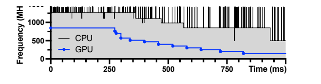
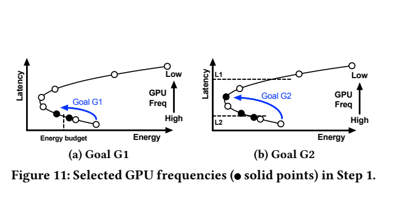
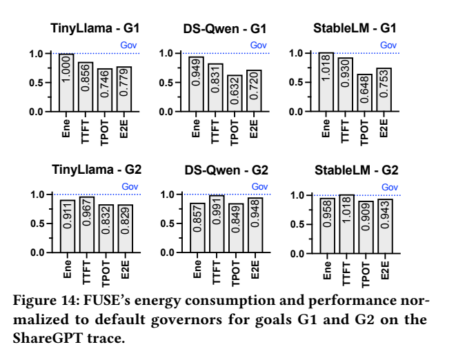

[返回五篇实验手册](guide.md) · [论文原文](https://arxiv.org/abs/2507.02135v1) · [所用版本PDF](https://arxiv.org/pdf/2507.02135v1)

**Dissecting the Impact of Mobile DVFS Governors on LLM Inference Performance and Energy Efficiency**  
Zongpu Zhang, Pranab Dash, Y. Charlie Hu, Qiang Xu, Jian Li, Haibing Guan。arXiv2507.02135v1，2025-07-02，16页；与SparseDVFS同名缩写的FUSE不是同一系统。

> 方法详解第二版。本篇最值得学习的是“先用控制实验找出瓶颈，再把发现变成低成本策略”。FUSE是离线测量搜索、在线阶段查表的方法，不是强化学习控制器。所用PDF为2025年预印本v1。

## 1. 为什么LLM主要在GPU上跑，还要调CPU

手机上的一次语言模型推理大致经历：CPU准备输入并提交GPU计算→GPU执行算子→CPU驱动或框架推进下一步→继续提交。即使大部分矩阵运算在GPU，CPU上的OpenCL运行时仍在关键路径。CPU过慢会让GPU等新任务，GPU过慢会让CPU等计算完成。等待不等于工作已经完成。

先认识两个阶段。**Prefill**一次处理输入提示词，可以批量做较大的矩阵计算；**decode**逐个生成输出token，前一个输出影响下一个输入，提交与等待更频繁。两阶段对CPU/GPU频率的敏感程度不同，因此不能只给整个程序配一个利用率阈值。

FUSE的被控程序是llama.cpp的移动GPU推理，策略输出CPU/GPU频率组合，模型权重与量化格式在对照中保持一致。使用LLM作为负载，并不要求你用LLM来生成调频命令。

## 2. 先拆实验设计：怎样证明问题来自控制器互相影响

作者首先枚举CPU、GPU、内存组合，18×12×13=2808种，比较默认governor是否处在能量—延时的好位置。这一步是“机会分析”：证明存在更好的工作点，并不等于已经设计出一个低开销在线算法。随后用固定其他频率、只改变一个控制器的实验找原因。

| 控制实验 | 固定什么 | 改变/观察什么 | 能排除的混淆 |
| --- | --- | --- | --- |
| GPU控制器 | CPU和内存频率 | GPU默认调节与逐档固定 | CPU/内存同时变频造成的影响 |
| CPU控制器 | GPU和内存频率 | CPU默认调节与逐档固定 | GPU自身变频导致的延时变化 |
| 内存控制器 | CPU与GPU频率 | 内存默认与固定档 | CPU/GPU的联动 |
| 双向耦合 | 固定一方为不同值 | 另一方频率分布与利用率 | 只有相关、无法区分方向的问题 |

这里“固定”指将governor允许的最小值和最大值设为同一个合法频点，并核对实际频率。系统热限频等机制仍可能影响执行，不能仅凭写入成功就认为频率真的锁定。论文使用有权限的实验手机，不意味着任意未root手机都能运行其控制脚本。



[放大原图表](images/fuse2025-fig10.png) · [原文 Fig10，PDF 第 9 页](https://arxiv.org/pdf/2507.02135v1#page=9)。图表来自该论文作者。

Fig.10横轴是时间ms，纵轴是CPU/GPU频率MHz。GPU最初固定高档，在250ms解除固定后交回默认governor。接下来GPU频率先降，CPU随后降，两者继续互相影响，直到更低工作点。应从250ms这个干预点向右读，而不是只比较曲线高低。原文在§5.4、PDF第9–10页还用不同固定档的分布实验支持这条解释。

机制可拆成六步：CPU利用率低→CPU控制器降频→GPU任务提交变慢→GPU利用率降低→GPU控制器降频→CPU等待GPU更久、CPU利用率进一步降低。两个控制器各自追求局部利用率目标，可能使整机完成一个token更慢、能量更大。这是本文提出联合选档的依据。

这个结论有边界：它是在指定手机、框架、模型和governor下观察到的。换成不同提交机制、算子融合或NPU后，耦合强度可能变化，不能把“默认governor一定很差”作为无需实验的前提。

## 3. 明确目标：同能量提速和同时延省能是两种实验

对某个模型、阶段和输入长度，记一个候选组合 $a=(f_C,f_G)$ 的测量延时为 $L(a)$，单位token能量为 $E(a)$。内存保留默认控制器。两种目标写为

$$
\mathrm{G1}:\ \min_a L(a)\quad\mathrm{s.t.}\ E(a)\le B_E,
\qquad
\mathrm{G2}:\ \min_a E(a)\quad\mathrm{s.t.}\ L(a)\le D.
$$

$B_E$是每token能量预算，$D$为TTFT或TPOT限制。实验中常用默认governor的能量作为G1预算、默认governor的延时作为G2限制。预算必须对应同一阶段和计量口径，不能用“整个请求可耗1J”直接约束“每token能耗1J”。

| 名称 | 定义 | 容易误解之处 |
| --- | --- | --- |
| TTFT | 请求开始至首token时间 | 本文场景不计请求排队；需对齐模型装载边界 |
| TPOT | decode阶段平均每输出token时间 | 首token边界与分母需按框架时间戳固定 |
| Prefill EPT | $\bar P\,TTFT/N_p$ | 分母为输入token数，不是输出token数 |
| Decode EPT | $\bar P\,TPOT$ | 应与decode采样窗严格对应 |
| 整次请求能量 | 对整个定义好的请求窗口积分 | 不能用不加权的两阶段EPT直接相加 |

例如首token到最后token之间共有 $N_o-1$ 个间隔，按这组时间戳定义TPOT时分母应为 $N_o-1$；若框架包含首个decode步，则必须相应调整窗口与分母。复现重点是时间边界和分母一致，不是任选一个看起来接近的指标名字。

## 4. FUSE的离线—在线分工

作者利用同一个模型会在手机上反复使用的特点，在部署/安装阶段做频率搜索。搜索按prefill长度分组，为5个代表长度32、64、128、256、512以及decode长度32建立配置。在线根据推理框架的阶段通知应用配置。

```text
离线输入：设备、模型、量化、推理后端、目标G1/G2、预算、代表长度
    → 运行少量固定频率实验
    → 保存每阶段/长度组的CPU与GPU频率

在线输入：当前模型、prefill/decode事件、长度所属组、目标配置
    → 查已标定的频率组合
    → 请求CPU/GPU频率
    → 运行推理并记录实际频率、延时和能量
```

在线不需要每token重新训练，也不在每个请求上遍历2808组合。其输入不主要是即时利用率，而是**模型身份、阶段和长度类别**。代价转移到了离线标定。新设备、不同量化或推理框架版本可能改变曲线，表需要重新验证。

原文认为最优配置主要受prefill长度影响、对输入具体内容不敏感，这是实验观察。五个分组的全部边界及越界长度回退规则在当前材料中未定位齐。你复建时需要把边界写进配置文件，不能让“最近长度”与“向上取档”在不同脚本里隐式混用。

## 5. 两步搜索第一步：为什么只保留一到两个GPU档



[放大原图表](images/fuse2025-fig11.png) · [原文 Fig11，PDF 第 10 页](https://arxiv.org/pdf/2507.02135v1#page=10)。图表来自该论文作者。

Fig.11是搜索示意图。纵轴延时、横轴能量，实心点表示保留候选，箭头表示GPU频率变化。它表达搜索逻辑，不提供可直接抄写的测量坐标。原文依赖的经验规律是：延时通常随频率提高而下降，能量随频率可能呈U形，因此只找预算或期限附近的边界点，再微调CPU。

**G1逐步读。** 从最高GPU频率开始逐档下降，找到第一个满足能量预算的GPU档 $F$。保留它，也保留刚刚因能量超预算被跳过的较高档 $F'$。为什么保留一个当前不合格的档？因为第二步调整CPU后，它的总能量可能降到预算以内，同时保留更短GPU计算时间。

**教学数据，不是论文测量。** 能量预算为300mJ/token，扫描得到如下结果。

| GPU档 | 当前测得TPOT ms | 当前测得EPT mJ | 第一步处理 |
| --- | ---: | ---: | --- |
| H | 30 | 330 | 暂超预算，保留为上邻候选 |
| M | 40 | 280 | 首个可行，停止扫描 |
| L | 60 | 310 | 已不必在这条启发式路径继续探索 |

保留H和M进入CPU搜索。若直接丢掉H，可能错失后面CPU调整带来的收益。

**G2逐步读。** 先从高GPU频率向下扫描能量，发现能量开始回升时，前一个档为搜索到的最低能量点。如果该点已满足延时限制，就把它交给第二步；若不满足，则在更高性能区域找到延时限制两侧相邻GPU档并保留。截止线较宽时选能量谷底，较紧时选性能边界附近，这是Fig.11中L1/L2的含义。

这不是任意曲线上的全局最优证明。热节流、工作相变或频点噪声可能破坏单调/U形假设。复现时应先画测量曲线，若假设不成立，就需要完整枚举或回退搜索，并单独报告与原启发式不同的处理。

## 6. 第二步：CPU搜索与最终组合如何产生

对第一步保留的每个GPU档，固定GPU、遍历CPU档。G1从高CPU频率往下降，找到进入能量预算的边界，最终在合法候选里选延时最小组合。G2从高CPU频率往下降，遇到超出延时限制后停止，在满足限制的候选里选能量最低组合。内存控制仍使用默认governor，因为§5.2实验认为其表现接近较好工作点。

沿用刚才的G1教学例子，第二步得到

| GPU/CPU组合 | TPOT ms | EPT mJ | 是否满足300mJ预算 |
| --- | ---: | ---: | --- |
| H/高 | 30 | 330 | 否 |
| H/中 | 32 | 295 | 是 |
| M/高 | 40 | 280 | 是 |
| M/中 | 44 | 260 | 是 |

最终选H/中，32ms；如果第一步只留下M，则只能得到40ms或更慢。这说明保留边界外邻点的实际作用。注意这个例子是在简化表上演示逻辑，没有证明论文所有设备都满足相同关系。

```python
# G1的教学重建；扫描顺序和测量边界必须写入配置
gpu_candidates = find_first_energy_feasible_gpu_and_previous()
feasible = []
for gpu in gpu_candidates:
    for cpu in cpu_frequencies_descending:
        latency, energy = profile_one_setting(cpu, gpu)
        if energy <= budget:
            feasible.append((latency, energy, cpu, gpu))
            break  # 依赖论文讨论的边界搜索假设
if feasible:
    save_configuration(min(feasible, key=lambda x: x[0]))
else:
    record_budget_unreachable()  # 复建时必须显式补齐的失败路径
```

CPU和GPU频率不是两个可以各自独立最优化的量。每次测量都必须运行同一端到端负载；不能把CPU单独压测的最优点与GPU单独压测最优点机械拼在一起。阶段切换也应记录命令发出和实际生效，评估短阶段中转换开销占比。

## 7. 原实验平台与结果逐项读

平台为Pixel 7/7 Pro、Android 13；GPU后端为OpenCL/CLBlast，llama.cpp b2202，4bit量化。手机电池被旁路，由Monsoon供电并每0.2ms报告功耗；屏幕关闭，手机本地守护程序执行实验。主工作线程与测量线程的核绑定也被控制。这些设置使测量边界明确，但与日常亮屏、电池供电、后台应用运行的条件不同。

测试包含两层：六种模型的固定长度设置验证搜索效果；从ShareGPT抽取的200个请求验证查表策略在长度变化下的端到端表现，输入≤512、输出≤256，平均输入232.4、输出70.0token。不要将这200个请求等同于200次对同一个输入的独立重复，也不要把初始机会分析的最优固定点收益直接写成FUSE在线收益。



[放大原图表](images/fuse2025-fig14.png) · [原文 Fig14，PDF 第 12 页](https://arxiv.org/pdf/2507.02135v1#page=12)。图表来自该论文作者。

Fig.14以默认governor归一化，横向各栏分别是能量、TTFT、TPOT和E2E，1是基线。先读同一模型同一目标的一行，再对比不同指标；G1和G2不能混成一句“既保证同能量又保证同时延”。

TinyLlama的G1中，TPOT从210.7ms到157.2ms，减少 $(210.7-157.2)/210.7=25.39\%$；总电荷量738.1到737.8mAh接近相同。G2中电荷量738.1到672.3mAh，减少8.91%。原文使用mAh并称energy，严格说mAh是电荷，只有供电电压和积分边界相同才可相应比较能量；换算焦耳需要 $E=V\times Q_{\mathrm{Ah}}\times3600$ 或电压随时间的积分。

原文对“相同预算”有近似表述，例如Fig.14的StableLM G1归一化能量略高于1。应把实际数值及预算容差一起报告，不能写成数学上逐次严格不超预算的保证。该图也不能独立给出请求尾部延时或统计显著性，重复运行与原始分布仍需补齐。

## 8. 搜索成本与复现路线

G1平均每种设置第一步约2.4次、第二步约5.1次推理，六种设置的总时间随模型而变。作者报告TinyLlama约17.7分钟、StableLM约43.1分钟、Llama-2约78.5分钟；G2对应搜索更长。频率试验次数少不等于零成本，模型升级或运行后端变化都可能触发重新标定。

没有手机时，先准备一张完整的教学或实测CPU×GPU二维表，分别实现完整枚举与FUSE边界搜索。记录两者最终目标差、约束违例及测量次数；加入非U形和噪声表，观察启发式失效。只凭离线表可以验证搜索逻辑，不能证明手机电池续航提高。

原平台复现建议按以下顺序执行，每一步保留可检查产物。

1. 固定模型、量化、prompt清单、后端版本和token计时边界。先在默认governor下重复运行，确认输出正确及热状态可比。
2. 验证CPU/GPU锁档：保存请求频率与实际频率时间线。做小规模网格，确认频率变化确实改变端到端结果。
3. 重做单组件干预实验，检查CPU/GPU互相等待是否仍存在。若现象消失，先解释平台差异再套FUSE。
4. 实现两步搜索，保存每次试验及停止原因。对一个可承受的小网格做穷举对照，量化搜索次优性。
5. 冻结表后测未参与标定的请求。按请求配对比较、随机化策略运行顺序，报告均值、分位数、约束违例率、净能量及离线标定成本。

## 9. 怎样迁移到你的CPU/E902项目

最可迁移的不是某个手机频率，而是“识别应用阶段→离线少量标定→在线简单执行”。例如一个CPU块处理程序可以区分读入、计算、写出，先验证阶段标记是否比单一利用率更有用。E902若只有一个可控时钟域，就先做单域版本；不能为了照搬FUSE而虚构第二个GPU域。

若课题要求智能算法，可把阶段/输入长度映射到候选档的小树或回归模型作为扩展，并与原始查表比较。需要明确：这是你的扩展，不是FUSE已有神经网络。P0比较按阶段查表与全程固定档，P1比较二维联合选择与各域独立阈值，P1在后台干扰和温度变化下测试旧表失效。成功标准是在同一服务目标下获得可重复的净收益，同时报告不满足预算的请求。

## 10. 精确复现仍需核对什么

需补齐五个长度区间边界、各步搜索时非扫描域的初始设置、预算容差、重复次数和原始记录、阶段通知接口，以及与论文一致的源码版本。软件更新会改变频率接口与推理实现，因此复现时记录commit比只写“用llama.cpp”更重要。本文笔记不把这两步搜索称作已训练模型，也不把已知输入长度说成对未知生成长度的准确预测。


## 双语摘要改写与原文入口

**中文改写**　本文研究手机本地GPU卸载的LLM自回归推理，单请求顺序执行的运行时能效。具体程序包括llama.cpp b2202/OpenCL＋CLBlast；TinyLlama1.1B、DS-R1-Distill-Qwen1.5B、Refact1.6B、StableLM2.7B、Phi2 2.7B、Llama2 6.7B，4bit；ShareGPT抽200请求。作者在root/opened Pixel7与7Pro，TensorG2/MaliG710、Android13；Monsoon旁路电池、0.2ms采样，屏幕关闭；测设备功耗上采用基于U形能量曲线的两步离线搜索：先GPU至能量/时延边界，再CPU细调；5种prompt桶＋1种decode配置；相位切换查表，无RL。输入为模型、prompt长度桶、当前prefill/decode通知、离线E/T曲线、用户每token能量预算G1或时延目标G2，输出为CPU/GPU锁定频率pair；memory governor默认；G1最小时延/G2最小能量。主要结果应与下方基线、性能约束和测量范围一起阅读，不能只摘最高百分比。以受控实验揭示多governor相互作用，提出简单可部署的阶段感知协同控制；复杂神经控制器不是必要条件。

**English paraphrase**　FUSE studies mobile LLM inference under independent CPU, GPU and memory governors. It finds that CPU kernel-submission delays can cause a mutually reinforcing CPU/GPU downclocking cycle. A model-specific offline search chooses CPU/GPU settings for latency or energy objectives and applies them at phase boundaries, while leaving the memory governor at its default setting. This is a reader-written paraphrase, not the original abstract.

**代码与复现边界**　当前材料中尚未定位齐完整控制器源码、实验脚本和原始重复数据；这不表示这些材料不存在。

[完整编号图表索引](../fuse2025/figs_notes.md) · [原四报告中的技术笔记](../fuse2025/paper_notes.md) · [原表核算脚本](https://github.com/zzxwhu/dvfs-paper-read/blob/main/examples/focus-five/check_examples.py) · [方法逐步演示脚本](https://github.com/zzxwhu/dvfs-paper-read/blob/main/examples/focus-five/method_walkthrough.py)
