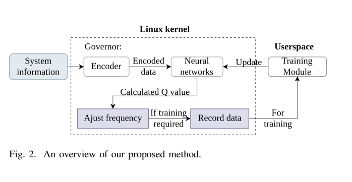
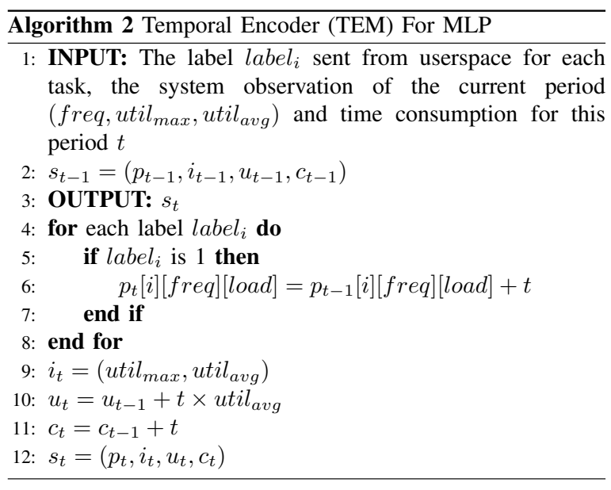
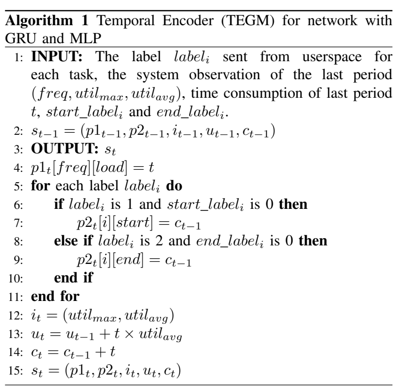
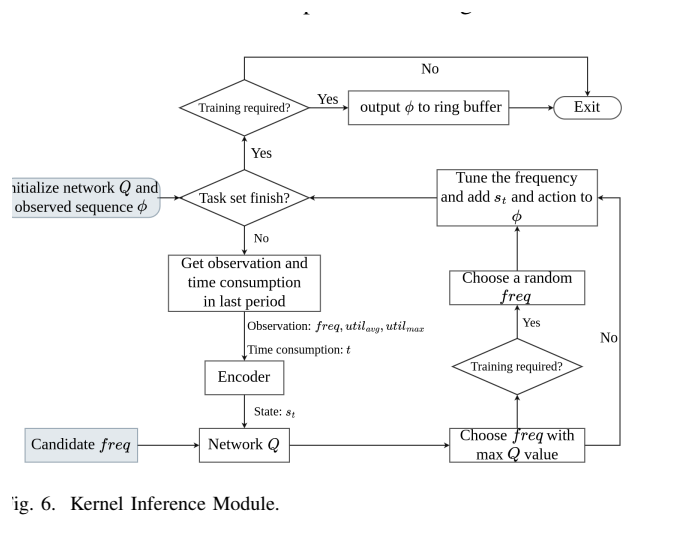
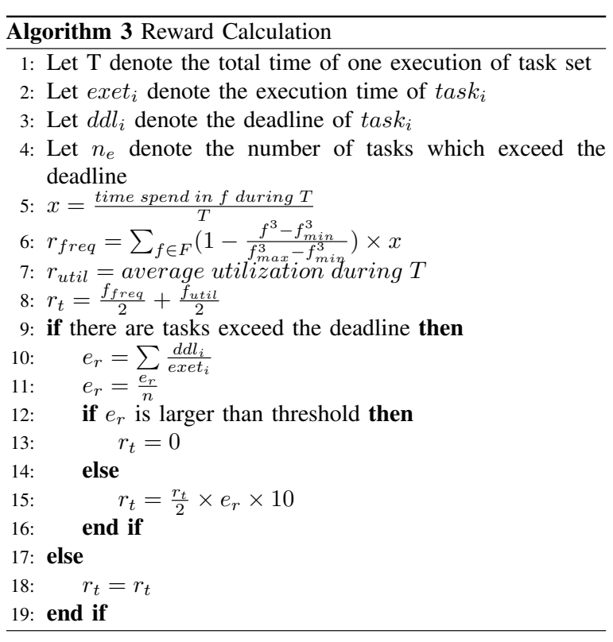
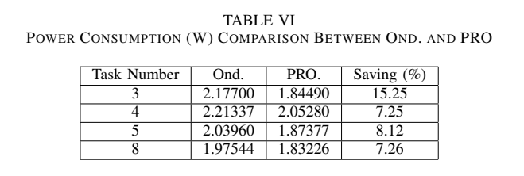
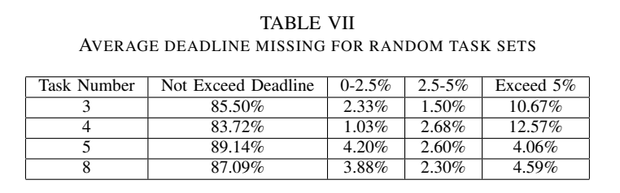

[返回五篇实验手册](guide.md) · [论文原文](https://doi.org/10.48550/arXiv.2409.19434) · [所用版本PDF](https://arxiv.org/pdf/2409.19434v3)

**Energy-Efficient Computation with DVFS using Deep Reinforcement Learning for Multi-Task Systems in Edge Computing**  
Xinyi Li, Ti Zhou, Haoyu Wang, Man Lin。arXiv2409.19434v3，2025-05-21，13页；不混用初版摘要。

> 方法详解第二版。本章按“系统状态如何产生→网络如何选档→怎样训练→如何验证”展开。分析版本是2025年5月修订的v3。标准DDQN公式与手算数据用于教学，未定位的作者超参数不以示例代替。

## 1. 研究问题：100%利用率为什么不足以选频

CPU同时承担多个周期任务，每个任务有自己的期限。两个时刻都测得100%利用率，含义可能截然不同：一次是刚开始执行且预算充足，另一次是还有很多工作没做却快到期。只看当前利用率，很难区分这两种情况。

论文让一个小型神经网络结合**频率与利用率历史、任务开始结束信息、已经花掉的时间**，选择下一控制区间的CPU频率。被控程序是乘法循环或MiBench中的JPEG、qsort、FFT、typeset，神经网络只负责选择频率。动作是一个共享CPU性能域的档位，不是给每个任务分配一个独立时钟，也不是修改任务调度优先级。

这是软实时系统研究。原表确实存在超时，不能将方法概括为“保证所有期限”。更关键的是，**用户态知道期限并据此算训练奖励，期限本身并未直接交给内核策略作为显式状态输入**。策略通过反复训练学习任务模式。这影响它对新期限和新到达模式的泛化能力。证据见§II-A、II-C，PDF第3–6页。



[放大原图表](images/multitask-drl2024-fig2.png) · [原文 Fig2，PDF 第 2 页](https://arxiv.org/pdf/2409.19434v3#page=2)。图表来自该论文作者。

读Fig.2时把系统分成三段：应用提供任务状态，内核读取运行状态并执行推理，用户态根据运行序列更新网络。不要把“用户态训练”理解为每次调频都要训练一遍。在线路径必须足够短，反向传播和经验回放留在训练路径。

## 2. 先把六种时间分清楚

| 记号 | 含义 | 单位与来源 |
| --- | --- | --- |
| $r_j$ | 第j个任务本次释放时刻 | s，由任务生成器定义 |
| $b_j$ | 实际开始执行时刻 | s，由应用事件观察 |
| $d_j$ | 相对期限 | s，由实验任务规格给定 |
| $r_j+d_j$ | 绝对截止时刻 | s，由前两项计算 |
| $F_j$ | 实际完成时刻 | s，由完成事件记录 |
| $\Delta t_k$ | 两次控制决策间隔 | s，由计时器测量 |

响应时间为 $F_j-r_j$，不只包含CPU真正执行的时间，还可能包括等待。若任务在0.7s释放，相对期限0.5s，则绝对截止时刻为1.2s；在1.21s完成意味着迟10ms。不能把1.21s直接与0.5s比较。原文用于奖励的“execution time”在具体复建中还需对齐计时起止定义。

原文标签 `0/1/2` 分别表示未开始、运行中、已完成。它们是运行时发出的事件，不是提前知道完成时间。未完成任务的结束时间必须保持“未观察”语义；训练数据处理中把真实最终结束时间填回早期状态，会泄漏未来。

## 3. TEM：先理解能手算的编码



[放大原图表](images/multitask-drl2024-algorithm2.png) · [原文 Algorithm2，PDF 第 5 页](https://arxiv.org/pdf/2409.19434v3#page=5)。图表来自该论文作者。

原文Algorithm 2为每个任务维护“频率档×利用率区间”的驻留时间表。设有 $N$ 个任务、$F$ 个频档和 $B$ 个负载区间，则这一部分有 $NFB$ 个元素。

$$
p_k[j,a,b]=p_{k-1}[j,a,b]+\Delta t_k
\quad\text{当任务j运行中且本区间处于档a、负载区间b。}
$$

其余格子保持原值。它不是在数该任务精确退休了多少条指令，而是记录该任务处于运行状态时，系统经历了什么频率和利用率环境。因此多个任务同时运行时可以同时累加，不能把各任务驻留表求和后当作系统实际墙钟时间。

**教学算例。** 两档L/H、两个负载区间[0,60%)与[60%,100%]，格子顺序为L低载、L高载、H低载、H高载。上一窗口10ms，低档，最大利用率80%，平均利用率50%，任务1已完成、任务2运行中、任务3未开始。则只有任务2的L高载格增加10ms。

同时维护

$$
i_k=(u_{\max,k},u_{\mathrm{avg},k}),\qquad
U_k=U_{k-1}+\Delta t_k u_{\mathrm{avg},k},\qquad
C_k=C_{k-1}+\Delta t_k.
$$

这里 $u$ 输入0到1的比例，$U$是累计平均忙碌时间，$C$是累计墙钟时间。例子中 $U$加5ms、$C$加10ms。若把50当作50%直接乘，会扩大100倍。多核平均利用率也不等于一个任务的执行进度，更不是多核总busy时间之和。

TEM把这些信息展平后交给MLP。优点是透明、容易验证；缺点是任务数量增加时输入增长，驻留累计还会丢失顺序。例如“先低后高”和“先高后低”可能给出相同驻留总量，却处在不同任务阶段。

## 4. TEGM：GRU究竟替代了哪部分



[放大原图表](images/multitask-drl2024-algorithm1.png) · [原文 Algorithm1，PDF 第 4 页](https://arxiv.org/pdf/2409.19434v3#page=4)。图表来自该论文作者。

原文Algorithm 1把状态写成 $s_k=(p_k^1,p_k^2,i_k,U_k,C_k)$。

| 状态部分 | 存什么 | 解决什么问题 |
| --- | --- | --- |
| $p_k^1$ | 当前窗口的系统频率—负载驻留，未选中的格为0 | 描述刚过去的系统行为 |
| $p_k^2$ | 每个任务第一次观察到开始和结束的时间 | 区分任务执行阶段 |
| $i_k$ | 当前最大/平均利用率 | 保留即时负载 |
| $U_k$ | 累计平均忙碌时间 | 区分有效忙碌与等待 |
| $C_k$ | 从任务组开始累计的时间 | 保留回合进度 |

注意 $p^1$是本窗口观察，TEM的 $p$则是每任务累计；两者不应使用同一更新函数。GRU按顺序读 $p^1$，用隐藏状态 $h_k$保存历史摘要。

$$
h_k=\operatorname{GRU}(p_k^1,h_{k-1}),\qquad
Q_\theta(s_k,a)=\operatorname{MLP}_\theta(h_k,p_k^2,i_k,U_k,C_k,a).
$$

这是一张解释计算路径的概念式，具体展平和连接方式需按实现核对。GRU的作用是压缩先后顺序，不是在模型里模拟CPU。回合开始需要清空驻留、任务标记和GRU隐藏态；否则上一组任务的信息可能污染下一组。

原文报告GRU输入2、隐藏状态6，MLP两个隐藏层各30节点，输出1；较大任务组又测试隐藏层60节点的PROL。但§II-A用“两频档×两负载区间”举例时会产生4个格，§III-A又给出GRU输入2和MLP维度公式。**示意例子与实验张量配置不能不加核对地拼起来。** 复建前应写出每个张量的shape，并核查实际使用的负载分箱、特征连接、动作编码。当前材料未定位齐这个配置，不能声称15维等数字已足够唯一重建网络。

任务开始/结束时间在Algorithm 1中用上一决策点的累计时间记录，因此还应考虑采样量化误差。若控制间隔10ms，事件发生在窗口内，只有标签变化而没有精确事件时间时，观测时间可能偏差一个窗口。这是控制周期影响状态质量的原因之一。

## 5. 网络怎样把状态变成频率



[放大原图表](images/multitask-drl2024-fig6.png) · [原文 Fig6，PDF 第 5 页](https://arxiv.org/pdf/2409.19434v3#page=5)。图表来自该论文作者。

沿Fig.6顺序读：获取状态→给每个候选动作打分→选最大Q值→下发频率→保存状态动作序列。候选频率是网络的一个输入，输出是一个Q值；不是把连续实数直接当MHz，更不是把Q值当预测功耗。

$$
a_k=\arg\max_{a\in\{L,H\}}Q_\theta(s_k,a).
$$

**教学算例。** 某状态网络对低档打0.62，对高档打0.58，部署时选低档。到下一时刻任务进度不同，分数变为0.41和0.73，就选高档。0.62没有瓦或焦耳单位，表示按训练奖励尺度估计的未来回报。不能说“低档功耗0.62W”。

训练采集阶段还包含随机探索。以一定概率随机选档，可以发现当前策略未尝试的轨迹；冻结部署时通常关闭探索。原文具体探索率、变化日程、折扣因子与优化器设置在当前核验材料中未定位齐，不能把常用值0.1、0.99等写成论文设置。

还有一个实现细节：同一状态下比较多个动作时，要共享同一次历史更新后的 $h_k$。如果计算低档Q时更新一次GRU，计算高档Q时又更新一次，会使两个动作看到不同历史，这是错误实现。

## 6. 奖励怎么算，为什么它不等于节能率



[放大原图表](images/multitask-drl2024-algorithm3.png) · [原文 Algorithm3，PDF 第 6 页](https://arxiv.org/pdf/2409.19434v3#page=6)。图表来自该论文作者。

原文Algorithm 3先计算低频偏好和平均利用率。

$$
x_f=\frac{\text{回合中频率f的驻留时间}}{T},\qquad
R_f=\sum_{f\in F}\left(1-\frac{f^3-f_{\min}^3}{f_{\max}^3-f_{\min}^3}\right)x_f,
\qquad R_0=\frac{R_f+\bar u}{2}.
$$

所有频率必须用同一单位。归一化后的最低档系数为1、最高档为0。在只用两档时，$R_f$恰好等于低档驻留比例。若低档占60%、平均利用率80%，$R_0=(0.6+0.8)/2=0.7$。这是低频和高利用率的代理目标，未直接积分电压、电流。

论文还根据超时程度处罚，超过阈值后奖励置零，且只有回合最后一次转移有非零奖励。**这里存在必须保留的复现疑点。** PDF第6页Algorithm 3第10行排版为 $\sum ddl_i/exet_i$，正文却说按执行时间相对期限计算；第15行写成 $R\leftarrow R/2\times e_r\times10$，正文又描述为降低奖励。在常见的“运行1.02倍期限”例子中，按字面 $e_r\approx0.98$，乘数约4.90，反而可能提高奖励。这里不能悄悄改成看起来合理的惩罚，再称为原算法。

复现应将这列为阻塞精确复现的参数问题，核对作者代码/版本或联系作者；若暂时做方法级实验，可以明确命名为“本地重构奖励”，保存采用的超时定义、阈值与惩罚公式，并做敏感性实验。原文奖励范围、回放分桶及训练收敛都依赖此定义。

## 7. DDQN到底学什么：一条训练样本走到底

一次任务组运行形成一条轨迹 $(s_0,a_0,r_0,s_1,\ldots)$。中间奖励为0，末尾得到回合奖励。DDQN利用后续状态价值把末尾反馈逐渐传播回早先的选档动作。

下面是**标准DDQN教学表达**，用于解释原文采用的方法，不补写作者未报告的超参数。

$$
a^+=\arg\max_a Q_\theta(s',a),\qquad
y=r+\gamma(1-d)Q_{\bar\theta}(s',a^+),\qquad
\mathcal L=(y-Q_\theta(s,a))^2.
$$

$\theta$是在线网络参数，$\bar\theta$是较慢更新的目标网络参数；$d=1$表示回合结束；$\gamma$是折扣因子。在线网络负责选下一个动作，目标网络负责评价这个动作，减轻同一个估计器既选择又评价造成的高估。

教学数字：在线网络在下一状态给L/H打0.6/0.8，所以选H；目标网络给L/H打0.9/0.7，应该取H对应的0.7，而不是目标网络最大值0.9。设中间奖励0、$\gamma=0.9$，则训练目标为0.63。若这已是终止转移且奖励0.7，目标就是0.7，不再加未来值。

```python
# 逻辑重建；不是完整作者训练源码
for episode in training_episodes:
    reset_task_labels_and_history()
    trajectory = collect_with_exploration(policy)
    final_reward = documented_reward_definition(trajectory)
    transitions = attach_terminal_reward(trajectory, final_reward)
    replay.add(transitions)
    batch = replay.sample()
    train_online_network_using_double_q_target(batch)
    periodically_copy_online_to_target()
    export_weights_to_inference_module()
freeze_policy()
evaluate_on_held_out_task_sequences()
```

原文回放池按奖励0到1分为10桶，优先高奖励数据。对GRU训练，抽取样本时必须保留正确的历史状态或按顺序重放前缀；直接把每个时间点打乱、隐藏态全部置零，会改变算法。作者的具体序列采样实现还需代码核对。

## 8. 原实验怎样组织，复现为什么不止跑一个奖励曲线

硬件为Jetson Nano 2GB、Linux 4.9、Ruideng UM25C USB功率计。策略只用两个电压频率等级，Linux内置基线可用平台全部频点，动作空间并不完全相同。功率测量是USB供电边界，应保留其他板上耗电的影响。

| 实验 | 作者要验证的主张 | 复建时必须观察 |
| --- | --- | --- |
| 三任务乘法循环 | 相同程序、不同期限能否学出不同选频时机 | 每任务释放/结束与频率时间轴 |
| 五任务MiBench | 并发任务时编码是否仍有效 | 每个任务的响应时间和重叠关系 |
| 八任务、较大网络 | 容量和编码能否支持更多任务 | PRO与PROL的推理开销、超时与功率 |
| 随机任务组 | 对非单一固定模式是否有效 | 随机生成规则、是否重新训练、留出方式 |
| 运行开销 | 策略是否足够轻量 | 最大推理时间及其占控制周期的比例 |

每轮收集三次、训练400轮等设置在原文实验节给出，训练总时长约1.67–1.89小时；奖励评估每次测试5遍并报告相应统计。不要把“5次测试”写成5块不同硬件或5个独立训练模型。更不要把400轮结束等同于泛化完成。



[放大原图表](images/multitask-drl2024-tablevi.png) · [原文 TableVI，PDF 第 11 页](https://arxiv.org/pdf/2409.19434v3#page=11)。图表来自该论文作者。

Table VI给出功率，下面Table VII给出期限分布。阅读顺序应该是先固定任务数，再读两种指标。



[放大原图表](images/multitask-drl2024-tablevii.png) · [原文 TableVII，PDF 第 11 页](https://arxiv.org/pdf/2409.19434v3#page=11)。图表来自该论文作者。

三任务平均功率从2.17700W降到1.84490W，下降约15.25%；对应按时比例85.50%，全部超时14.50%，超过期限5%的严重超时10.67%。后两项一个是所有违约，一个是子集，不能混用。

若基线运行1s、策略运行1.2s，那么即使平均功率下降15.25%，教学换算能量比仍为 $0.8475\times1.2=1.017$，能量反而略升。这里的1s和1.2s是解释用假设，不是作者这行实验时间。这说明必须同时记录总时间和积分能量。奖励曲线上升也不能代替按时率统计。

## 9. 没有Jetson时怎样做有意义的算法级验证

先用离散事件或时间步进环境表达任务剩余工作量。在每步中，按本步动作和已标定的速度推进工作量；任务开始/完成会改变下步状态。这样动作会改变未来状态，才构成控制闭环。单纯播放一条固定日志然后在旁边打印选频结果，没有动作对环境的反馈，无法评价节能或期限。

起步环境可用教学假设 $T_a=C/f_a$，但要明确它忽略访存和多核争用。随后用真实CPU上每档测得的执行时间替换；对并发任务必须采集并发条件或建模资源分配，不能把每个任务都当成独占CPU。评价器可拥有完整剩余工作量作为隐藏真值，策略只能读取原论文允许的状态。

复建顺序建议是状态编码器→固定频率基线→利用率规则→TEM/DDQN→TEGM/DDQN。每一步都有单独检查：开始/结束事件只记录一次；驻留总量与墙钟一致；同一状态候选动作共享历史；终止目标不bootstrap；留出任务流从未用于调参。能完成这些检查后，再考虑将前向推理搬入内核。

## 10. 对E902课题的取舍与最小实验清单

直接可借鉴的是任务标签、忙碌/等待区分、稀疏反馈和编码消融。不能直接照搬Jetson的多核利用率、频点、内核浮点实现或节能百分比。原文在内核用浮点计算，并解释了未量化原因；E902部署前要确认你实际配置的算力、内存与浮点支持。先在PC训练，导出小网络到目标端推理，是待验证的工程路径。

P0做“相同利用率、不同剩余期限”的两条任务流，比较利用率规则与加入进度特征的策略。P1固定全部策略只用相同两档，再比较TEM、TEGM及简单预测搜索，排除动作空间影响。P1扫描训练与测试到达模式、期限变化，检查策略是否只是记住固定周期。每项报告净能量、所有超时率、严重超时率、响应时间尾部、策略耗时与切换次数。

**精确复现尚缺的材料。** 两个频档数值、控制周期、完整特征张量配置、奖励歧义的实现选择、学习率/折扣/探索/目标更新配置以及对应源码提交。相关tinyagent仓库是内核推理基础，不应在未验证时视为这篇论文的完整实验包。


## 双语摘要改写与原文入口

**中文改写**　本文研究多核共享频率上的周期软实时任务集，串行/并行与多个期限的运行时能效。具体程序包括3任务：重复乘法；5/8任务：MiBench jpeg、qsort、fft、typeset混合；另随机生成3/4/5/8任务集。作者在NVIDIA Jetson Nano2GB，Linux4.9；Ruideng UM25C USB功率计；内核浮点网络，用户态训练；不是E902实现上采用用户态DDQN＋内核TEGM（GRU+MLP，PRO/PROL）或TEM（MLP，PROM）；对每个候选频率评估Q并取最大；终回合稀疏reward。输入为每任务未开始/执行中/完成标签、开始/完成时间记录、最大/平均利用率、候选频率、累计已用时间与频率-负载驻留时间，输出为两档候选CPU频率的选择；内核不接收完整任务模型，期限用于用户态reward。主要结果应与下方基线、性能约束和测量范围一起阅读，不能只摘最高百分比。相对已有2023单任务编码，新增多任务状态标签/时间戳和递归编码，并调整软超时奖励；需要较大网络才处理8任务，展示可观测性与容量权衡。

**English paraphrase**　This work extends utilization-based learned CPU governors to periodic task sets with multiple deadlines. Task-state labels and temporal encoders feed a Double DQN trained in user space and evaluated in the kernel. Jetson Nano experiments compare recurrent and non-recurrent encodings, including random task sets. Reported savings and deadline violations must be examined together. This is a reader-written paraphrase, not the original abstract.

**代码与复现边界**　论文链接 https://github.com/coladog/tinyagent 为相关内核引擎；未运行本篇多任务代码或确认该仓库某提交即可重现实验。

[完整编号图表索引](../multitask-drl2024/figs_notes.md) · [原四报告中的技术笔记](../multitask-drl2024/paper_notes.md) · [原表核算脚本](https://github.com/zzxwhu/dvfs-paper-read/blob/main/examples/focus-five/check_examples.py) · [方法逐步演示脚本](https://github.com/zzxwhu/dvfs-paper-read/blob/main/examples/focus-five/method_walkthrough.py)
