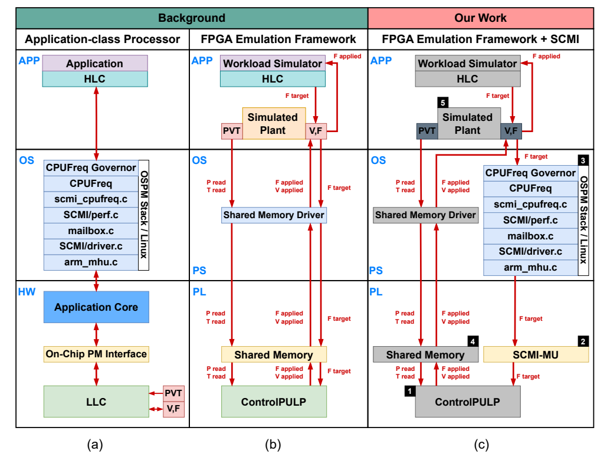
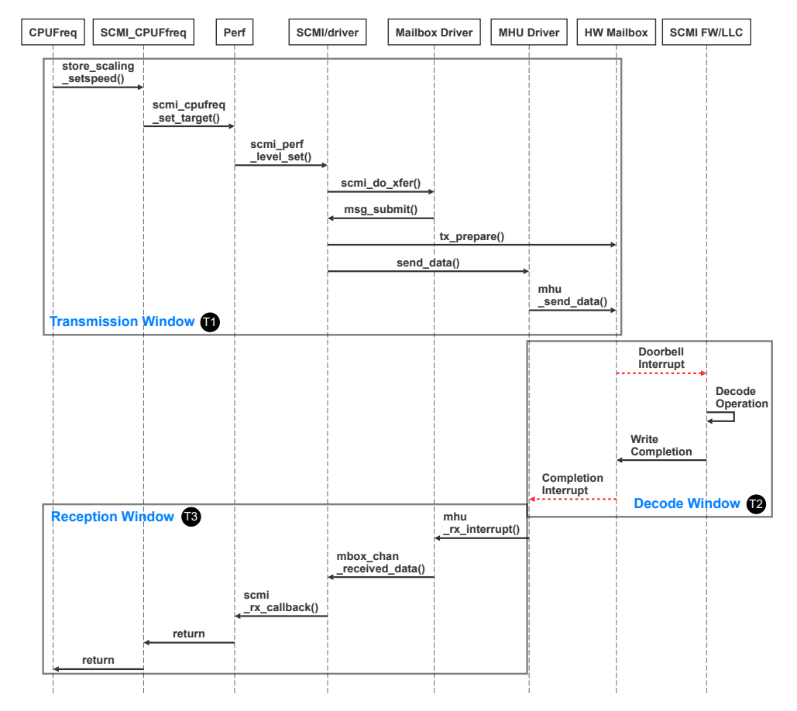
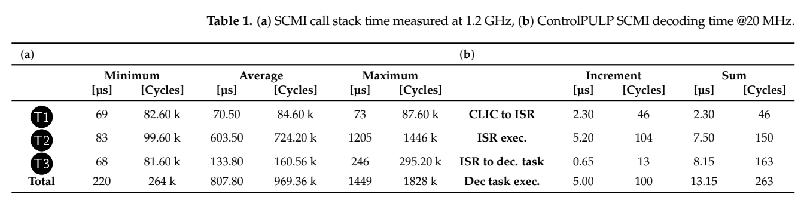
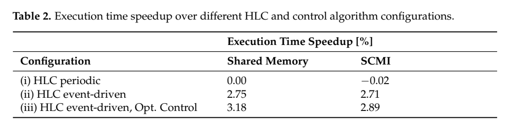

[返回五篇实验手册](guide.md) · [论文原文](https://www.mdpi.com/1996-1073/17/22/5778) · [所用版本PDF](https://www.research-collection.ethz.ch/server/api/core/bitstreams/5fab7af7-3ebf-4ae4-93bb-9fea8875e6e3/content)

**Performance Characterization of Hardware/Software Communication Interfaces in End-to-End Power Management Solutions of High-Performance Computing Processors**  
Antonio del Vecchio, Alessandro Ottaviano, Giovanni Bambini, Andrea Acquaviva, Andrea Bartolini。ETH仓储正式版，含1页封面共16页；本文所有PDF页码比正文印刷页多1。

> 方法详解第二版。这篇重点研究DVFS请求如何经过驱动、消息和固件到达执行端，以及延迟怎样影响收益。它同时给出上层预测选频和底层快速响应方案。FPGA控制器是真实运行的，被控高性能处理器及功耗/热行为由模型提供，两者必须分开。

## 1. 先回答“选好频率以后还差什么”

假设你的策略已决定从档位A切到B。一次寄存器写操作结束，可能只说明命令到达总线或邮箱；固件还没处理，电源还没稳定，PLL也可能还没锁定。只记录请求时刻会低估闭环延迟，甚至把阶段已结束后才生效的动作算成有效控制。

本文把系统分为HLC和LLC。HLC是上层控制器，了解应用阶段并提出性能目标；LLC是底层电源管理控制器，综合功率、温度等约束后执行。SCMI是两者交换管理请求的协议，MU是承载消息的邮箱硬件。这里LLC不是末级缓存，PCF也不是被控应用程序，而是电源控制固件。



[放大原图表](images/scmi-interfaces2024-fig1.png) · [原文 Fig1，PDF 第 6 页](https://www.research-collection.ethz.ch/server/api/core/bitstreams/5fab7af7-3ebf-4ae4-93bb-9fea8875e6e3/content#page=6)。图表来自该论文作者。

Fig.1有三种系统结构，应先看最后一幅(c)。ZCU102的PS侧A53运行Linux、高层策略及C语言被控对象模型；PL侧实例化ControlPULP RTL及新增SCMI邮箱。共享内存传递模型传感器与执行器量。由此得到的是硬件在环实验：消息协议和固件在真实平台运行，高性能CPU的执行、功率和热行为由模拟plant提供。

**这与你的“软控软/软控硬”问题直接相关。** 模型也可以形成实时交互闭环，只要控制动作会改变后续模型状态，模型再反馈观测。它验证的是该模型假设下的策略和接口行为；只有实际E902运行程序、PLL改变实际时钟并测量板上结果，才能形成目标硬件的执行证据。

## 2. 上层怎样选择目标频率：从公式推一遍

论文比较周期HLC和事件HLC。周期HLC根据上一个窗口的计算/访存组成，用last-value预测下一个窗口，即“假定下一段与上一段相似”。事件HLC假设有完美阶段标记和oracle，阶段一变就知道该用什么目标，是一种理想化的上层信息条件。

周期公式见原文Eq.(1)、PDF第9页。令上一窗计算相关工作为 $A=N_{ic}CPI_{ic}$，访存相关工作为 $B=N_{im}CPI_{im}$，可写成

$$
f_T=f_{\max}\frac{A}{B(\beta-1)+A\beta}.
$$

$N$是相应指令数量，CPI为每指令周期数，$f_T$是目标频率。原文把 $\beta$描述为可接受执行时间开销参数；为理解这个公式，下面用**总时间允许倍率**解释它。允许慢10%时使用1.10，而不是0.10，这与公式中 $\beta-1$的位置一致，具体实现仍应核对参数约定。

**教学推导。** 设在最高频率时，计算和访存等效耗时比例为A、B；降低CPU频率后，计算部分按频率反比增长，访存部分近似不变。令 $x=f/f_{\max}$，总时间模型为 $A/x+B$。允许总时间不超过 $\beta(A+B)$，有

$$
A/x+B\le\beta(A+B)
\Rightarrow x\ge\frac{A}{\beta A+(\beta-1)B}.
$$

选择满足条件的最低频率即可得到前式。若A占30%、B占70%，允许慢10%，$x=0.3/(1.1-0.7)=0.75$；最高3.4GHz时目标2.55GHz，模型总时间为 $0.3/0.75+0.7=1.1$。这解释了“访存等待多时CPU可以降频”的依据。

真正输出需要映射到合法离散档，通常向上选满足条件的最近档，并受最低/最高档限制。纯计算、纯访存、窗口无指令、模型突变都需处理。该公式依赖前一窗预测与计算/访存分解，并不是任意复杂程序的最坏情况时间保证。

事件HLC在本文合成实验中对计算阶段请求最高3.4GHz、访存阶段请求0.8GHz。它不需要等下一次周期采样，因此能降低发现阶段变化的延迟。但这是理想阶段信息，不能将其与真实预测器混成同一个算法。

## 3. 跟踪一条perf_level_set消息



[放大原图表](images/scmi-interfaces2024-fig2.png) · [原文 Fig2，PDF 第 7 页](https://www.research-collection.ethz.ch/server/api/core/bitstreams/5fab7af7-3ebf-4ae4-93bb-9fea8875e6e3/content#page=7)。图表来自该论文作者。

Fig.2横向是软件/硬件模块，纵向是调用先后。按图从左上沿箭头读：

1. HLC写CPUFreq接口，`store_scaling_setspeed()`接收目标。
2. `scmi_cpufreq_set_target()`和`scmi_perf_level_set()`把目标封装为性能域请求。
3. SCMI及mailbox驱动把消息写到共享邮箱，经MHU驱动敲doorbell。
4. LLC收到中断，ISR快速保存待处理信息，等待解码任务运行。
5. FreeRTOS解码任务读取头部、payload和事务标识，映射成目标设定，清doorbell并填响应。
6. LLC触发completion，Linux侧中断回调读取应答，唤醒等待者并结束CPUFreq调用。

SCMI-MU通过32bit AXI Lite连接两侧，包含33个32bit寄存器，并以doorbell/completion两个寄存器产生电平中断。doorbell清除表示消息已取走，completion表示响应已准备。这些消息事件与电源/时钟执行的物理完成应分别观察。

论文使用Linux 4.19和对应MHU-v1路径。现代内核的接口细节可能不同，因此不能拿当前随便一台Linux电脑的调用栈时间直接复现这张图。你的简化E902实现可以不用完整SCMI，但应保留事务编号、目标档、接收、完成与错误的语义。

## 4. 底层控制器为什么会再等待一个周期

原始PCF每500µs运行周期控制任务，串联模型功率上限控制与PID温度约束。新目标不是一到达就无条件应用：本轮读取目标、计算允许的频率和电压，下一任务周期才应用。请求到达相对周期边界的位置不同，等待也不同。

设LLC周期为 $T_c$，请求解码完成在 $t_d$。**教学时序模型**把下次读取时刻写为 $t_{\mathrm{read}}=\lceil t_d/T_c\rceil T_c$，下一周期应用为 $t_{\mathrm{apply}}=t_{\mathrm{read}}+T_c$。仅这部分等待就在约一个到两个周期之间。真实调度还包括中断、任务优先级、计算耗时等，不能用这个模型重算后声称完全重现了原表。

例如 $T_c=0.5$ms，解码完成在0.01ms，则0.5ms读取、1.0ms应用；若完成在0.49ms仍是1.0ms应用；若刚错过边界在0.51ms完成，则要到1.5ms应用。一个0.02ms的到达差异可能变成0.5ms的生效差异。这正是控制器中不能忽略相位的原因。

## 5. 作者优化了哪两处，为什么降频更快

第一处是HLC的发现机制，从周期检查换成阶段事件触发，减少“等下一次采样才发现”的时间。第二处是LLC优化，若新的目标频率低于之前PCF决定的工作点，可直接采用较低频率，减少等待周期策略计算/应用的延迟。升频仍保留完整约束路径。

```python
# 语义重建，省略具体SCMI字段和RTOS接口
on_decoded_request(request):
    remember_target(request.domain, request.level)
    if request.frequency < previous_pcf_frequency:
        apply_frequency_reduction_fast_path(request)
    else:
        wait_for_periodic_power_and_thermal_policy()
    return_protocol_response(request.transaction_id)
```

代码帮助理解快路径条件，不能把它直接当作你PMIC的安全时序。一个更低频率通常减轻动态功率压力，但降压是否立刻执行、供电域是否共享、PLL是否需切备用时钟仍受具体硬件约束。本文没有替你定义E902和现有PLL宏的全部电气时序。

升频不能简单复制降频快路径，因为更高频率可能超过功率/热限制，且电压裕量要先足够。这也解释为什么优化后的升频和降频延迟相差很大，平均值会掩盖方向差异。

## 6. 要记录哪些时间，才能知道慢在哪里

| 时间戳 | 事件 | 用它能计算什么 |
| --- | --- | --- |
| $t_0$ | 工作负载阶段发生变化 | 控制延迟起点 |
| $t_1$ | 高层发出请求 | 发现/决策延迟 $t_1-t_0$ |
| $t_2$ | 消息到LLC或doorbell触发 | 发送延迟 $t_2-t_1$ |
| $t_3$ | 解码完成 | 排队与解码时间 |
| $t_4$ | 协议应答 | 消息往返，不等同频率稳定 |
| $t_5$ | 执行目标实际生效 | 端到端控制延迟 $CD=t_5-t_0$ |

原文定义通信窗口T1/T2/T3与控制延迟CD。T1是Linux发送段，T2跨LLC与Linux的解码/中断响应，T3是Linux返回段。三者总和给请求处理路径的时间；CD从负载变化开始，到频率真正改变为止，定义更宽。只用T1当总通信时延，或用263个固件周期当整个DVFS延迟，都会得出错误结论。

对你的硬件，建议用独立固定参考时钟采时间戳。正在变频的CPU cycle counter可以记录周期，但跨频点换算墙钟时间需分段处理；直接用“全部周期÷最终频率”会算错。PLL锁定、PMIC电压稳定和请求寄存器读回也不是同一个信号，应逐一分清。

## 7. 实验一：通信链路测量到底证明了什么



[放大原图表](images/scmi-interfaces2024-table1.png) · [原文 Table1，PDF 第 10 页](https://www.research-collection.ethz.ch/server/api/core/bitstreams/5fab7af7-3ebf-4ae4-93bb-9fea8875e6e3/content#page=10)。图表来自该论文作者。

作者每1s轮换三个频率目标，测1000次请求，使用较长间隔避免拥塞。Linux端用ftrace，时间分辨率1µs；LLC端用CV32E40P性能计数器，并扣除约5cycle的测量开销。

| 原表量 | 平均值 | 解释 |
| --- | ---: | --- |
| T1 | 70.50µs | 发起至邮箱发送段 |
| T2 | 603.50µs | 跨两侧的中断/解码响应区间 |
| T3 | 133.80µs | Linux回调返回段 |
| 总计 | 807.80µs | 三段平均之和 |
| LLC固件解码 | 263cycle，20MHz时13.15µs | 很小的一段，不是807.80µs的替代量 |

263/20MHz=13.15µs；它约占807.8µs的1.63%。提高固件时钟可以减少这部分，却不等比例消除Linux端调度和中断抖动。T2的宽分布与T3的双峰也提示，只有平均延迟不足以评估短任务。

该实验是低请求率测量，不能直接外推邮箱拥塞、持续高频请求或多发送者的吞吐。复现可另外增加请求率，记录队列长度、拒绝和超时，但要标明是扩展实验。还应把原表个别周期/时间换算疑点与均值分开核查，不因为某列印刷数字就重写其他已测数值。

## 8. 实验二：延迟怎样影响应用结果

工作负载模型交替执行计算密集与访存密集阶段，50%占空比，总计500个20ms阶段，最高频基准下10s。功率和温度限制由LLC强制执行。周期HLC为1ms，事件HLC假设完美阶段标记，比较SCMI与近零延迟共享内存传输。

论文说明模型时间引擎相对LLC时间尺度放慢25倍，并人为增加1.7ms转发延迟来匹配尺度。这个1.7ms不是在真实芯片上测得的PLL锁定时间。复建时至少保存主机墙钟、模型时间和目标控制器周期三种单位，所有人为延迟说明作用在哪条轴。



[放大原图表](images/scmi-interfaces2024-table2.png) · [原文 Table2，PDF 第 12 页](https://www.research-collection.ethz.ch/server/api/core/bitstreams/5fab7af7-3ebf-4ae4-93bb-9fea8875e6e3/content#page=12)。图表来自该论文作者。

结果依次是：周期HLC＋SCMI平均CD为2.20ms；事件HLC＋SCMI为1.35ms；事件HLC＋优化LLC为0.77ms。最后一项进一步分解，升频约1.42ms，降频约114µs。这支持快路径主要改善降频的解释。

对20ms阶段，2.20ms占11%，0.77ms占3.85%。这是阶段中等待占比，不等于节能率或应用加速率。Table 2的SCMI优化配置加速2.89%，基线为周期HLC与共享内存传输。它是本文模拟应用在指定功率/热约束下的结果，不是测得某颗真实服务器CPU快2.89%，也不是单纯频率切换越快就固定提升2.89%。

为什么控制延迟减少能提升受约束性能？访存阶段更快降频，可以减少无效功耗和发热；留出的功率/热空间可能让后续计算阶段允许更高频。因而应用结果来自策略、执行延迟和约束的共同作用，不能只用“少等了1.43ms”直接推算应用收益。

## 9. 没有FPGA时如何复建方法，而不虚构硬件结果

先写离散事件模型，事件包括阶段变化、上层采样、请求传输、解码、周期控制和生效。所有事件放进按时间排序的队列；动作生效后才改变被控模型速度。不要在请求生成时立即改模型频率，否则会把待研究的延迟删除。

保持同一阶段序列，依次比较四种配置：周期HLC＋原LLC；事件HLC＋原LLC；周期HLC＋降频快路径；事件HLC＋降频快路径。前三个对照能分离两处优化贡献，第四个检查组合效果。再比较固定与带抖动的发送延迟，以及不同阶段长度。

**建议验收。** 请求落在周期边界前后时等待出现预期跳变；降频快路径只改变符合条件的动作；升频仍等待完整策略；每条命令可追踪到实际生效或错误；阶段越短时延迟占比越大。若加热模型，则报告模型来源与参数敏感性，否则只报告时序指标，不生成看似实测的瓦数曲线。

原平台级复现还需要ZCU102、ControlPULP版本、SCMI-MU RTL、Linux配置、FreeRTOS任务优先级与模型代码。当前材料不足以把所有依赖配置写成“一键复现”，因此笔记给出可独立验证的时序重建和待核对项。

## 10. 接你的E902、PLL与PMIC应怎样分阶段

第一阶段只测接口状态机：`request → accepted → applied/error`，记录事务ID与目标档。仿真注入PLL不锁、PMIC忙、目标非法、旧请求延迟到达等情况，检查是否重复应用、错误升频或丢失应答。

第二阶段在FPGA上用合法时钟资源运行E902程序，固定电压做DFS，用独立参考时钟测真实切换，核对程序输出。这时PLL/时钟路径是真硬件，但目标能量若仍由模型估计，就明确标注模型结果。

第三阶段在硬件允许时接实际可调供电轨，定义稳定确认、升降档顺序和失败回退。既要验证程序正确，也要验证供电与时钟实际达到目标。你现有ASIC工艺PLL宏不能直接综合为FPGA逻辑，应使用板上器件支持的时钟资源；PMIC命令接口是否能用，还取决于板卡供电拓扑与具体稳压器。

**课题中的创新机会。** P0研究短任务的执行延迟是否吞掉预测选档收益；P1把“请求档”和“实际档”分别输入预测器，避免把尚未生效的动作当作已生效；P1比较周期/任务边界触发与方向相关快路径。成功标准是接口正确、延迟分布可解释、控制收益在计入实际延迟后仍成立。这篇给你的价值，是让上层智能算法最终能够成为可验证的硬件控制系统。


## 双语摘要改写与原文入口

**中文改写**　本文以Linux高层策略与ControlPULP底层控制器为对象，研究SCMI软硬件接口对DVFS的影响。作者在FPGA硬件在环环境中测量请求发送、应答与解码延迟，再比较周期策略、事件驱动策略和底层降频快速通路。结果说明仅优化消息传输远远不够，控制任务调度也能主导响应。优化对降频最明显，升频仍受安全控制和周期限制；实验对象包含模拟CPU和工作负载，不能当真实HPC系统能耗复现。

**English paraphrase**　The study measures the path from Linux frequency requests to a firmware power controller through SCMI. Hardware-in-the-loop experiments separate communication latency from control-policy delay and evaluate periodic, event-driven and optimized low-level policies. Fast application of safe frequency decreases reduces delay, whereas increases remain constrained. The plant and energy effects are emulated. This is a reader-written paraphrase.

**代码与复现边界**　论文依托[ControlPULP平台](https://github.com/pulp-platform/control-pulp)；本篇完整Linux补丁、实验脚本与对应commit当前未全部核验，不假定基础仓库包含所有扩展。

[完整编号图表索引](../scmi-interfaces2024/figs_notes.md) · [原四报告中的技术笔记](../scmi-interfaces2024/paper_notes.md) · [原表核算脚本](https://github.com/zzxwhu/dvfs-paper-read/blob/main/examples/focus-five/check_examples.py) · [方法逐步演示脚本](https://github.com/zzxwhu/dvfs-paper-read/blob/main/examples/focus-five/method_walkthrough.py)
