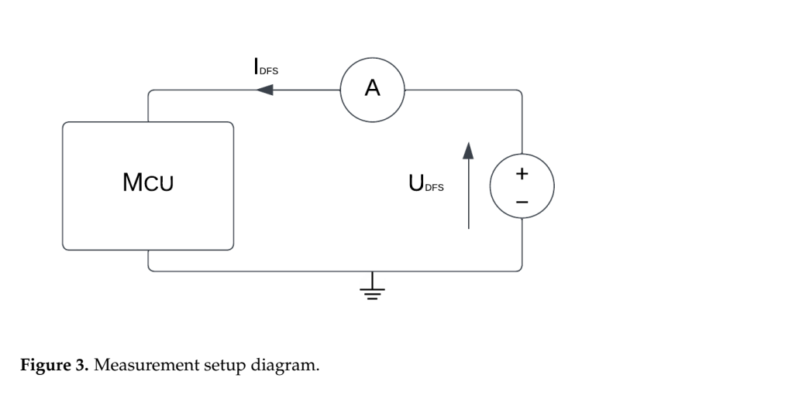
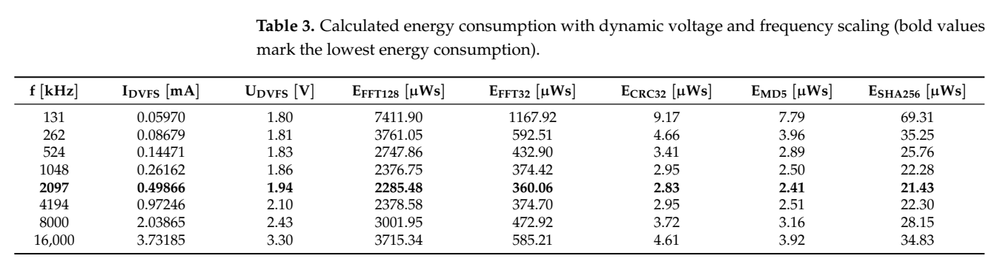
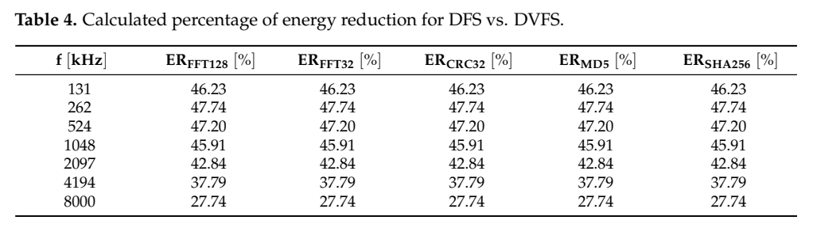

[返回五篇实验手册](guide.md) · [论文原文](https://doi.org/10.3390/electronics13050826) · [所用版本PDF](https://mdpi-res.com/d_attachment/electronics/electronics-13-00826/article_deploy/electronics-13-00826.pdf)

**Dynamic Voltage and Frequency Scaling as a Method for Reducing Energy Consumption in Ultra-Low-Power Embedded Systems**  
Josip Zidar, Tomislav Matić, Ivan Aleksi, Željko Hocenski。MDPI正式版18页，DOI 10.3390/electronics13050826。

先想象 E902 收到一包数据，需要算 CRC32 校验值。程序必须算出同一个结果，可以选择运行速度。若只观察电流，最低档很容易胜出。但电池付出的是整个任务期间的能量。低档执行得久，连带静态功耗一起积累，完成同一包数据可能更费电。本文特别适合作为你所有智能控制算法的第一条基线。

## 一次决策如何发生

这里有两张不同的表。设计者先做实验，制作“档位→执行时间和能量”的标定表。运行时，用程序已经知道的任务类别做选择。严格时间要求的工作走高性能模式，有时间余量的工作可走能量效率模式，低负荷事件走省电模式。Algorithm 5 在任务开始前切模式，完成后回省电模式。这个控制器的输入是软件发出的任务事件和类别。分类错了，即使频率执行得很准，也会超时。

[放大原图表](images/ulp-dvfs2024-fig3.png) · [原文 Fig3，PDF 第 6 页](https://mdpi-res.com/d_attachment/electronics/electronics-13-00826/article_deploy/electronics-13-00826.pdf#page=6)。图表来自该论文作者。

沿供电线看原图，先确认仪器测哪条电流，再用任务起止标记截取同一个时间窗。电流表给出 mA，处理器定时或外部仪器给出运行时间。固定工作点时，E≈U×I×t。V×mA×ms 得到 µJ。若运行中换档，要分段积分并把转换期算进去。

## 原作者是怎样取得表中数字的

作者在 STM32L0 上跑 FFT32、FFT128、CRC32、MD5、SHA256。先固定 3.3 V，扫描 131 kHz 到 16 MHz 的八档，测电流和时间，报告每项取 100 次平均。然后用最低和最高两个端点拟合电压随频率的指数曲线，计算另一张能量表。这两步分别回答“单纯变频怎样影响每次计算”和“按这个电压模型配档可能再省多少”。

[放大原图表](images/ulp-dvfs2024-table3.png) · [原文 Table3，PDF 第 13 页](https://mdpi-res.com/d_attachment/electronics/electronics-13-00826/article_deploy/electronics-13-00826.pdf#page=13)。图表来自该论文作者。

**按行重算。** 选 CRC32 一列，131 kHz 是 9.17 µJ，2097 kHz 是 2.83 µJ，16000 kHz 是 4.61 µJ。相对最高档，表中中间档少用约 38.6%，计算为 1−2.83/4.61。最低频率反而比中间档多用两倍以上能量。换成 Table 4，2097 kHz 的 42.84% 用的是**相同频率下固定 3.3 V** 的另一条基线。这两个百分比可以同时正确，回答的是不同问题。

[放大原图表](images/ulp-dvfs2024-table4.png) · [原文 Table4，PDF 第 13 页](https://mdpi-res.com/d_attachment/electronics/electronics-13-00826/article_deploy/electronics-13-00826.pdf#page=13)。图表来自该论文作者。

现在加一个期限 D。即使 2.097 MHz 那行能量最小，也要先检查该行的运行时间是否落在 D 以内。若换档要 1 ms 而只剩 0.5 ms 余量，静态表里的可行点在闭环里就不可行。这是把原文三个任务模式扩成你自己的带期限控制器时，需要额外做的判断。

## 怎样复建这一篇

1. **无板起步。** 抄录 Table 3 的八行，单位统一为 MHz、V、µJ。按任务列取最小值，再独立用同频固定压表复算 Table 4。先核对 CRC32 的三个数，再处理其余程序。此步验证读表、单位和选档逻辑。
2. **实物标定。** 选具体 STM32L0 板或你的目标 CPU，记录芯片型号、编译器与优化级别。固定 CRC 输入字节与期望校验值。每档重复同一批数据，用引脚翻转标出开始和结束，让计时和电流积分覆盖同一次执行。短任务可连续做多次再除以次数，单独测空循环开销。换平台应重建整张表。
3. **部署策略。** 先用厂商允许的频档验证三模式切换。记录请求档、实际档、稳定时刻、输出、耗时和能量。再决定板卡是否支持改变目标电源轨。论文的两端点拟合不能用来认证 FPGA 核心电压。
4. **验收。** 同输入比较固定最高档、固定能量最优档和按任务选模式。分别报告 J/任务、超时次数和整段运行总能量。把唯一输入改成长度变化的一批新输入，再看静态表是否仍然够用。若所有任务需求恒定，复杂学习器的价值可能很小。

## 摘要改写与复建资料

先扫描真实MCU程序的能量—频率曲线，再按任务时限选择三种工作模式。同频点DVFS相对3.3V DFS能量：降低27.74%–47.74%，条件为Table4各频率比较；不是相对最优DFS点统一降低47.74%。

This study characterizes FFT and hashing operations on an ultra-low-power Cortex-M0+ MCU. It compares fixed-voltage frequency scaling with voltage-frequency settings obtained from an exponential fit, and sketches task-specific operating modes. Its value is a measurement-oriented baseline rather than a learned online governor. This is a reader-written paraphrase, not the original abstract.

**代码与复现边界**　当前材料中尚未定位齐完整控制器源码、实验脚本和原始重复数据；这不表示这些材料不存在。

[完整编号图表索引](../ulp-dvfs2024/figs_notes.md) · [原四报告中的技术笔记](../ulp-dvfs2024/paper_notes.md) · [配套核算脚本](https://github.com/zzxwhu/dvfs-paper-read/blob/main/examples/focus-five/check_examples.py)
