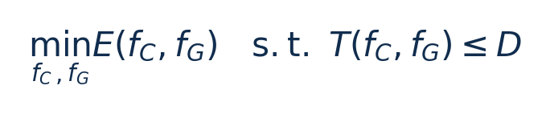
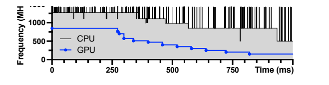
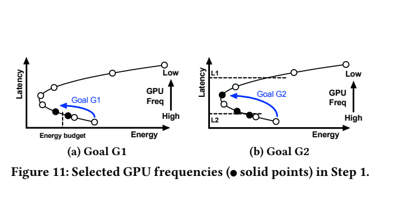
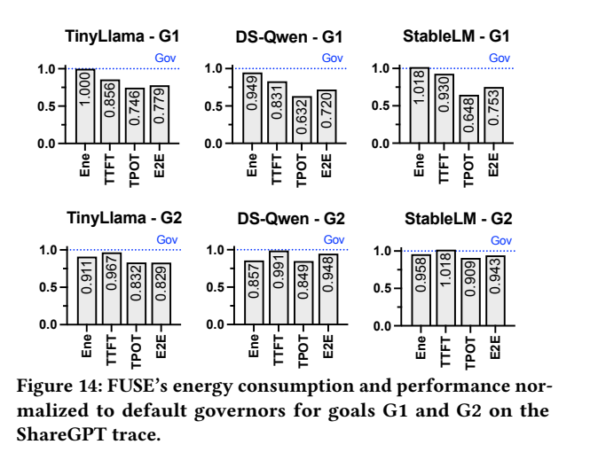
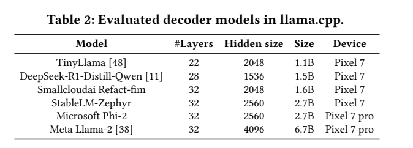

[论文页面](https://arxiv.org/abs/2507.02135v1) · [本笔记所用 PDF](https://arxiv.org/pdf/2507.02135v1) · [标识符](https://doi.org/10.48550/arXiv.2507.02135)

整理日期：2026-11-06。**读者原创中文解读；原图归论文作者／出版方。未运行作者实验，不是独立复现。**

**一句话：** 解释手机CPU/GPU独立governor互相降频的恶性循环，再通过离线两步搜索为prefill/decode配置协同频率

阅读地图：先看问题与输入输出，再顺着架构图、公式和结果图阅读；最后检查统计边界与E902迁移。完整编号索引另见“图表索引”。下文“读者分析”是推断或建议，不是原文结果。

## 阶段0：材料与版本审计

| 材料 | 当前可用程度 | 影响 |
| --- | --- | --- |
| 摘要、正文、方法、原图注 | 已获取本地完整PDF、文本与逐页渲染 | 可核查结构、实验及关键数字；可见页面优先于异常文本层 |
| 分析版本 | arXiv2507.02135v1，2025-07-02，16页；与SparseDVFS同名缩写的FUSE不是同一系统。 | 引用页码以“PDF第几页”标识 |
| 代码／原始数据 | 当前材料中尚未定位齐完整控制器源码、实验脚本和原始重复数据；这不表示这些材料不存在。 | 公开链接不等于已构建或已拿到原始轨迹 |
| 附件、独立原始重复与勘误 | 当前未完成全渠道附件／勘误穷尽检索 | 不能断言没有附件、没有勘误或没有其他版本 |
| 本次工作范围 | 材料阅读、图表裁取、证据整理、教学公式 | 所有新实验均是建议，尚未执行 |

## 阶段1：身份卡与整体概述

| 项目 | 内容 |
| --- | --- |
| 英文题名 | Dissecting the Impact of Mobile DVFS Governors on LLM Inference Performance and Energy Efficiency |
| 中文导读题名 | 解释手机CPU/GPU独立governor互相降频的恶性循环，再通过离线两步搜索为prefill/decode配置协同频率 |
| 作者 | Zongpu Zhang, Pranab Dash, Y. Charlie Hu, Qiang Xu, Jian Li, Haibing Guan |
| 发表／版本 | arXiv预印本2025；arXiv2507.02135v1，2025-07-02，16页；与SparseDVFS同名缩写的FUSE不是同一系统。 |
| 类型与领域 | 原始方法／工程系统研究；DVFS、GPU/CPU能效、CV/LLM应用运行时控制 |
| 单位、通讯、资助与利益关系 | 作者姓名以本版本首页为准；通讯方式、单位及资助可回查首页与末页声明。当前尚未完成资助/利益关系/勘误的跨版本穷尽审计。 |
| 核心对象与接口 | 安装/部署时每模型离线搜索；运行时只在prefill/decode边界换表，不是连续在线训练/逐tokenMPC |
| 代码与数据 | 当前材料中尚未定位齐完整控制器源码、实验脚本和原始重复数据；这不表示这些材料不存在。 |
| 与本课题关系 | 如果有GPU/手机实验权限，适合作为“软控软”的清晰案例：软件策略控制运行推理软件的真实硬件。CPU单平台可借鉴阶段分表与小规模离线搜索；E902只迁移阶段观测/安全OPP，不照搬Android三频域。 |

**约200字中文概述（改写）：** 本文研究手机本地GPU卸载的LLM自回归推理，单请求顺序执行的运行时能效。具体程序包括llama.cpp b2202/OpenCL＋CLBlast；TinyLlama1.1B、DS-R1-Distill-Qwen1.5B、Refact1.6B、StableLM2.7B、Phi2 2.7B、Llama2 6.7B，4bit；ShareGPT抽200请求。作者在root/opened Pixel7与7Pro，TensorG2/MaliG710、Android13；Monsoon旁路电池、0.2ms采样，屏幕关闭；测设备功耗上采用基于U形能量曲线的两步离线搜索：先GPU至能量/时延边界，再CPU细调；5种prompt桶＋1种decode配置；相位切换查表，无RL。输入为模型、prompt长度桶、当前prefill/decode通知、离线E/T曲线、用户每token能量预算G1或时延目标G2，输出为CPU/GPU锁定频率pair；memory governor默认；G1最小时延/G2最小能量。主要结果应与下方基线、性能约束和测量范围一起阅读，不能只摘最高百分比。以受控实验揭示多governor相互作用，提出简单可部署的阶段感知协同控制；复杂神经控制器不是必要条件。

**三句话定位：** 问题是为什么局部利用率不能完整反映整个应用的性能与能耗？本篇的研究问题或可检验主张是：解释手机CPU/GPU独立governor互相降频的恶性循环，再通过离线两步搜索为prefill/decode配置协同频率。验证链是可观测状态→控制规则或学习模型→执行器→任务正确性/服务质量与能耗对照。 方法主线为模型、prompt长度桶、当前prefill/decode通知、离线E/T曲线、用户每token能量预算G1或时延目标G2 → 基于U形能量曲线的两步离线搜索：先GPU至能量/时延边界，再CPU细调；5种prompt桶＋1种decode配置；相位切换查表，无RL → CPU/GPU锁定频率pair；memory governor默认；G1最小时延/G2最小能量 → 执行与反馈。 主要证据见下方结果表，结论须与测量和版本范围一起使用。

## 阶段2：问题、假设与创新位置

为什么局部利用率不能完整反映整个应用的性能与能耗？本篇的研究问题或可检验主张是：解释手机CPU/GPU独立governor互相降频的恶性循环，再通过离线两步搜索为prefill/decode配置协同频率。验证链是可观测状态→控制规则或学习模型→执行器→任务正确性/服务质量与能耗对照。

**创新判断（读者分析）：** 以受控实验揭示多governor相互作用，提出简单可部署的阶段感知协同控制；复杂神经控制器不是必要条件。 不依据作者自称“首次”断定整个领域绝无前例。

## 阶段3：必要术语与数学

| 级别 | 术语／关键词 | 直觉、严格含义与易混点 |
| --- | --- | --- |
| A | DVFS / DFS | DVFS同时涉及动态电压与频率；只有时钟变化称DFS。电压能否改变取决于实际供电域。 |
| A | Workload | 真正执行应用计算的程序与输入；本文里的控制器是另一个角色。 |
| A | Controller | 根据观测选择动作的软件／硬件，可运行在同一CPU或独立控制核。 |
| A | OPP | Operating Performance Point，经过允许范围验证的电压—频率组合。 |
| A | Power / Energy | 功率W表示此刻消耗快慢；能量J是对时间积分。低功率不必然低能量。 |
| B | Deadline | 作业必须完成的时刻；平均时延、P95与最大时延各有不同用途。 |
| A | 被控程序 | llama.cpp b2202/OpenCL＋CLBlast；TinyLlama1.1B、DS-R1-Distill-Qwen1.5B、Refact1.6B、StableLM2.7B、Phi2 2.7B、Llama2 6.7B，4bit；ShareGPT抽200请求 |
| A | 控制策略 | 基于U形能量曲线的两步离线搜索：先GPU至能量/时延边界，再CPU细调；5种prompt桶＋1种decode配置；相位切换查表，无RL |
| B | 控制周期 | 安装/部署时每模型离线搜索；运行时只在prefill/decode边界换表，不是连续在线训练/逐tokenMPC |
| B | 证据边界 | 实测、硬件仿真、功耗模型是不同证据，见平台与结果表。 |

### 公式1：G1：能量预算下最低时延

**符号与前提：** T为TTFT(s)或TPOT(s/token)，E为对应阶段J或J/token；两种目标不可混。

**代入与检查：** 若GPU单独高频能量略超预算，调CPU可能让该GPU档变为可行，故保留边界前一档。

**来源：** §6/Fig11，p10–11
### 公式2：G2：时延约束下最低能量

**符号与前提：** D是阶段时延目标；memory默认，此式不是完整三维穷举。

**代入与检查：** 最低频若延长运行、增加基线能量，会比中间频率更费能，形成U形。

**来源：** §6.1，p10–11

## 阶段4–6：架构、关键图与方法拆解

**输入—处理—输出：** 模型、prompt长度桶、当前prefill/decode通知、离线E/T曲线、用户每token能量预算G1或时延目标G2 → 基于U形能量曲线的两步离线搜索：先GPU至能量/时延边界，再CPU细调；5种prompt桶＋1种decode配置；相位切换查表，无RL → CPU/GPU锁定频率pair；memory governor默认；G1最小时延/G2最小能量 → 执行与反馈。

| 系统角色 | 具体设置 |
| --- | --- |
| 具体控制算法 | 基于U形能量曲线的两步离线搜索：先GPU至能量/时延边界，再CPU细调；5种prompt桶＋1种decode配置；相位切换查表，无RL |
| 被控负载类型 | 手机本地GPU卸载的LLM自回归推理，单请求顺序执行 |
| 具体被控程序 | llama.cpp b2202/OpenCL＋CLBlast；TinyLlama1.1B、DS-R1-Distill-Qwen1.5B、Refact1.6B、StableLM2.7B、Phi2 2.7B、Llama2 6.7B，4bit；ShareGPT抽200请求 |
| 使用平台与测量 | root/opened Pixel7与7Pro，TensorG2/MaliG710、Android13；Monsoon旁路电池、0.2ms采样，屏幕关闭；测设备功耗 |
| 输入/状态 | 模型、prompt长度桶、当前prefill/decode通知、离线E/T曲线、用户每token能量预算G1或时延目标G2 |
| 输出/动作 | CPU/GPU锁定频率pair；memory governor默认；G1最小时延/G2最小能量 |
| 周期与运行位置 | 安装/部署时每模型离线搜索；运行时只在prefill/decode边界换表，不是连续在线训练/逐tokenMPC |

§3–6，PDF p4–12：CPU负责OpenCL kernel提交和token处理，GPU等待使CPU利用率低；CPU降频又延迟提交、降低GPU利用率，GPU也降频，进一步拖慢，形成antagonistic downward spiral。先测固定频率对照，区分真正算力不足与governor互相影响。

FUSE利用主导GPU因素，G1从高GPU频率向下找首次达到能量预算的频点及前一档，再逐GPU候选从高CPU频率向下细调；G2先找能量谷底或时延约束两侧GPU档，再找CPU可行档。内存默认governor已近最优，未强行搜索三维。5个prefill代表长度32/64/128/256/512＋decode32tokens离线剖析；实际按相位通知应用表。耗时17.7–87.7分钟/模型/目标范围，要靠多次使用摊销。

### Fig10：耦合频率时序

[打开大图](images/original-fig10.png) · [原文 Fig10，PDF p9](https://arxiv.org/pdf/2507.02135v1#page=9)

**怎样看：** 先读图题、图例、坐标/表头与单位，再在同一负载和同一基线内比较。需与单独钉住组件对照。

**直接观察／原文报告：** 需与单独钉住组件对照。

**读者判断：** 只支持此图所列的模型、设备、输入与测量口径；需与单独钉住组件对照。 不能由单图推出E902或其他GPU的同幅收益。

### Fig11：两种目标的候选点

[打开大图](images/original-fig11.png) · [原文 Fig11，PDF p10](https://arxiv.org/pdf/2507.02135v1#page=10)

**怎样看：** 先读图题、图例、坐标/表头与单位，再在同一负载和同一基线内比较。G1与G2选择规则不同。

**直接观察／原文报告：** G1与G2选择规则不同。

**读者判断：** 只支持此图所列的模型、设备、输入与测量口径；G1与G2选择规则不同。 不能由单图推出E902或其他GPU的同幅收益。

| 阅读问题 | 先看材料 | 如何接到下一步 |
| --- | --- | --- |
| 为什么要改现有方案 | 问题背景与动机图 | 确定目标、约束和原有不足 |
| 系统观察什么、控制什么 | 输入输出表＋关键架构图 | 确认数据、模型和执行器真实角色 |
| 方法如何得到动作或估计 | 方法段、公式、算法／模型表 | 明确离线训练与在线流程 |
| 收益是否真实且公平 | 结果图表、统计与测量边界 | 核查基线／目标／分母／开销 |
| 能否用于自己的CPU | 局限、复现计划、三项实验 | 把论文假设变成待验证的工程条件 |

## 阶段7–8：实验、统计及证据链

本节数字均是**原文明确报告或原文数值的标注算例**；没有按图柱高度臆造额外精确值。

| 指标 | 原文报告 | 条件／分母／边界 | 证据位置 |
| --- | --- | --- | --- |
| ShareGPT同能量预算G1 | TTFT降低7.0%–16.9%；TPOT降低25.4%–36.8% | TinyLlama/DS-Qwen/StableLM，200请求，近似iso-energy；不是节能百分比 | Fig14/§6.2，p12 |
| ShareGPT同TTFT目标G2 | 总能量/电量代理降低4.2%–14.3% | 三个模型；论文部分以mAh写energy drain，电量转J需电压 | Fig14，p12 |
| 固定长度同阶段时延G2 | prefill每token能量−6.9%、decode−10.3%均值 | 六模型固定长度，不能替代真实trace范围 | Fig13，p12 |

### Fig14：真实ShareGPT回放

[打开大图](images/original-fig14.png) · [原文 Fig14，PDF p12](https://arxiv.org/pdf/2507.02135v1#page=12)

**怎样看：** 先读图题、图例、坐标/表头与单位，再在同一负载和同一基线内比较。200请求、三模型与两个目标。

**直接观察／原文报告：** 200请求、三模型与两个目标。

**读者判断：** 只支持此图所列的模型、设备、输入与测量口径；200请求、三模型与两个目标。 不能由单图推出E902或其他GPU的同幅收益。

### Table2：六模型配置

[打开大图](images/original-table2.png) · [原文 Table2，PDF p11](https://arxiv.org/pdf/2507.02135v1#page=11)

**怎样看：** 先读图题、图例、坐标/表头与单位，再在同一负载和同一基线内比较。参数规模不等运行工作量。

**直接观察／原文报告：** 参数规模不等运行工作量。

**读者判断：** 只支持此图所列的模型、设备、输入与测量口径；参数规模不等运行工作量。 不能由单图推出E902或其他GPU的同幅收益。

**统计与公平性审查（读者分析）：** ShareGPT随机200请求，prompt≤512/output≤256，TTFT不含排队，不能套服务端SLO。Monsoon有高频设备测量，但请求数不同于重复设备样本。文中mAh是电量单位，若未给恒定供电电压，不应直接写等值J；近似iso-energy例也有小幅差异。

工程实验中，设备、程序、输入文件、重复运行、时间窗口是不同统计层级，不能互相替代。本任务不涉及生物样本，细胞／动物／试剂等检查不适用。未注明的P值或置信区间不补造；“差了几个百分点”不自动等于统计显著。

| 主张层级 | 直接证据 | 对照与统计 | 可得结论／替代解释 | 可信度 |
| --- | --- | --- | --- | --- |
| 原文明确报告 | ShareGPT同能量预算G1：TTFT降低7.0%–16.9%；TPOT降低25.4%–36.8% | Fig14/§6.2，p12 | TinyLlama/DS-Qwen/StableLM，200请求，近似iso-energy；不是节能百分比；仅在该实验范围内成立 | 图表／文本可核对：高；独立复现：尚无 |
| 作者解释 | 所提架构／模型解释了性能或估计改善 | 关键原图与方法见上文；统计边界见下节 | 效果可能同时来自动作空间、平台特性与采样设置，因果归因需消融 | 中 |
| AI分析／迁移假设 | 用于允许的GPU/CV/LLM候选场景及CPU/E902迁移 | 本篇未直接验证该芯片与任务组合 | 需三项后续实验；不能复制论文收益数字 | 待验证，当前无法判断 |

## 阶段9–10：贡献与局限分开判断

以受控实验揭示多governor相互作用，提出简单可部署的阶段感知协同控制；复杂神经控制器不是必要条件。

| 来源 | 严重程度 | 局限及其影响 |
| --- | --- | --- |
| 读者分析 | 关键 | 离线配置依赖模型/平台；温度、后台负载、长上下文和并发请求可能让表失效。 |
| 读者分析 | 关键 | root/sysfs权限和整机功耗测量成本高，不等同普通手机app即可控制频率。 |
| 读者分析 | 关键 | 不能把LLM负载称控制算法，或把G1时延改善说成同幅节能。 |

## 阶段11：最小复现路线与缺口

本次未运行作者代码。最小复建顺序：①固定本文平台/模型/输入与质量目标，确认合法可用频档和权限；②逐档运行真实被控程序，验证输出、预热、计时同步与能量测量窗口，至少记录多次独立运行原始数据；③实现本文算法，冻结离线训练/搜索配置，留出新的输入、到达率和温度条件测试；④同动作空间、同质量/SLO比较固定最高档、默认governor、简单规则和本文方案；⑤把离线剖析与在线控制、采样、切频成本单列并计算摊销次数。失败时退回安全固定档，缺失参数列日志，不猜成已知。如果有GPU/手机实验权限，适合作为“软控软”的清晰案例：软件策略控制运行推理软件的真实硬件。CPU单平台可借鉴阶段分表与小规模离线搜索；E902只迁移阶段观测/安全OPP，不照搬Android三频域。

**代码／数据现状：** 当前材料中尚未定位齐完整控制器源码、实验脚本和原始重复数据；这不表示这些材料不存在。

**质量控制顺序：** 先验证程序输出和时间基准，再验证采样／模型，最后比较策略。保存输入文件哈希、平台配置、OPP、随机种子、温度与每次运行原始记录。失败时先回固定安全频点定位错误，再继续优化。复现可行性判断为“可开始部分方法复建，完整数值复现条件未齐”；这与“已完成复现”不同。

## 阶段12：应用选题与CPU／E902课题联系

如果有GPU/手机实验权限，适合作为“软控软”的清晰案例：软件策略控制运行推理软件的真实硬件。CPU单平台可借鉴阶段分表与小规模离线搜索；E902只迁移阶段观测/安全OPP，不照搬Android三频域。

| 建议实验／优先级 | 价值 | 最低资源 | 主要风险 | 成功判据（设计目标，非已得结果） |
| --- | --- | --- | --- | --- |
| P0：独立governor与锁频对照 | 先验证应用与执行器，建立同边界基线 | 可root手机/Jetson或Linux CPU、轻量SLM、实际频率日志 | 频率命令不一定获准或真实生效 | 输出正确；保存实际频率、温度、时延与积分能量 |
| P1：相位分表与统一表、联合与独立调节 | 验证状态/阶段感知是否优于固定档与阈值 | 可root手机/Jetson或Linux CPU、轻量SLM、实际频率日志 | 新输入与离线标定分布不同 | 同期限/质量/动作空间下报告净收益及尾部时延 |
| P1：控制成本和迁移消融 | 分开采样、模型、切换与算法贡献 | 执行器时间戳；必要时外部电测或明确功耗模型 | 短任务收益被开销吞掉；E902可观测量不同 | 分别关闭各组件；报告失败输入；CPU迁移重新标定 |

上述优先级是读者建议：P0先做，P1建立在基线可运行后，P2只在资源允许且前序实验证明有必要时开展。本批允许CV/LLM/GPU应用；压缩、CV、SLM均未最终定题，也未证明已在E902运行。论文公开可读不自动授权任意复制数据；代码、图片和数据须分别核对许可。

## 阶段13：读完后应掌握与继续核查

**五个知识点：** 解释手机CPU/GPU独立governor互相降频的恶性循环，再通过离线两步搜索为prefill/decode配置协同频率 你还应能解释输入输出表中的角色、两条公式的单位、首个结果指标的分母，以及局限表里的关键条件。

**五个未决问题：** 独立新输入是否成立？最差时延是否可接受？测量参考是否足够？控制与切换是否抵消收益？E902实际具有哪些接口和可观测量？这些是研究问题，不是对作者遗漏的无证据指控。

**立即做：** 按公式算例手算一次，选一张结果图复述“硬件—负载—基线—指标—边界”。**后续核查：** 补齐代码版本、训练数据和仪表设置。**可复用：** 上文明确标注的模型与接口思路。**谨慎采用：** 所有跨平台百分比。**暂不采用：** 尚未证实存在的电压控制和完整硬实时承诺。
