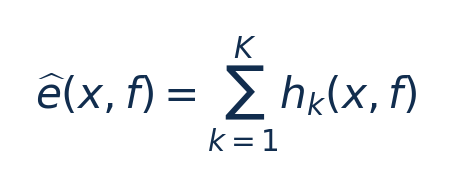

[论文页面](https://arxiv.org/abs/2201.01684v1) · [本笔记所用 PDF](https://arxiv.org/pdf/2201.01684v1) · [标识符](https://doi.org/10.48550/arXiv.2201.01684)

整理日期：2026-11-06。**读者原创中文解读；原图归论文作者／出版方。未运行作者实验，不是独立复现。**

## 先把四个角色放对位置

被控负载是要完成的程序和输入，比如识别一帧图像、生成token或完成一次训练迭代；CPU/GPU是执行程序的硬件；控制器根据观测选运行档位；驱动／寄存器把档位落实。程序代码可以完全一样，CPU时钟变慢时每条指令对应的墙钟时间通常变长，访存或I/O等待则未必按同样比例变化。

软件控制并不意味着没有真实硬件。软件中的学习策略可控制真实CPU；也可先控制一个执行时间与能量模型。后者能验证闭环逻辑，但模型输出的J不能当真实电测。E902的RTL能在仿真中改变时钟并反馈计数；电压导致的物理功耗还需相应模型、功耗分析或板级实验。

## 这篇到底解决哪一件事

先检测训练迭代周期，再用XGBoost预测候选GPU核/显存频率的能量和时间，最后在线黄金分割搜索修正预测

为什么局部利用率不能完整反映整个应用的性能与能耗？本篇的研究问题或可检验主张是：先检测训练迭代周期，再用XGBoost预测候选GPU核/显存频率的能量和时间，最后在线黄金分割搜索修正预测。验证链是可观测状态→控制规则或学习模型→执行器→任务正确性/服务质量与能耗对照。

**把方法想成一条流水线：** 采样power/SM利用率/memory利用率周期信号；参考频率下PTX类型密度、L1/L2 miss、候选SM/显存档位、性能损失阈值 → FFT候选周期＋序列相似度/高斯混合与滚动检验；4个XGBoost相对E/T预测器；先显存后SM局部黄金分割/凸拟合搜索 → SM与显存频率配置；以预测ED²P或受损失约束能量优化为目标 → 执行与反馈。

| 先回答的问题 | 本文答案 |
| --- | --- |
| 具体控制算法 | FFT候选周期＋序列相似度/高斯混合与滚动检验；4个XGBoost相对E/T预测器；先显存后SM局部黄金分割/凸拟合搜索 |
| 被控负载类型 | GPU机器学习训练：周期性DNN/GNN及非周期传统ML |
| 具体被控程序 | PyTorch Benchmarks训练预测器；14项AIBench＋ThunderSVM/ThunderGBM测试；55项benchmarking-gnns（GAT/GCN/GatedGCN等×COLLAB/CSL/SBM/TSP/TU等） |
| 使用平台与测量 | RTX3080Ti＋AMD5950X/64GB；driver470.57、CUDA11.3；NVML功率/时钟、CUPTI计数；GPU能量非整机能量 |
| 输入/状态 | 采样power/SM利用率/memory利用率周期信号；参考频率下PTX类型密度、L1/L2 miss、候选SM/显存档位、性能损失阈值 |
| 输出/动作 | SM与显存频率配置；以预测ED²P或受损失约束能量优化为目标 |
| 周期与运行位置 | 检测到稳定周期后采一个迭代的细计数；局部搜索跨若干迭代；非周期按固定区间IPS与功率估E/T |

## 十个先修关键词

| 级别 | 术语／关键词 | 直觉、严格含义与易混点 |
| --- | --- | --- |
| A | DVFS / DFS | DVFS同时涉及动态电压与频率；只有时钟变化称DFS。电压能否改变取决于实际供电域。 |
| A | Workload | 真正执行应用计算的程序与输入；本文里的控制器是另一个角色。 |
| A | Controller | 根据观测选择动作的软件／硬件，可运行在同一CPU或独立控制核。 |
| A | OPP | Operating Performance Point，经过允许范围验证的电压—频率组合。 |
| A | Power / Energy | 功率W表示此刻消耗快慢；能量J是对时间积分。低功率不必然低能量。 |
| B | Deadline | 作业必须完成的时刻；平均时延、P95与最大时延各有不同用途。 |
| A | 被控程序 | PyTorch Benchmarks训练预测器；14项AIBench＋ThunderSVM/ThunderGBM测试；55项benchmarking-gnns（GAT/GCN/GatedGCN等×COLLAB/CSL/SBM/TSP/TU等） |
| A | 控制策略 | FFT候选周期＋序列相似度/高斯混合与滚动检验；4个XGBoost相对E/T预测器；先显存后SM局部黄金分割/凸拟合搜索 |
| B | 控制周期 | 检测到稳定周期后采一个迭代的细计数；局部搜索跨若干迭代；非周期按固定区间IPS与功率估E/T |
| B | 证据边界 | 实测、硬件仿真、功耗模型是不同证据，见平台与结果表。 |

## 用一个小算例建立直觉

预测0.85表示该基线能量的85%，若时间比1.1，则ED²P比0.85×1.1²≈1.029。

x为参考档特征，f为候选档；输出e是E/Edefault无量纲，不是J；hk为回归树。

**要防止的误读：** XGBoost是预测模型，最终动作由搜索决定；不能称端到端强化学习或把预测误差当节能率。

## 论文真正验证了什么

| 指标 | 原文报告 | 条件／分母／边界 | 证据位置 |
| --- | --- | --- | --- |
| 全71项平均 | GPU能量−16.2%，执行时间＋5.1% | 相对NVIDIA默认；并非每项满足5% slowdown | 摘要/§5.4，p1/9–11 |
| 16项中型测试 | 能量−14.7%、ED²P−6.8%、时间＋4.6% | 14AIBench＋2传统ML；相对默认 | Fig13，p9–10 |
| 55项GNN | 能量−16.6%、时间＋5.2% | 仅22/55在整体评估中达到5%性能损失约束；不可称零违约 | Fig14/§5.4.2，p11 |

这些结果来自作者实验。算法reward、模型误差、控制器时延、被控应用速度与应用节能是不同指标，要看具体行的单位和证据。

## 它与你的毕设怎么接起来

很适合“轻量预测＋安全候选档搜索”的毕设结构。GPU负载可直接借鉴；E902把CUPTI换实际可用cycles/停顿/访存计数，先证明新输入预测有效，再比较无模型搜索与纯查表。

最先可以尝试：**P0：参考档特征与E–T数据**。理由是先验证应用与执行器，建立同边界基线；最低资源是可锁频GPU或有计数器CPU；小CNN/GNN或候选压缩程序；通过标准是输出正确；保存实际频率、温度、时延与积分能量。

## 五分钟自测

1. 这篇输出的是下一频率、功率估计，还是通信／控制时序？
2. 是真实负载硬件实验，还是模型／RTL／HIL？哪些部分是真的？
3. 最重要百分比的分母和比较对象是什么？
4. 如果换成单核E902，哪一个输入或硬件旋钮会消失？
5. 算上采样、推理、切频和空闲时间后，节能是否还成立？

答案线索在本页角色表和结果表；进一步读“图文技术精读”的关键原图、公式与三项课题实验，再到“图表索引”回查原PDF。不是先记住论文所有缩写。
