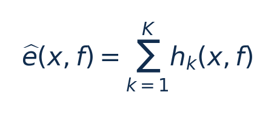
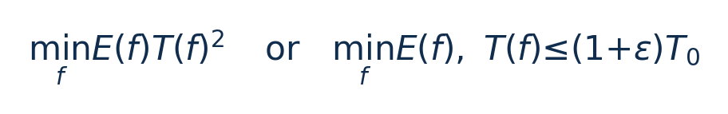
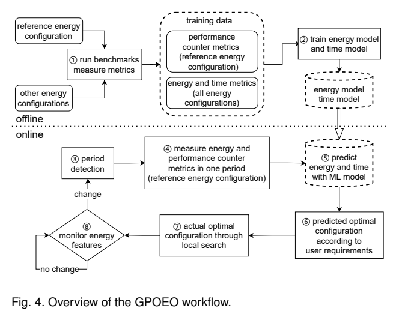
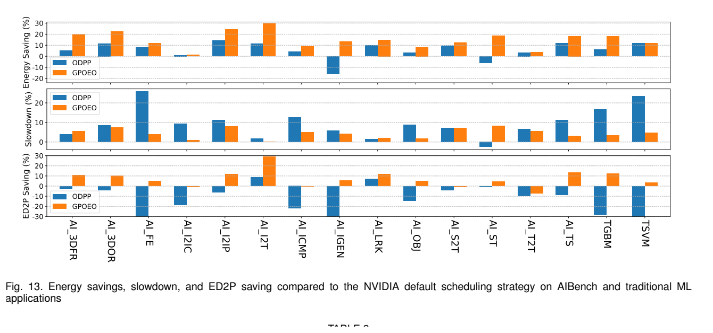
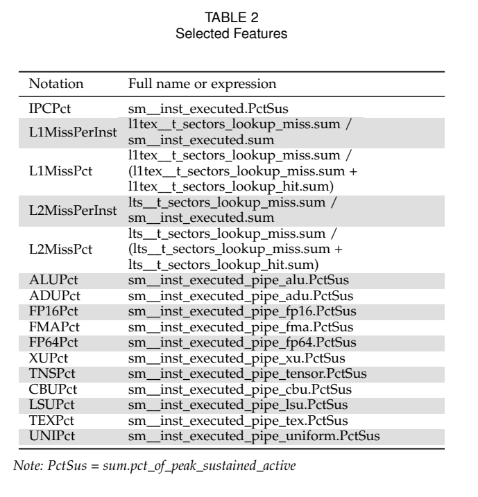

[论文页面](https://arxiv.org/abs/2201.01684v1) · [本笔记所用 PDF](https://arxiv.org/pdf/2201.01684v1) · [标识符](https://doi.org/10.48550/arXiv.2201.01684)

整理日期：2026-11-06。**读者原创中文解读；原图归论文作者／出版方。未运行作者实验，不是独立复现。**

**一句话：** 先检测训练迭代周期，再用XGBoost预测候选GPU核/显存频率的能量和时间，最后在线黄金分割搜索修正预测

阅读地图：先看问题与输入输出，再顺着架构图、公式和结果图阅读；最后检查统计边界与E902迁移。完整编号索引另见“图表索引”。下文“读者分析”是推断或建议，不是原文结果。

## 阶段0：材料与版本审计

| 材料 | 当前可用程度 | 影响 |
| --- | --- | --- |
| 摘要、正文、方法、原图注 | 已获取本地完整PDF、文本与逐页渲染 | 可核查结构、实验及关键数字；可见页面优先于异常文本层 |
| 分析版本 | arXiv2201.01684v1，13页；本文为GPOEO，不是后续MF-GPOEO。 | 引用页码以“PDF第几页”标识 |
| 代码／原始数据 | 原文PDF p2给出 [GPOEO源码仓库](https://github.com/ruixueqingyang/GPOEO)，本次确认该公开仓库可访问。尚未构建、运行或锁定论文实验对应commit；公开代码不等于本文结果已复现。 | 公开链接不等于已构建或已拿到原始轨迹 |
| 附件、独立原始重复与勘误 | 当前未完成全渠道附件／勘误穷尽检索 | 不能断言没有附件、没有勘误或没有其他版本 |
| 本次工作范围 | 材料阅读、图表裁取、证据整理、教学公式 | 所有新实验均是建议，尚未执行 |

## 阶段1：身份卡与整体概述

| 项目 | 内容 |
| --- | --- |
| 英文题名 | Dynamic GPU Energy Optimization for Machine Learning Training Workloads |
| 中文导读题名 | 先检测训练迭代周期，再用XGBoost预测候选GPU核/显存频率的能量和时间，最后在线黄金分割搜索修正预测 |
| 作者 | Farui Wang, Weizhe Zhang, Shichao Lai, Meng Hao, Zheng Wang |
| 发表／版本 | arXiv预印本，2022；arXiv2201.01684v1，13页；本文为GPOEO，不是后续MF-GPOEO。 |
| 类型与领域 | 原始方法／工程系统研究；DVFS、GPU/CPU能效、CV/LLM应用运行时控制 |
| 单位、通讯、资助与利益关系 | 作者姓名以本版本首页为准；通讯方式、单位及资助可回查首页与末页声明。当前尚未完成资助/利益关系/勘误的跨版本穷尽审计。 |
| 核心对象与接口 | 检测到稳定周期后采一个迭代的细计数；局部搜索跨若干迭代；非周期按固定区间IPS与功率估E/T |
| 代码与数据 | 原文PDF p2给出 [GPOEO源码仓库](https://github.com/ruixueqingyang/GPOEO)，本次确认该公开仓库可访问。尚未构建、运行或锁定论文实验对应commit；公开代码不等于本文结果已复现。 |
| 与本课题关系 | 很适合“轻量预测＋安全候选档搜索”的毕设结构。GPU负载可直接借鉴；E902把CUPTI换实际可用cycles/停顿/访存计数，先证明新输入预测有效，再比较无模型搜索与纯查表。 |

**约200字中文概述（改写）：** 本文研究GPU机器学习训练：周期性DNN/GNN及非周期传统ML的运行时能效。具体程序包括PyTorch Benchmarks训练预测器；14项AIBench＋ThunderSVM/ThunderGBM测试；55项benchmarking-gnns（GAT/GCN/GatedGCN等×COLLAB/CSL/SBM/TSP/TU等）。作者在RTX3080Ti＋AMD5950X/64GB；driver470.57、CUDA11.3；NVML功率/时钟、CUPTI计数；GPU能量非整机能量上采用FFT候选周期＋序列相似度/高斯混合与滚动检验；4个XGBoost相对E/T预测器；先显存后SM局部黄金分割/凸拟合搜索。输入为采样power/SM利用率/memory利用率周期信号；参考频率下PTX类型密度、L1/L2 miss、候选SM/显存档位、性能损失阈值，输出为SM与显存频率配置；以预测ED²P或受损失约束能量优化为目标。主要结果应与下方基线、性能约束和测量范围一起阅读，不能只摘最高百分比。把低侵入周期识别、细计数学习和在线局部修正组合，使离线预测不必完全精确。

**三句话定位：** 问题是为什么局部利用率不能完整反映整个应用的性能与能耗？本篇的研究问题或可检验主张是：先检测训练迭代周期，再用XGBoost预测候选GPU核/显存频率的能量和时间，最后在线黄金分割搜索修正预测。验证链是可观测状态→控制规则或学习模型→执行器→任务正确性/服务质量与能耗对照。 方法主线为采样power/SM利用率/memory利用率周期信号；参考频率下PTX类型密度、L1/L2 miss、候选SM/显存档位、性能损失阈值 → FFT候选周期＋序列相似度/高斯混合与滚动检验；4个XGBoost相对E/T预测器；先显存后SM局部黄金分割/凸拟合搜索 → SM与显存频率配置；以预测ED²P或受损失约束能量优化为目标 → 执行与反馈。 主要证据见下方结果表，结论须与测量和版本范围一起使用。

## 阶段2：问题、假设与创新位置

为什么局部利用率不能完整反映整个应用的性能与能耗？本篇的研究问题或可检验主张是：先检测训练迭代周期，再用XGBoost预测候选GPU核/显存频率的能量和时间，最后在线黄金分割搜索修正预测。验证链是可观测状态→控制规则或学习模型→执行器→任务正确性/服务质量与能耗对照。

**创新判断（读者分析）：** 把低侵入周期识别、细计数学习和在线局部修正组合，使离线预测不必完全精确。 不依据作者自称“首次”断定整个领域绝无前例。

## 阶段3：必要术语与数学

| 级别 | 术语／关键词 | 直觉、严格含义与易混点 |
| --- | --- | --- |
| A | DVFS / DFS | DVFS同时涉及动态电压与频率；只有时钟变化称DFS。电压能否改变取决于实际供电域。 |
| A | Workload | 真正执行应用计算的程序与输入；本文里的控制器是另一个角色。 |
| A | Controller | 根据观测选择动作的软件／硬件，可运行在同一CPU或独立控制核。 |
| A | OPP | Operating Performance Point，经过允许范围验证的电压—频率组合。 |
| A | Power / Energy | 功率W表示此刻消耗快慢；能量J是对时间积分。低功率不必然低能量。 |
| B | Deadline | 作业必须完成的时刻；平均时延、P95与最大时延各有不同用途。 |
| A | 被控程序 | PyTorch Benchmarks训练预测器；14项AIBench＋ThunderSVM/ThunderGBM测试；55项benchmarking-gnns（GAT/GCN/GatedGCN等×COLLAB/CSL/SBM/TSP/TU等） |
| A | 控制策略 | FFT候选周期＋序列相似度/高斯混合与滚动检验；4个XGBoost相对E/T预测器；先显存后SM局部黄金分割/凸拟合搜索 |
| B | 控制周期 | 检测到稳定周期后采一个迭代的细计数；局部搜索跨若干迭代；非周期按固定区间IPS与功率估E/T |
| B | 证据边界 | 实测、硬件仿真、功耗模型是不同证据，见平台与结果表。 |

### 公式1：相对能量预测

**符号与前提：** x为参考档特征，f为候选档；输出e是E/Edefault无量纲，不是J；hk为回归树。

**代入与检查：** 预测0.85表示该基线能量的85%，若时间比1.1，则ED²P比0.85×1.1²≈1.029。

**来源：** §4.3，p6–7
### 公式2：目标与性能约束（整理）

**符号与前提：** ε为允许slowdown比例；E J、T s；ED²P单位J·s²。

**代入与检查：** 能量−15%、时间＋10%时ED²P反而约＋2.85%，不能只看能量。

**来源：** §3.1/§5.4，p3/9

## 阶段4–6：架构、关键图与方法拆解

**输入—处理—输出：** 采样power/SM利用率/memory利用率周期信号；参考频率下PTX类型密度、L1/L2 miss、候选SM/显存档位、性能损失阈值 → FFT候选周期＋序列相似度/高斯混合与滚动检验；4个XGBoost相对E/T预测器；先显存后SM局部黄金分割/凸拟合搜索 → SM与显存频率配置；以预测ED²P或受损失约束能量优化为目标 → 执行与反馈。

| 系统角色 | 具体设置 |
| --- | --- |
| 具体控制算法 | FFT候选周期＋序列相似度/高斯混合与滚动检验；4个XGBoost相对E/T预测器；先显存后SM局部黄金分割/凸拟合搜索 |
| 被控负载类型 | GPU机器学习训练：周期性DNN/GNN及非周期传统ML |
| 具体被控程序 | PyTorch Benchmarks训练预测器；14项AIBench＋ThunderSVM/ThunderGBM测试；55项benchmarking-gnns（GAT/GCN/GatedGCN等×COLLAB/CSL/SBM/TSP/TU等） |
| 使用平台与测量 | RTX3080Ti＋AMD5950X/64GB；driver470.57、CUDA11.3；NVML功率/时钟、CUPTI计数；GPU能量非整机能量 |
| 输入/状态 | 采样power/SM利用率/memory利用率周期信号；参考频率下PTX类型密度、L1/L2 miss、候选SM/显存档位、性能损失阈值 |
| 输出/动作 | SM与显存频率配置；以预测ED²P或受损失约束能量优化为目标 |
| 周期与运行位置 | 检测到稳定周期后采一个迭代的细计数；局部搜索跨若干迭代；非周期按固定区间IPS与功率估E/T |

§3–4，p3–7：高层利用率相似仍可能有不同频率敏感性，故先用低侵入功率/利用率组合检测迭代周期，再在参考频率1800/9251MHz采CUPTI特征。四个XGBoost分别预测改变SM或显存的相对能量/相对时间，训练数据每配置测10次取平均，超参grid search。离线训练套件与主要评估套件分开。

预测最优档附近先搜显存（过低显存易严重慢化），再搜SM；利用目标大致凸的经验做黄金分割，拟合多次噪声点。SM实际搜索450–1920MHz、15MHz档距；硬件全支持210–2025MHz不等于算法全选。非周期任务改用固定区间IPS/power，避免把假周期当一次完整训练。约束只保证优化后的迭代，剖析/搜索阶段会额外慢化。

### Fig4：GPOEO流程

[打开大图](images/original-fig4.png) · [原文 Fig4，PDF p3](https://arxiv.org/pdf/2201.01684v1#page=3)

**怎样看：** 先读图题、图例、坐标/表头与单位，再在同一负载和同一基线内比较。预测后仍有在线搜索。

**直接观察／原文报告：** 预测后仍有在线搜索。

**读者判断：** 只支持此图所列的模型、设备、输入与测量口径；预测后仍有在线搜索。 不能由单图推出E902或其他GPU的同幅收益。

| 阅读问题 | 先看材料 | 如何接到下一步 |
| --- | --- | --- |
| 为什么要改现有方案 | 问题背景与动机图 | 确定目标、约束和原有不足 |
| 系统观察什么、控制什么 | 输入输出表＋关键架构图 | 确认数据、模型和执行器真实角色 |
| 方法如何得到动作或估计 | 方法段、公式、算法／模型表 | 明确离线训练与在线流程 |
| 收益是否真实且公平 | 结果图表、统计与测量边界 | 核查基线／目标／分母／开销 |
| 能否用于自己的CPU | 局限、复现计划、三项实验 | 把论文假设变成待验证的工程条件 |

## 阶段7–8：实验、统计及证据链

本节数字均是**原文明确报告或原文数值的标注算例**；没有按图柱高度臆造额外精确值。

| 指标 | 原文报告 | 条件／分母／边界 | 证据位置 |
| --- | --- | --- | --- |
| 全71项平均 | GPU能量−16.2%，执行时间＋5.1% | 相对NVIDIA默认；并非每项满足5% slowdown | 摘要/§5.4，p1/9–11 |
| 16项中型测试 | 能量−14.7%、ED²P−6.8%、时间＋4.6% | 14AIBench＋2传统ML；相对默认 | Fig13，p9–10 |
| 55项GNN | 能量−16.6%、时间＋5.2% | 仅22/55在整体评估中达到5%性能损失约束；不可称零违约 | Fig14/§5.4.2，p11 |

### Fig13：16任务能量/时间/ED²P

[打开大图](images/original-fig13.png) · [原文 Fig13，PDF p10](https://arxiv.org/pdf/2201.01684v1#page=10)

**怎样看：** 先读图题、图例、坐标/表头与单位，再在同一负载和同一基线内比较。三行配对才可判断。

**直接观察／原文报告：** 三行配对才可判断。

**读者判断：** 只支持此图所列的模型、设备、输入与测量口径；三行配对才可判断。 不能由单图推出E902或其他GPU的同幅收益。

### Table2：CUPTI特征

[打开大图](images/original-table2.png) · [原文 Table2，PDF p6](https://arxiv.org/pdf/2201.01684v1#page=6)

**怎样看：** 先读图题、图例、坐标/表头与单位，再在同一负载和同一基线内比较。PTX密度与cache miss来自GPU硬件。

**直接观察／原文报告：** PTX密度与cache miss来自GPU硬件。

**读者判断：** 只支持此图所列的模型、设备、输入与测量口径；PTX密度与cache miss来自GPU硬件。 不能由单图推出E902或其他GPU的同幅收益。

**统计与公平性审查（读者分析）：** 训练数据每测10次平均不等于最终71工作负载每项都有10次独立重复。Fig9–12主要为预测误差分布，不是节能效果。两个测试分组的mean与全体mean不同。控制开销作者消融全系统但不调频，Fig15开销<4%；探索期间违反5%约束需要单列。

工程实验中，设备、程序、输入文件、重复运行、时间窗口是不同统计层级，不能互相替代。本任务不涉及生物样本，细胞／动物／试剂等检查不适用。未注明的P值或置信区间不补造；“差了几个百分点”不自动等于统计显著。

| 主张层级 | 直接证据 | 对照与统计 | 可得结论／替代解释 | 可信度 |
| --- | --- | --- | --- | --- |
| 原文明确报告 | 全71项平均：GPU能量−16.2%，执行时间＋5.1% | 摘要/§5.4，p1/9–11 | 相对NVIDIA默认；并非每项满足5% slowdown；仅在该实验范围内成立 | 图表／文本可核对：高；独立复现：尚无 |
| 作者解释 | 所提架构／模型解释了性能或估计改善 | 关键原图与方法见上文；统计边界见下节 | 效果可能同时来自动作空间、平台特性与采样设置，因果归因需消融 | 中 |
| AI分析／迁移假设 | 用于允许的GPU/CV/LLM候选场景及CPU/E902迁移 | 本篇未直接验证该芯片与任务组合 | 需三项后续实验；不能复制论文收益数字 | 待验证，当前无法判断 |

## 阶段9–10：贡献与局限分开判断

把低侵入周期识别、细计数学习和在线局部修正组合，使离线预测不必完全精确。

| 来源 | 严重程度 | 局限及其影响 |
| --- | --- | --- |
| 读者分析 | 关键 | 只在RTX3080Ti验证，性能计数/特征与频率选项跨GPU需重训。 |
| 作者明确讨论＋读者影响分析（§5.4，p10–11） | 关键 | 周期检测异常和短运行会削弱搜索摊销，瞬态性能并未硬保证。 |
| 读者分析 | 关键 | XGBoost是预测模型，最终动作由搜索决定；不能称端到端强化学习或把预测误差当节能率。 |

## 阶段11：最小复现路线与缺口

本次未运行作者代码。最小复建顺序：①固定本文平台/模型/输入与质量目标，确认合法可用频档和权限；②逐档运行真实被控程序，验证输出、预热、计时同步与能量测量窗口，至少记录多次独立运行原始数据；③实现本文算法，冻结离线训练/搜索配置，留出新的输入、到达率和温度条件测试；④同动作空间、同质量/SLO比较固定最高档、默认governor、简单规则和本文方案；⑤把离线剖析与在线控制、采样、切频成本单列并计算摊销次数。失败时退回安全固定档，缺失参数列日志，不猜成已知。很适合“轻量预测＋安全候选档搜索”的毕设结构。GPU负载可直接借鉴；E902把CUPTI换实际可用cycles/停顿/访存计数，先证明新输入预测有效，再比较无模型搜索与纯查表。

**代码／数据现状：** 原文PDF p2给出 [GPOEO源码仓库](https://github.com/ruixueqingyang/GPOEO)，本次确认该公开仓库可访问。尚未构建、运行或锁定论文实验对应commit；公开代码不等于本文结果已复现。

**质量控制顺序：** 先验证程序输出和时间基准，再验证采样／模型，最后比较策略。保存输入文件哈希、平台配置、OPP、随机种子、温度与每次运行原始记录。失败时先回固定安全频点定位错误，再继续优化。复现可行性判断为“可开始部分方法复建，完整数值复现条件未齐”；这与“已完成复现”不同。

## 阶段12：应用选题与CPU／E902课题联系

很适合“轻量预测＋安全候选档搜索”的毕设结构。GPU负载可直接借鉴；E902把CUPTI换实际可用cycles/停顿/访存计数，先证明新输入预测有效，再比较无模型搜索与纯查表。

| 建议实验／优先级 | 价值 | 最低资源 | 主要风险 | 成功判据（设计目标，非已得结果） |
| --- | --- | --- | --- | --- |
| P0：参考档特征与E–T数据 | 先验证应用与执行器，建立同边界基线 | 可锁频GPU或有计数器CPU；小CNN/GNN或候选压缩程序 | 频率命令不一定获准或真实生效 | 输出正确；保存实际频率、温度、时延与积分能量 |
| P1：预测器＋局部修正与穷举oracle | 验证状态/阶段感知是否优于固定档与阈值 | 可锁频GPU或有计数器CPU；小CNN/GNN或候选压缩程序 | 新输入与离线标定分布不同 | 同期限/质量/动作空间下报告净收益及尾部时延 |
| P1：控制成本和迁移消融 | 分开采样、模型、切换与算法贡献 | 执行器时间戳；必要时外部电测或明确功耗模型 | 短任务收益被开销吞掉；E902可观测量不同 | 分别关闭各组件；报告失败输入；CPU迁移重新标定 |

上述优先级是读者建议：P0先做，P1建立在基线可运行后，P2只在资源允许且前序实验证明有必要时开展。本批允许CV/LLM/GPU应用；压缩、CV、SLM均未最终定题，也未证明已在E902运行。论文公开可读不自动授权任意复制数据；代码、图片和数据须分别核对许可。

## 阶段13：读完后应掌握与继续核查

**五个知识点：** 先检测训练迭代周期，再用XGBoost预测候选GPU核/显存频率的能量和时间，最后在线黄金分割搜索修正预测 你还应能解释输入输出表中的角色、两条公式的单位、首个结果指标的分母，以及局限表里的关键条件。

**五个未决问题：** 独立新输入是否成立？最差时延是否可接受？测量参考是否足够？控制与切换是否抵消收益？E902实际具有哪些接口和可观测量？这些是研究问题，不是对作者遗漏的无证据指控。

**立即做：** 按公式算例手算一次，选一张结果图复述“硬件—负载—基线—指标—边界”。**后续核查：** 补齐代码版本、训练数据和仪表设置。**可复用：** 上文明确标注的模型与接口思路。**谨慎采用：** 所有跨平台百分比。**暂不采用：** 尚未证实存在的电压控制和完整硬实时承诺。
