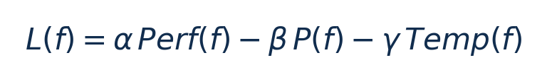

[论文页面](https://doi.org/10.1109/CCGrid59990.2024.00039) · [本笔记所用 PDF](https://infoscience.epfl.ch/bitstreams/45739ef5-f6b4-47a7-8555-73e3dd17bf9f/download) · [标识符](https://doi.org/10.1109/CCGrid59990.2024.00039)

整理日期：2026-11-05。**读者原创中文解读；原图归论文作者／出版方。未运行作者实验，不是独立复现。**

## 先把四个角色放对位置

被控负载是要完成的程序和输入，比如压缩一块日志；CPU是执行程序的硬件；控制器根据观测选运行档位；驱动／寄存器把档位落实。程序代码可以完全一样，CPU时钟变慢时每条指令对应的墙钟时间通常变长，访存或I/O等待则未必按同样比例变化。

软件控制并不意味着没有真实硬件。软件中的学习策略可控制真实CPU；也可先控制一个执行时间与能量模型。后者能验证闭环逻辑，但模型输出的J不能当真实电测。E902的RTL能在仿真中改变时钟并反馈计数；电压导致的物理功耗还需相应模型、功耗分析或板级实验。

## 这篇到底解决哪一件事

先识别应用当前请求强度，再查其合适CPU频率，避免把CPU忙碌率误认为服务需求

为什么相同CPU利用率未必对应相同的工作需求？本篇的可检验主张是：先识别应用当前请求强度，再查其合适CPU频率，避免把CPU忙碌率误认为服务需求。验证链是可观测状态→控制规则或学习模型→执行器→任务正确性/服务质量与能耗对照。

**把方法想成一条流水线：** 每秒73项系统/应用指标时间序列；离线六档负载与各频点性能/功率/温度 → 离线加权效用最大化选“负载等级—频率”对；LSTM早期序列分类；在线概率加权频率f=Σp_i f_i；不是强化学习 → LSTM负载等级概率→各预选频率的加权期望→CPUFreq动作；合法频点取整细节待核 → 执行与反馈。

| 先回答的问题 | 本文答案 |
| --- | --- |
| 具体控制算法 | 离线加权效用最大化选“负载等级—频率”对；LSTM早期序列分类；在线概率加权频率f=Σp_i f_i；不是强化学习 |
| 被控负载类型 | 虚拟机中的数据库/缓存/搜索服务，请求强度变化 |
| 具体被控程序 | CloudSuite Data Serving（YCSB+Cassandra）、Redis benchmark、CloudSuite Web Search（Nutch） |
| 使用平台与测量 | HPE ProLiant DL380 Gen11，2×Xeon Gold6448Y，256GB DDR5；Ubuntu23.04/Linux6.2，KVM/QEMU/libvirt；perf/turbostat等监测package功率并积分能量 |
| 输入/状态 | 每秒73项系统/应用指标时间序列；离线六档负载与各频点性能/功率/温度 |
| 输出/动作 | LSTM负载等级概率→各预选频率的加权期望→CPUFreq动作；合法频点取整细节待核 |
| 周期与运行位置 | 指标每秒采样；用户态工具链与CPU调频接口；不是微秒级硬件控制器 |

## 十个先修关键词

| 级别 | 术语／关键词 | 直觉、严格含义与易混点 |
| --- | --- | --- |
| A | DVFS / DFS | DVFS同时涉及动态电压与频率；只有时钟变化称DFS。电压能否改变取决于实际供电域。 |
| A | Workload | 真正执行应用计算的程序与输入；本文里的控制器是另一个角色。 |
| A | Controller | 根据观测选择动作的软件／硬件，可运行在同一CPU或独立控制核。 |
| A | OPP | Operating Performance Point，经过允许范围验证的电压—频率组合。 |
| A | Power / Energy | 功率W表示此刻消耗快慢；能量J是对时间积分。低功率不必然低能量。 |
| B | Deadline | 作业必须完成的时刻；平均时延、P95与最大时延各有不同用途。 |
| A | 被控程序 | CloudSuite Data Serving（YCSB+Cassandra）、Redis benchmark、CloudSuite Web Search（Nutch） |
| A | 控制策略 | 离线加权效用最大化选“负载等级—频率”对；LSTM早期序列分类；在线概率加权频率f=Σp_i f_i；不是强化学习 |
| B | 控制周期 | 指标每秒采样；用户态工具链与CPU调频接口；不是微秒级硬件控制器 |
| B | 证据边界 | 实测、硬件仿真、功耗模型是不同证据，见平台与结果表。 |

## 用一个小算例建立直觉

权重0.5/0.3/0.2是本文选定值，不是E902理论最优权重。

α+β+γ=1；各指标须按论文归一化尺度使用，温度与功率不能直接当能量。

**要防止的误读：** 无硬截止期或所有未知负载的保证；概率期望频率也不自动是混合场景最优动作。

## 论文真正验证了什么

| 指标 | 原文报告 | 条件／分母／边界 | 证据位置 |
| --- | --- | --- | --- |
| 已知负载能量改善 | WS4.6%、Redis6.5%、Data Serving18.3% | 相对论文intel governor；package能量；不同应用分别报告 | TableV，p10 |
| 已知负载性能改善 | 0.9%、1.3%、1.3% | 与上行同三应用和基线，不是所有负载无退化证明 | TableV，p10 |
| 分类准确率 | 94.1%、97.7%、90.0% | 分别DS/Redis/WS，不是节能率 | TableIV，p7 |
| 未知负载 | 最高约19%能效改善 | 作者对未训练负载的概括，不能扩展成未知应用 | §V-D/Fig9，p10 |

这些结果来自作者实验。算法reward、模型误差、控制器时延、被控应用速度与应用节能是不同指标，要看具体行的单位和证据。

## 它与你的毕设怎么接起来

可把负载等级换成压缩块大小/熵和历史周期需求，用小树/原型表分类，再查合法频率；保留GreenDVFS的“先估需求、再选档”分工，不复制服务器LSTM成本。

最先可以尝试：**P0：块需求能否识别**。理由是检验观测是否比忙碌率有用；最低资源是块长/进度/历史cycles-byte；通过标准是整文件留出比较需求预测误差。

## 五分钟自测

1. 这篇输出的是下一频率、功率估计，还是通信／控制时序？
2. 是真实负载硬件实验，还是模型／RTL／HIL？哪些部分是真的？
3. 最重要百分比的分母和比较对象是什么？
4. 如果换成单核E902，哪一个输入或硬件旋钮会消失？
5. 算上采样、推理、切频和空闲时间后，节能是否还成立？

答案线索在本页角色表和结果表；进一步读“图文技术精读”的关键原图、公式与三项课题实验，再到“图表索引”回查原PDF。不是先记住论文所有缩写。
