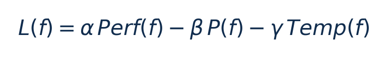
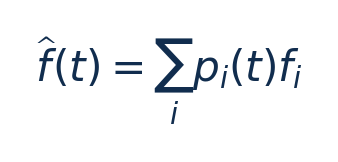
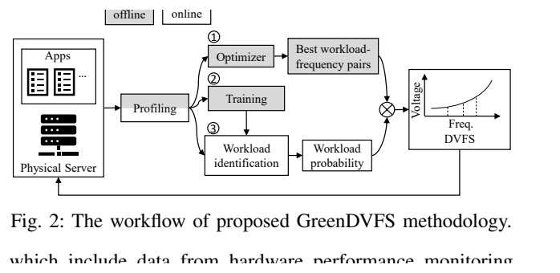
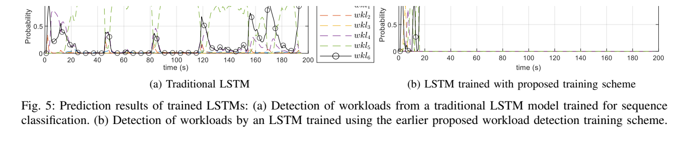
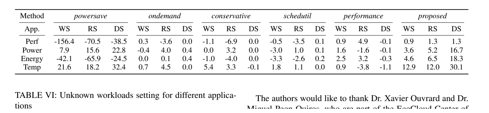

[论文页面](https://doi.org/10.1109/CCGrid59990.2024.00039) · [本笔记所用 PDF](https://infoscience.epfl.ch/bitstreams/45739ef5-f6b4-47a7-8555-73e3dd17bf9f/download) · [标识符](https://doi.org/10.1109/CCGrid59990.2024.00039)

整理日期：2026-11-05。**读者原创中文解读；原图归论文作者／出版方。未运行作者实验，不是独立复现。**

**一句话：** 先识别应用当前请求强度，再查其合适CPU频率，避免把CPU忙碌率误认为服务需求

阅读地图：先看问题与输入输出，再顺着架构图、公式和结果图阅读；最后检查统计边界与E902迁移。完整编号索引另见“图表索引”。下文“读者分析”是推断或建议，不是原文结果。

## 阶段0：材料与版本审计

| 材料 | 当前可用程度 | 影响 |
| --- | --- | --- |
| 摘要、正文、方法、原图注 | 已获取本地完整PDF、文本与逐页渲染 | 可核查结构、实验及关键数字；可见页面优先于异常文本层 |
| 分析版本 | EPFL机构仓储作者公开版11页；DOI 10.1109/CCGrid59990.2024.00039。 | 引用页码以“PDF第几页”标识 |
| 代码／原始数据 | 当前材料中尚未定位齐完整控制器源码、实验脚本和原始重复数据；这不表示这些材料不存在。 | 公开链接不等于已构建或已拿到原始轨迹 |
| 附件、独立原始重复与勘误 | 当前未完成全渠道附件／勘误穷尽检索 | 不能断言没有附件、没有勘误或没有其他版本 |
| 本次工作范围 | 材料阅读、图表裁取、证据整理、教学公式 | 所有新实验均是建议，尚未执行 |

## 阶段1：身份卡与整体概述

| 项目 | 内容 |
| --- | --- |
| 英文题名 | Is the powersave governor really saving power? |
| 中文导读题名 | 先识别应用当前请求强度，再查其合适CPU频率，避免把CPU忙碌率误认为服务需求 |
| 作者 | Darong Huang, Luis Costero, David Atienza |
| 发表／版本 | IEEE CCGrid2024，273–283；EPFL机构仓储作者公开版11页；DOI 10.1109/CCGrid59990.2024.00039。 |
| 类型与领域 | 原始方法／工程系统研究；DVFS、CPU能效、运行时控制 |
| 单位、通讯、资助与利益关系 | 作者姓名以本版本首页为准；通讯方式、单位及资助可回查首页与末页声明。当前尚未完成资助/利益关系/勘误的跨版本穷尽审计。 |
| 核心对象与接口 | 指标每秒采样；用户态工具链与CPU调频接口；不是微秒级硬件控制器 |
| 代码与数据 | 当前材料中尚未定位齐完整控制器源码、实验脚本和原始重复数据；这不表示这些材料不存在。 |
| 与本课题关系 | 可把负载等级换成压缩块大小/熵和历史周期需求，用小树/原型表分类，再查合法频率；保留GreenDVFS的“先估需求、再选档”分工，不复制服务器LSTM成本。 |

**约200字中文概述（改写）：** 本文研究虚拟机中的数据库/缓存/搜索服务，请求强度变化的运行时能效。具体程序包括CloudSuite Data Serving（YCSB+Cassandra）、Redis benchmark、CloudSuite Web Search（Nutch）。作者在HPE ProLiant DL380 Gen11，2×Xeon Gold6448Y，256GB DDR5；Ubuntu23.04/Linux6.2，KVM/QEMU/libvirt；perf/turbostat等监测package功率并积分能量上采用离线加权效用最大化选“负载等级—频率”对；LSTM早期序列分类；在线概率加权频率f=Σp_i f_i；不是强化学习。输入为每秒73项系统/应用指标时间序列；离线六档负载与各频点性能/功率/温度，输出为LSTM负载等级概率→各预选频率的加权期望→CPUFreq动作；合法频点取整细节待核。主要结果应与下方基线、性能约束和测量范围一起阅读，不能只摘最高百分比。将应用服务需求、早期LSTM分类和离线多指标选频整合；关键不在LSTM越大越好，而是避免单纯利用率控制的观测混淆。

**三句话定位：** 问题是为什么相同CPU利用率未必对应相同的工作需求？本篇的可检验主张是：先识别应用当前请求强度，再查其合适CPU频率，避免把CPU忙碌率误认为服务需求。验证链是可观测状态→控制规则或学习模型→执行器→任务正确性/服务质量与能耗对照。 方法主线为每秒73项系统/应用指标时间序列；离线六档负载与各频点性能/功率/温度 → 离线加权效用最大化选“负载等级—频率”对；LSTM早期序列分类；在线概率加权频率f=Σp_i f_i；不是强化学习 → LSTM负载等级概率→各预选频率的加权期望→CPUFreq动作；合法频点取整细节待核 → 执行与反馈。 主要证据见下方结果表，结论须与测量和版本范围一起使用。

## 阶段2：问题、假设与创新位置

为什么相同CPU利用率未必对应相同的工作需求？本篇的可检验主张是：先识别应用当前请求强度，再查其合适CPU频率，避免把CPU忙碌率误认为服务需求。验证链是可观测状态→控制规则或学习模型→执行器→任务正确性/服务质量与能耗对照。

**创新判断（读者分析）：** 将应用服务需求、早期LSTM分类和离线多指标选频整合；关键不在LSTM越大越好，而是避免单纯利用率控制的观测混淆。 不依据作者自称“首次”断定整个领域绝无前例。

## 阶段3：必要术语与数学

| 级别 | 术语／关键词 | 直觉、严格含义与易混点 |
| --- | --- | --- |
| A | DVFS / DFS | DVFS同时涉及动态电压与频率；只有时钟变化称DFS。电压能否改变取决于实际供电域。 |
| A | Workload | 真正执行应用计算的程序与输入；本文里的控制器是另一个角色。 |
| A | Controller | 根据观测选择动作的软件／硬件，可运行在同一CPU或独立控制核。 |
| A | OPP | Operating Performance Point，经过允许范围验证的电压—频率组合。 |
| A | Power / Energy | 功率W表示此刻消耗快慢；能量J是对时间积分。低功率不必然低能量。 |
| B | Deadline | 作业必须完成的时刻；平均时延、P95与最大时延各有不同用途。 |
| A | 被控程序 | CloudSuite Data Serving（YCSB+Cassandra）、Redis benchmark、CloudSuite Web Search（Nutch） |
| A | 控制策略 | 离线加权效用最大化选“负载等级—频率”对；LSTM早期序列分类；在线概率加权频率f=Σp_i f_i；不是强化学习 |
| B | 控制周期 | 指标每秒采样；用户态工具链与CPU调频接口；不是微秒级硬件控制器 |
| B | 证据边界 | 实测、硬件仿真、功耗模型是不同证据，见平台与结果表。 |

### 公式1：离线效用（原文Eq1）

**符号与前提：** α+β+γ=1；各指标须按论文归一化尺度使用，温度与功率不能直接当能量。

**代入与检查：** 权重0.5/0.3/0.2是本文选定值，不是E902理论最优权重。

**来源：** Eq1，p3
### 公式2：在线频率期望

**符号与前提：** p_i为负载类别概率，和为1；f_i为离线预选频率Hz；最终须投影至合法档位。

**代入与检查：** p=(0.25,0.75)，f=(0.5,1.0)GHz，期望0.875GHz；硬件不支持时必须定义映射。教学例。

**来源：** Eq5，p5

## 阶段4–6：架构、关键图与方法拆解

**输入—处理—输出：** 每秒73项系统/应用指标时间序列；离线六档负载与各频点性能/功率/温度 → 离线加权效用最大化选“负载等级—频率”对；LSTM早期序列分类；在线概率加权频率f=Σp_i f_i；不是强化学习 → LSTM负载等级概率→各预选频率的加权期望→CPUFreq动作；合法频点取整细节待核 → 执行与反馈。

| 系统角色 | 具体设置 |
| --- | --- |
| 具体控制算法 | 离线加权效用最大化选“负载等级—频率”对；LSTM早期序列分类；在线概率加权频率f=Σp_i f_i；不是强化学习 |
| 被控负载类型 | 虚拟机中的数据库/缓存/搜索服务，请求强度变化 |
| 具体被控程序 | CloudSuite Data Serving（YCSB+Cassandra）、Redis benchmark、CloudSuite Web Search（Nutch） |
| 使用平台与测量 | HPE ProLiant DL380 Gen11，2×Xeon Gold6448Y，256GB DDR5；Ubuntu23.04/Linux6.2，KVM/QEMU/libvirt；perf/turbostat等监测package功率并积分能量 |
| 输入/状态 | 每秒73项系统/应用指标时间序列；离线六档负载与各频点性能/功率/温度 |
| 输出/动作 | LSTM负载等级概率→各预选频率的加权期望→CPUFreq动作；合法频点取整细节待核 |
| 周期与运行位置 | 指标每秒采样；用户态工具链与CPU调频接口；不是微秒级硬件控制器 |

§III–V（p3–10）：效用L=αPerf−βPower−γTemp，权重0.5/0.3/0.2为启发式选择。逐负载扫频寻找最大L；LSTM用截短轨迹训练，反复将训练长度减半，以便在执行早期就识别负载。在线保留概率分布而非只取argmax，按概率加权离线频率；输出仍需落入平台合法频率。训练/测试80/20。

这篇学习的是负载类别，不是直接在线学习最优电压。功率通过pkgwatt采样，不能说整台服务器插座能量均降低18.3%。Table1的核/线程计数写法不清，比较表只采用明确的CPU型号与数量。性能、温度和功率有不同单位，复现应核对归一化再用权重，不能直接加原始数值。

### Fig2：GreenDVFS整体框图

[打开大图](images/original-fig2.png) · [原文 Fig2，PDF p3](https://infoscience.epfl.ch/bitstreams/45739ef5-f6b4-47a7-8555-73e3dd17bf9f/download#page=3)

**怎样看：** 先读图题、图例、坐标/表头与单位，再在同一负载和同一基线内比较。离线profiling/选频、LSTM训练与运行时选频分开。

**直接观察／原文报告：** 离线profiling/选频、LSTM训练与运行时选频分开。

**读者判断：** 本项只支撑原文所列平台和配置；不证明E902可直接复用这些数值。

### Fig5：早期分类训练对照

[打开大图](images/original-fig5.png) · [原文 Fig5，PDF p5](https://infoscience.epfl.ch/bitstreams/45739ef5-f6b4-47a7-8555-73e3dd17bf9f/download#page=5)

**怎样看：** 先读图题、图例、坐标/表头与单位，再在同一负载和同一基线内比较。只在序列末尾准确的模型对在线调频帮助有限。

**直接观察／原文报告：** 只在序列末尾准确的模型对在线调频帮助有限。

**读者判断：** 本项只支撑原文所列平台和配置；不证明E902可直接复用这些数值。

| 阅读问题 | 先看材料 | 如何接到下一步 |
| --- | --- | --- |
| 为什么要改现有方案 | 问题背景与动机图 | 确定目标、约束和原有不足 |
| 系统观察什么、控制什么 | 输入输出表＋关键架构图 | 确认数据、模型和执行器真实角色 |
| 方法如何得到动作或估计 | 方法段、公式、算法／模型表 | 明确离线训练与在线流程 |
| 收益是否真实且公平 | 结果图表、统计与测量边界 | 核查基线／目标／分母／开销 |
| 能否用于自己的CPU | 局限、复现计划、三项实验 | 把论文假设变成待验证的工程条件 |

## 阶段7–8：实验、统计及证据链

本节数字均是**原文明确报告或原文数值的标注算例**；没有按图柱高度臆造额外精确值。

| 指标 | 原文报告 | 条件／分母／边界 | 证据位置 |
| --- | --- | --- | --- |
| 已知负载能量改善 | WS4.6%、Redis6.5%、Data Serving18.3% | 相对论文intel governor；package能量；不同应用分别报告 | TableV，p10 |
| 已知负载性能改善 | 0.9%、1.3%、1.3% | 与上行同三应用和基线，不是所有负载无退化证明 | TableV，p10 |
| 分类准确率 | 94.1%、97.7%、90.0% | 分别DS/Redis/WS，不是节能率 | TableIV，p7 |
| 未知负载 | 最高约19%能效改善 | 作者对未训练负载的概括，不能扩展成未知应用 | §V-D/Fig9，p10 |

### TableV：综合实验结果

[打开大图](images/original-tablev.png) · [原文 TableV，PDF p10](https://infoscience.epfl.ch/bitstreams/45739ef5-f6b4-47a7-8555-73e3dd17bf9f/download#page=10)

**怎样看：** 先读图题、图例、坐标/表头与单位，再在同一负载和同一基线内比较。能量降4.6/6.5/18.3%，与不同governor逐项比较。

**直接观察／原文报告：** 能量降4.6/6.5/18.3%，与不同governor逐项比较。

**读者判断：** 本项只支撑原文所列平台和配置；不证明E902可直接复用这些数值。

**统计与公平性审查（读者分析）：** 负载强度留出与全新应用留出不同；80/20如何按完整轨迹分割需核对以排除邻近样本泄漏。没有统一独立服务器重复和置信区间，不能把秒级样本当独立硬件样本。TableV中性能/能量各有分母，温度30.1%是原文摄氏指标比较，不应解读为热能减少30%。

工程实验中，设备、程序、输入文件、重复运行、时间窗口是不同统计层级，不能互相替代。本任务不涉及生物样本，细胞／动物／试剂等检查不适用。未注明的P值或置信区间不补造；“差了几个百分点”不自动等于统计显著。

| 主张层级 | 直接证据 | 对照与统计 | 可得结论／替代解释 | 可信度 |
| --- | --- | --- | --- | --- |
| 原文明确报告 | 已知负载能量改善：WS4.6%、Redis6.5%、Data Serving18.3% | TableV，p10 | 相对论文intel governor；package能量；不同应用分别报告；仅在该实验范围内成立 | 图表／文本可核对：高；独立复现：尚无 |
| 作者解释 | 所提架构／模型解释了性能或估计改善 | 关键原图与方法见上文；统计边界见下节 | 效果可能同时来自动作空间、平台特性与采样设置，因果归因需消融 | 中 |
| AI分析／迁移假设 | 用于E902的压缩候选负载 | 本篇未直接验证该芯片与任务组合 | 需三项后续实验；不能复制论文收益数字 | 待验证，当前无法判断 |

## 阶段9–10：贡献与局限分开判断

将应用服务需求、早期LSTM分类和离线多指标选频整合；关键不在LSTM越大越好，而是避免单纯利用率控制的观测混淆。

| 来源 | 严重程度 | 局限及其影响 |
| --- | --- | --- |
| 读者分析 | 关键 | 离线按应用负载扫频成本较高，服务/硬件升级需要重标定。 |
| 读者分析 | 关键 | 73项指标和浮点LSTM不适合原样塞入E902；应先验证少量可用特征。 |
| 读者分析 | 关键 | 无硬截止期或所有未知负载的保证；概率期望频率也不自动是混合场景最优动作。 |

## 阶段11：最小复现路线与缺口

先重建原文固定安全档、输入文件和测量边界，再实现上述算法。逐档确认正确输出和执行时间，记录控制、监测、调频与空闲成本；冻结模型后用整文件留出的输入测试。原文未定位齐的参数须列入复现日志，不用猜测值伪装完整复现。可把负载等级换成压缩块大小/熵和历史周期需求，用小树/原型表分类，再查合法频率；保留GreenDVFS的“先估需求、再选档”分工，不复制服务器LSTM成本。

**代码／数据现状：** 当前材料中尚未定位齐完整控制器源码、实验脚本和原始重复数据；这不表示这些材料不存在。

**质量控制顺序：** 先验证程序输出和时间基准，再验证采样／模型，最后比较策略。保存输入文件哈希、平台配置、OPP、随机种子、温度与每次运行原始记录。失败时先回固定安全频点定位错误，再继续优化。复现可行性判断为“可开始部分方法复建，完整数值复现条件未齐”；这与“已完成复现”不同。

## 阶段12：用于你的CPU／E902课题

可把负载等级换成压缩块大小/熵和历史周期需求，用小树/原型表分类，再查合法频率；保留GreenDVFS的“先估需求、再选档”分工，不复制服务器LSTM成本。

| 建议实验／优先级 | 价值 | 最低资源 | 主要风险 | 成功判据（设计目标，非已得结果） |
| --- | --- | --- | --- | --- |
| P0：块需求能否识别 | 检验观测是否比忙碌率有用 | 块长/进度/历史cycles-byte | 同利用率输入仍难区分 | 整文件留出比较需求预测误差 |
| P1：概率混合与硬分类 | 验证加权频率是否有价值 | 小分类器和合法档位映射 | 平均频率未必满足期限 | 同时报违约率/能量/推理开销 |
| P1：新输入泛化 | 避免轨迹记忆 | 未见熵类型与块大小 | 分布漂移 | 冻结模型后仍优于规则基线 |

上述优先级是读者建议：P0先做，P1建立在基线可运行后，P2只在资源允许且前序实验证明有必要时开展。压缩应用仍是候选，尚未替你最终定题或证明已在E902运行。论文公开可读不自动授权任意复制数据；代码、图片和数据须分别核对许可。

## 阶段13：读完后应掌握与继续核查

**五个知识点：** 先识别应用当前请求强度，再查其合适CPU频率，避免把CPU忙碌率误认为服务需求 你还应能解释输入输出表中的角色、两条公式的单位、首个结果指标的分母，以及局限表里的关键条件。

**五个未决问题：** 独立新输入是否成立？最差时延是否可接受？测量参考是否足够？控制与切换是否抵消收益？E902实际具有哪些接口和可观测量？这些是研究问题，不是对作者遗漏的无证据指控。

**立即做：** 按公式算例手算一次，选一张结果图复述“硬件—负载—基线—指标—边界”。**后续核查：** 补齐代码版本、训练数据和仪表设置。**可复用：** 上文明确标注的模型与接口思路。**谨慎采用：** 所有跨平台百分比。**暂不采用：** 尚未证实存在的电压控制和完整硬实时承诺。
