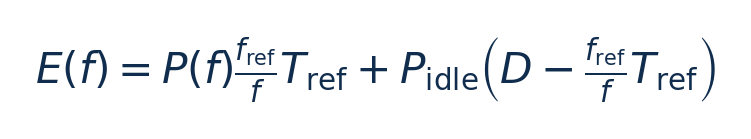
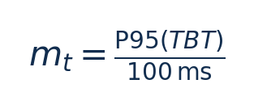
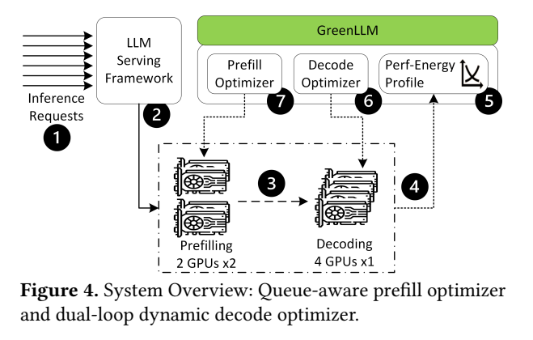
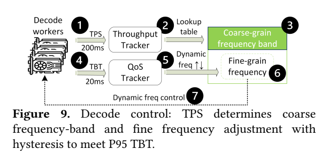
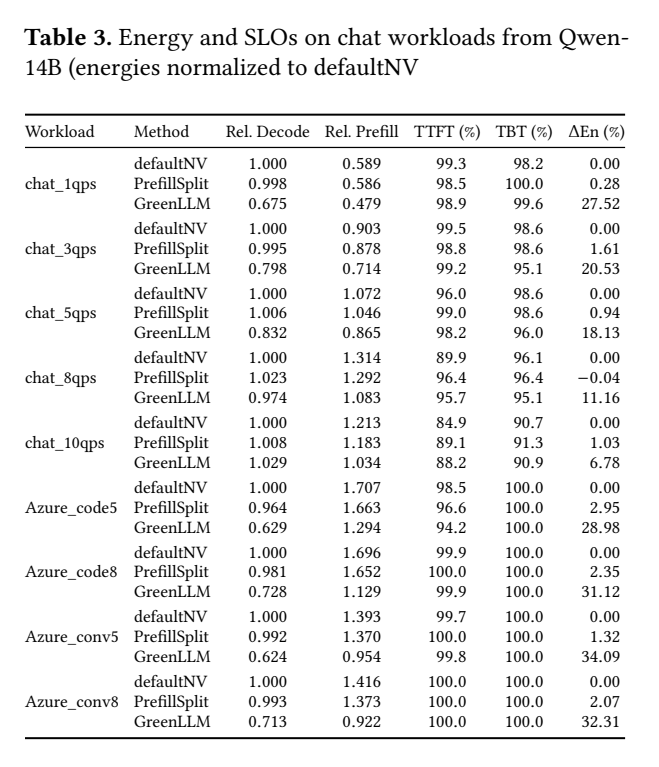
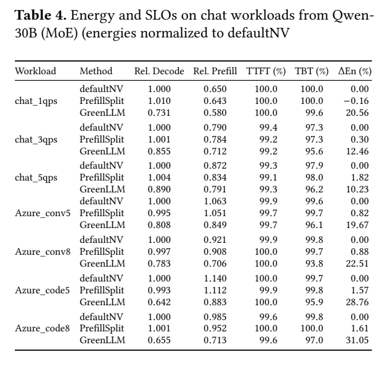

[论文页面](https://arxiv.org/abs/2508.16449v1) · [本笔记所用 PDF](https://arxiv.org/pdf/2508.16449v1) · [标识符](https://doi.org/10.48550/arXiv.2508.16449)

整理日期：2026-11-06。**读者原创中文解读；原图归论文作者／出版方。未运行作者实验，不是独立复现。**

**一句话：** prefill按prompt长度分队列并解能量模型，decode用TPS粗档表与token尾延时细环分别调GPU频率

阅读地图：先看问题与输入输出，再顺着架构图、公式和结果图阅读；最后检查统计边界与E902迁移。完整编号索引另见“图表索引”。下文“读者分析”是推断或建议，不是原文结果。

## 阶段0：材料与版本审计

| 材料 | 当前可用程度 | 影响 |
| --- | --- | --- |
| 摘要、正文、方法、原图注 | 已获取本地完整PDF、文本与逐页渲染 | 可核查结构、实验及关键数字；可见页面优先于异常文本层 |
| 分析版本 | arXiv2508.16449v1，2025-08-22，13页；与GreenDVFS服务器CPU工作不同。 | 引用页码以“PDF第几页”标识 |
| 代码／原始数据 | 当前材料中尚未定位齐完整控制器源码、实验脚本和原始重复数据；这不表示这些材料不存在。 | 公开链接不等于已构建或已拿到原始轨迹 |
| 附件、独立原始重复与勘误 | 当前未完成全渠道附件／勘误穷尽检索 | 不能断言没有附件、没有勘误或没有其他版本 |
| 本次工作范围 | 材料阅读、图表裁取、证据整理、教学公式 | 所有新实验均是建议，尚未执行 |

## 阶段1：身份卡与整体概述

| 项目 | 内容 |
| --- | --- |
| 英文题名 | GreenLLM: SLO-Aware Dynamic Frequency Scaling for Energy-Efficient LLM Serving |
| 中文导读题名 | prefill按prompt长度分队列并解能量模型，decode用TPS粗档表与token尾延时细环分别调GPU频率 |
| 作者 | Qunyou Liu, Darong Huang, Marina Zapater, David Atienza |
| 发表／版本 | arXiv预印本2025；arXiv2508.16449v1，2025-08-22，13页；与GreenDVFS服务器CPU工作不同。 |
| 类型与领域 | 原始方法／工程系统研究；DVFS、GPU/CPU能效、CV/LLM应用运行时控制 |
| 单位、通讯、资助与利益关系 | 作者姓名以本版本首页为准；通讯方式、单位及资助可回查首页与末页声明。当前尚未完成资助/利益关系/勘误的跨版本穷尽审计。 |
| 核心对象与接口 | decode 200ms估TPS、连续3窗口才换bucket；20ms细环；6s更新粗表。prefill按待处理队列调节 |
| 代码与数据 | 当前材料中尚未定位齐完整控制器源码、实验脚本和原始重复数据；这不表示这些材料不存在。 |
| 与本课题关系 | 适合将“队列长度/阶段＋粗表＋细反馈”迁移到CPU服务应用；E902可用队列积压/剩余期限替代TPS与P95窗口，先简单规则再学习预测。完整LLM服务实验需要GPU内存，E902只适合小负载或作为管理核。 |

**约200字中文概述（改写）：** 本文研究多请求服务端LLM推理，prefill/decode解耦、动态到达率的运行时能效。具体程序包括Qwen3-14B dense、Qwen3-30B MoE，BF16；Alibaba ServeGen chat QPS1/3/5/8/10、Azure2024 code/conversation下采样trace。作者在单DGX-A100节点8×A100-SXM4 40GB/NVLink；Dynamo0.3.1/TensorRT-LLM；NVML SM应用时钟，显存固定；GPU能量，不含全设施上采用prefill长度分队列＋二次延时/三次功率模型约束优化；decode TPS查表粗环＋滞回＋20ms尾延时频率步进细环＋6s表偏置更新。输入为prompt长度/队列待处理项、离线aL²+bL+c时延与P(f)功率模型、过去200ms TPS、近期P95 TBT、SLO余量，输出为prefill队列路由与各worker SM频率；decode频带＋15MHz步进频率；不在线改变模型尺寸。主要结果应与下方基线、性能约束和测量范围一起阅读，不能只摘最高百分比。按阶段采用不同控制律，且将服务排队、空闲功耗、尾延时反馈组合；可解释的双时间尺度比泛称“智能DVFS”更有实施意义。

**三句话定位：** 问题是为什么局部利用率不能完整反映整个应用的性能与能耗？本篇的研究问题或可检验主张是：prefill按prompt长度分队列并解能量模型，decode用TPS粗档表与token尾延时细环分别调GPU频率。验证链是可观测状态→控制规则或学习模型→执行器→任务正确性/服务质量与能耗对照。 方法主线为prompt长度/队列待处理项、离线aL²+bL+c时延与P(f)功率模型、过去200ms TPS、近期P95 TBT、SLO余量 → prefill长度分队列＋二次延时/三次功率模型约束优化；decode TPS查表粗环＋滞回＋20ms尾延时频率步进细环＋6s表偏置更新 → prefill队列路由与各worker SM频率；decode频带＋15MHz步进频率；不在线改变模型尺寸 → 执行与反馈。 主要证据见下方结果表，结论须与测量和版本范围一起使用。

## 阶段2：问题、假设与创新位置

为什么局部利用率不能完整反映整个应用的性能与能耗？本篇的研究问题或可检验主张是：prefill按prompt长度分队列并解能量模型，decode用TPS粗档表与token尾延时细环分别调GPU频率。验证链是可观测状态→控制规则或学习模型→执行器→任务正确性/服务质量与能耗对照。

**创新判断（读者分析）：** 按阶段采用不同控制律，且将服务排队、空闲功耗、尾延时反馈组合；可解释的双时间尺度比泛称“智能DVFS”更有实施意义。 不依据作者自称“首次”断定整个领域绝无前例。

## 阶段3：必要术语与数学

| 级别 | 术语／关键词 | 直觉、严格含义与易混点 |
| --- | --- | --- |
| A | DVFS / DFS | DVFS同时涉及动态电压与频率；只有时钟变化称DFS。电压能否改变取决于实际供电域。 |
| A | Workload | 真正执行应用计算的程序与输入；本文里的控制器是另一个角色。 |
| A | Controller | 根据观测选择动作的软件／硬件，可运行在同一CPU或独立控制核。 |
| A | OPP | Operating Performance Point，经过允许范围验证的电压—频率组合。 |
| A | Power / Energy | 功率W表示此刻消耗快慢；能量J是对时间积分。低功率不必然低能量。 |
| B | Deadline | 作业必须完成的时刻；平均时延、P95与最大时延各有不同用途。 |
| A | 被控程序 | Qwen3-14B dense、Qwen3-30B MoE，BF16；Alibaba ServeGen chat QPS1/3/5/8/10、Azure2024 code/conversation下采样trace |
| A | 控制策略 | prefill长度分队列＋二次延时/三次功率模型约束优化；decode TPS查表粗环＋滞回＋20ms尾延时频率步进细环＋6s表偏置更新 |
| B | 控制周期 | decode 200ms估TPS、连续3窗口才换bucket；20ms细环；6s更新粗表。prefill按待处理队列调节 |
| B | 证据边界 | 实测、硬件仿真、功耗模型是不同证据，见平台与结果表。 |

### 公式1：SLO窗口能量

**符号与前提：** 频率同单位，Tref/D为s，功率W，E为J；只在busy≤D可行时用。

**代入与检查：** 教学例D=1s、busy=0.6s，剩0.4s的idle也耗能；不能只看active功率。

**来源：** Eq5–12，p6
### 公式2：尾延时控制误差

**符号与前提：** m无量纲；m>1升频，m<0.65降频，中间死区保持；不等PID积分。

**代入与检查：** P95=70ms时m=0.7，保持；60ms时降频；105ms时升频。

**来源：** Eq13/§3.3，p7

## 阶段4–6：架构、关键图与方法拆解

**输入—处理—输出：** prompt长度/队列待处理项、离线aL²+bL+c时延与P(f)功率模型、过去200ms TPS、近期P95 TBT、SLO余量 → prefill长度分队列＋二次延时/三次功率模型约束优化；decode TPS查表粗环＋滞回＋20ms尾延时频率步进细环＋6s表偏置更新 → prefill队列路由与各worker SM频率；decode频带＋15MHz步进频率；不在线改变模型尺寸 → 执行与反馈。

| 系统角色 | 具体设置 |
| --- | --- |
| 具体控制算法 | prefill长度分队列＋二次延时/三次功率模型约束优化；decode TPS查表粗环＋滞回＋20ms尾延时频率步进细环＋6s表偏置更新 |
| 被控负载类型 | 多请求服务端LLM推理，prefill/decode解耦、动态到达率 |
| 具体被控程序 | Qwen3-14B dense、Qwen3-30B MoE，BF16；Alibaba ServeGen chat QPS1/3/5/8/10、Azure2024 code/conversation下采样trace |
| 使用平台与测量 | 单DGX-A100节点8×A100-SXM4 40GB/NVLink；Dynamo0.3.1/TensorRT-LLM；NVML SM应用时钟，显存固定；GPU能量，不含全设施 |
| 输入/状态 | prompt长度/队列待处理项、离线aL²+bL+c时延与P(f)功率模型、过去200ms TPS、近期P95 TBT、SLO余量 |
| 输出/动作 | prefill队列路由与各worker SM频率；decode频带＋15MHz步进频率；不在线改变模型尺寸 |
| 周期与运行位置 | decode 200ms估TPS、连续3窗口才换bucket；20ms细环；6s更新粗表。prefill按待处理队列调节 |

§3，PDF p4–7：短/中/长prompt分队列减轻head-of-line blocking；按长度预测参考时钟busy time，再以fref/f近似缩放，拟合active P(f)=k3f³+k2f²+k1f+k0，并把SLO窗口剩余时间idle能量也计入，选择busy≤D时能量最低档。

decode先离线按TPS200–3000剖析最低能耗可行SM频率，在线过去200ms映射bucket，连续三个窗口留在新桶才换band；20ms计算近期P95 TBT/100ms，大于1升15MHz，小于0.65降15MHz，否则保持；限制在粗档邻域。6s持续偏置才更新表。方法是模型＋反馈规则，不是神经RL。4个prefill GPU（2workers×2）和4个decodeGPU；每trace至少30min。

### Fig4：整体架构

[打开大图](images/original-fig4.png) · [原文 Fig4，PDF p4](https://arxiv.org/pdf/2508.16449v1#page=4)

**怎样看：** 先读图题、图例、坐标/表头与单位，再在同一负载和同一基线内比较。路由、prefill优化、decode反馈分开。

**直接观察／原文报告：** 路由、prefill优化、decode反馈分开。

**读者判断：** 只支持此图所列的模型、设备、输入与测量口径；路由、prefill优化、decode反馈分开。 不能由单图推出E902或其他GPU的同幅收益。

### Fig9：decode双环

[打开大图](images/original-fig9.png) · [原文 Fig9，PDF p7](https://arxiv.org/pdf/2508.16449v1#page=7)

**怎样看：** 先读图题、图例、坐标/表头与单位，再在同一负载和同一基线内比较。粗表与细步进各有时钟。

**直接观察／原文报告：** 粗表与细步进各有时钟。

**读者判断：** 只支持此图所列的模型、设备、输入与测量口径；粗表与细步进各有时钟。 不能由单图推出E902或其他GPU的同幅收益。

| 阅读问题 | 先看材料 | 如何接到下一步 |
| --- | --- | --- |
| 为什么要改现有方案 | 问题背景与动机图 | 确定目标、约束和原有不足 |
| 系统观察什么、控制什么 | 输入输出表＋关键架构图 | 确认数据、模型和执行器真实角色 |
| 方法如何得到动作或估计 | 方法段、公式、算法／模型表 | 明确离线训练与在线流程 |
| 收益是否真实且公平 | 结果图表、统计与测量边界 | 核查基线／目标／分母／开销 |
| 能否用于自己的CPU | 局限、复现计划、三项实验 | 把论文假设变成待验证的工程条件 |

## 阶段7–8：实验、统计及证据链

本节数字均是**原文明确报告或原文数值的标注算例**；没有按图柱高度臆造额外精确值。

| 指标 | 原文报告 | 条件／分母／边界 | 证据位置 |
| --- | --- | --- | --- |
| GPU总能量降低 | Azure Qwen14B最高34.09% | Azure_conv5，相对defaultNV；其他工况约6.78%–34.09%，非所有34% | Table3，p10 |
| Qwen30B例 | Azure_conv8节能22.51%，TBT通过99.8%→93.8% | 通过率下降6.0个百分点；与摘要“additional violations<3.5%”笼统说法不完全一致 | Table4，p10 |
| 路由单独贡献 | 多工况约1%–3%能量变化 | PrefillSplit消融vsdefaultNV；主要节能还来自阶段调频 | Table3–4，p10 |

### Table3：14B完整trace结果

[打开大图](images/original-table3.png) · [原文 Table3，PDF p10](https://arxiv.org/pdf/2508.16449v1#page=10)

**怎样看：** 先读图题、图例、坐标/表头与单位，再在同一负载和同一基线内比较。逐行对照通过率和总能量。

**直接观察／原文报告：** 逐行对照通过率和总能量。

**读者判断：** 只支持此图所列的模型、设备、输入与测量口径；逐行对照通过率和总能量。 不能由单图推出E902或其他GPU的同幅收益。

### Table4：30B完整trace结果

[打开大图](images/original-table4.png) · [原文 Table4，PDF p10](https://arxiv.org/pdf/2508.16449v1#page=10)

**怎样看：** 先读图题、图例、坐标/表头与单位，再在同一负载和同一基线内比较。有6个百分点TBT通过率下降，不能漏掉。

**直接观察／原文报告：** 有6个百分点TBT通过率下降，不能漏掉。

**读者判断：** 只支持此图所列的模型、设备、输入与测量口径；有6个百分点TBT通过率下降，不能漏掉。 不能由单图推出E902或其他GPU的同幅收益。

**统计与公平性审查（读者分析）：** trace每次至少30min不等独立30次重复。SLO通过率有TTFT/TBT不同分母，P95目标与整段百分比不同。Table4个别通过率下降超过摘要概括范围，引用必须逐行标注，不隐去反例。预填充功率拟合与busy缩放有近似误差；固定显存条件不能推出显存协同收益。

工程实验中，设备、程序、输入文件、重复运行、时间窗口是不同统计层级，不能互相替代。本任务不涉及生物样本，细胞／动物／试剂等检查不适用。未注明的P值或置信区间不补造；“差了几个百分点”不自动等于统计显著。

| 主张层级 | 直接证据 | 对照与统计 | 可得结论／替代解释 | 可信度 |
| --- | --- | --- | --- | --- |
| 原文明确报告 | GPU总能量降低：Azure Qwen14B最高34.09% | Table3，p10 | Azure_conv5，相对defaultNV；其他工况约6.78%–34.09%，非所有34%；仅在该实验范围内成立 | 图表／文本可核对：高；独立复现：尚无 |
| 作者解释 | 所提架构／模型解释了性能或估计改善 | 关键原图与方法见上文；统计边界见下节 | 效果可能同时来自动作空间、平台特性与采样设置，因果归因需消融 | 中 |
| AI分析／迁移假设 | 用于允许的GPU/CV/LLM候选场景及CPU/E902迁移 | 本篇未直接验证该芯片与任务组合 | 需三项后续实验；不能复制论文收益数字 | 待验证，当前无法判断 |

## 阶段9–10：贡献与局限分开判断

按阶段采用不同控制律，且将服务排队、空闲功耗、尾延时反馈组合；可解释的双时间尺度比泛称“智能DVFS”更有实施意义。

| 来源 | 严重程度 | 局限及其影响 |
| --- | --- | --- |
| 读者分析 | 关键 | DGX节点/两模型/下采样trace对单设备CPU或手机外推有限。 |
| 读者分析 | 关键 | 低负载有余量，高负载趋向最高频率，节能随QPS减小，不能保证负载满时仍34%。 |
| 读者分析 | 关键 | SLO不是硬deadline证明；原文表格存在更大通过率代价，需要独立重算和明确违约定义。 |

## 阶段11：最小复现路线与缺口

本次未运行作者代码。最小复建顺序：①固定本文平台/模型/输入与质量目标，确认合法可用频档和权限；②逐档运行真实被控程序，验证输出、预热、计时同步与能量测量窗口，至少记录多次独立运行原始数据；③实现本文算法，冻结离线训练/搜索配置，留出新的输入、到达率和温度条件测试；④同动作空间、同质量/SLO比较固定最高档、默认governor、简单规则和本文方案；⑤把离线剖析与在线控制、采样、切频成本单列并计算摊销次数。失败时退回安全固定档，缺失参数列日志，不猜成已知。适合将“队列长度/阶段＋粗表＋细反馈”迁移到CPU服务应用；E902可用队列积压/剩余期限替代TPS与P95窗口，先简单规则再学习预测。完整LLM服务实验需要GPU内存，E902只适合小负载或作为管理核。

**代码／数据现状：** 当前材料中尚未定位齐完整控制器源码、实验脚本和原始重复数据；这不表示这些材料不存在。

**质量控制顺序：** 先验证程序输出和时间基准，再验证采样／模型，最后比较策略。保存输入文件哈希、平台配置、OPP、随机种子、温度与每次运行原始记录。失败时先回固定安全频点定位错误，再继续优化。复现可行性判断为“可开始部分方法复建，完整数值复现条件未齐”；这与“已完成复现”不同。

## 阶段12：应用选题与CPU／E902课题联系

适合将“队列长度/阶段＋粗表＋细反馈”迁移到CPU服务应用；E902可用队列积压/剩余期限替代TPS与P95窗口，先简单规则再学习预测。完整LLM服务实验需要GPU内存，E902只适合小负载或作为管理核。

| 建议实验／优先级 | 价值 | 最低资源 | 主要风险 | 成功判据（设计目标，非已得结果） |
| --- | --- | --- | --- | --- |
| P0：阶段与排队时延分离 | 先验证应用与执行器，建立同边界基线 | 单GPU/CPU轻量服务、可控请求到达率、端到端与执行时间日志 | 频率命令不一定获准或真实生效 | 输出正确；保存实际频率、温度、时延与积分能量 |
| P1：固定档/统一策略/阶段双环的SLO对照 | 验证状态/阶段感知是否优于固定档与阈值 | 单GPU/CPU轻量服务、可控请求到达率、端到端与执行时间日志 | 新输入与离线标定分布不同 | 同期限/质量/动作空间下报告净收益及尾部时延 |
| P1：控制成本和迁移消融 | 分开采样、模型、切换与算法贡献 | 执行器时间戳；必要时外部电测或明确功耗模型 | 短任务收益被开销吞掉；E902可观测量不同 | 分别关闭各组件；报告失败输入；CPU迁移重新标定 |

上述优先级是读者建议：P0先做，P1建立在基线可运行后，P2只在资源允许且前序实验证明有必要时开展。本批允许CV/LLM/GPU应用；压缩、CV、SLM均未最终定题，也未证明已在E902运行。论文公开可读不自动授权任意复制数据；代码、图片和数据须分别核对许可。

## 阶段13：读完后应掌握与继续核查

**五个知识点：** prefill按prompt长度分队列并解能量模型，decode用TPS粗档表与token尾延时细环分别调GPU频率 你还应能解释输入输出表中的角色、两条公式的单位、首个结果指标的分母，以及局限表里的关键条件。

**五个未决问题：** 独立新输入是否成立？最差时延是否可接受？测量参考是否足够？控制与切换是否抵消收益？E902实际具有哪些接口和可观测量？这些是研究问题，不是对作者遗漏的无证据指控。

**立即做：** 按公式算例手算一次，选一张结果图复述“硬件—负载—基线—指标—边界”。**后续核查：** 补齐代码版本、训练数据和仪表设置。**可复用：** 上文明确标注的模型与接口思路。**谨慎采用：** 所有跨平台百分比。**暂不采用：** 尚未证实存在的电压控制和完整硬实时承诺。
