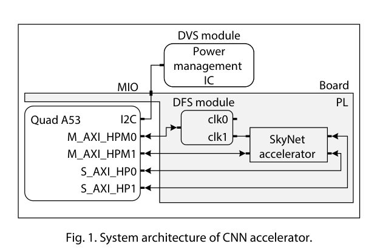
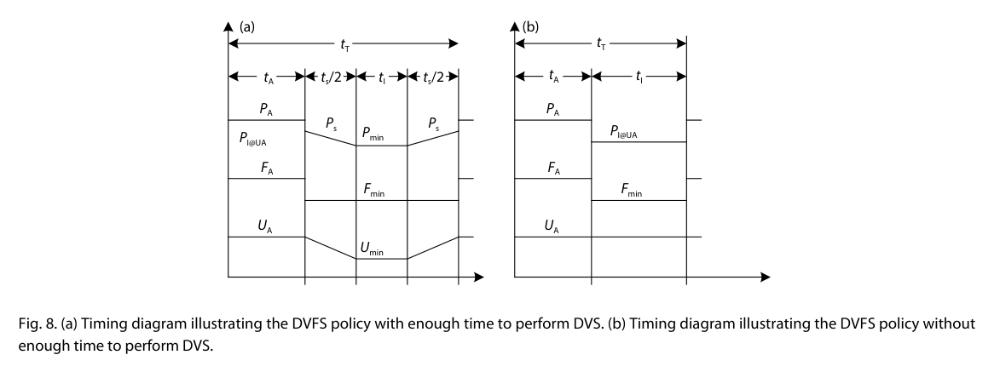

用户选定的入门阅读材料。先读这篇建立“应用要求→选择配置→软件驱动→时钟与电源执行→测量验证”的认识，再进入IC控制器和智能算法论文。本页是基于全文核对的教学导读，未独立复现，不代替完整精读及器件手册。

## 原文与阅读顺序

Weixiong Jiang等，Optimizing energy efficiency of CNN-based object detection with dynamic voltage and frequency scaling，Journal of Semiconductors 41, 022406 (2020)。[论文入口](https://doi.org/10.1088/1674-4926/41/2/022406) · [公开PDF](https://www.researching.cn/ArticlePdf/m00098/2020/41/2/022406.pdf)。

推荐先读图1，再读§4.1调频、§4.2调压、§4.3与图8策略，接着读§5.1系统分工和§6实验。重点解释其工程流程，不能把2020年的工作误写成最新IC顶刊论文。

## 第一步：谁控制谁

*原文图1：A53运行控制软件，PL中的SkyNet是被控负载，板上PMIC负责供电。*

|角色|论文中的实现|初学者应理解的含义|
|---|---|---|
|控制软件|A53上的Linux程序与驱动|计算/接收目标并发出配置命令|
|被控负载|PL上的SkyNet目标检测加速器|实际执行图像计算的硬件|
|调频执行器|MMCM|根据配置参数输出新时钟|
|调压执行器|板上IRPS5401及供电电路|改变真实VCCINT电压|

论文没有用这条路径调节A53本身的电压。迁移到E902时，先明确E902是控制核还是被控CPU。

## 第二步：软件怎样改变真实频率和电压

调频路径：Linux软件→内存映射寄存器→AXI4-Lite→MMCM→加速器时钟。§4.1给出：

$$f_{out}=f_{in}\frac{M}{D\,O}$$

输入参考时钟为$f_{in}$，$M$是倍频参数，$D$和$O$是分频参数；这些参数决定输出频率。实际配置的参考时钟为100MHz，图2通用示意中的33MHz不能混用。框架报告20–400MHz、1MHz步进、约3μs调频；移植时必须核对具体原语允许的配置及切换行为。

调压路径：Linux软件→I²C驱动/PMBus命令→PS侧I²C控制器与MIO→PCA9548→IRPS5401→VCCINT。改变的是板上真实供电，软件只负责下发命令。§4.2报告调压约2ms，因此调压比调频慢很多。读取电压、电流和功率用于观测与实验，不等于已经实现了依据功率误差自动选档的闭环控制器。

## 第三步：前期遍历选档，运行时按阶段切换

这里要分清两个阶段：

1. 前期扫描不同电压频率组合，记录运行时间、功率、能量和检测准确率。§6.1实际扫描电压680–840mV、20mV间隔；频率200–400MHz、1MHz间隔。这与框架支持的全部范围不同。
2. 根据帧率、准确率等目标比较实测配置，并考虑调档开销，选取合适的活动配置。
3. 运行时以活动配置计算；当前帧完成后进入低频空闲；空闲窗口足够时再降压；下一次计算前恢复活动条件。

因此可以概括为“前期遍历测量＋选择活动档位＋运行时活动/空闲切换”。不能理解成每到一帧都重新扫描全部配置，也没有证据表明该策略使用强化学习或神经网络自动选档。SkyNet是被控负载，不是选档算法。

## 第四步：用图8理解触发与开销

*原文图8：左侧空闲窗口允许降频和降压；右侧窗口较短，仅降频，电压维持活动值。*

图中的$U_A,F_A$是活动电压频率，$U_{min},F_{min}$是空闲低档。触发来自“当前帧完成”与“准备下一次处理”的阶段变化。§5.1明确只在硬件调用的迭代间隙改变电压和频率，不应解释为任意中途扰动加速器。

$$t_T=t_A+t_S+t_I$$
$$E_T=P_A t_A+P_S t_S+P_I t_I,\qquad P_M=\frac{E_T}{t_T}$$

$t_T$是帧周期，$t_A$是处理时间，$t_S$是总切换时间，$t_I$是空闲时间；$P_A,P_S,P_I$分别是相应阶段的功率，$E_T$是周期能量，$P_M$是平均功率。图8两端各标$t_S/2$。选择配置要比较周期总能量，不能只看低档功率。

教学算例：24FPS对应约41.67ms周期（由$1/24$计算，不是新增测量）。处理完成后剩余窗口还要容纳必要的切换和恢复；短窗口不一定值得调压。

## 可迁移到当前课题的路线

先用可解释的查表/遍历基线把“策略输出→时钟/PMIC命令→实际生效→测量”接通，再替换选档策略并比较净收益。现有PLL/PMIC接口、电压稳定反馈、锁定反馈、超时回退与安全时钟切换需要根据自己的IP落实。

本论文采用FPGA内建MMCM和板外电源芯片；不能把ASIC模拟PLL直接当作FPGA可综合模块。VCCINT是共享电源轨，不能默认只改变某个软核的供电。论文还研究了CNN容忍错误的配置；通用CPU程序首先需要满足计算正确性。

## 阅读时必须标出的原文问题

- PDF第4页图4标题为DFS驱动，图中实际是与图7重复的调压代码。不能直接照抄图4实现调频。
- 引言写平均功率降低30%，§6.7给出12.86W降至10.90W，约15%；引用时保留差异和实验条件。
- §6.3分析PL/VCCINT功率；§6.4讨论包含PS影响的总能量。两种测量边界不能混用。
- 表2的能效提升38%不是能量降低38%；IoU从71.91%到71.80%是降低0.11个百分点。

## 读完应能回答

谁是控制端和负载？软件怎样改变真实时钟与电压？活动配置怎样选？何时切换？为什么短空闲只降频？怎样计入切换开销？哪些必须重新表征才能迁移到E902？

后续阅读：[IC方向精选10篇](../ic-codesign-selected-10.md)，进一步学习数字控制器、反馈、保护与co-design。
