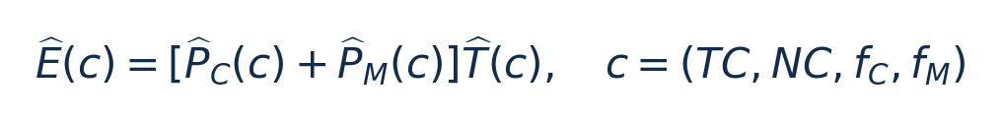

# JOSS：从零入门

[论文页面](https://arxiv.org/abs/2306.04615) · [本笔记所用 PDF](https://arxiv.org/pdf/2306.04615v1) · [DOI](https://doi.org/10.48550/arXiv.2306.04615)

整理日期：2026-11-05。**读者原创中文解读；原图归论文作者／出版方。未运行作者实验，不是独立复现。**

## 先把四个角色放对位置

被控负载是要完成的程序和输入，比如压缩一块日志；CPU是执行程序的硬件；控制器根据观测选运行档位；驱动／寄存器把档位落实。程序代码可以完全一样，CPU时钟变慢时每条指令对应的墙钟时间通常变长，访存或I/O等待则未必按同样比例变化。

软件控制并不意味着没有真实硬件。软件中的学习策略可控制真实CPU；也可先控制一个执行时间与能量模型。后者能验证闭环逻辑，但模型输出的J不能当真实电测。E902的RTL能在仿真中改变时钟并反馈计数；电压导致的物理功耗还需相应模型、功耗分析或板级实验。

## 这篇到底解决哪一件事

每个任务选择哪类核、几个核、CPU频率和内存频率，以最小化CPU加内存的总能量。

降低CPU功率会延长任务，内存也可能多耗一段时间；只优化CPU能量的配置可能不是系统总能量最优。假设是联合建模与联合选择能够获得更好折中，即便不能改变内存频率也有价值。

**把方法想成一条流水线：** 离线合成计算／访存程序拟合模型 → 每个kernel在两档CPU频率采样 → 估计memory-boundness → 预测各配置的时间和两项功率 → 搜索最低能量／满足速度要求的配置 → 共享域协调、合并短任务 → 实际运行。

| 先回答的问题 | 本文答案 |
| --- | --- |
| 输入 | 任务类型、两档执行时间、核类型／数量、可用CPU与内存频点、用户相对速度目标。 |
| 输出 | (TC,NC,f_C,f_M)四元组及调度位置；E902单核可缩减为f_C。 |
| 约束 | 相对最低能量设置的1.2×/1.4×/1.8×性能目标，不等于任意绝对硬截止期。 |
| 实验 | TX2双Denver＋四A57，各cluster共享频率，INA3221测CPU和内存轨。 |

## 十个先修关键词

| 级别 | 术语／关键词 | 直觉、严格含义与易混点 |
| --- | --- | --- |
| A | DVFS / DFS | DVFS同时涉及动态电压与频率；只有时钟变化称DFS。电压能否改变取决于实际供电域。 |
| A | Workload | 真正执行应用计算的程序与输入；本文里的控制器是另一个角色。 |
| A | Controller | 根据观测选择动作的软件／硬件，可运行在同一CPU或独立控制核。 |
| A | OPP | Operating Performance Point，经过允许范围验证的电压—频率组合。 |
| A | Power / Energy | 功率W表示此刻消耗快慢；能量J是对时间积分。低功率不必然低能量。 |
| B | Deadline | 作业必须完成的时刻；平均时延、P95与最大时延各有不同用途。 |
| A | 总能量 | 这里主要指CPU轨＋内存轨，不自动包括整板所有外设。 |
| B | Memory-boundness | 等待访存对运行时间的影响，本文由模型估计。 |
| B | Moldable任务 | 同类任务可选择使用不同核数执行。 |
| C | 最陡下降 | 邻域内逐步找更低预测能量；一般不保证全局最优。 |

## 用一个小算例建立直觉

教学例：配置A CPU1W+内存1W运行10ms，20mJ；配置B CPU0.7W+内存1W运行15ms，25.5mJ。CPU功率降低了，总能量却增加。

P_C/P_M为W，T为s，E为J；TC为核类型，NC为核数，频率Hz。依赖功率／时间模型准确、共享空闲功耗分摊合理。

**要防止的误读：** 平均频率合成与局部搜索无全局最优保证；小E902没有异构核和可调DRAM时应删减动作空间。

## 论文真正验证了什么

| 指标 | 原文报告 | 条件／分母／边界 | 证据位置 |
| --- | --- | --- | --- |
| 相对GRWS总能量 | JOSS降低40.7%；STEER降低19.5% | Fig8统一归一化到GRWS，含CPU＋内存 | §7.1，p8–9 |
| 论文所谓额外收益 | 作者称相对STEER额外21.2% | 40.7−19.5=21.2个百分点；分母不同，不能直接当相对比值 | §7.1，Fig8 |
| 不控制内存频率 | 相对GRWS降低24.8% | 仍考虑内存能量，证明目标边界重要 | §7.1，p8 |
| 平均模型分数 | 时间97%、CPU功率90%、内存功率80% | 按1−相对绝对误差定义，不是三种分类正确率 | §7.3，Fig10，p9 |
| 运行时采样 | 约0.8%总时间 | 每kernel重复出现的测试场景 | §5.1，p5 |

这些结果来自作者实验。算法reward、模型误差、控制器时延、被控应用速度与应用节能是不同指标，要看具体行的单位和证据。

## 它与你的毕设怎么接起来

你最应借鉴免PMC的两档标定、把非CPU固定功耗加入目标、用小查表替代复杂在线搜索。E902先只调CPU，测量SRAM/外设和板级功耗的边界；不要为了照搬四旋钮引入不存在的内存调压接口。

最先可以尝试：**P0：CPU能量与整板能量双目标**。理由是找出目标边界是否改变最优频点；最低资源是两档计时与可获得的电源测量；通过标准是同一输入画两套E–T曲线，给出选档是否变化。

## 五分钟自测

1. 这篇输出的是下一频率、功率估计，还是通信／控制时序？
2. 是真实负载硬件实验，还是模型／RTL／HIL？哪些部分是真的？
3. 最重要百分比的分母和比较对象是什么？
4. 如果换成单核E902，哪一个输入或硬件旋钮会消失？
5. 算上采样、推理、切频和空闲时间后，节能是否还成立？

答案线索在本页角色表和结果表；进一步读“图文技术精读”的关键原图、公式与三项课题实验，再到“图表索引”回查原PDF。不是先记住论文所有缩写。
