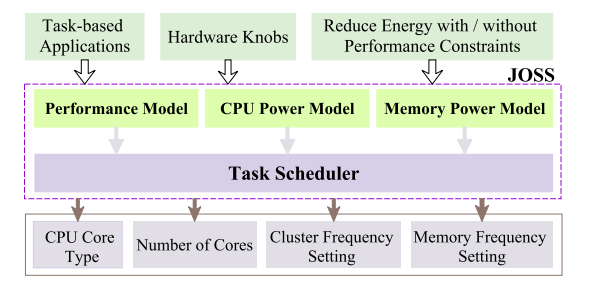
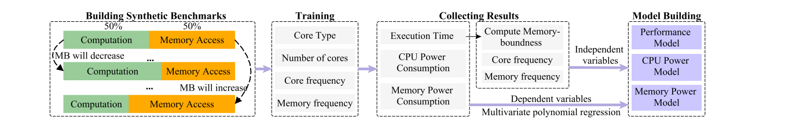
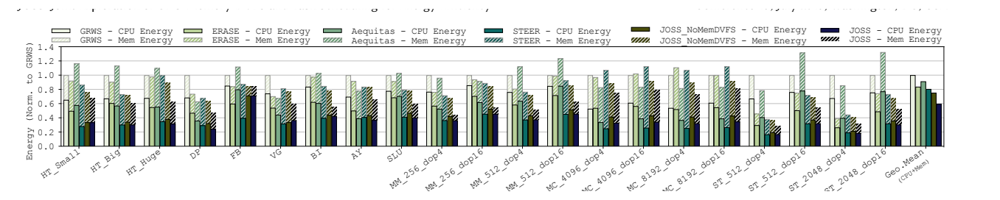
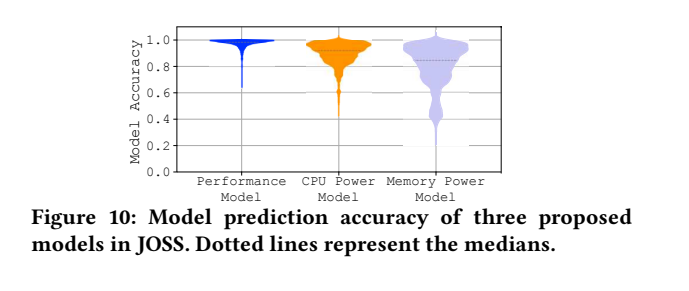
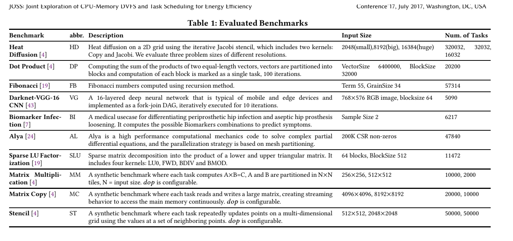

[论文页面](https://arxiv.org/abs/2306.04615) · [本笔记所用 PDF](https://arxiv.org/pdf/2306.04615v1) · [DOI](https://doi.org/10.48550/arXiv.2306.04615)

整理日期：2026-11-05。**读者原创中文解读；原图归论文作者／出版方。未运行作者实验，不是独立复现。**

**覆盖范围：** 本版本正文中识别到的11项图、表或算法；保留原编号。关键项已裁图并在技术精读相应段落出现，未内嵌的项可点PDF页链接查看，不上传整篇PDF。

**统计总边界：** 每项重复10次，但缺少完整原始重复数据／所有置信区间。性能目标并非全部达到：MC_4096在1.2×目标上约差3%，高访存任务可能达不到1.8×。模型误差不等于决策损失。读者对Fig8的百分数做分母审查：若直接拿已四舍五入汇总值估算，相对STEER约(0.805−0.593)/0.805≈26.3%，但这不是从逐任务原始数据重新算出的正式均值；保留原文数值并明确“百分点口径”。

## Fig1：四种资源配置的动机

[原文 Fig1，PDF p3](https://arxiv.org/pdf/2306.04615v1#page=3)

1. **本项回答的问题：** 四种资源配置的动机，用于支撑这条方法或实验链中的具体环节。
2. **组成、坐标和对照：** 在同类任务内比较联合旋钮与单项。 按原图／表标示的单位与归一化基准阅读；不将不同子图或不同分母的柱高直接相除。 颜色按原图图例辨认，不能把同色跨图视为同一组。
3. **阅读顺序与统计单位：** 先看设定、单位和图例，再看趋势与作者正文。重复次数及采样独立性参见本篇技术精读统计节；没有为该图定位到的误差线定义／独立重复数，不另行猜测。
4. **直接观察：** 配置的相互影响显著。
5. **作者解释的范围：** 原文以该图／表作为上述观察的结构说明或实验支撑，需连同对应页正文读取；本索引不额外替作者推导因果机制。
6. **独立判断（AI分析）：** 动机例子不是平均收益。
7. **证据链位置：** 性能验证／定量或示例证据，需结合实验条件。它支持本文具体条件下的实现或结果，不单独完成跨平台验证。
8. **结论与强度：** 可复述“配置的相互影响显著。”；对图内描述的核查可信度高，对未做独立实验的泛化判断为中或无法判断。不能得出的结论是“动机例子不是平均收益。”所排除的外推。

## Fig2：能量性能目标

[原文 Fig2，PDF p3](https://arxiv.org/pdf/2306.04615v1#page=3)

1. **本项回答的问题：** 能量性能目标，用于支撑这条方法或实验链中的具体环节。
2. **组成、坐标和对照：** 先定位最低能量点，再看相对性能要求。 按原图／表标示的单位与归一化基准阅读；不将不同子图或不同分母的柱高直接相除。 颜色按原图图例辨认，不能把同色跨图视为同一组。
3. **阅读顺序与统计单位：** 先看设定、单位和图例，再看趋势与作者正文。重复次数及采样独立性参见本篇技术精读统计节；没有为该图定位到的误差线定义／独立重复数，不另行猜测。
4. **直接观察：** 用户可以选择不同折中。
5. **作者解释的范围：** 原文以该图／表作为上述观察的结构说明或实验支撑，需连同对应页正文读取；本索引不额外替作者推导因果机制。
6. **独立判断（AI分析）：** 不是严格绝对deadline。
7. **证据链位置：** 性能验证／定量或示例证据，需结合实验条件。它支持本文具体条件下的实现或结果，不单独完成跨平台验证。
8. **结论与强度：** 可复述“用户可以选择不同折中。”；对图内描述的核查可信度高，对未做独立实验的泛化判断为中或无法判断。不能得出的结论是“不是严格绝对deadline。”所排除的外推。

## Fig3：JOSS总架构

[原文 Fig3，PDF p3](https://arxiv.org/pdf/2306.04615v1#page=3)

[打开大图](images/original-fig3.png)

1. **本项回答的问题：** JOSS总架构，用于支撑这条方法或实验链中的具体环节。
2. **组成、坐标和对照：** 模型提供预测，调度器选择四元组。 结构／流程类没有统一数值坐标；箭头表示数据或控制关系，不表示统计因果。 颜色按原图图例辨认，不能把同色跨图视为同一组。
3. **阅读顺序与统计单位：** 先看设定、单位和图例，再看趋势与作者正文。重复次数及采样独立性参见本篇技术精读统计节；没有为该图定位到的误差线定义／独立重复数，不另行猜测。
4. **直接观察：** 预测与调度是两个环节。
5. **作者解释的范围：** 原文以该图／表作为上述观察的结构说明或实验支撑，需连同对应页正文读取；本索引不额外替作者推导因果机制。
6. **独立判断（AI分析）：** 不使用深Q学习。
7. **证据链位置：** 方法／系统实现说明。它支持本文具体条件下的实现或结果，不单独完成跨平台验证。
8. **结论与强度：** 可复述“预测与调度是两个环节。”；对图内描述的核查可信度高，对未做独立实验的泛化判断为中或无法判断。不能得出的结论是“不使用深Q学习。”所排除的外推。

## Fig4：模型建立流程

[原文 Fig4，PDF p4](https://arxiv.org/pdf/2306.04615v1#page=4)

[打开大图](images/original-fig4.png)

1. **本项回答的问题：** 模型建立流程，用于支撑这条方法或实验链中的具体环节。
2. **组成、坐标和对照：** 离线平台建模→在线任务采样→查表预测。 结构／流程类没有统一数值坐标；箭头表示数据或控制关系，不表示统计因果。 颜色按原图图例辨认，不能把同色跨图视为同一组。
3. **阅读顺序与统计单位：** 先看设定、单位和图例，再看趋势与作者正文。重复次数及采样独立性参见本篇技术精读统计节；没有为该图定位到的误差线定义／独立重复数，不另行猜测。
4. **直接观察：** 训练数据与部署采样分工明确。
5. **作者解释的范围：** 原文以该图／表作为上述观察的结构说明或实验支撑，需连同对应页正文读取；本索引不额外替作者推导因果机制。
6. **独立判断（AI分析）：** 平台更换必须重新标定。
7. **证据链位置：** 方法／系统实现说明。它支持本文具体条件下的实现或结果，不单独完成跨平台验证。
8. **结论与强度：** 可复述“训练数据与部署采样分工明确。”；对图内描述的核查可信度高，对未做独立实验的泛化判断为中或无法判断。不能得出的结论是“平台更换必须重新标定。”所排除的外推。

## Fig5：CPU与内存功率响应

[原文 Fig5，PDF p4](https://arxiv.org/pdf/2306.04615v1#page=4)

1. **本项回答的问题：** CPU与内存功率响应，用于支撑这条方法或实验链中的具体环节。
2. **组成、坐标和对照：** 分辨两子图、频率组合和MB曲线。 按原图／表标示的单位与归一化基准阅读；不将不同子图或不同分母的柱高直接相除。 颜色按原图图例辨认，不能把同色跨图视为同一组。
3. **阅读顺序与统计单位：** 先看设定、单位和图例，再看趋势与作者正文。重复次数及采样独立性参见本篇技术精读统计节；没有为该图定位到的误差线定义／独立重复数，不另行猜测。
4. **直接观察：** 内存功耗不能被CPU功耗代替。
5. **作者解释的范围：** 原文以该图／表作为上述观察的结构说明或实验支撑，需连同对应页正文读取；本索引不额外替作者推导因果机制。
6. **独立判断（AI分析）：** TX2上的响应不适用于所有SRAM。
7. **证据链位置：** 性能验证／定量或示例证据，需结合实验条件。它支持本文具体条件下的实现或结果，不单独完成跨平台验证。
8. **结论与强度：** 可复述“内存功耗不能被CPU功耗代替。”；对图内描述的核查可信度高，对未做独立实验的泛化判断为中或无法判断。不能得出的结论是“TX2上的响应不适用于所有SRAM。”所排除的外推。

## Fig6：在线时间线

[原文 Fig6，PDF p6](https://arxiv.org/pdf/2306.04615v1#page=6)

1. **本项回答的问题：** 在线时间线，用于支撑这条方法或实验链中的具体环节。
2. **组成、坐标和对照：** 读采样、建表、选配置与执行。 按原图／表标示的单位与归一化基准阅读；不将不同子图或不同分母的柱高直接相除。 颜色按原图图例辨认，不能把同色跨图视为同一组。
3. **阅读顺序与统计单位：** 先看设定、单位和图例，再看趋势与作者正文。重复次数及采样独立性参见本篇技术精读统计节；没有为该图定位到的误差线定义／独立重复数，不另行猜测。
4. **直接观察：** 前期标定存在成本。
5. **作者解释的范围：** 原文以该图／表作为上述观察的结构说明或实验支撑，需连同对应页正文读取；本索引不额外替作者推导因果机制。
6. **独立判断（AI分析）：** 不是每任务都免费预测。
7. **证据链位置：** 性能验证／定量或示例证据，需结合实验条件。它支持本文具体条件下的实现或结果，不单独完成跨平台验证。
8. **结论与强度：** 可复述“前期标定存在成本。”；对图内描述的核查可信度高，对未做独立实验的泛化判断为中或无法判断。不能得出的结论是“不是每任务都免费预测。”所排除的外推。

## Fig7：四角筛选与局部下降

[原文 Fig7，PDF p6](https://arxiv.org/pdf/2306.04615v1#page=6)

1. **本项回答的问题：** 四角筛选与局部下降，用于支撑这条方法或实验链中的具体环节。
2. **组成、坐标和对照：** 先选核类型／核数，再找频率邻居。 按原图／表标示的单位与归一化基准阅读；不将不同子图或不同分母的柱高直接相除。 颜色按原图图例辨认，不能把同色跨图视为同一组。
3. **阅读顺序与统计单位：** 先看设定、单位和图例，再看趋势与作者正文。重复次数及采样独立性参见本篇技术精读统计节；没有为该图定位到的误差线定义／独立重复数，不另行猜测。
4. **直接观察：** 减少搜索比较次数。
5. **作者解释的范围：** 原文以该图／表作为上述观察的结构说明或实验支撑，需连同对应页正文读取；本索引不额外替作者推导因果机制。
6. **独立判断（AI分析）：** 局部收敛不证明全局最优。
7. **证据链位置：** 性能验证／定量或示例证据，需结合实验条件。它支持本文具体条件下的实现或结果，不单独完成跨平台验证。
8. **结论与强度：** 可复述“减少搜索比较次数。”；对图内描述的核查可信度高，对未做独立实验的泛化判断为中或无法判断。不能得出的结论是“局部收敛不证明全局最优。”所排除的外推。

## Fig8：总能量对比

[原文 Fig8，PDF p9](https://arxiv.org/pdf/2306.04615v1#page=9)

[打开大图](images/original-fig8.png)

1. **本项回答的问题：** 总能量对比，用于支撑这条方法或实验链中的具体环节。
2. **组成、坐标和对照：** 横轴应用，堆叠CPU／内存，统一GRWS=1。 按原图／表标示的单位与归一化基准阅读；不将不同子图或不同分母的柱高直接相除。 颜色按原图图例辨认，不能把同色跨图视为同一组。
3. **阅读顺序与统计单位：** 先看设定、单位和图例，再看趋势与作者正文。重复次数及采样独立性参见本篇技术精读统计节；没有为该图定位到的误差线定义／独立重复数，不另行猜测。
4. **直接观察：** 仅优化CPU会遗漏内存部分。
5. **作者解释的范围：** 原文以该图／表作为上述观察的结构说明或实验支撑，需连同对应页正文读取；本索引不额外替作者推导因果机制。
6. **独立判断（AI分析）：** 节能百分点与相对百分比不能混用。
7. **证据链位置：** 性能验证／定量或示例证据，需结合实验条件。它支持本文具体条件下的实现或结果，不单独完成跨平台验证。
8. **结论与强度：** 可复述“仅优化CPU会遗漏内存部分。”；对图内描述的核查可信度高，对未做独立实验的泛化判断为中或无法判断。不能得出的结论是“节能百分点与相对百分比不能混用。”所排除的外推。

## Fig9：速度要求与能量代价

[原文 Fig9，PDF p9](https://arxiv.org/pdf/2306.04615v1#page=9)

1. **本项回答的问题：** 速度要求与能量代价，用于支撑这条方法或实验链中的具体环节。
2. **组成、坐标和对照：** 上图时间、下图能量，均以JOSS无约束为参照。 按原图／表标示的单位与归一化基准阅读；不将不同子图或不同分母的柱高直接相除。 颜色按原图图例辨认，不能把同色跨图视为同一组。
3. **阅读顺序与统计单位：** 先看设定、单位和图例，再看趋势与作者正文。重复次数及采样独立性参见本篇技术精读统计节；没有为该图定位到的误差线定义／独立重复数，不另行猜测。
4. **直接观察：** 更高速度通常需更多能量。
5. **作者解释的范围：** 原文以该图／表作为上述观察的结构说明或实验支撑，需连同对应页正文读取；本索引不额外替作者推导因果机制。
6. **独立判断（AI分析）：** 部分目标未满足，不是全范围硬保证。
7. **证据链位置：** 性能验证／定量或示例证据，需结合实验条件。它支持本文具体条件下的实现或结果，不单独完成跨平台验证。
8. **结论与强度：** 可复述“更高速度通常需更多能量。”；对图内描述的核查可信度高，对未做独立实验的泛化判断为中或无法判断。不能得出的结论是“部分目标未满足，不是全范围硬保证。”所排除的外推。

## Fig10：模型准确率分布

[原文 Fig10，PDF p9](https://arxiv.org/pdf/2306.04615v1#page=9)

[打开大图](images/original-fig10.png)

1. **本项回答的问题：** 模型准确率分布，用于支撑这条方法或实验链中的具体环节。
2. **组成、坐标和对照：** 看三模型分布和虚线中位数。 按原图／表标示的单位与归一化基准阅读；不将不同子图或不同分母的柱高直接相除。 颜色按原图图例辨认，不能把同色跨图视为同一组。
3. **阅读顺序与统计单位：** 先看设定、单位和图例，再看趋势与作者正文。重复次数及采样独立性参见本篇技术精读统计节；没有为该图定位到的误差线定义／独立重复数，不另行猜测。
4. **直接观察：** 内存预测比时间预测弱。
5. **作者解释的范围：** 原文以该图／表作为上述观察的结构说明或实验支撑，需连同对应页正文读取；本索引不额外替作者推导因果机制。
6. **独立判断（AI分析）：** 分数不是测试应用分类准确率。
7. **证据链位置：** 性能验证／定量或示例证据，需结合实验条件。它支持本文具体条件下的实现或结果，不单独完成跨平台验证。
8. **结论与强度：** 可复述“内存预测比时间预测弱。”；对图内描述的核查可信度高，对未做独立实验的泛化判断为中或无法判断。不能得出的结论是“分数不是测试应用分类准确率。”所排除的外推。

## Table1：十类任务与输入

[原文 Table1，PDF p7](https://arxiv.org/pdf/2306.04615v1#page=7)

[打开大图](images/original-table1.png)

1. **本项回答的问题：** 十类任务与输入，用于支撑这条方法或实验链中的具体环节。
2. **组成、坐标和对照：** 按任务类型、输入规模和任务数阅读。 按原图／表标示的单位与归一化基准阅读；不将不同子图或不同分母的柱高直接相除。 颜色按原图图例辨认，不能把同色跨图视为同一组。
3. **阅读顺序与统计单位：** 先看设定、单位和图例，再看趋势与作者正文。重复次数及采样独立性参见本篇技术精读统计节；没有为该图定位到的误差线定义／独立重复数，不另行猜测。
4. **直接观察：** 具有多类计算／访存模式。
5. **作者解释的范围：** 原文以该图／表作为上述观察的结构说明或实验支撑，需连同对应页正文读取；本索引不额外替作者推导因果机制。
6. **独立判断（AI分析）：** 大量子任务不是同数量独立实验。
7. **证据链位置：** 性能验证／定量或示例证据，需结合实验条件。它支持本文具体条件下的实现或结果，不单独完成跨平台验证。
8. **结论与强度：** 可复述“具有多类计算／访存模式。”；对图内描述的核查可信度高，对未做独立实验的泛化判断为中或无法判断。不能得出的结论是“大量子任务不是同数量独立实验。”所排除的外推。
