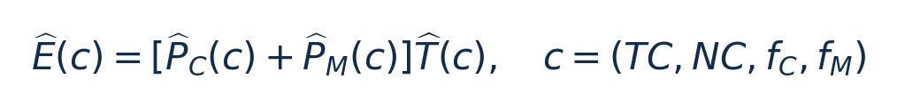
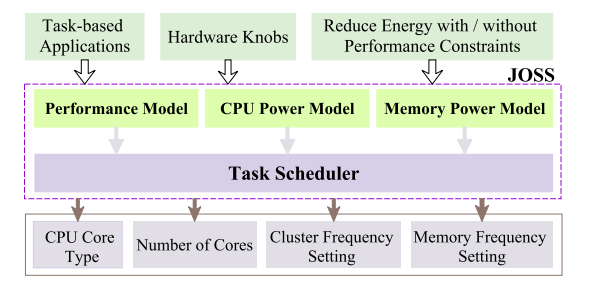
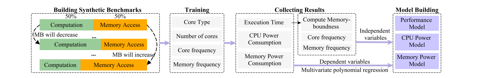
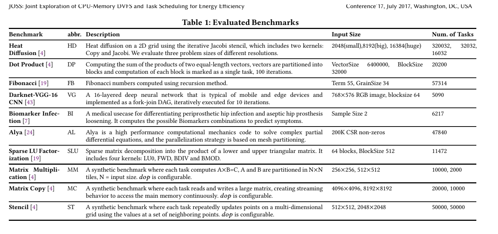
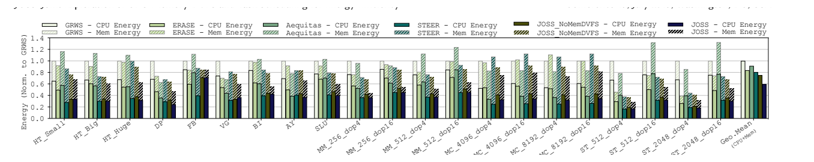
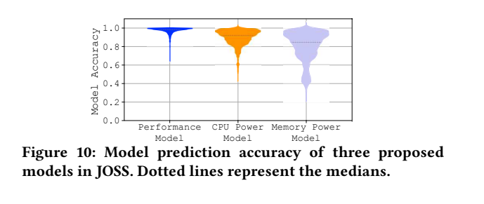

# JOSS：图文技术精读

[论文页面](https://arxiv.org/abs/2306.04615) · [本笔记所用 PDF](https://arxiv.org/pdf/2306.04615v1) · [DOI](https://doi.org/10.48550/arXiv.2306.04615)

整理日期：2026-11-05。**读者原创中文解读；原图归论文作者／出版方。未运行作者实验，不是独立复现。**

**一句话：** 每个任务选择哪类核、几个核、CPU频率和内存频率，以最小化CPU加内存的总能量。

阅读地图：先看问题与输入输出，再顺着架构图、公式和结果图阅读；最后检查统计边界与E902迁移。完整编号索引另见“图表索引”。下文“读者分析”是推断或建议，不是原文结果。

## 阶段0：材料与版本审计

| 材料 | 当前可用程度 | 影响 |
| --- | --- | --- |
| 摘要、正文、方法、原图注 | 已获取本地完整PDF、文本与逐页渲染 | 可核查结构、实验及关键数字；可见页面优先于异常文本层 |
| 分析版本 | arXiv v1，11页。页眉Conference’17/2017属于未替换模板，不能视为真实会议元数据。 | 引用页码以“PDF第几页”标识 |
| 代码／原始数据 | 论文引用[XiTAO基础运行时](https://github.com/CHART-Team/xitao)，当前材料中尚未确认完全对应JOSS扩展的发布commit。 | 公开链接不等于已构建或已拿到原始轨迹 |
| 附件、独立原始重复与勘误 | 当前未完成全渠道附件／勘误穷尽检索 | 不能断言没有附件、没有勘误或没有其他版本 |
| 本次工作范围 | 材料阅读、图表裁取、证据整理、教学公式 | 所有新实验均是建议，尚未执行 |

## 阶段1：身份卡与整体概述

| 项目 | 内容 |
| --- | --- |
| 英文题名 | JOSS: Joint Exploration of CPU-Memory DVFS and Task Scheduling for Energy Efficiency |
| 中文导读题名 | 别只盯CPU功耗：同时预测任务时间、CPU能量与内存能量 |
| 作者 | Jing Chen, Madhavan Manivannan, Bhavishya Goel, Miquel Pericàs |
| 发表／版本 | arXiv:2306.04615 (2023)，本笔记按预印本标注；arXiv v1，11页。页眉Conference’17/2017属于未替换模板，不能视为真实会议元数据。 |
| 类型与领域 | 原始方法／工程系统研究；DVFS、CPU能效、运行时控制 |
| 单位、通讯、资助与利益关系 | 作者主要来自Chalmers University of Technology。当前版本未定位到明确通讯作者标记、完整资助或利益冲突栏目；这些字段保持未知，不由作者顺序推断。 |
| 核心对象与接口 | TX2双Denver＋四A57，各cluster共享频率，INA3221测CPU和内存轨。 |
| 代码与数据 | 论文引用[XiTAO基础运行时](https://github.com/CHART-Team/xitao)，当前材料中尚未确认完全对应JOSS扩展的发布commit。 |
| 与本课题关系 | 你最应借鉴免PMC的两档标定、把非CPU固定功耗加入目标、用小查表替代复杂在线搜索。E902先只调CPU，测量SRAM/外设和板级功耗的边界；不要为了照搬四旋钮引入不存在的内存调压接口。 |

**约200字中文概述（改写）：** JOSS把任务映射与CPU／内存频率选择联合起来。它通过平台离线回归和运行时两档采样，预测每类任务的执行时间及CPU、内存功耗，搜索满足能量或相对性能目标的配置；再处理共享频域的并发冲突及短任务切换成本。Jetson TX2实验显示，只优化CPU能量可能增加内存驻留能量。该方法有助于建立“总能量而非单轨功率”的选频观念，但多核异构调度和内存DVFS并不是E902现成具备的条件。

**三句话定位：** 问题是降低CPU功率会延长任务，内存也可能多耗一段时间；只优化CPU能量的配置可能不是系统总能量最优。假设是联合建模与联合选择能够获得更好折中，即便不能改变内存频率也有价值。 方法主线为离线合成计算／访存程序拟合模型 → 每个kernel在两档CPU频率采样 → 估计memory-boundness → 预测各配置的时间和两项功率 → 搜索最低能量／满足速度要求的配置 → 共享域协调、合并短任务 → 实际运行。 主要证据见下方结果表，结论须与测量和版本范围一起使用。

## 阶段2：问题、假设与创新位置

降低CPU功率会延长任务，内存也可能多耗一段时间；只优化CPU能量的配置可能不是系统总能量最优。假设是联合建模与联合选择能够获得更好折中，即便不能改变内存频率也有价值。

**创新判断（读者分析）：** 贡献是四旋钮联合、免PMC的任务特征估计、CPU和内存分项模型、运行时调度整合；学习成分为回归预测与模型引导搜索，不是强化学习。 不依据作者自称“首次”断定整个领域绝无前例。

## 阶段3：必要术语与数学

| 级别 | 术语／关键词 | 直觉、严格含义与易混点 |
| --- | --- | --- |
| A | DVFS / DFS | DVFS同时涉及动态电压与频率；只有时钟变化称DFS。电压能否改变取决于实际供电域。 |
| A | Workload | 真正执行应用计算的程序与输入；本文里的控制器是另一个角色。 |
| A | Controller | 根据观测选择动作的软件／硬件，可运行在同一CPU或独立控制核。 |
| A | OPP | Operating Performance Point，经过允许范围验证的电压—频率组合。 |
| A | Power / Energy | 功率W表示此刻消耗快慢；能量J是对时间积分。低功率不必然低能量。 |
| B | Deadline | 作业必须完成的时刻；平均时延、P95与最大时延各有不同用途。 |
| A | 总能量 | 这里主要指CPU轨＋内存轨，不自动包括整板所有外设。 |
| B | Memory-boundness | 等待访存对运行时间的影响，本文由模型估计。 |
| B | Moldable任务 | 同类任务可选择使用不同核数执行。 |
| C | 最陡下降 | 邻域内逐步找更低预测能量；一般不保证全局最优。 |

### 公式1：总能量选配置（对方法的紧凑整理）

**符号与前提：** P_C/P_M为W，T为s，E为J；TC为核类型，NC为核数，频率Hz。依赖功率／时间模型准确、共享空闲功耗分摊合理。

**代入与检查：** 教学例：配置A CPU1W+内存1W运行10ms，20mJ；配置B CPU0.7W+内存1W运行15ms，25.5mJ。CPU功率降低了，总能量却增加。

**来源：** §4–5，PDF p4–6；数字为读者算例。
### 公式2：计算项缩放与预测准确率

**符号与前提：** MB无量纲，描述原始运行中等待占比；T_C′为新CPU频率下计算时间。A是本文用的相对误差反向分数，不是分类准确率。完整等待模型还包含内存频率，不能删掉。

**代入与检查：** T=10ms、MB=0.4、CPU频率减半，则计算部分变成12ms；不能把整个任务直接说成20ms，还要加新配置等待项。若实际功率2W、预测1.6W，则A=80%。

**来源：** Eq1、§7.3，PDF p4/9。

## 阶段4–6：架构、关键图与方法拆解

**输入—处理—输出：** 离线合成计算／访存程序拟合模型 → 每个kernel在两档CPU频率采样 → 估计memory-boundness → 预测各配置的时间和两项功率 → 搜索最低能量／满足速度要求的配置 → 共享域协调、合并短任务 → 实际运行。

| 系统角色 | 具体设置 |
| --- | --- |
| 输入 | 任务类型、两档执行时间、核类型／数量、可用CPU与内存频点、用户相对速度目标。 |
| 输出 | (TC,NC,f_C,f_M)四元组及调度位置；E902单核可缩减为f_C。 |
| 约束 | 相对最低能量设置的1.2×/1.4×/1.8×性能目标，不等于任意绝对硬截止期。 |
| 实验 | TX2双Denver＋四A57，各cluster共享频率，INA3221测CPU和内存轨。 |

§4（PDF p4–5）：时间拆成计算和等待，计算项按CPU频率近似反比缩放；等待项使用memory-boundness和CPU／内存频率比的多项式回归。两个功率模型分别预测CPU与内存，空闲功率在并发任务间分摊。核心特征不依赖硬件PMC，但依赖可重复任务采样和平台离线表征。

§5：每类kernel在两种CPU频率、不同核类型／核数下采样。模型表生成后，四角筛选加最陡下降降低搜索量；共享域并发采用算术平均频率协调，而非证明全局最优。短任务先聚合，避免每几个微秒就切频。

§6–7：十类任务基准，g++7.5.0、Linux4.9.253-tegra；5ms功率采样，每项重复10次取算术平均。Fig8汇总用Geo.Mean标识，不能把所有汇总统计笼统称算术平均。部分性能目标受预测误差或峰值能力限制而达不到。

### Fig3：JOSS总架构

[打开大图](images/original-fig3.png) · [原文 Fig3，PDF p3](https://arxiv.org/pdf/2306.04615v1#page=3)

**怎样看：** 模型提供预测，调度器选择四元组。

**直接观察／原文报告：** 预测与调度是两个环节。

**读者判断：** 不使用深Q学习。

### Fig4：模型建立流程

[打开大图](images/original-fig4.png) · [原文 Fig4，PDF p4](https://arxiv.org/pdf/2306.04615v1#page=4)

**怎样看：** 离线平台建模→在线任务采样→查表预测。

**直接观察／原文报告：** 训练数据与部署采样分工明确。

**读者判断：** 平台更换必须重新标定。

### Table1：十类任务与输入

[打开大图](images/original-table1.png) · [原文 Table1，PDF p7](https://arxiv.org/pdf/2306.04615v1#page=7)

**怎样看：** 按任务类型、输入规模和任务数阅读。

**直接观察／原文报告：** 具有多类计算／访存模式。

**读者判断：** 大量子任务不是同数量独立实验。

| 阅读问题 | 先看材料 | 如何接到下一步 |
| --- | --- | --- |
| 为什么要改现有方案 | 问题背景与动机图 | 确定目标、约束和原有不足 |
| 系统观察什么、控制什么 | 输入输出表＋关键架构图 | 确认数据、模型和执行器真实角色 |
| 方法如何得到动作或估计 | 方法段、公式、算法／模型表 | 明确离线训练与在线流程 |
| 收益是否真实且公平 | 结果图表、统计与测量边界 | 核查基线／目标／分母／开销 |
| 能否用于自己的CPU | 局限、复现计划、三项实验 | 把论文假设变成待验证的工程条件 |

## 阶段7–8：实验、统计及证据链

本节数字均是**原文明确报告或原文数值的标注算例**；没有按图柱高度臆造额外精确值。

| 指标 | 原文报告 | 条件／分母／边界 | 证据位置 |
| --- | --- | --- | --- |
| 相对GRWS总能量 | JOSS降低40.7%；STEER降低19.5% | Fig8统一归一化到GRWS，含CPU＋内存 | §7.1，p8–9 |
| 论文所谓额外收益 | 作者称相对STEER额外21.2% | 40.7−19.5=21.2个百分点；分母不同，不能直接当相对比值 | §7.1，Fig8 |
| 不控制内存频率 | 相对GRWS降低24.8% | 仍考虑内存能量，证明目标边界重要 | §7.1，p8 |
| 平均模型分数 | 时间97%、CPU功率90%、内存功率80% | 按1−相对绝对误差定义，不是三种分类正确率 | §7.3，Fig10，p9 |
| 运行时采样 | 约0.8%总时间 | 每kernel重复出现的测试场景 | §5.1，p5 |

### Fig8：总能量对比

[打开大图](images/original-fig8.png) · [原文 Fig8，PDF p9](https://arxiv.org/pdf/2306.04615v1#page=9)

**怎样看：** 横轴应用，堆叠CPU／内存，统一GRWS=1。

**直接观察／原文报告：** 仅优化CPU会遗漏内存部分。

**读者判断：** 节能百分点与相对百分比不能混用。

### Fig10：模型准确率分布

[打开大图](images/original-fig10.png) · [原文 Fig10，PDF p9](https://arxiv.org/pdf/2306.04615v1#page=9)

**怎样看：** 看三模型分布和虚线中位数。

**直接观察／原文报告：** 内存预测比时间预测弱。

**读者判断：** 分数不是测试应用分类准确率。

**统计与公平性审查（读者分析）：** 每项重复10次，但缺少完整原始重复数据／所有置信区间。性能目标并非全部达到：MC_4096在1.2×目标上约差3%，高访存任务可能达不到1.8×。模型误差不等于决策损失。读者对Fig8的百分数做分母审查：若直接拿已四舍五入汇总值估算，相对STEER约(0.805−0.593)/0.805≈26.3%，但这不是从逐任务原始数据重新算出的正式均值；保留原文数值并明确“百分点口径”。

工程实验中，设备、程序、输入文件、重复运行、时间窗口是不同统计层级，不能互相替代。本任务不涉及生物样本，细胞／动物／试剂等检查不适用。未注明的P值或置信区间不补造；“差了几个百分点”不自动等于统计显著。

| 主张层级 | 直接证据 | 对照与统计 | 可得结论／替代解释 | 可信度 |
| --- | --- | --- | --- | --- |
| 原文明确报告 | 相对GRWS总能量：JOSS降低40.7%；STEER降低19.5% | §7.1，p8–9 | Fig8统一归一化到GRWS，含CPU＋内存；仅在该实验范围内成立 | 图表／文本可核对：高；独立复现：尚无 |
| 作者解释 | 所提架构／模型解释了性能或估计改善 | 关键原图与方法见上文；统计边界见下节 | 效果可能同时来自动作空间、平台特性与采样设置，因果归因需消融 | 中 |
| AI分析／迁移假设 | 用于E902的压缩候选负载 | 本篇未直接验证该芯片与任务组合 | 需三项后续实验；不能复制论文收益数字 | 待验证，当前无法判断 |

## 阶段9–10：贡献与局限分开判断

贡献是四旋钮联合、免PMC的任务特征估计、CPU和内存分项模型、运行时调度整合；学习成分为回归预测与模型引导搜索，不是强化学习。

| 来源 | 严重程度 | 局限及其影响 |
| --- | --- | --- |
| 作者报告 | 重要 | 部分速度目标受模型误差和平台能力限制；内存模型较不准确。 |
| 读者分析 | 关键 | 两点采样依赖同类任务行为稳定，输入变化大时要检测失配并重新校准。 |
| 读者分析 | 重要 | 平均频率合成与局部搜索无全局最优保证；小E902没有异构核和可调DRAM时应删减动作空间。 |

## 阶段11：最小复现路线与缺口

先跑XiTAO及论文Table1任务，离线复测平台功率表；在两档下采样而非完整测试集泄漏训练。复建共享域合成与短任务合并，统一基线是否可变核数／内存频率。记录每任务的CPU、内存能量和时限分布；论文链接提供框架，不等于JOSS完整扩展已可复现。当前未编译运行。

**代码／数据现状：** 论文引用[XiTAO基础运行时](https://github.com/CHART-Team/xitao)，当前材料中尚未确认完全对应JOSS扩展的发布commit。

**质量控制顺序：** 先验证程序输出和时间基准，再验证采样／模型，最后比较策略。保存输入文件哈希、平台配置、OPP、随机种子、温度与每次运行原始记录。失败时先回固定安全频点定位错误，再继续优化。复现可行性判断为“可开始部分方法复建，完整数值复现条件未齐”；这与“已完成复现”不同。

## 阶段12：用于你的CPU／E902课题

你最应借鉴免PMC的两档标定、把非CPU固定功耗加入目标、用小查表替代复杂在线搜索。E902先只调CPU，测量SRAM/外设和板级功耗的边界；不要为了照搬四旋钮引入不存在的内存调压接口。

| 建议实验／优先级 | 价值 | 最低资源 | 主要风险 | 成功判据（设计目标，非已得结果） |
| --- | --- | --- | --- | --- |
| P0：CPU能量与整板能量双目标 | 找出目标边界是否改变最优频点 | 两档计时与可获得的电源测量 | 测量噪声大于收益 | 同一输入画两套E–T曲线，给出选档是否变化 |
| P1：两频点预测压缩耗时 | 降低穷举标定成本 | 固定块大小、两档CPU频率 | 压缩熵变化破坏模型 | 留出文件预测误差和决策后违约率都达自定阈值 |
| P1：块合并摊薄切频成本 | 处理过短控制粒度 | 不同块数合并、相同到达期限 | 合并增加排队时间 | 把等待也计入端到端期限，报告净收益和尾时延 |

上述优先级是读者建议：P0先做，P1建立在基线可运行后，P2只在资源允许且前序实验证明有必要时开展。压缩应用仍是候选，尚未替你最终定题或证明已在E902运行。论文公开可读不自动授权任意复制数据；代码、图片和数据须分别核对许可。

## 阶段13：读完后应掌握与继续核查

**五个知识点：** 每个任务选择哪类核、几个核、CPU频率和内存频率，以最小化CPU加内存的总能量。 你还应能解释输入输出表中的角色、两条公式的单位、首个结果指标的分母，以及局限表里的关键条件。

**五个未决问题：** 独立新输入是否成立？最差时延是否可接受？测量参考是否足够？控制与切换是否抵消收益？E902实际具有哪些接口和可观测量？这些是研究问题，不是对作者遗漏的无证据指控。

**立即做：** 按公式算例手算一次，选一张结果图复述“硬件—负载—基线—指标—边界”。**后续核查：** 补齐代码版本、训练数据和仪表设置。**可复用：** 上文明确标注的模型与接口思路。**谨慎采用：** 所有跨平台百分比。**暂不采用：** 尚未证实存在的电压控制和完整硬实时承诺。
