# 从零读懂 CPU DVFS：再看这篇论文在改进什么

**原文入口：** [论文页面](https://arxiv.org/abs/2309.03779) · [直接打开 PDF](https://arxiv.org/pdf/2309.03779) · [期刊 DOI](https://doi.org/10.1016/j.sysarc.2023.102955)

> 这页按第一次接触 DVFS 的读者设计。先用一个贯穿全文的例子建立概念，再进入真实论文。标为“教学假设”的数字不是论文实验结果；原图、原文公式和读者补充分别注明。

## 0. 先抓住这一个问题

假设设备每秒要处理一个数据块，下一秒到来之前必须处理完。CPU 始终开最高频率，可能很早完成，但用掉较多能量；低频运行可能省电，也可能赶不上截止时间。DVFS 研究的核心就是：**根据任务与硬件状态，在合适的时刻选择合适的电压频率档位。**

读完这页，你应能画出谁控制谁，解释为什么低频不一定省能量，以及说清这篇论文为什么需要执行历史。

## 1. 先认识六个角色

| 术语 | 在系统中做什么 | 本论文中的对应物 |
| --- | --- | --- |
| 负载 workload | 真正需要完成的计算任务和输入 | 人脸相关处理、音频相关处理、四项 MiBench 程序 |
| 被控对象 | 动作作用后会改变行为的系统 | 承载这些程序的 CPU 与其调频域 |
| 观测 observation | 控制器读到的运行信息 | 利用率、当前频率、经过的时间 |
| 控制器 / 策略 | 决定下一步怎样调节 | 时序编码与小型 Q 网络 |
| 动作 action | 控制器发出的选择 | 下一时段使用高频还是低频 |
| 执行器 | 把选择落实为硬件变化 | CPUFreq、平台驱动与已有供电/时钟链路 |

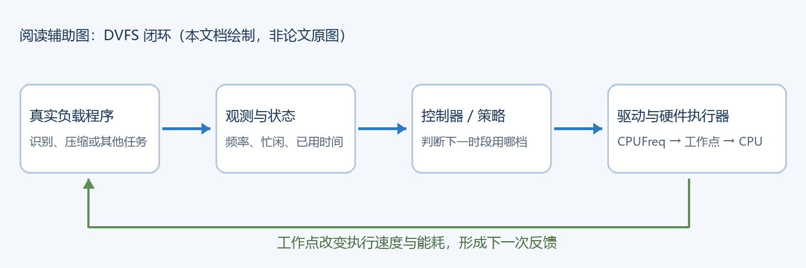

沿图从左往右读：程序执行产生运行状态；控制器读取状态选档；驱动改变 CPU 工作点；程序的执行过程随后改变，再形成新的观测。**程序是真实运行的，调节的是运行它的 CPU。**

“软控软”是组内表述，可能强调软件策略管理软件负载；它不能单独说明是否仿真。判断时要逐一问：任务真的在跑吗？频率真的改变了吗？能量是实测还是模型算出来的？本论文前两项都在真实板上完成，能量也做了板级测量。

## 2. 频率与电压分别影响什么

频率 f 表示每秒有多少时钟周期。1 GHz 是每秒十亿个周期，但不等于每秒固定执行十亿条指令。指令可能等待数据、发生流水线停顿，也可能一周期完成不止一条；具体取决于处理器和程序。

对一个计算为主、需要大致固定周期数的阶段，可以先用下面的近似建立直觉。

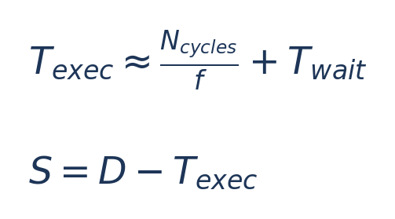

| 符号 | 含义 | 单位 |
| --- | --- | --- |
| T_exec | 本次任务从开始到完成的时间 | s |
| N_cycles | 这个教学模型中完成计算需要的周期数 | cycle |
| f | CPU 频率 | cycle/s，即 Hz |
| T_wait | 不能简单随 CPU 频率缩短的等待 | s |
| D | 从任务开始算起允许使用的时间，即截止时间预算 | s |
| S | 完成后相对截止时间还剩多少余量 slack | s |

教学假设：计算部分需要 4 亿周期，等待 0.2 s。1 GHz 时约需 0.4+0.2=0.6 s；0.5 GHz 时约需 0.8+0.2=1.0 s。如果 D=1 s，第二档刚好赶上。这个模型帮助理解，真实程序仍需测量；缓存、内存和输入变化都可能让它失准。

电压 V 是电路供电电压。高频通常需要足够高的电压才能可靠工作，因此实际选择的是经过平台验证的电压频率工作点，而不是任意拼一对 V 与 f。OPP（Operating Performance Point）就是这样的合法工作点。

PLL 是时钟产生/调节部件；PMIC 或稳压器负责供电。策略一般先选档，再通过驱动和硬件控制链路执行。具体有哪些部件、由谁控制，取决于平台，不能假设 E902 RTL 自带完整可调电源。

## 3. 省电到底是降低功率，还是减少能量

功率 P 是每秒消耗能量的快慢，单位 W；能量 E 是整个任务消耗的总量，单位 J。手机电池续航更直接关心一段使用过程中的总能量。

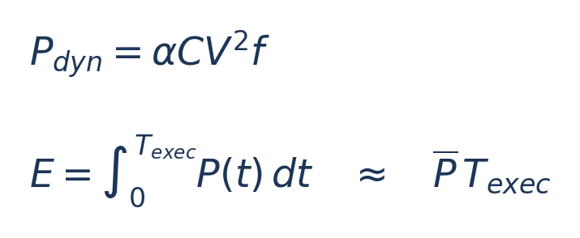

第一式是论文背景中的常见 CMOS 动态功率模型：α 是活动因子，C 是等效开关电容，V 是供电电压，f 是时钟频率。它只描述动态部分；系统还存在漏电、内存、外设与其他固定功耗。第二式是能量定义，平均功率乘时间的写法用于便于理解。

一个很有用的推导是：若 V 不变、计算周期数也不变，仅让 f 减半，那么理想动态功率约减半，但计算时间约翻倍，两者相乘的动态能量可能近似不变；额外持续更久的固定功耗甚至会增加。**这就是“降频一定省能量”不成立的原因。**

教学假设：方案 A 以平均 5 W 跑 0.4 s，消耗 2 J；方案 B 以 3 W 跑 0.8 s，消耗 2.4 J。B 的功率更低，任务能量却更高。你做实验时必须同时记功率和运行时长。

## 4. DVFS 控制问题怎样写成目标

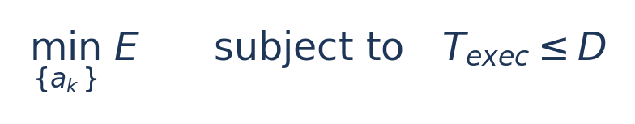

a_k 是第 k 个控制时段选择的档位；一串 a_k 决定整个任务期间怎么跑。这是理解控制问题的理想表达。本文采用软截止时间奖励，实验中仍有超时，不能把上面的约束当成它已经证明的保证。

硬截止时间意味着超时不可接受；软截止时间允许一定违约但会损失服务质量。本论文属于后者。这里先记住：**能量和实时性必须一起比较。**

## 5. 不用智能算法，系统原来怎样调频

Linux 的 governor 是一个选频策略模块。Performance 大体保持高性能档；Ondemand 根据近期利用率响应；Conservative 较渐进地调整；Schedutil 利用调度器相关信号。本论文把这些作为比较对象。它们是不同策略，不是不同硬件。

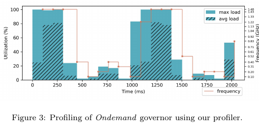 *原论文图 3，PDF 第 5 页。*

读图顺序：先看横轴时间，再看左轴 CPU 利用率，最后看右轴对应的橙色频率线。实色/斜线柱反映最大与平均利用率。图想说明“忙闲程度变化以后，已有策略怎样选频”，它还不是本文新算法的实验收益图。

利用率可以理解为采样窗口内 CPU 忙碌的时间比例。它不等于程序完成百分比，也不能直接当成功耗。多核时，某一个核很忙与所有核都很忙是不同情况。

## 6. 本论文为什么认为只看近期利用率不够

第一种困难是电压档位粗：有很多频率，不代表每小幅降频都能同步降压。第二种是多核负载不均：最大核利用率高，并不表示整个共享调频域都满负荷。第三种是程序内部有等待：当前计算放慢一点，也许能被录音等等待时间遮盖。

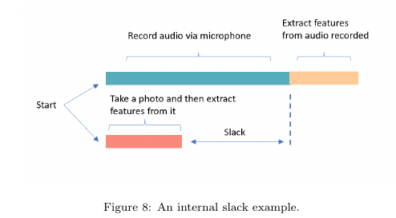 *原论文图 8，PDF 第 7 页。*

看录音和图像处理两条时间线。如果一条必须等待较长时间，另一条计算提前完成形成的空隙就可能被利用。这叫 internal slack，任务内部余量。

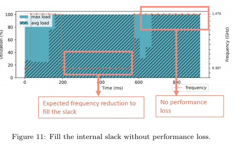 *原论文图 11，PDF 第 7 页。*

图 11 用不同阶段的频率安排说明思路：把低频放在适合的位置，而不是对整段任务一刀切。新方法需要知道“刚才发生了什么、现在可能处于哪一阶段”，所以引入历史编码。

## 7. 智能算法在闭环里究竟负责哪一步

强化学习 reinforcement learning 是通过动作与结果反馈学习策略。这里不用先背算法名，先记住四个量。

| 名称 | 在这篇论文里的意思 | 不能混淆成什么 |
| --- | --- | --- |
| 状态 s | 由近期观测和执行历史整理出的数字 | 不是原始图像，也不是真实已完成百分比 |
| 动作 a | 下一时段选哪个频档 | 不是修改识别模型精度 |
| 奖励 r | 对这次选频过程好坏的评分 | 不等于仪表直接读到的焦耳数 |
| Q(s,a) | 从当前状态选这个动作，预计以后能获得多少回报 | 不是实际频率、功率或剩余毫秒 |

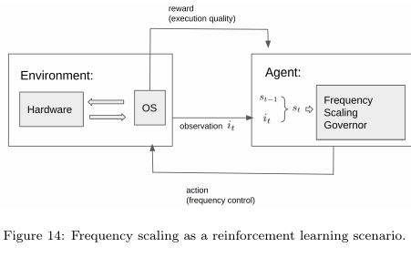 *原论文图 14，PDF 第 11 页。*

图里 Environment 包含硬件和操作系统，Agent 是调频控制器。观测送给控制器，动作返回系统；运行结果又产生奖励。论文用 DDQN 学 Q 值，再对高频与低频分别打分，选择较好的那一档。

训练相当于反复做任务、比较结果、更新网络；推理是拿已经学到的网络作一次选择。训练可以在较强的主机或用户态进行，在线控制只保留小模型推理。这也是你将来把策略部署到小 CPU 时可借鉴的分工。

## 8. 用一张图看这篇论文怎样落地

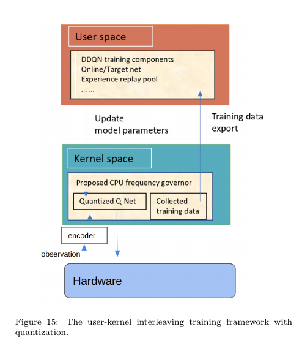 *原论文图 15，PDF 第 12 页。*

沿箭头读：硬件运行产生观测；编码器整理状态；内核中的小网络选频；训练数据导出到用户态；训练得到的新参数再传回内核。这里的“内核”是 Linux 操作系统内核，不是 CPU core；两种中文都可能叫“核”，读论文时要分清。

此时你已经能解释论文主线：**用紧凑历史信息帮助一个小模型选频，并把学习与低开销执行分开。** 精确状态更新、奖励和 DDQN 公式放在技术精读正文，逐式配有符号说明。

## 9. 看实验只问四个问题

第一，与谁比？Performance 和 Ondemand 不是同一基线。第二，在哪个硬件、什么任务、什么截止时间下比？第三，省的是板级总能量，还是只测 CPU 核？第四，省能量时是否增加了超时？

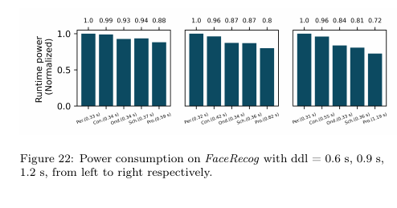 *原论文图 22，PDF 第 16 页。*

先固定一个 deadline，再横向比较柱子。柱上的 0.88 表示该图归一化参照下的 88%，不是“节能 88%”；若参照为 1，节能是 1−0.88=12%。图中另一个 deadline 下的 0.72 则对应约 28%。这两个数字不能自动替代相对 Ondemand 的改善。

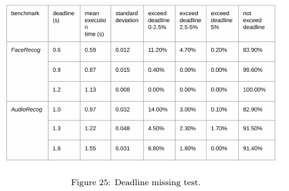 *原论文图 25，PDF 第 17 页；原文把统计表排成 Figure。*

在 FaceRecog、deadline=0.6 s 的第一行，平均时间约 0.59 s，但最后一列按时比例只有 83.9%。也就是说约 16.1% 仍然超时。看完这行，你就知道为什么论文不能声称硬实时保证。

## 10. 怎样对应到你的 CPU / E902 项目

可先考虑一个真正运行的 CPU 程序，如周期性数据压缩，固定每块的完成时限并检验输出。观测可以从周期计数、忙闲统计和输入长度开始；控制器输出合法档位；最终同时记录正确性、时间、能量与超时。这是读者建议，原论文没有实验过 E902 或这个压缩负载。

软件实验是否真实，取决于动作有没有真的改变运行程序的 CPU。普通 QEMU 通常不能用来证明真实主机发生了 DVFS；RTL 仿真适合验证硬件控制行为；板级测量或可信功耗模型才支持相应能量结论。只完成时钟频率切换时，要准确称为动态调频，不能提前声称电压也调了。

一个适合入门的比较顺序是：固定高频 → 固定低频 → 利用率阈值 → 轻量预测或学习控制。先让基础对照能跑、结果正确，再看智能算法是否值得。

## 11. 读完后自测

| 问题 | 应能说出的关键点 |
| --- | --- |
| 为什么程序可以通过调频变快或变慢？ | 执行它的 CPU 频率变了；等待部分未必同步缩短 |
| 为什么更低的功率未必省能量？ | 时间可能更长，能量需要积分或用平均功率乘时间 |
| 被控负载与控制器有什么区别？ | 前者做业务任务，后者观测并选择工作点 |
| 这篇论文新增了什么？ | 用紧凑历史状态结合强化学习，并完成低开销真实系统部署 |
| 为什么平均 0.59 s 仍可能不满足 0.6 s 实时要求？ | 平均值掩盖尾部超时，需要看违约率 |
| 哪些数字能直接用于 E902？ | 不能直接迁移 Jetson 的收益或推理时间，必须重测 |

能回答这六题，再读“技术精读”中的状态与奖励公式，会更容易把每个符号放回系统中。
