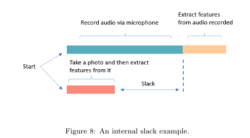
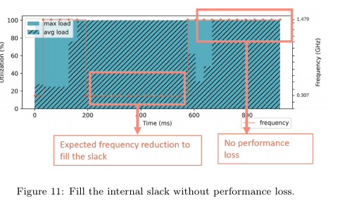
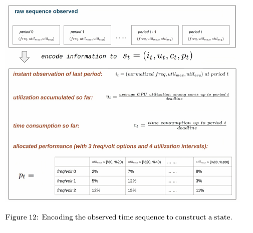
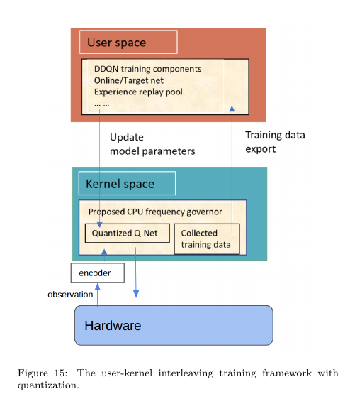
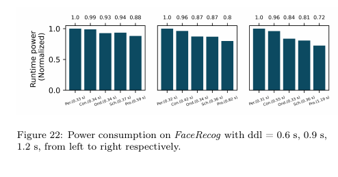
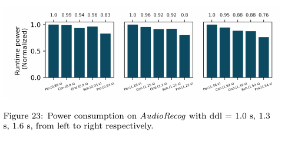
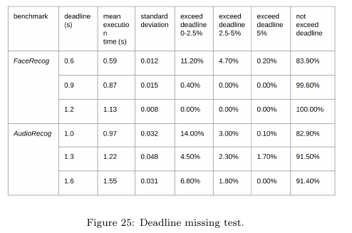
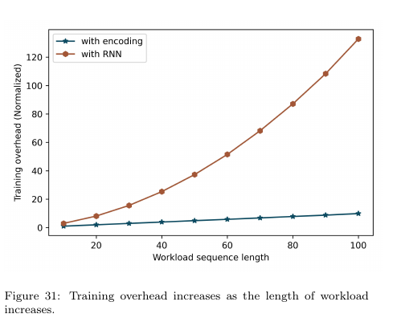

# 图表索引：用于回查原图与实验边界

> 重要图表已嵌入“从零入门”和“图文精读”的相应段落；此页保留原先八幅图的简短回查说明。以下为原论文图表的阅读裁图，保留原作者图号。来源：Ti Zhou、Man Lin，arXiv:2309.03779v1。页码按 21 页预印本，原始图表与数据归原作者。这里只解析精选图表，不声称覆盖论文全部图表。[原文](https://arxiv.org/abs/2309.03779)

## 图 8：任务内部的空隙（PDF 第 7 页）

[打开大图](images/fig08.png)

录音、拍照和特征提取的持续时间不同，部分工作可以重叠。图中的 slack 是一次任务内部形成的余量。它解释了为什么“CPU 刚才很忙”不足以决定下一步必须高频：某段计算稍慢，可能仍能被另一段无法加速的等待遮盖。

这是一种特定应用结构，不是所有程序都存在同样的隐藏余量。

## 图 11：怎样利用内部余量（PDF 第 7 页）

[打开大图](images/fig11.png)

先看横轴的执行时间，再同时看利用率与频率。作者希望在可以被等待遮盖的部分降低频率，而在关键计算阶段避免不必要降频。图用于解释理想调度行为，并不能单独证明学习算法在所有输入上都找到了最优策略。

## 图 12：历史如何压缩成状态（PDF 第 8 页）

[打开大图](images/fig12.png)

图展示近期信息、累计利用率、时间消耗以及性能分配等状态组。重点是把执行历史压缩成有界表示，使模型不必输入无限增长的原始序列。

时间比例表示已消耗的预算，不是观测到了真实任务进度。具体张量尺寸和动作如何拼接，需要复现时对照源码确认。

## 图 15：真实系统的部署架构（PDF 第 12 页）

[打开大图](images/fig15.png)

沿着采样、编码、经验与网络更新、频率动作的箭头阅读。训练与实际控制分布在不同位置：用户态负责学习，内核路径负责轻量推理和调频。这是软件策略控制真实 CPU 的实现，不是只运行一个虚拟功耗模型。

迁移到裸机 RISC-V 时，用户态/内核态划分可以改成主机离线训练与固件在线推理，但 CPUFreq 和平台采样接口必须替换。

## 图 22：FaceRecog 的截止时间与能量（PDF 第 16 页）

[打开大图](images/fig22.png)

每组柱子须与上方的 deadline 一起读。FaceRecog 在 0.6、0.9、1.2 s 条件下，相对 Performance 的能量约为 88%、80%、72%。这是相对最高性能策略的归一化值，不能与相对 Ondemand 的 5%–14% 改善混用。

图题与正文存在 power/energy 用语需要核查的地方，引用时应说明本文讨论的是运行期间能量，不能把它写成瞬时功率降低了同样百分比。

## 图 23：AudioRecog 的对比（PDF 第 16 页）

[打开大图](images/fig23.png)

横向比较同一 deadline 下各 governor，再比较 deadline 变宽后的变化。正文报告相对 Ondemand 的改善约为 12%–14%。需同时注意这个应用包括录音和其他处理阶段，不能只凭名字将其当作纯语音模型。

更宽松的时限通常提供更多调节余地，但图中的趋势不构成任意负载、任意工作点上的数学保证。四项 MiBench 的详细对比另见原文图 24，相对 Ondemand 的改善为 3%–11%；本页未裁录图 24。

## 图 25：平均时间掩盖了多少违约（PDF 第 17 页）

[打开大图](images/fig25.png)

表中同时给出 deadline、平均执行时间、标准差以及不同超时区间。FaceRecog 的 0.6 s 条件下平均约 0.59 s，按时比例却只有 83.9%。剩余约 16.1% 运行出现不同程度的超时。

这是判断实时性的关键证据。不能因为平均执行时间低于截止时间，就写“满足实时性且没有性能损失”。你的实验也应给出违约率和尾延迟。

## 图 31：编码与 RNN 的训练开销（PDF 第 19 页）

[打开大图](images/fig31.png)

比较横轴不同输入规模下，两种方法的开销增长。论文支持在其网络结构与实现设置中，编码方案的增长较缓。它不能证明所有 RNN 都更差，也不能直接给出 E902 的推理时间。

训练开销、在线推理开销与硬件切换开销是不同指标；做自己的方案时要分开测量。
