# JSA 2023 技术精读：从观测到真实 CPU DVFS 决策

**原文入口：** [论文页面](https://arxiv.org/abs/2309.03779) · [直接打开 PDF](https://arxiv.org/pdf/2309.03779) · [期刊 DOI](https://doi.org/10.1016/j.sysarc.2023.102955)

**初次阅读建议：** 先打开左侧“从零入门”，建立频率、能量、截止时间和控制闭环的概念；本页再沿着状态、动作、奖励和实验逐步推导。图表在对应问题旁，点击网页中的图片可放大。

> 阅读范围：已核对 arXiv:2309.03779v1 全文及实验图表，页码按该 21 页预印本。中文为整理与解释，英文摘要为改写概述。论文发表于 JSA 142 (2023), 102955。本文由当前 Codex 会话依据本地 PDF 整理，未声称运行了师兄的外部模型流水线。

论文：CPU Frequency Scheduling of Real-Time Applications on Embedded Devices with Temporal Encoding-based Deep Reinforcement Learning。作者 Ti Zhou、Man Lin。[原文与 PDF](https://arxiv.org/abs/2309.03779)，[期刊 DOI](https://doi.org/10.1016/j.sysarc.2023.102955)，[作者公开实现 tinyagent](https://github.com/coladog/tinyagent)。公开实现链接来自论文；本笔记没有完成其源码复现。

## 1. 中英文摘要

### 中文摘要（根据全文整理，非原摘要逐句翻译）

论文研究小型嵌入式设备上周期性、具有软截止时间的 CPU 任务，目标是在尽量按时完成任务的同时减少能量消耗。作者发现，仅依据近期 CPU 利用率作决策的 Linux governor，在电压档位粗、多核负载不均衡、任务内存在 I/O 等待时，可能不能充分利用性能余量。为此，作者以紧凑的时序编码保存一次任务执行中的历史特征，并通过 Double DQN 选择 CPU 频率；模型在用户态训练，量化后的推理与采样逻辑部署在内核中。系统在 Jetson Nano 实机上控制 CPU，使用两项自建应用和四项 MiBench 程序验证。相对 Ondemand，MiBench 的能量改善为 3%–11%，自建应用的改善随负载和时限变化。该方案适用于可容忍一定截止时间违约的场景，不能视为硬实时保证。

### English abstract (reader-written paraphrase)

This paper studies CPU DVFS for periodic embedded workloads with soft deadlines. It identifies coarse voltage levels, uneven multicore activity, and internal I/O waiting as cases that challenge utilization-based Linux governors. A compact temporal representation summarizes execution history, and a Double DQN selects CPU frequencies without an explicit workload model. Training runs in user space, while quantized inference and frequency decisions run in the kernel. Experiments use a real Jetson Nano board, two custom applications, and four MiBench programs. The method reduces measured energy relative to Ondemand under the tested conditions. The results support soft-deadline energy management, but do not establish deadline guarantees or transferability to a different processor.

## 2. 问题与创新点

先把理想目标写清：选一串合法工作点，使任务能量尽量小，并尽量按时完成。下式是帮助理解的约束表达；本文通过软截止时间奖励实现，不能把它当成已证明的硬约束保证。

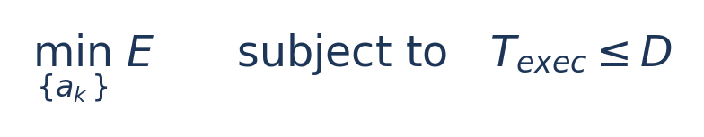

这里 a_k 是第 k 个控制时段的动作，E 为能量，T_exec 为实际完成时间，D 为截止时间预算。频率 f 的单位为 Hz，电压 V 的单位为 V，利用率是 0 到 1 之间的比例。后文只用这些基础量逐步构造状态。


论文解决的是“任务执行过程中什么时候用高频、什么时候用低频”，被控对象是运行真实程序的 CPU 系统。它没有通过减少识别精度、跳过帧或改变程序功能来冒充 DVFS。

| 论文中的困难 | 普通利用率决策容易遗漏什么 | 本文办法 |
| --- | --- | --- |
| 电压档位粗 | 频率降低一档不一定伴随电压降低，能量收益不一定符合直觉 | 结合具体硬件工作点学习调度 |
| 多核忙闲不均 | 最大核利用率不能反映整个共享调频域的工作状态 | 同时使用平均与最大利用率 |
| 一次任务内部有 I/O 等待 | 相同的当前利用率可能对应不同执行阶段和剩余余量 | 编码近期状态、累计状态和历史分布 |

作者的贡献可以归纳为三点：分析了上述失败模式；提出适合小型控制器的历史表示，并与强化学习结合；完成用户态训练、内核量化推理及板级能量验证。应把贡献落到“状态设计与低开销部署的组合”，不能只写“使用了强化学习”。

论文的 model-free 指不要求预先给出精确的任务执行模型，并不意味着不需要应用边界、截止时间、硬件档位或训练数据。

## 3. 整体架构：谁控制谁

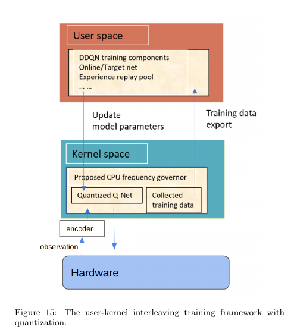 *原论文图 15，PDF 第 12 页；本节重点图。*

先看底部 Hardware：真实程序在这里执行。观测向上经过 encoder，内核的 Quantized Q-Net 选频。右侧箭头导出训练数据，上方用户态负责更新网络，再把参数下传。用户态/内核态属于操作系统层次，不能与 CPU 核数混为一谈。


```text
真实任务开始 / 给定截止时间
          |
          v
CPU 执行应用 --> 采样利用率、当前频率、已用时间
     ^                         |
     |                         v
CPUFreq 设置工作点 <-- Q 网络选频 <-- 紧凑时序编码
     |                                         |
     +-------- 下一采样周期反馈 ----------------+

用户态：收集经验、计算训练目标、训练网络
内核态：采样、编码、量化网络推理、频率控制
独立验证：板级测量能量，记录执行时间与截止时间违约
```

程序跑得快慢来自承载它的 CPU。控制器输出频率动作，驱动通过平台已有的 DVFS 链路改变工作点；应用本身继续执行。这里是真实软件负载和真实硬件调频，不是用一个公式虚拟出完成时间。

“软控软”是组内用语，可能指软件控制器管理软件负载；它并不天然意味着仿真。控制器、负载、执行器需要分别说明。本论文的控制器由软件实现，负载是真实程序，最终执行器仍然是平台的 CPU 调频与供电基础设施。

### 输入、内部状态、输出与反馈

| 类别 | 本文设置 | 阅读时应避免的误解 |
| --- | --- | --- |
| 外部任务信息 | 任务执行边界、给定截止时间 | 不等于无需任何任务信息 |
| 近期观测 | 当前频率、平均 CPU 利用率、最大 CPU 利用率 | 不是 token 数，也不是所有硬件性能计数器 |
| 累计观测 | 累计利用率与已消耗的时间预算等 | 已用时间比例不是真实计算完成百分比 |
| 历史编码 | 各频率及利用率区间的累计分配特征 | 是压缩历史，不是保留无限长的采样序列 |
| 决策输入 | 编码后的状态与候选动作 | 具体展平维度应对照作者实现核验 |
| 网络输出 | 候选动作的 Q 值，即预计长期回报 | 不是直接输出真实功耗或精确完成时间 |
| 执行动作 | 选择低频或高频档位 | 不是神经网络任意生成一个电压值 |
| 训练反馈 | 任务结束时计算的终端奖励 | 不等于在线功率计读数直接作为每步奖励 |
| 验证指标 | 能量、执行时间、违约分布、推理开销 | 必须与训练代理指标区分 |

## 4. 方法：编码、DDQN 与内核部署

### 4.1 为什么保留执行历史

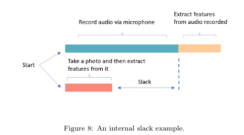 *原论文图 8，PDF 第 7 页。*

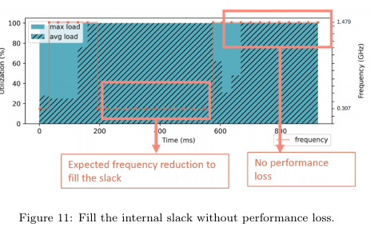 *原论文图 11，PDF 第 7 页。*

两图连起来看：有些计算可在不可缩短的等待期间完成，因此关键不是“处处降频”，而是“把低频放在哪里”。近期利用率相同，也可能处于不同阶段；历史信息正是用来帮助区分这些情形。


单个采样点只能告诉控制器“刚才忙不忙”。对于有预处理、多线程计算和 I/O 等待的任务，这不足以区分当前处于哪一阶段。作者将近期状态与累计信息结合，使当前输入携带任务执行历史，同时让输入规模不随任务长度一直增长。

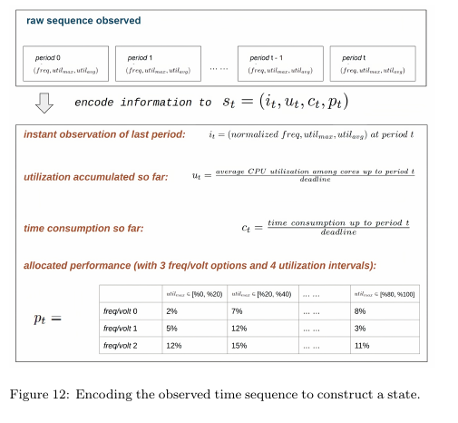 *原论文图 12，PDF 第 8 页。*

#### 先对照图理解状态公式

下面按照原文算法 2 重排符号：原文用 t 表示采样序号、T 表示截止时间、x 表示采样时长；本笔记改用 k、D、Δt_k，避免“第几个时段”和“经过多少秒”混淆。

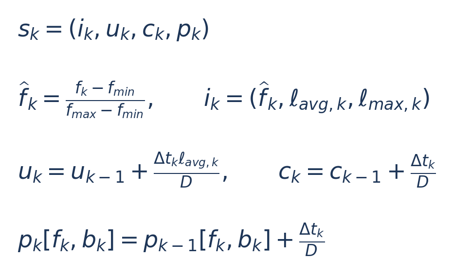

| 符号 | 怎么得到 | 它告诉控制器什么 |
| --- | --- | --- |
| s_k | 合并 i_k、u_k、c_k、p_k 四组量 | 到当前时刻为止的状态摘要 |
| i_k | 本时段频率归一化值、平均和最大利用率 | 刚才发生了什么 |
| ℓ_avg,k / ℓ_max,k | 各核利用率的平均值 / 最大值 | 多核整体忙碌程度 / 最忙的核有多忙 |
| u_k | 各时段忙碌时间的累计量，除以 D | 累计 CPU 活动预算；不是除以当前已用时间的运行平均值 |
| c_k | 已经过的时间除以 D | 已花掉多少时间预算；不是计算完成百分比 |
| p_k[f,b] | 按频率 f 和利用率区间 b 累计驻留时间，再除以 D | 此前的性能分配历史 |
| b_k | 本时段最大利用率所在的区间 | 应更新矩阵的哪一列 |
| Δt_k | 实际测得的本次采样时长 | 允许采样周期有抖动，而非假定每次完全相同 |

未命中的 p_k 矩阵项保持不变，任务开始时累计项清零。利用率输入采用比例而非百分数：100% 写成 1，不是 100。

#### 跟着原图算一次状态更新

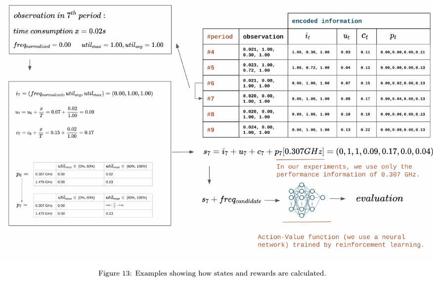 *原论文图 13 的下半部分，PDF 第 10 页。*

用原图中的第 7 时段：D=1 s，Δt=0.02 s，CPU 在 0.307 GHz，平均与最大利用率都为 1。频率归一化为 0；u 从 0.07 加到 0.09；c 从 0.15 加到 0.17；低频、高利用率那一格从 0.02 加到 0.04。

这个小算例揭示了两个容易混淆的量：c=0.17 表示用掉 17% 时间预算；u=0.09 表示累计忙碌时间按完整预算归一化后为 0.09。它们都不是“任务做完了多少”。

原文正文报告六维状态、7→8→8→1 的 Q 网络，但图 13 展开示例与维数表述存在需要核对之处。概念上按上述四组状态理解即可；复现时必须用代码核对实际输入维度、冗余项处理和候选动作拼接，不能强行按图凑数。

### 4.2 DDQN 在这里做什么

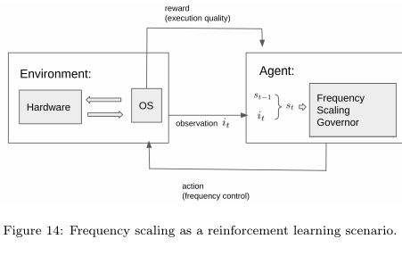 *原论文图 14，PDF 第 11 页。*

#### 在线选频：同一个状态，把两个动作分别打分

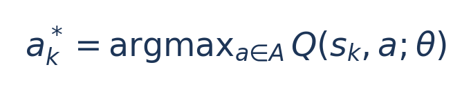

A 是允许的动作集合，本实验主要为高频和低频两档；θ 是网络参数；argmax 的意思是“找出让后面的值最大的那个动作”，输出档位而非输出最大 Q 数字。

教学假设：当前状态下网络给低频 Q=0.62、高频 Q=0.55，则控制器选低频。它并不是判断低频功耗为 0.62 W；这两个分数是预计回报。下一个采样点状态改变，选择也可能改变。

#### 训练：用下一状态的反馈修正当前分数

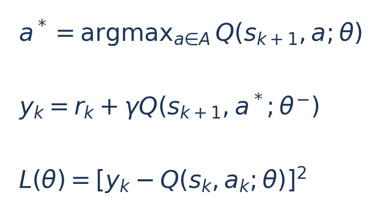

这三式对应原文算法 5 的更新思路，参数记号作了重排。θ 是持续更新的在线网络参数，θ⁻ 是隔一段训练步数才复制更新的目标网络；γ 是未来回报的折扣系数，y_k 是学习目标，L 是当前预测与目标之间的平方误差。终止状态没有下一步，直接令 y_k=r_k。

第一式由在线网络决定下一动作 a*，第二式让目标网络评价它，第三式让当前预测逐步靠近 y_k。暂时不必掌握梯度细节；需要理解的只是：网络的选频分数来自重复任务中的反馈，而不是人工预写好所有状态的答案。


每个采样周期对候选频率计算 Q(s,a)，选择 Q 值较高的动作。Double DQN 将下一步动作选择与目标值评估分开，降低普通 DQN 中的过高估计倾向。这里的学习目标是长期回报，不是用一个分类器直接预测“这一帧要多久”。

训练需要任务重复执行并形成状态、动作、奖励和下一状态的经验。论文在不同负载与截止时间下训练和评估；这不能自动解释为一个预训练模型能适应所有新应用。

### 4.3 奖励为什么要单独审视

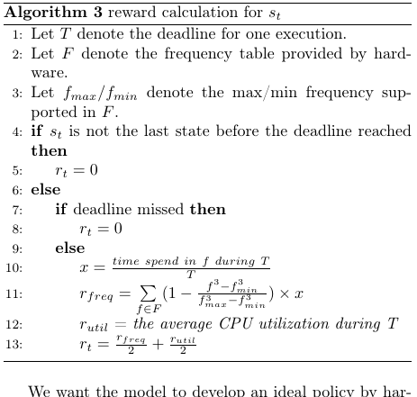 *原论文算法 3，PDF 第 11 页。*

下面把算法中的按时终端奖励重排成易读公式。中间步骤奖励为 0；如果超时，奖励也为 0，不能继续按按时公式计算。

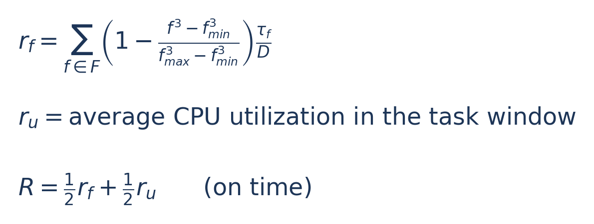

F 是频率表；f_min、f_max 是相应最小与最大频率；τ_f 是任务窗口中在频率 f 停留的累计时间；D 是截止时间预算；r_f 奖励低频使用，r_u 是窗口中的平均 CPU 利用率，R 是最终得分。正文中的 r_t 是终端时刻的这个 R，其他时刻为零。

#### 原论文的数字代入

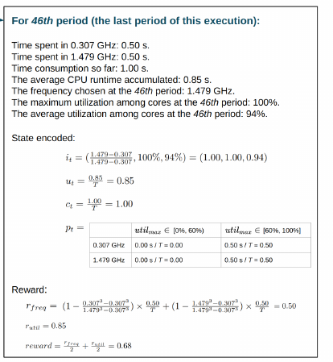 *原论文图 13 的右上部分，PDF 第 10 页。*

此例 D=1 s，低频 0.307 GHz 与高频 1.479 GHz 各用了 0.5 s。最低频率对应括号项为 1，最高频率为 0，所以 r_f=1×0.5+0×0.5=0.5。若 r_u=0.85，则 R=0.5×0.5+0.5×0.85=0.675，约为图中 0.68。

为什么这不是实测能量？因为得分仅从频率使用和利用率构造，未直接积分仪表功率。频率三次方来自简化背景与启发，真实平台的电压台阶、漏电和固定功耗可能不满足精确三次关系。因此论文还必须通过真实能量实验验证。


实际能量通过独立板级实验比较。奖励与真实能量之间是否一致，是值得补充验证的内容；不能把奖励增大直接写成实测能耗降低。

### 4.4 训练与部署位置

训练在用户态使用 PyTorch，采样、编码和 Q 网络推理进入内核路径。为了避免内核浮点计算，作者把相关数值映射为 32 位整数进行量化推理。这不是常见的“所有网络权重直接转成 INT8”方案。

论文报告采样编码与推理开销在高频下约 25.62 μs、低频下约 41.05 μs。它支持该 Jetson 实现的轻量性，但不能直接当成 E902 的开销。频率切换的电气稳定过程、驱动延迟与神经网络计算时间也应分别统计。

## 5. 实验平台与可比性

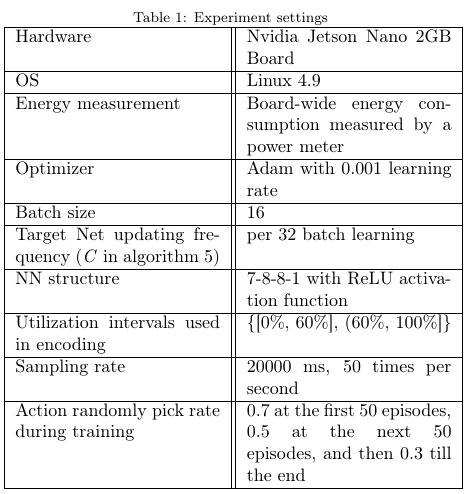 *原论文表 1，PDF 第 14 页。*

读这张表，先看硬件、OS 和测量边界，再看网络与训练设置。Adam 是训练时更新参数的优化器；learning rate 是每次更新的步长；batch size 是一批用于更新的数据量；Target Net updating frequency 是目标网络多久刷新一次。它们属于训练设置，不是 CPU 的调压参数。

注意 Sampling rate 这一行自身有单位矛盾，后文单独标注，不能照抄到实现里。

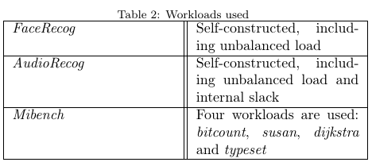 *原论文表 2，PDF 第 14 页。*


| 项目 | 论文设置 | 对结论的影响 |
| --- | --- | --- |
| 硬件 | Jetson Nano 2GB 的 CPU | 是 ARM 多核 Linux 平台，不是 E902 或 GPU 调频实验 |
| 软件 | Linux 4.9，CPUFreq 相关实现 | 依赖内核与平台驱动 |
| 频率动作 | 1.479 GHz 与 0.307 GHz | 本文控制器主要使用两个动作 |
| 平台工作点 | 支持 15 个频率，电压档位较粗 | 不能说硬件只支持两个频率 |
| 基线动作集 | Linux governor 可以使用完整可用频率范围 | 动作集合不完全对称，比较时必须披露 |
| 基线 | Performance、Ondemand、Schedutil、Conservative | 不同节能百分比的参照不能混用 |
| 负载 | FaceRecog、AudioRecog；bitcount、susan、dijkstra、typeset | 六个应用，并不证明对任意任务通用 |
| 测量 | 外部测量板级能量，记录执行时间 | 包含平台其他部分，不能解释成仅 CPU 核的动态能量 |
| 约束 | 多种软截止时间 | 平均按时不等于每次按时 |

FaceRecog 含单线程输入与预处理、多线程识别等阶段。AudioRecog 组合音频记录、FaceRecog 与音频特征处理，不能简单概括为“纯语音识别大模型”。

## 6. 实验结果对比：每个百分比都附参照

#### 先学会读归一化结果

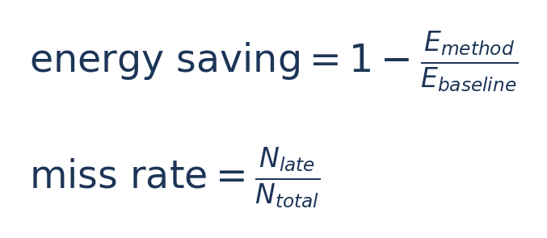

归一化能量 0.88 意味着 E_method/E_baseline=0.88，节能 12%，不是节能 88%。N_late 是超时次数，N_total 是总次数。比较时，任务正确性、输入和测量边界也应相同。

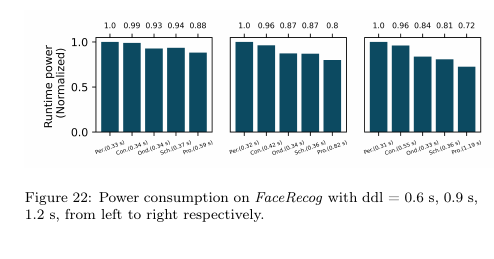 *原论文图 22，PDF 第 16 页。*

先固定一组 deadline，再把本文方法与同组的 Linux 策略比较；然后才看 deadline 变宽是否带来更多收益。图上的柱高和下面括号中的运行时间需要一起读。

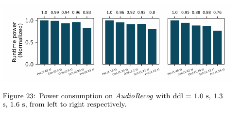 *原论文图 23，PDF 第 16 页。*

这是另一个包含录音和计算的应用，不能直接把结果当作所有音频任务的收益。

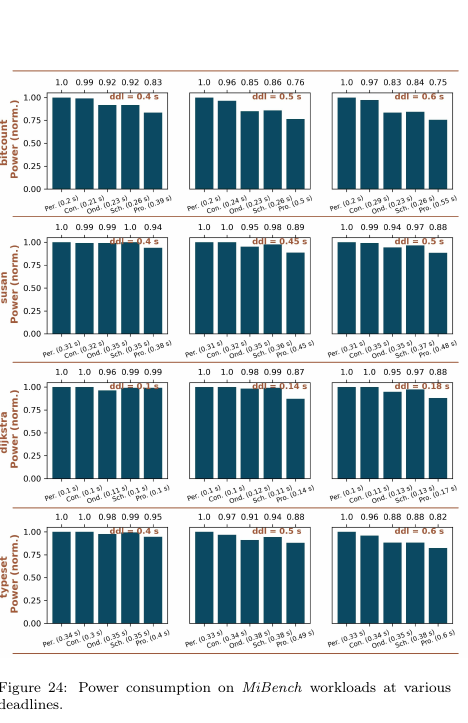 *原论文图 24，PDF 第 17 页。每一行是一个程序，每列对应一个时限。*

这张图可用来检查改善是否只发生在一个自建负载。仍须区分 Performance 的归一化参照与正文相对 Ondemand 的 3%–11% 改善。


| 负载或对比 | 结果 | 基线与条件 | 能证明什么 |
| --- | --- | --- | --- |
| 四项 MiBench | 能量改善 3%–11% | 相对 Ondemand，论文设定的截止时间余量范围约 0.04–0.4 s | 这些工作负载及条件下有效 |
| FaceRecog | 能量改善约 5%–14% | 相对 Ondemand，随截止时间而变化 | 利用应用内部结构获得收益 |
| AudioRecog | 能量改善约 12%–14% | 相对 Ondemand；正文细分实验 | 不可与摘要合并表述中的范围机械等同 |
| FaceRecog 三种截止时间 | 归一化能量约 88%、80%、72% | 相对 Performance；截止时间 0.6、0.9、1.2 s，见图 22 | 对应约 12%、20%、28% 节能，参照与前两行不同 |
| FaceRecog 紧截止时间 | 平均约 0.59 s；按时比例 83.9% | 截止时间 0.6 s，见图 25 | 仍有约 16.1% 违约，不能宣称硬实时 |
| 决策计算开销 | 25.62 / 41.05 μs | 对应高 / 低频的本文实现 | 仅是本平台、此网络与路径的实测 |

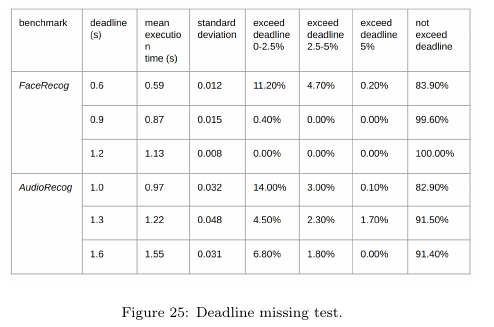 *原论文图 25，PDF 第 17 页。*

先看第一行 mean execution time，再看最右侧 not exceed deadline。平均时间合格不代表每次合格。表内超过截止时间的不同区间占比之和，才揭示了平均值掩盖的风险。

图 25 中，FaceRecog 在 0.6 s 截止时间下，违约分布约为：超时 0%–2.5% 占 11.2%，超时 2.5%–5% 占 4.7%，超时超过 5% 占 0.2%。平均时间 0.59 s 并没有排除尾部违约。

原文摘要对两项自建应用使用了合并的 5%–14% 范围；正文再细分负载。引用时最好直接说明基线与负载，而不是抽取一个最大数字代表全系统表现。

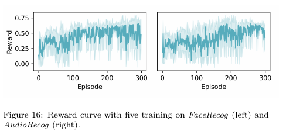 *原论文图 16，PDF 第 14 页。横轴 Episode 是任务重复执行形成的训练轮次，纵轴 Reward 是奖励，不是焦耳。*

曲线上升表示学到更高奖励的策略；单看它不能断言实测节能，也不能证明硬实时。多条重复训练的均值与波动提示了学习过程的随机性。

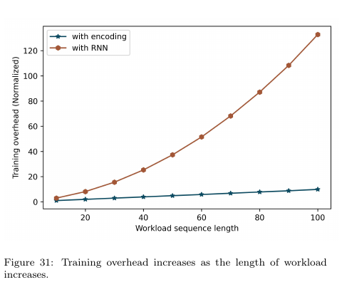 *原论文图 31，PDF 第 19 页。*

作者还比较了编码方法与 RNN：编码方式在给定结构和训练设置下收敛更快、更稳定，且随输入规模增长的训练开销较小。这不能推广为“RNN 都不适合 DVFS”。训练约 300 轮的设置以及部分实验约 100 轮出现良好行为，不构成对未知任务的收敛保证。

### 原文中需要复现时核查的细节

一处参数表把采样间隔写成 20000 ms，同时写每秒 50 次；两者不一致。50 Hz 对应约 20 ms，复现时应以作者代码和实际计时为准。

部分图题写 power consumption，但正文讨论和归一化数值涉及 energy。重新作图时应统一为测得的能量积分及单位，避免把平均功率和总能量混用。

## 7. 局限：证据到哪里为止

下面是依据本文实验范围归纳的阅读判断，除非特别标明，不应称为作者逐字列出的 limitations。

| 局限或待核实问题 | 为什么影响应用 |
| --- | --- |
| 软截止时间且存在违约 | 无法直接用于要求零违约的任务 |
| 训练以特定应用和截止时间为条件 | 跨输入、跨负载、跨时限泛化需要新实验 |
| 奖励是能量代理 | 可能对漏电、固定平台功耗和切换代价刻画不足 |
| 控制器两档、基线多档 | 需要补充同动作集消融，分清策略与动作空间的贡献 |
| 多核 Jetson 的特征设计 | 最大与平均利用率之差在单核 E902 上可能失去意义 |
| 板级能量边界 | 无法直接拆分 CPU 核、内存及外围部分的收益 |
| 训练成本未形成统一摊销结论 | 不能据此声称很短的部署周期就能收回训练能量 |
| 当前笔记未完成作者源码复现 | 数据转引自论文，不能称为我们复现的结果 |

## 8. 值得改进的地方：转成可检验的工作

下面均为读者提出的方案，不是原论文已经证明的贡献。优先从容易完成且与 CPU 毕设紧密相关的实验开始。

| 改进想法 | 具体实现 | 怎样判断是否值得做 |
| --- | --- | --- |
| 加入截止时间保护 | 学习策略之外，剩余时间过低时回退最高安全档 | 同时报告能量、违约率、最坏超时，验证保护是否有效 |
| 把切换代价纳入决策 | 加入最小驻留时间与切换惩罚，统计切换次数 | 与无惩罚版本比较净能量和执行时间，防止频繁抖动 |
| 简化智能算法 | 用小决策树或小型 MLP 预测剩余执行时间，再选最低可行档 | 与 DDQN、固定频率、阈值策略比较，计入预测开销 |
| 验证状态设计 | 依次删去历史编码、已用时间、累计信息 | 同一动作集合与测试输入下做消融，定位实际有效的特征 |
| 跨输入泛化 | 按输入文件而非随机采样点划分训练与测试集 | 在未见过的数据长度和内容上测能量与尾延迟 |
| 改善能量目标 | 用测量或校准后的每档功率估计能量，并计入切换 | 比较奖励排序与真实能量排序是否一致 |
| 单核 RISC-V 迁移 | 用周期计数、忙闲计数、任务阶段代替多核利用率差异 | 在目标 CPU 重新量化开销与性能，不直接套用 Jetson 数字 |

## 9. 对当前 E902/CPU 项目的启发

最可迁移的部分是“真实任务—观测—状态—策略—工作点—反馈”的闭环，以及把训练和轻量部署分开。Linux CPUFreq、多核统计和 Jetson 的电压频率表需要重新实现或替换。

一个可评估的负载候选是周期性的日志或传感数据压缩：输入数据块，输出压缩结果，以每块的完成时限约束控制。它适合 CPU，容易检验输出正确性，也便于改变数据长度与可压缩程度；它目前是设计候选，并非本文的实验负载。若题目要求“智能”算法，可让轻量模型预测剩余执行时间或最低可行频档，再与规则控制比较。

在普通电脑上运行该真实程序，并通过系统驱动实际调 CPU 频率，可形成真实软件控制实验。只在 QEMU 中改变一个“频率参数”通常不能证明真实主机的电压、时延和能量变化。RTL 仿真可以验证时序、握手与控制行为，但电压收益仍需可信功耗模型或实机证据。

建议先交付同一套接口：观测输入、目标时限、档位编号输出、执行耗时和结果校验，再将软件执行器与 RTL/板级执行器分别接入。未落实可切换电源域、稳压器和电压时序前，成果应准确称为动态调频实验，而不是已经实现真实电压调节。

## 10. 下一步复现记录

记录源码版本、CPU 与调频域、允许工作点、时限、输入数据集、训练测试划分、重复次数、置信区间、任务正确性、能量测量范围、采样/推理/切换开销。对所有基线使用相同输入与实验边界，同时给出原生动作集和统一动作集两组比较。

本笔记是阅读交付，不包含新的硬件实验结果。图号、结果和原始方法均归于原作者；第 8–9 节中的改进与迁移建议需后续验证。
