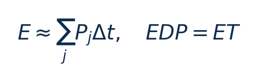
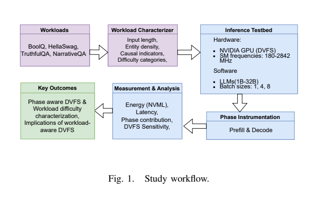
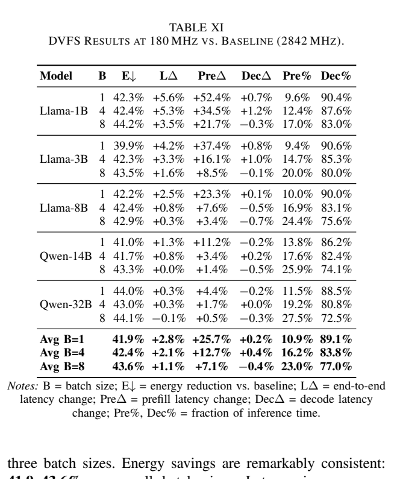
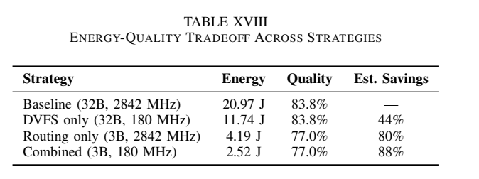

[论文页面](https://arxiv.org/abs/2501.08219v4) · [本笔记所用 PDF](https://arxiv.org/pdf/2501.08219v4) · [标识符](https://doi.org/10.48550/arXiv.2501.08219)

整理日期：2026-11-06。**读者原创中文解读；原图归论文作者／出版方。未运行作者实验，不是独立复现。**

**一句话：** 以控制变量实验刻画模型规模、输入语义、batch与GPU频率的关系，给阶段调频和模型路由提供机会分析而非完整新闭环控制器

阅读地图：先看问题与输入输出，再顺着架构图、公式和结果图阅读；最后检查统计边界与E902迁移。完整编号索引另见“图表索引”。下文“读者分析”是推断或建议，不是原文结果。

## 阶段0：材料与版本审计

| 材料 | 当前可用程度 | 影响 |
| --- | --- | --- |
| 摘要、正文、方法、原图注 | 已获取本地完整PDF、文本与逐页渲染 | 可核查结构、实验及关键数字；可见页面优先于异常文本层 |
| 分析版本 | arXiv2501.08219v4，2026-02-24，11页；题名/模型/结果与2025初版不同。 | 引用页码以“PDF第几页”标识 |
| 代码／原始数据 | 当前材料中尚未定位齐完整控制器源码、实验脚本和原始重复数据；这不表示这些材料不存在。 | 公开链接不等于已构建或已拿到原始轨迹 |
| 附件、独立原始重复与勘误 | 当前未完成全渠道附件／勘误穷尽检索 | 不能断言没有附件、没有勘误或没有其他版本 |
| 本次工作范围 | 材料阅读、图表裁取、证据整理、教学公式 | 所有新实验均是建议，尚未执行 |

## 阶段1：身份卡与整体概述

| 项目 | 内容 |
| --- | --- |
| 英文题名 | Characterizing LLM Inference Energy-Performance Tradeoffs across Workloads and GPU Scaling |
| 中文导读题名 | 以控制变量实验刻画模型规模、输入语义、batch与GPU频率的关系，给阶段调频和模型路由提供机会分析而非完整新闭环控制器 |
| 作者 | Paul Joe Maliakel, Shashikant Ilager, Ivona Brandic |
| 发表／版本 | arXiv预印本v4，2026；arXiv2501.08219v4，2026-02-24，11页；题名/模型/结果与2025初版不同。 |
| 类型与领域 | 原始方法／工程系统研究；DVFS、GPU/CPU能效、CV/LLM应用运行时控制 |
| 单位、通讯、资助与利益关系 | 作者姓名以本版本首页为准；通讯方式、单位及资助可回查首页与末页声明。当前尚未完成资助/利益关系/勘误的跨版本穷尽审计。 |
| 核心对象与接口 | 每配置固定SM频率并重复3次平均；相位切换案例是由刻画提出的策略解释，路由需未来实现与开销验证 |
| 代码与数据 | 当前材料中尚未定位齐完整控制器源码、实验脚本和原始重复数据；这不表示这些材料不存在。 |
| 与本课题关系 | 适合作为你开题前的实验模板：先固定应用质量和工作量，做E–T曲线/阶段分解，再决定是否有必要学习。CPU/E902也先扫描合法档、计算EDP与错误条；不必一开始选LLM，更不移植Blackwell的频率和百分比。 |

**约200字中文概述（改写）：** 本文研究单GPU离线LLM推理基准，分类与生成两种任务的运行时能效。具体程序包括Llama3.2-1B/3B、Llama3.1-8B、Qwen2.5-14B/32B，FP16；BoolQ/HellaSwag用log-likelihood分类（不生成），TruthfulQA_GEN/NarrativeQA greedy最多100tokens；3817queries。作者在单RTX PRO6000 Blackwell96GB；NVML/nvidia-smi 10ms功率采样、CUDA同步计时；batch1/4/8，显存默认频率；只计GPU能量上采用离线7档SM频率扫描＋语义/质量相关分析＋EDP比较；提出prefill高频/decode低频用例；模型路由联合87%为估算，无训练在线governor。输入为受控SM频率、模型规模、batch、prompt语义/长度特征；分类accuracy与生成ROUGE-L；不是在线反馈state，输出为频率–能量–时间表、EDP最优档、质量/能量机会分析；没有可直接部署的每步闭环动作轨迹。主要结果应与下方基线、性能约束和测量范围一起阅读，不能只摘最高百分比。提供跨输入语义、模型大小和硬件频率的统一刻画；价值是选状态/实验基线，并不是提出有稳定性或SLO保证的新学习控制器。

**三句话定位：** 问题是为什么局部利用率不能完整反映整个应用的性能与能耗？本篇的研究问题或可检验主张是：以控制变量实验刻画模型规模、输入语义、batch与GPU频率的关系，给阶段调频和模型路由提供机会分析而非完整新闭环控制器。验证链是可观测状态→控制规则或学习模型→执行器→任务正确性/服务质量与能耗对照。 方法主线为受控SM频率、模型规模、batch、prompt语义/长度特征；分类accuracy与生成ROUGE-L；不是在线反馈state → 离线7档SM频率扫描＋语义/质量相关分析＋EDP比较；提出prefill高频/decode低频用例；模型路由联合87%为估算，无训练在线governor → 频率–能量–时间表、EDP最优档、质量/能量机会分析；没有可直接部署的每步闭环动作轨迹 → 执行与反馈。 主要证据见下方结果表，结论须与测量和版本范围一起使用。

## 阶段2：问题、假设与创新位置

为什么局部利用率不能完整反映整个应用的性能与能耗？本篇的研究问题或可检验主张是：以控制变量实验刻画模型规模、输入语义、batch与GPU频率的关系，给阶段调频和模型路由提供机会分析而非完整新闭环控制器。验证链是可观测状态→控制规则或学习模型→执行器→任务正确性/服务质量与能耗对照。

**创新判断（读者分析）：** 提供跨输入语义、模型大小和硬件频率的统一刻画；价值是选状态/实验基线，并不是提出有稳定性或SLO保证的新学习控制器。 不依据作者自称“首次”断定整个领域绝无前例。

## 阶段3：必要术语与数学

| 级别 | 术语／关键词 | 直觉、严格含义与易混点 |
| --- | --- | --- |
| A | DVFS / DFS | DVFS同时涉及动态电压与频率；只有时钟变化称DFS。电压能否改变取决于实际供电域。 |
| A | Workload | 真正执行应用计算的程序与输入；本文里的控制器是另一个角色。 |
| A | Controller | 根据观测选择动作的软件／硬件，可运行在同一CPU或独立控制核。 |
| A | OPP | Operating Performance Point，经过允许范围验证的电压—频率组合。 |
| A | Power / Energy | 功率W表示此刻消耗快慢；能量J是对时间积分。低功率不必然低能量。 |
| B | Deadline | 作业必须完成的时刻；平均时延、P95与最大时延各有不同用途。 |
| A | 被控程序 | Llama3.2-1B/3B、Llama3.1-8B、Qwen2.5-14B/32B，FP16；BoolQ/HellaSwag用log-likelihood分类（不生成），TruthfulQA_GEN/NarrativeQA greedy最多100tokens；3817queries |
| A | 控制策略 | 离线7档SM频率扫描＋语义/质量相关分析＋EDP比较；提出prefill高频/decode低频用例；模型路由联合87%为估算，无训练在线governor |
| B | 控制周期 | 每配置固定SM频率并重复3次平均；相位切换案例是由刻画提出的策略解释，路由需未来实现与开销验证 |
| B | 证据边界 | 实测、硬件仿真、功耗模型是不同证据，见平台与结果表。 |

### 公式1：积分能量与EDP

**符号与前提：** P W、Δt s、E J、T s；采样10ms未必捕获更短瞬态，需窗口校验。

**代入与检查：** 教学例能量0.6倍、时间1.1倍，EDP0.66倍；低功率本身不是能量。

**来源：** §IV/TableXII，p3/7
### 公式2：阶段调频能量（教学分析）

**符号与前提：** p为prefill、d为decode，功率W、时间s、切换J；phase-specific开销需实际测量。

**代入与检查：** decode占90%时间不等占90%能量；prefill高功率可能仍贡献较多J。

**来源：** §VI–VII/Fig6，p7–9

## 阶段4–6：架构、关键图与方法拆解

**输入—处理—输出：** 受控SM频率、模型规模、batch、prompt语义/长度特征；分类accuracy与生成ROUGE-L；不是在线反馈state → 离线7档SM频率扫描＋语义/质量相关分析＋EDP比较；提出prefill高频/decode低频用例；模型路由联合87%为估算，无训练在线governor → 频率–能量–时间表、EDP最优档、质量/能量机会分析；没有可直接部署的每步闭环动作轨迹 → 执行与反馈。

| 系统角色 | 具体设置 |
| --- | --- |
| 具体控制算法 | 离线7档SM频率扫描＋语义/质量相关分析＋EDP比较；提出prefill高频/decode低频用例；模型路由联合87%为估算，无训练在线governor |
| 被控负载类型 | 单GPU离线LLM推理基准，分类与生成两种任务 |
| 具体被控程序 | Llama3.2-1B/3B、Llama3.1-8B、Qwen2.5-14B/32B，FP16；BoolQ/HellaSwag用log-likelihood分类（不生成），TruthfulQA_GEN/NarrativeQA greedy最多100tokens；3817queries |
| 使用平台与测量 | 单RTX PRO6000 Blackwell96GB；NVML/nvidia-smi 10ms功率采样、CUDA同步计时；batch1/4/8，显存默认频率；只计GPU能量 |
| 输入/状态 | 受控SM频率、模型规模、batch、prompt语义/长度特征；分类accuracy与生成ROUGE-L；不是在线反馈state |
| 输出/动作 | 频率–能量–时间表、EDP最优档、质量/能量机会分析；没有可直接部署的每步闭环动作轨迹 |
| 周期与运行位置 | 每配置固定SM频率并重复3次平均；相位切换案例是由刻画提出的策略解释，路由需未来实现与开销验证 |

§IV–VII，PDF p3–9：统一FP16、greedy、固定最大输出，7档180/487/960/1500/2000/2505/2842MHz，显存默认。分类用选项log-likelihood，无token生成，不能把所有四数据集都叫decode。语义特征包括实体密度、因果标记、推理复杂度、熵；用相关分析筛选并检查与长度相关性，不是已经训练可部署难度分类器。

TableXI扫描180对2842MHz，TableXII比较各batch的EDP最优频率，最佳可能960MHz且时间比最高档更低，要排查热/测量路径而非当普适定律。TableXVI给phase-aware案例数据，文中同时称180MHz结果为upper bound；需作者日志确认它与静态扫描行的关系。TableXVII/ XVIII模型路由+DVFS的87/88%明确是估算且相对“总用32B最高频”的强基线，伴随质量下降，不是部署后无损节能。

### Fig1：研究流程

[打开大图](images/original-fig1.png) · [原文 Fig1，PDF p3](https://arxiv.org/pdf/2501.08219v4#page=3)

**怎样看：** 先读图题、图例、坐标/表头与单位，再在同一负载和同一基线内比较。测量研究而非闭环部署。

**直接观察／原文报告：** 测量研究而非闭环部署。

**读者判断：** 只支持此图所列的模型、设备、输入与测量口径；测量研究而非闭环部署。 不能由单图推出E902或其他GPU的同幅收益。

| 阅读问题 | 先看材料 | 如何接到下一步 |
| --- | --- | --- |
| 为什么要改现有方案 | 问题背景与动机图 | 确定目标、约束和原有不足 |
| 系统观察什么、控制什么 | 输入输出表＋关键架构图 | 确认数据、模型和执行器真实角色 |
| 方法如何得到动作或估计 | 方法段、公式、算法／模型表 | 明确离线训练与在线流程 |
| 收益是否真实且公平 | 结果图表、统计与测量边界 | 核查基线／目标／分母／开销 |
| 能否用于自己的CPU | 局限、复现计划、三项实验 | 把论文假设变成待验证的工程条件 |

## 阶段7–8：实验、统计及证据链

本节数字均是**原文明确报告或原文数值的标注算例**；没有按图柱高度臆造额外精确值。

| 指标 | 原文报告 | 条件／分母／边界 | 证据位置 |
| --- | --- | --- | --- |
| batch1低频扫描/案例 | 平均GPU能量−41.9%、时延＋2.8% | 180对2842MHz；各模型能量−39.9%–44.0%，时延＋0.3%–5.6%；仅本设备 | TableXI/XVI，p7/9 |
| batch扩大 | batch4/8能量−42.4%/43.6%，时延＋2.1%/1.1% | 同最高频基线；不等任意在线batch服务收益 | TableXI，p7 |
| 联合路由机会 | 约87%估算；3B质量77.0%对32B83.8% | 质量差6.8个百分点；没有部署路由测量；44.5%“easy”是分析分类 | TableXVII/XVIII，p9 |

### TableXI：180MHz扫描结果

[打开大图](images/original-tablexi.png) · [原文 TableXI，PDF p7](https://arxiv.org/pdf/2501.08219v4#page=7)

**怎样看：** 先读图题、图例、坐标/表头与单位，再在同一负载和同一基线内比较。平均41.9%与2.8%按batch1。

**直接观察／原文报告：** 平均41.9%与2.8%按batch1。

**读者判断：** 只支持此图所列的模型、设备、输入与测量口径；平均41.9%与2.8%按batch1。 不能由单图推出E902或其他GPU的同幅收益。

### TableXVIII：能量质量折中

[打开大图](images/original-tablexviii.png) · [原文 TableXVIII，PDF p9](https://arxiv.org/pdf/2501.08219v4#page=9)

**怎样看：** 先读图题、图例、坐标/表头与单位，再在同一负载和同一基线内比较。3B与32B质量差6.8个百分点。

**直接观察／原文报告：** 3B与32B质量差6.8个百分点。

**读者判断：** 只支持此图所列的模型、设备、输入与测量口径；3B与32B质量差6.8个百分点。 不能由单图推出E902或其他GPU的同幅收益。

**统计与公平性审查（读者分析）：** 每配置3次均值，未因3817queries就宣称3817独立设备重复。相关r=0.002不能证明长度对全部LLM完全无影响；语义分组与模型质量共同定义，预测外部验证不足。分类与生成指标、固定频点实验与phase-aware案例、实测与联合估算分开。GPU遥测排除CPU/系统能量；高频异常变慢需要热与功率限制日志核查。

工程实验中，设备、程序、输入文件、重复运行、时间窗口是不同统计层级，不能互相替代。本任务不涉及生物样本，细胞／动物／试剂等检查不适用。未注明的P值或置信区间不补造；“差了几个百分点”不自动等于统计显著。

| 主张层级 | 直接证据 | 对照与统计 | 可得结论／替代解释 | 可信度 |
| --- | --- | --- | --- | --- |
| 原文明确报告 | batch1低频扫描/案例：平均GPU能量−41.9%、时延＋2.8% | TableXI/XVI，p7/9 | 180对2842MHz；各模型能量−39.9%–44.0%，时延＋0.3%–5.6%；仅本设备；仅在该实验范围内成立 | 图表／文本可核对：高；独立复现：尚无 |
| 作者解释 | 所提架构／模型解释了性能或估计改善 | 关键原图与方法见上文；统计边界见下节 | 效果可能同时来自动作空间、平台特性与采样设置，因果归因需消融 | 中 |
| AI分析／迁移假设 | 用于允许的GPU/CV/LLM候选场景及CPU/E902迁移 | 本篇未直接验证该芯片与任务组合 | 需三项后续实验；不能复制论文收益数字 | 待验证，当前无法判断 |

## 阶段9–10：贡献与局限分开判断

提供跨输入语义、模型大小和硬件频率的统一刻画；价值是选状态/实验基线，并不是提出有稳定性或SLO保证的新学习控制器。

| 来源 | 严重程度 | 局限及其影响 |
| --- | --- | --- |
| 作者明确讨论＋读者影响分析（Threats to validity，p9） | 关键 | 单GPU/离线replay/短生成范围，未覆盖continuous batching、speculative decoding或多GPU。 |
| 读者分析 | 关键 | 44.5%easy与87%联合收益不是已验证在线预测器的结果。 |
| 读者分析 | 关键 | 180MHz极端点和960MHz异常优势必须复核；不能据此要求任意GPU降到180MHz。 |

## 阶段11：最小复现路线与缺口

本次未运行作者代码。最小复建顺序：①固定本文平台/模型/输入与质量目标，确认合法可用频档和权限；②逐档运行真实被控程序，验证输出、预热、计时同步与能量测量窗口，至少记录多次独立运行原始数据；③实现本文算法，冻结离线训练/搜索配置，留出新的输入、到达率和温度条件测试；④同动作空间、同质量/SLO比较固定最高档、默认governor、简单规则和本文方案；⑤把离线剖析与在线控制、采样、切频成本单列并计算摊销次数。失败时退回安全固定档，缺失参数列日志，不猜成已知。适合作为你开题前的实验模板：先固定应用质量和工作量，做E–T曲线/阶段分解，再决定是否有必要学习。CPU/E902也先扫描合法档、计算EDP与错误条；不必一开始选LLM，更不移植Blackwell的频率和百分比。

**代码／数据现状：** 当前材料中尚未定位齐完整控制器源码、实验脚本和原始重复数据；这不表示这些材料不存在。

**质量控制顺序：** 先验证程序输出和时间基准，再验证采样／模型，最后比较策略。保存输入文件哈希、平台配置、OPP、随机种子、温度与每次运行原始记录。失败时先回固定安全频点定位错误，再继续优化。复现可行性判断为“可开始部分方法复建，完整数值复现条件未齐”；这与“已完成复现”不同。

## 阶段12：应用选题与CPU／E902课题联系

适合作为你开题前的实验模板：先固定应用质量和工作量，做E–T曲线/阶段分解，再决定是否有必要学习。CPU/E902也先扫描合法档、计算EDP与错误条；不必一开始选LLM，更不移植Blackwell的频率和百分比。

| 建议实验／优先级 | 价值 | 最低资源 | 主要风险 | 成功判据（设计目标，非已得结果） |
| --- | --- | --- | --- | --- |
| P0：固定工作量频率扫描 | 先验证应用与执行器，建立同边界基线 | 可锁频GPU小SLM或LinuxCPU候选程序，重复运行与温度日志 | 频率命令不一定获准或真实生效 | 输出正确；保存实际频率、温度、时延与积分能量 |
| P1：阶段调频与路由分别计质量/能量 | 验证状态/阶段感知是否优于固定档与阈值 | 可锁频GPU小SLM或LinuxCPU候选程序，重复运行与温度日志 | 新输入与离线标定分布不同 | 同期限/质量/动作空间下报告净收益及尾部时延 |
| P1：控制成本和迁移消融 | 分开采样、模型、切换与算法贡献 | 执行器时间戳；必要时外部电测或明确功耗模型 | 短任务收益被开销吞掉；E902可观测量不同 | 分别关闭各组件；报告失败输入；CPU迁移重新标定 |

上述优先级是读者建议：P0先做，P1建立在基线可运行后，P2只在资源允许且前序实验证明有必要时开展。本批允许CV/LLM/GPU应用；压缩、CV、SLM均未最终定题，也未证明已在E902运行。论文公开可读不自动授权任意复制数据；代码、图片和数据须分别核对许可。

## 阶段13：读完后应掌握与继续核查

**五个知识点：** 以控制变量实验刻画模型规模、输入语义、batch与GPU频率的关系，给阶段调频和模型路由提供机会分析而非完整新闭环控制器 你还应能解释输入输出表中的角色、两条公式的单位、首个结果指标的分母，以及局限表里的关键条件。

**五个未决问题：** 独立新输入是否成立？最差时延是否可接受？测量参考是否足够？控制与切换是否抵消收益？E902实际具有哪些接口和可观测量？这些是研究问题，不是对作者遗漏的无证据指控。

**立即做：** 按公式算例手算一次，选一张结果图复述“硬件—负载—基线—指标—边界”。**后续核查：** 补齐代码版本、训练数据和仪表设置。**可复用：** 上文明确标注的模型与接口思路。**谨慎采用：** 所有跨平台百分比。**暂不采用：** 尚未证实存在的电压控制和完整硬实时承诺。
