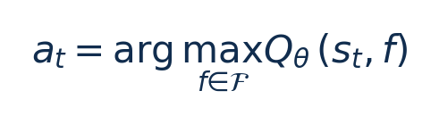

[论文页面](https://doi.org/10.48550/arXiv.2409.19434) · [本笔记所用 PDF](https://arxiv.org/pdf/2409.19434v3) · [标识符](https://doi.org/10.48550/arXiv.2409.19434)

整理日期：2026-11-05。**读者原创中文解读；原图归论文作者／出版方。未运行作者实验，不是独立复现。**

## 先把四个角色放对位置

被控负载是要完成的程序和输入，比如压缩一块日志；CPU是执行程序的硬件；控制器根据观测选运行档位；驱动／寄存器把档位落实。程序代码可以完全一样，CPU时钟变慢时每条指令对应的墙钟时间通常变长，访存或I/O等待则未必按同样比例变化。

软件控制并不意味着没有真实硬件。软件中的学习策略可控制真实CPU；也可先控制一个执行时间与能量模型。后者能验证闭环逻辑，但模型输出的J不能当真实电测。E902的RTL能在仿真中改变时钟并反馈计数；电压导致的物理功耗还需相应模型、功耗分析或板级实验。

## 这篇到底解决哪一件事

把任务开始/完成标签和负载历史编码给DDQN，使共享CPU频率能考虑多个任务的软期限

为什么相同CPU利用率未必对应相同的工作需求？本篇的可检验主张是：把任务开始/完成标签和负载历史编码给DDQN，使共享CPU频率能考虑多个任务的软期限。验证链是可观测状态→控制规则或学习模型→执行器→任务正确性/服务质量与能耗对照。

**把方法想成一条流水线：** 每任务未开始/执行中/完成标签、开始/完成时间记录、最大/平均利用率、候选频率、累计已用时间与频率-负载驻留时间 → 用户态DDQN＋内核TEGM（GRU+MLP，PRO/PROL）或TEM（MLP，PROM）；对每个候选频率评估Q并取最大；终回合稀疏reward → 两档候选CPU频率的选择；内核不接收完整任务模型，期限用于用户态reward → 执行与反馈。

| 先回答的问题 | 本文答案 |
| --- | --- |
| 具体控制算法 | 用户态DDQN＋内核TEGM（GRU+MLP，PRO/PROL）或TEM（MLP，PROM）；对每个候选频率评估Q并取最大；终回合稀疏reward |
| 被控负载类型 | 多核共享频率上的周期软实时任务集，串行/并行与多个期限 |
| 具体被控程序 | 3任务：重复乘法；5/8任务：MiBench jpeg、qsort、fft、typeset混合；另随机生成3/4/5/8任务集 |
| 使用平台与测量 | NVIDIA Jetson Nano2GB，Linux4.9；Ruideng UM25C USB功率计；内核浮点网络，用户态训练；不是E902实现 |
| 输入/状态 | 每任务未开始/执行中/完成标签、开始/完成时间记录、最大/平均利用率、候选频率、累计已用时间与频率-负载驻留时间 |
| 输出/动作 | 两档候选CPU频率的选择；内核不接收完整任务模型，期限用于用户态reward |
| 周期与运行位置 | 在governor决策点更新；本文统一采样间隔及两档确切频值当前未定位齐；400训练轮，每轮3次收集 |

## 十个先修关键词

| 级别 | 术语／关键词 | 直觉、严格含义与易混点 |
| --- | --- | --- |
| A | DVFS / DFS | DVFS同时涉及动态电压与频率；只有时钟变化称DFS。电压能否改变取决于实际供电域。 |
| A | Workload | 真正执行应用计算的程序与输入；本文里的控制器是另一个角色。 |
| A | Controller | 根据观测选择动作的软件／硬件，可运行在同一CPU或独立控制核。 |
| A | OPP | Operating Performance Point，经过允许范围验证的电压—频率组合。 |
| A | Power / Energy | 功率W表示此刻消耗快慢；能量J是对时间积分。低功率不必然低能量。 |
| B | Deadline | 作业必须完成的时刻；平均时延、P95与最大时延各有不同用途。 |
| A | 被控程序 | 3任务：重复乘法；5/8任务：MiBench jpeg、qsort、fft、typeset混合；另随机生成3/4/5/8任务集 |
| A | 控制策略 | 用户态DDQN＋内核TEGM（GRU+MLP，PRO/PROL）或TEM（MLP，PROM）；对每个候选频率评估Q并取最大；终回合稀疏reward |
| B | 控制周期 | 在governor决策点更新；本文统一采样间隔及两档确切频值当前未定位齐；400训练轮，每轮3次收集 |
| B | 证据边界 | 实测、硬件仿真、功耗模型是不同证据，见平台与结果表。 |

## 用一个小算例建立直觉

只有两档时需评估两次；扩8档会增加计算量，不能假设开销不变。

s为时序编码状态，Q为无量纲预期回报，f为候选动作；推理每档一次。

**要防止的误读：** two-frequency策略与全频Linux对照不可宣称完全同动作权限公平比较。

## 论文真正验证了什么

| 指标 | 原文报告 | 条件／分母／边界 | 证据位置 |
| --- | --- | --- | --- |
| 固定任务集相对Ondemand | 约7%/3%/4%降低 | 分别3任务PRO、5任务PRO、8任务PROL；图15称功率，正文又称energy，应保留术语不一致 | Fig15/§III-E，p9–10 |
| 随机任务集功率 | 2.177→1.8449W（3任务，15.25%） | 不是所有任务均有15.25%；4/5/8任务7.25/8.12/7.26% | TableVI，p11 |
| 推理开销 | 最大0.16ms | 8任务PROL；非旧2023的整数引擎25µs | TableIV，p10 |
| 随机任务超时>5%的比例 | 10.67%/12.57%/4.06%/4.59% | 分别3/4/5/8任务；不能写零违约保证 | TableVII，p11 |

这些结果来自作者实验。算法reward、模型误差、控制器时延、被控应用速度与应用节能是不同指标，要看具体行的单位和证据。

## 它与你的毕设怎么接起来

对E902可把多任务标签换成“采集、压缩、发送”阶段或多个待处理块；先实现低维历史统计/小Q表，再考虑GRU。不要为单核小任务复制内核浮点网络。

最先可以尝试：**P0：多块任务标签**。理由是验证排队和期限是否可观测；最低资源是块ID/开始完成/队列长度；通过标准是记录逐块时延而非平均完成时间。

## 五分钟自测

1. 这篇输出的是下一频率、功率估计，还是通信／控制时序？
2. 是真实负载硬件实验，还是模型／RTL／HIL？哪些部分是真的？
3. 最重要百分比的分母和比较对象是什么？
4. 如果换成单核E902，哪一个输入或硬件旋钮会消失？
5. 算上采样、推理、切频和空闲时间后，节能是否还成立？

答案线索在本页角色表和结果表；进一步读“图文技术精读”的关键原图、公式与三项课题实验，再到“图表索引”回查原PDF。不是先记住论文所有缩写。
