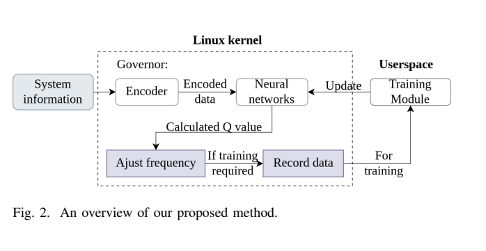
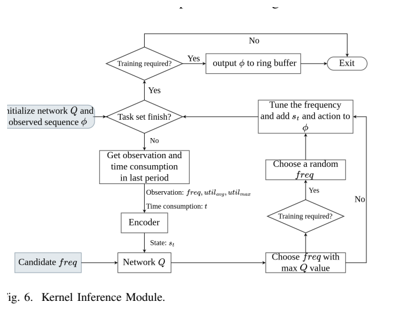
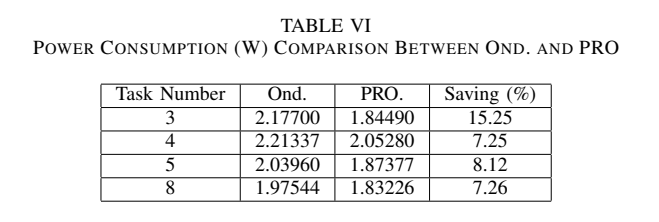

[论文页面](https://doi.org/10.48550/arXiv.2409.19434) · [本笔记所用 PDF](https://arxiv.org/pdf/2409.19434v3) · [标识符](https://doi.org/10.48550/arXiv.2409.19434)

整理日期：2026-11-05。**读者原创中文解读；原图归论文作者／出版方。未运行作者实验，不是独立复现。**

**覆盖范围：** 本版本正文中识别到的26项图、表或算法；保留原编号。关键项已裁图并在技术精读相应段落出现，未内嵌的项可点PDF页链接查看，不上传整篇PDF。

**统计总边界：** 五次训练曲线带standard error，但不能把收敛reward当能量统计。固定任务TableV实际不超时约85.74%–87.18%；随机TableVII有10.67%/12.57%样本超时超过5%，与结论“no task exceeds deadline”不一致，需优先采用表格。功率与能量混用，不能无执行时长就把W节省全称J节省。训练400轮不是理论收敛证明。

## Fig1：多任务deadline失败示例

[原文 Fig1，PDF p2](https://arxiv.org/pdf/2409.19434v3#page=2)

1. **本项回答的问题：** 多任务deadline失败示例，用于支撑这条方法或实验链中的具体环节。
2. **组成、坐标和对照：** 先读图题、图例、坐标/表头与单位，再在同一负载和同一基线内比较。单个利用率无法表示多个不同期限。 按原图／表标示的单位与归一化基准阅读；不将不同子图或不同分母的柱高直接相除。 颜色按原图图例辨认，不能把同色跨图视为同一组。
3. **阅读顺序与统计单位：** 先看设定、单位和图例，再看趋势与作者正文。重复次数及采样独立性参见本篇技术精读统计节；没有为该图定位到的误差线定义／独立重复数，不另行猜测。
4. **直接观察：** 单个利用率无法表示多个不同期限。
5. **作者解释的范围：** 原文以该图／表作为上述观察的结构说明或实验支撑，需连同对应页正文读取；本索引不额外替作者推导因果机制。
6. **独立判断（AI分析）：** 本项只支撑原文所列平台和配置；不证明E902可直接复用这些数值。
7. **证据链位置：** 性能验证／定量或示例证据，需结合实验条件。它支持本文具体条件下的实现或结果，不单独完成跨平台验证。
8. **结论与强度：** 可复述“单个利用率无法表示多个不同期限。”；对图内描述的核查可信度高，对未做独立实验的泛化判断为中或无法判断。不能得出的结论是“本项只支撑原文所列平台和配置；不证明E902可直接复用这些数值。”所排除的外推。

## Fig2：方法整体流程

[原文 Fig2，PDF p2](https://arxiv.org/pdf/2409.19434v3#page=2)

[打开大图](images/original-fig2.png)

1. **本项回答的问题：** 方法整体流程，用于支撑这条方法或实验链中的具体环节。
2. **组成、坐标和对照：** 先读图题、图例、坐标/表头与单位，再在同一负载和同一基线内比较。用户标签、内核编码和用户态训练分工明确。 结构／流程类没有统一数值坐标；箭头表示数据或控制关系，不表示统计因果。 颜色按原图图例辨认，不能把同色跨图视为同一组。
3. **阅读顺序与统计单位：** 先看设定、单位和图例，再看趋势与作者正文。重复次数及采样独立性参见本篇技术精读统计节；没有为该图定位到的误差线定义／独立重复数，不另行猜测。
4. **直接观察：** 用户标签、内核编码和用户态训练分工明确。
5. **作者解释的范围：** 原文以该图／表作为上述观察的结构说明或实验支撑，需连同对应页正文读取；本索引不额外替作者推导因果机制。
6. **独立判断（AI分析）：** 本项只支撑原文所列平台和配置；不证明E902可直接复用这些数值。
7. **证据链位置：** 方法／系统实现说明。它支持本文具体条件下的实现或结果，不单独完成跨平台验证。
8. **结论与强度：** 可复述“用户标签、内核编码和用户态训练分工明确。”；对图内描述的核查可信度高，对未做独立实验的泛化判断为中或无法判断。不能得出的结论是“本项只支撑原文所列平台和配置；不证明E902可直接复用这些数值。”所排除的外推。

## Fig3：用户态与内核交换

[原文 Fig3，PDF p3](https://arxiv.org/pdf/2409.19434v3#page=3)

1. **本项回答的问题：** 用户态与内核交换，用于支撑这条方法或实验链中的具体环节。
2. **组成、坐标和对照：** 先读图题、图例、坐标/表头与单位，再在同一负载和同一基线内比较。核内只保留推理与采样，训练在用户态。 按原图／表标示的单位与归一化基准阅读；不将不同子图或不同分母的柱高直接相除。 颜色按原图图例辨认，不能把同色跨图视为同一组。
3. **阅读顺序与统计单位：** 先看设定、单位和图例，再看趋势与作者正文。重复次数及采样独立性参见本篇技术精读统计节；没有为该图定位到的误差线定义／独立重复数，不另行猜测。
4. **直接观察：** 核内只保留推理与采样，训练在用户态。
5. **作者解释的范围：** 原文以该图／表作为上述观察的结构说明或实验支撑，需连同对应页正文读取；本索引不额外替作者推导因果机制。
6. **独立判断（AI分析）：** 本项只支撑原文所列平台和配置；不证明E902可直接复用这些数值。
7. **证据链位置：** 性能验证／定量或示例证据，需结合实验条件。它支持本文具体条件下的实现或结果，不单独完成跨平台验证。
8. **结论与强度：** 可复述“核内只保留推理与采样，训练在用户态。”；对图内描述的核查可信度高，对未做独立实验的泛化判断为中或无法判断。不能得出的结论是“本项只支撑原文所列平台和配置；不证明E902可直接复用这些数值。”所排除的外推。

## Fig4：TEGM编码算例

[原文 Fig4，PDF p4](https://arxiv.org/pdf/2409.19434v3#page=4)

1. **本项回答的问题：** TEGM编码算例，用于支撑这条方法或实验链中的具体环节。
2. **组成、坐标和对照：** 先读图题、图例、坐标/表头与单位，再在同一负载和同一基线内比较。任务时间戳和频率/负载历史共同形成状态。 按原图／表标示的单位与归一化基准阅读；不将不同子图或不同分母的柱高直接相除。 颜色按原图图例辨认，不能把同色跨图视为同一组。
3. **阅读顺序与统计单位：** 先看设定、单位和图例，再看趋势与作者正文。重复次数及采样独立性参见本篇技术精读统计节；没有为该图定位到的误差线定义／独立重复数，不另行猜测。
4. **直接观察：** 任务时间戳和频率/负载历史共同形成状态。
5. **作者解释的范围：** 原文以该图／表作为上述观察的结构说明或实验支撑，需连同对应页正文读取；本索引不额外替作者推导因果机制。
6. **独立判断（AI分析）：** 本项只支撑原文所列平台和配置；不证明E902可直接复用这些数值。
7. **证据链位置：** 性能验证／定量或示例证据，需结合实验条件。它支持本文具体条件下的实现或结果，不单独完成跨平台验证。
8. **结论与强度：** 可复述“任务时间戳和频率/负载历史共同形成状态。”；对图内描述的核查可信度高，对未做独立实验的泛化判断为中或无法判断。不能得出的结论是“本项只支撑原文所列平台和配置；不证明E902可直接复用这些数值。”所排除的外推。

## Fig5：TEM编码算例

[原文 Fig5，PDF p5](https://arxiv.org/pdf/2409.19434v3#page=5)

1. **本项回答的问题：** TEM编码算例，用于支撑这条方法或实验链中的具体环节。
2. **组成、坐标和对照：** 先读图题、图例、坐标/表头与单位，再在同一负载和同一基线内比较。简化编码损失一部分任务历史信息。 按原图／表标示的单位与归一化基准阅读；不将不同子图或不同分母的柱高直接相除。 颜色按原图图例辨认，不能把同色跨图视为同一组。
3. **阅读顺序与统计单位：** 先看设定、单位和图例，再看趋势与作者正文。重复次数及采样独立性参见本篇技术精读统计节；没有为该图定位到的误差线定义／独立重复数，不另行猜测。
4. **直接观察：** 简化编码损失一部分任务历史信息。
5. **作者解释的范围：** 原文以该图／表作为上述观察的结构说明或实验支撑，需连同对应页正文读取；本索引不额外替作者推导因果机制。
6. **独立判断（AI分析）：** 本项只支撑原文所列平台和配置；不证明E902可直接复用这些数值。
7. **证据链位置：** 性能验证／定量或示例证据，需结合实验条件。它支持本文具体条件下的实现或结果，不单独完成跨平台验证。
8. **结论与强度：** 可复述“简化编码损失一部分任务历史信息。”；对图内描述的核查可信度高，对未做独立实验的泛化判断为中或无法判断。不能得出的结论是“本项只支撑原文所列平台和配置；不证明E902可直接复用这些数值。”所排除的外推。

## Fig6：内核推理流程

[原文 Fig6，PDF p5](https://arxiv.org/pdf/2409.19434v3#page=5)

[打开大图](images/original-fig6.png)

1. **本项回答的问题：** 内核推理流程，用于支撑这条方法或实验链中的具体环节。
2. **组成、坐标和对照：** 先读图题、图例、坐标/表头与单位，再在同一负载和同一基线内比较。遍历候选频率并选Q最大动作。 结构／流程类没有统一数值坐标；箭头表示数据或控制关系，不表示统计因果。 颜色按原图图例辨认，不能把同色跨图视为同一组。
3. **阅读顺序与统计单位：** 先看设定、单位和图例，再看趋势与作者正文。重复次数及采样独立性参见本篇技术精读统计节；没有为该图定位到的误差线定义／独立重复数，不另行猜测。
4. **直接观察：** 遍历候选频率并选Q最大动作。
5. **作者解释的范围：** 原文以该图／表作为上述观察的结构说明或实验支撑，需连同对应页正文读取；本索引不额外替作者推导因果机制。
6. **独立判断（AI分析）：** 本项只支撑原文所列平台和配置；不证明E902可直接复用这些数值。
7. **证据链位置：** 方法／系统实现说明。它支持本文具体条件下的实现或结果，不单独完成跨平台验证。
8. **结论与强度：** 可复述“遍历候选频率并选Q最大动作。”；对图内描述的核查可信度高，对未做独立实验的泛化判断为中或无法判断。不能得出的结论是“本项只支撑原文所列平台和配置；不证明E902可直接复用这些数值。”所排除的外推。

## Fig7：用户态训练

[原文 Fig7，PDF p6](https://arxiv.org/pdf/2409.19434v3#page=6)

1. **本项回答的问题：** 用户态训练，用于支撑这条方法或实验链中的具体环节。
2. **组成、坐标和对照：** 先读图题、图例、坐标/表头与单位，再在同一负载和同一基线内比较。经验回放与网络更新不同于执行器。 按原图／表标示的单位与归一化基准阅读；不将不同子图或不同分母的柱高直接相除。 颜色按原图图例辨认，不能把同色跨图视为同一组。
3. **阅读顺序与统计单位：** 先看设定、单位和图例，再看趋势与作者正文。重复次数及采样独立性参见本篇技术精读统计节；没有为该图定位到的误差线定义／独立重复数，不另行猜测。
4. **直接观察：** 经验回放与网络更新不同于执行器。
5. **作者解释的范围：** 原文以该图／表作为上述观察的结构说明或实验支撑，需连同对应页正文读取；本索引不额外替作者推导因果机制。
6. **独立判断（AI分析）：** 本项只支撑原文所列平台和配置；不证明E902可直接复用这些数值。
7. **证据链位置：** 性能验证／定量或示例证据，需结合实验条件。它支持本文具体条件下的实现或结果，不单独完成跨平台验证。
8. **结论与强度：** 可复述“经验回放与网络更新不同于执行器。”；对图内描述的核查可信度高，对未做独立实验的泛化判断为中或无法判断。不能得出的结论是“本项只支撑原文所列平台和配置；不证明E902可直接复用这些数值。”所排除的外推。

## Fig8：3任务训练reward

[原文 Fig8，PDF p7](https://arxiv.org/pdf/2409.19434v3#page=7)

1. **本项回答的问题：** 3任务训练reward，用于支撑这条方法或实验链中的具体环节。
2. **组成、坐标和对照：** 先读图题、图例、坐标/表头与单位，再在同一负载和同一基线内比较。均值与误差带属于训练曲线。 按原图／表标示的单位与归一化基准阅读；不将不同子图或不同分母的柱高直接相除。 颜色按原图图例辨认，不能把同色跨图视为同一组。
3. **阅读顺序与统计单位：** 先看设定、单位和图例，再看趋势与作者正文。重复次数及采样独立性参见本篇技术精读统计节；没有为该图定位到的误差线定义／独立重复数，不另行猜测。
4. **直接观察：** 均值与误差带属于训练曲线。
5. **作者解释的范围：** 原文以该图／表作为上述观察的结构说明或实验支撑，需连同对应页正文读取；本索引不额外替作者推导因果机制。
6. **独立判断（AI分析）：** 本项只支撑原文所列平台和配置；不证明E902可直接复用这些数值。
7. **证据链位置：** 性能验证／定量或示例证据，需结合实验条件。它支持本文具体条件下的实现或结果，不单独完成跨平台验证。
8. **结论与强度：** 可复述“均值与误差带属于训练曲线。”；对图内描述的核查可信度高，对未做独立实验的泛化判断为中或无法判断。不能得出的结论是“本项只支撑原文所列平台和配置；不证明E902可直接复用这些数值。”所排除的外推。

## Fig9：5任务训练reward

[原文 Fig9，PDF p8](https://arxiv.org/pdf/2409.19434v3#page=8)

1. **本项回答的问题：** 5任务训练reward，用于支撑这条方法或实验链中的具体环节。
2. **组成、坐标和对照：** 先读图题、图例、坐标/表头与单位，再在同一负载和同一基线内比较。比较PRO/PROM学习行为。 按原图／表标示的单位与归一化基准阅读；不将不同子图或不同分母的柱高直接相除。 颜色按原图图例辨认，不能把同色跨图视为同一组。
3. **阅读顺序与统计单位：** 先看设定、单位和图例，再看趋势与作者正文。重复次数及采样独立性参见本篇技术精读统计节；没有为该图定位到的误差线定义／独立重复数，不另行猜测。
4. **直接观察：** 比较PRO/PROM学习行为。
5. **作者解释的范围：** 原文以该图／表作为上述观察的结构说明或实验支撑，需连同对应页正文读取；本索引不额外替作者推导因果机制。
6. **独立判断（AI分析）：** 本项只支撑原文所列平台和配置；不证明E902可直接复用这些数值。
7. **证据链位置：** 性能验证／定量或示例证据，需结合实验条件。它支持本文具体条件下的实现或结果，不单独完成跨平台验证。
8. **结论与强度：** 可复述“比较PRO/PROM学习行为。”；对图内描述的核查可信度高，对未做独立实验的泛化判断为中或无法判断。不能得出的结论是“本项只支撑原文所列平台和配置；不证明E902可直接复用这些数值。”所排除的外推。

## Fig10：8任务网络扩容

[原文 Fig10，PDF p8](https://arxiv.org/pdf/2409.19434v3#page=8)

1. **本项回答的问题：** 8任务网络扩容，用于支撑这条方法或实验链中的具体环节。
2. **组成、坐标和对照：** 先读图题、图例、坐标/表头与单位，再在同一负载和同一基线内比较。小网络PRO不足时扩PROL，成本随之增加。 按原图／表标示的单位与归一化基准阅读；不将不同子图或不同分母的柱高直接相除。 颜色按原图图例辨认，不能把同色跨图视为同一组。
3. **阅读顺序与统计单位：** 先看设定、单位和图例，再看趋势与作者正文。重复次数及采样独立性参见本篇技术精读统计节；没有为该图定位到的误差线定义／独立重复数，不另行猜测。
4. **直接观察：** 小网络PRO不足时扩PROL，成本随之增加。
5. **作者解释的范围：** 原文以该图／表作为上述观察的结构说明或实验支撑，需连同对应页正文读取；本索引不额外替作者推导因果机制。
6. **独立判断（AI分析）：** 本项只支撑原文所列平台和配置；不证明E902可直接复用这些数值。
7. **证据链位置：** 性能验证／定量或示例证据，需结合实验条件。它支持本文具体条件下的实现或结果，不单独完成跨平台验证。
8. **结论与强度：** 可复述“小网络PRO不足时扩PROL，成本随之增加。”；对图内描述的核查可信度高，对未做独立实验的泛化判断为中或无法判断。不能得出的结论是“本项只支撑原文所列平台和配置；不证明E902可直接复用这些数值。”所排除的外推。

## Fig11：3任务执行时间

[原文 Fig11，PDF p8](https://arxiv.org/pdf/2409.19434v3#page=8)

1. **本项回答的问题：** 3任务执行时间，用于支撑这条方法或实验链中的具体环节。
2. **组成、坐标和对照：** 先读图题、图例、坐标/表头与单位，再在同一负载和同一基线内比较。必须按各自deadline读，不能用总时长代替。 按原图／表标示的单位与归一化基准阅读；不将不同子图或不同分母的柱高直接相除。 颜色按原图图例辨认，不能把同色跨图视为同一组。
3. **阅读顺序与统计单位：** 先看设定、单位和图例，再看趋势与作者正文。重复次数及采样独立性参见本篇技术精读统计节；没有为该图定位到的误差线定义／独立重复数，不另行猜测。
4. **直接观察：** 必须按各自deadline读，不能用总时长代替。
5. **作者解释的范围：** 原文以该图／表作为上述观察的结构说明或实验支撑，需连同对应页正文读取；本索引不额外替作者推导因果机制。
6. **独立判断（AI分析）：** 本项只支撑原文所列平台和配置；不证明E902可直接复用这些数值。
7. **证据链位置：** 性能验证／定量或示例证据，需结合实验条件。它支持本文具体条件下的实现或结果，不单独完成跨平台验证。
8. **结论与强度：** 可复述“必须按各自deadline读，不能用总时长代替。”；对图内描述的核查可信度高，对未做独立实验的泛化判断为中或无法判断。不能得出的结论是“本项只支撑原文所列平台和配置；不证明E902可直接复用这些数值。”所排除的外推。

## Fig12：5任务执行时间

[原文 Fig12，PDF p8](https://arxiv.org/pdf/2409.19434v3#page=8)

1. **本项回答的问题：** 5任务执行时间，用于支撑这条方法或实验链中的具体环节。
2. **组成、坐标和对照：** 先读图题、图例、坐标/表头与单位，再在同一负载和同一基线内比较。并行与晚到达任务有不同余量。 按原图／表标示的单位与归一化基准阅读；不将不同子图或不同分母的柱高直接相除。 颜色按原图图例辨认，不能把同色跨图视为同一组。
3. **阅读顺序与统计单位：** 先看设定、单位和图例，再看趋势与作者正文。重复次数及采样独立性参见本篇技术精读统计节；没有为该图定位到的误差线定义／独立重复数，不另行猜测。
4. **直接观察：** 并行与晚到达任务有不同余量。
5. **作者解释的范围：** 原文以该图／表作为上述观察的结构说明或实验支撑，需连同对应页正文读取；本索引不额外替作者推导因果机制。
6. **独立判断（AI分析）：** 本项只支撑原文所列平台和配置；不证明E902可直接复用这些数值。
7. **证据链位置：** 性能验证／定量或示例证据，需结合实验条件。它支持本文具体条件下的实现或结果，不单独完成跨平台验证。
8. **结论与强度：** 可复述“并行与晚到达任务有不同余量。”；对图内描述的核查可信度高，对未做独立实验的泛化判断为中或无法判断。不能得出的结论是“本项只支撑原文所列平台和配置；不证明E902可直接复用这些数值。”所排除的外推。

## Fig13：8任务执行时间

[原文 Fig13，PDF p9](https://arxiv.org/pdf/2409.19434v3#page=9)

1. **本项回答的问题：** 8任务执行时间，用于支撑这条方法或实验链中的具体环节。
2. **组成、坐标和对照：** 先读图题、图例、坐标/表头与单位，再在同一负载和同一基线内比较。PRO出现超时，PROL改善但非硬保证。 按原图／表标示的单位与归一化基准阅读；不将不同子图或不同分母的柱高直接相除。 颜色按原图图例辨认，不能把同色跨图视为同一组。
3. **阅读顺序与统计单位：** 先看设定、单位和图例，再看趋势与作者正文。重复次数及采样独立性参见本篇技术精读统计节；没有为该图定位到的误差线定义／独立重复数，不另行猜测。
4. **直接观察：** PRO出现超时，PROL改善但非硬保证。
5. **作者解释的范围：** 原文以该图／表作为上述观察的结构说明或实验支撑，需连同对应页正文读取；本索引不额外替作者推导因果机制。
6. **独立判断（AI分析）：** 本项只支撑原文所列平台和配置；不证明E902可直接复用这些数值。
7. **证据链位置：** 性能验证／定量或示例证据，需结合实验条件。它支持本文具体条件下的实现或结果，不单独完成跨平台验证。
8. **结论与强度：** 可复述“PRO出现超时，PROL改善但非硬保证。”；对图内描述的核查可信度高，对未做独立实验的泛化判断为中或无法判断。不能得出的结论是“本项只支撑原文所列平台和配置；不证明E902可直接复用这些数值。”所排除的外推。

## Fig14：选频轨迹

[原文 Fig14，PDF p9](https://arxiv.org/pdf/2409.19434v3#page=9)

1. **本项回答的问题：** 选频轨迹，用于支撑这条方法或实验链中的具体环节。
2. **组成、坐标和对照：** 先读图题、图例、坐标/表头与单位，再在同一负载和同一基线内比较。相似负载也可能选择不同动作，因为历史不同。 按原图／表标示的单位与归一化基准阅读；不将不同子图或不同分母的柱高直接相除。 颜色按原图图例辨认，不能把同色跨图视为同一组。
3. **阅读顺序与统计单位：** 先看设定、单位和图例，再看趋势与作者正文。重复次数及采样独立性参见本篇技术精读统计节；没有为该图定位到的误差线定义／独立重复数，不另行猜测。
4. **直接观察：** 相似负载也可能选择不同动作，因为历史不同。
5. **作者解释的范围：** 原文以该图／表作为上述观察的结构说明或实验支撑，需连同对应页正文读取；本索引不额外替作者推导因果机制。
6. **独立判断（AI分析）：** 本项只支撑原文所列平台和配置；不证明E902可直接复用这些数值。
7. **证据链位置：** 性能验证／定量或示例证据，需结合实验条件。它支持本文具体条件下的实现或结果，不单独完成跨平台验证。
8. **结论与强度：** 可复述“相似负载也可能选择不同动作，因为历史不同。”；对图内描述的核查可信度高，对未做独立实验的泛化判断为中或无法判断。不能得出的结论是“本项只支撑原文所列平台和配置；不证明E902可直接复用这些数值。”所排除的外推。

## Fig15：固定任务集功率

[原文 Fig15，PDF p9](https://arxiv.org/pdf/2409.19434v3#page=9)

1. **本项回答的问题：** 固定任务集功率，用于支撑这条方法或实验链中的具体环节。
2. **组成、坐标和对照：** 先读图题、图例、坐标/表头与单位，再在同一负载和同一基线内比较。图题功率与正文energy术语不一致；不任意合并。 按原图／表标示的单位与归一化基准阅读；不将不同子图或不同分母的柱高直接相除。 颜色按原图图例辨认，不能把同色跨图视为同一组。
3. **阅读顺序与统计单位：** 先看设定、单位和图例，再看趋势与作者正文。重复次数及采样独立性参见本篇技术精读统计节；没有为该图定位到的误差线定义／独立重复数，不另行猜测。
4. **直接观察：** 图题功率与正文energy术语不一致；不任意合并。
5. **作者解释的范围：** 原文以该图／表作为上述观察的结构说明或实验支撑，需连同对应页正文读取；本索引不额外替作者推导因果机制。
6. **独立判断（AI分析）：** 本项只支撑原文所列平台和配置；不证明E902可直接复用这些数值。
7. **证据链位置：** 性能验证／定量或示例证据，需结合实验条件。它支持本文具体条件下的实现或结果，不单独完成跨平台验证。
8. **结论与强度：** 可复述“图题功率与正文energy术语不一致；不任意合并。”；对图内描述的核查可信度高，对未做独立实验的泛化判断为中或无法判断。不能得出的结论是“本项只支撑原文所列平台和配置；不证明E902可直接复用这些数值。”所排除的外推。

## TableI：平台与网络

[原文 TableI，PDF p7](https://arxiv.org/pdf/2409.19434v3#page=7)

1. **本项回答的问题：** 平台与网络，用于支撑这条方法或实验链中的具体环节。
2. **组成、坐标和对照：** 先读图题、图例、坐标/表头与单位，再在同一负载和同一基线内比较。JetsonNano/Linux4.9，GRU2→6。 按原图／表标示的单位与归一化基准阅读；不将不同子图或不同分母的柱高直接相除。 颜色按原图图例辨认，不能把同色跨图视为同一组。
3. **阅读顺序与统计单位：** 先看设定、单位和图例，再看趋势与作者正文。重复次数及采样独立性参见本篇技术精读统计节；没有为该图定位到的误差线定义／独立重复数，不另行猜测。
4. **直接观察：** JetsonNano/Linux4.9，GRU2→6。
5. **作者解释的范围：** 原文以该图／表作为上述观察的结构说明或实验支撑，需连同对应页正文读取；本索引不额外替作者推导因果机制。
6. **独立判断（AI分析）：** 本项只支撑原文所列平台和配置；不证明E902可直接复用这些数值。
7. **证据链位置：** 性能验证／定量或示例证据，需结合实验条件。它支持本文具体条件下的实现或结果，不单独完成跨平台验证。
8. **结论与强度：** 可复述“JetsonNano/Linux4.9，GRU2→6。”；对图内描述的核查可信度高，对未做独立实验的泛化判断为中或无法判断。不能得出的结论是“本项只支撑原文所列平台和配置；不证明E902可直接复用这些数值。”所排除的外推。

## TableII：程序与任务集

[原文 TableII，PDF p7](https://arxiv.org/pdf/2409.19434v3#page=7)

1. **本项回答的问题：** 程序与任务集，用于支撑这条方法或实验链中的具体环节。
2. **组成、坐标和对照：** 先读图题、图例、坐标/表头与单位，再在同一负载和同一基线内比较。MiBench程序名、任务数和并行关系要分开。 按原图／表标示的单位与归一化基准阅读；不将不同子图或不同分母的柱高直接相除。 颜色按原图图例辨认，不能把同色跨图视为同一组。
3. **阅读顺序与统计单位：** 先看设定、单位和图例，再看趋势与作者正文。重复次数及采样独立性参见本篇技术精读统计节；没有为该图定位到的误差线定义／独立重复数，不另行猜测。
4. **直接观察：** MiBench程序名、任务数和并行关系要分开。
5. **作者解释的范围：** 原文以该图／表作为上述观察的结构说明或实验支撑，需连同对应页正文读取；本索引不额外替作者推导因果机制。
6. **独立判断（AI分析）：** 本项只支撑原文所列平台和配置；不证明E902可直接复用这些数值。
7. **证据链位置：** 性能验证／定量或示例证据，需结合实验条件。它支持本文具体条件下的实现或结果，不单独完成跨平台验证。
8. **结论与强度：** 可复述“MiBench程序名、任务数和并行关系要分开。”；对图内描述的核查可信度高，对未做独立实验的泛化判断为中或无法判断。不能得出的结论是“本项只支撑原文所列平台和配置；不证明E902可直接复用这些数值。”所排除的外推。

## TableIII：逐任务执行时间

[原文 TableIII，PDF p9](https://arxiv.org/pdf/2409.19434v3#page=9)

1. **本项回答的问题：** 逐任务执行时间，用于支撑这条方法或实验链中的具体环节。
2. **组成、坐标和对照：** 先读图题、图例、坐标/表头与单位，再在同一负载和同一基线内比较。星号超时项不能在能效总结中省略。 按原图／表标示的单位与归一化基准阅读；不将不同子图或不同分母的柱高直接相除。 颜色按原图图例辨认，不能把同色跨图视为同一组。
3. **阅读顺序与统计单位：** 先看设定、单位和图例，再看趋势与作者正文。重复次数及采样独立性参见本篇技术精读统计节；没有为该图定位到的误差线定义／独立重复数，不另行猜测。
4. **直接观察：** 星号超时项不能在能效总结中省略。
5. **作者解释的范围：** 原文以该图／表作为上述观察的结构说明或实验支撑，需连同对应页正文读取；本索引不额外替作者推导因果机制。
6. **独立判断（AI分析）：** 本项只支撑原文所列平台和配置；不证明E902可直接复用这些数值。
7. **证据链位置：** 性能验证／定量或示例证据，需结合实验条件。它支持本文具体条件下的实现或结果，不单独完成跨平台验证。
8. **结论与强度：** 可复述“星号超时项不能在能效总结中省略。”；对图内描述的核查可信度高，对未做独立实验的泛化判断为中或无法判断。不能得出的结论是“本项只支撑原文所列平台和配置；不证明E902可直接复用这些数值。”所排除的外推。

## TableIV：推理时间

[原文 TableIV，PDF p10](https://arxiv.org/pdf/2409.19434v3#page=10)

1. **本项回答的问题：** 推理时间，用于支撑这条方法或实验链中的具体环节。
2. **组成、坐标和对照：** 先读图题、图例、坐标/表头与单位，再在同一负载和同一基线内比较。最大0.16ms是本平台最大网络，不能外推E902。 按原图／表标示的单位与归一化基准阅读；不将不同子图或不同分母的柱高直接相除。 颜色按原图图例辨认，不能把同色跨图视为同一组。
3. **阅读顺序与统计单位：** 先看设定、单位和图例，再看趋势与作者正文。重复次数及采样独立性参见本篇技术精读统计节；没有为该图定位到的误差线定义／独立重复数，不另行猜测。
4. **直接观察：** 最大0.16ms是本平台最大网络，不能外推E902。
5. **作者解释的范围：** 原文以该图／表作为上述观察的结构说明或实验支撑，需连同对应页正文读取；本索引不额外替作者推导因果机制。
6. **独立判断（AI分析）：** 本项只支撑原文所列平台和配置；不证明E902可直接复用这些数值。
7. **证据链位置：** 性能验证／定量或示例证据，需结合实验条件。它支持本文具体条件下的实现或结果，不单独完成跨平台验证。
8. **结论与强度：** 可复述“最大0.16ms是本平台最大网络，不能外推E902。”；对图内描述的核查可信度高，对未做独立实验的泛化判断为中或无法判断。不能得出的结论是“本项只支撑原文所列平台和配置；不证明E902可直接复用这些数值。”所排除的外推。

## TableV：固定集超时分布

[原文 TableV，PDF p10](https://arxiv.org/pdf/2409.19434v3#page=10)

1. **本项回答的问题：** 固定集超时分布，用于支撑这条方法或实验链中的具体环节。
2. **组成、坐标和对照：** 先读图题、图例、坐标/表头与单位，再在同一负载和同一基线内比较。不超时比例约86%，不是100%。 按原图／表标示的单位与归一化基准阅读；不将不同子图或不同分母的柱高直接相除。 颜色按原图图例辨认，不能把同色跨图视为同一组。
3. **阅读顺序与统计单位：** 先看设定、单位和图例，再看趋势与作者正文。重复次数及采样独立性参见本篇技术精读统计节；没有为该图定位到的误差线定义／独立重复数，不另行猜测。
4. **直接观察：** 不超时比例约86%，不是100%。
5. **作者解释的范围：** 原文以该图／表作为上述观察的结构说明或实验支撑，需连同对应页正文读取；本索引不额外替作者推导因果机制。
6. **独立判断（AI分析）：** 本项只支撑原文所列平台和配置；不证明E902可直接复用这些数值。
7. **证据链位置：** 性能验证／定量或示例证据，需结合实验条件。它支持本文具体条件下的实现或结果，不单独完成跨平台验证。
8. **结论与强度：** 可复述“不超时比例约86%，不是100%。”；对图内描述的核查可信度高，对未做独立实验的泛化判断为中或无法判断。不能得出的结论是“本项只支撑原文所列平台和配置；不证明E902可直接复用这些数值。”所排除的外推。

## TableVI：随机任务功率

[原文 TableVI，PDF p11](https://arxiv.org/pdf/2409.19434v3#page=11)

[打开大图](images/original-tablevi.png)

1. **本项回答的问题：** 随机任务功率，用于支撑这条方法或实验链中的具体环节。
2. **组成、坐标和对照：** 先读图题、图例、坐标/表头与单位，再在同一负载和同一基线内比较。3任务15.25%是表内最大，而非统一收益。 按原图／表标示的单位与归一化基准阅读；不将不同子图或不同分母的柱高直接相除。 颜色按原图图例辨认，不能把同色跨图视为同一组。
3. **阅读顺序与统计单位：** 先看设定、单位和图例，再看趋势与作者正文。重复次数及采样独立性参见本篇技术精读统计节；没有为该图定位到的误差线定义／独立重复数，不另行猜测。
4. **直接观察：** 3任务15.25%是表内最大，而非统一收益。
5. **作者解释的范围：** 原文以该图／表作为上述观察的结构说明或实验支撑，需连同对应页正文读取；本索引不额外替作者推导因果机制。
6. **独立判断（AI分析）：** 本项只支撑原文所列平台和配置；不证明E902可直接复用这些数值。
7. **证据链位置：** 性能验证／定量或示例证据，需结合实验条件。它支持本文具体条件下的实现或结果，不单独完成跨平台验证。
8. **结论与强度：** 可复述“3任务15.25%是表内最大，而非统一收益。”；对图内描述的核查可信度高，对未做独立实验的泛化判断为中或无法判断。不能得出的结论是“本项只支撑原文所列平台和配置；不证明E902可直接复用这些数值。”所排除的外推。

## TableVII：随机任务违约

[原文 TableVII，PDF p11](https://arxiv.org/pdf/2409.19434v3#page=11)

1. **本项回答的问题：** 随机任务违约，用于支撑这条方法或实验链中的具体环节。
2. **组成、坐标和对照：** 先读图题、图例、坐标/表头与单位，再在同一负载和同一基线内比较。含大于5%超时组，应与功率收益并排。 按原图／表标示的单位与归一化基准阅读；不将不同子图或不同分母的柱高直接相除。 颜色按原图图例辨认，不能把同色跨图视为同一组。
3. **阅读顺序与统计单位：** 先看设定、单位和图例，再看趋势与作者正文。重复次数及采样独立性参见本篇技术精读统计节；没有为该图定位到的误差线定义／独立重复数，不另行猜测。
4. **直接观察：** 含大于5%超时组，应与功率收益并排。
5. **作者解释的范围：** 原文以该图／表作为上述观察的结构说明或实验支撑，需连同对应页正文读取；本索引不额外替作者推导因果机制。
6. **独立判断（AI分析）：** 本项只支撑原文所列平台和配置；不证明E902可直接复用这些数值。
7. **证据链位置：** 性能验证／定量或示例证据，需结合实验条件。它支持本文具体条件下的实现或结果，不单独完成跨平台验证。
8. **结论与强度：** 可复述“含大于5%超时组，应与功率收益并排。”；对图内描述的核查可信度高，对未做独立实验的泛化判断为中或无法判断。不能得出的结论是“本项只支撑原文所列平台和配置；不证明E902可直接复用这些数值。”所排除的外推。

## Algorithm1：TEGM编码

[原文 Algorithm1，PDF p4](https://arxiv.org/pdf/2409.19434v3#page=4)

1. **本项回答的问题：** TEGM编码，用于支撑这条方法或实验链中的具体环节。
2. **组成、坐标和对照：** 先读图题、图例、坐标/表头与单位，再在同一负载和同一基线内比较。状态显式包含任务进度标签。 按原图／表标示的单位与归一化基准阅读；不将不同子图或不同分母的柱高直接相除。 颜色按原图图例辨认，不能把同色跨图视为同一组。
3. **阅读顺序与统计单位：** 先看设定、单位和图例，再看趋势与作者正文。重复次数及采样独立性参见本篇技术精读统计节；没有为该图定位到的误差线定义／独立重复数，不另行猜测。
4. **直接观察：** 状态显式包含任务进度标签。
5. **作者解释的范围：** 原文以该图／表作为上述观察的结构说明或实验支撑，需连同对应页正文读取；本索引不额外替作者推导因果机制。
6. **独立判断（AI分析）：** 本项只支撑原文所列平台和配置；不证明E902可直接复用这些数值。
7. **证据链位置：** 性能验证／定量或示例证据，需结合实验条件。它支持本文具体条件下的实现或结果，不单独完成跨平台验证。
8. **结论与强度：** 可复述“状态显式包含任务进度标签。”；对图内描述的核查可信度高，对未做独立实验的泛化判断为中或无法判断。不能得出的结论是“本项只支撑原文所列平台和配置；不证明E902可直接复用这些数值。”所排除的外推。

## Algorithm2：TEM编码

[原文 Algorithm2，PDF p5](https://arxiv.org/pdf/2409.19434v3#page=5)

1. **本项回答的问题：** TEM编码，用于支撑这条方法或实验链中的具体环节。
2. **组成、坐标和对照：** 先读图题、图例、坐标/表头与单位，再在同一负载和同一基线内比较。删去部分递归信息降低复杂度。 按原图／表标示的单位与归一化基准阅读；不将不同子图或不同分母的柱高直接相除。 颜色按原图图例辨认，不能把同色跨图视为同一组。
3. **阅读顺序与统计单位：** 先看设定、单位和图例，再看趋势与作者正文。重复次数及采样独立性参见本篇技术精读统计节；没有为该图定位到的误差线定义／独立重复数，不另行猜测。
4. **直接观察：** 删去部分递归信息降低复杂度。
5. **作者解释的范围：** 原文以该图／表作为上述观察的结构说明或实验支撑，需连同对应页正文读取；本索引不额外替作者推导因果机制。
6. **独立判断（AI分析）：** 本项只支撑原文所列平台和配置；不证明E902可直接复用这些数值。
7. **证据链位置：** 性能验证／定量或示例证据，需结合实验条件。它支持本文具体条件下的实现或结果，不单独完成跨平台验证。
8. **结论与强度：** 可复述“删去部分递归信息降低复杂度。”；对图内描述的核查可信度高，对未做独立实验的泛化判断为中或无法判断。不能得出的结论是“本项只支撑原文所列平台和配置；不证明E902可直接复用这些数值。”所排除的外推。

## Algorithm3：奖励计算

[原文 Algorithm3，PDF p6](https://arxiv.org/pdf/2409.19434v3#page=6)

1. **本项回答的问题：** 奖励计算，用于支撑这条方法或实验链中的具体环节。
2. **组成、坐标和对照：** 先读图题、图例、坐标/表头与单位，再在同一负载和同一基线内比较。基于低频驻留/利用率及软超时惩罚。 按原图／表标示的单位与归一化基准阅读；不将不同子图或不同分母的柱高直接相除。 颜色按原图图例辨认，不能把同色跨图视为同一组。
3. **阅读顺序与统计单位：** 先看设定、单位和图例，再看趋势与作者正文。重复次数及采样独立性参见本篇技术精读统计节；没有为该图定位到的误差线定义／独立重复数，不另行猜测。
4. **直接观察：** 基于低频驻留/利用率及软超时惩罚。
5. **作者解释的范围：** 原文以该图／表作为上述观察的结构说明或实验支撑，需连同对应页正文读取；本索引不额外替作者推导因果机制。
6. **独立判断（AI分析）：** 本项只支撑原文所列平台和配置；不证明E902可直接复用这些数值。
7. **证据链位置：** 性能验证／定量或示例证据，需结合实验条件。它支持本文具体条件下的实现或结果，不单独完成跨平台验证。
8. **结论与强度：** 可复述“基于低频驻留/利用率及软超时惩罚。”；对图内描述的核查可信度高，对未做独立实验的泛化判断为中或无法判断。不能得出的结论是“本项只支撑原文所列平台和配置；不证明E902可直接复用这些数值。”所排除的外推。

## Algorithm4：随机任务生成

[原文 Algorithm4，PDF p10](https://arxiv.org/pdf/2409.19434v3#page=10)

1. **本项回答的问题：** 随机任务生成，用于支撑这条方法或实验链中的具体环节。
2. **组成、坐标和对照：** 先读图题、图例、坐标/表头与单位，再在同一负载和同一基线内比较。随机到达与期限来源有限，不是任意实际业务。 按原图／表标示的单位与归一化基准阅读；不将不同子图或不同分母的柱高直接相除。 颜色按原图图例辨认，不能把同色跨图视为同一组。
3. **阅读顺序与统计单位：** 先看设定、单位和图例，再看趋势与作者正文。重复次数及采样独立性参见本篇技术精读统计节；没有为该图定位到的误差线定义／独立重复数，不另行猜测。
4. **直接观察：** 随机到达与期限来源有限，不是任意实际业务。
5. **作者解释的范围：** 原文以该图／表作为上述观察的结构说明或实验支撑，需连同对应页正文读取；本索引不额外替作者推导因果机制。
6. **独立判断（AI分析）：** 本项只支撑原文所列平台和配置；不证明E902可直接复用这些数值。
7. **证据链位置：** 性能验证／定量或示例证据，需结合实验条件。它支持本文具体条件下的实现或结果，不单独完成跨平台验证。
8. **结论与强度：** 可复述“随机到达与期限来源有限，不是任意实际业务。”；对图内描述的核查可信度高，对未做独立实验的泛化判断为中或无法判断。不能得出的结论是“本项只支撑原文所列平台和配置；不证明E902可直接复用这些数值。”所排除的外推。
