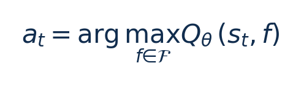
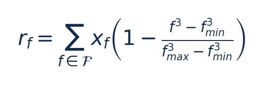
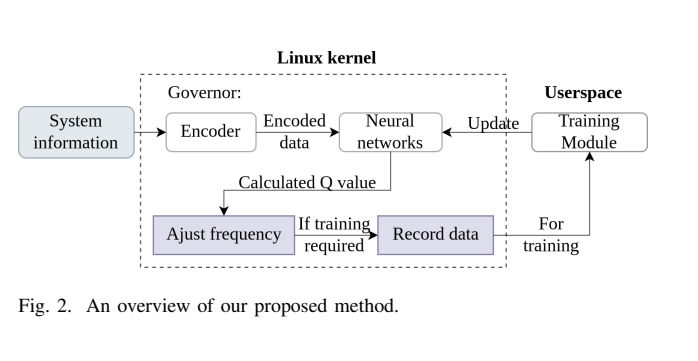
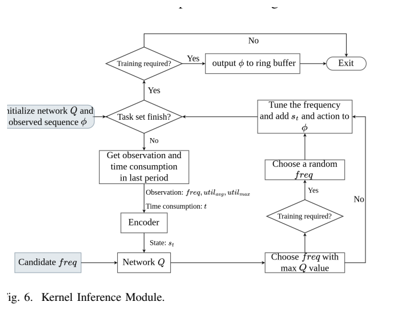
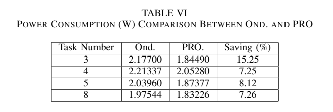

[论文页面](https://doi.org/10.48550/arXiv.2409.19434) · [本笔记所用 PDF](https://arxiv.org/pdf/2409.19434v3) · [标识符](https://doi.org/10.48550/arXiv.2409.19434)

整理日期：2026-11-05。**读者原创中文解读；原图归论文作者／出版方。未运行作者实验，不是独立复现。**

**一句话：** 把任务开始/完成标签和负载历史编码给DDQN，使共享CPU频率能考虑多个任务的软期限

阅读地图：先看问题与输入输出，再顺着架构图、公式和结果图阅读；最后检查统计边界与E902迁移。完整编号索引另见“图表索引”。下文“读者分析”是推断或建议，不是原文结果。

## 阶段0：材料与版本审计

| 材料 | 当前可用程度 | 影响 |
| --- | --- | --- |
| 摘要、正文、方法、原图注 | 已获取本地完整PDF、文本与逐页渲染 | 可核查结构、实验及关键数字；可见页面优先于异常文本层 |
| 分析版本 | arXiv2409.19434v3，2025-05-21，13页；不混用初版摘要。 | 引用页码以“PDF第几页”标识 |
| 代码／原始数据 | 论文链接 https://github.com/coladog/tinyagent 为相关内核引擎；未运行本篇多任务代码或确认该仓库某提交即可重现实验。 | 公开链接不等于已构建或已拿到原始轨迹 |
| 附件、独立原始重复与勘误 | 当前未完成全渠道附件／勘误穷尽检索 | 不能断言没有附件、没有勘误或没有其他版本 |
| 本次工作范围 | 材料阅读、图表裁取、证据整理、教学公式 | 所有新实验均是建议，尚未执行 |

## 阶段1：身份卡与整体概述

| 项目 | 内容 |
| --- | --- |
| 英文题名 | Energy-Efficient Computation with DVFS using Deep Reinforcement Learning for Multi-Task Systems in Edge Computing |
| 中文导读题名 | 把任务开始/完成标签和负载历史编码给DDQN，使共享CPU频率能考虑多个任务的软期限 |
| 作者 | Xinyi Li, Ti Zhou, Haoyu Wang, Man Lin |
| 发表／版本 | arXiv2409.19434，首次2024、v3修订2025；arXiv2409.19434v3，2025-05-21，13页；不混用初版摘要。 |
| 类型与领域 | 原始方法／工程系统研究；DVFS、CPU能效、运行时控制 |
| 单位、通讯、资助与利益关系 | 作者姓名以本版本首页为准；通讯方式、单位及资助可回查首页与末页声明。当前尚未完成资助/利益关系/勘误的跨版本穷尽审计。 |
| 核心对象与接口 | 在governor决策点更新；本文统一采样间隔及两档确切频值当前未定位齐；400训练轮，每轮3次收集 |
| 代码与数据 | 论文链接 https://github.com/coladog/tinyagent 为相关内核引擎；未运行本篇多任务代码或确认该仓库某提交即可重现实验。 |
| 与本课题关系 | 对E902可把多任务标签换成“采集、压缩、发送”阶段或多个待处理块；先实现低维历史统计/小Q表，再考虑GRU。不要为单核小任务复制内核浮点网络。 |

**约200字中文概述（改写）：** 本文研究多核共享频率上的周期软实时任务集，串行/并行与多个期限的运行时能效。具体程序包括3任务：重复乘法；5/8任务：MiBench jpeg、qsort、fft、typeset混合；另随机生成3/4/5/8任务集。作者在NVIDIA Jetson Nano2GB，Linux4.9；Ruideng UM25C USB功率计；内核浮点网络，用户态训练；不是E902实现上采用用户态DDQN＋内核TEGM（GRU+MLP，PRO/PROL）或TEM（MLP，PROM）；对每个候选频率评估Q并取最大；终回合稀疏reward。输入为每任务未开始/执行中/完成标签、开始/完成时间记录、最大/平均利用率、候选频率、累计已用时间与频率-负载驻留时间，输出为两档候选CPU频率的选择；内核不接收完整任务模型，期限用于用户态reward。主要结果应与下方基线、性能约束和测量范围一起阅读，不能只摘最高百分比。相对已有2023单任务编码，新增多任务状态标签/时间戳和递归编码，并调整软超时奖励；需要较大网络才处理8任务，展示可观测性与容量权衡。

**三句话定位：** 问题是为什么相同CPU利用率未必对应相同的工作需求？本篇的可检验主张是：把任务开始/完成标签和负载历史编码给DDQN，使共享CPU频率能考虑多个任务的软期限。验证链是可观测状态→控制规则或学习模型→执行器→任务正确性/服务质量与能耗对照。 方法主线为每任务未开始/执行中/完成标签、开始/完成时间记录、最大/平均利用率、候选频率、累计已用时间与频率-负载驻留时间 → 用户态DDQN＋内核TEGM（GRU+MLP，PRO/PROL）或TEM（MLP，PROM）；对每个候选频率评估Q并取最大；终回合稀疏reward → 两档候选CPU频率的选择；内核不接收完整任务模型，期限用于用户态reward → 执行与反馈。 主要证据见下方结果表，结论须与测量和版本范围一起使用。

## 阶段2：问题、假设与创新位置

为什么相同CPU利用率未必对应相同的工作需求？本篇的可检验主张是：把任务开始/完成标签和负载历史编码给DDQN，使共享CPU频率能考虑多个任务的软期限。验证链是可观测状态→控制规则或学习模型→执行器→任务正确性/服务质量与能耗对照。

**创新判断（读者分析）：** 相对已有2023单任务编码，新增多任务状态标签/时间戳和递归编码，并调整软超时奖励；需要较大网络才处理8任务，展示可观测性与容量权衡。 不依据作者自称“首次”断定整个领域绝无前例。

## 阶段3：必要术语与数学

| 级别 | 术语／关键词 | 直觉、严格含义与易混点 |
| --- | --- | --- |
| A | DVFS / DFS | DVFS同时涉及动态电压与频率；只有时钟变化称DFS。电压能否改变取决于实际供电域。 |
| A | Workload | 真正执行应用计算的程序与输入；本文里的控制器是另一个角色。 |
| A | Controller | 根据观测选择动作的软件／硬件，可运行在同一CPU或独立控制核。 |
| A | OPP | Operating Performance Point，经过允许范围验证的电压—频率组合。 |
| A | Power / Energy | 功率W表示此刻消耗快慢；能量J是对时间积分。低功率不必然低能量。 |
| B | Deadline | 作业必须完成的时刻；平均时延、P95与最大时延各有不同用途。 |
| A | 被控程序 | 3任务：重复乘法；5/8任务：MiBench jpeg、qsort、fft、typeset混合；另随机生成3/4/5/8任务集 |
| A | 控制策略 | 用户态DDQN＋内核TEGM（GRU+MLP，PRO/PROL）或TEM（MLP，PROM）；对每个候选频率评估Q并取最大；终回合稀疏reward |
| B | 控制周期 | 在governor决策点更新；本文统一采样间隔及两档确切频值当前未定位齐；400训练轮，每轮3次收集 |
| B | 证据边界 | 实测、硬件仿真、功耗模型是不同证据，见平台与结果表。 |

### 公式1：候选频率逐个评分

**符号与前提：** s为时序编码状态，Q为无量纲预期回报，f为候选动作；推理每档一次。

**代入与检查：** 只有两档时需评估两次；扩8档会增加计算量，不能假设开销不变。

**来源：** §II-B，p5–6
### 公式2：低频reward项

**符号与前提：** x_f为驻留时间/T，和为1；不是实测功率，V-f关系和静态功率未显式包含。

**代入与检查：** 两档最高/最低各一半时r_f=0.5，实际焦耳仍须独立电测。

**来源：** Algorithm3，p6

## 阶段4–6：架构、关键图与方法拆解

**输入—处理—输出：** 每任务未开始/执行中/完成标签、开始/完成时间记录、最大/平均利用率、候选频率、累计已用时间与频率-负载驻留时间 → 用户态DDQN＋内核TEGM（GRU+MLP，PRO/PROL）或TEM（MLP，PROM）；对每个候选频率评估Q并取最大；终回合稀疏reward → 两档候选CPU频率的选择；内核不接收完整任务模型，期限用于用户态reward → 执行与反馈。

| 系统角色 | 具体设置 |
| --- | --- |
| 具体控制算法 | 用户态DDQN＋内核TEGM（GRU+MLP，PRO/PROL）或TEM（MLP，PROM）；对每个候选频率评估Q并取最大；终回合稀疏reward |
| 被控负载类型 | 多核共享频率上的周期软实时任务集，串行/并行与多个期限 |
| 具体被控程序 | 3任务：重复乘法；5/8任务：MiBench jpeg、qsort、fft、typeset混合；另随机生成3/4/5/8任务集 |
| 使用平台与测量 | NVIDIA Jetson Nano2GB，Linux4.9；Ruideng UM25C USB功率计；内核浮点网络，用户态训练；不是E902实现 |
| 输入/状态 | 每任务未开始/执行中/完成标签、开始/完成时间记录、最大/平均利用率、候选频率、累计已用时间与频率-负载驻留时间 |
| 输出/动作 | 两档候选CPU频率的选择；内核不接收完整任务模型，期限用于用户态reward |
| 周期与运行位置 | 在governor决策点更新；本文统一采样间隔及两档确切频值当前未定位齐；400训练轮，每轮3次收集 |

§II–III（p3–11）将任务标签编码进p2，频率/负载驻留编码进p1，合并瞬时利用率、累计运行和墙钟时间。TEGM保留GRU历史；TEM仅MLP；候选频率作为动作输入，逐个计算Q值。该v3的GRU输入2、状态6，与TNSE2022的GRU状态8不是同一网络。MLP两个隐藏层30节点，大任务集扩成PROL。内核执行推理，用户态训练DDQN，经验池按reward十桶优先抽样。

奖励的低频项按f³归一，结合平均利用率，发生超时时按平均超时程度扣分，超过阈值则0；不是直接用实测焦耳作每步reward。仅回合末非零reward。原文Algorithm3部分变量/超时比公式与叙述需要结合代码核查，本笔记不把它改写成严格硬期限约束。基线Linux可用全部频率，而学习策略只用两档，因此动作空间不同。

### Fig2：方法整体流程

[打开大图](images/original-fig2.png) · [原文 Fig2，PDF p2](https://arxiv.org/pdf/2409.19434v3#page=2)

**怎样看：** 先读图题、图例、坐标/表头与单位，再在同一负载和同一基线内比较。用户标签、内核编码和用户态训练分工明确。

**直接观察／原文报告：** 用户标签、内核编码和用户态训练分工明确。

**读者判断：** 本项只支撑原文所列平台和配置；不证明E902可直接复用这些数值。

### Fig6：内核推理流程

[打开大图](images/original-fig6.png) · [原文 Fig6，PDF p5](https://arxiv.org/pdf/2409.19434v3#page=5)

**怎样看：** 先读图题、图例、坐标/表头与单位，再在同一负载和同一基线内比较。遍历候选频率并选Q最大动作。

**直接观察／原文报告：** 遍历候选频率并选Q最大动作。

**读者判断：** 本项只支撑原文所列平台和配置；不证明E902可直接复用这些数值。

| 阅读问题 | 先看材料 | 如何接到下一步 |
| --- | --- | --- |
| 为什么要改现有方案 | 问题背景与动机图 | 确定目标、约束和原有不足 |
| 系统观察什么、控制什么 | 输入输出表＋关键架构图 | 确认数据、模型和执行器真实角色 |
| 方法如何得到动作或估计 | 方法段、公式、算法／模型表 | 明确离线训练与在线流程 |
| 收益是否真实且公平 | 结果图表、统计与测量边界 | 核查基线／目标／分母／开销 |
| 能否用于自己的CPU | 局限、复现计划、三项实验 | 把论文假设变成待验证的工程条件 |

## 阶段7–8：实验、统计及证据链

本节数字均是**原文明确报告或原文数值的标注算例**；没有按图柱高度臆造额外精确值。

| 指标 | 原文报告 | 条件／分母／边界 | 证据位置 |
| --- | --- | --- | --- |
| 固定任务集相对Ondemand | 约7%/3%/4%降低 | 分别3任务PRO、5任务PRO、8任务PROL；图15称功率，正文又称energy，应保留术语不一致 | Fig15/§III-E，p9–10 |
| 随机任务集功率 | 2.177→1.8449W（3任务，15.25%） | 不是所有任务均有15.25%；4/5/8任务7.25/8.12/7.26% | TableVI，p11 |
| 推理开销 | 最大0.16ms | 8任务PROL；非旧2023的整数引擎25µs | TableIV，p10 |
| 随机任务超时>5%的比例 | 10.67%/12.57%/4.06%/4.59% | 分别3/4/5/8任务；不能写零违约保证 | TableVII，p11 |

### TableVI：随机任务功率

[打开大图](images/original-tablevi.png) · [原文 TableVI，PDF p11](https://arxiv.org/pdf/2409.19434v3#page=11)

**怎样看：** 先读图题、图例、坐标/表头与单位，再在同一负载和同一基线内比较。3任务15.25%是表内最大，而非统一收益。

**直接观察／原文报告：** 3任务15.25%是表内最大，而非统一收益。

**读者判断：** 本项只支撑原文所列平台和配置；不证明E902可直接复用这些数值。

**统计与公平性审查（读者分析）：** 五次训练曲线带standard error，但不能把收敛reward当能量统计。固定任务TableV实际不超时约85.74%–87.18%；随机TableVII有10.67%/12.57%样本超时超过5%，与结论“no task exceeds deadline”不一致，需优先采用表格。功率与能量混用，不能无执行时长就把W节省全称J节省。训练400轮不是理论收敛证明。

工程实验中，设备、程序、输入文件、重复运行、时间窗口是不同统计层级，不能互相替代。本任务不涉及生物样本，细胞／动物／试剂等检查不适用。未注明的P值或置信区间不补造；“差了几个百分点”不自动等于统计显著。

| 主张层级 | 直接证据 | 对照与统计 | 可得结论／替代解释 | 可信度 |
| --- | --- | --- | --- | --- |
| 原文明确报告 | 固定任务集相对Ondemand：约7%/3%/4%降低 | Fig15/§III-E，p9–10 | 分别3任务PRO、5任务PRO、8任务PROL；图15称功率，正文又称energy，应保留术语不一致；仅在该实验范围内成立 | 图表／文本可核对：高；独立复现：尚无 |
| 作者解释 | 所提架构／模型解释了性能或估计改善 | 关键原图与方法见上文；统计边界见下节 | 效果可能同时来自动作空间、平台特性与采样设置，因果归因需消融 | 中 |
| AI分析／迁移假设 | 用于E902的压缩候选负载 | 本篇未直接验证该芯片与任务组合 | 需三项后续实验；不能复制论文收益数字 | 待验证，当前无法判断 |

## 阶段9–10：贡献与局限分开判断

相对已有2023单任务编码，新增多任务状态标签/时间戳和递归编码，并调整软超时奖励；需要较大网络才处理8任务，展示可观测性与容量权衡。

| 来源 | 严重程度 | 局限及其影响 |
| --- | --- | --- |
| 读者分析 | 关键 | 固定任务规模较小，随机集不代表未知应用泛化或所有期限满足。 |
| 读者分析 | 关键 | 内核浮点安全/上下文成本与E902无FPU资源差异需单独设计。 |
| 读者分析 | 关键 | two-frequency策略与全频Linux对照不可宣称完全同动作权限公平比较。 |

## 阶段11：最小复现路线与缺口

先重建原文固定安全档、输入文件和测量边界，再实现上述算法。逐档确认正确输出和执行时间，记录控制、监测、调频与空闲成本；冻结模型后用整文件留出的输入测试。原文未定位齐的参数须列入复现日志，不用猜测值伪装完整复现。对E902可把多任务标签换成“采集、压缩、发送”阶段或多个待处理块；先实现低维历史统计/小Q表，再考虑GRU。不要为单核小任务复制内核浮点网络。

**代码／数据现状：** 论文链接 https://github.com/coladog/tinyagent 为相关内核引擎；未运行本篇多任务代码或确认该仓库某提交即可重现实验。

**质量控制顺序：** 先验证程序输出和时间基准，再验证采样／模型，最后比较策略。保存输入文件哈希、平台配置、OPP、随机种子、温度与每次运行原始记录。失败时先回固定安全频点定位错误，再继续优化。复现可行性判断为“可开始部分方法复建，完整数值复现条件未齐”；这与“已完成复现”不同。

## 阶段12：用于你的CPU／E902课题

对E902可把多任务标签换成“采集、压缩、发送”阶段或多个待处理块；先实现低维历史统计/小Q表，再考虑GRU。不要为单核小任务复制内核浮点网络。

| 建议实验／优先级 | 价值 | 最低资源 | 主要风险 | 成功判据（设计目标，非已得结果） |
| --- | --- | --- | --- | --- |
| P0：多块任务标签 | 验证排队和期限是否可观测 | 块ID/开始完成/队列长度 | 只有负载百分比看不到队列 | 记录逐块时延而非平均完成时间 |
| P1：历史与无历史消融 | 检验GRU是否必要 | 相同合法档位/状态/数据 | 复杂度带来推理成本 | 小表/树/MLP与历史模型报告净收益 |
| P1：逐任务违约分布 | 避免只用回合reward | 不同到达周期与独立文件 | 少量严重超时被均值掩盖 | 输出每块P95/最大时延和超时>5%比例 |

上述优先级是读者建议：P0先做，P1建立在基线可运行后，P2只在资源允许且前序实验证明有必要时开展。压缩应用仍是候选，尚未替你最终定题或证明已在E902运行。论文公开可读不自动授权任意复制数据；代码、图片和数据须分别核对许可。

## 阶段13：读完后应掌握与继续核查

**五个知识点：** 把任务开始/完成标签和负载历史编码给DDQN，使共享CPU频率能考虑多个任务的软期限 你还应能解释输入输出表中的角色、两条公式的单位、首个结果指标的分母，以及局限表里的关键条件。

**五个未决问题：** 独立新输入是否成立？最差时延是否可接受？测量参考是否足够？控制与切换是否抵消收益？E902实际具有哪些接口和可观测量？这些是研究问题，不是对作者遗漏的无证据指控。

**立即做：** 按公式算例手算一次，选一张结果图复述“硬件—负载—基线—指标—边界”。**后续核查：** 补齐代码版本、训练数据和仪表设置。**可复用：** 上文明确标注的模型与接口思路。**谨慎采用：** 所有跨平台百分比。**暂不采用：** 尚未证实存在的电压控制和完整硬实时承诺。
