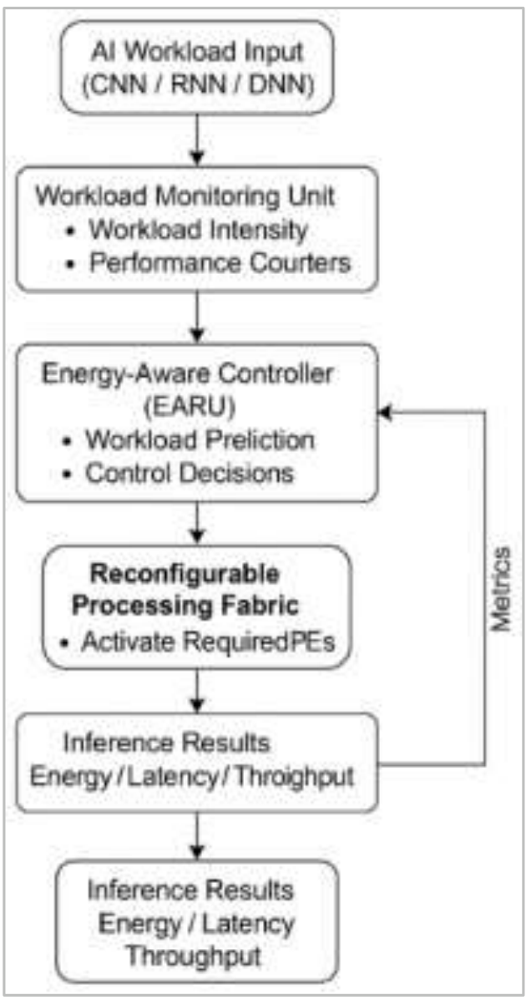
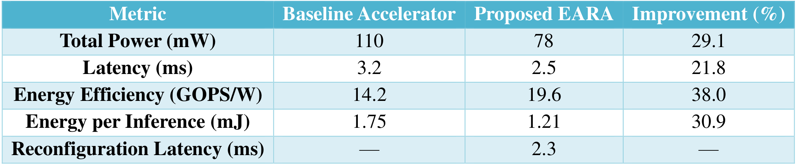
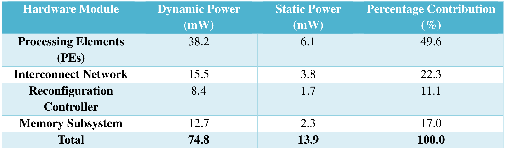
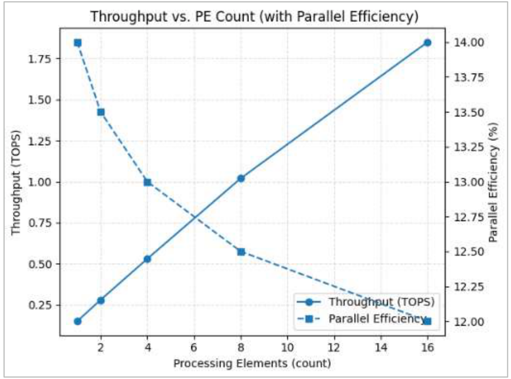
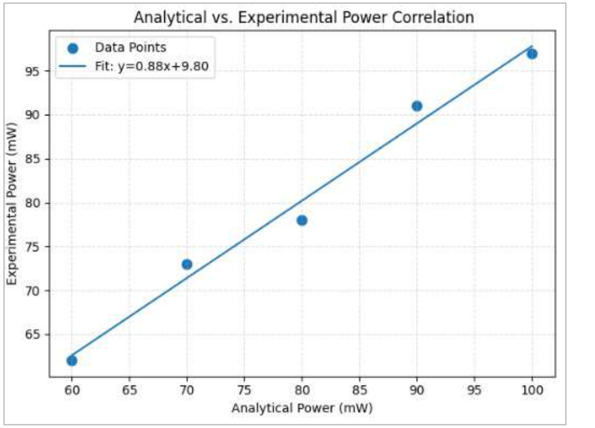

# EARA与DEAR：负载反馈、PE重配和DVFS的流程重建与证据审查

[从零入门](start.md) · [原图表索引](figures.md) · [双语摘要与导读](abstract.md)

## 核心信息

- 标题：Energy-Aware Reconfigurable VLSI Architecture for Edge-AI Acceleration: Design, Implementation, and FPGA-Based Validation
- 标题翻译：面向边缘人工智能加速的能量感知可重配VLSI架构：设计、实现与FPGA验证
- 作者：Rushikesh Ramesh Vikhe；Ankit Navgeet Joshi
- 发表时间：用户PDF页眉标2024年11月
- 发表渠道：International Journal of Advanced Multidisciplinary Scientific Research，7(11)，196–212
- DOI：10.31426/ijamsr.2024.7.11.7927
- 论文链接：https://doi.org/10.31426/ijamsr.2024.7.11.7927
- 论文类型：加速器架构与运行时控制方法

## 原文摘要翻译

本文描述一种能量感知可重配VLSI架构EARA的设计、实现与验证，目标是提高边缘人工智能加速器的能量效率和计算灵活性。该架构把动态电压频率调节、时钟门控与电源门控等多层功耗管理方法，结合到运行时重配置平台中，以根据工作负载动态调整功耗和性能。文章称，在Xilinx Zynq UltraScale+ MPSoC上部署后，相比传统静态架构，总功率平均降低29%，推理时延降低21%，计算能效提高38%。方法结合硬件在环实验、仿真分析、FPGA验证及理论预测与测量的相关性检查，声称两者差异小于±8%。架构根据工作量启停处理单元、重映射互连，以实现实时低功耗推理所需的能量比例性；片上数据复用和分层存储也有助于降低时延、提高吞吐。作者认为，能量感知控制与动态重配可以共存，适用于物联网、自治设备和可穿戴电子等受限系统，并为高性能与低功耗边缘人工智能提供可扩展框架。

摘要结尾跨到PDF第2页，本译文已接全。摘要百分比忠实保留为作者报告，后文的量纲核查不应倒填进摘要。

**English abstract paraphrase**：EARA combines DVFS, clock gating, power gating, and runtime resource reconfiguration for edge inference. The paper reports a Zynq-based implementation and improvements in power, latency, and operations per watt over a static design. It connects analytical models, simulation, and FPGA evaluation. The detailed note below audits the disclosed control policy and the consistency of the reported measurements; it does not claim an independent reproduction.

## 创新点

1. **联合控制的架构设想**：把V/f、活跃PE数、互连与数据复用放进一个重配置控制框架。它比“只根据利用率调频”覆盖更多动作，但也更难区分每项贡献。
2. **DEAR运行时流程**：提出“监测—预测—配置—约束检查—再调整”的控制循环，并给出按负载比例分配PE的公式。
3. **模型—逻辑—平台验证路线**：作者声称把功耗模型、HDL和ZCU104实验联系起来。路线本身有借鉴价值；当前公开证据还不足以复建每条物理控制链。

原文“没有已有研究统一这些技术”的表述不能直接采纳为已核实的首次贡献。本笔记未完成所有先行研究全文的优先权审查；尤其本文自己也引用了既有FPGA动态能量管理工作。

## 一句话总结

EARA描述了一个想同时控制V/f和计算资源的框架，但DEAR选档律、真实FPGA电源执行以及实验数值之间都有关键缺口，适合学习怎样审查控制论文，暂不宜作为你的节能结果依据。

## 研究问题

### 作者要解决什么

静态加速器按高负载配置，低负载时可能仍有较多空闲资源与功耗。作者希望随需求改变处理速度和活跃资源，让功耗更接近任务需求，并保持实时性能。被控负载是**运行在加速架构上的推理计算**；控制器是EARA的重配置部分，DEAR是其运行时流程，两者不是同一层的名字。

CPU程序同样会有需求变化，但E902单核不能直接套用“16个PE开几个”的动作。可迁移的是需求输入、合法OPP选择、开销预算和执行反馈。若先做CPU课题，可把PE数固定，先只验证V/f策略。

### 先记住三个不同的节能动作

|动作|改变什么|通常能证明什么|不能自动证明什么|
|---|---|---|---|
|时钟门控/时钟使能|减少不必要状态翻转|活动相关动态功耗可能下降|逻辑电源被切断、泄漏已消失|
|电源门控|断开某物理域供电|该域断电后可减少泄漏|普通FPGA中每个任意PE均有独立断电开关|
|DVFS|改变合法电压频率点|同正确性与时限下可能降低能量|只写一个电压参数就已改变芯片电源轨|

部分重配置又是另一种动作：加载或改变硬件配置，不等于简单门控。若每次都耗毫秒，必须核算恢复状态、数据保留与收益摊销。

## 数据与任务定义

用户PDF共17页，正文与29条参考条目已读；全部7图2表已核对原页，5项核心原图表内嵌。算法1跨第8–9页，下面逐步文字重建，未把流程提纲伪装成可执行源码。

|原文设置|报告内容|复现仍缺什么|
|---|---|---|
|平台|ZCU104，Zynq UltraScale+ MPSoC|器件速率等级、PS/PL任务分工、目标电压轨和测点|
|规模|16个PE，频率100–500MHz|每PE并行MAC数、数据位宽、流水与存储配置|
|程序/输入|CNN、RNN、全连接；范围段提及MobileNet、Tiny-YOLO及轻量Transformer层|精确模型版本、层形状、权重、数据集、批量和映射脚本|
|仿真|ModelSim SE 2023.4|测试向量、覆盖、精度误差和断言|
|综合/估算|Vivado 2024.1，SAIF活动文件|时序约束、实现报告、功耗边界及活动来源|
|其他工具|列Cadence Incisive、Voltus|和“ASIC建模未来工作”的关系，不能等同流片|
|运行长度|低/中/高负载各10000周期|独立重复次数、持续温度、采样率、误差分布|

10000周期是一次运行的时间长度，不是10000次独立实验。500MHz下10000周期仅20微秒，与表1毫秒推理、重配置的关系需要说明。没有明确运行协议，就不能用“H₁统计显著”作为已完成显著性检验。

版本也要单列：页眉是2024，但引文包含多篇2025工作和2025年10月25日访问记录。本次DOI网页读取未成功，出版社域名搜索未定位到可靠条目，因此实际版本形成/更新日期仍待确认，不能擅自改为2025或按2024建立技术优先顺序。

## 方法主线

### 机制流程

1. **监测与预测**：输入当前负载强度、功率/时延限制和PE总数；性能计数器产生负载观测，再用统计估计或回归预测下一阶段需求，输出给配置决策。
2. **生成候选配置**：输入预测需求，选择电压与频率；同时由负载比例计算活跃PE数，停用其余PE。输出是目标V/f和资源配置，具体映射尚未展开。
3. **约束修正与执行**：输入候选配置后的功率和平均时延，检查是否越阈值；若越界就“微调频率或重分配资源”，再交给重配置控制器。原文没有给修正方向、步长、优先级或终止条件。
4. **周期反馈**：输出新的运行指标回到监测/预测环节，每个更新周期重复。更新周期只有符号，数值、测量窗口和故障回退状态均缺少具体定义。

### 图1：闭环“有哪些框”与闭环“怎样计算”是两回事

*原文图1，PDF第8页：EARA控制流程，原图控制框写作EARU。*

从AI负载向下读：监测单元→能量感知控制器→可重配PE阵列→能量/时延/吞吐指标。右侧指标回到控制器，说明作者的闭环意图。最下方推理结果框重复，不能理解成又跑一次推理。

图里没有可读的预测模型、OPP查表、PMIC配置总线、PLL锁定、温度反馈阈值或失败出口。箭头只能证明作者把模块联系起来，不能证明环路已实现、满足稳定性或具有可重复收益。

### 算法1逐步翻成工程含义

|原步骤|输入与操作|你要实现时必须补的内容|
|---|---|---|
|1|计数器持续监测当前负载 $W_t$|选哪些计数器、计数差值还是瞬时值、归一化单位|
|2|统计或回归得到下一阶段负载|具体模型、特征、预测跨度、训练标签、误差范围|
|3|按预测负载调V/f，保持热/电安全|合法OPP列表、安全边界、选点目标和查表规则|
|4|按当前负载计算活跃PE数|最大负载标定、取整、上下界、分配到哪些PE|
|5|闲置/低利用PE电源门控|物理电源域、隔离/保留/唤醒协议；FPGA能否真正实现|
|6|检查总功率与平均时延|传感器还是估计、窗口定义、平均超时能否掩盖尾延迟|
|7|越界时微调频率或重配|功率与时延冲突时选什么、是否振荡、多久可收敛|
|8|控制器部署配置|配置字、总线、握手、切换顺序和完成状态|
|9|按更新周期重复|真实周期、最小驻留时间、抖动和异常回退|

原文并没有指定LSTM、PID或强化学习。只写“回归”不能替它补成一个训练好的智能算法；只写“动态调节”也不能等于遍历全部OPP。当前只能确认它是**预测加反馈的控制框架提纲**。

### 唯一明确的资源映射公式

$$N_{\mathrm{active}}=\left\lceil\frac{W_t}{W_{\max}}N_{\mathrm{PE}}\right\rceil.$$

$W_t$是当前负载强度，$W_{\max}$是最大负载标度，$N_{\mathrm{PE}}$为PE总数。若最大标度为1、当前为0.4且16PE，向上取整得到7PE。这是公式算例，不是原文的实测运行点。

注意原步骤3用预测的下一阶段负载，而步骤4公式仍用当前负载。二者是否刻意使用不同时间索引、怎样同步，原文没有说明。若需求已经突增，旧负载分配可能不足；若两个动作同时改变，性能模型也要包含PE数和频率的共同影响。实际实现还需处理零负载、超范围输入与最大PE上限，这些是工程补全，不能悄悄改完后称“原算法”。

### 功耗公式能提供什么，不能提供什么

作者给出动态功耗和泄漏近似：

$$P_{\mathrm{dyn}}=\alpha C_{\mathrm{sw}}V^2f,\qquad P_{\mathrm{leak}}=I_{\mathrm{leak}}V.$$

这里活动因子是 $\alpha$，有效电容是 $C_{\mathrm{sw}}$，电压与频率分别是 $V$ 和 $f$。它解释降压和减少切换活动的动机，不会自动生成安全档位。泄漏电流也依赖工艺、温度和电压，不能把它在所有档位当固定常数。

作者又把总功耗写成动态、静态和泄漏之和，需要清楚定义静态项是否已经包含泄漏，否则存在重复计数风险。无论采用哪种模型，都要用同一测量边界标定。

### PLL/PMIC和FPGA：关键缺口在哪里

V/f动作必须落到可编程时钟与可调目标电源轨。原文没有提供PLL/MMCM参数、重配置接口、锁定等待、PMIC型号、I²C/PMBus写法、稳定检测或安全电压范围。因此不能声称“照算法写寄存器就能在ZCU104上复现”。

普通FPGA的PE是逻辑区域，通常共享器件物理供电网络；少用LUT、拉低使能和停止时钟，不等于给任意PE单独断电。若作者实现了簇级独立电压或电源门控，应提供对应板级/器件资源及证据，文中不足以确认。

对你的执行器，至少还要补“请求—许可—切换—完成/超时”状态，按已有IP条件决定先升压后升频、先降频后降压以及是否旁路/暂停。这里是通用设计要求，不是本文公开实现。Jiang2020实际展示MMCM/PMBus链路，可用来理解这种缺口，不能因为EARA引用它就认定两者实现相同。

## 关键结果

### 表1：先算对量纲，再读百分比

*原文表1，PDF第9页：静态基线与EARA的性能比较。*

|指标|基线|EARA|直接核查|
|---|---:|---:|---|
|总功率|110mW|78mW|降低29.09%，与表29.1%一致|
|推理时延|3.2ms|2.5ms|降低21.875%，与21.8%近似|
|计算能效|14.2GOPS/W|19.6GOPS/W|提高38.03%，但尚缺任务与吞吐定义|
|每推理能量|1.75mJ|1.21mJ|降低30.86%，不能由前两行重建|
|重配时延|未列|2.3ms|与2.5ms推理同量级，是否计入尚不清楚|

若功率和时延是**同一次推理、同一边界**，平均功率乘时长应给：

$$E_{\mathrm{base}}=0.110\times0.0032=0.352\,\mathrm{mJ},\qquad E_{\mathrm{EARA}}=0.078\times0.0025=0.195\,\mathrm{mJ}.$$

它们不等于1.75mJ和1.21mJ。这里不是擅自把能量表“纠正”为0.352/0.195，因为也可能表列不同范围、统计窗口或额外工作；问题在于原文没有解释。无法统一边界前，不能接受能量改善已被独立验证。

再看第6页的“每推理能量”公式：

$$\mathrm{EPI}_{\mathrm{paper}}=\frac{P_{\mathrm{avg}}t_{\mathrm{inf}}}{\mathrm{Ops}_{\mathrm{total}}}.$$

分子是焦耳，分母是操作数，所以量纲是**焦耳/操作**，不是焦耳/推理。每推理能量与每操作能量各有用处，但必须分开命名。这个命名问题会直接影响复现脚本与结果比较。

### 表2：控制器不是免费，模块总和也要对齐

*原文表2，PDF第12页：PE、互连、控制器与存储功率构成。*

动态74.8mW加静态13.9mW，合计 **88.7mW**，并非表1的78mW。重配置控制器为8.4＋1.7＝10.1mW，占这张表总和约11.39%；原表百分比列写11.1%，也未完全一致。分模块的统计条件可能不同，但原文没有给出对应OPP和负载。

这张表能说明作者报告了控制器和互连代价，不能仅凭“分布均衡”就证明电源门控有效。要证明门控贡献，需相同负载、同质量下开/关门控的消融，且计入唤醒和状态保存。

### 图3：扩展曲线只画到16PE

*原文图3，PDF第10页：实线为吞吐，虚线为并行效率，双纵轴。*

先看横轴PE数，再分别看左轴TOPS与右轴百分比。图中点只到16PE；正文却讨论“超过16后饱和”，讨论段又说可扩展到64且不降低时序。图本身不支持这些外推。右轴并行效率在12–14%之间，原文没有给清定义，不能按常见单PE归一化公式替作者解释。

第9页称16PE在500MHz达到1.8TOPS。如果按该峰值和频率计算，需要每PE每周期225个操作。一个“PE”可能内部有很多并行算子，但文章缺少足够数据通路、SIMD数和操作计数定义，不能把它理解成单MAC再直接相信峰值。

同页称平均PE传播延迟2.1ns，又称500MHz全部闭合且slack≥0.32ns。500MHz周期为2ns，但整PE路径和流水级可能不是同一范围；必须看实现时序报告再判断。当前证据不足以证明矛盾如何消解，也不足以直接断言电路必然无法工作。

### 图7：相关性不是误差保证

*原文图7，PDF第13页：横轴分析功率、纵轴实验功率，图例给拟合直线。*

只有少量展示点，没有误差条和独立测试划分。正文写相关系数 $R=0.94$，下方解释写 $R^2>0.94$，两者不等价；若前者成立，其平方约0.884。图内拟合为斜率0.88、截距9.80，说明即便相关高也可能有系统偏差。必须同时看绝对/相对误差和未参与标定的工作点，不能从相关直接推出模型可可靠移植ASIC。

### 其他功率结果如何看

第11页依次列2.8W、DVFS后2.05W、再门控1.72W、联合门控与数据流1.38W；它与表1的毫瓦量级没有统一边界说明。第二步约降低16.1%是相对2.05W，最终约50.7%是相对2.8W，不能把这些百分比相加。文中0.89→0.45nJ/操作是另一指标，也需对应操作数与任务条件。

因此，本笔记保留“作者报告29%功率、21%时延、38%能效”的事实，但**不将其列成已核实可复现的架构收益**。多个技术同时变动时，也无法把整体改善全部归因于DVFS。

## 深度分析

### 全部图表与算法阅读索引

|项目|PDF页|读图顺序/直接观察|应保留的边界|
|---|---|---|---|
|图1|8|任务→监控→控制→资源→指标反馈|概念流程不含执行器协议|
|算法1|8–9|四输入→预测→V/f→PE数→约束→周期|九步提纲不是完整数值算法；上文逐项解释|
|表1|9|单位→基线→方案→改善|先查功率×时长与能量是否同边界|
|图2|10|CNN/RNN/FC横轴，蓝基线橙方案，纵轴毫秒|没有具体模型、重复误差；不是三类任务的完整基准协议|
|图3|10|双纵轴分开读，点到16PE|不能推出16以外或64PE扩展|
|图4|11|工作量百分比与瓦，基线/方案两线|有非零空闲功率，不能只因近线性就证明严格能量比例性|
|图5|11|100–500MHz与GOPS/W|没有各点电压和负载；曲线不能复建OPP表|
|表2|12|每模块动态＋静态，再求总和|88.7mW与表1边界待澄清|
|图6|12|蓝动态、橙静态堆叠|主要复画表2，不是门控消融实验|
|图7|13|分析/实验轴、点、拟合|相关、拟合和预测误差属于不同统计量|

### 核心主张的证据矩阵

|主张|目前证据|替代解释或缺口|使用建议|
|---|---|---|---|
|DEAR根据需求调资源|图1、算法1、PE公式|预测器和选档律不具体|保留为设计问题清单|
|联合控制明显省能且更快|表1、功率段、图2/4/5|边界、单位、基线、消融不足|不作为目标数值或核心已证结论|
|FPGA实现细粒度电源门控|平台与文字描述|可能只是逻辑停用/时钟使能，物理轨未给|必须查电源结构和实际波形|
|模型可迁移ASIC|图7与相关陈述|估算和测量范围不清、未独立外推|不把FPGA曲线当ASIC硅片实测|

### 这篇在DVFS脉络里放哪里

参考12确实引用Jiang2020，参考10列Hosseinabady与Nunez-Yanez的2018年FPGA加速器动态能量管理研究，DOI10.1145/3182172；参考29列Zidar2024超低功耗嵌入式DVFS。这里记录的是**原文真实引用条目**，并不表示EARA的具体控制器源自其中某个模块，或原始三篇的全部结果本次均重新复现。

Jiang提供较明确的软件—MMCM—外部PMIC流程，EARA提供更宽的联合动作设想。对你的课题，应先掌握可执行的单域切换，再研究资源分配共同设计，而不是把多个尚未实现的动作一次堆进控制器。

## 局限

- **作者限定**：只研究推理，原型16PE，带宽和重配时间限制扩展；ASIC建模列未来方向。
- **读者发现，关键**：功率/时延/能量的同边界关系、瓦与毫瓦结果、模块总和需澄清，否则无法可靠判断净收益。
- **读者发现，关键**：缺少V/f决策规则和PLL/PMIC物理执行证据。功能仿真正确、SAIF功耗估计、FPGA逻辑运行和真实轨调压不能互相替代。
- **读者发现，重要**：具体基线、模型输入、原始数据、独立重复、温度和仪表参数不足；统计显著和稳定性未得到可审查支持。
- **读者发现，重要**：2.3ms重配开销接近推理时长；如果每次推理触发，必须明确是否已包含。平均时延也可能掩盖最坏截止期违约。
- **读者发现，重要**：版本年份和部分图文/统计表述冲突，影响时间排序与结论追溯。

这些是可定位缺口，不是依据期刊名称给出真假判决。没有原始数据和实现报告时，既不替它补出正确数字，也不把所有报告一概宣称为虚假。

## 我的笔记

### 能复现什么，不能复现什么

现有全文足以复算部分表内百分比、量纲和PE比例公式；不足以做到参数一致的DEAR硬件复现。本次没有运行作者代码、综合其RTL或测量其板卡。下面是独立补全方案，必须按自己的实现命名与报告。

**最低资料清单**：确切程序和输入、位宽/PE结构、OPP合法集合、负载强度定义、预测器、控制周期、基线配置、切换/重配时延能量、目标轨与仪表、重复运行协议。缺哪一项，就在结果中注明影响，不能用任意默认值冒充原文。

|实验/优先级|方法与资源|成功标准|风险和回退|
|---|---|---|---|
|CPU单域策略，P0|固定PE维度；选可运行CPU任务；测周期与合法档位耗时；先规则/线性回归预测，再按截止期选档|相同输出与输入、同违约约束；模型能量含控制/切换开销；对照固定高档和理想预知|负载不可预测时回保守档；PC和E902结果分开|
|RTL执行器，P0|以`opp_id`输入，PLL/PMIC行为模型输出完成/失败；验证非法档、延迟、锁定失败和超时|安全升降序列和完成握手均满足；不能只看寄存器写成功|FPGA固定核心轨时明确只验证协议；不声称物理调压|
|联合资源消融，P1|只有目标确有多PE与可测门控时，固定任务比较只DVFS、只资源启停、联合；另计重配能量|收益大于策略/门控/重配成本；每条结果保存轨、窗口和温度|逻辑停用不标电源门控；重配成本过高就扩大驻留时间或取消动作|

### 一个必须加入你实验脚本的检查

每行结果同时保存功率单位、时间单位、能量边界与任务数。若报告每任务能量，应核对积分能量除任务数；若采用平均功率乘时长，应确保两者来自同窗口。若不相等，先查窗口、空闲、转换器损耗与统计方式，再发结果。

阅读顺序建议：先用Jiang理解软件怎样调用执行器，再读ISSCC的物理反馈与裕量，最后回本篇检查联合资源动作需要补哪些信息。EARA值得留作控制流程与证据审查案例，不应替代你自己的可验证设计。

## 引用

1. Vikhe、Joshi，EARA用户PDF，17页；[文中DOI](https://doi.org/10.31426/ijamsr.2024.7.11.7927)。实际更新日期仍待独立确认。页码均为PDF顺序，不是196起的印刷页码。
2. 原文参考12：Jiang等，2020，[DOI](https://doi.org/10.1088/1674-4926/41/2/022406)。批内有正式流程笔记；记录真实引用，不推断相同实现。
3. 原文参考10：Hosseinabady、Nunez-Yanez，2018，[DOI](https://doi.org/10.1145/3182172)。作为直接FPGA动态能量管理入口，本文未对其全文重新完成精读。
4. 原文参考29：Zidar等，2024，[DOI](https://doi.org/10.3390/electronics13050826)。用于引用链定位，不把本篇单位问题转移成该研究的问题。
