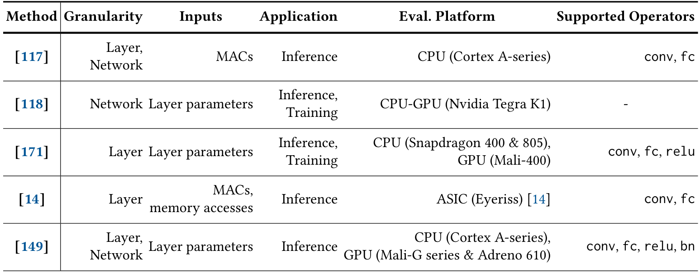
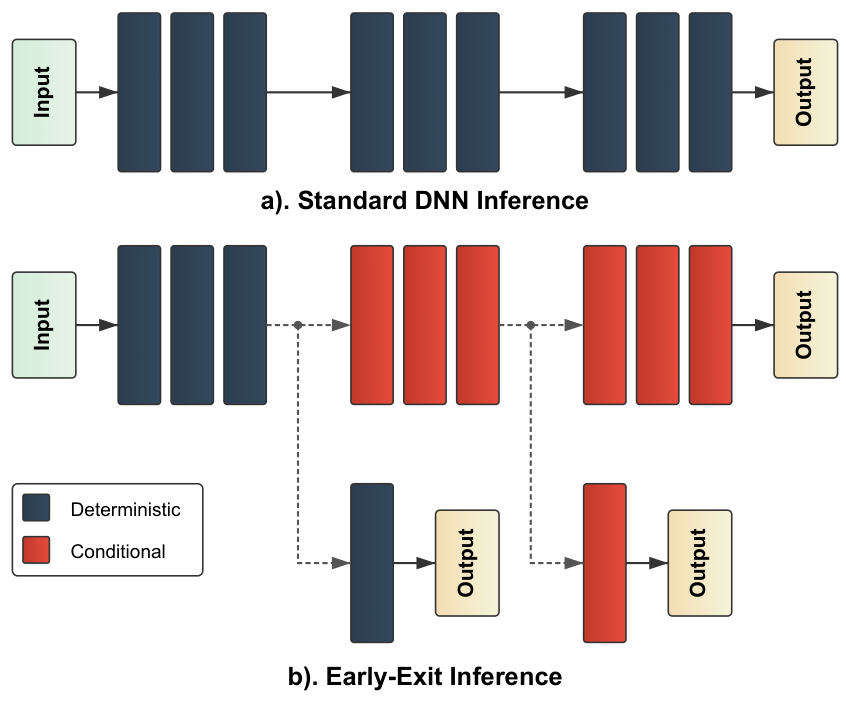
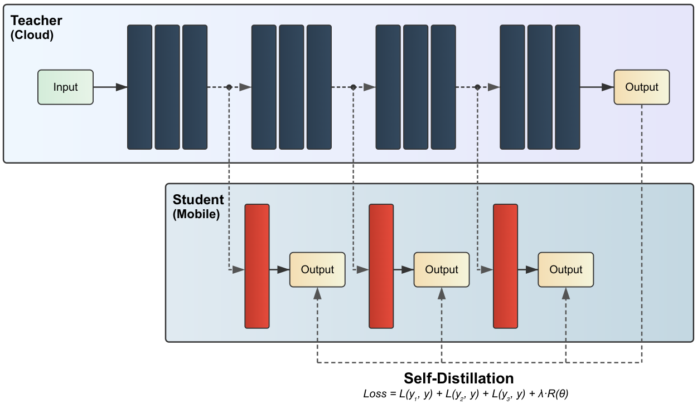
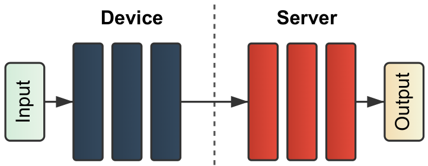
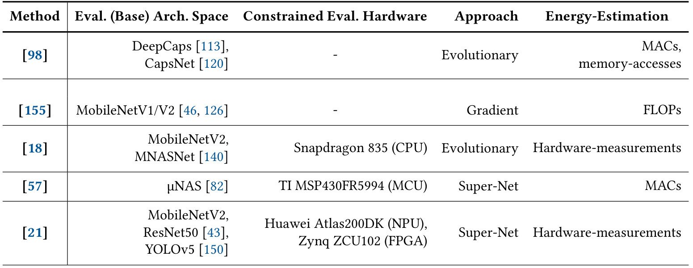
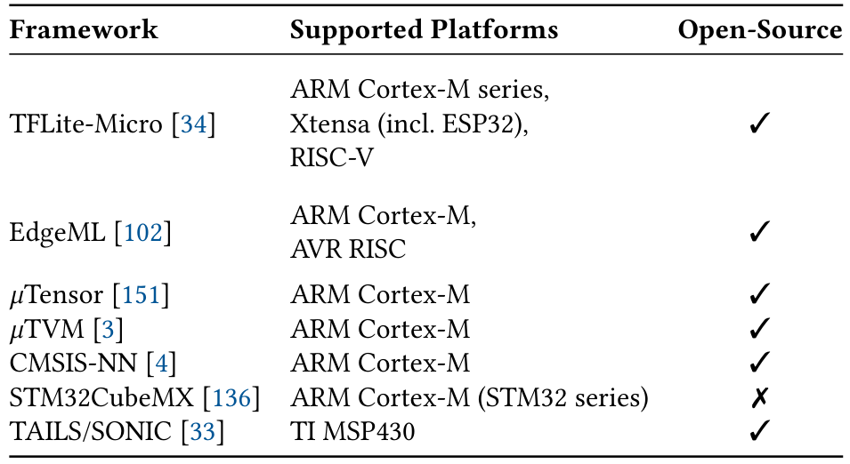

# 能量感知深度学习：哪些方法直接接DVFS，怎样把工作量预测变成档位控制

[从零入门](start.md) · [原图表索引](figures.md) · [双语摘要与导读](abstract.md)

## 核心信息

- 标题：Energy-Aware Deep Learning on Resource-Constrained Hardware
- 标题翻译：资源受限硬件上的能量感知深度学习
- 作者：Josh Millar；Hamed Haddadi；Anil Madhavapeddy
- 机构：Imperial College London；University of Cambridge
- 发表时间：2025年5月18日，用户提供v1
- 发表渠道：arXiv预印本
- arXiv：2505.12523v1
- 论文链接：https://arxiv.org/abs/2505.12523v1
- 论文类型：能量感知深度学习方法综述

## 原文摘要翻译

在物联网和移动设备上采用深度学习，相比依赖云端处理有多种优势。然而，这些设备为了延长电池寿命，受到显著的能量约束；使用能量采集的设备甚至可能只能间歇运行。因此，近年来出现了许多面向资源受限设备、优化深度学习推理与训练的能量感知方法。本文概述这些方法的机制、它们对能量消耗和系统效率的影响，以及在网络类型、硬件平台和应用场景方面的限制。作者希望该综述能够清晰综合不断发展的能量感知深度学习领域，并为受能量约束的计算研究提供基础。

**English abstract paraphrase**：The survey reviews energy-aware deep learning for constrained IoT and mobile hardware, including battery-powered and intermittently powered devices. It covers design, inference, training, and deployment policies, explaining their energy implications and limitations across network types, platforms, and applications. It is a synthesis of existing work rather than a new DVFS implementation or a unified benchmark experiment.

## 创新点

1. **按能量而非仅模型大小组织文献**：作者强调，参数、乘加数和FLOPs不能完整替代目标设备的能量。这能帮助你判断控制器应该预测工作量，还是直接预测每档能量。
2. **连接静态设计与动态策略**：把压缩、神经架构搜索、动态宽度/精度、早退、卸载与训练放到设计—部署全过程中，说明减少计算需求有多种方式。
3. **纳入间歇计算和训练**：除了电池供电推理，还讨论断电一致性、能量采集调度及联邦训练的资源差异。

贡献是分类与综合，不是作者新设计了一个神经DVFS控制器。主线和你的IC课题只有部分交集，**PredictiveExit是文中明确连接剩余工作量预测与V/f配置的重要入口**。

## 一句话总结

这篇教你区分“少做多少计算”和“用什么电压频率完成计算”，并把早退预测提供的剩余工作量，作为DVFS策略可能使用的应用输入。

## 研究问题

### 三种动作先分开

假设同一个识别任务原来要算10层。剪枝或改网络可能让每层更轻；早退可能只算前4层；DVFS则可在满足时限时，让这4层以较低V/f执行。三者可以联合，但它们的节能来源不同。不能把“因为没有计算后6层”全部写成DVFS带来的收益。

论文想回答的是：在内存、算力和能量受限的设备上，怎样在设计、推理、训练与部署时直接考虑能量？对你的控制器，更具体的问题是：能否从应用得到比“CPU利用率”更有用的剩余工作量信息，再安全地转换成合法OPP？

### 为什么算得少，不必然耗能少

第2页强调数据搬移与存储层级。两种模型即使乘加数不同，访问片外存储、缓存命中、并行效率和实现内核也会改变能量。一个小模型可能反复搬数据，一个稍大模型可能很好地复用片上数据。这里不能反过来认定计算量无用；它仍可作为特征，只是不够作为唯一能量真值。

对E902也是一样：CPU周期、访存等待和所用OPP都影响任务耗时与能量。手机GPU上的节能率不能直接外推到E902。先确认你的具体程序和硬件资源，再决定是否需要神经网络负载；CPU程序不必是CV或LLM。

## 数据与任务定义

本次分析用户24页v1：第1–16页正文与第16–24页参考条目均已读，全部三图三表均检查原页、裁图与语义并内嵌。编号到191，但存在重复条目，例如38/39、49/50、55/56、125/126、143/144、173/174；**191个编号不等于191项独立研究**。没有把这些被引论文全都声称为本次全文精读。

|材料类别|综述中的对象|和DVFS的关系|
|---|---|---|
|能量建模|算子、网络、平台能量预测|可给策略提供各OPP的成本，必须针对平台校准|
|模型设计|剪枝、量化、搜索与分解|通常改变负载本身，不自动操纵电压频率|
|动态推理|多分支、多出口、动态精度|改变每个输入的工作量；部分方法可与DVFS联合|
|卸载|端侧—手机—云的分割|改变执行位置与通信成本，未必含DVFS动作|
|训练|减少更新参数、蒸馏、持续学习|改变训练工作，不代表学习了选档策略|
|间歇/联邦部署|储能、断电恢复、参与调度|提供系统约束；储能启停电压不能等同CPU核心电压|

该综述没有把所有方法放在同一板卡、同一模型和相同质量约束下重跑。因此下文“实验对比”以方法的评估平台与指标边界为主，不能伪造统一排名。本文也不提供一个可直接复建的PLL/PMIC控制实验。

## 方法主线

### 机制流程

以下四步重建它对研究问题的处理顺序，属于综述分析流程。

1. **输入是网络、硬件与能量约束**。提取计算代理、访存和实际测量的区别，更新候选能量成本；输出给设计或策略层，用于比较配置。
2. **输入是候选网络与任务输入**。根据难度、置信度和能量提取决策条件，更新分支、精度或出口选择；输出工作路径给推理执行环节。
3. **输入是路径、设备和环境状态**。提取本地/远端执行及调度条件；明确涉及DVFS的方法还更新剩余工作量估计并决定V/f，输出给平台配置接口。
4. **输入是质量、耗时和能量结果**。提取收益、学习成本和跨平台泛化问题，更新各路线的适用范围；输出局限给实验设计和后续研究。综述没有实现一套统管所有动作的统一控制器。

### 第一步：能量模型应该怎样理解

*原文表2，PDF第5页：五类DNN能量估计方法的粒度、输入、应用、平台与算子覆盖。*

先看估计粒度是层还是整网，再看输入，最后核查平台和算子。表中有用MACs的模型、使用MACs和访存的模型，以及用层参数学习的模型；支持卷积、全连接不代表支持任意注意力或稀疏内核。表格没有给统一预测误差，因此不能据此宣布某一行最好。

作者将Tu等参考149描述为基于内核测量的随机森林回归，并讨论其跨网络/设备泛化；这是综述对原始研究的归纳，不能代替你在目标CPU上的留出测试。表中平台与正文个别描述也不完全一一对应，应回原始实现确认后再复现。

对DVFS，能量预测至少应说明是“固定档位下按网络估计”，还是“给定网络和OPP估计”。如果训练样本都在一个频率，直接预测未见频率的能量通常缺依据。可先建立每档查表或每档回归，再研究共享模型。

教学分解可写成：

$$\widehat E(i,x)=\widehat E_{\mathrm{compute}}(i,x)+\widehat E_{\mathrm{memory}}(i,x)+\widehat E_{\mathrm{idle}}(i,x)+\widehat E_{\mathrm{control/switch}}(i_{\mathrm{prev}},i).$$

$x$代表具体任务和输入特征，$i$代表合法档位。这是为了组织实验的读者模型，不是本综述给出的已训练估计器。没有真实电源测量时，估计结果只能标为模型能量。

### 第二步：设计时搜索与运行时调档不能混称

§2讨论剪枝、量化与神经架构搜索。剪枝按某种重要性/能量排序去掉连接或滤波器；量化降低表示位宽；架构搜索在网络结构空间中优化。它们的输出是网络、权重或实现配置，**不必输出电压与频率**。

能量感知搜索可用进化、梯度或超级网络路径来找候选，但每次都上真机测所有网络代价太高，所以常用能量代理或回归。这带来“搜索被模型误差误导”的风险。必须在候选网络最终部署后重新测量，不能把预测最优当已实测最优。

### 第三步：图1把早退的工作量变化画清楚

*原文图1，PDF第7页：普通推理与早退推理，蓝色为确定执行、红色为条件执行，虚线表示条件路径。*

普通网络把全部层算完才输出。早退网络增加中间分类头，输入足够容易时可以提前输出；困难输入继续向后。图中蓝/红色不是高低频率，不要按颜色猜OPP。

出口多不一定更省：每个头也要读特征、计算分类并判断退出。如果最终仍走到最后，之前失败的头可能增加总成本。作者因此讨论粗/细出口粒度以及Zero Time Waste复用中间预测的思路。后者是相关方法，不能当DVFS电路。

§3.2区分两种决策：**执行前先选出口**，容易得到计划工作量但可能过多或过少计算；**逐层运行时决定出口**，适应输入难度但剩余时间不确定。预测出口的价值就在于，把不确定的剩余工作量变成较早可用的信息。

### PredictiveExit怎样接到DVFS

第7页明确写，PredictiveExit参考81用低成本预测引擎预测输入会在哪个出口结束，减少逐个评估预置出口的开销，并据此配置V/f。可以把它的**综述级机制**读成：

> 已执行特征/输入信息 → 预测退出位置 → 估计剩余层数或代价 → 结合时限选V/f → 执行至计划出口。

这条链给你的启发是“应用告诉控制器还剩多少工作”，而非只等CPU忙起来再升频。预测器预测的是任务路径；另一个策略把路径转换成档位；再由执行器调真实时钟和电压。这三者应分开验证。

原参考81列2022预印本。已核对[arXiv记录](https://arxiv.org/abs/2206.04685)与[AAAI正式条目](https://ojs.aaai.org/index.php/AAAI/article/view/26042)：正式发表为2023年，DOI10.1609/aaai.v37i7.26042。官方摘要也明确剩余层数用于选择频率和电压。本次只核其身份与摘要，没有把原始研究的模型、硬件或节能结果冒称为已全文复现。

综述没有展开该预测器特征、结构、损失、训练划分、误预测回退和档位表，因此不能从这篇综述直接写出参数一致的PredictiveExit实现。要复现原研究，还需读其正式全文/代码及平台控制接口。

### 置信度怎样变成退出决策

§3.2–3.3讨论最大类别分数、熵与第一/第二名分数差。较大的分数差可提示分类器更确定，但**不是校准后正确概率的保证**。统一阈值可能对不同类别不公平，所以文中转引类别相关阈值：

$$\mathrm{th}_c^*=\arg\min_{\mathrm{th}_c}\left[\mathrm{FP}_c(\mathrm{th}_c)+\alpha E_c(\mathrm{th}_c)\right].$$

其中类别是 $c$，阈值为 $\mathrm{th}_c$。误报项为 $\mathrm{FP}_c$，$E_c$是与该类别处理能量成比例的量，$\alpha$权衡质量和能量。原文的能量项按级联网络调用加权，不自动等于真实焦耳；尺度变化时权重也要重新解释。该式选的是**退出阈值**，不是CPU电压。

规则、Q学习或策略网络都可决定出口/分支，但学习模型的动作必须写清。如果动作是“退出/继续”，它就不是“选择OPP”的同一个策略。Q学习表查询的运行成本可能较小，状态动作空间和训练/探索成本仍需计入；不能一概认为强化学习适合所有小MCU。

### 第四步：图2讲的是负载训练，不是训练DVFS控制器

*原文图2，PDF第8页：云端主干与移动端出口头之间的自蒸馏示意，保留图内联合损失。*

先看上方教师主干，再看向下传递的特征与下方出口，最后读虚线蒸馏路径。图内损失把多个出口的损失与正则项相加。这里学习的是分类网络出口，不是让神经网络输出V/f。第11页又提醒，最后出口不总比前面更准确，所以不能无条件把末层输出当可靠真标签。

§4还讨论只微调部分层/参数、缓存压缩中间表示和持续学习。它们节省反向传播和存储成本，但有初始筛选、回放和适应数据漂移的代价。原文NEq式写成绝对速度小于阈值且阈值非正，并在后文换用另一阈值符号；这一点在结果审查中单列，不照抄为可执行筛选条件。

### 图3与采能/联邦学习：相邻系统问题

*原文图3，PDF第10页：端侧与服务端的网络分割。*

虚线是执行位置边界，不是时钟域或电压域。分割后要传输中间激活；层越往后，端侧算得越多，通信数据量也未必单调减少。应比较本地计算和传输、远端执行、等待的总能量与时延，而不是只比较端侧层数。

§5.1的启动阈值写作 $V_{\mathrm{on}}$，表示设备何时启动。

断电阈值写作 $V_{\mathrm{off}}$，表示何时停止运行。两者针对电容可用能量，不是CPU核心OPP的两个电压。SONIC等工作的幂等任务、循环延续和撤销日志解决断电恢复一致性；调度策略减少停机，二者作用不同。

§5.2的联邦学习讨论设备选择、迭代次数、量化、分割与无线成本。能量多的设备频繁参与可能造成训练偏差，等待最慢设备又增加时延。这是系统协同问题；只有原始研究明确操纵V/f时，才能进一步纳入直接DVFS主线，不能把联邦学习全部归成DVFS论文。

## 关键结果

### 表1：搜索方法比较的是路线与平台，不是统一节能排名

*原文表1，PDF第3页：五项能量感知神经架构搜索的架构空间、平台、搜索方法与能量估计。*

按“网络空间→目标平台→搜索法→估计来源”读。MACs/FLOPs是代理，硬件测量则要看测哪台设备、何种档位。表里破折号表示不在范围，不应解释为作者证明该方法对所有硬件都有效。这里没有统一精度、时延与搜索成本，所以不能用一张表排序最佳控制算法。

### 表3：能运行模型，不等于具备DVFS物理接口

*原文表3，PDF第14页：嵌入式深度学习框架与所支持平台，按2025论文快照阅读。*

三列是框架、平台与开源标记。TFLite-Micro行提RISC-V，只能作为进一步检查移植条件的线索；不能推出任意E902配置都可运行所有算子，更不能推出已有可调电源轨或PLL驱动。实际部署仍需核对ISA扩展、内存、内核、编译器和板卡。表里工具支持状态不是2026实时兼容保证。

### 可采用的结论与应保留的问题

|位置|综述说了什么|如何使用|
|---|---|---|
|第2页|数据移动可能比算术高10–100倍以上，某GoogLeNet分析计算仅约10%|作为特定文献背景；具体倍率依设备/存储层级，不能代入E902总能量|
|第2页|SqueezeNet比AlexNet少50倍MACs却更耗能|该50倍可能混用了参数缩减与MACs，需回原始模型/测量；保留疑问，不用于定量推导|
|第7页|PredictiveExit把退出预测与V/f相连|是直接DVFS线索；该综述没有足够参数重建原控制器|
|第8页|HarvSched优于Zygarde的特定采能场景|未给统一重跑结果和完整参数；不是所有RL策略都优于规则|
|第11页|NEq用相对速度判断是否更新|原式绝对值小于非正阈值不可直接执行，阈值符号前后也不同；需原始文献核对，不替作者猜修正值|
|第13页|转引DSP训练相对CPU/GPU的11.3倍/4.0倍能量差|属于特定INT8训练与平台组合，非本综述实测，更不是DVFS单项收益|
|第14–15页|MCU评估和跨平台能量预测仍不足|可转成你的实验问题，但不代表本文已经解决|

这篇最有用的“结果”是分类与证据边界。没有同平台的DVFS节能率、OPP转移延迟或PLL/PMIC波形；不能为了填对比表而编出这些值。它没有证明一个新控制器优于固定档位/PID/RL。

## 深度分析

### 全六图表阅读索引

|项目|PDF页|问题与阅读顺序|能/不能得到什么|
|---|---|---|---|
|表1|3|网络空间→平台→搜索→能量估计|知道设计时优化路线；不是统一性能对照|
|表2|5|粒度→特征→应用→硬件→算子|知道模型适用范围；不能假设跨OPP/E902精度|
|图1|7|上普通网络，下早退出口，最后图例|知道条件工作量；颜色不表示V/f|
|图2|8|主干→出口→教师信号→损失|知道出口训练；不是训练OPP策略|
|图3|10|端侧→分界→服务端|知道卸载路径；缺通信成本和硬件域协议|
|表3|14|框架→平台→开源列|提供移植入口；不承诺当前兼容或物理DVFS|

### 主张证据矩阵

|主张|证据|局限与外推|
|---|---|---|
|不能只按网络大小推能量|§2、表1/2、存储讨论|结构性理由充分；具体倍率须回目标平台|
|预测出口可向DVFS提供需求|§3.2与参考81，外核正式摘要|直接关联已定位；预测器/档位/执行器细节需原始全文|
|动态推理总比静态省能|综述并未给普适证明|出口与预测开销、困难输入、错误退出都可能抵消收益|
|各种学习策略可搬到E902|表3仅给平台类别|内存、算子、ISA、特征和执行接口均需验证|

### 给你的控制器画出接口契约

可以先采用以下独立设计，它不是本综述原算法：应用在任务开始或窗口边界报告待处理量、预计周期和截止时间；策略选择合法OPP；执行器把编号转换成PLL/PMIC请求，确认完成后才认为实际档位变化。任务结束记录输出正确性、耗时与能量，用于下一次估计。

|接口位置|候选字段|选择依据与边界|
|---|---|---|
|应用→策略|任务ID、队列、剩余样本/层数、截止时间|能较早获知、成本低、与周期需求相关；预测值不可当真值|
|硬件→策略|实际周期、忙/等待、温度或功率状态|按硬件真实可用信号选，E902不一定有全部PMU事件|
|策略→执行器|`opp_id`、请求有效、紧急程度|只允许已表征的合法档位，不任意组合V和f|
|执行器→策略|实际OPP、忙、完成、锁定/稳定、超时/故障|写配置不等于已到档；异常回保守状态|

一个教学选档条件是：

$$\widehat t_i(x)+t_{\mathrm{control}}+t_{\mathrm{switch}}(i_{\mathrm{prev}},i)\le D_{\mathrm{remaining}}.$$

在可行档位中再比较预计总能量；预测不确定时加保守余量或回高档。不要把层数直接当时间：层间成本不同、频率缩放也可能受访存限制。最好测每类任务在各档位的实际耗时，或者建立经过独立验证的模型。

PLL/PMIC的安全切换和错误恢复属于硬件执行层，本综述不足以规定其时序。前期完全可以用软件时间/能量模型验证策略，再用RTL行为模型检查握手；真实调压必须在支持目标电源域的平台上测。QEMU中改变模型频率或仿真时间并不自动等于测得真实芯片能量。

## 局限

1. **作者强调**：跨网络与平台预测能量、自动能量剖析、MCU评估和训练能效仍有不足；精确覆盖更多算子和运行条件很难。
2. **读者分析，关键**：它是广泛能量感知DL综述，DVFS只占有限关联段，没有执行器和安全OPP实验，不能替代IC控制论文。
3. **读者分析，重要**：没有完整检索/纳排流程和统一统计重跑；参考条目重复意味着不能直接按条目数称文献覆盖规模。
4. **读者分析，重要**：多个结果为异平台转引，部分物理倍率、MACs表述与NEq符号需回原始文献。不同精度/通信/训练任务不能合成节能排名。
5. **读者分析，重要**：训练/选择策略的成本、难输入尾时延和跨设备失败情形没有统一量化，不能只看平均收益。

## 我的笔记

### 先做哪种复现

本次未运行作者或被引工作代码。综述本身可复核的是分类、图表与引用定位；没有唯一新算法可逐参数复现。若选择PredictiveExit作为后续对象，应另建该原始论文精读任务，先确认网络、训练数据、退出标签、预测器、时限、OPP、平台和切换成本，不拿综述缺项自行补齐再冒称一致复现。

|后续实验与优先级|步骤/资源|成功标准|风险与失败处理|
|---|---|---|---|
|四组消融，P0|选CPU能运行的小网络或通用可变工作量程序；固定数据与质量要求，比较全量高档、只早退、只DVFS、联合；先软件模型|同时报告质量、违约、任务能量、预测/出口/切换开销；联合收益不能只来自更多质量损失|模型太大就换小程序，不要求E902跑LLM；错误退出与超时分开|
|能量/耗时模型，P0|逐合法OPP测量或模拟同一程序，按未见输入/时间段留出，再增加未见任务/设备测试|各类误差单报，尾误差能解释违约；预测最优点经目标平台验证|邻近窗口泄漏、只用MAC漏访存；不具备仪表则明确能量是估计|
|策略—RTL执行，P1|应用输出工作量估计与截止期；策略请求OPP，行为PLL/PMIC注入不同延迟/失败|每次请求完成或明确失败；安全序列与回退可验证；切换总时延进预算|FPGA固定电压只证明协议，不声称真实DVS；转移费用过高就延长驻留或拒绝换档|

三个可保留的输入候选是剩余任务量、剩余截止时间与执行历史；置信度只有在它与工作路径和正确性有可验证关联时才加入。可保留的输出是合法档位编号及完成反馈；神经网络输出任意电压值不是一个安全接口。

这篇在知识库中归为“应用需求与能量建模背景”，引用81是已确认的直接DVFS入口；NAS、间歇恢复和联邦学习放邻近技术层。下一步应深入直接研究控制算法和执行器的原始论文，而不是继续把所有低功耗AI都归档为DVFS。

## 引用

1. Millar、Haddadi、Madhavapeddy. *Energy-Aware Deep Learning on Resource-Constrained Hardware*. [arXiv:2505.12523v1](https://arxiv.org/abs/2505.12523v1)。主证据为用户24页PDF；页码按PDF顺序，三图三表均内嵌。
2. 原文参考81：Li等，*Predictive Exit: Prediction of Fine-Grained Early Exits for Computation- and Energy-Efficient Inference*。[2022预印本](https://arxiv.org/abs/2206.04685)；[AAAI2023正式条目](https://ojs.aaai.org/index.php/AAAI/article/view/26042)，DOI10.1609/aaai.v37i7.26042。本次外核身份/摘要，未声称其全文精读或复现。
3. 原文参考149：Tu等，2023 SEC能量测量/预测研究，[DOI](https://doi.org/10.1145/3583740.3628442)。本文只按综述归纳其作用，尚未独立核完原始实验。
4. 原文参考33：Gobieski等SONIC/GENESIS间歇推理工作，[arXiv](https://arxiv.org/abs/1810.07751)。作为断电一致性邻近路线，不直接当PLL/PMIC控制论文。
