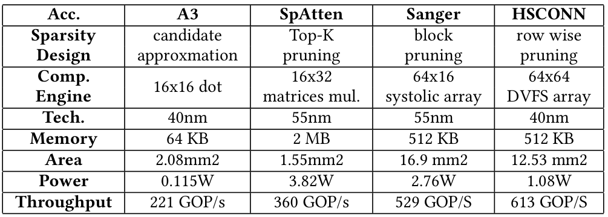
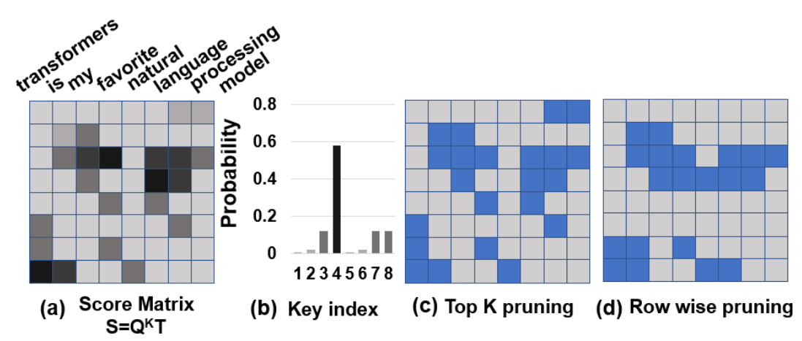
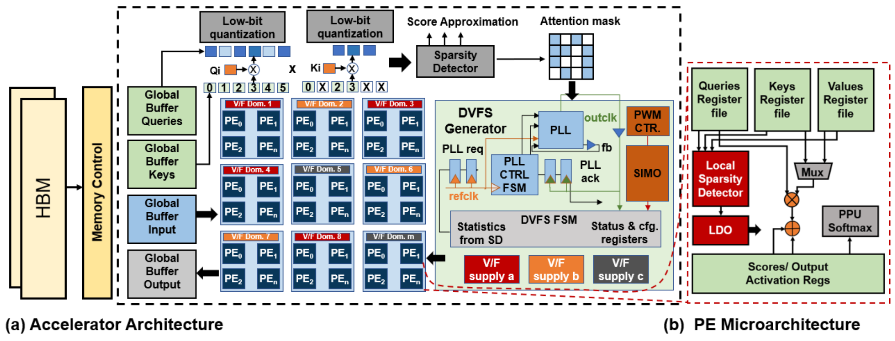
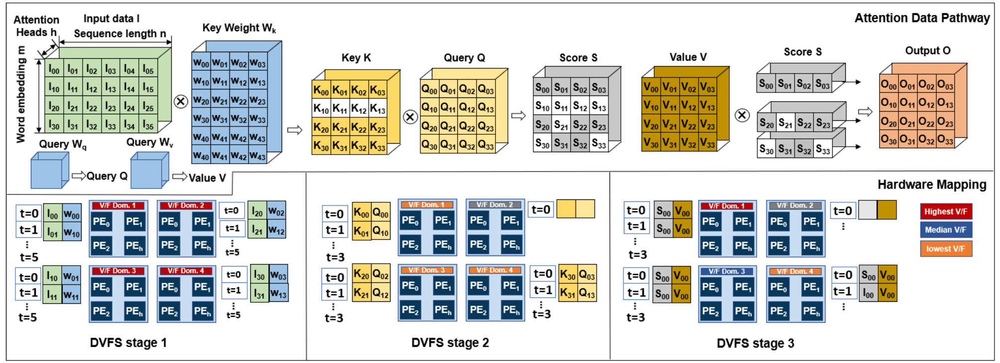
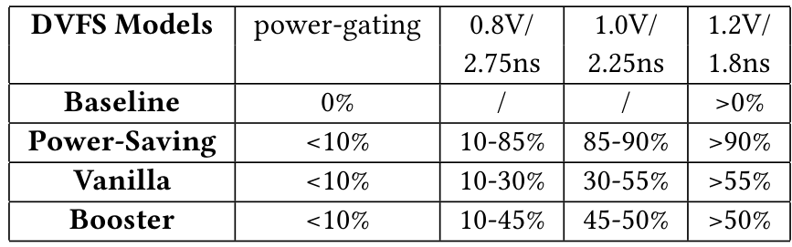
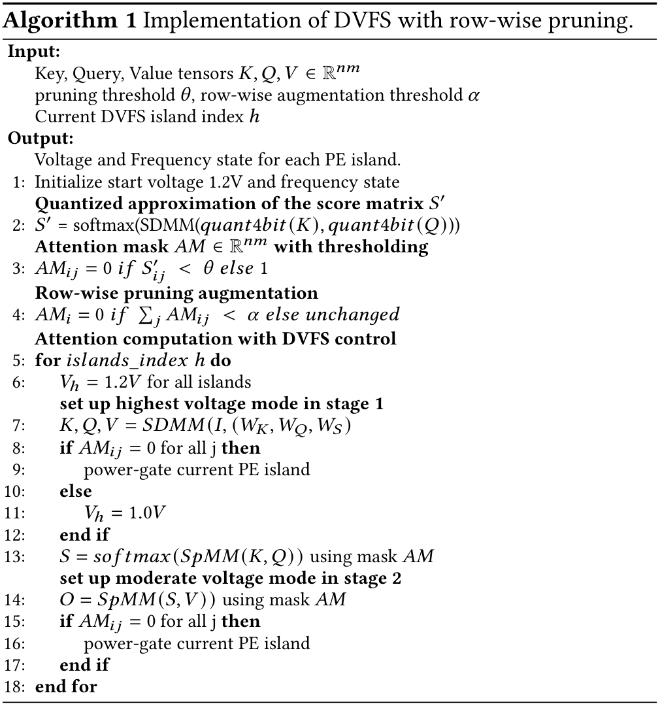
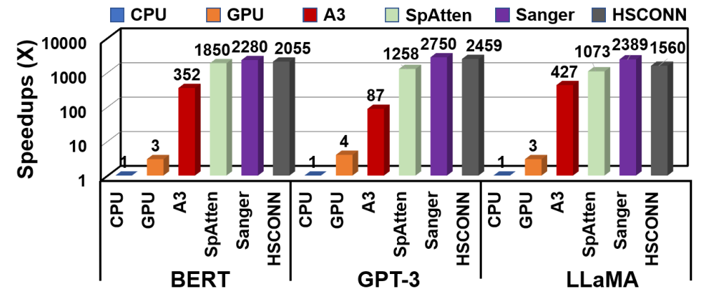
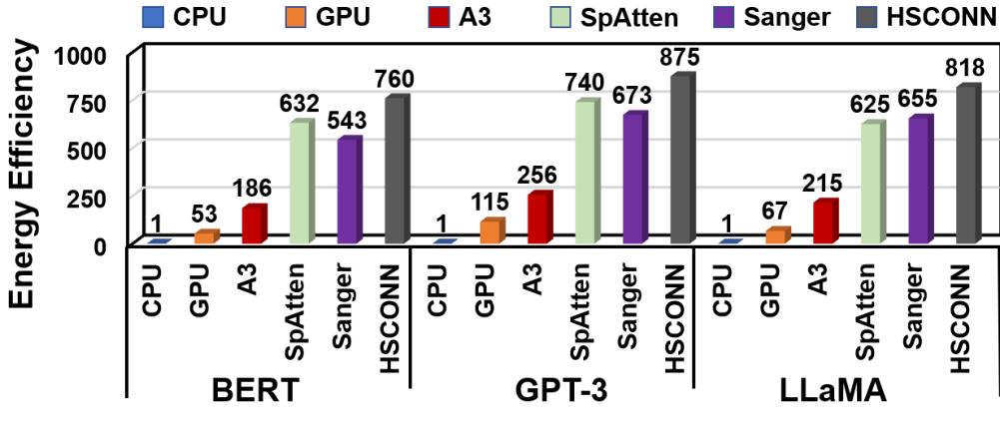
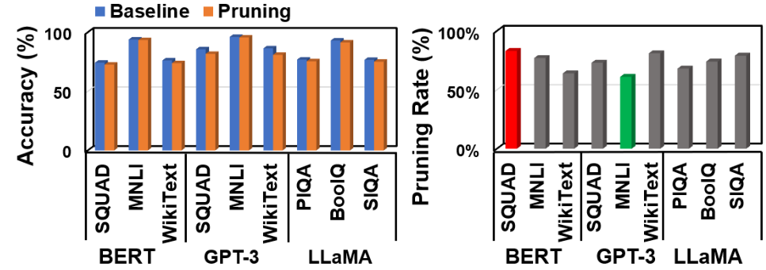

# HSCONN：从注意力剪枝、工作量估计，到异频PE岛与DVFS控制

[从零入门](start.md) · [原图表索引](figures.md) · [双语摘要与导读](abstract.md)

## 核心信息

- 标题：HSCONN: Hardware-Software Co-Optimization of Self-Attention Neural Networks for Large Language Models
- 标题翻译：HSCONN：面向大语言模型的自注意力神经网络软硬件共同优化
- 作者：Siqin Liu、Prakash Chand Kuve、Avinash Karanth
- 机构：Ohio University；Microchip Technology Corporation
- 发表时间：2024年
- 发表渠道：Great Lakes Symposium on VLSI（GLSVLSI），736–741页，用户PDF6页
- DOI：10.1145/3649476.3658709
- 论文链接：https://doi.org/10.1145/3649476.3658709
- 论文类型：稀疏注意力算法、PE阵列和多域DVFS共同设计

## 原文摘要翻译

自注意力模型能够捕获上下文信息，在自然语言处理和计算机视觉中表现出色，但也面临数据移动效率、二次计算复杂度及大量存储访问等挑战。稀疏注意力提供一种解决方向，但其不规则或规则的稀疏模式，以及高成本预处理，会降低硬件效率。本文介绍用于自注意力的高能效硬件加速器HSCONN，以减轻计算和存储开销。HSCONN将动态电压频率调节与矩阵乘法的动态稀疏性结合，以改善能效；方法包括行级剪枝和具有独立电压频率的处理单元岛，通过额外稀疏减少存储访问及整体能耗。自然语言处理实验展示，相对CPU和GPU架构，HSCONN取得1952倍、615倍加速，能量降低倍率最高达820倍、113倍。与A3、SpAtten和Sanger相比，报告加速分别为1.71倍、1.25倍和1.47倍，能效分别为1.5倍、1.7倍和1.4倍。（第1页摘要，按原文保留数值；与正文/图表的不一致在结果部分核查）

## 创新点

1. **把运行时稀疏信息直接作为DVFS的工作量输入。** 不仅跳过小分数计算，还让工作少的岛使用更低V/f、全空岛关电，连接应用特征与电源时钟策略。
2. **让剪枝形状适合硬件供电/时钟分组。** 在元素级筛选后进一步剪整行，使按行映射的PE岛更容易完全空闲，构成算法与硬件的共同设计。
3. **统一三阶段的数据映射。** QKV投影、分数计算和加权Value以相近的岛级计算方式组织，结合本地寄存器和全局缓冲减少不规则访问。

这里的智能模型是被加速的attention网络；DVFS控制主要是稀疏工作量到状态的阈值映射。原文没有用强化学习替代这套选档策略，也不能把所有加速或能效变化归因DVFS单项。

## 一句话总结

先低成本估计哪些注意力计算值得保留，再按行组织剩余工作，给各PE岛分配匹配其工作量的电压频率；但实际异频同步、切换开销和部分结果数据仍不足以直接等价复现。

## 研究问题

### 你需要先理解的逻辑

**English paraphrase (not the original abstract):** HSCONN combines low-bit attention-score approximation, element and row pruning, and workload-dependent voltage/frequency islands. A sparse mask guides mapping and state selection across attention stages. The paper is useful for tracing application features into a digital DVFS controller, but its state definitions, synchronization details, evaluation setup, and several headline comparisons contain ambiguities that prevent a faithful implementation from the paper alone.

稀疏减少工作，但也让不同岛的工作量不一样。如果所有岛都最高频，较空的岛可能提前算完后等待；如果所有岛都低频，最忙的岛会拖慢整体。作者尝试让少工作慢跑、多工作快跑，并把完全空的岛关电。

这个思路不是“升频让少的工作追上多的工作”，而是尽量在整体时间约束内少花能量。能否成立取决于工作量估计、频率与性能关系、传输/同步及真实切换成本。论文给出方案与评估，尚未完整闭合这些实现条件。

### 分层术语

|层次|词|如何理解|
|---|---|---|
|基础|Q/K/V|查询、键、值矩阵，来自输入与不同权重的线性投影|
|A|score与mask|score表示token之间的相关性，mask是要保留哪些元素/计算的二值表|
|A|剪枝|选择性省去计算；本文主要剪注意力连接及整行，不是把完整LLM权重全部剪掉|
|B|4bit近似|用低位Q/K估一个便宜分数，用于筛选；不意味着所有最终计算都变成4bit|
|B|PE岛|共享或共同控制电压/时钟的一组处理单元；粒度不是任意一个软件变量|
|B|power gating|切断供电以降静态及动态能耗，涉及保持/隔离/恢复，和只降频不同|
|C|异频、CDC|不同时钟域不能按同一边沿传数据；跨域需专门协议保证不丢、不重、不乱|
|C|阈值策略|根据工作量落入哪个区间选择状态；阈值可能经实验确定，不等于训练一个在线决策网络|

## 数据与任务定义

### 工作负载与平台证据

作者使用BERT、GPT-3、LLaMA；任务提到SQuAD、GLUE、MNLI及若干常识推理基准。文中有PIQA/PISCO等命名差异，具体数据处理与模型规模需作者配置确认。大模型名称不代表已测完整端到端聊天生成，也不能把单个attention块速度当作整个LLM系统速度。

CPU/GPU基线分别使用PyTorch MKL、cuBLAS路径；GPU为V100。CPU名称写作“Intel Xeon I7 4770”，系列和型号混杂，无法据此唯一重建机器。比较专用加速器时又声称将乘法器数归一到64×64、1GHz。这个评估设置与方法正文的16×16阵列、表1周期存在待解释差异。（第3、5页）

*原表2，第6页：A3、SpAtten、Sanger、HSCONN的架构、工艺、存储、面积、功率和吞吐。*

HSCONN列40nm、64×64 DVFS阵列、512KB、12.53mm²、1.08W、613GOP/s。**这些是作者RTL/模拟评估报告，不是流片实测。** 论文没有给出足以重建所有EDA流程、工艺库、时序与功率活动的方法细节。对手工艺40/55nm、存储规模和结构也不同，不能仅用GOP/s或W推出公平的DVFS单项优势。

### 一次实验的单位是什么

算法层应是模型/任务/输入样本，架构层应是相同工作轨迹下的岛级周期与能量，电路层应是合法状态和切换。原文将多层结果放在一起，但缺少完整逐层消融、重复、温控与置信区间。它有co-design思路，不等于已经证明每层的独立贡献。

## 方法主线

### 机制流程

1. **产生QKV与估分。** 输入token表示和预训练权重，先得到Q/K/V；提取Q/K低位近似分数，交给稀疏检测器。原算法框列示顺序有歧义，实际实现必须遵守此数据依赖。
2. **更新稀疏mask。** 用阈值θ筛元素，再根据每行剩余非零数和α筛整行，输出mask及每行/岛的预计工作量。
3. **映射并选择状态。** 将行映射到岛，按阶段和工作量阈值更新V/f请求；全空岛可关电。输出请求给DVFS FSM、时钟与电源执行逻辑。
4. **执行并汇合。** 各岛计算本行相关结果，本地暂存后写全局缓冲；通过工作量与速度匹配减少等待。完整跨域/跨压协议仍需复现者实现和验证，不能当作论文已公开。

### 1．先建立正确的attention尺寸关系

为便于复现，采用常见行存token记号：输入X有n行、每行d个特征；Q、K每头有d_h列。标准写法为：

$$
Q=XW_Q,\quad K=XW_K,\quad V=XW_V,\quad A=\operatorname{softmax}(QK^T/\sqrt{d_h}),\quad O=AV.
$$

QK转置后是n×n，A的第i行表示第i个query关注各key的权重；第i行与V相乘得到对应输出行。这套记号是本笔记的标准化教学表达，不是逐字抄论文：原文式1、图3与文字中的乘法方向和命名并不完全统一。实现前要固定张量形状，不能只按“K×Q”字样写代码。

### 2．两级剪枝究竟剪掉什么

*原图1，第2页：分数/概率、主要连接、元素筛选及进一步整行剪枝。*

先用4bit量化后的Q/K做近似分数并softmax，将得到的近似分数记作 S′。元素mask满足：S′_ij小于θ时置0，否则为1。再统计第i行的保留元素数c_i；若c_i<α，整行mask清零。（第4–5页，算法1）

$$
M_{ij}=\mathbf 1[S'_{ij}\ge\theta],\qquad c_i=\sum_j M_{ij},\qquad M_{i,:}\leftarrow0\ \text{if }c_i<\alpha.
$$

θ是分数阈值，α是非零数量阈值；M为二值，c_i是计数，不是电压或百分比。它们不是同一个门限。θ/α通过训练或微调确定，推理阶段θ保持固定，近似分数和mask随输入动态产生。

直观例子：一行八个位置经元素剪枝只剩一个，α=2时整行都清零；剩四个的行则保留。**这是教学算例，非原文参数。** 行剪枝比只剪小元素更激进，会丢掉原本保留的连接，因此需要微调和任务质量验证。对于标准attention，全零行也可能影响其输出及后续残差，不能假设天然无损。

论文称Top-K，但实际伪代码写的是阈值比较，不是明确“每行恰好保留K个”。稀疏mask究竟应用于logit、softmax归一化之前还是之后，和最终精确score的重算方式，需要保持数学语义一致；不能随意换位置并声称等价。

### 3．硬件具体增加哪些模块

*原图2，第4页：左为架构/供电控制，右为PE内部；稀疏检测结果进入DVFS FSM，后续接PLL与电源相关模块。*

|模块|输入→处理→输出|与数字DVFS控制器的联系|
|---|---|---|
|低位估分|Q/K→量化乘法与近似score→mask线索|提供应用相关的工作量先验|
|稀疏检测|mask/数据流→计数和行分类→统计|替代只看平均利用率的输入思路|
|DVFS FSM与状态寄存器|统计、模式和状态→阈值映射/控制→V/f请求|你可设计的主要数字策略/执行协调部分|
|PLL控制FSM|时钟请求、反馈/ack→协调时钟生成|需具体PLL接口和锁定语义，示意信号不足以直接适配|
|PWM、SIMO、LDO|电源控制/转换相关链→各域供电|图中存在这些部件，不代表完整模拟设计已公开或可综合到FPGA|
|PE与寄存器|选中的向量运算→局部乘累加、softmax、结果保存|不同域独立运行后仍须正确传输和存储|
|全局缓冲/HBM|输入输出与索引→数据供给/接收|带宽、仲裁和缓冲可能改变实际瓶颈|

本文画出了硬件分工，但没有提供能直接连你现有PLL/PMIC的完整寄存器表、事务顺序、跨压隔离与超时恢复规范。保留“有接口概念”与“可直接综合并验证”之间的区别。

### 4．三阶段如何决定V/f

*原图3，第4页：上方矩阵运算、下方对应PE岛映射；红/蓝/橙代表较高/中/较低V/f，灰色为空闲岛。*

**第一阶段：QKV投影。** 输入与权重乘法是稠密工作，各岛按最高状态处理，避免一开始让密集投影变瓶颈。每行输入映射到岛，同岛PE并行处理不同头。

**第二阶段：mask引导的score计算。** 用已有Q/K先估mask，然后对保留部分进行分数计算。全空行对应岛可关电，其他岛在示例中使用共同中档。不是把所有Q/K数据先变成稀疏输入；稀疏主要出现在中间score及所选计算位置。

**第三阶段：score乘Value。** 行间工作差异更明显，全空行不计算，稠密行高V/f，较稀疏行较低V/f。于是不同岛可以异频运行，目标是在不拖累整体的情况下省能。

图3标注有方向/符号简化，应用时应以尺寸正确的数据依赖为准；不能直接将图里的每个t编号理解为所有异频域完全相同的物理时刻。

### 5．表1就是选档核心，但它不是完全一致的规范

*原表1，第4页：按工作量百分比区间选择关电或三种活动状态；“2.75ns”等是周期，不是频率或调档延迟。*

三档约为0.8V/364MHz、1.0V/444MHz、1.2V/556MHz，这是用周期取倒数的派生换算。表1四种模式：Baseline保持最高状态；Power-Saving把较宽区间放低档；Vanilla较均衡；Booster更早进入高档。

以表内Vanilla为例：<10%为关电列，10–30%低档，30–55%中档，>55%高档。**这些数字是选档阈值，不是实测“有多少PE被分配到每档”的统计比例。** 每行百分比不用加成100%。

这里有必须澄清的问题：工作量百分比的归一化分母未完整定义；区间端点重叠如何归属不清楚；正文Power-Saving写10–70%而表是10–85%，Booster写>40%而表是>50%；正文称四活动状态，表仅三个。

另一个关键点：算法1说全零行才关电，而表1的关电区间为<10%。如果仍有非零工作，不能因为小于10%就直接断电丢任务。应先确认行剪枝是否已将它变成零行，或是否迁移了工作。原文没有给出足够统一规则，复现不能默默忽略。

### 6．算法1逐行应怎样重建

*原算法1，第5页：输入Q/K/V及θ/α，输出各岛V/f状态；18行并未覆盖所有表1模式与执行细节。*

|原行|可确定的意图|不能机械照抄之处|
|---|---|---|
|1–3|以高状态初始化，4bit估分，生成元素mask|后续第7行才列生成QKV，实际先有Q/K才能估分|
|4|按非零计数α做整行增强|α具体值、重训练与归一化规则需配置|
|5–12|岛循环、稠密阶段高状态、全空关电/其余中档|V_h同时像电压又像Value，W_S与W_V等符号可能混用|
|13–14|根据mask算score和输出|矩阵转置、softmax与mask语义需要统一；第三阶段完整阈值选择未在框中展开|
|15–18|全空行关电并结束循环|没有PLL锁定/电源稳定、恢复隔离、缓冲协议等全部时序|

可重建的真实顺序应是QKV→低位估分→mask/行剪枝→阶段映射/状态请求→带正确协议的执行。这个顺序是依照正文数据依赖整理，不能声称原算法框本来没有歧义。

### 7．各PE频率不同，结果怎样对齐

论文第3页明确承认异频导致额外同步成本，给了三条思路：少工作岛配低V/f、多工作岛配高V/f，使完成时间尽量接近；PE内用有限缓冲暂存；最终输出直接回写全局缓冲，减少岛间同步。这并不是让不同频率信号直接接到同一个同步寄存器。

**教学算例：** 一个岛100个串行工作周期、500MHz，理想计算时间200ns；另一个岛50周期、250MHz，也是200ns。这说明匹配工作量与速度为什么可能减少等待。实际还有访存、启动和切换成本，不保证精确同时结束；这些数字不是论文实验。

可行的工程实现通常需要按行/头/输出索引标识数据，本地保持部分和或完成结果，经过可靠跨域传输后写对应全局地址；共享接收端还需仲裁和背压。这样“哪个位置的结果”由标识/地址决定，不由“第几个时钟沿到达”决定。**这是补足实现的工程解释，原文没有公开完整协议或证明采用了某个具体异步FIFO。**

复现还需决定：同岛是否同频，岛间是否有逐拍依赖，异步FIFO深度/满空判断，跨压电平转换，关电隔离与状态保持，阶段完成屏障，何时允许消费结果。全局缓冲减少直接岛间交换，但并没有消灭跨域和乱序问题。

### 8．控制周期是否真的允许50个周期一调

原文设epoch=50cycles。按1.8ns周期，50周期约90ns；若按评估的1GHz则50ns。两者只是决策窗口量级，不能说供电每90ns已完成一次切换。实际还要算稀疏统计、FSM、PLL锁定、稳压响应、隔离、数据停顿与恢复。

$$
T_{\mathrm{window}}\ge T_{\mathrm{observe}}+T_{\mathrm{decide}}+T_{\mathrm{execute}}+T_{\mathrm{useful}}.
$$

各项为时间；该不等式是本笔记对实现预算的建议，非原文公式。若执行占掉大多数窗口，即使算法逻辑正确也未必节能。图2的SIMO/LDO不能自动证明所有延迟已经小于90ns；真实器件参数和波形需要另外核验。

### 9．给你的输入、触发、输出设置

|环节|本篇意图|移植时要补|
|---|---|---|
|输入|mask、行非零数、阶段、模式、岛号|明确计数和归一化，区分稀疏率与剩余工作量|
|触发|阶段变化和epoch更新|窗口用哪个时钟定义、执行未完成时新请求怎样处理|
|策略|表1区间映射及全空行关电|统一端点和矛盾规则，保护未完成的非零工作|
|输出|岛级V/f状态和关电请求|映射到现有PLL/PMIC合法OPP，不能只发任意V值|
|反馈|架构有状态/配置与PLL相关ack|定义ack是收到请求还是物理稳定，以及超时/故障回退|

## 关键结果

### 图4没有支持“全面比Sanger快1.47倍”

*原图4，第5页：相对CPU归一的推理速度，对数纵轴；读取每种模型的同组柱值。*

|模型|HSCONN|Sanger|HSCONN/Sanger，按柱值派生|
|---|---:|---:|---:|
|BERT|2055|2280|约0.901|
|GPT-3|2459|2750|约0.894|
|LLaMA|1560|2389|约0.653|

三组均低于1，不能支持正文“比Sanger快1.47倍”的全面表述。原文没有足够原始数据解释这是标注、基线还是文字问题；应保留冲突，不能选一个喜欢的数当作已复现结论。

CPU/GPU几百上千倍的比较也同时改变专用架构、剪枝、数据流、精度、存储和DVFS。缺同架构开关DVFS的清晰消融时，不能写成“DVFS使LLM快1952倍”。

### 图5与正文CPU能效倍数也不一致

*原图5，第5页：CPU基线为1，HSCONN三模型柱顶为760、875、818；它与摘要/正文倍率不能直接统一。*

正文说相对GPU和CPU能效11.3倍、113倍；图上CPU归一化却约760–875。摘要又使用820/113倍的能量降低表述，指标、基线和峰值不完全对齐。能效倍率和能量倍率还须固定相同任务/质量，不能仅换一个词就当作等价。

图5可支持作者报告了较高相对能效这一方向，但现有材料不足以重建全部精确比例，更不足以给E902预期节能率。建议将这些数保存在“待澄清结果”列，而不进入毕业设计目标承诺。

### 图6：剪枝质量与调参边界

*原图6，第6页：左为剪枝/微调与基线的任务质量，右为不同任务剪枝率；不从小图臆造所有精确百分点。*

作者报告寻找最高剪枝率且质量损失在0.5%以内的配置。但§4.2说探索在test sets上推理并挑最优配置，这存在测试集参与选择的风险；复现应划分训练、验证与最终测试。剪枝率高和任务质量近似保持说明算法可能省工作，不直接证明计入转换/同步后DVFS仍有净收益。

## 深度分析

### 全部原图表与算法索引

共6图2表1算法，本笔记全部内嵌，不遗漏另计。

|项目/页|看什么与边界|
|---|---|
|图1／2|小分数与行剪枝形成规则空行；不等于无损删除所有弱连接|
|图2／4|估分、统计、FSM、PLL/电源和缓冲结构；没有完整跨域电气协议|
|图3／4|三阶段矩阵/数据映射；图示t编号不自动等于异频物理时间|
|表1／4|工作量区间映射；ns为周期，阈值不是比例统计，正文差异要保留|
|算法1／5|估分、mask、行剪枝与阶段状态；顺序、变量、第三阶段映射有缺口|
|图4／5|CPU归一速度；三组Sanger都高于HSCONN，与文字不一致|
|图5／5|CPU归一能效；数值与113倍文字不一致，不能强行统一|
|表2／6|不同阵列/工艺/存储的作者报告，非全部同工艺硅片测量|
|图6／6|质量与剪枝率；测试集调参风险、缺原始精确数和独立验证|

### 核心证据矩阵

|主张|直接证据|支持范围|还需补的关键证据|
|---|---|---|---|
|稀疏度驱动档位|图2/3、表1、算法1|确有应用→工作量→控制结构|统一工作量定义、端点、全部状态和实际执行开销|
|行剪枝增加空岛机会|图1与算法、图6|算法意图与任务质量观察|独立测试、精确阈值与相同质量下消融|
|异频降低不均浪费|第3页说明、本地寄存器/全局缓冲图|合理系统设计方向|FIFO/CDC/电平转换、背压与最坏等待验证|
|相对已有硬件更优|图4/5和表2|部分方向性比较|原始数据、冲突修订、同架构DVFS-only基线|

### 对当前IC课题的价值与取舍

最值得带走的是**控制输入应该反映剩余有效工作，而不是只反映有多少数据**。同样n个token，剪枝后MAC数可能不同；同样CPU数据块大小，压缩可压缩性或访存行为也可能不同。应用可提供阶段/工作量先验，硬件计数与温度/电源状态负责修正和约束。

不必在E902课题一开始实现HBM、64×64阵列、多电源岛和attention。可先做单域CPU分块任务，把“mask非零数”抽象成可测剩余工作指标，再让数字控制器调用已有PLL/PMIC。多域是额外硬件条件，不是换个策略名就能拥有。

## 局限

### 关键复现缺口

三/四活动状态、表1/正文阈值、16×16/64×64阵列及1GHz/表内周期没有统一。算法1顺序和命名也不足以直接执行。工作量百分比归一化、非零低工作量关电条件、mask与softmax语义都应先固定。

异频PE同步、电平转换、关电隔离/保持、缓冲深度和恢复未完整披露，50周期窗口未计闭合执行开销。图里出现PLL/SIMO/LDO并不能替代完整电路或IP数据手册。

### 结果与外推限制

图4与Sanger加速表述冲突，图5与CPU能效倍率冲突。不同架构/工艺/任务质量的总收益不能归因DVFS；模型规模和端到端范围不足。测试集选择配置需重做独立验证。当前材料支持研究思路，不支持把所有精确峰值当作可靠复现实验目标。

本篇发表于GLSVLSI，不能把会名写成IEEE VLSI技术与电路研讨会。2024工作也不应自动称为2026最新SOTA。上述判断来自用户原文核对，不是对作者代码或硅片做了独立复现。

## 我的笔记

### 最小复现，从一小块attention而不是整个LLM开始

1. 固定尺寸、精度、模型权重与输入；写稠密参考，统一QK转置、softmax和输出语义。记录逐层输出与最终质量，先排除实现错误。
2. 做4bit近似mask，分开元素剪枝与行剪枝，θ/α只用训练/验证集选择。冻结参数后才看最终测试，保留失败和质量退化配置。
3. 导出每行有效运算和访存trace，固定同一轨迹比较不同V/f策略。若自行定义工作量比例“本窗口有效MAC/稠密MAC”，明确这是补充定义，不声称已从原文得到。
4. 先用合法三档和关电行为模型，统一阈值端点、零行判断与非零任务处理。给每次切换加延迟和能量，扫描0到较大开销，观察何时收益归零。
5. 比较稠密、仅元素剪枝、元素+行剪枝、相同稀疏轨迹固定频率、同轨迹DVFS。这样分开少做工作与改工作点的贡献，不能把两个变化叠加后全归因控制器。
6. 再做RTL执行层：先同频可校验，再异频，验证无丢/重/乱序、FIFO满空、背压、关电恢复和阶段完成。给输出带可核对索引，在全局缓冲与参考逐项比较。
7. 最后适配现有PLL/PMIC：确定请求、实际状态、lock/stable反馈、故障优先级和回退。硬件只有一个电源域就只验证单域，不宣称实现独立多岛真实调压。

需要作者材料才能等价复现的部分：阈值定义/配置、真实阵列和频率、评估工具库、同步协议、能量和延迟原始结果。没有这些时可报告“按公开思路重建的模型”，不能叫作者结果已复现。

### 三个直接关联CPU/E902的实验

|优先级/实验|资源、价值|风险和成功标准|
|---|---|---|
|P0：同工作轨迹的策略比较|CPU分块任务或稀疏trace+响应模型，验证工作量→OPP映射|特征可能不预测实际时间；成功为留出输入下满足约束、净能量优于固定基线，估计/实测分列|
|P1：切换开销与控制周期|FSM+PLL/PMIC延迟模型，扫描窗口与状态转换成本|频繁调档可能亏损；成功为找出可行周期和收益边界，不默认50cycles合理|
|P2：双时钟域结果汇合|小型两个计算岛、异步传输/缓冲与校验|跨压/关电不等于CDC；成功为各种速比/背压/复位下输出顺序与数值正确，再决定是否实物多轨|

本轮未执行HSCONN硬件模拟或模型训练；完成的是全文、图表、数据依赖和数值一致性审查。复现目标应先保证可定义、可校验，再追求复杂智能策略。

## 引用

1. Siqin Liu, Prakash Chand Kuve, Avinash Karanth. HSCONN: Hardware-Software Co-Optimization of Self-Attention Neural Networks for Large Language Models. GLSVLSI2024, 736–741. [DOI](https://doi.org/10.1145/3649476.3658709)。
2. 方法§3用户第3–5页；表1/图2–3第4页；算法1/图4–5第5页；表2/图6及评估第6页。图文冲突按此六页版本记录。
3. 原文参考文献[5]为Jiang2020：[DVFS执行流程论文](https://doi.org/10.1088/1674-4926/41/2/022406)。已核对真实引用，平台参数和结果仍分别归档。
