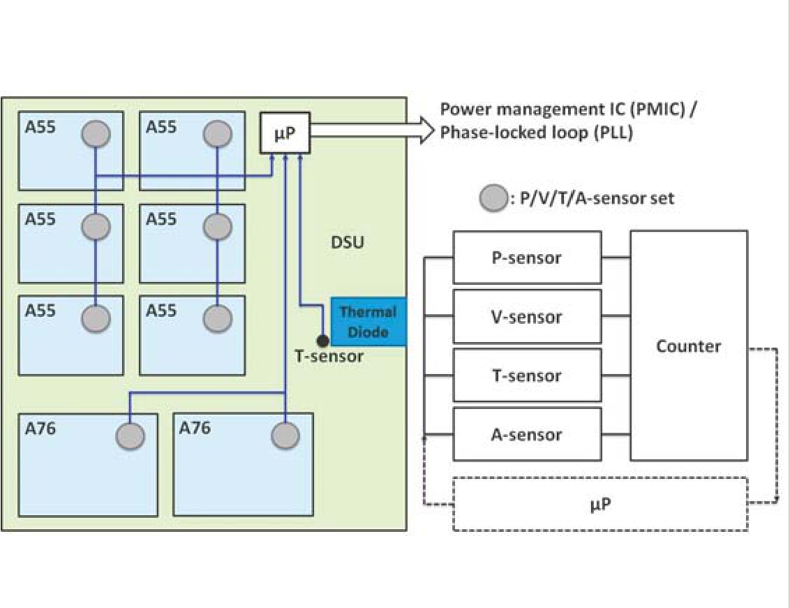
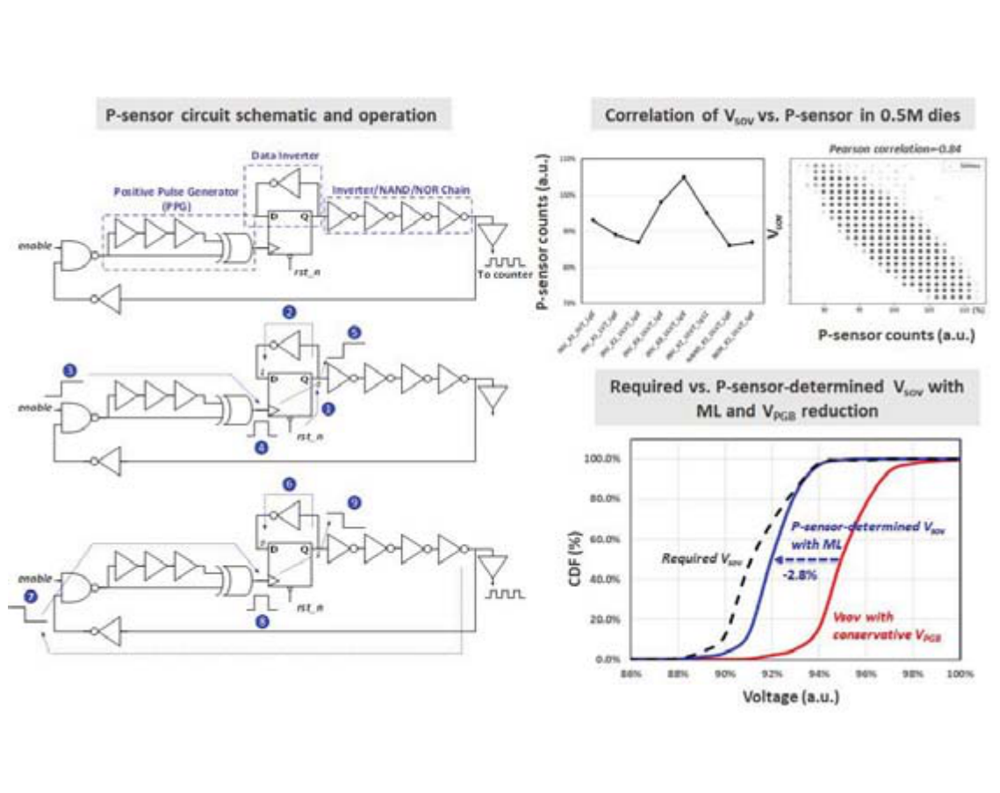
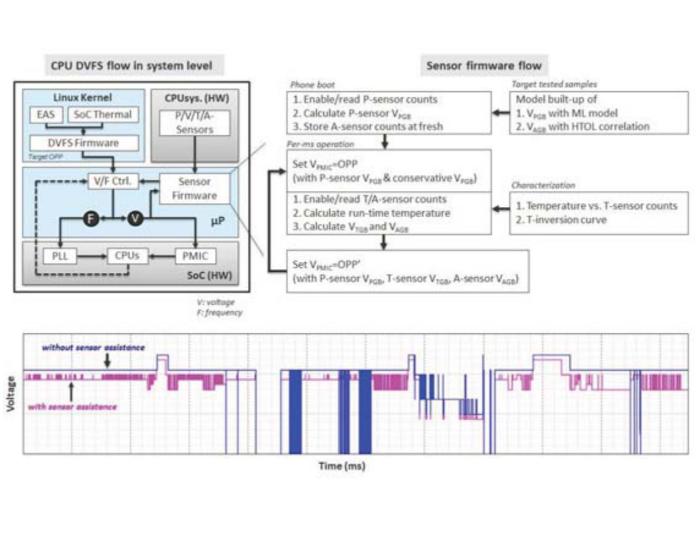
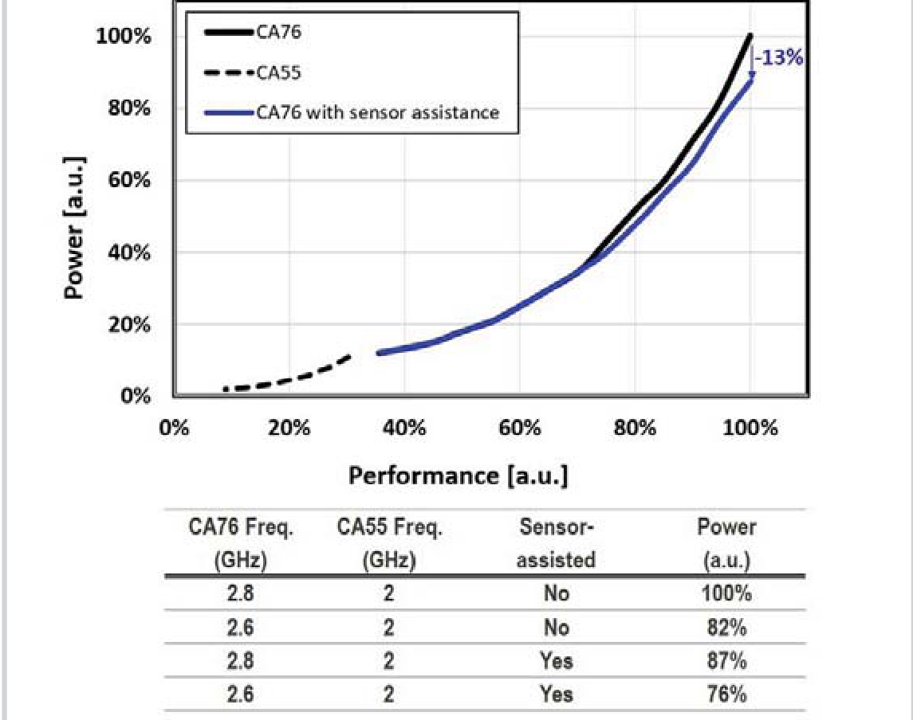

# ISSCC2021：用传感器修正电压裕量，固件怎样控制PLL和PMIC

[从零入门](start.md) · [原图表索引](figures.md) · [双语摘要与导读](abstract.md)

## 核心信息

- 标题：An Octa-Core 2.8/2GHz Dual-Gear Sensor-Assisted High-Speed and Power-Efficient CPU in 7nm FinFET 5G Smartphone SoC
- 标题翻译：7nm FinFET 5G手机SoC中采用传感器辅助的2.8/2GHz双档高性能高能效八核CPU
- 作者：Bo-Jr Huang、Eric Jia-Wei Fang等
- 机构：MediaTek，台湾新竹
- 发表时间：2021年
- 发表渠道：IEEE ISSCC，论文35.1，用户PDF共3页
- DOI：10.1109/ISSCC42613.2021.9366046
- 论文链接：https://doi.org/10.1109/ISSCC42613.2021.9366046
- 论文类型：数字与电路、传感器及固件共同设计，含真实芯片测量

## 原文摘要翻译

这份会议摘要集正文没有单列Abstract。以下翻译开头概述段，不额外加入分析结论。

本文以7nm FinFET工艺实现了一个高速、低功耗的异构八核CPU复合体。片上传感器针对工艺、电压、温度与老化的裕量进行处理，以改善动态频率和电压缩放中的功耗。工艺传感器结合机器学习确定每颗芯片的工艺电压裕量，服务于智能手机工作电压设置。温度传感器感知运行时局部温度及温度反转，调整DVFS中的温度裕量。老化传感器将单元退化转换成相应老化裕量进行补偿。电压传感器则维持系统面对供电噪声时的稳定性。在传感器辅助下，CPU最高可运行到2.8GHz，并获得13%的功耗改善。它被集成到支持sub-6GHz、上行2.6Gbps及下行4.7Gbps的5G手机SoC中。（PDF第1页首段）

## 创新点

1. **将工艺、温度与老化的电压裕量分开校准和调整。** 以当前芯片的实际传感信息取代统一采用最坏条件的部分裕量，目标是在要求频率不变时减少过度供电。

2. **工艺传感器不仅模拟组合逻辑延迟。** 在环振结构中加入触发器、数据反相和脉冲发生器，使感测路径包含时序单元，更接近CPU关键路径的构成；用传感计数与所需电压建立多元回归关系。

3. **把传感器电路、固件与现有PLL/PMIC连接成运行流程。** 启动阶段做每颗芯片的校准，运行时约每1ms结合性能需求、热预算与传感器更新OPP。快速供电跌落由V传感器处理，不能只靠毫秒循环。

“用了机器学习”不是说训练了一个神经网络或强化学习器来直接决定所有频率动作。本文的明确机器学习作用是传感器到工作电压的校准建模。

## 一句话总结

EAS与热预算决定CPU需要哪个性能工作点，片上传感器和固件再修正该工作点所需的电压裕量，PLL与PMIC负责真实执行。

## 研究问题

### 电压为什么有多余裕量

在同一频率下，不同芯片、不同温度及不同老化程度所需最低可靠电压不同。厂商若统一按最坏条件设置，就要为较好的芯片留出可能并不需要的电压。电压偏高会增加动态功率。

但是把所有芯片电压一起降低同样比例也不可靠：有的芯片更慢，温度与延迟的关系会随电压变化，老化还会使路径变慢。因此作者通过传感与校准，分别估计裕量。它解决的是“保持要求性能时需要多少供电”，并不替代调度器判断应用需要多快。

这里的双档指A76高性能核心与A55高能效核心两个组别，不等于整个DVFS只有两个工作点。

## 数据与任务定义

### 芯片、控制端和样本

平台为7nm手机SoC，两个Cortex-A76高性能核心和六个Cortex-A55高能效核心，ARMv8.2指令集。A76原2.6GHz配置可提升至2.8GHz；A55为2GHz。CPU共享单元DSU具有1MB共享L3。芯片照片标CPU面积8.2mm²，这不是传感器或控制器单独面积。

管理微处理器μP运行DVFS及传感固件。被控对象是CPU复合体；PLL产生CPU时钟，PMIC提供供电。论文没有要求你在PC上把CPU程序本身改写成电路才可以控制它。

作者报告约50万颗die的工艺传感统计，以及1000颗die温度传感结果。它们是不同传感实验的样本，不是CPU应用程序重复跑了50万次。图35.1.6给出性能功率曲线与频率组合，但没有完整列出可直接复刻的程序、输入、软件版本、运行次数和环境配置。

## 方法主线

### 第一层：传感器究竟输入了什么

*图35.1.2，PDF第2页：各CPU核附近的P/V/T/A传感器、计数器、管理微处理器及PLL/PMIC连接。*

从左侧核心上的圆点读到右侧四类传感器，再经计数器到μP，最后看μP到PLL/PMIC的路径。固件读到的是数字计数，但这些数字反映了实际物理电路状态。

| 输入 | 表征什么 | 如何参与控制 | 不应如何理解 |
|---|---|---|---|
| P-sensor计数 | 芯片个体工艺与路径速度差异 | 启动时经校准模型确定工艺裕量VPGB | 不是应用负载利用率 |
| T-sensor与反转检测计数 | 局部温度及不同V/T条件下的路径变化 | 运行时确定温度裕量VTGB | 不是统一“越热越要加压”的单调规则 |
| A-sensor新旧差值 | 受应力老化与新鲜参考的差异 | 根据寿命试验关联模型补偿VAGB | 不是软件运行时长直接等于老化电压 |
| V-sensor | 快速供电下降/噪声 | 快速稳定性保护，采用前作方案 | 不是每1ms读一次就覆盖所有瞬态 |

P/T/A传感结构基于数字环形振荡器ROSC，计数间接反映路径延迟。**这里的ROSC是传感器，不是取代CPU PLL的时钟发生器。** 这与ISSCC2024使用FLL与ROSC协调CPU频率的路径不同。

### 第二层：工艺模型怎样得到

*图35.1.3，PDF第2页：P传感器结构和操作示意、传感计数与电压相关性、保守与校准电压分布。源图细节较小，定量值以第1页正文为准。*

普通环振的缓冲/门链主要表征组合逻辑。CPU关键路径还包含触发器，因此作者把触发器加入感测环。数据反相器让输入交替为0和1，正脉冲发生器PPG反复产生触发边沿，数据经过门链后回到输入，如此持续振荡。其半周期代表所选门链与触发器的延迟。

离线阶段，作者在包括角落芯片的样本上采集P传感计数及所需手机工作电压Vsov，建立多元回归关系。图右上展示不同传感类型与计数/电压关系，右下比较保守电压、实际需求和ML校准电压的累积分布。传感器慢的芯片不能仅因“平均能降压”就得到相同降幅。

原文没有给完整回归特征组合、系数、损失函数、训练/验证切分和所有频率条件。因此可以复现“采样—拟合—保留裕量—验证”的方法，但不能从该图恢复工业芯片全部参数。启动时计算是使用已经建立的模型，不是每次启动重新大规模训练。

### 第三层：为什么温度需要工作点相关的校准

低压下可能发生温度反转：温度较高时某些路径反而更快，因此在室温可能需要更高电压维持相同频率。文中0.75V模拟展示这一现象，在0.96V下不再观察到相同反转。作者用对温度反转较敏感的四输入NOR门类结构来模拟关键影响。

温度传感模式与反转检测模式使用不同电路配置。校准时建立“温度—传感计数”和反转曲线，并存入EFUSE；运行时用局部计数查询/映射VTGB。图35.1.4分别给电路、不同电压下模拟曲线、温度测量及裕量分布。

0.05°C是报告的分辨率，±1.6°C是两点修调后的最大误差，两者不同。分辨得更细不表示绝对温度就准确到0.05°C。数字控制器使用温度输入时，还要考虑误差、量化和采样延迟。

### 第四层：老化和快速供电噪声

老化监测使用两个P传感器副本：一个高频翻转接受应力，一个大部分时间静止作为新鲜参考。高温工作寿命HTOL试验建立计数退化与老化裕量的关联；运行时对比退化与初始计数修正VAGB。

这类慢变化与供电瞬态不同。V传感器针对快速电压下降维持稳定，具体方案引用2020年前作。本文没有展开全部保护动作时序，不能擅自写成某个已知持续周期或固定阈值中断。

### 机制流程

*图35.1.5，PDF第2页：系统软硬件分工、启动与每毫秒传感固件流程，以及有无传感器辅助的电压轨迹。*

1. **离线标定与启动初始化。** 离线获得工艺回归、温度/反转曲线及HTOL老化关系。启动时μP读取P计数计算个体VPGB，并保存A传感器新鲜计数。输出是该芯片的初始裕量与参考状态，供后续周期复用。
2. **性能与功率约束进入DVFS固件。** 约每1ms，固件根据CPU能量感知调度EAS及SoC热模块功率预算决定目标OPP。先采用工艺裕量和保守温度裕量，将目标转换为电压频率，控制PLL和PMIC。原文没有公开EAS内部全部选档算法，不能补写成利用率超过某阈值就升频。
3. **用实际传感状态修正电压。** 传感固件读取T/A计数，计算温度、反转条件和老化补偿，把VTGB与VAGB等裕量更新到OPP，对PMIC发新的电压调整。性能目标没有必要与每次裕量修正一起改变。
4. **下一个周期继续，同时保留快速保护。** 下一1ms周期再次接受需求并读传感器。图下方蓝色保守电压与粉色辅助电压轨迹显示差别；它是运行例子，不能代替全工况安全或响应时间统计。

可以用下面的教学账本描述电压构成：

$$
V_{\rm cmd}=V_{\rm base}(f)+\Delta V_P+\Delta V_T+\Delta V_A.
$$

$V_{\rm base}$与各裕量单位都是V，$f$单位Hz。这个式子是解释各部分职责的简化记法，不是论文公开的精确回归式。不能把已含保守裕量的基础OPP再加一次全部裕量，也不能认为任何校准项都允许为负；具体参考、限幅和安全条件应由表征数据确定。

### 输出不是一个抽象“档位”就结束

策略输出OPP后，PLL要真正完成时钟配置，PMIC要使物理电压达到要求。论文给出了固件控制两者的路径，但没有披露总线类型、完整寄存器、PLL锁定时间、PMIC稳定判据和所有升降档顺序。做你自己的模块时，这些应由已有IP规范补齐，不能由图中箭头自动推得。

## 关键结果

### 传感器结果与系统收益分开读

| 测量 | 原文报告 | 支持的解释 |
|---|---|---|
| 工艺传感 | 约50万颗die统计，平均2.8%电压改善 | 个体回归相对统一保守VPGB可收紧部分裕量 |
| 温度传感 | 1000颗die，分辨率0.05°C、最大误差±1.6°C，两点修调 | 该样本与校准条件下的测温特性，不等于全部CPU测试都具有同样样本数 |
| 温度裕量 | 相对角落芯片保守VTGB约3.2%电压收益 | 温度/反转辅助减少保守性；不能与2.8%相加当整机节能 |
| CPU功率 | 指定2.8GHz A76/2GHz A55有辅助87%，无辅助100% | 相同频率组合下功率降低13% |

### 图35.1.6：13%的基线到底是什么

*图35.1.6，PDF第2页：CPU归一性能–功率曲线及四种频率/传感辅助配置。*

先按图例区分A76、A55、带传感器辅助的A76，再看相同性能横坐标下功率差异。纵轴为归一功率，不是瓦特；不能从100%恢复实际总功率。下表提供更清楚的条件：

| A76频率 | A55频率 | 传感器辅助 | 归一功率 |
|---|---|---|---:|
| 2.8GHz | 2GHz | 无 | 100% |
| 2.6GHz | 2GHz | 无 | 82% |
| 2.8GHz | 2GHz | 有 | 87% |
| 2.6GHz | 2GHz | 有 | 76% |

同2.8GHz条件的改善是$(100-87)/100=13\%$。同2.6GHz条件是$(82-76)/82\approx7.32\%$，这是本笔记由原表计算。若拿带辅助2.8GHz的87与无辅助2.6GHz的82相比，功率仍增加约6.1%；它说明提升频率仍付出代价。不能表述为“升频到2.8GHz同时比所有2.6GHz配置都省电13%”。

动态功率近似$P_{\rm dyn}=\alpha C V^2 f$。同频同活动下，电压降低通常能减少平方项功耗；系统总功率还含漏电、存储和其他模块，工艺与温度电压改善百分比不能直接转换成总能量下降。任务能量必须积分功率并考虑执行时长。

## 深度分析

### 逐图索引

| 图 | PDF位置 | 阅读重点与证据边界 |
|---|---|---|
| 35.1.1 | 第2页左上 | SoC模块图，识别CPU/GPU/APU与存储，不把所有模块当一个独立可调域。 |
| 35.1.2 | 第2页右上 | 主文已嵌。沿传感器→计数→μP→PLL/PMIC读，先厘清控制端。 |
| 35.1.3 | 第2页左中 | 主文已嵌。先电路和9步运行，再相关性，最后电压分布；未给完整回归系数。 |
| 35.1.4 | 第2页右中 | 电路模式、模拟温度反转、1000die测温和电压分布是不同证据，不能混成同一实测。 |
| 35.1.5 | 第2页左下 | 主文已嵌。离线标定、启动、周期固件与电压轨迹对应方法全过程。 |
| 35.1.6 | 第2页右下 | 主文已嵌。四行表决定13%比较条件，曲线不能代替统计重复信息。 |
| 35.1.7 | 第3页 | 芯片照片和CPU区域8.2mm²，确认实现背景，不证明全部角落条件安全。 |

### 这篇的共同设计体现在哪里

传感器选择与关键路径物理结构有关，校准模型把计数变成电压估计，固件把性能需求和裕量变成命令，PLL/PMIC承担实际动作。只有把这些连接起来才能得到低电压且可运行的系统。算法不一定复杂，接口、校准和保护同样是研究贡献。

与ISSCC2024对照，本文强调固件和多类传感器裕量，后者强调硬件HBVC快环与电源顺序。两篇不能简单归结为“旧论文查表、新论文神经网络”；2024并没有在本文中给出一个大模型选频策略。2021与2024共同引用2017供电网络工作，但不能因此画出未经核实的直接互引关系。

## 局限

原文未展开完整OPP、回归参数、误差安全界限、老化补偿系数和所有接口时序。传感器相关性高并不证明每一颗芯片、每个关键路径、每种程序和所有生命周期都不会出错。工业表征细节决定能否缩减裕量，单靠管理代码不能替代这些数据。

CPU测量的具体工作负载、重复运行、温度与误差线不完整；13%只能在已给出的条件理解。0.05°C分辨率不等于同量级准确度。快速跌落保护采用前作，若要实现相同保护需要继续读2020原文和已有IP规格。

本次笔记只分析论文，没有在实际7nm芯片上运行，也没有独立复现回归、HTOL或供电实验。

## 我的笔记

### 初学者阅读顺序与英文改写

先图35.1.2找清控制端和执行端；再图35.1.5理解哪些在离线/启动做、哪些每毫秒做；然后读P/T/A输入与校准；最后用图35.1.6核对同频对照。电路细节暂不熟悉时，也先掌握计数如何进入固件，不必先重新设计传感器。

**English paraphrase, not the original abstract:** This measured 7nm CPU uses process, temperature, aging and voltage sensing to support DVFS. Offline calibration and firmware connect sensor counts to voltage guardbands, while performance requests and thermal budgets guide operating-point selection. The reported 13% power reduction applies to the stated matched-frequency configuration and does not imply a universal energy benefit.

### 三层复现实验

以下是课题实验建议，未在本次执行。

| 层次与优先级 | 输入与资源 | 输出与成功标准 | 主要风险 |
|---|---|---|---|
| 1，优先：模型验证 | CPU程序阶段日志、明确来源的合法OPP、可控温度/工艺/老化参数模型；比较固定保守裕量与校准反馈 | 保持任务正确性/时限，记录估计能量、裕量及越界；对未见条件单独测试 | 模型电压若未校准不能称真实Vmin或实测节能 |
| 2，优先：数字接口 | 固件或RTL状态机、PLL/PMIC行为模型、锁定/电压完成/超时反馈 | 每次请求可追踪，非法电压频率不生效，连续请求不死锁，超时可回退 | 原文没有协议，必须以现有IP手册适配 |
| 3，后续：物理验证 | 可调CPU电源轨、支持动态配置PLL、温度/时序监测和仪器 | 同频同程序输入比较完成任务的总能量，重复并控制温度，报告控制开销 | FPGA上的模拟计数/环振不自动代表E902 ASIC真实安全电压 |

对E902第一版，可以先把温度、任务时限、当前状态和稳定反馈作为接口，使用安全OPP查表建立基线。加入小型回归/预测器前，应证明它输出的动作可安全执行，并比较阈值策略。智能输入应与可测机制对应；不能因为传感器多就断言必然更省电。

## 引用

1. Huang等，本文，ISSCC2021，DOI：[10.1109/ISSCC42613.2021.9366046](https://doi.org/10.1109/ISSCC42613.2021.9366046)。第1页正文，第2页图35.1.1–6，第3页图35.1.7。抽取文件中DOI尾随的字母噪声不属于标识。
2. Mair等，2020年7nm双档八核CPU与5G手机SoC工作，本文参考文献[1]，提供所采用V传感器前序；本笔记未代替该前作精读。
3. Mair等，2017年10nm三档十核CPU与供电网络工作，本文参考文献[6]，与ISSCC2024均有实际引用关系。
