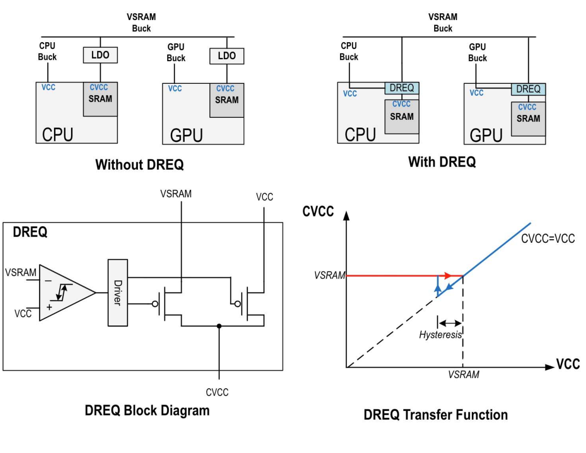
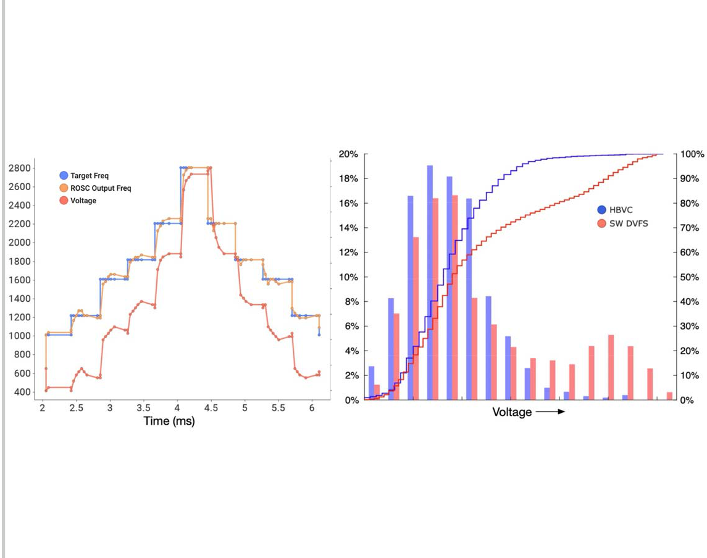
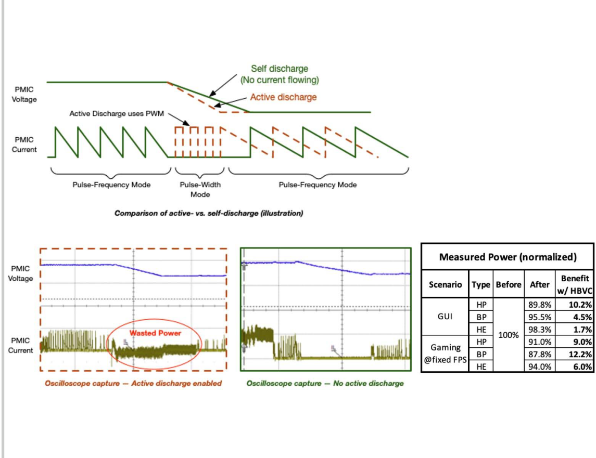

# ISSCC2024：硬件电压闭环如何协调CPU时钟、PMIC和SRAM供电

## 核心信息

- 标题：A 4nm 3.4GHz Tri-Gear Fully Out-of-Order ARMv9.2 CPU Subsystem-Based 5G Mobile SoC
- 标题翻译：采用4nm工艺、3.4GHz三档全乱序ARMv9.2 CPU子系统的5G移动SoC
- 作者：Anshul Varma、Sumanth Gururajarao等
- 机构：MediaTek
- 发表时间：2024年
- 发表渠道：IEEE ISSCC，论文2.1，用户PDF共3页
- DOI：10.1109/ISSCC49657.2024.10454494
- 论文链接：https://doi.org/10.1109/ISSCC49657.2024.10454494
- 论文类型：手机SoC芯片与硬件电源管理方法，含硅片测量

## 原文摘要翻译

用户提供的会议摘要集正文没有单列Abstract。以下忠实翻译开头概述段，不把后文判断补写成作者摘要。

面向下一代旗舰智能手机，本文介绍一种新的三档CPU子系统。已有研究发表过三档CPU子系统，而本工作介绍的三个档次均使用乱序执行CPU。在4nm CMOS工艺中，四个高能效核心配合三个均衡性能核心和一个高性能核心。通过改进前作的DVFS控制机制，实现了完全由硬件承担的DVFS控制。借助面向SRAM供电的自动双轨均衡器，以及面向核心供电的新高带宽电压控制器，消除了供电顺序对软件的依赖。更快的响应和PMIC节能工作模式带来功耗收益。高频访问的一级缓存采用全CMOS单轨存储阵列，减少功耗；降低标准单元中间金属层电阻与电容的版图技术提升了最高时钟频率。芯片照片见图2.1.7，单线程功耗与性能对照见图2.1.1。（PDF第1页开头）

## 创新点

1. **将前作的软件自适应电压调整移入HBVC硬件环。** 它接收目标频率、当前频率和环振编码，计算电压调整量，直接通过专用SPI通知PMIC。它解决的是目标频率已给定后怎样快速、稳定地找到供电电压。（第1页）

2. **双轨均衡器DREQ自动保证SRAM供电。** 比较CPU电压与SRAM最低供电轨，选择较高者并加入迟滞，减少软件排序和专用LDO资源。（图2.1.5）

3. **把PMIC降压方式纳入系统共同优化。** 取消主动放电，让负载自然消耗电荷，减少降压阶段的浪费；这要求时钟和供电控制能配合该响应方式。（图2.1.6）

论文还包含乱序微架构、缓存阵列和标准单元改进。它们共同贡献最终整机收益，因此不能把全文节能数字都归因于上述控制器。

## 一句话总结

软件提出“CPU需要跑多快”，硬件电压环和频率环协同实现该目标，存储电源选择电路与PMIC工作模式负责使这一过程更安全、更省电。

## 研究问题

### 为什么有了OPP表还需要硬件闭环

OPP是合法工作点，即电压与频率的组合。固定表可以给出保守电压，但芯片实际需要的电压受温度、个体差异和当前电路状态影响。给定同一目标频率，保守电压往往留下裕量；软件读取状态、计算并写PMIC也需要时间。本文把自适应调整搬到硬件，希望缩短响应并减少裕量。

另一个约束来自SRAM。CPU逻辑可以继续降压时，存储阵列可能已经接近自己的最低可靠电压。只控制核心电压会遗漏这个条件。第三个约束是降压动作本身会消耗能量：强迫电源快速下降不一定是净能量最优方案。

这里的“三档”指高能效、均衡性能、高性能三种核心配置，**不是只有三个DVFS工作点**。频率需求仍会随负载变化。

## 数据与任务定义

### 被控对象和控制域

平台是实际制造的4nm移动SoC。四个HE核心采用Cortex-A720，2GHz、每核256KB L2；三个BP核心采用Cortex-X4，2.85GHz、每核512KB L2；一个HP核心采用Cortex-X4，3.4GHz、1MB L2。它不是在电脑上运行的CPU指令级模拟器。

本文把共用一个降压转换器的CPU视为一组。共享电源的核心不能任意获得彼此独立的电压。设计数字控制器前，要先确定电源域，再确定频率域；“每核都能设置频率”不意味着“每核都能独立调压”。

### 评价用什么程序

原文给出热门游戏、固定帧率游戏及GUI场景，部分具体程序名称、版本和统计重复次数没有展开。固定FPS比较有助于避免把少完成工作误当作省电，但它不等于所有场景均有相同响应或能量收益。图2.1.1则比较不同代核心，混合了架构、缓存、工艺和电路变化。

## 方法主线

### 先认清五个角色

| 角色 | 输入 | 输出/去向 | 主要职责 |
|---|---|---|---|
| 能量感知调度器EAS | 应用与系统的性能需要 | 目标频率，进入控制系统 | 提出性能要求 |
| 高带宽电压控制器HBVC | 目标频率、当前频率、ROSC编码 | 电压增量，经SPI送PMIC | 调整实现目标所需的电压 |
| 频率锁定环FLL | 当前电压下的振荡器状态、频率要求 | CPU时钟/环振控制状态 | 使频率适应给定供电 |
| PMIC及其降压转换器 | 电压控制信息、负载 | 物理供电电压 | 将控制命令转化为真实电压 |
| 双轨均衡器DREQ | CPU电压VCC、存储电压轨VSRAM | SRAM供电CVCC | 保持存储电源约束 |

ROSC是环形振荡器，其编码影响振荡器工作状态。FLL是频率锁定环；本文没有把它叫作PLL。用户已有PLL如果采用固定参考与动态分频方案，不能直接照搬本文的环振自适应环。

### 机制流程

1. **性能需求进入。** EAS可频繁至每10µs更新CPU频率要求。目标频率是控制器输入，原文没有在这里重新训练一个负载分类器。需求何时变化取决于调度器，不能凭本文编造“利用率超过80%就升档”的阈值。
2. **硬件计算电压改变量。** HBVC结合目标频率、实际频率和ROSC当前编码，求所需电压增量。片上电压表和数字温度传感网络提供状态信息，ROSC编码随电压、温度持续调整以收紧裕量。电压命令通过专用SPI进入PMIC。
3. **真实电源与时钟响应。** PMIC改变供电，FLL在给定电压下维持合适频率，变化后的频率与状态又反馈到硬件环。原文指出进行了闭环稳定性调谐，以抑制过冲、欠冲和振荡。它没有公开完整控制律、全部增益或状态机，不能据此认定采用某组PID参数。
4. **SRAM供电同步满足约束。** DREQ连续比较两条供电轨并自动选择较高者；降压阶段还可关闭PMIC主动放电，利用负载自然放电。这样避免让软件逐次安排所有存储供电动作。

这四步构成反馈过程。不是每运行一个程序都先全范围遍历电压频率，也不是程序开始前选择一次档位后永久不变。离线芯片表征和在线闭环是两个阶段。

### 控制律能知道多少

可以用教学记号表示输入误差：

$$
e_f(k)=f_{\mathrm{target}}(k)-f_{\mathrm{actual}}(k),\qquad
\Delta V(k)=g\bigl(e_f(k),c_{\mathrm{ROSC}}(k),\ldots\bigr).
$$

其中频率用Hz、电压增量用V，环振编码是离散设置；函数$g$代表原文未展开的硬件控制关系。**这只是接口重述，不是论文公布的算法公式。** 当实际频率追不上目标，通常需要更强供电或调整振荡器工作状态，但具体如何限幅、何时更新、如何保证稳定，需要控制器实现和电源模型共同确定。

10µs是需求更新可达到的频度，30µs是文中电压刷新周期；两者不能互换，也都不是PLL锁定时间。如果请求比执行器完成更快，具体实现需要请求合并、排队或覆盖规则，本文没有展开。

### SRAM为什么需要单独处理

*图2.1.5，PDF第2页：DREQ前后的供电路径、比较器与电源开关、带迟滞的转移关系。*

先看上排：旧路径用专用LDO为存储供电，新路径由DREQ选择CPU供电或SRAM供电。再看下排左侧，比较器判断两条轨的高低，驱动电源开关。最后看右侧转移曲线：CPU电压足够高时，CVCC跟随VCC；CPU继续降压时，CVCC保持在SRAM所需轨附近。

论文要求：

$$
CVCC\geq\max(VCC,VSRAM).
$$

三个符号都是物理电压。比较器的小迟滞避免两轨接近时来回切换。它是实际电源路径中的电路，不是FPGA里对两个数字取最大值就能实现的供电功能。数字模型可以验证选择逻辑，真实供电切换还需要相应的电源开关与电路支持。

### 为什么关闭主动放电可能省电

输出电容在高电压时存储的能量较多。降到低电压会释放约$\frac12 C(V_H^2-V_L^2)$的电容能量。主动放电把一部分能量通过放电路径消耗掉；自然放电由负载继续用电使电压下降。该解释是电路基础推导，论文用波形说明其实际效果。

这并不意味着自然放电在所有负载都更快。负载轻时电压下降可能更慢，因此是否允许取消主动放电，需要同时考虑响应时间。用户调用现有PMIC时，应先确认是否暴露该模式及其完成条件。

## 关键结果

### 图2.1.4：响应与裕量的证据

*图2.1.4，PDF第2页：左侧为目标频率、ROSC输出与电压随时间变化，右侧比较硬件与软件DVFS的电压分布。*

左图从目标频率阶梯开始读，再比较实际频率是否跟随，最后看电压随阶梯变化。图中叠放了不同量纲曲线，不能把频率轴刻度直接当作电压读数。它支持“频率追踪能够运行”，不提供每种跳变的统计最坏响应时间。

右图横向向右为电压升高；柱表示分布，阶梯线表示累积分布。HBVC的分布相对软件DVFS偏向低电压。原文报告游戏场景中位电压降低10mV，未影响性能。这里比较的是分布中位数，不能换成“每个时刻都降低10mV”或“10mV就是10%的节能”。

动态功率近似为：

$$
P_{\mathrm{dyn}}=\alpha C_{\mathrm{sw}}V^2f.
$$

$\alpha$是活动因子，$C_{\mathrm{sw}}$为等效开关电容，$f$为时钟频率。在相同频率与活动下，降低电压有平方项收益；整机还包含漏电、存储和供电损耗，所以仅凭10mV无法恢复整机节能率。

### 图2.1.6：执行端的实际能量代价

*图2.1.6，PDF第2页：主动放电与自然放电示意、示波器波形及GUI/固定FPS游戏的分核心功率表。*

从上排读主动放电与自然下降的差别，再对照下排电压和电流。橙色圈标出主动放电配置的一段浪费，绿色配置取消该路径。右表以前配置归一100%，给出包含HBVC的配置结果：

| 场景 | HP核心功率收益 | BP核心功率收益 | HE核心功率收益 |
|---|---:|---:|---:|
| GUI | 10.2% | 4.5% | 1.7% |
| 固定FPS游戏 | 9.0% | 12.2% | 6.0% |

正文给游戏范围5.98%–12.25%，表格按较少小数位呈现。因为表头写明包含HBVC，而正文同时讨论取消主动放电，保守解读为相关配置组合的收益，不能声称已严格分离每个模块的独立贡献。

### 哪些数字不能混用

| 数字 | 对照及意义 | 不支持的结论 |
|---|---|---|
| 中位电压低10mV | 游戏中硬件与软件DVFS电压分布 | 所有负载节能固定比例 |
| 游戏约6%–12.25% | 图2.1.6相关电源控制配置、分核心 | 全系统统一节能12.25% |
| CPU低28%、系统低22% | 与前代对比，包含架构/缓存/电路/系统改进 | HBVC单独降低28%CPU功率 |
| HE最高低67% | 微架构等综合变化、性能相当条件 | 降压控制器单独贡献67% |

这些结果是作者报告的硅片证据；本笔记没有独立运行芯片或复现实验。

## 深度分析

### 完整图表阅读索引

| 图 | 位置 | 怎么读、与控制流程的关系 |
|---|---|---|
| 2.1.1 | 第2页左上 | 性能为横轴、功率为纵轴，比较前后代不同核心。用于理解总体目标，架构因素混杂，不能作为控制器单独消融。 |
| 2.1.2 | 第2页右上 | 对照全CMOS阵列和6T读写路径，再读开关晶体管数量表。说明存储实现会影响低压适配和功耗；不是新的选档算法。 |
| 2.1.3 | 第2页左中 | 逐行比较版图前后，关注金属连接、过孔和单元组合。说明最高频率还受物理实现约束。 |
| 2.1.4 | 第2页右中 | 已就地嵌入。先时间响应，后电压分布，分开“跟随得上”和“裕量更小”两个主张。 |
| 2.1.5 | 第2页左下 | 已就地嵌入。先供电拓扑，后比较器与迟滞曲线，理解SRAM最低供电约束。 |
| 2.1.6 | 第2页右下 | 已就地嵌入。先示意、后测量、最后表格，不把示意图当实测曲线。 |
| 2.1.7 | 第3页 | 芯片照片，确认实现背景；照片本身不能证明控制器稳定性或分模块节能率。 |

原文没有独立编号表，图2.1.2和2.1.6内部包含表格；本笔记没有漏把它们当作不存在。

### 对你的数字DVFS控制器意味着什么

最有价值的划分是：性能策略决定目标，安全映射决定合法工作点，执行器负责真正改变时钟与电压，监测与保护负责发现异常。本文深入的是后三者中的部分路径。你可以采用自己的负载预测算法，但仍需把动作交给合法OPP和执行状态机。

本文的FLL/HBVC依赖定制时钟和传感电路。若你的接口只有PLL配置寄存器、锁定信号、PMIC调压命令和完成反馈，更合适的第一版是离散OPP执行器。升性能时先满足电压条件再切高频，降性能时先降频再降低电压；这是常见的安全执行原则，**不是本文公开的完整内部时序**。PLL的锁定、无毛刺切换、电压确认、SRAM下限和超时回退仍要根据已有IP规格制定。

## 局限

作者以篇幅很短的工业芯片报告展示实现和结果，没有给出可直接生成RTL的完整规范。当前PDF未展开控制系数、滤波、死区、饱和、请求冲突处理、完整OPP表、SPI寄存器含义和所有时序。这限制了“完全复现”，但不妨碍借鉴模块划分并设计可检验的替代实现。

测量场景的游戏名称、输入轨迹、软件版本、重复次数、置信区间和温度条件也未完整展开。不能从一张示波器波形推得全工况最坏情况保证。最终28%/22%收益混入多种改进，缺少把HBVC、DREQ和放电模式逐项分离的完整消融。

## 我的笔记

### 三句话导读与英文摘要改写

先理解EAS提出目标频率，再理解HBVC为什么需要实际频率和环振状态。随后看DREQ，它解释了CPU逻辑降压时为什么存储器可能还不能降。最后看电流波形和功率表，把“目标合理”与“执行省电”连接起来。

**English abstract paraphrase, not the original abstract:** This measured 4nm mobile SoC moves adaptive voltage control into hardware. A high-bandwidth voltage controller coordinates PMIC updates with a ring-oscillator-based frequency loop, while automatic rail selection protects SRAM supply requirements. The reported voltage and power benefits depend on the evaluated workloads and combined chip-level improvements.

### 最小复现：先验证流程，再增加硬件

以下是面向你课题的实验设计，不是本文已经公开或本次已经完成的复现。

| 实验 | 输入、实现与资源 | 输出、验收与失败条件 |
|---|---|---|
| 1，优先：模型级闭环 | CPU程序工作量/阶段日志、已表征或明确假设的OPP表、带延迟的电压与时钟模型；比较固定OPP与控制策略 | 任务时延、越界次数、切换开销、估计能量；所有参数注明来源；测试突发请求和执行器慢于请求的情况。未经校准的能量只报告估计。 |
| 2，优先：数字执行器 | RTL状态机或软件状态机接PMIC/PLL行为模型，注入锁定超时、电压反馈延迟、连续目标变更 | 输出请求/确认轨迹；检查非法高频低压组合、SRAM约束、死锁及回退。FPGA可验证接口与时序逻辑，不自动证明真实调压。 |
| 3，后续：物理平台 | 具有可调核心电源轨、受支持PLL动态配置、供电反馈与测量点的平台；固定程序输入与环境条件 | 实测任务正确性、时延、输入端总能量和控制开销；按同样完成工作比较，温度受控并重复。平台没有可调电源轨时仅验证DFS。 |

记录一次请求的完整轨迹：请求时间、目标OPP、当前状态、发电压命令时间、电压确认、切频/锁定确认、任务完成、异常原因。能量按$E=\int P(t)dt$积分，不能仅比较平均功率。若增加控制器后任务拖得更久，必须比较完成同样任务的净能量。

CPU/E902验证可选CPU上的分块压缩或可控计算/访存程序。它们只是负载候选，不要求E902运行本文的手机游戏。尚未测量你的PLL、PMIC与CPU时序，不能给出预期节能百分比。

### 引用脉络与后续问题

本文明确引用2022年5nm三档ARMv9子系统作为DVFS前作，以及2017年10nm优化供电网络的CPU工作。2021传感器辅助CPU论文可与本文做主题对照，但本PDF未将它列作直接前作，因此关系图应使用不同边。

复现前最需要确认的是：现有PLL是否有动态配置与锁定反馈，PMIC何时能够确认电压稳定，CPU/SRAM是否共享供电下限，以及控制周期能否容纳最坏切换开销。

## 引用

1. Varma et al. 本文，ISSCC2024，DOI：[10.1109/ISSCC49657.2024.10454494](https://doi.org/10.1109/ISSCC49657.2024.10454494)。证据以用户3页PDF为准，第1页正文、第2页图2.1.1–2.1.6、第3页图2.1.7。
2. Nayak et al. A 5nm 3.4GHz Tri-Gear ARMv9 CPU Subsystem in a Fully Integrated 5G Flagship Mobile SoC，ISSCC2022，本文参考文献[3]，[DOI](https://doi.org/10.1109/ISSCC42614.2022.9731604)。本次仅核对引用与身份，未在此笔记中宣称完成该前作精读。
3. Mair等，2017年10nm三档十核CPU与优化供电网络工作，本文参考文献[4]。仅作已证实引用关系，不在此替代原文分析。英文题名见用户PDF第1页参考文献。
