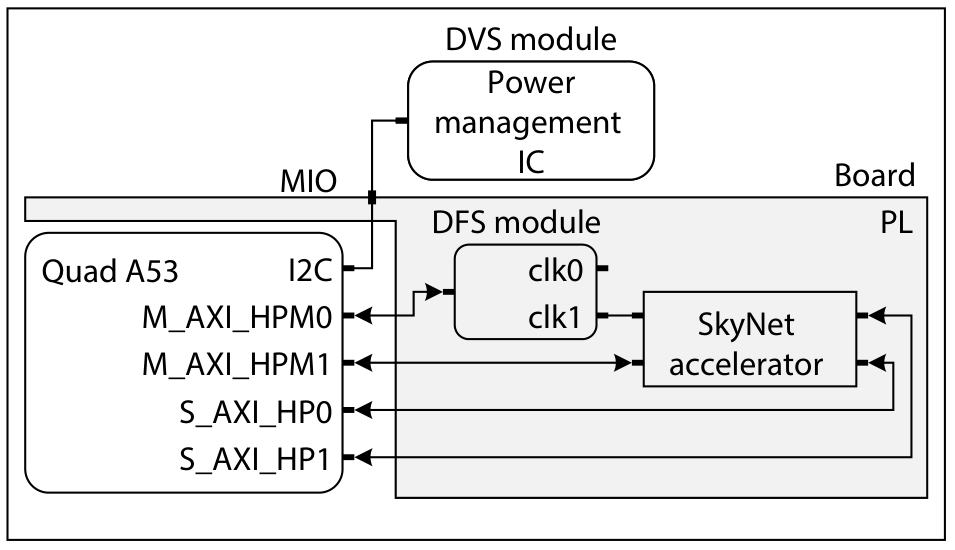
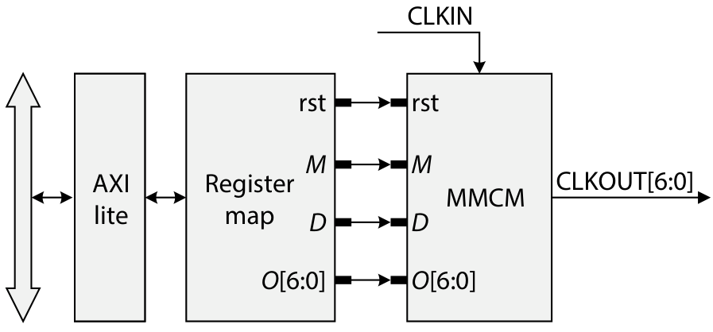
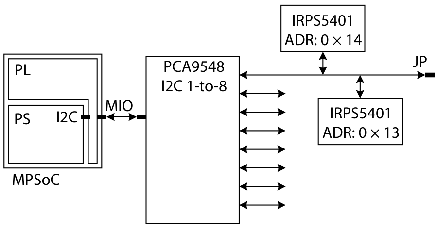
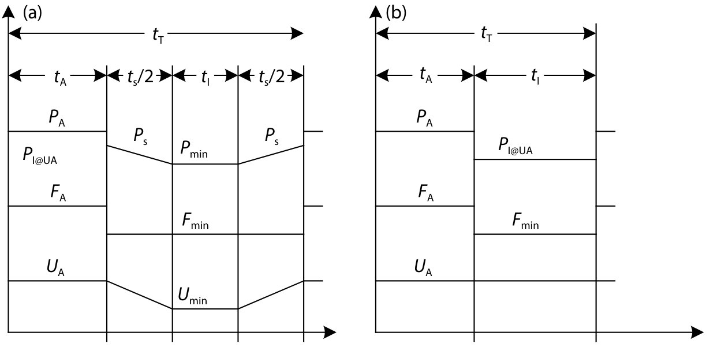
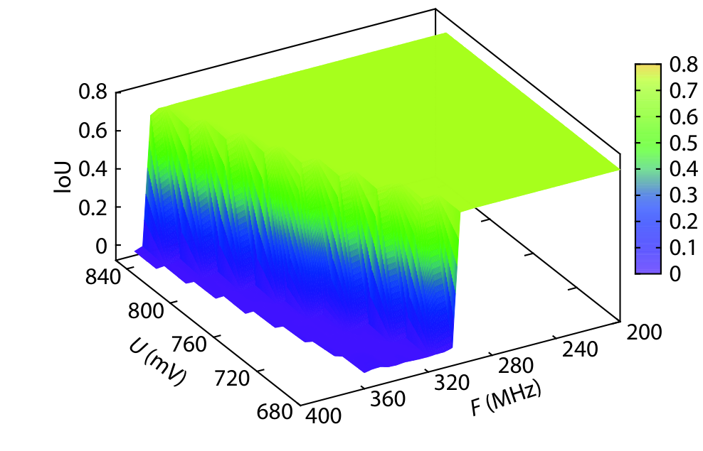
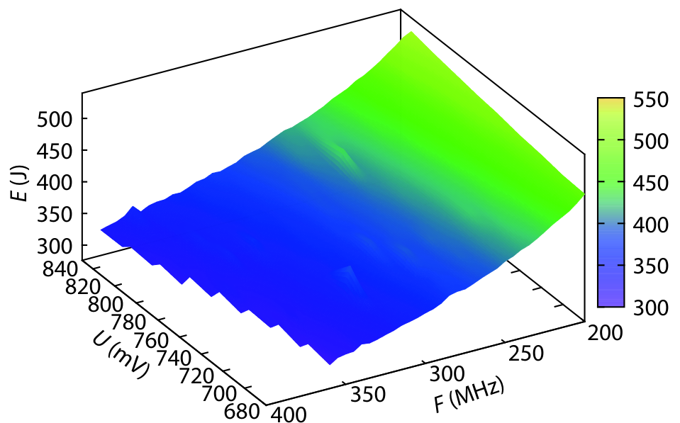
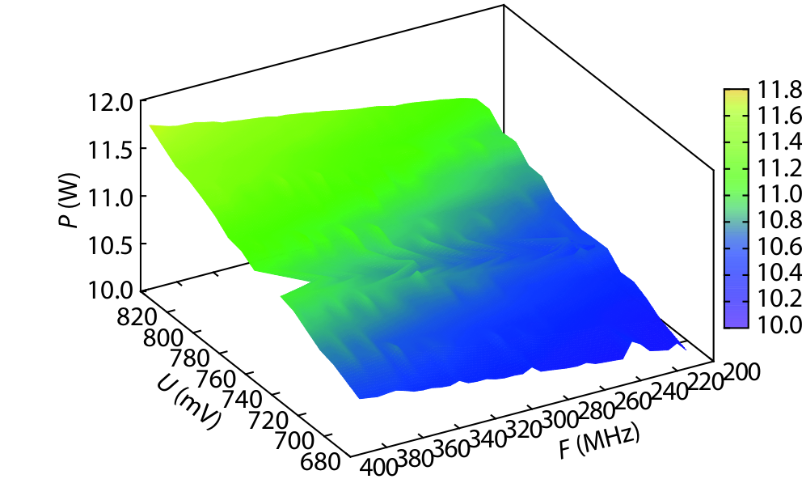
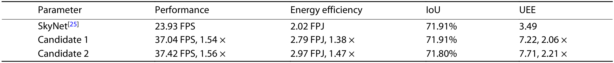

# Jiang2020：从离线扫档、每帧触发，到MMCM与PMIC实际执行的完整DVFS流程

[从零入门](start.md) · [原图表索引](figures.md) · [双语摘要与导读](abstract.md)

## 核心信息

- 标题：Optimizing energy efficiency of CNN-based object detection with dynamic voltage and frequency scaling
- 标题翻译：利用动态电压频率调节优化CNN目标检测的能效
- 作者：Weixiong Jiang、Heng Yu、Jiale Zhang、Jiaxuan Wu、Shaobo Luo、Yajun Ha
- 机构：上海科技大学、中国科学院上海微系统与信息技术研究所、中国科学院大学、宁波诺丁汉大学、Université Paris-Est
- 发表时间：2020年
- 发表渠道：Journal of Semiconductors，41(2)，022406
- DOI：10.1088/1674-4926/41/2/022406
- 论文链接：https://doi.org/10.1088/1674-4926/41/2/022406
- 论文类型：真实FPGA的DVFS执行框架、工作点表征与周期任务策略

## 原文摘要翻译

一方面，在边缘计算中使用FPGA加速卷积神经网络，对高能效的要求不断提高；另一方面，与普通数字算法不同，CNN在存在有限时序错误时仍具有较强鲁棒性。作者利用这一特征，提出通过动态电压频率调节进一步优化CNN能效。首先，在FPGA上开发DVFS框架；其次，将其应用于面向目标检测的先进神经网络SkyNet；然后分析DVFS对性能、功率、能效和准确性的影响。实验结果表明，与已有先进方案相比，在不损失准确性的条件下能效提高38%；若允许准确性放宽0.11%，能效可提高47%。（用户PDF第2页摘要；“0.11%”沿原文表述，具体表值的百分点含义见结果分析）

## 创新点

1. **打通已有时钟和供电资源的软件控制路径。** 利用MMCM、可配置板级PMIC和Linux驱动，使应用实验能够控制真实V/f，而非只用能量模型。
2. **将DVFS框架与HLS/SDSoC设计流连接。** 控制平台预先建立，后续加速器可通过高层代码集成到系统，降低重复搭建接口的成本。
3. **区分两类实际任务目标。** 单次触发任务关注每帧能量；固定帧率任务关注一个完整周期的平均功率，包含活动、空闲和切换成本。
4. **联合测量性能、能量和质量。** 既给保持质量的候选，也探索CNN容忍少量错误的取舍。但后一条不应直接迁移到通用CPU程序。

贡献是系统整合、测量和策略组织，原文没有训练神经网络或强化学习来做DVFS决策。“首次”是作者在其相关工作范围内的定位，本笔记不把它扩成所有平台上的绝对首创。

## 一句话总结

先用真实程序遍历V/f建立表，再根据帧周期选择活动工作点；运行时在任务完成后进入低频空闲，有足够时间才降压，并在下一帧前恢复，而不是每次运行都重新遍历所有档位。

## 研究问题

### 先回答你一直追问的“什么时候调、凭什么调”

**English paraphrase (not the original abstract):** The paper integrates software-accessible FPGA clock and power controls with the SkyNet detector, characterizes voltage–frequency operating points, and evaluates both per-frame efficiency and fixed-rate operation. The runtime policy alternates between an offline-selected active point and an idle state, applying voltage scaling only when sufficient slack exists. Results require careful separation of PL power, system energy, quality tolerance, and cross-platform baselines.

这里有两件不同的工作：**离线选择活动工作点**，以及**在线按每帧状态切换**。前者可在运行前完成；后者在程序实际运行过程中反复发生。因此“活动档预先确定”与“运行时有动态调节”完全可以同时成立。

论文的负载是目标检测加速器。它由真实电路在真实FPGA上处理图像，不是虚拟程序速度的动画；控制代码在PS的A53/Linux运行。你若改成CPU程序，真实程序同样可受真实CPU工作点影响，但需要平台允许控制对应时钟和电源。

### 两种应用目标为什么选出的档位不同

|应用情形|目标|关键约束|为什么不能只找最低功率|
|---|---|---|---|
|有事件才处理一帧|尽量少用能量完成这帧|结果质量与任务完成|频率太低会让PS和其他模块持续耗能更久|
|相机固定产生帧|最小化整个帧周期平均功率|必须在下一帧前完成及恢复|需要同时计算活动、空闲和调档成本|

降低瞬时功率不一定降低任务总能量；最快完成也不一定最低平均功率。要把目标写清楚，才能判断一个工作点是好还是坏。

### 最少术语

|层次|术语|直观和严格含义|
|---|---|---|
|A|PS/PL|PS是片上处理器系统，运行控制软件；PL是可编程逻辑，本篇负载在PL|
|A|频率、电压、OPP|频率影响单位时间可推进的时钟周期；电压影响功耗和延迟；OPP是被允许的电压频率组合|
|A|功率W、能量J|W表示耗能速率，J表示累计消耗；相同功率下运行更久，能量更高|
|B|MMCM|FPGA专用时钟管理资源，配置后产生工作时钟；不是普通RTL实现的模拟PLL|
|B|PMIC/PMBus|前者实际转换与调节供电，后者是控制/监测协议，经I²C兼容链路访问|
|B|FPS/FPJ|每秒处理帧数/每焦耳处理帧数，分别表示速度和能效|
|C|空闲余量|帧周期减去活动与切换后剩余的时间，决定是否有足够时间降压及恢复|
|C|质量边界|当前数据集的IoU何时变化；不等于所有输入、所有电路内部状态均无错误|

阅读顺序：图1确定控制与负载位置，图3/6了解执行器，图8跟一帧走完，最后读能量/质量曲面和表2。

## 数据与任务定义

### 版本、页码与平台先核准

用户PDF共11页，第1页是下载封面，正文在第2–11页。与此前保存的公开10页版逐页去空白比对，十页正文全部一致，映射为“用户页=旧版页+1”。本笔记统一用用户PDF页码，不把封面当作新研究内容。

**本篇实例平台是ZCU104。** 文中介绍原始SkyNet曾在Ultra96运行，不能把那个前作平台写成本篇全部实验平台。对比表使用前作结果，本篇将设计迁移到ZCU104；因此表2不是同板上仅开关DVFS的严格消融。（第3页、§4、§6.1与§6.8）

*原图1，用户第4页：Quad-A53、板级PMIC、PL内DFS与SkyNet及其AXI连接。*

控制软件由1.2GHz四核A53运行，系统为Xilinx修改的Ubuntu18.04；SkyNet使用HLS C++，SDSoC 2019.1综合。PS负责载入图像、设置目标频率和加速器参数。不是在SkyNet内部重新设计一个CPU来做控制。

### 范围、数据集与测点

|项目|框架能力或实验设置|应如何使用|
|---|---|---|
|DFS框架|20–400MHz，1MHz步进，约3µs每次|能力声明，不等于每个频点都对当前负载正确|
|DVS框架|650–850mV，10mV步进，约2ms每次|板级执行能力，非任意FPGA的安全供电范围|
|实际扫描|680–840mV，每20mV；200–400MHz，每1MHz|概念网格9×201=1809点；不能推断所有点均运行成功|
|程序与输入|SkyNet，DAC-SDC2019样本1000图及标注|同输入比较时间、能量和平均IoU|
|§6.3功率|重点为PL的VCCINT轨，排除PS|不能当作整机功率|
|§6.4任务能量|考虑PS持续工作等系统开销|不可用PL功率直接乘时间代替此范围|
|实时情形|设定相机24FPS|周期1/24s≈41.67ms是派生值，不是另测得的任务时间|

原文未充分报告温度控制、每点重复次数和置信区间，1000图是工作输入数量，不等于1000次独立板卡样本。全文没有完成本笔记意义下的独立复现。

## 方法主线

### 机制流程

1. **离线表征。** 输入程序、固定图像和候选V/f，更新硬件状态并测总时间、功率/能量和IoU，将有效点及失效状态存入表征表。
2. **确定活动点。** 输入目标（每帧能量或周期平均功率）、性能/质量约束和表征表，提取可行候选，输出活动电压U_A和频率F_A。
3. **按帧更新状态。** 输入帧到达和任务完成事件，在活动点运行；完成后降到低频，若余量足够再降压，将状态交给空闲等待与恢复流程。
4. **恢复并反馈。** 下一帧前恢复活动状态，再运行任务；记录周期功率及完成/质量。论文给出策略时序，但完整的执行确认、锁定和故障回退仍需工程补充。

### 1．调频具体怎样发生

*原图3，用户第5页：Linux可访问的AXI4-Lite寄存器连接MMCM的M、D、O及复位。*

PS经内存映射访问DFS模块寄存器，写入与目标频率对应的参数。MMCM把输入时钟变换成输出时钟，再驱动SkyNet及相关AXI接口时钟域。实际输入为PS FCLK的100MHz；通用示意图2所画33MHz是另一种示意，不能混成本文实际输入。

$$
f_{\mathrm{out}}=f_{\mathrm{in}}\frac{M}{D\,O}.
$$

M、D、O无量纲，f输入输出单位相同。正文给D=O=5，M取目标频率数值除4，使100MHz×M/25得到目标MHz，并以0.25的M步进解释1MHz分辨率。**这是本文描述的配置办法，不是所有器件均允许任意这些分数参数的保证。** 实际移植还要核对MMCM原语、VCO范围和合法重配置。

论文报告约3µs调频。其图4虽然标题是DFS驱动，内容却包含i2c-dev、set_voltage及调压命令，与图7重复。这是原文材料问题：**不能照抄图4就得到正确调频代码。** 正确驱动仍需要依据寄存器映射和时钟IP规范实现。

### 2．调压具体在哪里，不是给程序“输入一个电压”

*原图6，用户第5页：PS I²C经MIO和PCA9548到两颗IRPS5401；板级路由决定哪个器件和通道控制哪条轨。*

IRPS5401才是产生电压的器件。软件在I²C总线上经PMBus发送请求，外部稳压器调整输出；电源轨再给PL逻辑供电。软件接口负责表达目标和读取状态，物理转换由硬件完成。

本文选PS/MIO路径以复用Linux I²C驱动，也讨论PL实现AXI I²C控制器的替代路径。两者改变控制通信的实现位置，不能让PMIC模拟功率级变成普通可综合RTL。

板上两颗PMIC经PCA9548总线开关连接，软件必须选对路径和供电输出。原文提到电压/电流监测，但完整读回确认、等待稳定、超时、限值配置的可执行规范没有全部给齐。图7也是示意伪代码，不应直接当作任意板卡可执行脚本。§4.2把不同电源相关器件并列描述，器件是否实际支持调压必须以具体数据手册为准。

**控制粒度是供电域，不是任意软件函数或单个PE。** 原文说明PL切片共享供电，所以此平台DVS较粗粒度。不能因为时钟可分成多个域，就自动获得多条独立电压域。

### 3．离线遍历到底在干什么

对每一个候选V/f，用相同图像运行SkyNet，记录能否完成、处理时间、功率/总能量以及平均IoU。把无法运行、违反性能要求或质量退化超过允许值的点排除，再按目标排序。

它是“先测响应表，再选点”，并非在线每帧从1809个组合里重跑1000图。文章没有给出训练集/测试集划分、状态神经网络、奖励函数或强化学习更新。若你需要智能算法，应在这套可解释基线上增加预测或自适应模块，并独立验证新增收益。

对于CPU任务，表至少存工作量/输入类别、OPP、实际频率、电压、时延、能量、正确性和温度。运行前确定活动点可以是最小版本；不同阶段再选择不同点则是扩展，不要把自己的扩展误记成本文原方法。

### 4．图8逐段走一帧：动态切换发生在任务边界

*原图8，用户第6页：(a)余量足够时降频也降压；(b)余量不足时只降频，活动电压保持。*

左图从左往右依次是活动t_A、降档过渡、低压低频空闲t_I、恢复过渡。电压不是瞬间跳变，功率也随切换而变；两端各t_S/2表示总切换预算的拆分。右图空隙较短，只把频率降到F_min，U_A不变，空闲功率保持在活动电压下的水平。

$$
t_T=t_A+t_S+t_I,\qquad E_T=t_A P_A+t_S P_S+t_I P_I,\qquad P_M=E_T/t_T.
$$

时间t以秒计，功率P以W计，能量E以J计。若将ms代入，能量会得到mJ，必须统一单位。下标含义如下：

|下标|含义|
|---|---|
|A|活动|
|S|总切换|
|I|空闲|
|T|完整周期|
|M|平均|

P_S是切换段平均功率，本文用两端空闲功率的平均来近似，因此公式不是任意非线性电源转换过程的精确积分。（§4.3公式2–4）

为何不是始终“尽量慢慢算”：活动更久可能增加系统基础耗能；为何不是始终“最高频算完立刻闲”：高频可能要更高活动电压，且空闲深降压要花时间和能量。作者用测量数据比较完整周期P_M，避免仅凭直觉判断。

### 5．触发条件、输入输出完整对应

|时刻|可观察输入|判定/触发|输出和执行|
|---|---|---|---|
|配置实验/初始化|目标帧率、质量要求、表征数据|确定活动点和最低空闲状态|活动U_A/F_A及空闲状态配置|
|帧到达/硬件调用|一帧图像与当前状态|按活动点启动加速器|软件启动命令，负载开始运行|
|任务完成|硬件完成状态、距下帧时间|进入空闲，余量足够才做DVS|先进入低频；有时间再降压|
|下帧前|周期时刻及恢复预算|恢复活动状态|调压/调频请求，随后允许下一任务|

§5.1明确电压和频率只在硬件调用迭代间隙修改。触发并不一定要写成“利用率>80%”这样的阈值；**完成事件和下一个任务时刻本身就是触发条件。** 文章没有完整在线可变任务预测器，也没有给出所有定时器/中断源码。

一个直观算例：24FPS周期41.67ms，若假设活动30ms、降压恢复合计4ms，则还有7.67ms可低压空闲；若活动40ms，则没有4ms切换预算，不能仍安排同样DVS。这里30/40/4ms都是教学假设，不是论文测量值；原文“每次约2ms”是否对应你的具体单程命令，必须实测。

### 6．从可行到划算，还应检查调档盈亏

只剩足够时间还不够，也要确认节省的空闲能量大于调档开销。可先按已测切换能量比较两种完整周期：保留活动电压仅降频，与降频降压再恢复。选后者的条件是其总能量更低且都能准时完成。

这是把论文公式用于你的控制器的工程补充。它不等于论文已实现了一个精确测量切换能量的在线判断器。升档建立电压裕量后再提高频率、降档先降低频率再降压，也需要按现有IP约束实现并确认完成，不能把图8当作完整无毛刺与异常恢复协议。

## 关键结果

### 能运行、质量不变、最省能，是三个不同条件

§6.3举680mV下360MHz仍未出现所称系统不稳定，但该段明确尚不检查结果正确性；§6.5则称680mV附近质量在285MHz后开始出现变化。两者不矛盾：能跑与质量不变不是同一边界。

*原图13，用户第8页：电压/频率/平均IoU曲面；质量陡降边界随电压改变。*

读图先看IoU约0.72的平台，再看频率增大后的波动和陡降。高电压提高可达频率范围，但不是任何高频都保持原质量。840mV正文讨论约371MHz质量阈值、之后若干波动和下降区间；表2又采用370MHz候选，不能把370/371/379/38.3FPS都混成一个测量点。

### 总能量曲面解释“较快反而省能”

*原图11，用户第8页：1000图任务总能量J，含PS场景开销，不能与图10的PL单轨功率直接混比。*

正文给200MHz/840mV为518.8J，371MHz/840mV为354.1J，约下降31.7%，作者约写32%。在这组点间提高频率缩短任务，使系统持续功耗累计减少。这不意味着所有V/f区域或所有程序都应最高频运行，也不能把32%当作相对原SkyNet基线的38%能效结果。

图10最低PL功率1.42W在200MHz/680mV；它与总任务能量最小点不同。测量范围、目标和质量约束必须同时标出。

### 固定24FPS：正文支持约15%的平均功率下降

*原图16，用户第9页：采用周期策略后的平均功率随活动点变化；完整周期含活动和空闲，不只是PL瞬时计算功率。*

§6.7报告最佳10.90W，活动点680mV/285MHz，原始12.86W，按数字计算下降15.24%，作者约写15%。引言贡献列表写30%，当前正文没有给出足以把两者统一为同一比较的说明，故本笔记不采用30%为已核实主结论。

图15另给空闲低状态约9.81W（20MHz/680mV）。这说明系统基底功耗较高，只看加速器动态功耗会错估实际周期收益；但没有全轨明细时也不能自行把9.81W全部归因某个CPU模块。

### 表2：38%能效提高应怎样换算

*原表2，用户第10页：前作SkyNet与两个候选的FPS、FPJ、IoU和UEE。*

|方案|论文活动点|FPS|FPJ|IoU|正确读法|
|---|---|---:|---:|---:|---|
|原始SkyNet|表中作为前作基线|23.93|2.02|71.91%|原平台Ultra96，存在平台差异|
|候选1|840mV/370MHz|37.04|2.79|71.91%|FPJ约1.38倍，质量均值相同|
|候选2|840mV/379MHz|37.42|2.97|71.80%|FPJ约1.47倍，IoU少0.11个百分点|

每帧能量是1/FPJ。候选1从约0.495J/帧到0.358J/帧，相同帧数能量下降约27.6%，**不是下降38%**；候选2约0.337J/帧，对应约32.0%下降。以上由表值复算，非新的硬件测量。对比包含平台与移植因素，不能把全部收益当作同板单项DVFS净贡献。

### UEE复算审查：不要用综合分数掩盖原始指标

$$
\mathrm{UEE}=\frac{\mathrm{FPS}\times\overline{\mathrm{IoU}}}{E}.
$$

原文式6分母写Total energy，IoU是比例，量纲为frame/(s·J)。若把固定1000帧改成2000帧，FPS与质量保持而总能量翻倍，这个分数会减半，所以跨样本数比较不稳定。

更具体地，利用表2的FPJ可反推每帧能量。如果E取每帧能量，三行UEE约34.760、74.313、79.797；若E取1000帧总能量，约0.03476、0.07431、0.07980。**两种都不能重建原表3.49、7.22、7.71。** 这些复算已实际执行。不能猜测为一个已解释的固定倍率错误，也不能照抄综合分数就宣称完全复现。

对你的项目，优先分别报告正确性、任务时延、违约率、任务能量和控制/切换开销。需要综合指标时要先固定定义和归一化，再留原始列供检查。

## 深度分析

### 全部16图2表阅读索引

主文内嵌8项；下面页码均为用户11页版，文章印刷页码比它少1。

|项目/用户页|目的、阅读方法与边界|
|---|---|
|图1／4，已嵌|PS、PL、供电与时钟分工；不是CPU内部策略全部结构|
|图2／5|通用MMCM内部示意；33MHz不要代替实际100MHz输入|
|图3／5，已嵌|AXI配置参数和复位；完整锁定/无毛刺协议仍需IP规范|
|图4／5|标题DFS，内容重复调压伪代码；材料问题，不能作为正确DFS源码|
|图5／5|板级PMIC供电示意；不能解释为每PE独立电源域|
|图6／5，已嵌|MIO、总线开关和两PMIC；移植先核对实际板级路由|
|图7／5|调压伪代码；只是示意，具体限值与命令参数应按平台实现|
|图8／6，已嵌|活动、切换、空闲与短空隙只DFS；事件触发与时间预算是核心|
|图9／7|横轴MHz、纵轴FPS；图注写总时间但图轴实际为吞吐，按轴读|
|图10／7|PL/VCCINT功率W；低功率不等于全任务低能量，也未在本段判全部正确|
|图11／8，已嵌|任务总能量J；含PS场景分析，与图10范围分开|
|图12／8|840mV下IoU随频率变化；小幅波动不证明所有内部结果无错|
|图13／8，已嵌|质量曲面；正确性边界随电压变化，不是挂死曲线|
|图14／9|UEE曲面；定义/表值不能重建，保留原图但不作为唯一选择依据|
|图15／9|空闲功率；观察V/f和系统基础开销，不能等同真正power gating|
|图16／9，已嵌|周期平均功率；实际数字支持约15%，与引言30%分开|
|表1／7|资源开销；DFS模块1164 LUT、1492 FF，PMIC不是LUT合成出来的模拟模块|
|表2／10，已嵌|性能/FPJ/IoU/UEE；基线平台、能效换算和UEE审查必须同时保留|

### 核心证据矩阵与可信度

|主张|直接证据|可相信到哪一步|不能替它证明什么|
|---|---|---|---|
|软件驱动真实DVFS|图1/3/6及§4/5|ZCU104实例具备实际时钟/供电控制|任意FPGA板都支持、完整驱动均正确公开|
|运行时按周期省空闲能量|图8与公式2–4、§6.7|固定帧率设定下有可执行策略思路和平均功率结果|有通用在线学习器、所有变负载都准时|
|最低功率不等于最低能量|图10/11范围与总时间|所测任务有PS等持续开销，需看完整能量|所有程序最高频最省能|
|CNN能容忍部分异常|IoU扫描及表2|当前数据质量均值存在取舍空间|通用CPU可容忍错误、PVT签核已完成|

对初学者的证据价值较高：路径、模型和实验串得完整。对精确复现驱动与所有综合分数的证据尚不足；这两种评价不冲突。本文不是IC顶会论文，但适合作为流程入门，再用ISSCC/DAC/TCAD补快环、裕量和复杂策略。

## 局限

### 原文中可核对的复现问题

图4/7重复；引言30%与正文约15%；370/371MHz阈值与候选选择略有差异；UEE公式与表值无法由现有列直接重建。图9图注说总时间而坐标是FPS。笔记保留这些差异，不合成一个更漂亮但没有来源的版本。

完整源码、寄存器地址、合法MMCM配置、调压稳定/锁定反馈和异常恢复没有全部展开。软件切换时延与物理稳定时间也需要示波器/状态信号重新测量；图8的示意曲线不足以证明安全切换顺序已全部实现。

### 实验和外推限制

1000图质量均值保持不等于芯片所有运算位完全正确。平台迁移与DVFS作用没有充分消融；温度、重复和不确定区间不足。FPS/FPJ能效的比例与总能量下降不同，PL功率和系统总能量也不同。

对CPU/E902，必须坚持通用程序的正确性和合法时序。不能沿用“检测精度没怎么变，所以允许电路算错”的假设。共享PL电压轨也限制独立域实验，控制器运行域和被控域必须明确。

## 我的笔记

### 最小复现：按顺序建立四份证据

1. **平台证据。** 核对板卡供电和时钟资料，确认可编程PMIC、目标轨、共享域、控制权限及MMCM动态配置。用额定合法状态验证读回和故障状态，不照抄本文mV范围。
2. **测量证据。** 固定SkyNet或可校验CPU程序、输入和工具版本；记录请求/实际OPP、时延、输出校验、各测点功率/能量及温度。对所有异常点明确分类，不补成正常数据。
3. **算法证据。** 在已确认合法表内先选最小任务能量，再构造固定周期的活动/空闲查表策略；计入调压、切频与恢复实测成本。保留最高固定、最优固定、仅DFS、DVFS策略四种基线。
4. **执行证据。** 将同一OPP接口接RTL/FSM，验证顺序、握手、时钟/电源稳定、超时与复位；再接真实器件测波形。模型节能与硬件测量分列，不能用前者替代后者。

正式记录一帧至少要有：frame_id、输入哈希、deadline、选定活动OPP、完成时间、切换请求/确认时刻、空闲状态、恢复时刻、输出校验、能量窗口和失败原因。以此才能判断策略只是算出一个档，还是实际准时安全地执行了。

### 三个CPU/E902后续实验

|优先级/实验|资源和价值|风险与成功标准|
|---|---|---|
|P0：离线扫档与正确性表|小型压缩/数组/整数程序、合法OPP、计时与能量来源|若无真轨只能标模型；成功为重复可检、零输出错误、能解释频率敏感度|
|P1：周期查表与余量判定|固定/变化周期任务、切换延迟能量表|余量被高估会违约；成功为预设违约率内净能量改善，包含策略计算与转换成本|
|P2：策略+执行器co-design|稳定控制域、PLL/PMIC模型与实际IP接口|CPU停钟后无法自恢复；成功为正确分域、非法请求拒绝、超时回退和波形对应|

初期软控软可以采用软件策略+真实CPU平台现有执行接口，也可以是软件策略+明确的V/f响应模型。前者的任务与硬件工作点是真实的，后者只验证算法假设；两者都可先做，后者的能量必须标为估计。软控硬阶段才把策略请求接自研数字执行逻辑及现有PLL/PMIC，不能凭一个仿真截图声称物理轨已调压。

本轮完成原文与图表核对、版本映射和指标复算，没有在ZCU104或E902重做作者实验。下一步最需要补的是正确DFS驱动、切换稳定时序、UEE定义和同板基线消融，而不是换更复杂的智能算法。

## 引用

1. Weixiong Jiang et al. Optimizing energy efficiency of CNN-based object detection with dynamic voltage and frequency scaling. Journal of Semiconductors 41(2), 022406, 2020. [DOI与原文入口](https://doi.org/10.1088/1674-4926/41/2/022406)。
2. 证据位置：§4用户第4–6页；§5第6–7页；§6第7–10页；表2第10页。十页正文与旧公开版逐页文字一致，阅读页码按用户版加一。
3. 原文参考文献[2]：Paolo Mantovani et al. An FPGA-Based Infrastructure for Fine-Grained DVFS Analysis in High-Performance Embedded Systems. DAC2016. [DOI](https://doi.org/10.1145/2897937.2897984)。记录真实引用边，不表示本轮已完整精读该前序。
4. 后续Terminator2022参考文献[8]实际引用本篇：[DAC2022](https://doi.org/10.1145/3489517.3530516)。此关系已由其用户PDF第6页核对。
